The default `cleanplots` colors are nominal: they are designed to
distinguish graph elements without implying any order. When the data is
ordinal -- e.g. survey responses from strongly disagree to strongly agree,
levels of education, self-rated health from poor to excellent -- the ordinal `cleanplots#` schemes use colors that
run from light to dark, so the order of the colors follows the order of the
categories.

The same bar chart with the nominal palette and with `cleanplots5`, which
matches the five ordered repair-record categories of Stata's `auto` data:

```{.stata-run}
. sysuse auto, clear
(1978 automobile data)

. graph bar price, over(rep78) asyvars scheme(cleanplots) ///
>     title("Nominal colors: cleanplots")

. graph bar price, over(rep78) asyvars scheme(cleanplots5) ///
>     title("Ordinal colors: cleanplots5")

```

::: {layout-ncol=2}
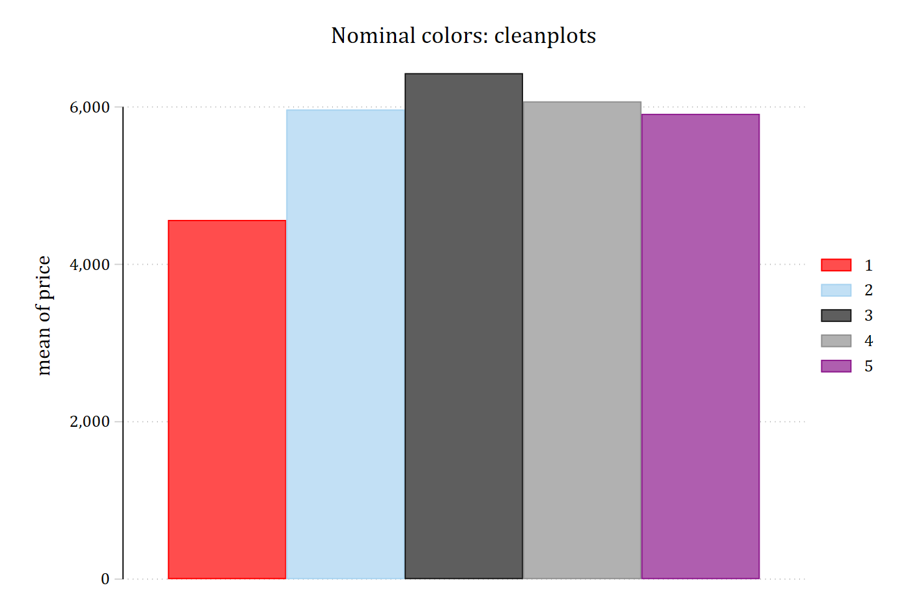{fig-alt="Bar chart of mean price by repair record with the nominal cleanplots colors, one distinct color per bar."}

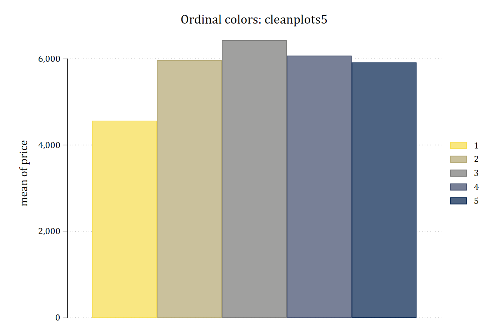{fig-alt="The same bar chart with the cleanplots5 scheme: bars run from light yellow to dark navy in the order of the repair-record categories."}
:::

## Choosing a scheme

There are four versions, each available for every number of categories from
2 to 15:

| Scheme | Palette | Colors run from |
|---|---|---|
| `cleanplots#` | Cividis | light yellow to dark navy |
| `cleanplots#r` | Cividis, reversed | dark navy to light yellow |
| `cleanplots#v` | Viridis | light yellow through green and blue to dark purple |
| `cleanplots#vr` | Viridis, reversed | dark purple to light yellow |

Replace `#` with the number of ordered categories in your graph. The number
is a count of categories, not a version number or a color intensity:
`cleanplots5` is for five ordered groups, and `cleanplots7vr` is for seven
ordered groups in reversed viridis colors. Apply a scheme to a graph with
the `scheme()` option, as in the bar chart above.

Which version to use:

- **Cividis** (`cleanplots#`) is the recommended default. It is a variant of
  viridis designed so that readers with red-green color blindness see
  essentially the same colors as everyone else.
- **Viridis** (`cleanplots#v`) moves through more hues -- yellow, green,
  blue, and purple -- so neighboring categories are easier to tell apart in
  color.
- **Reversed** (`cleanplots#r` and `cleanplots#vr`) puts the darkest color
  first. Use it when you want the first category to be the darkest.
- **Match the number to your categories.** If a graph has more series than
  the scheme has colors, the colors start over from the first color, while
  the line patterns and marker symbols keep changing.

The ordinal schemes inherit all layout, sizing, and legend settings from the
main `cleanplots` scheme, and each series still gets its own line pattern
and marker symbol. Bars and areas use softer versions of the colors, as in
the main scheme.

## The colors

Each scheme runs from the light end of its palette to the dark end, so the
more categories a scheme has, the smaller the steps between neighboring
colors. The colors of the ordinal schemes for 3, 4, 5, 6, 7, 9, and 15
categories are also available by the scheme's name in the
[`colorpalette`](https://repec.sowi.unibe.ch/stata/palettes/colors.html)
command. The cividis and viridis schemes for 3, 5, 9, and 15 categories:

```{.stata-run}
. colorpalette, span : cleanplots3 / cleanplots5 / cleanplots9 / cleanplots15

. colorpalette, span : cleanplots3v / cleanplots5v / cleanplots9v / cleanplots15v

```

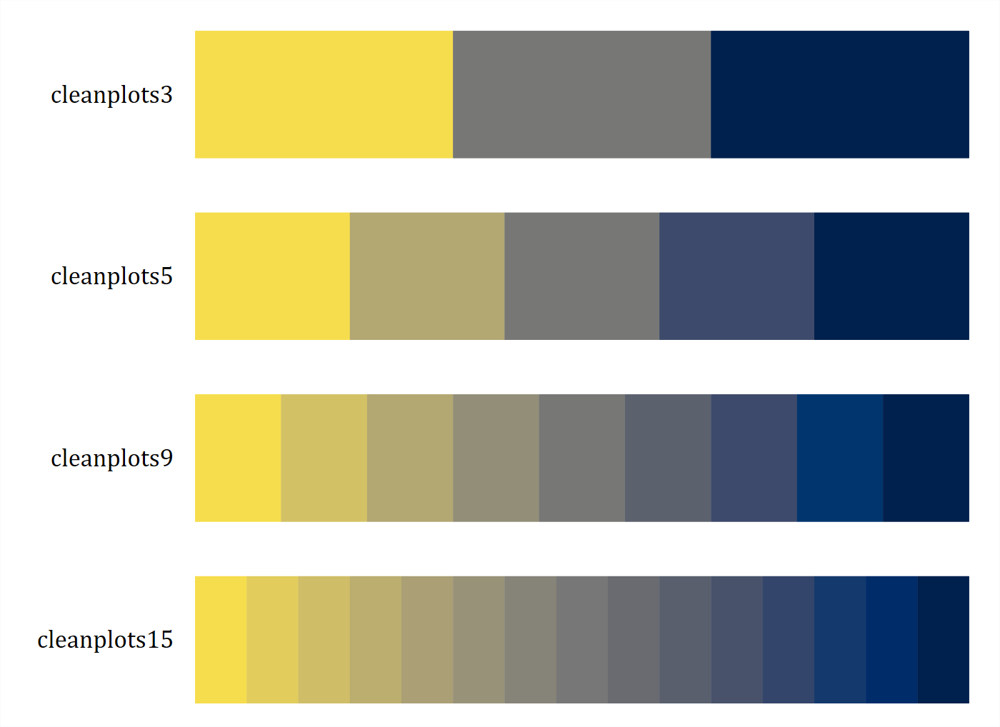{width=85% fig-alt="Four rows of swatches running from light yellow through gray to dark navy, with three, five, nine, and fifteen steps."}

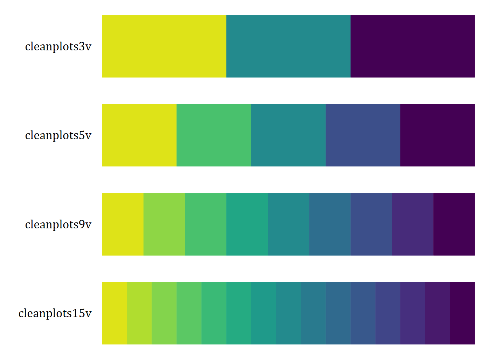{width=85% fig-alt="Four rows of swatches running from light yellow through green and blue to dark purple, with three, five, nine, and fifteen steps."}

With many categories, neighboring colors become hard to tell apart, so clear
labels, line patterns, and marker symbols matter more.

## Palette and direction

The repair-record bar chart in all four versions:

```{.stata-run}
. sysuse auto, clear
(1978 automobile data)

. graph bar price, over(rep78) asyvars scheme(cleanplots5) ///
>     title("Cividis: cleanplots5")

. graph bar price, over(rep78) asyvars scheme(cleanplots5r) ///
>     title("Cividis reversed: cleanplots5r")

. graph bar price, over(rep78) asyvars scheme(cleanplots5v) ///
>     title("Viridis: cleanplots5v")

. graph bar price, over(rep78) asyvars scheme(cleanplots5vr) ///
>     title("Viridis reversed: cleanplots5vr")

```

::: {layout-ncol=2}
{fig-alt="Bar chart of mean price by repair record with cleanplots5: bars run from light yellow to dark navy."}

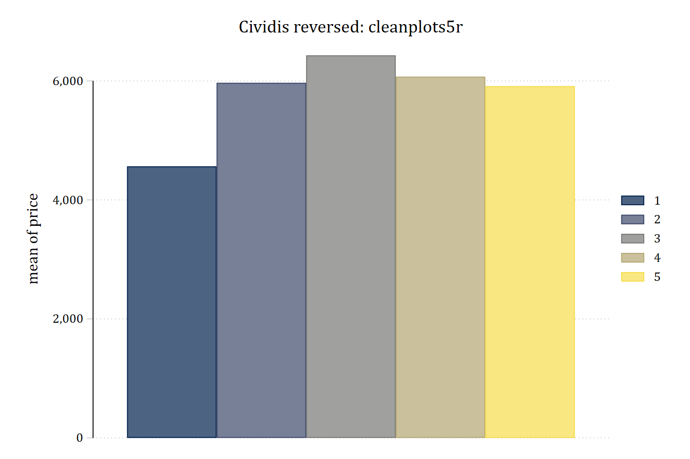{fig-alt="The same bar chart with cleanplots5r: bars run from dark navy to light yellow."}

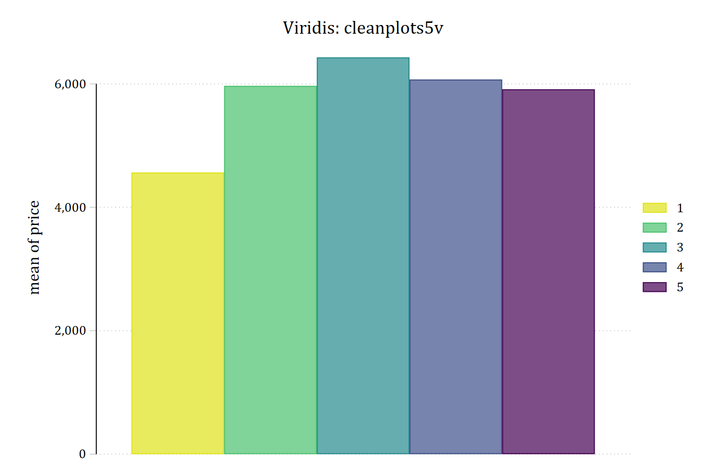{fig-alt="The same bar chart with cleanplots5v: bars run from light yellow through green and blue to dark purple."}

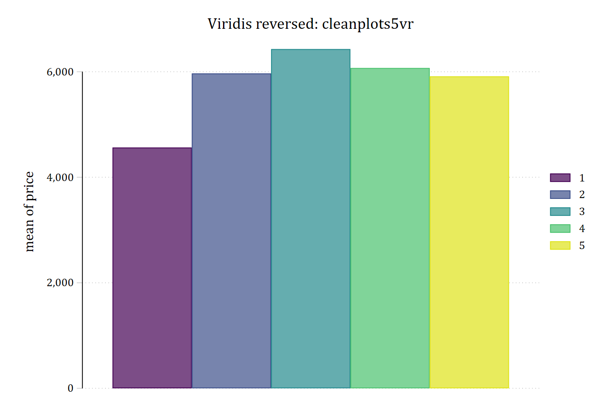{fig-alt="The same bar chart with cleanplots5vr: bars run from dark purple through blue and green to light yellow."}
:::

## Lines and markers

The ordinal palettes work for lines and markers as well as bars. Self-rated
health, from poor to excellent, is an ordered outcome. The predicted
probability of each category from an ordinal logit model, with
`cleanplots5` and `cleanplots5v`:

```{.stata-run}
. use "https://tdmize.github.io/data/data/addhealth4", clear
(addhealth4_dmv.dta | Add Health Wave IV | DMV Workshop)

. 
. quietly ologit health orole vrole i.woman age income i.race i.educ

. quietly margins, at(orole=(0(1)10))

. 
. marginsplot, recastci(rline) ciopts(lpat(dash) lcol(*.4)) ///
>     scheme(cleanplots5) title("Cividis: cleanplots5") ///
>     legend(order(6 "Poor" 7 "Fair" 8 "Good" 9 "Very Good" 10 "Excellent"))

Variables that uniquely identify margins: orole

. marginsplot, recastci(rline) ciopts(lpat(dash) lcol(*.4)) ///
>     scheme(cleanplots5v) title("Viridis: cleanplots5v") ///
>     legend(order(6 "Poor" 7 "Fair" 8 "Good" 9 "Very Good" 10 "Excellent"))

Variables that uniquely identify margins: orole

```

::: {layout-ncol=2}
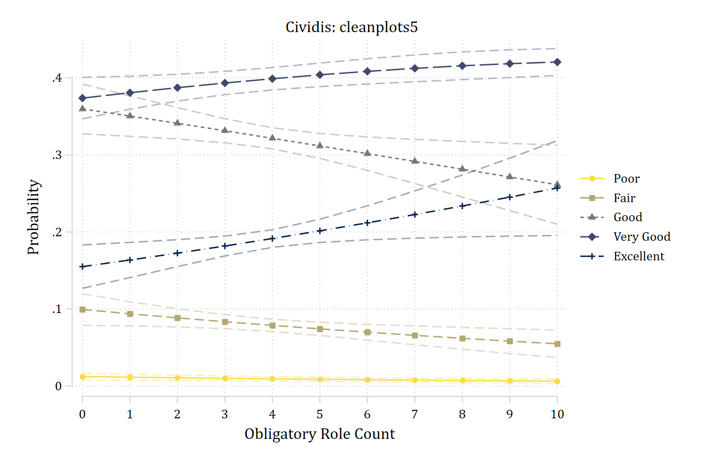{fig-alt="Predicted probabilities of five self-rated health categories across a count of obligatory roles with cleanplots5: the lines run from light yellow for poor to dark navy for excellent, each with its own marker and line pattern, and lighter dashed lines in the same colors show the confidence intervals."}

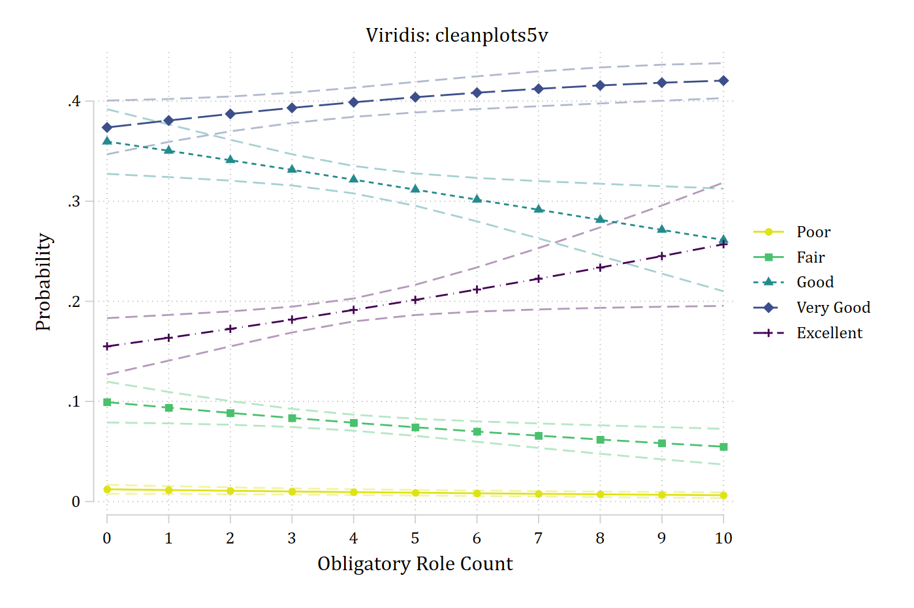{fig-alt="The same plot with cleanplots5v: the lines run from light yellow for poor through green and blue to dark purple for excellent, with lighter dashed confidence-interval lines."}
:::

## Printing in black and white

Because the colors run from light to dark, the order of the categories
carries over to grayscale. The nine-color cividis and viridis schemes in
color and in grayscale:

```{.stata-run}
. colorpalette, span : cleanplots9 / cleanplots9v

. colorpalette, gscale span : cleanplots9 / cleanplots9v

```

::: {layout-ncol=2}
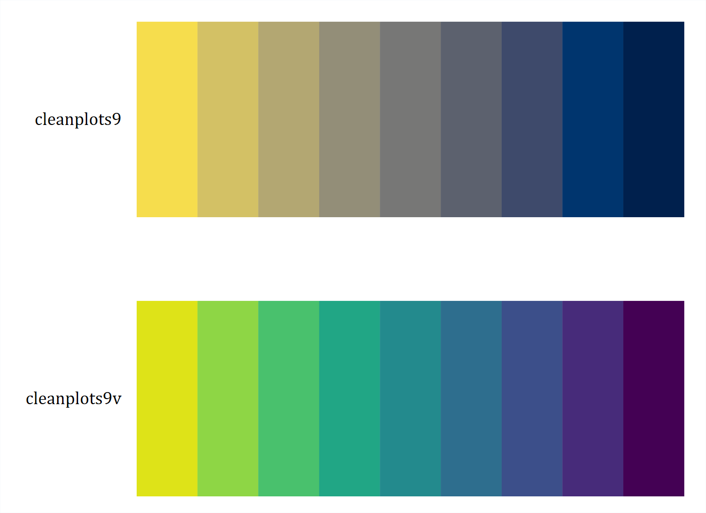{fig-alt="Two rows of nine swatches in color: cividis from light yellow to dark navy and viridis from light yellow to dark purple."}

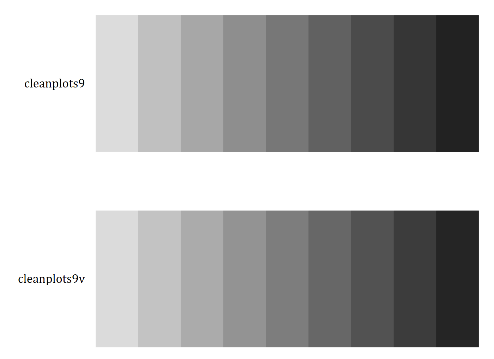{fig-alt="The same two rows in grayscale; both run from light gray to near black in the same order as the colors."}
:::

## Credit for the colors

If you use the ordinal schemes, please credit the palette you used: cividis
(Nunez, Anderton, and Renslow 2018) or viridis (van der Walt and Smith
2015).

## References

> Nunez, Jamie R., Christopher R. Anderton, and Ryan S. Renslow. 2018.
> "Optimizing Colormaps with Consideration for Color Vision Deficiency to
> Enable Accurate Interpretation of Scientific Data." *PLOS ONE* 13(7):
> e0199239.

> van der Walt, Stéfan, and Nathaniel Smith. 2015. "Viridis: A Better Default
> Colormap for Matplotlib."
> <https://bids.github.io/colormap/>
