## What is categorical data?

:::: {.columns}
::: {.column width="70%"}
- I use the term categorical data analysis to refer broadly to the **analysis of dependent variables that are not continuous** (interval-ratio)
  - Although we also cover complexities of analyzing categorical independent variables
- Examples: binary (2 categories), ordinal (3+ ordered categories), nominal (3+ unordered categories), count (summation of binary choices), censored, etc.
- These are **limited dependent variables** in that they do not have full continuous information
  - E.g., measured at a more blunt measurement level
:::
::: {.column width="30%"}
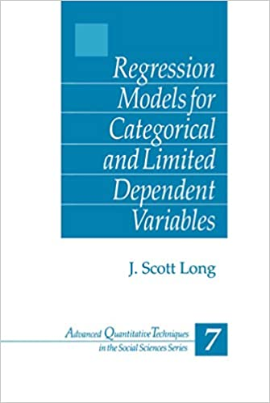{fig-alt="Cover of Long (1997), Regression Models for Categorical and Limited Dependent Variables."}
:::
::::

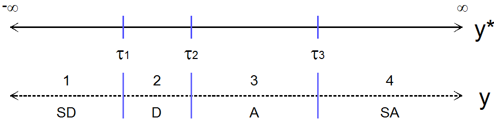{width=70% fig-alt="A continuous latent variable y-star divided by three thresholds into the four observed categories of y: strongly disagree, disagree, agree, and strongly agree."}

## Introduction

- Almost all health and social science graduate programs teach linear regression (or the often equivalent ANOVA)
  - Many (most?) do not require a class beyond linear regression
- Unfortunately, **most health and social science variables are not continuous** and thus linear regression is problematic / not ideal to model these variables as outcomes
  - E.g., Some inherently categorical data analysis questions:
    - Which political candidate will win the next election?
    - Is a vaccine effective at preventing disease and/or death?
    - How many publications does it take to receive tenure?
    - How many drinks does the average person consume per week?
  - In addition, even when a construct could be continuous, we typically measure things as categorical (e.g., a survey question)

> *Examples below*

:::: {.columns}
::: {.column width="50%"}
{width=60% fig-alt="General Social Survey logo."}
:::
::: {.column width="50%"}
{width=70% fig-alt="NORC at the University of Chicago logo."}
:::
::::

{fig-alt="GSS question: In general, do you think the courts in this area deal too harshly or not harshly enough with criminals?"}

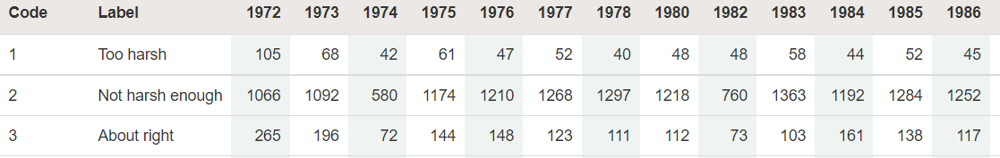{fig-alt="GSS counts by year for the courts question: too harsh, not harsh enough, and about right."}

{width=40% fig-alt="GSS question: About how often do you pray?"}

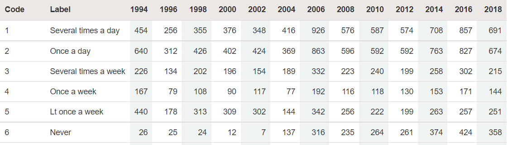{fig-alt="GSS counts by year for how often respondents pray, from several times a day to never."}

:::: {.columns}
::: {.column width="40%"}
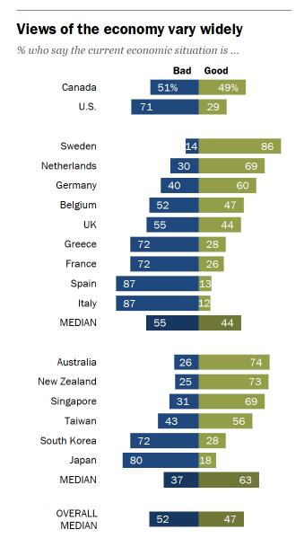{fig-alt="Pew Research Center chart: views of the economy as good or bad vary widely across countries."}
:::
::: {.column width="60%"}
{width=70% fig-alt="Pew Research Center logo."}
:::
::::

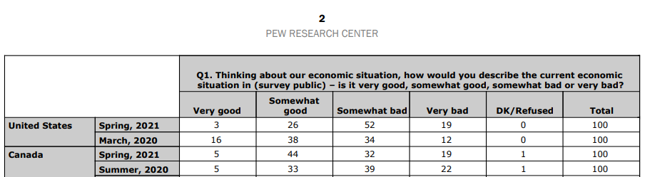{width=90% fig-alt="Pew Research Center table of how people in the United States and Canada rate the economic situation, from very good to very bad."}

:::: {.columns}
::: {.column width="50%"}
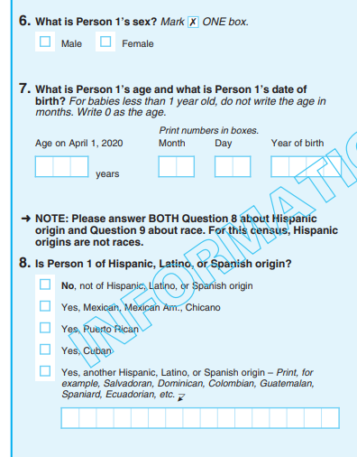{fig-alt="2020 U.S. Census form questions on sex, age, and Hispanic origin."}
:::
::: {.column width="50%"}
{fig-alt="2020 U.S. Census form question on race, with check boxes for many categories."}
:::
::::

{fig-alt="Fantasy football matchup showing each team's projected points and chance to win."}

:::: {.columns}
::: {.column width="55%"}
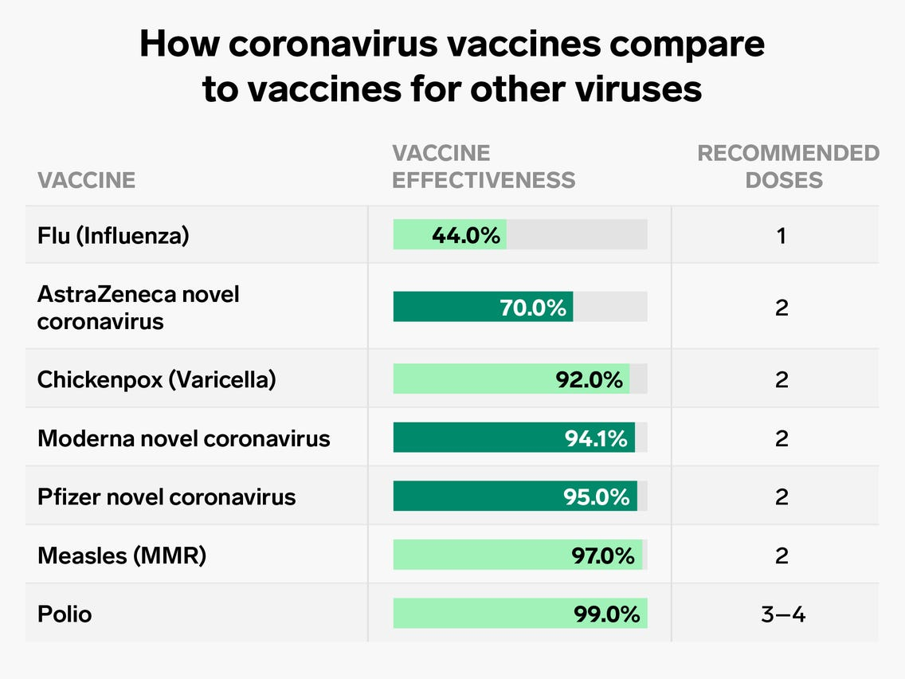{fig-alt="Table comparing the effectiveness and recommended doses of coronavirus vaccines and other vaccines."}
:::
::: {.column width="45%"}
{fig-alt="Netflix listing for Derry Girls showing a 93% match."}
:::
::::

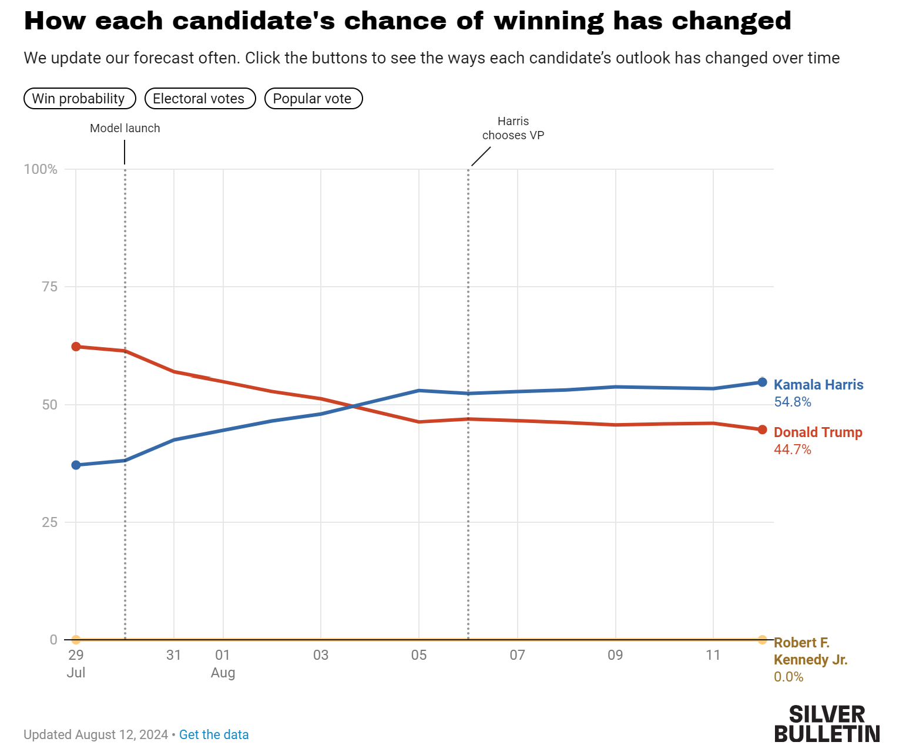{width=80% fig-alt="Election forecast showing each candidate's chance of winning over time."}

## Categorical data analysis? Really a class on nonlinear effects

- Goal of seminar is to provide frameworks for handling **nonlinear effects** in any model
  - Linear regression models are *sometimes* nonlinear; they are *sometimes* interactive; they are *sometimes* both
    - The methods covered in this seminar can be fruitfully applied to nonlinear linear regression models
  - Models for categorical dependent variables are *inherently* nonlinear **and** are *inherently* interactive
- With linear effects, the work is largely done when you estimate the model
- With nonlinear effects, the work begins once you have estimated the model

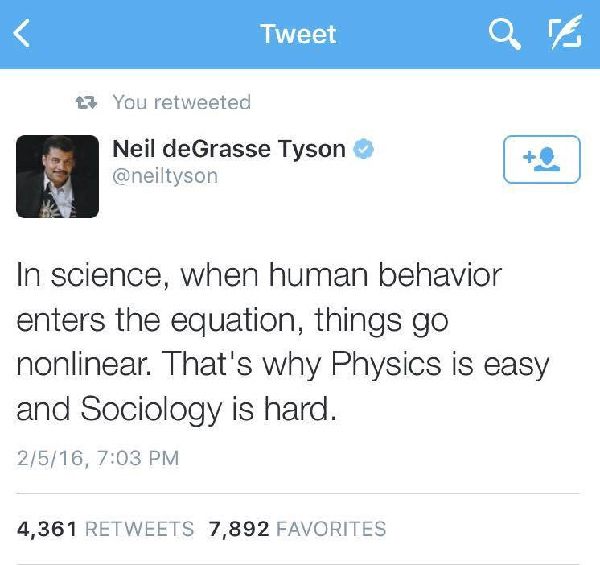{width=50% fig-alt="Tweet from Neil deGrasse Tyson: In science, when human behavior enters the equation, things go nonlinear. That's why Physics is easy and Sociology is hard."}

*"Think how hard physics would be if particles could think"* -- Murray Gell-Mann

## Meaningful interpretations

*"Unfortunately, all too often when these models are used, the substantive meaning of the parameter is incompletely explained, incorrectly explained, or simply ignored. Sometimes only the statistical significance or possibly the sign is mentioned." ([Long 1997](https://us.sagepub.com/en-us/nam/regression-models-for-categorical-and-limited-dependent-variables/book6071) p. xxiii)*

*"...several different interpretation techniques were applied in the reviewed articles... The most common strategy was to simply look at the p-values and the sign of the coefficient to infer the direction of the effect, ignoring both the strength and form of the relationship." ([Ronkko et al. 2021](https://doi.org/10.1177%2F1094428121991907) p.24)*

- We will learn how to tell an understandable story with your data in the presence of complex nonlinearities and interactive effects
  - Interpretations that go beyond signs and stars
  - Describing effects in the metrics of interest
  - Visualizing results
  - Etc.
- Why does nonlinearity make things so hard (and realistic)?

### Linear model

$$y = \alpha + \beta x_{i} + \gamma d_{i}$$

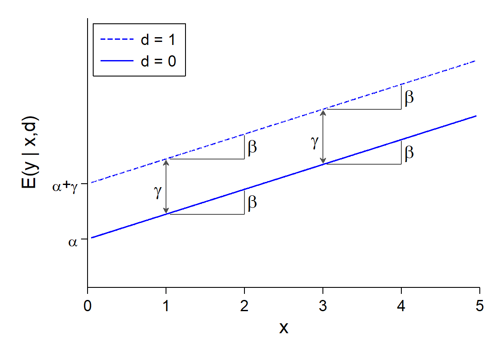{width=70% fig-alt="Two parallel straight lines for d = 0 and d = 1: each one-unit increase in x raises the expected value of y by beta, and the gap between the lines is always gamma."}

### Inherently nonlinear model

$$y = \frac{\exp(\alpha + \beta x + \gamma d)}{1 + \exp(\alpha + \beta x + \gamma d)}$$

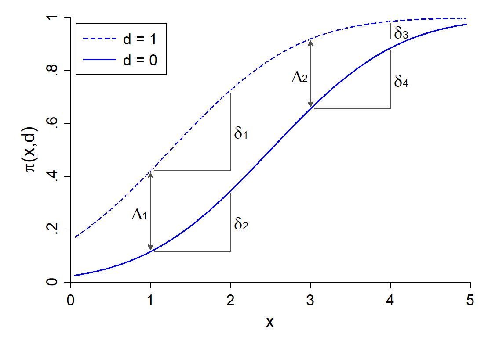{width=70% fig-alt="Two S-shaped probability curves for d = 0 and d = 1: the effect of x and the gap between the curves both change depending on where they are evaluated."}

## Topics considered

- Linear regression refresher
  - Plus a primer on controls and causality
- Nonlinearities and categorical independent variables
  - Nonlinear linear regression models
  - Interpretation with predictions and marginal effects
  - Inequality statistics
- Binary outcome models (logit and probit)
  - Odds ratios, risk ratios, predictions, marginal effects, ideal types
- Nominal outcome models (multinomial logit)
- Ordinal outcome models (ordinal logit and probit, generalized ordered logit)
  - Model assumptions and comparisons
- Count outcome models (Poisson regression, negative binomial, ZIP/ZINB)
  - Predictions for rates/counts, probabilities, ranges
  - Model selection
- Statistical moderation and mediation
  - Types of interactions
  - Comparing effects across models
- Testing and model fit
  - Internal, absolute, and relative fit
  - Model and effect robustness

### Useful extensions once you know categorical

- Other limited dependent variable models
  - Censored distributions---e.g., floors and ceilings
    - Proportions (bounded at 0 and 1)
- Multilevel and longitudinal models
- Latent variable models
  - Binary, ordinal, or nominal items
    - Continuous and nominal latent variables
- Network analysis
- Machine learning
  - Often 0/1 prediction tasks
    - E.g., LASSO; random forests

:::: {.columns}
::: {.column width="33%"}
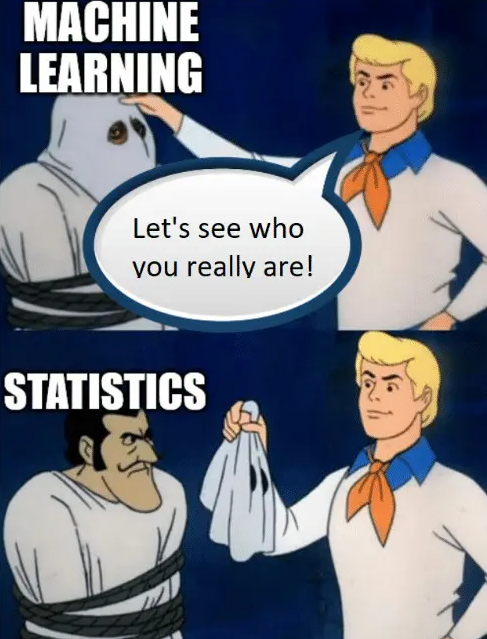{fig-alt="Scooby-Doo meme: unmasking machine learning reveals statistics."}
:::
::: {.column width="33%"}
{fig-alt="Cartoon: a teacher shows robots a picture of a boat, labeled 'machine learning'."}
:::
::: {.column width="33%"}
{fig-alt="Capital One tweet: we use logistic regression models and run inference in the browser to improve the customer experience."}
:::
::::

## Recommended books

- For more of the statistical details and backgrounds of the methods we cover:

:::: {.columns}
::: {.column width="30%"}
{fig-alt="Cover of Long (1997), Regression Models for Categorical and Limited Dependent Variables."}
:::
::: {.column width="30%"}
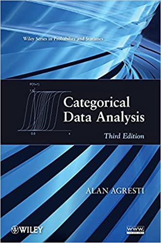{fig-alt="Cover of Agresti, Categorical Data Analysis, third edition."}
:::
::::

- For more detail on how to do categorical data analysis using Stata or R:

:::: {.columns}
::: {.column width="30%"}
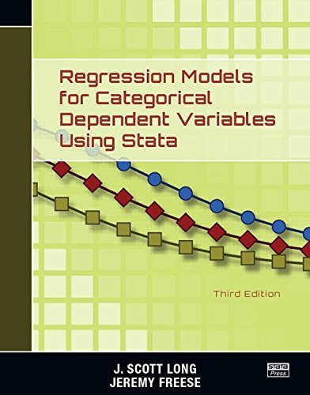{fig-alt="Cover of Long and Freese, Regression Models for Categorical Dependent Variables Using Stata, third edition."}
:::
::: {.column width="30%"}
{fig-alt="Cover of Melamed and Doan, Applications of Regression for Categorical Outcomes Using R."}
:::
::: {.column width="30%"}
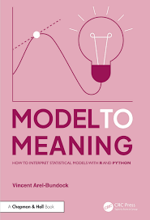{fig-alt="Cover of Arel-Bundock, Model to Meaning: How to Interpret Statistical Models With R and Python."}
:::
::::
