## Regression modeling and the language of expectations

- Regression modeling at its simplest is a way to model conditional expectations
  - Expectations are means (and conditional means)
- E(income) = mean of income
  - With no conditions---i.e., the overall sample mean

::: {.panel-tabset group="language"}
## Stata

```{.stata-run}
. use "https://tdmize.github.io/data/data/cda_gss", clear
(cda_gss.dta |  GSS 1972-2021 CDA - Categorical Data Analysis | date created 202
> 3)

. 
. tabstat income, stat(mean)

    Variable |      Mean
-------------+----------
      income |  32185.98
------------------------

. regress income

      Source |       SS           df       MS      Number of obs   =    39,163
-------------+----------------------------------   F(0, 39162)     =      0.00
       Model |           0         0           .   Prob > F        =         .
    Residual |  3.3178e+13    39,162   847199501   R-squared       =    0.0000
-------------+----------------------------------   Adj R-squared   =    0.0000
       Total |  3.3178e+13    39,162   847199501   Root MSE        =     29107

------------------------------------------------------------------------------
      income | Coefficient  Std. err.      t    P>|t|     [95% conf. interval]
-------------+----------------------------------------------------------------
       _cons |  32185.975    147.080  218.832   0.000    31897.694   32474.257
------------------------------------------------------------------------------

```

## R

```{r}
library(haven)           # import Stata data and labels
library(dplyr)           # data manipulation
library(sjmisc)          # frequency tables
library(ggplot2)         # graphs
library(marginaleffects) # predictions and marginal effects
library(cleanplots)      # graph scheme
cleanplots_defaults()

gss <- read_dta("https://tdmize.github.io/data/data/cda_gss.dta")

mean(gss$income, na.rm = TRUE)

summary(lm(income ~ 1, data = gss))
```

:::

::: {.callout-note icon="false" appearance="simple"}
E(income) ≈ 32,186
:::

### Conditional expectations

- Conditional expectations set further conditions (which are specified to the right of a vertical bar):

> E(income \| woman = 0) = mean of income for men\*
>
> E(income \| woman = 1) = mean of income for women\*
>
> E(income \| woman = 0) ≈ 40,097
>
> E(income \| woman = 1) ≈ 24,153

::: {.panel-tabset group="language"}
## Stata

```{.stata-run}
. tabstat income, stat(mean) by(woman)

Summary for variables: income
Group variable: woman (Woman R)

 woman |      Mean
-------+----------
   Men |  40096.77
 Women |  24153.19
-------+----------
 Total |   32187.9
------------------

```

## R

```{r}
gss |>
  filter(!is.na(woman)) |>
  group_by(woman) |>
  summarize(mean = mean(income, na.rm = TRUE))
```

:::

\*Not limited to binary variables. If your dataset measures gender with 3+ categories, can still apply same approach

### Relationship between conditional expectations and regression

::: {.panel-tabset group="language"}
## Stata

```{.stata-run}
. regress income i.woman

      Source |       SS           df       MS      Number of obs   =    39,153
-------------+----------------------------------   F(1, 39151)     =   3174.90
       Model |  2.4880e+12         1  2.4880e+12   Prob > F        =    0.0000
    Residual |  3.0681e+13    39,151   783646066   R-squared       =    0.0750
-------------+----------------------------------   Adj R-squared   =    0.0750
       Total |  3.3169e+13    39,152   847173151   Root MSE        =     27994

------------------------------------------------------------------------------
      income | Coefficient  Std. err.      t    P>|t|     [95% conf. interval]
-------------+----------------------------------------------------------------
       woman |
      Women  |  -1.59e+04    282.957  -56.346   0.000    -1.65e+04   -1.54e+04
       _cons |  40096.773    199.290  201.198   0.000    39706.159   40487.386
------------------------------------------------------------------------------

. di 24153.19 - 40096.77
-15943.58

```

## R

```{r}
summary(lm(income ~ woman, data = gss))
24153.19 - 40096.77
```

:::

- With a binary independent variable (IV), the regression coefficient represents the group difference; the difference in means between the category coded 1 and the category coded 0
- The gender variable *woman* is coded as woman = 1; man = 0
  - Therefore, the regression coefficient tells us how much more (or less) women earn than men

> *On average, women earn about \$15,900 less than men*

### Interpreting the intercept

- What does the constant (AKA intercept) term tell us in this model?
  - It is the **expected value when all IVs are 0**
    - In this case, when the variable woman = 0 this refers to men
      - So, it is the mean of income for men in the sample
- I rarely ever interpret the intercept
  - Usually, you have some variables in the model where 0 is not a meaningful value (e.g., if age is in the model and data is all adults)
- You can do things to make the intercept interpretable (e.g., mean-center all variables) but I find this unnecessary
  - I find it more straightforward to interpret predictions (more later)
  - A theme of the class is to **go beyond the coefficient estimates for interpretation**

### Regression with a nominal IV

- Nominal variables have 3+ unordered categories\*
  - E.g., Race-ethnicity, religious affiliation, political party, etc.
- Can estimate conditional expectations in the same way as binary---just with additional categories

::: {.panel-tabset group="language"}
## Stata

```{.stata-run}
. tabstat income, stat(mean) by(race4)

Summary for variables: income
Group variable: race4 (Race-ethnicity)

   race4 |      Mean
---------+----------
   White |  33693.02
   Black |  24724.65
   Other |  36037.94
Hispanic |  26005.54
---------+----------
   Total |  32182.69
--------------------

```

## R

```{r}
gss |>
  filter(!is.na(race4)) |>
  group_by(race4) |>
  summarize(mean = mean(income, na.rm = TRUE))
```

:::

::: {.callout-note icon="false" appearance="simple"}
E(income \| race = 1 \[White\]) ≈ 33,693

E(income \| race = 2 \[Black\]) ≈ 24,725

E(income \| race = 3 \[Other\]) ≈ 36,038

E(income \| race = 4 \[Hispanic\]) ≈ 26,006
:::

\*A binary IV (2 categories) is technically a nominal variable but we often give it a special designation of "binary"

- In regression with a nominal IV we choose an omitted/reference group and then include indicator variables for all remaining groups
  - By default, both Stata and R omit the first category as the reference (1 = White)

::: {.panel-tabset group="language"}
## Stata

```{.stata-run}
. regress income i.race4

      Source |       SS           df       MS      Number of obs   =    39,140
-------------+----------------------------------   F(3, 39136)     =    183.48
       Model |  4.5987e+11         3  1.5329e+11   Prob > F        =    0.0000
    Residual |  3.2697e+13    39,136   835462911   R-squared       =    0.0139
-------------+----------------------------------   Adj R-squared   =    0.0138
       Total |  3.3157e+13    39,139   847148559   Root MSE        =     28904

------------------------------------------------------------------------------
      income | Coefficient  Std. err.      t    P>|t|     [95% conf. interval]
-------------+----------------------------------------------------------------
       race4 |
      Black  |  -8968.368    433.349  -20.696   0.000    -9817.742   -8118.994
      Other  |   2344.922    769.166    3.049   0.002      837.338    3852.505
   Hispanic  |  -7687.479    657.923  -11.684   0.000    -8977.024   -6397.933
             |
       _cons |  33693.016    165.816  203.195   0.000    33368.012   34018.020
------------------------------------------------------------------------------

```

## R

```{r}
summary(lm(income ~ as_factor(race4), data = gss))
```

:::

- The coefficients thus represent the difference in income of each racial-ethnic group compared to the omitted group (White)

> *Black adults earn about \$8,968 a year less than White adults*
>
> *Adults from other racial-ethnic groups earn about \$2,345 a year more than White adults\**
>
> *Hispanic adults earn about \$7,687 less a year than White adults*

- The interpretation of the coefficients is limited to a comparison to the omitted/reference group
  - E.g., How do Black and Hispanic adults compare?
  - We will learn interpretation techniques that do not have this limitation

\*This is U.S. data so the "other" category is mostly Asian/Asian-American adults (though not exclusively)

### Regression with a continuous IV

- Regression is only slightly more difficult with a continuous IV

::: {.panel-tabset group="language"}
## Stata

```{.stata-run}
. reg income c.age

      Source |       SS           df       MS      Number of obs   =    38,993
-------------+----------------------------------   F(1, 38991)     =   1608.71
       Model |  1.3028e+12         1  1.3028e+12   Prob > F        =    0.0000
    Residual |  3.1577e+13    38,991   809852626   R-squared       =    0.0396
-------------+----------------------------------   Adj R-squared   =    0.0396
       Total |  3.2880e+13    38,992   843244332   Root MSE        =     28458

------------------------------------------------------------------------------
      income | Coefficient  Std. err.      t    P>|t|     [95% conf. interval]
-------------+----------------------------------------------------------------
         age |    423.166     10.550   40.109   0.000      402.487     443.845
       _cons |  14656.849    458.928   31.937   0.000    13757.338   15556.360
------------------------------------------------------------------------------

. di 14656.849 + 423.166*30
27351.829

. di 14656.849 + 423.166*50
35815.149

```

## R

```{r}
agemod <- lm(income ~ age, data = gss)
summary(agemod)

14656.849 + 423.166*30
14656.849 + 423.166*50
```

:::

- What about conditional expectations here? Unlike with a binary/nominal variable, there are many possible values to choose
  - Let's arbitrarily choose ages 30 and 50. Easy to calculate the conditional expectations (predictions) by plugging in values to the equation:

$$E(income\ |\ age = 30) = \beta_{0} + \beta_{age}{age}_{i} = 14657 + 423*30 \approx 27,352$$

$$E(income\ |\ age = 50) = \beta_{0} + \beta_{age}{age}_{i} = 14657 + 423*50 \approx 35,815$$

> *Our model predicts that the average 30-year-old earns about \$27,000; the average 50-year-old earns about \$36,000*

- With a continuous IV, plots of predictions are especially useful

::: {.panel-tabset group="language"}
## Stata

```{.stata-run}
. qui margins, at(age=(20(5)80))

. marginsplot, noci ylab(0(10000)50000) ///
>     title("[1.2.a] Predictions for income across range of age") ///
>     ytitle("Income")

Variables that uniquely identify margins: age

```

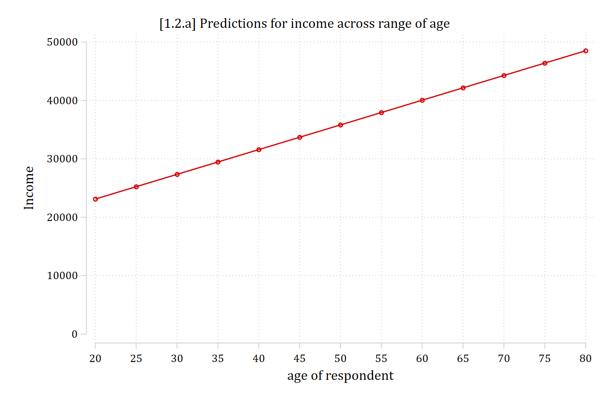{width=80% fig-alt="Predicted income by age: a straight line rising from about 23,000 dollars at age 20 to about 48,000 dollars at age 80."}

## R

```{r}
#| fig-alt: "Predicted income by age: a straight line rising from about 23,000 dollars at age 20 to about 48,000 dollars at age 80."
plot_predictions(agemod, condition = list(age = seq(20, 80, 5)), vcov = FALSE) +
  scale_y_continuous(breaks = seq(0, 50000, 10000), limits = c(0, 50000)) +
  labs(title = "[1.2.a] Predictions for income across range of age",
    x = "Age", y = "Income")
```

:::

- I arbitrarily chose to calculate a 20-year increase in age above
  - A regression coefficient always quantifies a one-unit increase

$$E(income\ |\ age = 30) = \beta_{0} + \beta_{age}{age}_{i} = 14657 + 423*30 \approx 27,352$$

$$E(income\ |\ age = 31) = \beta_{0} + \beta_{age}{age}_{i} = 14657 + 423*31 \approx 27,775$$

$$27,775 - 27,352 = 423$$

$$E(income\ |\ age = 50) = \beta_{0} + \beta_{age}{age}_{i} = 14657 + 423*50 \approx 35,815$$

$$E(income\ |\ age = 51) = \beta_{0} + \beta_{age}{age}_{i} = 14657 + 423*51 \approx 36,238$$

$$36,238 - 35,815 = 423$$

- The regression coefficient on age is about 423
  - This represents the effect of a one-unit increase in the IV (age) on the DV (income)
    - In [Lewis-Beck and Lewis-Beck's (2016)](https://doi.org/10.4135/9781483396774) terms:
      - *"The slope estimate indicates the average change in y associated with a unit change in x"*
    - Put more formally:
      - **A one unit increase in *x* is associated with a β increase/decrease in *y***
    - Plugging in our variables:

> *A one unit increase in age is associated with a \$423 increase in income*

### Advice for more naturally worded interpretations

- The interpretation above is correct but not very satisfying; it sounds like a robot wrote it; it does not pass the "grandma test"
  - "A one unit increase in age" is weird phrasing; instead, substitute "an additional year of age" or "getting one year older"
    - Always think about the metric of your variables and interpret them in ways that reflect how you would naturally talk about that metric

> *Each additional year of age is associated with a \$423 increase in income*

- With a binary (or nominal) IV, the regression coefficient represents **a group difference**; I recommend interpreting it as such. E.g., Which of these interpretations is easiest to understand and most natural?

:::: {.columns}
::: {.column width="15%"}
{fig-alt="No!"}
:::
::: {.column width="85%"}
> *A one unit increase in gender is associated with a \$15,900 decrease in income*
:::
::::

:::: {.columns}
::: {.column width="15%"}
{fig-alt="No!"}
:::
::: {.column width="85%"}
> *A one unit increase in identifying as a woman is associated with a \$15,900 decrease in income*
:::
::::

:::: {.columns}
::: {.column width="15%"}
{fig-alt="Bingo!"}
:::
::: {.column width="85%"}
> *On average, women earn about \$15,900 less than men*
:::
::::

## Regression with multiple IVs

- Most regression analyses in the health and social sciences include multiple IVs; e.g., within sociology 10 to 15 IVs is common

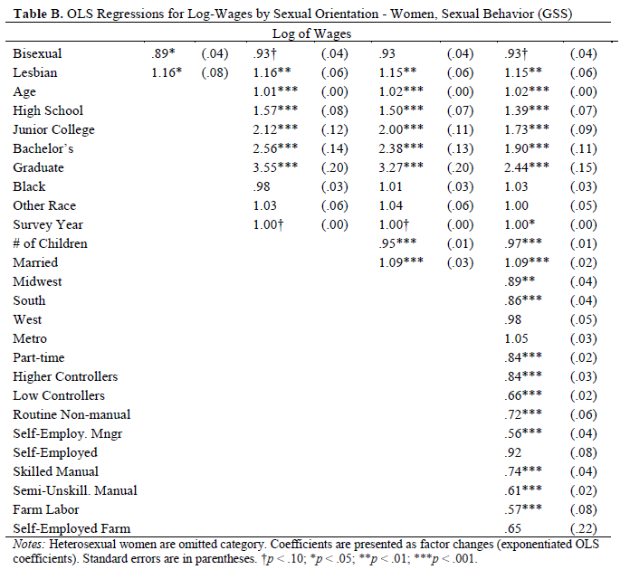{width=70% fig-alt="Appendix Table B of Mize (2016): linear regressions of log wages by sexual orientation for women, with many control variables."}

::: {.callout-note icon="false" appearance="simple"}
Appendix table from [Mize 2016 *ASR*](https://doi.org/10.1177%2F0003122416674025)
:::

### Multiple regression

- Regression with a single IV is sometimes referred to as **simple regression**; regression with multiple IVs as **multiple regression** (n.b. *not* "multivariate")
- Sometimes an analysis will have multiple **focal IVs**: independent variables that are integral to the theoretical questions and hypotheses being tested
  - E.g., For the [2016 article](https://doi.org/10.1177%2F0003122416674025) referenced above, I only put the focal IVs into the tables in the main text. These were variables I had specific hypotheses about

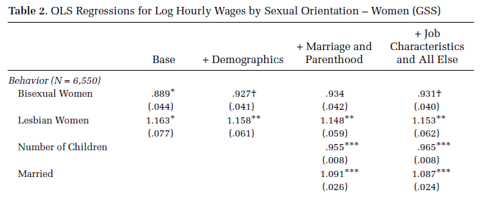{width=80% fig-alt="Table 2 of Mize (2016): linear regressions for log hourly wages by sexual orientation for women, showing only the focal variables."}

- Often, there will be many control variables: IVs that are not of specific interest but that are important to account for in the analysis
  - We control for IVs because we suspect they have shared variation with the IVs and DV; controlling or "accounting for" the additional IVs helps isolate the effect of the focal IV(s)

## Control variables and causality

- A motivation to include multiple IVs in the same model is **because** they are correlated (collinear)
  - There are two main motivations for adding control variables to a regression model: mediation and confounding
- Sticking with the gender (IV) and wages (DV) example, it would be reasonable to hypothesize that *women tend to earn less than men:*

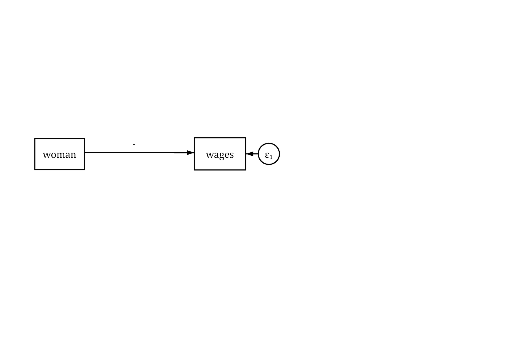{width=50% fig-alt="Path diagram: an arrow from woman to wages with a negative sign."}

- However, other factors are associated with both gender and wages. The simple model represented above suffers from omitted variable bias
  - From a causality framework, we would not expect this simple model to uncover the causal effect of gender as other factors may explain some or all of the gender wage gap

**\*Note** the direction of the arrow in the diagram above. The IV (*woman*) is the presumed cause of the DV (*wages*)

### Mediation

- **Mediation** occurs when the effect of your IV on the DV operates partially through a third (mediating) variable

{fig-alt="Mediation: the exposure X affects the mediator M, which affects the outcome Y, alongside a direct path from X to Y; overlapping circles show the shared variation."}

- For example, differences in the occupations men and women work in may explain some of the gender wage gap
  - For simplicity, consider a binary variable indicating whether the person works in a leadership role (= 1) or not (= 0)

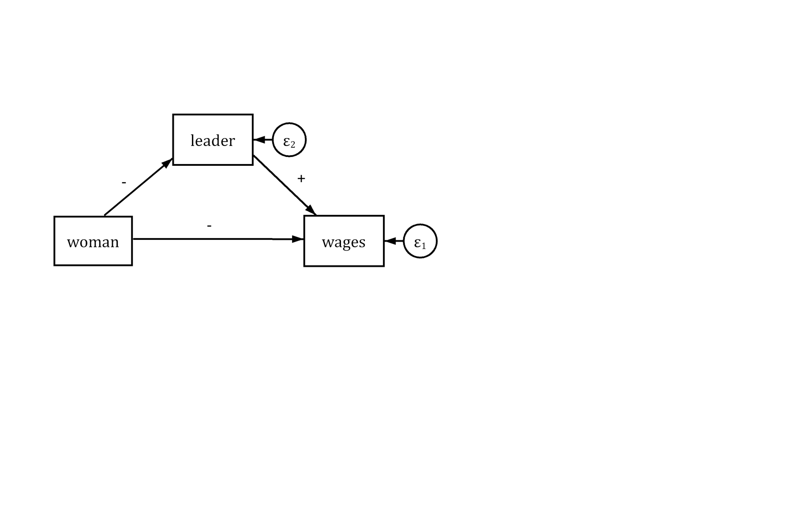{width=50% fig-alt="Path diagram: woman has a negative arrow to leader, leader has a positive arrow to wages, and woman has a negative arrow to wages."}

- Women may be less likely to work in leadership roles. Leadership roles are associated with higher wages
  - Controlling for *leader* should lessen the effect of *woman* in the model as some of the variation in wages associated with gender has now been explained by *leader*

::: {.panel-tabset group="language"}
## Stata

```{.stata-run}
. use "https://tdmize.github.io/data/data/cda_ah4", clear
(cda_ah4.dta | Add Health Wave 4 - | )

. drop if employed == 0
(4,093 observations deleted)

. 
. sum wages woman supervis

    Variable |        Obs        Mean    Std. dev.       Min        Max
-------------+---------------------------------------------------------
       wages |        900    9.035334     12.6879       2.13        150
       woman |      1,021    .6199804    .4856292          0          1
    supervis |        933    .2583065    .4379382          0          1

. clonevar leader = supervis
(88 missing values generated)

. lab def leadlab 0"Not a Leader" 1"Leader"

. lab val leader leadlab

. fre woman leader

woman -- Woman R
-------------------------------------------------------------
                |      Freq.    Percent      Valid       Cum.
----------------+--------------------------------------------
Valid   0 Man   |        388      38.00      38.00      38.00
        1 Woman |        633      62.00      62.00     100.00
        Total   |       1021     100.00     100.00           
-------------------------------------------------------------

leader -- Supervisor at Work
--------------------------------------------------------------------
                       |      Freq.    Percent      Valid       Cum.
-----------------------+--------------------------------------------
Valid   0 Not a Leader |        692      67.78      74.17      74.17
        1 Leader       |        241      23.60      25.83     100.00
        Total          |        933      91.38     100.00           
Missing .              |         88       8.62                      
Total                  |       1021     100.00                      
--------------------------------------------------------------------

. 
. reg wages i.woman

      Source |       SS           df       MS      Number of obs   =       900
-------------+----------------------------------   F(1, 898)       =     26.88
       Model |  4205.87862         1  4205.87862   Prob > F        =    0.0000
    Residual |  140517.664       898  156.478468   R-squared       =    0.0291
-------------+----------------------------------   Adj R-squared   =    0.0280
       Total |  144723.543       899  160.982806   Root MSE        =    12.509

------------------------------------------------------------------------------
       wages | Coefficient  Std. err.      t    P>|t|     [95% conf. interval]
-------------+----------------------------------------------------------------
       woman |
      Woman  |     -4.467      0.862   -5.184   0.000       -6.158      -2.776
       _cons |     11.829      0.681   17.360   0.000       10.492      13.167
------------------------------------------------------------------------------

. reg wages i.woman i.leader

      Source |       SS           df       MS      Number of obs   =       900
-------------+----------------------------------   F(2, 897)       =     16.22
       Model |  5049.82473         2  2524.91236   Prob > F        =    0.0000
    Residual |  139673.718       897   155.71206   R-squared       =    0.0349
-------------+----------------------------------   Adj R-squared   =    0.0327
       Total |  144723.543       899  160.982806   Root MSE        =    12.478

------------------------------------------------------------------------------
       wages | Coefficient  Std. err.      t    P>|t|     [95% conf. interval]
-------------+----------------------------------------------------------------
       woman |
      Woman  |     -4.350      0.861   -5.052   0.000       -6.039      -2.660
             |
      leader |
     Leader  |      2.218      0.953    2.328   0.020        0.348       4.087
       _cons |     11.185      0.734   15.237   0.000        9.744      12.625
------------------------------------------------------------------------------

```

## R

```{r}
ah4 <- read_dta("https://tdmize.github.io/data/data/cda_ah4.dta")
ah4 <- ah4 |> filter(employed == 1)

summary(ah4[c("wages", "woman", "supervis")])

# leader: supervis with labels for leadership
ah4 <- ah4 |>
  mutate(leader = factor(supervis, levels = 0:1, labels = c("Not a Leader", "Leader")),
    woman = as_factor(woman))
frq(ah4, woman, leader)

summary(lm(wages ~ woman, data = ah4))
summary(lm(wages ~ woman + leader, data = ah4))
```

:::

- As expected, the effect of gender is reduced after controlling for whether the worker holds a leadership position (more on how to provide a statistical significance test of this difference later in the course)

> *Women earn about \$4.35 less an hour than men, after accounting for whether the worker holds a leadership position*

### Confounding

- A confounding variable is one that influences both the IV and the DV. This can cause a spurious relationship between the IV and DV (i.e., a correlation between them that is not causal)

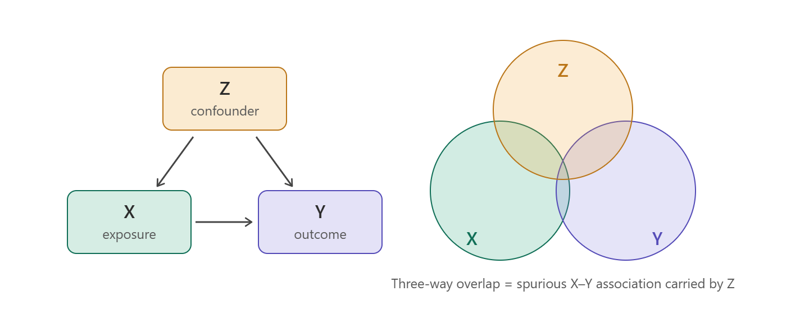{fig-alt="Confounding: Z affects both the exposure X and the outcome Y; the three-way overlap of circles is a spurious X-Y association carried by Z."}

- E.g., consider the relationship between income (IV) and happiness (DV)

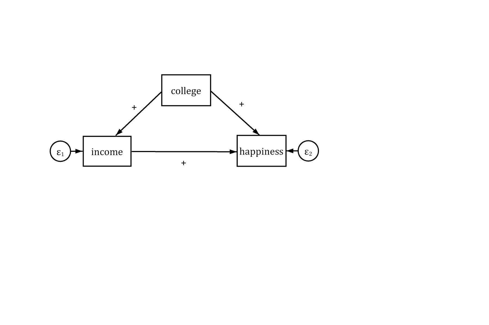{width=50% fig-alt="Path diagram: college has positive arrows to both income and happiness, and income has a positive arrow to happiness."}

- More income is associated with more self-reported happiness. However, a third variable---education (measured as college degree or not)---is a cause of both income and happiness
  - Without including *college* in the model our estimate for *income* would be spuriously large---indicating a larger effect of income on happiness than its true causal effect

::: {.panel-tabset group="language"}
## Stata

```{.stata-run}
. use "https://tdmize.github.io/data/data/cda_gss", clear
(cda_gss.dta |  GSS 1972-2021 CDA - Categorical Data Analysis | date created 202
> 3)

. 
. sum vhappy income edyrs

    Variable |        Obs        Mean    Std. dev.       Min        Max
-------------+---------------------------------------------------------
      vhappy |     64,068    .3060186    .4608411          0          1
      income |     39,163    32185.98    29106.69        336     160000
       edyrs |     68,603    12.97949    3.186762          0         20

. replace income = income / 1000
(68,846 real changes made, 29,683 to missing)

. lab var income "Income in 1000s"

. 
. * Create a continuous version of happiness just for example
. qui logit vhappy i.race3 c.age##c.age i.woman ///
>     i.married i.parent i.relig i.employed

. predict prhappy
(option pr assumed; Pr(vhappy))
(1,124 missing values generated)

. replace prhappy = prhappy*100
(67,722 real changes made)

. 
. reg prhappy income

      Source |       SS           df       MS      Number of obs   =    38,764
-------------+----------------------------------   F(1, 38762)     =    490.95
       Model |  51768.1069         1  51768.1069   Prob > F        =    0.0000
    Residual |   4087231.6    38,762  105.444291   R-squared       =    0.0125
-------------+----------------------------------   Adj R-squared   =    0.0125
       Total |  4138999.71    38,763  106.777074   Root MSE        =    10.269

------------------------------------------------------------------------------
     prhappy | Coefficient  Std. err.      t    P>|t|     [95% conf. interval]
-------------+----------------------------------------------------------------
      income |      0.040      0.002   22.157   0.000        0.036       0.043
       _cons |     29.017      0.078  372.906   0.000       28.864      29.169
------------------------------------------------------------------------------

. reg prhappy income college

      Source |       SS           df       MS      Number of obs   =    38,723
-------------+----------------------------------   F(2, 38720)     =    248.64
       Model |  52425.8242         2  26212.9121   Prob > F        =    0.0000
    Residual |  4082099.01    38,720  105.426111   R-squared       =    0.0127
-------------+----------------------------------   Adj R-squared   =    0.0126
       Total |  4134524.83    38,722  106.774568   Root MSE        =    10.268

------------------------------------------------------------------------------
     prhappy | Coefficient  Std. err.      t    P>|t|     [95% conf. interval]
-------------+----------------------------------------------------------------
      income |      0.038      0.002   19.637   0.000        0.034       0.042
     college |      0.353      0.124    2.835   0.005        0.109       0.597
       _cons |     28.987      0.079  367.470   0.000       28.832      29.141
------------------------------------------------------------------------------

```

## R

```{r}
summary(gss[c("vhappy", "income", "edyrs")])
gss <- gss |> mutate(income = income / 1000)

# Create a continuous version of happiness just for example
happymod <- glm(vhappy ~ as_factor(race3) + age + I(age^2) + woman + married +
    parent + as_factor(relig) + employed, family = binomial, data = gss)
gss$prhappy <- predict(happymod, newdata = gss, type = "response") * 100

summary(lm(prhappy ~ income, data = gss))
summary(lm(prhappy ~ income + college, data = gss))
```

:::

> *After controlling for college completion, a \$1,000 increase in income is associated with a 0.038 increase in happiness (on a 100-point happiness scale)*

\*NOTE: Income is measured in \$1,000 units; so, a one-unit increase is \$1,000---not \$1

### Collider variables

- A **collider** is a variable that is caused by *both* the IV and the DV
  - The causal arrows "collide" into it---the mirror image of a confounder, where the assumed causality runs to the IV and DV
- Controlling for a collider does not remove bias---it creates it
  - Induces a spurious (non-causal) correlation between the IV and DV

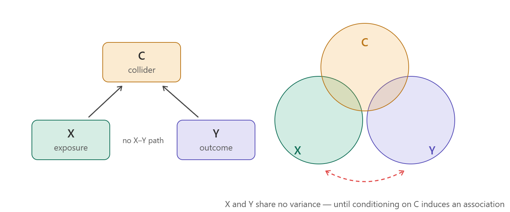{fig-alt="Collider: both the exposure X and the outcome Y affect C; X and Y share no variance until conditioning on C induces an association."}

- Consider the effect of *physical health* (IV) on *depressive symptoms* (DV)
  - You would probably want to control for socio-economic status (SES) somehow right?
    - What about a measure of *employment status*?

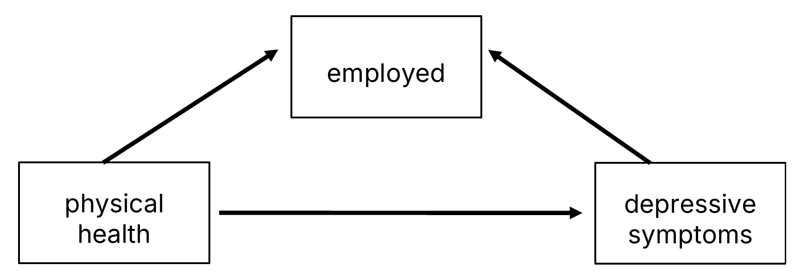{width=60% fig-alt="Path diagram: physical health has an arrow to depressive symptoms, and both physical health and depressive symptoms have arrows to employed."}

- Both physical health and depression are causes of employment status---making employment status a collider
  - Controlling for *employment* distorts the estimate of the true causal effect of *physical health*---it can shrink it, or even flip its sign

### Suppressor variables

- A suppressor variable shares variation with the IV (x) but is not directly associated with the outcome (y)
  - Controlling for the suppressor variable will increase the estimate of the effect of the IV (x)
    - I.e., the relationship was being "suppressed" and the true relationship only revealed after accounting for suppressor

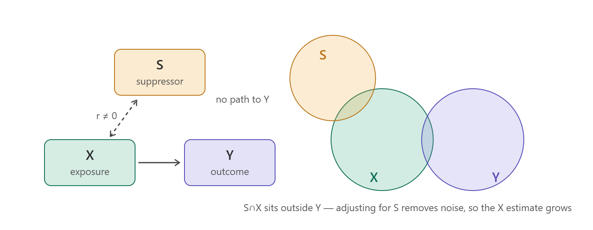{fig-alt="Suppressor: S is correlated with the exposure X but has no path to the outcome Y; adjusting for S removes noise, so the estimate for X grows."}

- E.g., Consider how well a domain-specific test score will predict success in that domain
  - E.g., Mechanical, numerical, and spatial ability skills necessary to be a successful pilot
    - Assessed with a written test
  - Outcome: demonstrated success at flying

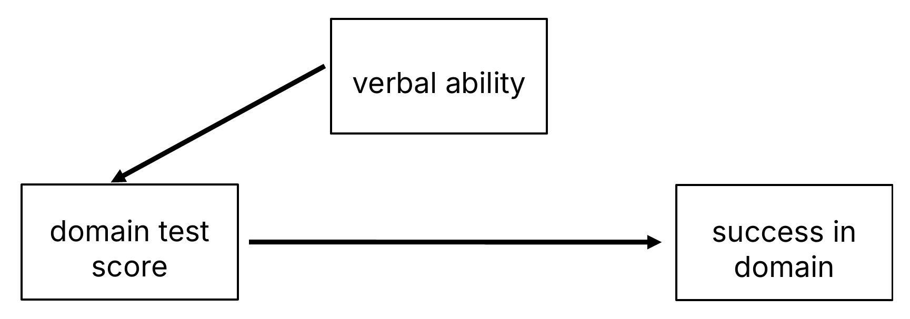{width=60% fig-alt="Path diagram: verbal ability has an arrow to the domain test score, and the domain test score has an arrow to success in the domain."}

- Verbal ability suppressed the predictive power of the test scores, which were very predictive of success, once accounting for it

### To control or not to control---that is the question

- Decisions about what variables to include as control variables should be guided by a theoretical consideration as to how those possible control variables are related to your focal IV and DV
- In general, always want to control for confounders
  - Often, the convincingness of your case for causality hinges on your ability to include likely confounds in the model
- Usually want to control for a suppressor, though they are much more rare
- Never want to control for a collider---will induce a spurious correlation
- For mediation, ***sometimes*** include a mediating variable as a control variable
  - E.g., As an acknowledgment that there are other pathways through which your focal IV might cause the DV
    - E.g., We know that *education* matters partially through *income* advantages; want to examine what else might matter
- However, usually **do not want to** control for a mediator
  - Doing so will explain away some of the effect of your IV
    - Just because an IV's effect goes through another variable does not diminish its fundamental causal importance (i.e., its total effect)
- Sometimes, a mediating relationship will be of primary theoretical interest
  - In this case, best to provide a statistical test of mediation
    - And quantify the total, direct, and indirect effect\*
- Note that *"Mediation and confounding are identical statistically and can be distinguished only on conceptual grounds."* *([MacKinnon et al. 2000](https://www.ncbi.nlm.nih.gov/pmc/articles/PMC2819361/pdf/nihms-173346.pdf))*
  - Thus, no statistical test will determine this for you. The distinction is made through theory and knowledge of past research

\*And/or others, if in the causal mediation framework

*"Which variables shall I include in this run? Shall I run X against Y or Y against X? Should I control for this? And if I control for this, must I also control for that? No statistics text or user's guide will tell you the answers." ([Davis 1985](https://us.sagepub.com/en-us/nam/book/logic-causal-order))*

- Often, we control for a host of things because everyone else in our field does (e.g., gender, race, income, education, age, etc.)
  - That is, there are normative in addition to theoretical reasons for conditioning on certain factors
- For many fields, past studies may have established important control variables to include in your model
- In the absence of experimental data with random assignment, your IV of interest will not be truly independent of other important factors, so control variables are often necessary

## Causality

- Most regression models based on **observational data** will not be able to determine causality
  - Health and social scientists tend to be very cautious about causal statements based on the results of regression models fit to observational data
- Best to think seriously about the process you are studying and ensure your model reflects the likely causal logic
  - Make sure the DV is logically the outcome of an IV cause
  - Add control variables for likely confounding variables
    - I find drawing a diagram with arrows extremely useful
      - Can formalize this as a directed acyclic graph (DAG; see [Rohrer 2018](https://doi.org/10.1177/2515245917745629))
      - But useful even informally, and as an aid for your model specification decisions

> *"The correct causal ordering of the variables is determined outside the estimation procedure. In practice, it is based on theoretical considerations, research design, good judgment, and past research." ([Lewis-Beck and Lewis-Beck 2015](https://us.sagepub.com/en-us/nam/book/applied-regression-0))*

> *"...data are profoundly dumb... you are smarter than your data" ([Pearl and Mackenzie 2018](http://bayes.cs.ucla.edu/WHY/))*

## Regression modeling overview

- Regression modeling gives us a tool for modeling expectations while conditioning on lots of other factors
  - E.g., There are lots of reasons why those with higher incomes report happier lives
    - Sometimes, interested in studying these mechanisms (mediation)
    - Other times, need to control for confounders to better isolate focal IV's effect
- Multiple regression is a tool for accounting for (conditioning on) other factors you think are important to the relationship between your focal IV(s) and DV
- Do not lose track of the fact that we are modeling conditional expectations
  - This becomes especially important when we move to binary and nominal dependent variables
  - If you focus on conditional expectations, the most intuitive way to interpret these models is clear
    - However, it is easy to get lost in the complications of the models and interpret something that is not intuitive or of substantive interest
