- One of the great things about Stata is that users can write their own commands for others to use. This greatly enhances what Stata is capable of (beyond what already comes from StataCorp itself)
- If you know the name of a command or package you want to download, you can use the **search** command in Stata to find it. For example, if you wanted to download Long and Freese's (2014) SPost13 suite of commands you could enter the command **search spost13**
- *I have compiled a do-file that automatically downloads the key user-written commands you will need for the class (CDA-Stata-setup.do). You only need to run this do-file one time if you will always work on the same computer. If you ever use Stata from a different computer, you will need to run it again to get the needed programs on it*

## usetdm command for course datasets

- One of the commands that the "Stata setup do-file" will install for you is one written by me to easily access my class and workshop datasets called [**usetdm**](/software/usetdm/index.qmd). This allows you to download any of the course datasets (which you can use for assignments and which many of the examples in the lecture notes are based on). This pulls the data from [my GitHub site](https://tdmize.github.io/data/) so you will need to be connected to the internet. To access any of the datasets for your assignments:

```stata
usetdm cda_ah4, clear
usetdm cda_gss, clear
usetdm cda_hrs, clear
```

- Note there are other datasets I use throughout these notes that can also be downloaded using the **usetdm** command. You will see examples of these if you look through the [lecture replication do-files](https://drive.google.com/drive/folders/1E0tqULBiY1WKic3A6pSG0_vFlcP-dhcF?usp=sharing)

## Descriptive statistics tables

- Each of your assignments (#3 through 9) will include a question like this:

  *Construct a table appropriate for a published article of the descriptive statistics for your model variables. Descriptive statistics tables must include: (a) an informative title, (b) means of all variables \[proportions of binary variables and of nominal variable categories\], (c) standard deviation of all continuous variables, (d) sample size, (e) a reasonable and consistent number of decimal points (2 or 3 is generally preferable), (f) numbers should be aligned by the decimal point, (g) variable names should not be used---instead use a substantive name (e.g. do not put edyrs in your tables---put "Years of Education"); often a well labeled variable provides all the information a reader needs---but if it does not (h) footnotes should be included under the table (e.g. if the measurement level of a variable is unclear or if categories of a variable require further explanation). Additional aspects of the table are up to you (e.g. if you want to report other statistics \[min, max, median, etc.\] you can include them in additional columns).*

- I include such a question as you should generally provide a descriptive statistics table in every quantitative article you write; you should also provide one if you are asking someone for help with an analysis

### desctable command

- I have made so many descriptive statistics tables in my lifetime---and been frustrated enough by the amount of time and fussiness it takes to make them look good and be effective---that I (along with Bianca Manago) wrote a Stata command [**desctable**](/software/desctable/index.qmd) to automate the process
- The **desctable** command will automatically accomplish all 8 requirements for good descriptive statistics tables described above

### desctable description

- From the help file:

> ***desctable** produces a descriptive (summary) statistics table. **desctable** treats continuous, binary, and nominal variables differently -- providing statistics and labeled output most appropriate for the measurement level of the variable.*
>
> *Factor syntax is required: binary and nominal variables must be entered into the variable list with the i. prefix. Variables without any prefix are assumed to be continuous.*
>
> ***desctable** outputs the descriptive statistics table to Excel; it can easily be copied to Word without losing the formatting of the table.*
>
> ***desctable** labels the rows of the table with the corresponding variable label. Categories of nominal variables are labeled with the value labels of the corresponding variable. Thus, the effectiveness of the default table depends on the effectiveness of the labels in the data (see label for details on adding variable and value labels to your data).*

```stata
desctable wage age i.race i.union i.collgrad tenure i.occupation hours, ///
    filename("descriptivesEX1")
```

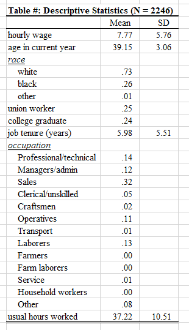{width=45% fig-alt="Descriptive statistics table made by desctable: means and standard deviations for continuous variables and proportions for each category of the binary and nominal variables."}

::: {.callout-note icon="false" appearance="simple"}
Note the only required option is to specify a filename. The Excel file is saved into your working directory

Type **pwd** in Stata to see where your working directory is currently set

Change your working directory with the [**cd** command](https://www.stata.com/manuals/dcd.pdf) or through File \> Change Working Directory

I recommend having a working directory for each project you work on. E.g. Have a working directory (folder) specific to this class where datasets, graphs, and tables are saved
:::

```stata
desctable wage age i.race i.union i.collgrad tenure i.occupation hours, ///
    filename("descriptivesEX2") stats(mean freq sd min max iqr median)
```

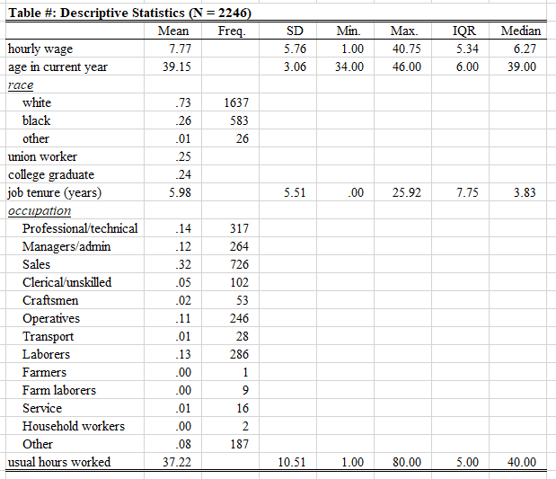{width=80% fig-alt="Descriptive statistics table made by desctable with additional columns for frequency, standard deviation, minimum, maximum, interquartile range, and median."}

::: {.callout-note icon="false" appearance="simple"}
Type [**help desctable**](/software/desctable/help.qmd) to read the help file which includes a list of all statistics **desctable** can calculate to include in the table
:::

```stata
desctable wage age i.union i.collgrad tenure i.occupation hours, ///
    filename("descriptivesEX5") group(race)
```

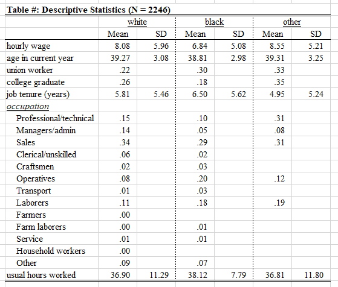{width=75% fig-alt="Descriptive statistics table made by desctable with separate columns of means and standard deviations for White, Black, and other respondents."}

::: {.callout-note icon="false" appearance="simple"}
Use the **group( )** option to calculate descriptive statistics over different nominal groups in the data
:::

### desctable options

- Read the **desctable** help file (just type [**help desctable**](/software/desctable/help.qmd)) to see other options---e.g. those needed to customize the appearance of the table
- **desctable** also provides options for statistics when the data:
  - Has survey weights applied ([**svyset** in Stata](https://www.stata.com/manuals13/svysvyset.pdf#svysvyset))
  - When missing data has been multiply imputed ([**mi set** in Stata](https://www.stata.com/manuals13/mimiset.pdf))
  - When the data has survey weights applied *and* missing data has been multiply imputed ([**mi svyset** in Stata](https://www.stata.com/manuals13/mimixxxset.pdf))

## Stata graphics and the cleanplots graphics schemes

- *Stata's default graphics scheme (e.g. colors, fonts, symbols, axis symbols, line and marker sizes, etc.) leaves much to be desired. However, with some small tweaks Stata can make excellent plots, graphics, and figures*
- *I have written a graphing scheme called **cleanplots** that changes the Stata defaults for all graphics. In particular, it is written to implement data visualization best practices by default---limiting the amount of time you have to spend tweaking the graph to be maximally readable and usable*
- *The **cleanplots** graphics scheme is automatically downloaded via the Stata setup do-file. If you want to tell your friends how to use it, it is available on my website:* [cleanplots](/software/cleanplots/index.qmd)

Below is an example of why you will probably want to use the **cleanplots** graphics scheme. Here is a **marginsplot** example for Stata's default graphics scheme (**s2color**):

```stata
margins, at(orole=(0(1)10))
marginsplot
```

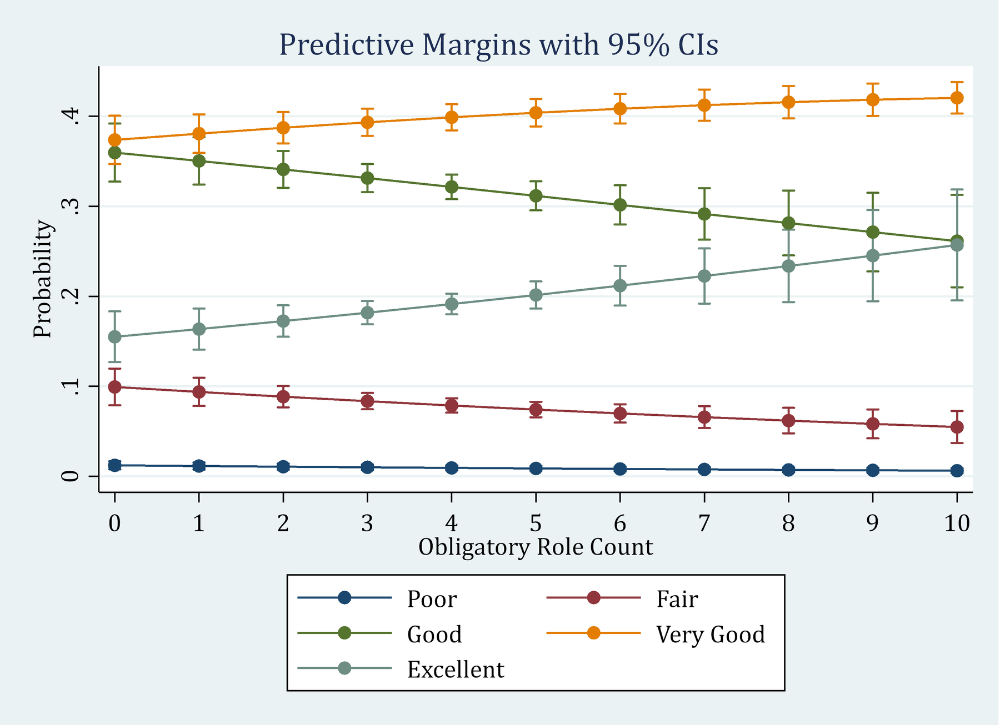{width=70% fig-alt="marginsplot with Stata's default s2color scheme: a blue-gray background, a boxed legend below the graph, and vertical axis labels."}

**cleanplots** implements a host of features that draw on best data visualization practices (some of which are borrowed from the excellent black and white graphics scheme **plainplots** from [Bischof (2017)](https://www.dropbox.com/s/m5viis9oybgkept/FigureScheme.pdf?dl=0)). This allows you to make publication quality Stata graphics with very little effort. With **cleanplots**, many of the defaults you would change before via code are already changed for you

For example:

- Default colors are easier to distinguish from each other and are more aesthetically pleasing
  - Default colors allow graphs to be printed in color or black and white
- Marker shapes and line features (e.g. solid, dashed, etc.) better distinguish lines and ensure lines will be distinguishable if printing in black and white
- All axis markers are horizontal -- thus easier to read
- A non-invasive light grid is on all plots
  - Both vertical and horizontal gridlines
- The background of the plot is white
- Legends are placed to right of the graph
- And many more!

```stata
set scheme cleanplots, perm
marginsplot, recastci(rline) ciopt(lpat(dash) col(gs12))
```

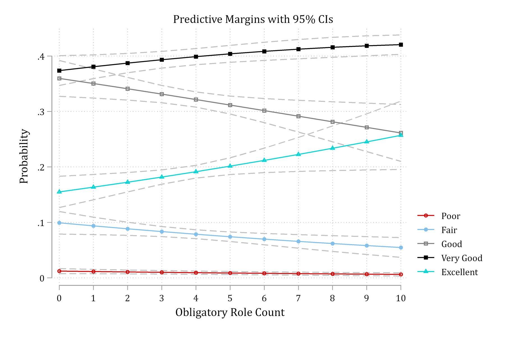{width=70% fig-alt="The same marginsplot with the cleanplots scheme: a white background, light grid, horizontal axis labels, distinct colors and markers, and the legend to the right."}

A couple of additional examples of Stata's default **s2color** vs. **cleanplots**

***Histograms**:*

```stata
hist vidtv, percent
```

:::: {.columns}
::: {.column width="50%"}
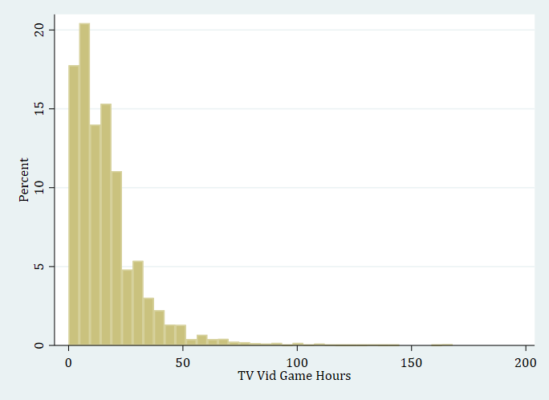{fig-alt="Histogram of TV and video game hours with the s2color scheme: khaki bars on a blue-gray background."}
:::
::: {.column width="50%"}
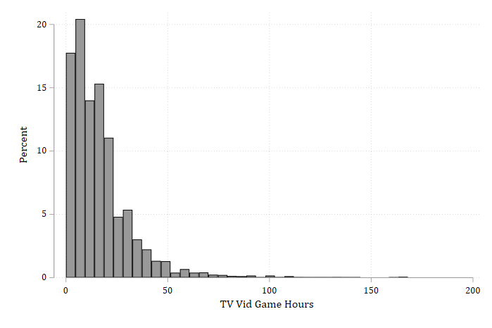{fig-alt="The same histogram with the cleanplots scheme: gray bars on a white background."}
:::
::::

### Color and grayscale images with cleanplots

- Much thought/research went into the color scheme.
  - You only need one set of figures instead of needing a color version and a black and white version

:::: {.columns}
::: {.column width="50%"}
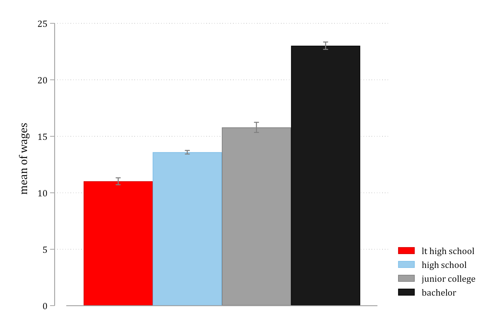{fig-alt="Bar graph of mean wages by education with the cleanplots colors: red, light blue, gray, and black."}
:::
::: {.column width="50%"}
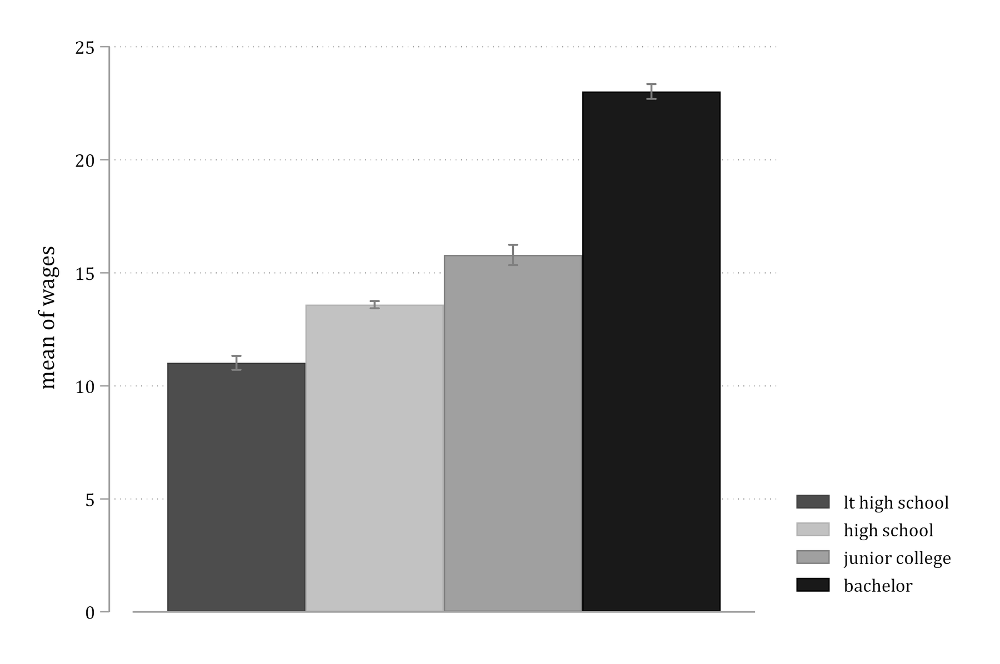{fig-alt="The same bar graph printed in grayscale: the four bars are still easy to tell apart."}
:::
::::

:::: {.columns}
::: {.column width="50%"}
{fig-alt="marginsplot with the cleanplots colors."}
:::
::: {.column width="50%"}
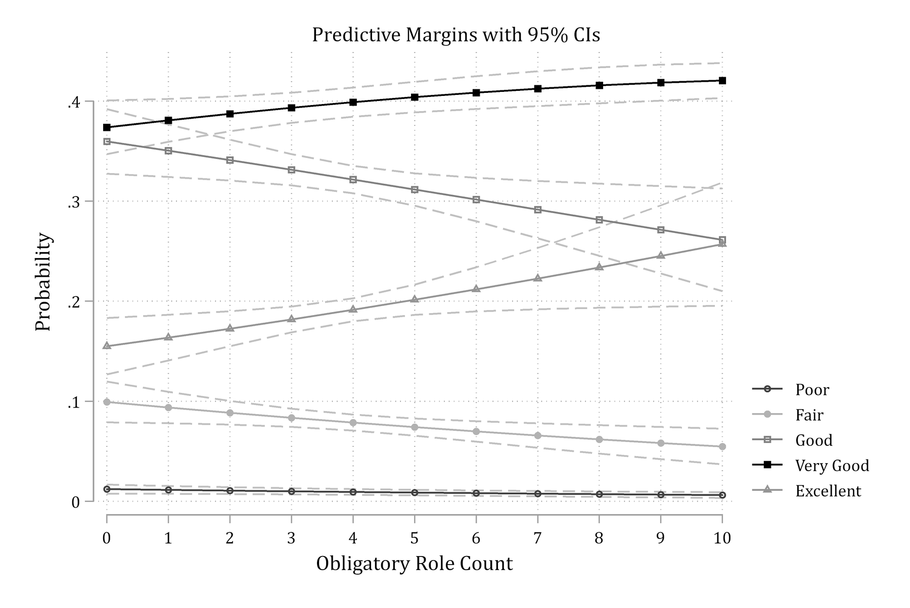{fig-alt="The same marginsplot printed in grayscale: the lines are still distinguishable by shade and marker."}
:::
::::

### Creating figures considerate of colorblindness

- About 5% of the population has some form of colorblindness (red/green being the most common which is why you should always avoid having red and green together on your figure)
  - This excellent website [Coloring for Colorblindness](https://davidmathlogic.com/colorblind/#%23C80000-%2382C0DF-%23808080-%23000000-%2305CECE-%23881161) lets you check your color schemes to see how they will be viewed for those who are colorblind
    - Below is an example for how the first four default **cleanplots** colors look to individuals with various types of colorblindness

:::: {.columns}
::: {.column width="60%"}
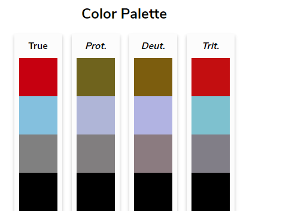{fig-alt="The first four cleanplots colors as seen with typical vision and with protanopia, deuteranopia, and tritanopia: the four colors stay distinct."}
:::
::: {.column width="15%"}
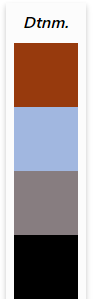{fig-alt="The first four cleanplots colors as seen with deuteranomaly."}
:::
::::
