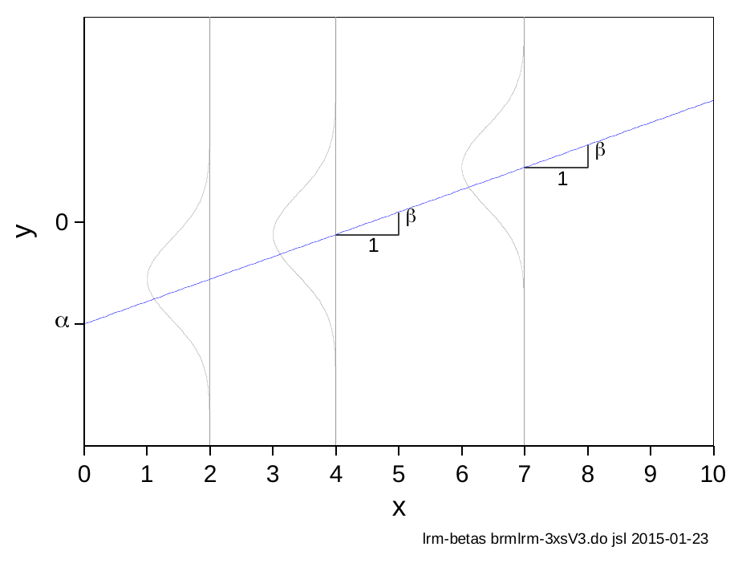
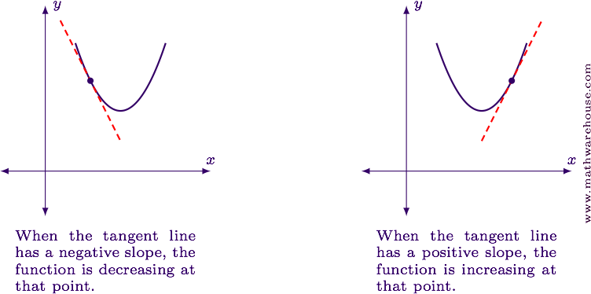
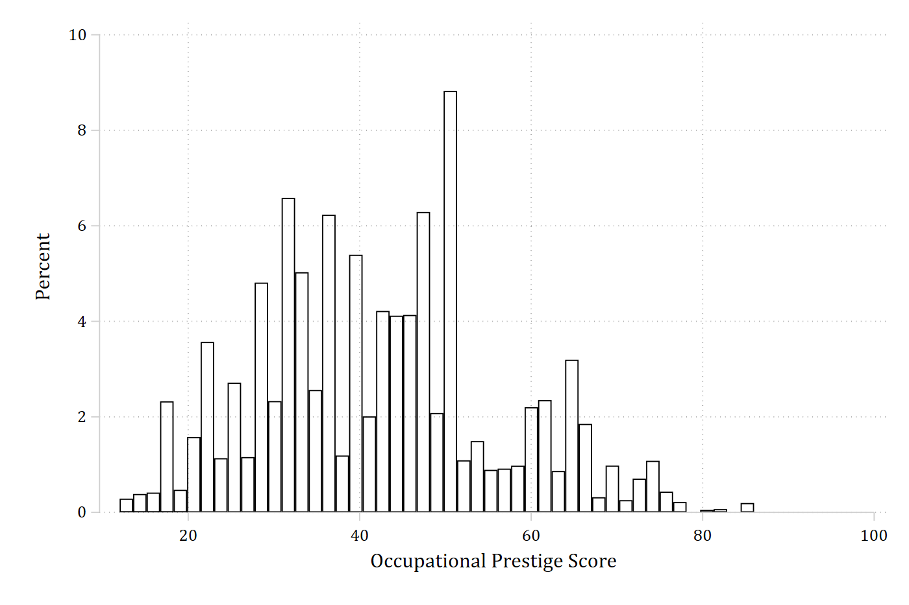
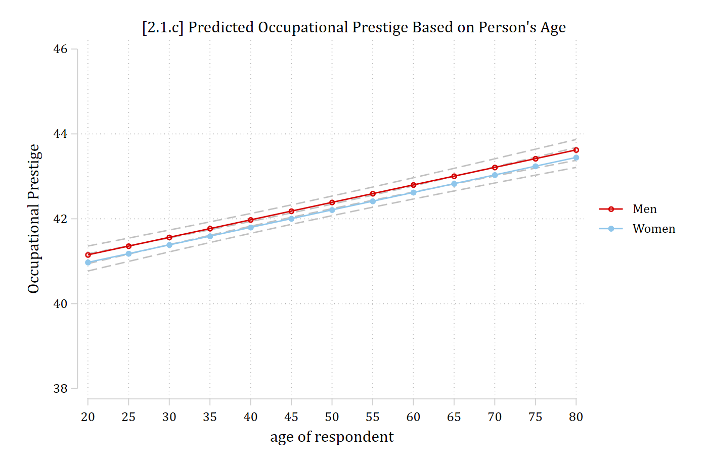
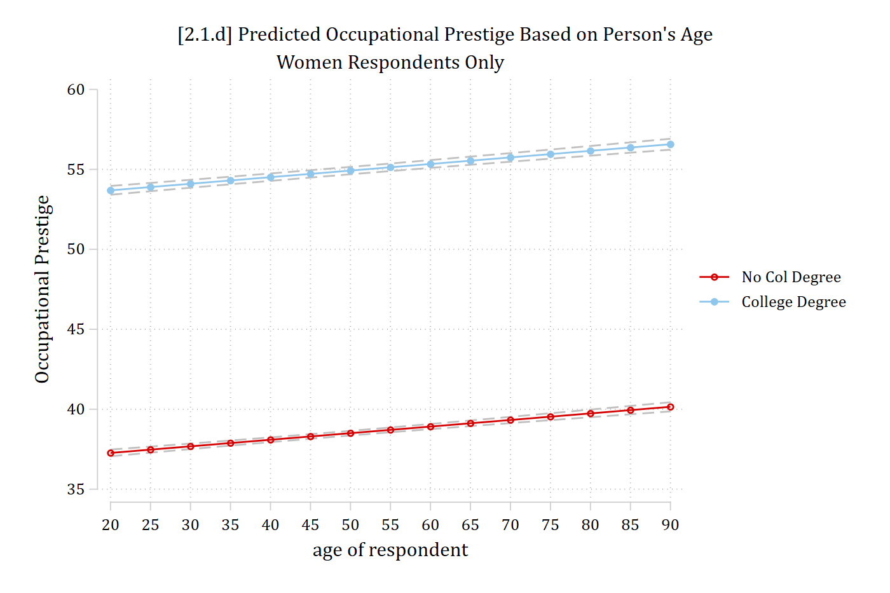

- A marginal effect is your model's answer to a counterfactual question:
  - *If the value of this independent variable were different, how would the predicted outcome change?*
    - Every marginal effect is an answer to some "what if" question you pose to your fitted model
- A **marginal effect** is defined as:
  - *The predicted change in the outcome for a change in* $x_{k}$ *of δ, holding other predictors constant*
    - And is calculated as the difference between two model predictions ($\eta$)
- With nonlinearities, it is often the best choice to provide a **summary of the effect** of a variable

### Marginal effects with linear additive effects

- In the special case of a linear regression model with linear, non-interactive (i.e., additive) effects: ${ME}_{x_{k} + 1} = \beta_{x_{k}}$
  - This is only true in this incredibly limited situation

{width=60% fig-alt="A straight regression line with normal error distributions at several values of x; each one-unit increase in x raises y by beta."}

#### Marginal effects with nonlinear and/or interactive effects

- Marginal effects are most useful for nonlinear and/or interactive effects
  - In these cases, the marginal effects are summarizing different information than the coefficients

## Marginal effects defined

- Denote our focal IV as $x_{k}$
- Denote the control variables as $\mathbf{x}_{- k}$ (all other IVs in the model excluding $x_{k}$)
- A marginal effect, at its simplest, is the difference between two predictions (denoted as $\eta$ "eta"): one at a starting value of substantive interest; one at an ending value of substantive interest
- Formally:

$$ME = \eta\left( x_{k} = end,\ \mathbf{x}_{- k} = \mathbf{x}^{\mathbf{*}} \right) - \eta\left( x_{k} = start,\ \mathbf{x}_{- k} = \mathbf{x}^{\mathbf{*}} \right)$$

- Starting and ending values of the focal IV $x_{k}$ can be any values of substantive interest. For binary IVs, there are only two logical choices: 0 and 1

$${ME}_{binary} = \eta\left( x_{k} = 1,\ \mathbf{x}_{- k} = \mathbf{x}^{\mathbf{*}} \right) - \eta\left( x_{k} = 0,\ \mathbf{x}_{- k} = \mathbf{x}^{\mathbf{*}} \right)$$

- For example, can compare a prediction for no degree (=0) to college (=1)

### Marginal effects for continuous IVs

- For continuous IVs, there are many more choices for starting and ending values. Common choices:
  - *start* = mean of $x_{k}$
  - *end* = mean + 1
    - *end* = mean + SD is also common\*; sometimes more informative
- Any other values of substantive interest can be used for *start* and *end* (e.g., age 30 and age 55)
  - This flexibility is one of the benefits of using marginal effects for interpretation

#### Amount of change ($\delta$)

- There are two types of marginal effects for continuous IVs, differing in the amount of change $\delta$ ([Mize and Han 2026](/research/mize_han_hdma_2025.qmd))
  - *Discrete change* in $\widehat{y}$ as an IV changes by a fixed amount
    - E.g., A one unit increase; a standard deviation increase
  - *Instantaneous rate of change* in $\widehat{y}$ (first derivative; AKA *slopes*)
    - Rates of changes are less intuitive to interpret and thus less popular in most social science applications

\*In most applications, especially for large changes, I recommend centering the change on *start* value

## Terminology is confusing

*"Mathematics is the art of giving the same name to different things."* -- Henri Poincaré

- I use **marginal effects** as an umbrella term for all of these effects (i.e., both discrete and rates of changes), regardless of the specific amount of change
  - "Marginal" comes from the idea of evaluating a change at the margin---that is, asking what happens to an outcome when a predictor changes slightly, holding other things constant
- Instantaneous rates of changes (AKA slopes) are sometimes called partial effects or (even more confusing) *marginal* changes

{width=75% fig-alt="Two curves with tangent lines: where the tangent line has a negative slope the function is decreasing; where it has a positive slope the function is increasing."}

## Example: Occupational Prestige

Data is from pooled General Social Survey (GSS) data from 1972 -- 2016

```{.stata-run}
. use "https://tdmize.github.io/data/data/cda_gss", clear
(cda_gss.dta |  GSS 1972-2021 CDA - Categorical Data Analysis | date created 202
> 3)

. 
. hist occprest, percent fcol(none) ylab(0(2)10)
(bin=47, start=12, width=1.5744681)

```

{width=80% fig-alt="Histogram of occupational prestige scores."}

### Example occupational prestige scores

- A [2018 *ASR* article](http://journals.sagepub.com/doi/pdf/10.1177/0003122418761857) examining occupational prestige scores
- The list of scores for various occupations can be [found here](http://ibgwww.colorado.edu/~agross/NNSD/prestige%20scores.html). Some examples:

| Occupation | Prestige score |
|:--------------------------|------:|
| Elementary school teachers | 64.08 |
| Sociologists | 60.75 |
| "Sociology teachers" | 73.51 |
| Statisticians | 55.57 |
| Architects | 73.15 |
| Physicians | 86.05 |
| Registered nurses | 66.48 |
| Sales workers, shoes | 27.67 |
| Bartenders | 24.53 |
| Barbers | 35.71 |
| Parking lot attendants | 21.22 |

### Regression results for occupational prestige (DV)

```{.stata-run}
. regress occprest c.age i.woman i.college

      Source |       SS           df       MS      Number of obs   =    58,304
-------------+----------------------------------   F(3, 58300)     =   6232.46
       Model |  2765051.56         3  921683.852   Prob > F        =    0.0000
    Residual |  8621657.35    58,300  147.884346   R-squared       =    0.2428
-------------+----------------------------------   Adj R-squared   =    0.2428
       Total |  11386708.9    58,303  195.302281   Root MSE        =    12.161

-------------------------------------------------------------------------------
     occprest | Coefficient  Std. err.      t    P>|t|     [95% conf. interval]
--------------+----------------------------------------------------------------
          age |      0.041      0.003   14.027   0.000        0.035       0.047
              |
        woman |
       Women  |     -0.178      0.101   -1.756   0.079       -0.376       0.021
              |
      college |
College De..  |     16.422      0.121  136.142   0.000       16.185      16.658
        _cons |     36.621      0.157  233.710   0.000       36.314      36.928
-------------------------------------------------------------------------------

. 
. esttab, b(2) se(2) nobase label ///
>     title("[2.1.b] Occupational Prestige Based on Age, Gender, and Education")

[2.1.b] Occupational Prestige Based on Age, Gender, and Education
------------------------------------
                              (1)   
                     Occupation~e   
------------------------------------
age of respondent            0.04***
                           (0.00)   

Women                       -0.18   
                           (0.10)   

College Degree              16.42***
                           (0.12)   

Constant                    36.62***
                           (0.16)   
------------------------------------
Observations                58304   
------------------------------------
Standard errors in parentheses
* p<0.05, ** p<0.01, *** p<0.001

```

::: {.callout-note icon="false" appearance="simple"}
**Side note**: to make publication quality regression tables in Stata, I recommend [**esttab**](https://repec.sowi.unibe.ch/stata/estout/esttab.html). To visualize regression coefficients, I recommend [**coefplot**](https://repec.sowi.unibe.ch/stata/coefplot/getting-started.html).

In R, I recommend [modelsummary](https://modelsummary.com/) for both.
:::

```{.stata-run}
. qui margins woman, at(age=(20(5)80))

. marginsplot, ///
>     recastci(rline) ciopts(lpat(dash) col(gs12)) ylab(38(2)46) ///
>     title("[2.1.c] Predicted Occupational Prestige Based on Person's Age", siz
> e(med)) ///
>     ytitle("Occupational Prestige")

Variables that uniquely identify margins: age woman
(note:  named style med not found in class gsize, default attributes used)

```

{width=80% fig-alt="Predicted occupational prestige by age for men and women: two nearly overlapping straight lines rising slowly with age."}

### Calculating marginal effects

$$\widehat{occprest} = 36.63 + 0.04*{age}_{i} - 0.183*{woman}_{i} + 16.43*{college}_{i}$$

**To calculate the marginal effect of age, where should we hold the other variables constant?**

Calculate the effect of aging from 40 to 50 for women without college degrees:

$\widehat{occprest} = 36.63 + 0.04*40 - 0.183*1 + 16.43*0$ = 38.047

$\widehat{occprest} = 36.63 + 0.04*50 - 0.183*1 + 16.43*0$ = 38.447

38.447 -- 38.047 = 0.400

Calculate the effect of aging from 40 to 50 for women with college degrees:

$\widehat{occprest} = 36.63 + 0.04*40 - 0.183*1 + 16.43*1$ = 54.477

$\widehat{occprest} = 36.63 + 0.04*50 - 0.183*1 + 16.43*1$ = 54.877

54.877 -- 54.477 = 0.400

```{.stata-run}
. di 36.63 + 0.04*40 - 0.183*1 + 16.43*0
38.047

. di 36.63 + 0.04*50 - 0.183*1 + 16.43*0
38.447

. di 38.447 - 38.047
.4

. 
. di 36.63 + 0.04*40 - 0.183*1 + 16.43*1
54.477

. di 36.63 + 0.04*50 - 0.183*1 + 16.43*1
54.877

. di 54.877 - 54.477
.4

```

### Simple interpretation due to linearity

#### Continuous variables

- Interpretation: **for a unit increase in *x~k~* the expected change in *y* is ME, holding other variables constant**
  - Remember, in the case of linear additive effects in linear regression: ${ME}_{x_{k} + 1} = \beta_{x_{k}}$

> *For each additional year a person ages, their job prestige is expected to be 0.04 points higher, holding other variables constant*
>
> *For ten additional years of age, a person's job prestige is expected to increase by 0.4 points, holding other variables constant*

**Note:** 0.04 \* 10 = 0.40

Plot the effects for women, separately for those who went to college or not:

```{.stata-run}
. qui margins, at(age=(20(5)90) woman=(1) college=(0 1))

. marginsplot, ///
>     recastci(rline) ciopts(lpat(dash) col(gs12)) ylab(35(5)60) ///
>     title("[2.1.d] Predicted Occupational Prestige Based on Person's Age", siz
> e(med)) ///
>     subtitle("Women Respondents Only", size(med)) ///
>     ytitle("Occupational Prestige")

Variables that uniquely identify margins: age college
(note:  named style med not found in class gsize, default attributes used)
(note:  named style med not found in class gsize, default attributes used)

```

{width=80% fig-alt="Predicted occupational prestige by age for women with and without a college degree: two parallel straight lines about 16 points apart."}

### Calculating marginal effects for a binary variable

$$\widehat{occprest} = 36.63 + 0.04*{age}_{i} - 0.183*{woman}_{i} + 16.43*{college}_{i}$$

Calculate the effect of having a college degree for a 40-year-old woman:

$\widehat{occprest} = 36.63 + 0.04*40 - 0.183*1 + 16.43*0$ = 38.047

$\widehat{occprest} = 36.63 + 0.04*40 - 0.183*1 + 16.43*1$ = 54.477

54.477 -- 38.047 = 16.43

Calculate the effect of having a college degree for a 40-year-old man:

$\widehat{occprest} = 36.63 + 0.04*40 - 0.183*0 + 16.43*0$ = 38.23

$\widehat{occprest} = 36.63 + 0.04*40 - 0.183*0 + 16.43*1$ = 54.66

54.66 -- 38.23 = 16.43

```{.stata-run}
. di 36.63 + 0.04*40 - 0.183*1 + 16.43*0
38.047

. di 36.63 + 0.04*40 - 0.183*1 + 16.43*1
54.477

. di 54.477 - 38.047
16.43

. 
. di 36.63 + 0.04*40 - 0.183*0 + 16.43*0
38.23

. di 36.63 + 0.04*40 - 0.183*0 + 16.43*1
54.66

. di 54.66 - 38.23
16.43

```

### Interpreting binary variables coded as 0 and 1

- Interpretation: **having characteristic *x~k~* (as opposed to not having the characteristic) results in an expected change of ME in *y*, holding other variables constant**
  - Note these are usually group comparisons. Interpretations are more natural when you state these as comparisons
  - Again, in the case of linear additive effects: ${ME}_{x_{k} + 1} = \beta_{x_{k}}$

> *On average, those with college degrees hold jobs that are 16.43 points more prestigious than jobs held by those without a college degree (accounting for other factors)*
