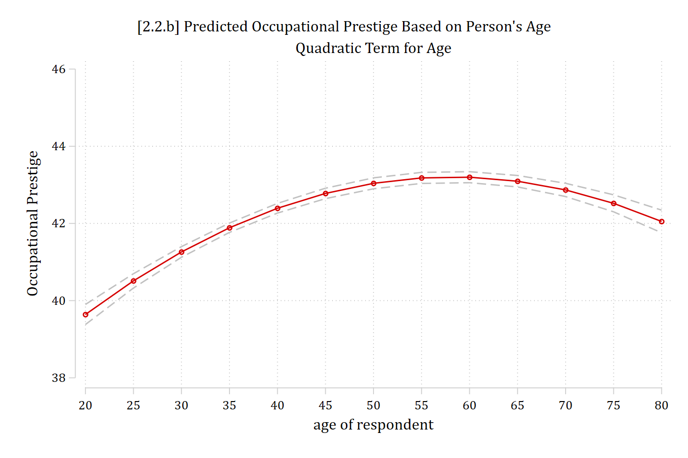
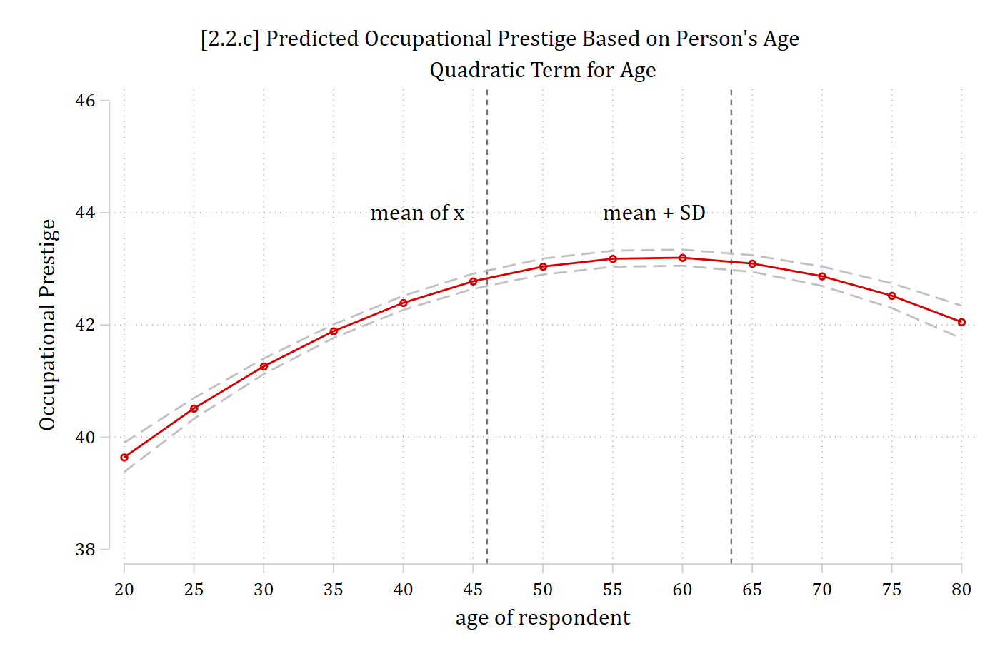
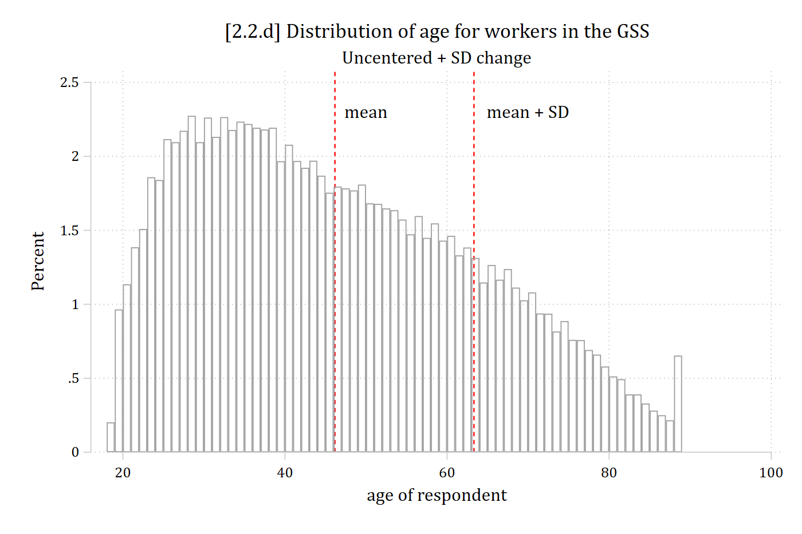
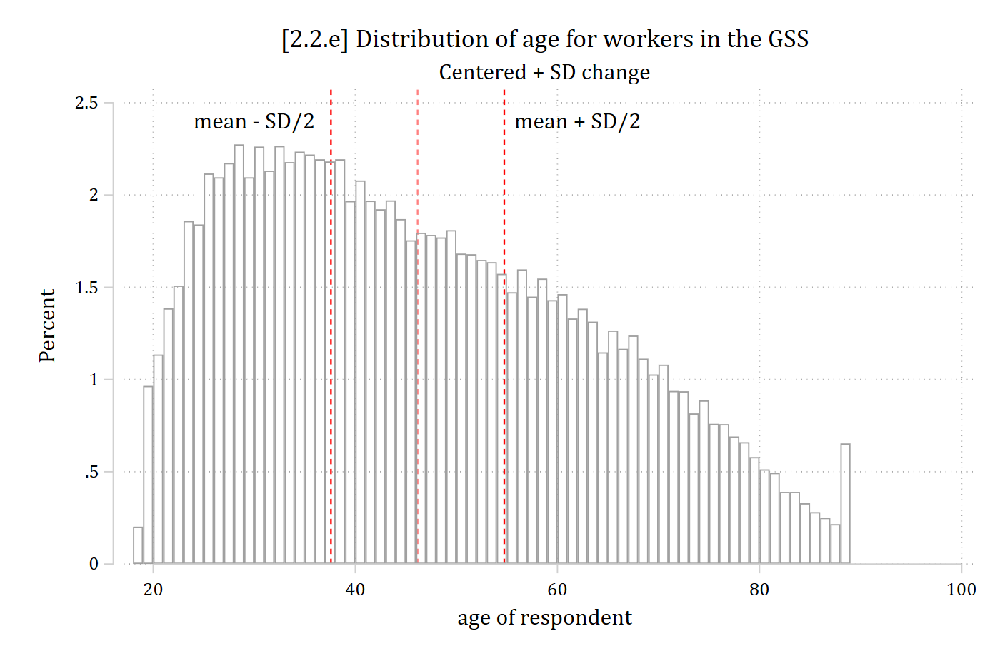
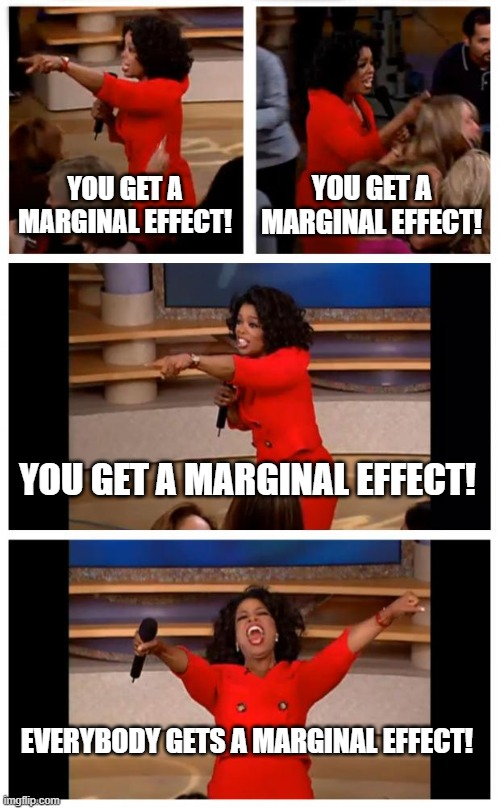
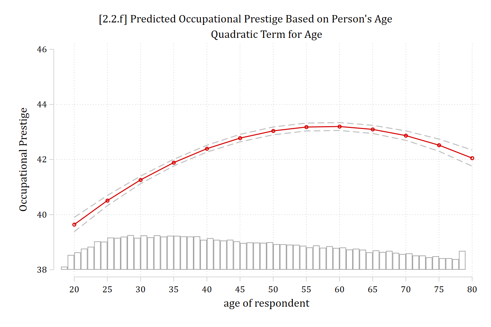

#### Marginal effect of *x~k~* for linear additive effects

- The size of the effect *does not* depend on the value of *x~k~*
- The size of the effect *does not* depend on the values of other IVs

#### Marginal effect of *x~k~* for nonlinear interactive effects

- The size of the effect *does* depend on the value of *x~k~*
- The size of the effect *does* depend on the values of other IVs

### Nonlinear effects in linear regression models

- By transforming IVs or the DV or by adding polynomial IVs the **effects** of IVs can be **nonlinear** even in the linear regression model
- The *x*'s enter in the linear (additive) form **xβ** = β~0~ + β~1~*x*~1~ + β~2~*x*~2~ + ...
- But the *x*'s can be **transformations** or **polynomials** of variables leading to nonlinear *effects*, e.g.

*Square root*:

$$\begin{aligned} y &= \beta_{0} + \beta_{1}x_{1} + \beta_{2}\sqrt{w_{2}} + \varepsilon \\ &= \beta_{0} + \beta_{1}x_{1} + \beta_{2}x_{2} + \varepsilon \end{aligned}$$

***Polynomial***: $y = \beta_{0} + \beta_{1}x_{1} + \beta_{2}{x_{1}}^{2} + \varepsilon$

**The effect in terms of the predictions is nonlinear**

### Polynomials of continuous IVs

- Add a polynomial term for age
  - Note if you include a higher order polynomial (e.g., *age^2^*) in a regression model you need to also include the lower order terms (here, *age*)

$${occupational\ prestige}_{i} = \beta_{0} + \beta_{age}{age}_{i} + \beta_{{age}^{2}}{{age}^{2}}_{i} \ldots$$

```{.stata-run}
. use "https://tdmize.github.io/data/data/cda_gss", clear
(cda_gss.dta |  GSS 1972-2021 CDA - Categorical Data Analysis | date created 202
> 3)

. 
. regress occprest c.age##c.age i.woman i.college

      Source |       SS           df       MS      Number of obs   =    58,304
-------------+----------------------------------   F(4, 58299)     =   4746.11
       Model |  2797112.11         4  699278.027   Prob > F        =    0.0000
    Residual |  8589596.79    58,299  147.336949   R-squared       =    0.2456
-------------+----------------------------------   Adj R-squared   =    0.2456
       Total |  11386708.9    58,303  195.302281   Root MSE        =    12.138

-------------------------------------------------------------------------------
     occprest | Coefficient  Std. err.      t    P>|t|     [95% conf. interval]
--------------+----------------------------------------------------------------
          age |      0.284      0.017   16.988   0.000        0.251       0.317
              |
  c.age#c.age |     -0.002      0.000  -14.751   0.000       -0.003      -0.002
              |
        woman |
       Women  |     -0.159      0.101   -1.576   0.115       -0.357       0.039
              |
      college |
College De..  |     16.238      0.121  134.149   0.000       16.001      16.475
        _cons |     31.359      0.389   80.511   0.000       30.595      32.122
-------------------------------------------------------------------------------

. est store opmod

. 
. est table, title("[2.2.a] Occupational prestige linear regression model") ///
>     b(%5.3f) star(.05 .01 .001)

[2.2.a] Occupational prestige linear regression model

---------------------------
    Variable |   opmod     
-------------+-------------
         age |   0.284***  
             |
 c.age#c.age |  -0.002***  
             |
       woman |
      Women  |  -0.159     
             |
     college |
College D..  |  16.238***  
       _cons |  31.359***  
---------------------------
Legend: * p<.05; ** p<.01; *** p<.001

```

::: {.callout-note icon="false" appearance="simple"}
**Stata**: Use [factor syntax](https://www.stata.com/links/stata-basics/factor-variable-notation/) (**c.** for continuous IVs) and **\##** to specify polynomials.

**R**: Use the [poly( , #)](https://www.rdocumentation.org/packages/stats/versions/3.6.2/topics/poly) function to specify polynomials.
:::

### Interpreting polynomial IVs

- The *age^2^* coefficient is statistically significant---which is what we usually use to determine whether we should keep it in the model or not
  - If it was not significant, I would go back to a model with only *age*
- The linear term (*age*) tells us the initial slope: here, a positive effect
- The squared term (*age^2^*) tells us how the regression line's slope will change eventually: here, become more negative/less positive
- The coefficients don't tell us at what age the effect becomes more negative; they do not tell us if the slope of age just becomes less positive or if it ever becomes negative (i.e., direction of effect reverses)
  - To answer these questions, we need to make and plot predictions

::: {.callout-note icon="false" appearance="simple"}
**Stata**: Use **margins** to calculate predictions, and [**marginsplot**](https://www.stata.com/features/overview/margins-plots/) to make the graph.

**R**: Use [**plot_predictions**](https://marginaleffects.com/bonus/plot.html) function.
:::

```{.stata-run}
. qui margins, at(age=(20(5)80))

. marginsplot, ///
>     recastci(rline) ciopts(lpat(dash) col(gs12)) ylab(38(2)46) ///
>     title("[2.2.b] Predicted Occupational Prestige Based on Person's Age", siz
> e(med)) ///
>     subtitle("Quadratic Term for Age") ///
>     ytitle("Occupational Prestige")

Variables that uniquely identify margins: age
(note:  named style med not found in class gsize, default attributes used)

```

{width=80% fig-alt="Predicted occupational prestige by age with a quadratic term: rising from age 20, peaking near 60, then falling slightly."}

The marginal effect of age is now different depending on what starting and ending values are used to calculate ME~age~

### Calculating marginal effects for nonlinear effects

$$\widehat{occprest} = 31.36 + 0.28*{age}_{i} - 0.002*{{age}^{2}}_{i} - 0.165*{woman}_{i} + 16.25*{college}_{i}$$

- To calculate the marginal effect of age we must include a value of age in the linear term, and that same value squared for the quadratic term:

Calculate the effect of aging from 40 to 50:

$\widehat{occprest} = 31.36 + 0.28*40 - 0.002*1600 - 0.165*0 + 16.25*0$ = 39.36

$\widehat{occprest} = 31.36 + 0.28*50 - 0.002*2500 - 0.165*0 + 16.25*0$ = 40.36

40.36 -- 39.36 = 1.00

Calculate the effect of aging from 70 to 80:

$\widehat{occprest} = 31.36 + 0.28*70 - 0.002*4900 - 0.165*0 + 16.25*0$ = 41.16

$\widehat{occprest} = 31.36 + 0.28*80 - 0.002*6400 - 0.165*0 + 16.25*0$ = 40.96

40.96 -- 41.16 = -0.20

```{.stata-run}
. di 31.36 + 0.28*40 - 0.002*1600 - 0.165*0 + 16.25*0
39.36

. di 31.36 + 0.28*50 - 0.002*2500 - 0.165*0 + 16.25*0
40.36

. di 40.36 - 39.36
1

. 
. di 31.36 + 0.28*70 - 0.002*4900 - 0.165*0 + 16.25*0
41.16

. di 31.36 + 0.28*80 - 0.002*6400 - 0.165*0 + 16.25*0
40.96

. di 40.96 - 41.16
-.2

```

### Interpreting marginal effects for nonlinear effects

Interpretation is now limited to the specific value of age the marginal effect is calculated at:

> *For someone who is 40 years old, ten additional years of age is predicted to **increase** job prestige by about 1 point, accounting for other factors*
>
> *For someone who is 70 years old, ten additional years of age is predicted to **decrease** job prestige by about 0.2 points, accounting for other factors*

::: {.callout-note icon="false" appearance="simple"}
**Interpretation tip**: Note the initial clause specifying the starting age. These interpretations are only accurate for that specific age.
:::

## Summarizing nonlinear effects

- A difficulty interpreting and presenting nonlinear effects is that the effect *depends* on where the effect is calculated \[i.e., starting and ending values\] and what type of change is being calculated
  - E.g., An instantaneous vs. one-unit vs. SD change will all yield different answers
  - And for categorical DVs, where the control variables are being held
- How to summarize these effects? Two common solutions:
  - Marginal effect at the mean
  - Average marginal effect
- **Marginal effect at the mean (MEM)**: what is the effect of a change in a focal IV *for the average person in your data*
- **Average marginal effect (AME)**: on average---pooling and averaging across every observation in your data---what is the effect of a change in a focal IV

### Marginal effects at the mean/modes (MEM)

- MEMs have often been used, perhaps due to ease of computation and tradition
- For a MEM, hold all control variables in $\mathbf{x}_{- k}$ constant at their observed sample means/modes:

$$MEM = \eta\left( x_{k} = end,\ \mathbf{x}_{- k} = \overline{\mathbf{x}} \right) - \eta\left( x_{k} = start,\ \mathbf{x}_{- k} = \overline{\mathbf{x}} \right)$$

- E.g., For a binary variable (e.g., *college*) make predictions at 0 and 1:

$${MEM}_{binary} = \eta\left( x_{k} = 1,\ \mathbf{x}_{- k} = \overline{\mathbf{x}} \right) - \eta\left( x_{k} = 0,\ \mathbf{x}_{- k} = \overline{\mathbf{x}} \right)$$

- E.g., For a continuous variable (e.g., *age*) could compare predictions at any two places---e.g., one common approach is at the mean and at the mean + 1:

$${MEM}_{continuous} = \eta\left( x_{k} = {\overline{x}}_{k} + 1,\ \mathbf{x}_{- k} = \overline{\mathbf{x}} \right) - \eta\left( x_{k} = {\overline{x}}_{k},\ \mathbf{x}_{- k} = \overline{\mathbf{x}} \right)$$

### Considerations for using a MEM

- Is the mean/mode representative of what you want to know?
  - Is someone who is average on all variables realistic? Interesting?
    - If your theory suggests you should be looking at a specific type of person/observation (e.g., someone who is highly educated; someone who is working class; etc) then the effect for someone who is average on all characteristics may not accurately answer your question
- Statistically, holding binary variables at their mean is not a problem
  - E.g., If ${\overline{x}}_{woman} = 0.60$, then the predictions are effectively weighted to reflect that 60% of the sample are women
  - However, substantively what does it mean to interpret a prediction for someone who is 0.60 a woman?
- Stata will hold all variables, including binary/nominal variables, at their mean with the **atmeans** option. This is best practice and the way to get a true average effect
  - R's **marginaleffects** sets binary/nominal variables to their modes, which I do not like and does not produce an average effect

```{.stata-run}
. qui margins, at(age=(20(5)80))

. marginsplot, ///
>     title("[2.2.c] Predicted Occupational Prestige Based on Person's Age", siz
> e(med)) ///
>     subtitle("Quadratic Term for Age") ///
>     ytitle("Occupational Prestige") ///
>     recastci(rline) ciopts(lpat(dash) col(gs12)) ///
>     ylab(38(2)46) xline(46) xline(63.50) ///
>     text(44 41 "mean of x") text(44 58 "mean + SD")

Variables that uniquely identify margins: age
(note:  named style med not found in class gsize, default attributes used)

```

{width=80% fig-alt="The quadratic prediction line for age with vertical lines at the mean of age and one standard deviation above the mean."}

Vertical lines on plot represent ${\overline{x}}_{age}$ and ${\overline{x}}_{age} + SD$

### Calculating MEMs

$$\widehat{occprest} = 31.36 + 0.28*{age}_{i} - 0.002*{{age}^{2}}_{i} - 0.165*{woman}_{i} + 16.25*{college}_{i}$$

- Calculate the marginal effect at the mean (MEM) for the effect of aging from the mean age (≈46) to a SD above the mean (age ≈63) while holding the control variables constant at their means:

$$\widehat{occprest} = 31.36 + 0.28*46.17 - 0.002*2131.67 - 0.165*0.54 + 16.25*0.23 \approx 42.85$$

$$\widehat{occprest} = 31.36 + 0.28*63.32 - 0.002*4009.42 - 0.165*0.54 + 16.25*0.23 \approx 43.14$$

MEM~age+SD~ = 43.14 -- 42.85 ≈ 0.293

```{.stata-run}
. est restore opmod
(results opmod are active now)

. sum age if e(sample)

    Variable |        Obs        Mean    Std. dev.       Min        Max
-------------+---------------------------------------------------------
         age |     58,304      46.165    17.15691         18         89

. di 46.165 + 17.15691
63.32191

. 
. mtable, at(age=(46.165 63.32191)) atmeans post

Expression: Linear prediction, predict()

           |      age        xb
 ----------+-------------------
         1 |     46.2    42.850
         2 |     63.3    43.143

Specified values of covariates

           |        1.         1.
           |    woman    college
 ----------+--------------------
   Current |     .542       .226

. mlincom 2 - 1

             |   lincom    pvalue        ll        ul 
-------------+---------------------------------------
           1 |    0.293     0.000     0.180     0.406 

. 
. sum age woman college if e(sample)

    Variable |        Obs        Mean    Std. dev.       Min        Max
-------------+---------------------------------------------------------
         age |     58,304      46.165    17.15691         18         89
       woman |     58,304    .5421412    .4982252          0          1
     college |     58,304    .2256792    .4180324          0          1

```

> *For the average person in the data, a standard deviation increase in age (about 17.2 years) is associated with a 0.293 increase in occupational prestige points*
>
> OR
>
> *For someone who is average on all characteristics included in the model, an additional standard deviation of age (about 17.2 years) is predicted to increase occupational prestige by 0.293 points*

### Centered vs uncentered changes

- The example above is an uncentered change: from *start* value to *start* + $\delta$
  - $\delta$ = amount of change
- Usually, and especially for larger changes like a SD, best to center the change on the *start* value

$${ME}_{centered} = \eta\left( x_{k} = start + \frac{\delta}{2},\ \mathbf{x}_{- k} = \mathbf{x*} \right) - \eta\left( x_{k} = start - \frac{\delta}{2},\ \mathbf{x}_{- k} = \mathbf{x*} \right)$$

- Better represents the center of the distribution / values around the *start* value

::: {.callout-note icon="false" appearance="simple"}
**Stata**: [**mecompare**](/software/mecompare/index.qmd) centers all changes for continuous variables by default (**uncentered** is an option)

**R**: [**avg_comparisons**](https://marginaleffects.com/man/r/comparisons.html) centers **sd** and **2sd** changes by default, but not \# changes (but, can request centered)
:::

```{.stata-run}
. est restore opmod
(results opmod are active now)

. sum age if e(sample)

    Variable |        Obs        Mean    Std. dev.       Min        Max
-------------+---------------------------------------------------------
         age |     58,304      46.165    17.15691         18         89

. di 46.165 + 17.15691
63.32191

. hist age if e(sample), percent width(1) fcolor(none) lcolor(gs10) ///
>     title("[2.2.d] Distribution of age for workers in the GSS") ///
>     subtitle("Uncentered + SD change") ///
>     xline(46.165, lcol(red)) xline(63.32, lcol(red)) ///
>     text(2.3 50 "mean") text(2.3 70 "mean + SD")
(bin=71, start=18, width=1)

```

{width=80% fig-alt="Histogram of age with vertical lines at the mean and one standard deviation above the mean."}

```{.stata-run}
. di 46.165 - (17.15691 / 2)
37.586545

. di 46.165 + (17.15691 / 2)
54.743455

. 
. hist age if e(sample), percent width(1) fcolor(none) lcolor(gs10) ///
>     title("[2.2.e] Distribution of age for workers in the GSS") ///
>     subtitle("Centered + SD change") ///
>     xline(46.165, lcol(red*.5)) xline(37.59, lcol(red)) xline(54.74, lcol(red)
> ) ///
>     text(2.4 30 "mean - SD/2") text(2.4 62 "mean + SD/2")
(bin=71, start=18, width=1)

```

{width=80% fig-alt="Histogram of age with vertical lines half a standard deviation below and above the mean."}

### Average marginal effects (AMEs)

- We can compute a marginal effect for each observation in the data:

$${ME}_{i} = \eta\left( x_{k} = {end}_{i},\ \mathbf{x}_{- k} = \mathbf{x}_{- k,i} \right) - \eta\left( x_{k} = {start}_{i},\ \mathbf{x}_{- k} = \mathbf{x}_{- k,i} \right)$$

- Note the subscript *i*'s in the formula which denote that the starting value, ending value, and control variable values can all vary across observations
  - $\mathbf{x}_{- k,i}$ indicates that the control variable values are set to the observed values for that observation
    - E.g., If you are making a prediction for the 1^st^ observation in the dataset who is a 45-year-old college educated woman, then make predictions at *age* = 45, *college* = 1, *woman* = 1 **for that observation**
    - Each ME calculation for each observation will use different values: those specific to that observation
- For the *start* and *end* values:
  - The most common starting value is: whatever is observed
    - Common ending values for continuous IVs are:
      - Observed + 1
      - Observed + SD
    - For binary IVs, ending value is: opposite of what was observed
- A set of predictions at the *start* and *end* values is made for every single observation in the data
- The difference between these two indicates the marginal effect for that specific observation (ME~i~)
- The **average marginal effect** (AME) averages these effects over all observations in the data:

$$AME = \frac{1}{N}\sum_{i = 1}^{N}\left\{ \eta\left( x_{k} = {end}_{i},\ \mathbf{x}_{- k} = \mathbf{x}_{- k,i} \right) - \eta\left( x_{k} = {start}_{i},\ \mathbf{x}_{- k} = \mathbf{x}_{- k,i} \right) \right\}$$

- Interpretations of AMEs are less awkward than MEM because you can now simply say what the effect is "on average" as you have calculated the effect for every observation in your sample and then averaged

{width=40% fig-alt="Meme: 'You get a marginal effect! Everybody gets a marginal effect!'"}

::: {.callout-note icon="false" appearance="simple"}
[FYI if you don't get the reference](https://www.youtube.com/watch?v=pviYWzu0dzk)
:::

```{.stata-run}
. est restore opmod
(results opmod are active now)

. mtable, at(age=(46.165 63.32191)) post

Expression: Linear prediction, predict()

           |      age        xb
 ----------+-------------------
         1 |     46.2    42.850
         2 |     63.3    43.143

Specified values where .n indicates no values specified with at()

           |  No at()
 ----------+---------
   Current |       .n

. mlincom 2 - 1

             |   lincom    pvalue        ll        ul 
-------------+---------------------------------------
           1 |    0.293     0.000     0.180     0.406 

```

```{.stata-run}
. est restore opmod
(results opmod are active now)

. qui margins, at(age=(20(5)80))

. marginsplot, ///
>     recastci(rline) ciopts(lpat(dash) col(gs12)) ///
>     title("[2.2.f] Predicted Occupational Prestige Based on Person's Age", siz
> e(med)) ///
>     subtitle("Quadratic Term for Age") ///
>     ytitle("Occupational Prestige") ///
>     addplot(hist age if age < 80 & occprest < ., width(1) lcol(gs10) ///
>     fcol(none) yaxis(2) yscale(range(0 0.15) off alt axis(2)) ///
>     legend(off) ylab(38(2)46))

Variables that uniquely identify margins: age
(note:  named style med not found in class gsize, default attributes used)

```

{width=80% fig-alt="The quadratic prediction line for age with a histogram of age along the bottom of the plot."}

\*Because we are calculating MEs for each observation, the AME is effectively weighted by where the data is; thus, it reflects both the effect (slope of line) and distribution of IV (where most of the data is)

### Estimating marginal effects in Stata

- In Stata, **margins**, **mchange**, and **mecompare** can all calculate marginal effects. [**mecompare**](/software/mecompare/index.qmd) has the most flexibility and capability
  - Default for all is AMEs; use option **atmeans** or **covariates(atmeans)** for MEMs

```{.stata-run}
. est restore opmod
(results opmod are active now)

. mecompare age college, covariates(atmeans)

Predicting: Linear prediction
Marginal effects (N_m1=58304)

                                 |  ME #   Estimate         SE      P>|z|
---------------------------------+---------------------------------------
age + 1 (centered)               |                                       
                              m1 |     1      0.059      0.003      0.000
---------------------------------+---------------------------------------
college                          |                                       
    College Deg - No Col Deg     |                                       
                              m1 |     2     16.238      0.121      0.000

. mecompare age college

note: models( ) omitted and e() holds a previous mecompare table; reusing the re
> gress model from that run. Type mecompare with no arguments to replay the tabl
> e instead.

Predicting: Linear prediction
Marginal effects (N_m1=58304)

                                 |  ME #   Estimate         SE      P>|z|
---------------------------------+---------------------------------------
age + 1 (centered)               |                                       
                              m1 |     1      0.059      0.003      0.000
---------------------------------+---------------------------------------
college                          |                                       
    College Deg - No Col Deg     |                                       
                              m1 |     2     16.238      0.121      0.000

```

> *On average, a one-year increase in age is predicted to increase occupational prestige by 0.059 points*
>
> *Workers with college degrees have jobs that are about 16 points more prestigious than workers without college degrees*

#### Custom changes with the mecompare command

- **mecompare** defaults to a one-unit change for continuous IVs
  - Can specify various custom amounts, e.g., a standard deviation with **amount(sd)**, or a specific $\delta$ with **amount(#)**, or an instantaneous rate of change with **amount(rate)**

```{.stata-run}
. mecompare age, amount(sd)

note: models( ) omitted and e() holds a previous mecompare table; reusing the re
> gress model from that run. Type mecompare with no arguments to replay the tabl
> e instead.

Predicting: Linear prediction
Marginal effects (N_m1=58304)

                                 |  ME #   Estimate         SE      P>|z|
---------------------------------+---------------------------------------
age + SD (centered)              |                                       
                              m1 |     1      1.010      0.054      0.000

```

> *On average, a standard deviation increase in age (about 17.2 years) is predicted to increase occupational prestige by about 1 point*

::: {.callout-note icon="false" appearance="simple"}
**Interpretation tip**: The first time you report a +SD marginal effect, good practice to remind readers of the size of a SD. This will vary drastically across samples and is needed to contextualize the effect.
:::
