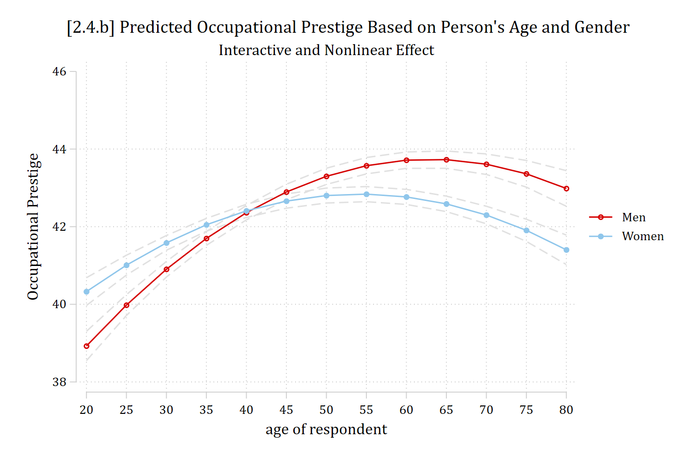
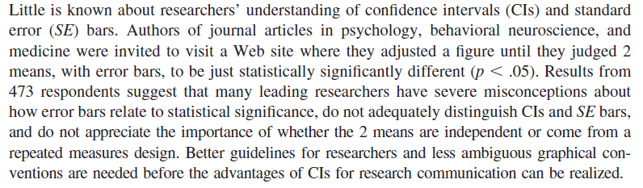
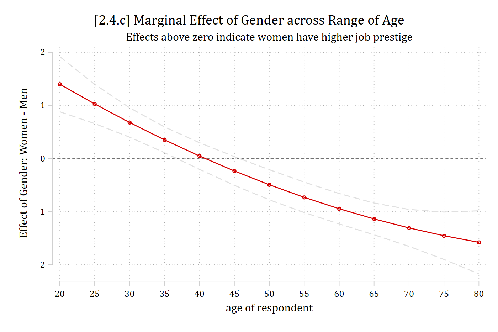
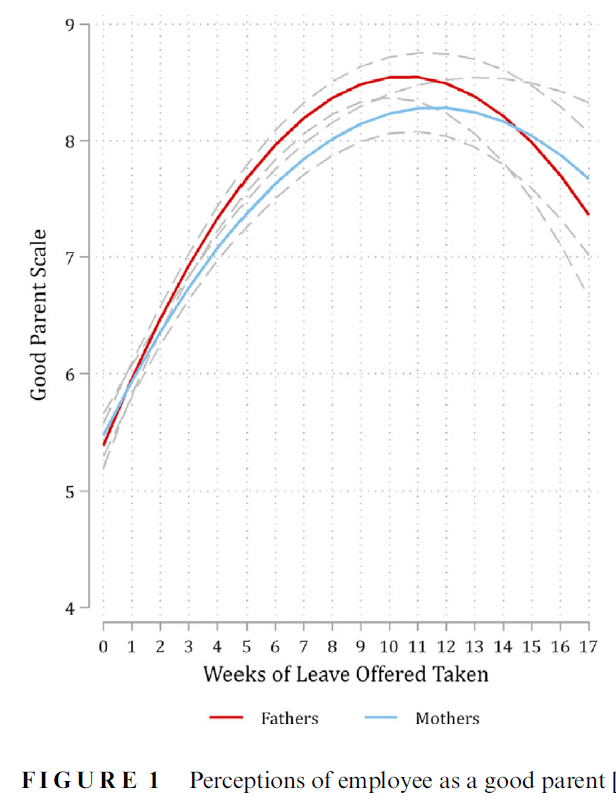
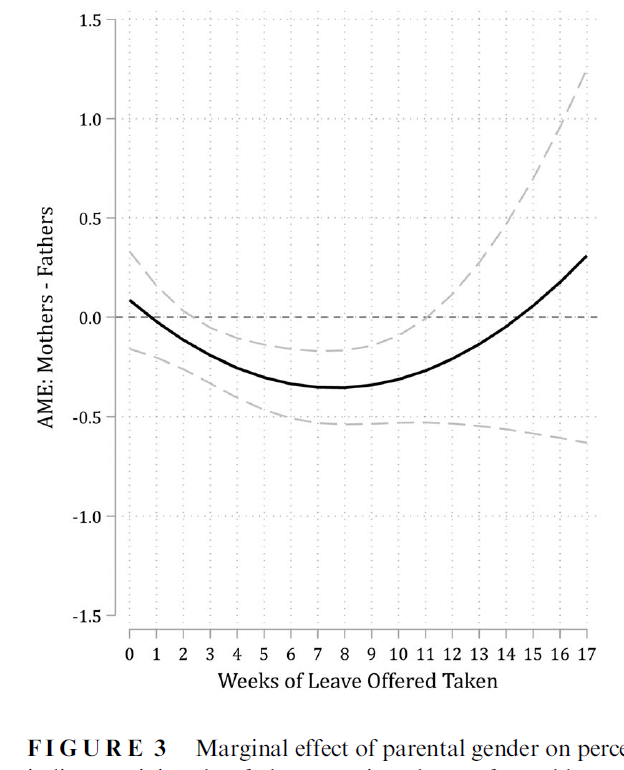

- Things get complicated quickly when we combine interaction effects with nonlinearities
  - When we get to models for categorical DVs, these are **inherently nonlinear *and* interactive**
  - Linear regression models **can be** nonlinear and interactive
- From the examples above, we already know that: (a) age has a nonlinear effect (*age^2^* coefficient was significant), and that (b) age has a different effect for men and women (*age X woman* product term coefficient is significant)
- *Note (below) that to correctly model the nonlinear interaction effect you need five coefficients: age, age^2^, woman, woman\*age, and woman\*age^2^*
  - *All five coefficients are necessary to properly estimate the nonlinear interaction effect*

## The limits of coefficients

```{.stata-run}
. use "https://tdmize.github.io/data/data/cda_gss", clear
(cda_gss.dta |  GSS 1972-2021 CDA - Categorical Data Analysis | date created 202
> 3)

. 
. regress occprest c.age##c.age##i.woman i.college

      Source |       SS           df       MS      Number of obs   =    58,304
-------------+----------------------------------   F(6, 58297)     =   3180.18
       Model |  2807908.65         6  467984.775   Prob > F        =    0.0000
    Residual |  8578800.25    58,297  147.156805   R-squared       =    0.2466
-------------+----------------------------------   Adj R-squared   =    0.2465
       Total |  11386708.9    58,303  195.302281   Root MSE        =    12.131

-------------------------------------------------------------------------------
     occprest | Coefficient  Std. err.      t    P>|t|     [95% conf. interval]
--------------+----------------------------------------------------------------
          age |      0.328      0.025   13.187   0.000        0.279       0.377
              |
  c.age#c.age |     -0.003      0.000  -10.458   0.000       -0.003      -0.002
              |
        woman |
       Women  |      3.116      0.774    4.027   0.000        1.600       4.633
              |
  woman#c.age |
       Women  |     -0.095      0.033   -2.831   0.005       -0.160      -0.029
              |
  woman#c.age#|
        c.age |
       Women  |      0.000      0.000    1.359   0.174       -0.000       0.001
              |
      college |
College De..  |     16.216      0.121  134.015   0.000       15.979      16.453
        _cons |     29.749      0.568   52.352   0.000       28.635      30.862
-------------------------------------------------------------------------------

. est store opintnlmod

. est table opintnlmod, ///
>     title("[2.4.a] Occupational prestige linear regression model" ///
>           "Nonlinear interaction effects") ///
>     b(%5.3f) star(.05 .01 .001)

[2.4.a] Occupational prestige linear regression model Nonlinear interaction
effects

---------------------------
    Variable | opintnlmod  
-------------+-------------
         age |   0.328***  
             |
 c.age#c.age |  -0.003***  
             |
       woman |
      Women  |   3.116***  
             |
 woman#c.age |
      Women  |  -0.095**   
             |
 woman#c.age#|
       c.age |
      Women  |   0.000     
             |
     college |
College D..  |  16.216***  
       _cons |  29.749***  
---------------------------
Legend: * p<.05; ** p<.01; *** p<.001

```

::: {.callout-note icon="false" appearance="simple"}
I find the coefficients more or less useless in nonlinear interactive models.

Here, I would go straight to a plot of predictions (include CIs!). Based on what the plot shows, I would then use that to guide further investigation---specifically, what MEs are likely to be informative.
:::

*¯\\\_(ツ)\_/¯*

```{.stata-run}
. qui margins, at(age=(20(5)80) woman=(0 1))

. marginsplot, ///
>     title("[2.4.b] Predicted Occupational Prestige Based on Person's Age and G
> ender", size(medium)) ///
>     subtitle("Interactive and Nonlinear Effect") ///
>     ytitle("Occupational Prestige") ///
>     recastci(rline) ciopts(lpat(dash) col(gs14)) ylab(38(2)46)

Variables that uniquely identify margins: age woman

```

{width=80% fig-alt="Predicted occupational prestige by age for men and women: two curved lines; men rise more steeply and peak higher, and the lines cross twice."}

*Now, the effect of age depends both on the value of age considered and based on whether the prediction is for a man or a woman*

### Interpreting nonlinear interaction effects with MEs

- It is best to provide examples and interpretations that best answer your research question
  - Let's say we are writing an article on the transition into early adulthood, thus we are mainly interested in the effect of age for those in their twenties
    - Remember the effect will be different for men and women, so need to calculate an ME for men and an ME for women

```{.stata-run}
. mecompare age, start(age=20) covariates(woman=0) amount(10) models(opintnlmod)

Predicting: Linear prediction
Marginal effects (N_opintnlmod=58304)

                                 |  ME #   Estimate         SE      P>|z|
---------------------------------+---------------------------------------
age + 10 (centered)              |                                       
                      opintnlmod |     1      2.238      0.152      0.000

. mecompare age, start(age=20) covariates(woman=1) amount(10) models(opintnlmod)

Predicting: Linear prediction
Marginal effects (N_opintnlmod=58304)

                                 |  ME #   Estimate         SE      P>|z|
---------------------------------+---------------------------------------
age + 10 (centered)              |                                       
                      opintnlmod |     1      1.471      0.139      0.000

```

> *A 10-year increase in age for 20-year-old men leads to about 2 points higher job prestige on average. For women, the same increase in age leads to about 1.26 points higher job prestige.*
>
> *OR*
>
> *On average, 30-year-old men are predicted to hold jobs that are about 2 points higher in job prestige than those held by 20-year-old men. 30-year-old women's job prestige is higher than 20-year-old women's by 1.26 points.*

\*See [Appendix A2.5](appendix-2a/a2-5-nonlinear-interactions.qmd) for more on how to calculate these MEs

### Equality of marginal effects: second differences

- Sometimes (depending on pattern of nonlinearities), can still be interesting / useful to examine if the effect, on average, differs across groups
  - *Does aging, on average, have a different effect for men and women?*
    - The test of the equality of MEs (sometimes called 1^st^ differences) is called a 2^nd^ difference

```{.stata-run}
. est restore opintnlmod
(results opintnlmod are active now)

. mecompare age, by(woman) amount(sd)

Predicting: Linear prediction
Marginal effects (N_m1=58304)

                                 |  ME #   Estimate         SE      P>|z|
---------------------------------+---------------------------------------
age + SD (centered)              |                                       
                             Men |     1      1.503      0.080      0.000
                           Women |     2      0.591      0.074      0.000

. metest 2 - 1

                                 |  estimate         se     pvalue 
---------------------------------+--------------------------------
       age_woman_1 - age_woman_0 |    -0.912      0.109      0.000 

```

> *On average, a standard deviation increase in age for men is associated with a 1.50 point increase in occupational prestige. For women, aging shows a smaller, but still significant increase in job prestige (ME~+SD\ |\ woman\ =\ 1~ = 0.59; 2^nd^ difference p \< .001).*

### A caution about overlapping CIs

- *An important (and often overlooked) part of interaction effects is the marginal effect of the secondary variable. E.g., The interpretations above focus on the effect of age---gender is a secondary consideration. However, what about the effect of gender? There is an interesting story there too*
  - *Importantly, when confidence intervals **do not overlap** this indicates that the group difference (i.e., men vs women in our plot) is significant. When the confidence interval **does overlap** this **may or may not** indicate the group difference is non-significant\*: you must test for this directly. As* [Belia et al. (2005)](http://psychology.okstate.edu/faculty/jgrice/psyc5314/ConfidenceConfusion_2005.pdf) *gently put it:*

{width=80% fig-alt="Abstract of Belia et al. (2005): many researchers misunderstand how confidence intervals and standard error bars relate to statistical significance."}

*\*NOTE: These general rules are only true for independent non-overlapping samples. It is even more complicated with clustered data (e.g., multilevel or longitudinal data)*

### Visualizing significant group differences

- Fortunately, there are fairly straightforward ways to calculate and visualize significance information for group differences
- The first method I recommend is to calculate and then plot the marginal effect of the binary/nominal IV across the range of the continuous IV (here, the ME of *gender* across the *range of age*)
  - Go back to the last graph. What is the ME of gender? It is simply the gap between the red and blue lines. That shows you the difference between men and women at each age
- Compare the last graph to the one below

```{.stata-run}
. est restore opintnlmod
(results opintnlmod are active now)

. qui margins, dydx(woman) at(age=(20(5)80))

. marginsplot, ///
>     recastci(rline) ciopts(lpat(dash) col(gs14)) yline(0) ylab(-2(1)2) ///
>     title("[2.4.c] Marginal Effect of Gender across Range of Age", size(medlar
> ge)) ///
>     subtitle("Effects above zero indicate women have higher job prestige") ///
>     ytitle("Effect of Gender: Women - Men")

Variables that uniquely identify margins: age

```

{width=80% fig-alt="Marginal effect of gender (women minus men) across age with confidence intervals: positive at young ages, crossing zero around age 40, and negative at older ages."}

*\*This is a direct test of the effect of gender: whenever the confidence interval overlaps zero = no significant group difference (see interpretation below)*

#### Example interpretation of the plot above

> *As Figure \# shows, at younger ages, women have **higher** occupational prestige than men (from age 20 to about age 37). From ages 37 to 45, men and women have similar occupational prestige scores. A gender gap reappears after age 45; however, at these older ages, the gender gap reverses, with **men having higher** occupational prestige than do women.*

To see at exactly what ages the group difference is or is not significant:

```{.stata-run}
. mtable, dydx(woman) at(age=(20(1)80)) stat(est se p)

Expression: Linear prediction, predict()

           |      age      d xb        se         p
 ----------+---------------------------------------
         1 |       20     1.401     0.265     0.000
         2 |       21     1.325     0.248     0.000
         3 |       22     1.250     0.232     0.000
         4 |       23     1.175     0.217     0.000
         5 |       24     1.102     0.202     0.000
         6 |       25     1.029     0.189     0.000
         7 |       26     0.957     0.177     0.000
         8 |       27     0.886     0.166     0.000
         9 |       28     0.816     0.157     0.000
        10 |       29     0.747     0.148     0.000
        11 |       30     0.679     0.141     0.000
        12 |       31     0.612     0.135     0.000
        13 |       32     0.545     0.131     0.000
        14 |       33     0.480     0.127     0.000
        15 |       34     0.415     0.125     0.001
        16 |       35     0.352     0.124     0.005
        17 |       36     0.289     0.123     0.019
        18 |       37     0.227     0.124     0.067
        19 |       38     0.166     0.125     0.183
        20 |       39     0.106     0.126     0.401
        21 |       40     0.047     0.128     0.714
        22 |       41    -0.011     0.130     0.930
        23 |       42    -0.069     0.132     0.602
        24 |       43    -0.125     0.134     0.350
        25 |       44    -0.181     0.136     0.184
        26 |       45    -0.235     0.138     0.088
        27 |       46    -0.289     0.140     0.039
        28 |       47    -0.342     0.141     0.016
        29 |       48    -0.394     0.143     0.006
        30 |       49    -0.445     0.144     0.002
        31 |       50    -0.495     0.145     0.001
        32 |       51    -0.545     0.146     0.000
        33 |       52    -0.593     0.146     0.000
        34 |       53    -0.640     0.146     0.000
        35 |       54    -0.687     0.146     0.000
        36 |       55    -0.733     0.146     0.000
        37 |       56    -0.777     0.146     0.000
        38 |       57    -0.821     0.146     0.000
        39 |       58    -0.864     0.146     0.000
        40 |       59    -0.906     0.146     0.000
        41 |       60    -0.947     0.146     0.000
        42 |       61    -0.988     0.147     0.000
        43 |       62    -1.027     0.147     0.000
        44 |       63    -1.065     0.149     0.000
        45 |       64    -1.103     0.150     0.000
        46 |       65    -1.139     0.153     0.000
        47 |       66    -1.175     0.156     0.000
        48 |       67    -1.210     0.160     0.000
        49 |       68    -1.244     0.165     0.000
        50 |       69    -1.277     0.171     0.000
        51 |       70    -1.309     0.178     0.000
        52 |       71    -1.340     0.186     0.000
        53 |       72    -1.371     0.195     0.000
        54 |       73    -1.400     0.205     0.000
        55 |       74    -1.429     0.216     0.000
        56 |       75    -1.456     0.228     0.000
        57 |       76    -1.483     0.241     0.000
        58 |       77    -1.509     0.255     0.000
        59 |       78    -1.534     0.270     0.000
        60 |       79    -1.558     0.286     0.000
        61 |       80    -1.581     0.303     0.000

Specified values where .n indicates no values specified with at()

           |  No at()
 ----------+---------
   Current |       .n

```

### Presenting nonlinear interaction effects

- *I would always include the plot of predictions in an article for a nonlinear interaction effect (figure 2.4.b above)*
  - *These are familiar to readers and easily understood*
- *The graph of MEs (2.4.c above) is harder to understand, especially out of context*
  - *I usually present these second in my article; when possible, alongside the graph of predictions (see below)*

:::: {.columns}
::: {.column width="50%"}
{fig-alt="Figure 1 of Petts, Kaufman, and Mize (2023): predicted perceptions of a good parent by weeks of leave taken, for fathers and mothers."}
:::
::: {.column width="50%"}
{fig-alt="Figure 3 of Petts, Kaufman, and Mize (2023): marginal effect of parental gender across weeks of leave taken."}
:::
::::

\*I like including both graphs in a single paper (often as separate panels) to help the reader follow what the second graph shows. Example from [Petts, Kaufman, and Mize 2023](https://doi.org/10.1111/jomf.12875)

### Example write-up of occupational prestige findings

```{.stata-run}
. est restore opintnlmod
(results opintnlmod are active now)

. mecompare age woman, amount(sd) models(opintnlmod)

Predicting: Linear prediction
Marginal effects (N_opintnlmod=58304)

                                 |  ME #   Estimate         SE      P>|z|
---------------------------------+---------------------------------------
age + SD (centered)              |                                       
                      opintnlmod |     1      1.013      0.054      0.000
---------------------------------+---------------------------------------
woman                            |                                       
                 Women - Men     |                                       
                      opintnlmod |     2     -0.165      0.101      0.101

```

::: {.callout-note icon="false" appearance="simple"}
overall average effects of age and gender
:::

> *Overall, individuals tend to hold more prestigious jobs when they are older compared to when they were younger---but the relationship is nonlinear. On average, a standard deviation increase in age (about 17.2 years) is associated with a 1.01 increase in occupational prestige (p \< 0.001). However, Figure \# illustrates the nonlinearities: aging is associated with increased occupational prestige until the late 50s, but the effect then reverses, with aging associated with lower occupational prestige late in life. In addition to the nonlinear effect of age, there are important differences in the effect of age based on a person's gender. Women have higher occupational prestige than men from age 20 to about 37, but the effect then reverses, with men having higher occupational prestige after the age of about 45. Overall, aging shows a stronger association for men than women (2^nd^ diff p \< .001).*
