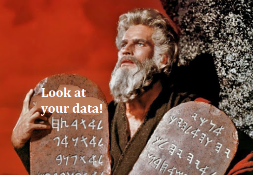
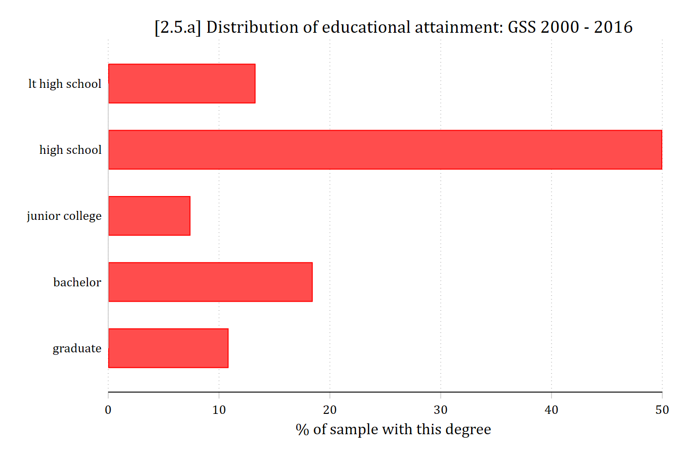
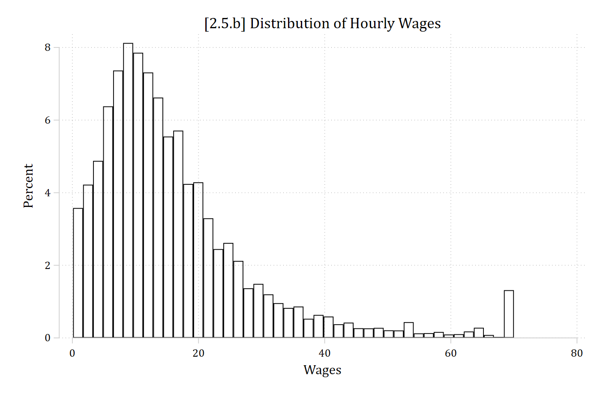
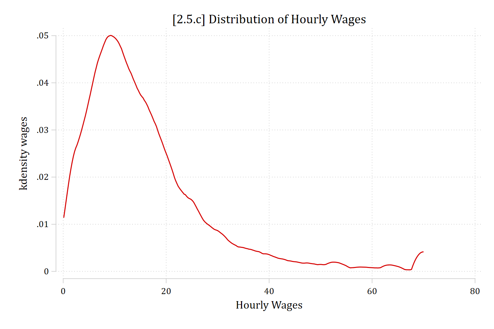
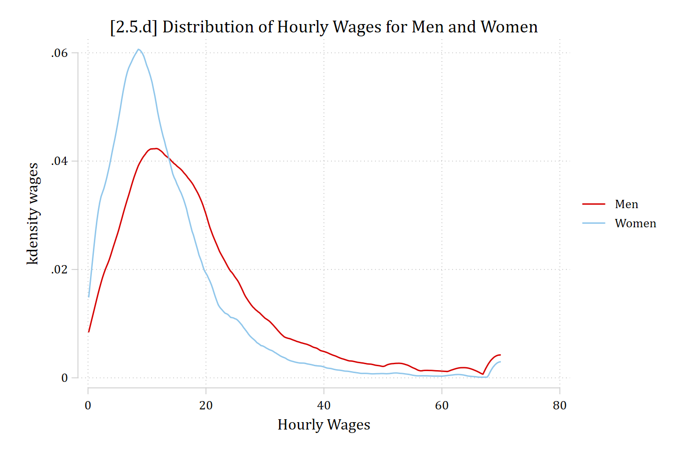

- The first commandment of data analysis is **look at your data**
  - Many (most?) common problems in data analysis can be easily ascertained via relatively simple techniques for examining your data
  - Graphical solutions are most helpful for continuous and count variables as they often contain many values (e.g., too many values to easily notice patterns via tables)
  - For binary, nominal, and ordinal variables a frequency table and/or bar chart often suffices

{width=40% fig-alt="Meme of Moses holding stone tablets: 'Look at your data!'"}

## Frequency tables & bar charts

- For a nominal/binary IV, can just look at frequency (or %) in each category

::: {.panel-tabset group="language"}
## Stata

```{.stata-run}
. use "https://tdmize.github.io/data/data/gss", clear
(gss.dta | GSS 1972 - 2016 Data | DMV Workshop)

. 
. fre degree if year >= 2010

degree -- Highest Educ Degree
-----------------------------------------------------------------------
                          |      Freq.    Percent      Valid       Cum.
--------------------------+--------------------------------------------
Valid   0  lt high school |       1251      13.28      13.29      13.29
        1  high school    |       4707      49.95      49.99      63.28
        2  junior college |        698       7.41       7.41      70.70
        3  bachelor       |       1737      18.43      18.45      89.14
        4  graduate       |       1022      10.85      10.86     100.00
        Total             |       9415      99.92     100.00           
Missing .n NA             |          8       0.08                      
Total                     |       9423     100.00                      
-----------------------------------------------------------------------

```

## R

```{r}
library(haven)           # import Stata data and labels
library(dplyr)           # data manipulation
library(sjmisc)          # frequency tables
library(ggplot2)         # graphs
library(cleanplots)      # graph scheme
cleanplots_defaults()

gss <- read_dta("https://tdmize.github.io/data/data/gss.dta")

gss10 <- gss |> filter(year >= 2010)

frq(gss10, degree)
```

:::

::: {.callout-note icon="false" appearance="simple"}
**Stata**: I much prefer the [**fre**](https://github.com/benjann/fre) command to **tabulate**, as you get: numeric value, value label, frequency counts, percents, and missing data all shown by default.

**R**: I like the **frq()** function from [**library(sjmisc)**](https://strengejacke.github.io/sjmisc/articles/exploringdatasets.html).
:::

::: {.panel-tabset group="language"}
## Stata

```{.stata-run}
. graph hbar if year >= 2010, over(degree) ///
>     title("[2.5.a] Distribution of educational attainment: GSS 2000 - 2016") /
> //
>     ytitle("% of sample with this degree")

```

{width=80% fig-alt="Horizontal bar chart of the percentage of respondents with each educational degree; high school is the largest category."}

## R

```{r}
#| fig-alt: "Horizontal bar chart of the percentage of respondents with each educational degree; high school is the largest category."
ggplot(filter(gss10, !is.na(degree)), aes(y = as_factor(degree))) +
  geom_bar() +
  labs(title = "[2.5.a] Distribution of educational attainment: GSS 2000 - 2016",
    x = "Number of respondents with this degree", y = NULL)
```

:::

## Tools for examining distributions

- Histograms are a good first step for continuous variables
  - Separate "bins" for ranges of continuous variables (e.g., age 20-25, 26-30, 31-35, 36-40, etc.)
- Kernel density plots are helpful to examine a smoothed version of the distribution (rather than each specific bin as with a histogram)
  - Kernel density plots are also helpful to overlay plots across multiple groups
- See examples below

::: {.panel-tabset group="language"}
## Stata

```{.stata-run}
. hist wages, percent fcol(none) ///
>     title("[2.5.b] Distribution of Hourly Wages")
(bin=44, start=.10516854, width=1.5885189)

```

{width=80% fig-alt="Histogram of hourly wages, strongly skewed to the right."}

## R

```{r}
#| fig-alt: "Histogram of hourly wages, strongly skewed to the right."
ggplot(gss, aes(wages)) +
  geom_histogram(fill = NA, color = "black") +
  labs(title = "[2.5.b] Distribution of Hourly Wages", x = "Hourly Wages")
```

:::

::: {.panel-tabset group="language"}
## Stata

```{.stata-run}
. twoway kdensity wages, ///
>     title("[2.5.c] Distribution of Hourly Wages") ///
>     xtitle("Hourly Wages")

```

{width=80% fig-alt="Kernel density plot of hourly wages, peaking near 10 dollars with a long right tail."}

## R

```{r}
#| fig-alt: "Kernel density plot of hourly wages, peaking near 10 dollars with a long right tail."
ggplot(gss, aes(wages)) +
  geom_density() +
  labs(title = "[2.5.c] Distribution of Hourly Wages", x = "Hourly Wages")
```

:::

::: {.panel-tabset group="language"}
## Stata

```{.stata-run}
. twoway kdensity wages if woman == 0 || ///
>     kdensity wages if woman == 1 ||, ///
>     title("[2.5.d] Distribution of Hourly Wages for Men and Women") ///
>     xtitle("Hourly Wages") legend(order(1 "Men" 2 "Women"))

```

{width=80% fig-alt="Kernel density plots of hourly wages for men and women; women's wages are more concentrated at lower values."}

## R

```{r}
#| fig-alt: "Kernel density plots of hourly wages for men and women; women's wages are more concentrated at lower values."
ggplot(gss, aes(wages, color = as_factor(woman))) +
  geom_density() +
  labs(title = "[2.5.d] Distribution of Hourly Wages for Men and Women",
    x = "Hourly Wages", color = NULL)
```

:::
