- Thus far, we have only covered the relatively simple case of adding a squared term for a continuous IV. However, there are many other ways to assess and model nonlinearities in regression models
- **Note it is not always best to use the most complicated solution**
  - Indeed, some of these more flexible methods are helpful for assessing when you are OK using the simpler solution
  - However, it is generally impossible to know whether the simpler solution is OK ***unless you have also tried the more complicated solution***
    - A footnote stating *"I tried it the more sophisticated way and found basically the same exact result as the easier way"* can be very reassuring to reviewers; in that case, present the easier way in the main text
    - **All else equal, simplicity is a virtue. However, simplicity is *not* a valid justification for inaccurately modeling your data\***

\*E.g., Would you be comfortable writing a paper with the occupational prestige, gender, and age data above that did not include *age^2^*? That did not include interactions between *age* and *gender*?

## Scatterplots

- For bivariate relationships, scatterplots can be helpful

```{.stata-run}
. use "https://tdmize.github.io/data/data/regjob3", clear
(Long's data on academic jobs of biochemists \ 2009-03-13)

. sort phd

. 
. twoway scatter job phd, jitter(3) ///
>     title("[2.6.a] Job Prestige and Prestige of PhD Program")

```

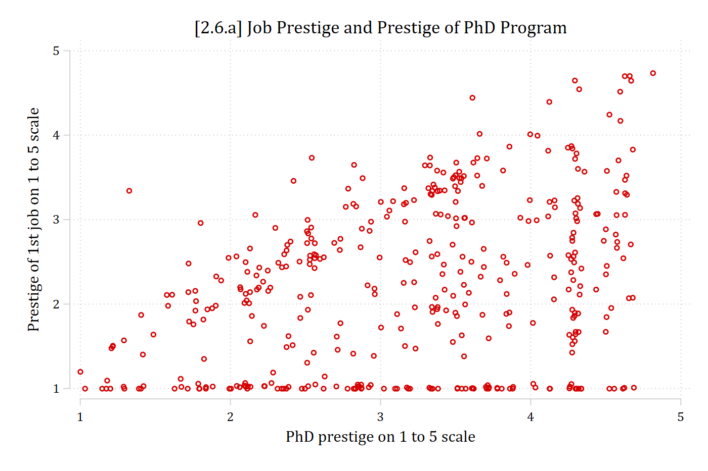{width=80% fig-alt="Jittered scatterplot of first-job prestige against the prestige of the PhD program."}

```{.stata-run}
. twoway scatter job phd if fem == 0, jitter(3) || ///
>     scatter job phd if fem == 1, jitter(3) || , ///
>     title("[2.6.b] Job Prestige and Prestige of PhD Program") ///
>     legend(order(1 "Men" 2 "Women"))

```

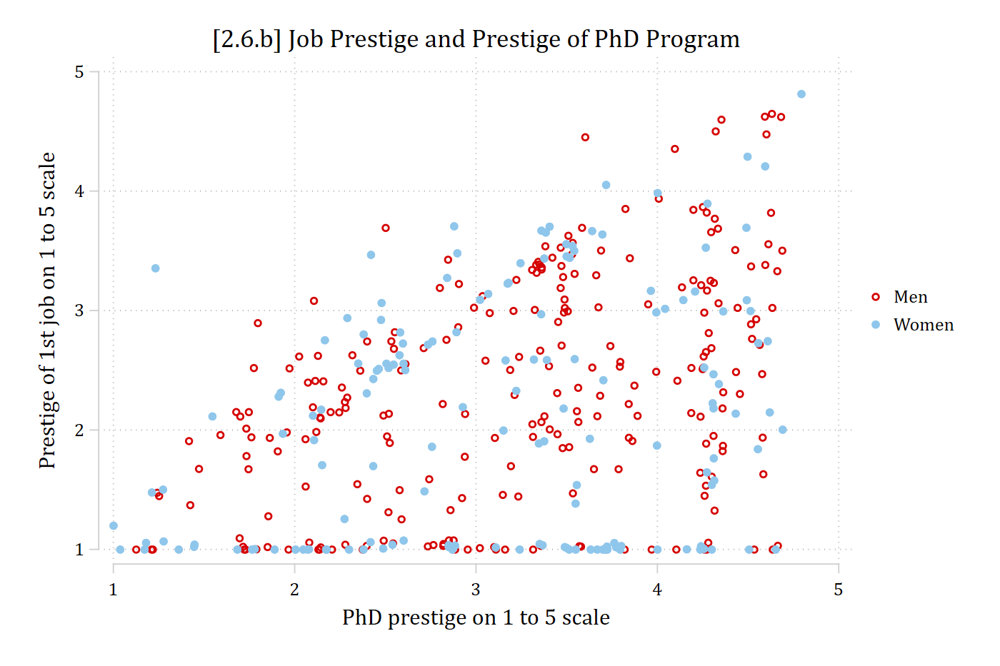{width=80% fig-alt="The same jittered scatterplot with separate markers for men and women."}

## LOWESS: locally weighted scatterplot smoothing

- Lowess performs "local" regressions sequentially across subsets of your data, showing how one continuous IV relates to a DV across the range of your data
  - This is primarily an exploratory technique---you can plot the smoothed regression line but you do not get parameter estimates or tests of statistical significance
  - It can be a helpful way to quickly assess nonlinearity and often suggests possible parametric modeling solutions for the nonlinearity (e.g., need both *age* and *age^2^* in model)
- Since a *lowess* plot is non-parametric it does not constrain the shape of the relationship between an IV and the DV in any way
- A bandwidth can be specified to determine just how **local** you want the lowess to calculate the regression estimate
  - A bandwidth of 0.4 means you want the 40% of the data closest to a given point used to calculate the regression line for that point (data points closer to the middle of the bandwidth are given more weight)
  - Smaller bandwidths will let you find more nonlinearities but are more susceptible to outliers and other quirks of your data

```{.stata-run}
. lowess job phd, bwidth(0.8)

. lowess job phd, bwidth(0.2)

```

:::: {.columns}
::: {.column width="50%"}
{fig-alt="Lowess smoother with bandwidth 0.8: a nearly straight line."}
:::
::: {.column width="50%"}
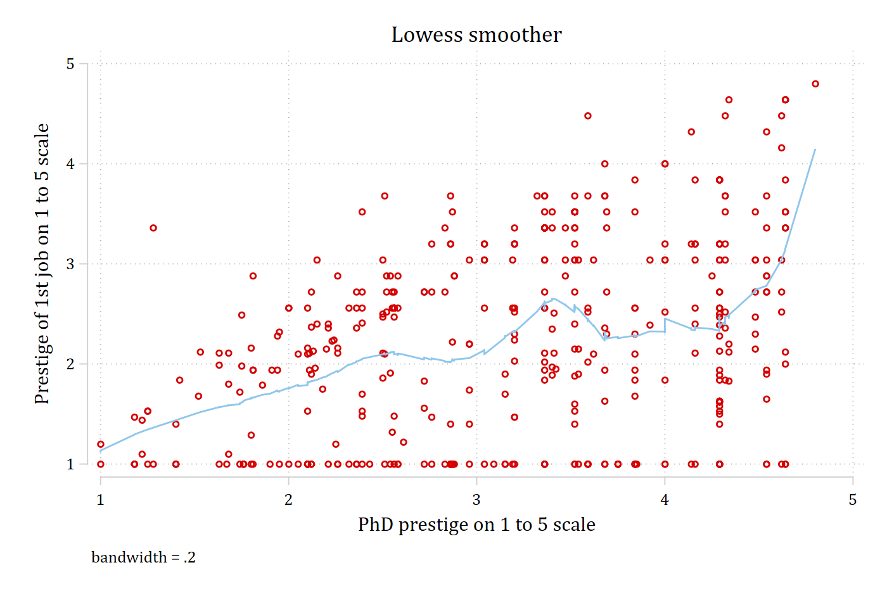{fig-alt="Lowess smoother with bandwidth 0.2: a jagged line with sharp jumps."}
:::
::::

- Bandwidth of 0.8 too wide to be informative (left panel above); mostly same as a linear fit
- Bandwidth of 0.2 is too small: it picks up on too many quirks of the data that we don't want to model (right panel above)
  - Sharp jumps in the line often suggest a too-small bandwidth

```{.stata-run}
. use "https://tdmize.github.io/data/data/cda_gss", clear
(cda_gss.dta |  GSS 1972-2021 CDA - Categorical Data Analysis | date created 202
> 3)

. 
. replace freespchSS = freespchSS * 100
(37,790 real changes made)

. 
. hist freespchSS, percent ///
>     title("[2.6.g] Distribution of support for free speech scale") ///
>     subtitle("0% = restrict free speech in all cases; 100% = support free spee
> ch in all cases")
(bin=46, start=0, width=2.173913)

```

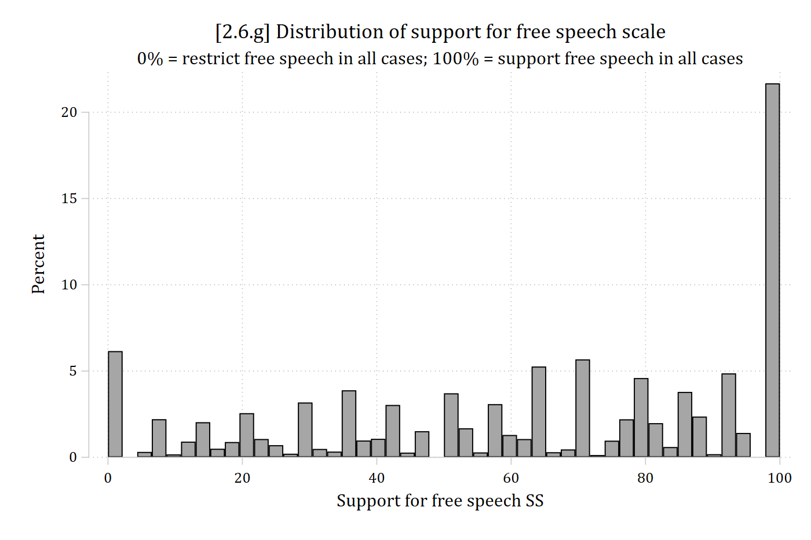{width=80% fig-alt="Histogram of the support for free speech scale, with a large spike at 100 percent."}

```{.stata-run}
. lowess freespchSS edyrs, bwidth(.4) jitter(3) xlab(0(2)20) gen(lowpr) ///
>     title("[2.6.h] Relationship between support for free speech and education"
> ) ///
>     subtitle("With lowess smoothed trend line") ytitle("Support for free speec
> h")

```

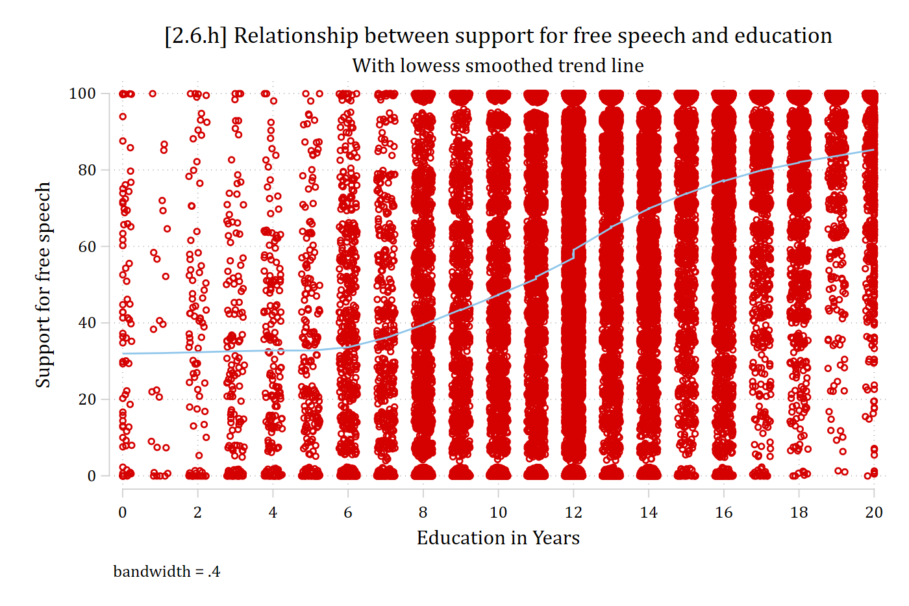{width=80% fig-alt="Jittered scatterplot of support for free speech by years of education with a lowess line that dips at low education and rises steadily after."}

```{.stata-run}
. reg freespchSS c.edyrs##c.edyrs##c.edyrs

      Source |       SS           df       MS      Number of obs   =    40,152
-------------+----------------------------------   F(3, 40148)     =   2973.88
       Model |  7555022.18         3  2518340.73   Prob > F        =    0.0000
    Residual |  33998175.3    40,148  846.821144   R-squared       =    0.1818
-------------+----------------------------------   Adj R-squared   =    0.1818
       Total |  41553197.5    40,151   1034.9231   Root MSE        =      29.1

------------------------------------------------------------------------------
  freespchSS | Coefficient  Std. err.      t    P>|t|     [95% conf. interval]
-------------+----------------------------------------------------------------
       edyrs |     -8.298      0.596  -13.934   0.000       -9.465      -7.131
             |
     c.edyrs#|
     c.edyrs |      1.186      0.054   21.792   0.000        1.080       1.293
             |
     c.edyrs#|
     c.edyrs#|
     c.edyrs |     -0.034      0.002  -21.703   0.000       -0.037      -0.031
             |
       _cons |     45.488      2.107   21.587   0.000       41.358      49.618
------------------------------------------------------------------------------

```

> All three *edyrs* coefficients are highly significant, suggesting that including them improves model fit (but note this is a very large sample)

```{.stata-run}
. margins, at(edyrs=(0(1)20))

Adjusted predictions                                    Number of obs = 40,152
Model VCE: OLS

Expression: Linear prediction, predict()
1._at:  edyrs =  0
2._at:  edyrs =  1
3._at:  edyrs =  2
4._at:  edyrs =  3
5._at:  edyrs =  4
6._at:  edyrs =  5
7._at:  edyrs =  6
8._at:  edyrs =  7
9._at:  edyrs =  8
10._at: edyrs =  9
11._at: edyrs = 10
12._at: edyrs = 11
13._at: edyrs = 12
14._at: edyrs = 13
15._at: edyrs = 14
16._at: edyrs = 15
17._at: edyrs = 16
18._at: edyrs = 17
19._at: edyrs = 18
20._at: edyrs = 19
21._at: edyrs = 20

------------------------------------------------------------------------------
             |            Delta-method
             |     Margin   std. err.      t    P>|t|     [95% conf. interval]
-------------+----------------------------------------------------------------
         _at |
          1  |     45.488      2.107   21.587   0.000       41.358      49.618
          2  |     38.342      1.605   23.889   0.000       35.196      41.488
          3  |     33.366      1.207   27.635   0.000       31.000      35.733
          4  |     30.358      0.906   33.495   0.000       28.582      32.135
          5  |     29.114      0.692   42.075   0.000       27.758      30.470
          6  |     29.431      0.550   53.537   0.000       28.354      30.509
          7  |     31.108      0.459   67.802   0.000       30.208      32.007
          8  |     33.940      0.396   85.750   0.000       33.164      34.716
          9  |     37.725      0.343  110.090   0.000       37.054      38.397
         10  |     42.261      0.291  145.377   0.000       41.691      42.831
         11  |     47.344      0.240  197.300   0.000       46.874      47.814
         12  |     52.772      0.198  266.998   0.000       52.384      53.159
         13  |     58.342      0.175  333.527   0.000       57.999      58.684
         14  |     63.851      0.177  360.987   0.000       63.504      64.197
         15  |     69.096      0.194  355.900   0.000       68.715      69.476
         16  |     73.874      0.213  346.047   0.000       73.456      74.293
         17  |     77.984      0.231  337.577   0.000       77.531      78.436
         18  |     81.221      0.260  312.841   0.000       80.712      81.730
         19  |     83.383      0.330  252.667   0.000       82.736      84.030
         20  |     84.268      0.472  178.569   0.000       83.343      85.193
         21  |     83.672      0.698  119.818   0.000       82.303      85.041
------------------------------------------------------------------------------

. marginsplot, plotop(msymbol(none)) recastci(rline) ciopt(lpat(dash) lcol(*.4))
>  ///
>     ylab(0(10)100) ytitle("free speech support") ///
>     title("[2.6.i] Predicted support for free speech by education in years") /
> //
>     addplot(connected lowpr edyrs, sort msymbol(none) lcol(eltblue)) ///
>     legend(order(2 "edyrs^3" 3 "lowess"))

Variables that uniquely identify margins: edyrs

```

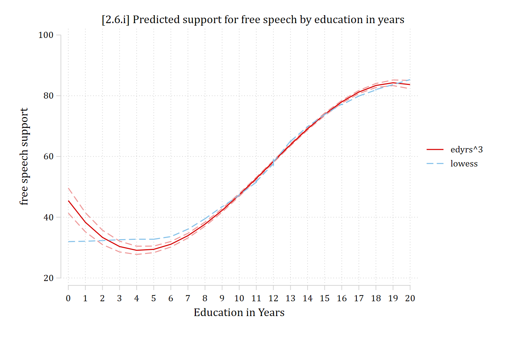{width=80% fig-alt="Predictions from the cubic model of education closely following the lowess line."}

## Splines

- An alternative to polynomial IVs is splines which allow for an abrupt change in the prediction line
  - Essentially, estimate a coefficient for each piece of the relationship separately allowing entirely different slopes
- For an overview of splines, see [Appendix 2C](appendix-2c-splines.qmd)
  - For details on coding splines in Stata, see [Appendix A2.8](appendix-2a/a2-8-splines.qmd)

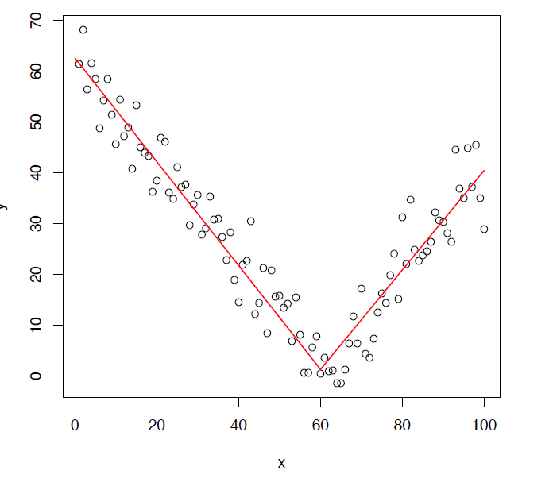{width=50% fig-alt="Scatterplot with a linear spline: a line that falls to a knot and then rises."}

## Binned scatterplots

- Scatterplot methods are less useful when you have lots of data
  - Graphs become impossible to read (but could plot random subsample) and lowess becomes computationally intensive
- A binned scatterplot is a useful tool for these and other cases ([Stepner 2014](https://michaelstepner.com/binscatter/binscatter-StataConference2014.pdf))
  - "bin" the *x* variable into groups (e.g., 20 age groups) and then calculate the mean of the *y* variable for each bin

**Table 1:** Descriptive Statistics for 21 waves of longitudinal data of Australians (*N~2~* = 29,186; *N~1~* = 242,933)

|                        |  Mean |    SD |  Min. |   Max. |
|:-----------------------|------:|------:|------:|-------:|
| *Physical Health Scale* | 77.37 | 21.38 |  0.00 | 100.00 |
| *Mental Health Scale*   | 72.23 | 19.13 |  0.00 | 100.00 |
| *Role Count*            |  4.15 |  1.33 |  0.00 |   8.00 |
| *Age*                   | 46.57 | 17.93 | 18.00 | 101.00 |

*The rest of this page uses restricted-access data (the HILDA survey), so the data file is not available to download.*

```{.stata-run}
. use "RaRc-03-analysis", clear
(RaRc | Analysis data)

. gen roles = oroles + vroles

. lab var roles "Number of social roles"

. 
. scatter PHscale age, jitter(3) ///
>     title("[2.6.j] HILDA data: N = 242,933")

```

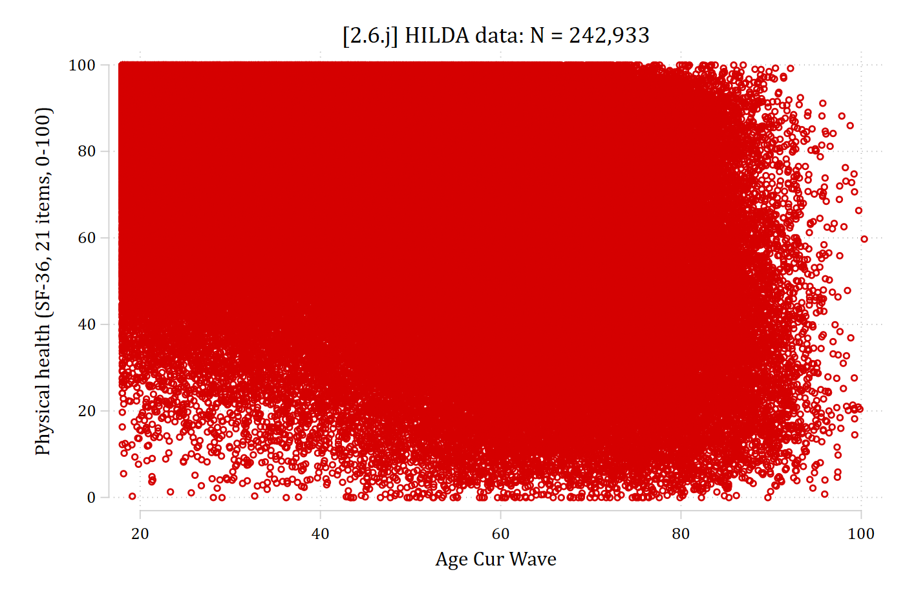{width=80% fig-alt="Scatterplot of physical health by age with so many points that it is a solid mass."}

```{.stata-run}
. binscatter PHscale age, ///
>     title("[2.6.k] Binned scatterplot for physical health by age") ///
>     ytitle("Physical health scale") line(none)

```

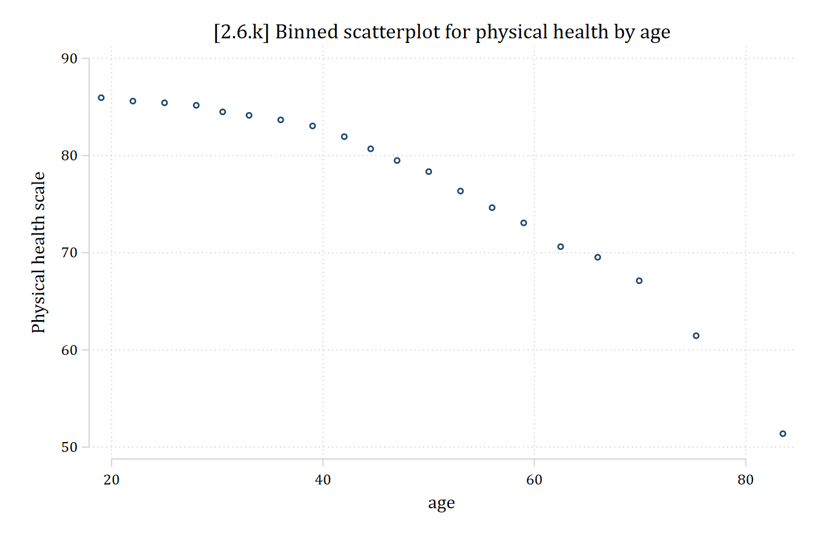{width=80% fig-alt="Binned scatterplot: mean physical health in 20 age bins, declining with age."}

```{.stata-run}
. binscatterhist PHscale age, line(qfit) ///
>     title("[2.6.l] Binned scatterplot for physical health by age") ///
>     subtitle("Including a quadratic line fit") ///
>     ytitle("Physical health scale")
(242,933 real changes made)

```

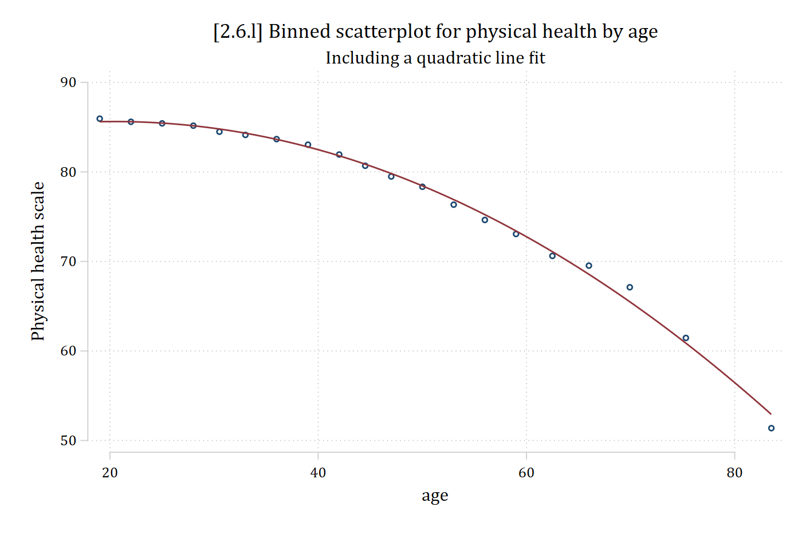{width=80% fig-alt="Binned scatterplot of physical health by age with a quadratic fit line."}

## Treating a continuous or ordinal IV as nominal

- A limitation of the methods covered above is they only examine bivariate relationships\*; often, we want to know conditional relationships after controlling for other variables
  - Also limited to relatively simple regressions; e.g., cannot examine multilevel or fixed effect models
- An elegantly simple but remarkably flexible way to examine the functional form of a continuous IV is to treat it as a nominal variable in your regression model
  - E.g., Omit 0 as reference category for social roles; add coefficients for 1, 2, 3, 4...8 roles
  - For IVs with lots of values, you can "coarsen" or "bin" them first
    - E.g., Create age categories of 20 -- 30, 31 -- 40, 41 -- 50, etc.
- Can use this technique for almost any regression model and almost any DV type
- For this technique, you want to go straight to graphs rather than worrying about the coefficient estimates

\*Can use lowess with control variables with the [**mlowess**](http://fmwww.bc.edu/RePEc/bocode/m/mlowess.html) command but it is limited

```{.stata-run}
. reg MHscale i.roles ///
>     i.male c.hhincome c.age i.educ i.wave, cluster(ID)

Linear regression                               Number of obs     =    242,933
                                                F(35, 29185)      =     127.82
                                                Prob > F          =     0.0000
                                                R-squared         =     0.0839
                                                Root MSE          =      18.31

                                (Std. err. adjusted for 29,186 clusters in ID)
------------------------------------------------------------------------------
             |               Robust
     MHscale | Coefficient  std. err.      t    P>|t|     [95% conf. interval]
-------------+----------------------------------------------------------------
       roles |
          1  |      2.911      1.594    1.826   0.068       -0.214       6.037
          2  |      6.972      1.645    4.238   0.000        3.747      10.196
          3  |     12.762      1.647    7.746   0.000        9.532      15.991
          4  |     16.818      1.647   10.210   0.000       13.589      20.046
          5  |     19.302      1.649   11.708   0.000       16.070      22.533
          6  |     20.382      1.653   12.327   0.000       17.141      23.622
          7  |     21.102      1.669   12.646   0.000       17.831      24.372
          8  |     18.821      2.467    7.630   0.000       13.986      23.656
             |
        male |
        Yes  |      3.007      0.206   14.616   0.000        2.603       3.410
    hhincome |      0.233      0.012   20.059   0.000        0.210       0.255
         age |      0.097      0.006   16.733   0.000        0.086       0.108
             |
        educ |
         HS  |      2.026      0.342    5.933   0.000        1.357       2.696
    SomeCol  |      0.793      0.290    2.734   0.006        0.225       1.362
    College  |      2.019      0.327    6.168   0.000        1.377       2.660
   Graduate  |      1.932      0.356    5.431   0.000        1.235       2.629
             |
        wave |
          3  |     -0.392      0.182   -2.161   0.031       -0.748      -0.036
          4  |     -0.463      0.195   -2.373   0.018       -0.845      -0.081
          5  |     -0.470      0.194   -2.421   0.015       -0.851      -0.090
          6  |     -0.211      0.204   -1.033   0.302       -0.612       0.190
          7  |     -0.451      0.211   -2.133   0.033       -0.865      -0.037
          8  |     -0.687      0.216   -3.184   0.001       -1.110      -0.264
          9  |     -0.436      0.217   -2.008   0.045       -0.861      -0.010
         10  |     -1.127      0.217   -5.202   0.000       -1.551      -0.702
         11  |     -0.939      0.209   -4.497   0.000       -1.348      -0.530
         12  |     -0.764      0.213   -3.587   0.000       -1.182      -0.347
         13  |     -1.030      0.217   -4.746   0.000       -1.456      -0.605
         14  |     -1.763      0.222   -7.946   0.000       -2.198      -1.328
         15  |     -2.305      0.223  -10.334   0.000       -2.743      -1.868
         16  |     -2.084      0.221   -9.437   0.000       -2.517      -1.652
         17  |     -2.793      0.226  -12.354   0.000       -3.236      -2.350
         18  |     -3.135      0.229  -13.674   0.000       -3.584      -2.685
         19  |     -3.827      0.233  -16.407   0.000       -4.284      -3.370
         20  |     -5.193      0.236  -22.023   0.000       -5.655      -4.731
         21  |     -5.701      0.241  -23.625   0.000       -6.174      -5.228
         22  |     -5.931      0.246  -24.148   0.000       -6.412      -5.449
             |
       _cons |     49.168      1.687   29.139   0.000       45.861      52.476
------------------------------------------------------------------------------

. 
. qui margins, at(roles=(0(1)8)) saving(m_cat, replace)

. marginsplot, ///
>     title("[2.6.m] Predictions from Categorical Form of Social Roles", size(me
> dium)) ///
>     ytitle("Mental Health Scale") xtitle("Number of Social Roles")

Variables that uniquely identify margins: roles

```

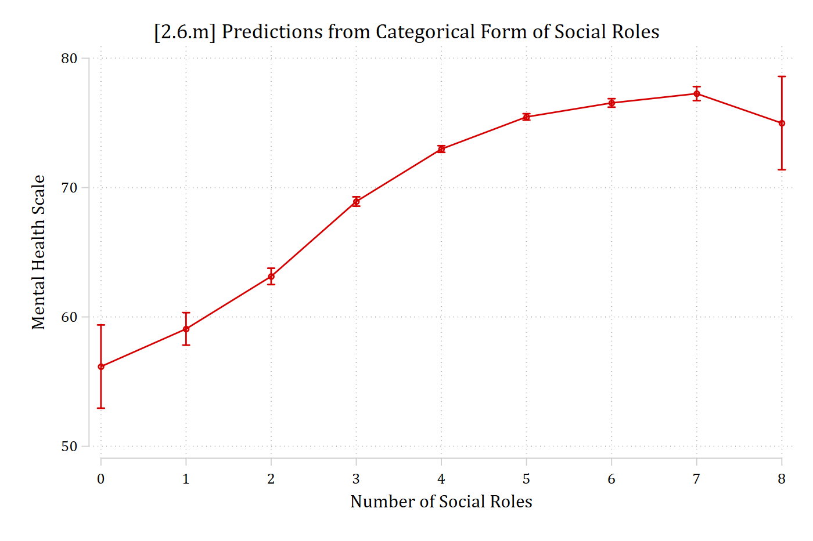{width=80% fig-alt="Predicted mental health for each number of social roles, rising steeply at first and then leveling off."}

Note, despite this pattern, there is no monotonic restriction on the functional form

- Can we model this relationship parametrically?

```{.stata-run}
. reg MHscale c.roles##c.roles ///
>     i.male c.hhincome c.age i.educ i.wave, cluster(ID)

Linear regression                               Number of obs     =    242,933
                                                F(29, 29185)      =     151.90
                                                Prob > F          =     0.0000
                                                R-squared         =     0.0833
                                                Root MSE          =     18.316

                                (Std. err. adjusted for 29,186 clusters in ID)
------------------------------------------------------------------------------
             |               Robust
     MHscale | Coefficient  std. err.      t    P>|t|     [95% conf. interval]
-------------+----------------------------------------------------------------
       roles |      7.668      0.324   23.697   0.000        7.034       8.303
             |
     c.roles#|
     c.roles |     -0.561      0.035  -15.982   0.000       -0.630      -0.492
             |
        male |
        Yes  |      3.013      0.206   14.638   0.000        2.610       3.417
    hhincome |      0.234      0.012   20.110   0.000        0.211       0.256
         age |      0.096      0.006   16.474   0.000        0.084       0.107
             |
        educ |
         HS  |      2.032      0.342    5.943   0.000        1.362       2.702
    SomeCol  |      0.814      0.290    2.803   0.005        0.245       1.383
    College  |      2.039      0.328    6.221   0.000        1.397       2.682
   Graduate  |      1.957      0.356    5.500   0.000        1.260       2.655
             |
        wave |
          3  |     -0.397      0.181   -2.188   0.029       -0.752      -0.041
          4  |     -0.460      0.195   -2.357   0.018       -0.842      -0.077
          5  |     -0.463      0.194   -2.384   0.017       -0.844      -0.082
          6  |     -0.206      0.204   -1.010   0.313       -0.607       0.194
          7  |     -0.452      0.211   -2.137   0.033       -0.866      -0.037
          8  |     -0.685      0.216   -3.174   0.002       -1.107      -0.262
          9  |     -0.431      0.217   -1.986   0.047       -0.856      -0.006
         10  |     -1.129      0.217   -5.211   0.000       -1.553      -0.704
         11  |     -0.937      0.209   -4.486   0.000       -1.346      -0.527
         12  |     -0.764      0.213   -3.586   0.000       -1.182      -0.347
         13  |     -1.031      0.217   -4.747   0.000       -1.456      -0.605
         14  |     -1.763      0.222   -7.942   0.000       -2.198      -1.328
         15  |     -2.307      0.223  -10.335   0.000       -2.744      -1.869
         16  |     -2.088      0.221   -9.447   0.000       -2.521      -1.655
         17  |     -2.790      0.226  -12.331   0.000       -3.233      -2.346
         18  |     -3.138      0.229  -13.684   0.000       -3.587      -2.688
         19  |     -3.828      0.233  -16.400   0.000       -4.285      -3.371
         20  |     -5.202      0.236  -22.048   0.000       -5.665      -4.740
         21  |     -5.714      0.242  -23.658   0.000       -6.187      -5.241
         22  |     -5.940      0.246  -24.161   0.000       -6.421      -5.458
             |
       _cons |     44.100      0.833   52.972   0.000       42.468      45.731
------------------------------------------------------------------------------

. 
. qui margins, at(roles=(0(.25)8))

. marginsplot, plotopt(lcol(eltblue) msym(none)) ///
>     recastci(rline) ciopts(lpat(dash) col(eltblue*.5)) ///
>     title("[2.6.n] Predictions from Quadratic Form of Social Roles", size(medi
> um)) ///
>     ytitle("Mental Health Scale") xtitle("Number of Social Roles")

Variables that uniquely identify margins: roles

```

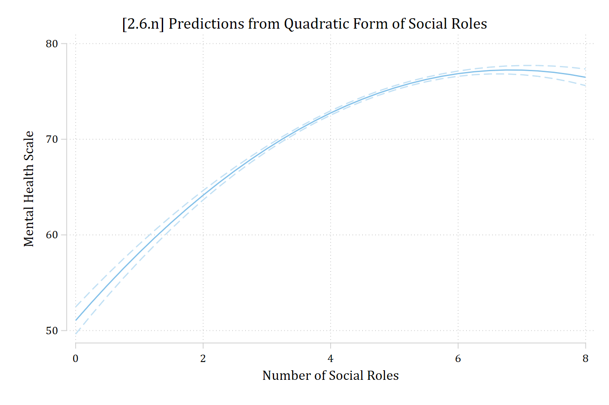{width=80% fig-alt="Predicted mental health from the quadratic specification of social roles: a smooth curve that rises and levels off."}

\*Note: The addition of the polynomial *roles^2^* allows for a change in the slope

```{.stata-run}
. qui margins, at(roles=(0(1)8)) saving(m_sq, replace)

. 
. combomarginsplot m_cat m_sq, ///
>     labels("Categorical Model" "Quadratic Model") ///
>     title("[2.6.o] Comparison of Predictions for Various Functional Forms of R
> oles", size(medium)) ///
>     ytitle("Mental Health Scale") xtitle("Number of Social Roles")

  Variables that uniquely identify margins: roles _filenumber

```

:::: {.columns}
::: {.column width="25%"}
{fig-alt="Chef's kiss emoji."}
:::
::: {.column width="75%"}
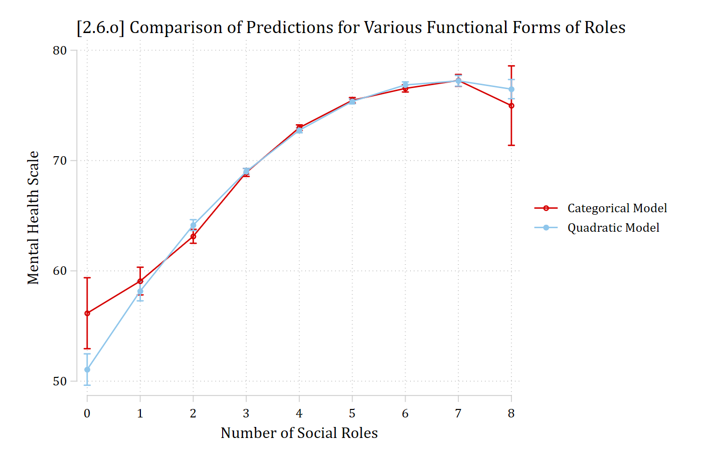{fig-alt="Predictions from the categorical and quadratic specifications of social roles, nearly identical."}
:::
::::

The simple addition of *roles^2^* does a remarkably good job here

```{.stata-run}
. xtset ID wave

Panel variable: ID (unbalanced)
 Time variable: wave, 2 to 22, but with gaps
         Delta: 1 unit

. 
. sum age

    Variable |        Obs        Mean    Std. dev.       Min        Max
-------------+---------------------------------------------------------
         age |    242,933    46.56807    17.92905         18        101

. egen ageC = cut(age), at(18(5)110)

. fre ageC

ageC
-----------------------------------------------------------
              |      Freq.    Percent      Valid       Cum.
--------------+--------------------------------------------
Valid   18    |      21275       8.76       8.76       8.76
        23    |      22067       9.08       9.08      17.84
        28    |      22324       9.19       9.19      27.03
        33    |      21810       8.98       8.98      36.01
        38    |      21462       8.83       8.83      44.84
        43    |      21839       8.99       8.99      53.83
        48    |      21236       8.74       8.74      62.57
        53    |      20185       8.31       8.31      70.88
        58    |      18351       7.55       7.55      78.44
        63    |      16253       6.69       6.69      85.13
        68    |      13613       5.60       5.60      90.73
        73    |      10290       4.24       4.24      94.97
        78    |       6829       2.81       2.81      97.78
        83    |       3665       1.51       1.51      99.29
        88    |       1407       0.58       0.58      99.87
        93    |        298       0.12       0.12      99.99
        98    |         29       0.01       0.01     100.00
        Total |     242933     100.00     100.00           
-----------------------------------------------------------

. recode ageC 93/110 = 93
(29 changes made to ageC)

. 
. * Person means of the role counts and their squares
. bysort ID: egen orolesM  = mean(oroles)

. bysort ID: egen oroles2M = mean(oroles^2)

. bysort ID: egen vrolesM  = mean(vroles)

. bysort ID: egen vroles2M = mean(vroles^2)

. 
. xtreg MHscale i.ageC ///
>     c.oroles##c.oroles c.vroles##c.vroles ///
>     c.orolesM c.oroles2M c.vrolesM c.vroles2M ///
>     physfunc ib3.educ c.hhincome i.wave, re

Random-effects GLS regression                   Number of obs     =    242,933
Group variable: ID                              Number of groups  =     29,186

R-squared:                                      Obs per group:
     Within  = 0.0967                                         min =          1
     Between = 0.2670                                         avg =        8.3
     Overall = 0.2424                                         max =         21

                                                Wald chi2(49)     =   33654.68
corr(u_i, X) = 0 (assumed)                      Prob > chi2       =     0.0000

------------------------------------------------------------------------------
     MHscale | Coefficient  Std. err.      z    P>|z|     [95% conf. interval]
-------------+----------------------------------------------------------------
        ageC |
         23  |     -0.611      0.137   -4.452   0.000       -0.880      -0.342
         28  |     -1.189      0.155   -7.688   0.000       -1.492      -0.886
         33  |     -1.397      0.169   -8.275   0.000       -1.728      -1.066
         38  |     -1.339      0.181   -7.392   0.000       -1.695      -0.984
         43  |     -0.335      0.190   -1.764   0.078       -0.707       0.037
         48  |      0.840      0.199    4.228   0.000        0.450       1.229
         53  |      2.658      0.208   12.763   0.000        2.250       3.066
         58  |      4.779      0.220   21.734   0.000        4.348       5.210
         63  |      7.076      0.235   30.139   0.000        6.616       7.536
         68  |      8.758      0.254   34.468   0.000        8.260       9.256
         73  |      8.729      0.279   31.237   0.000        8.181       9.276
         78  |      8.245      0.315   26.191   0.000        7.628       8.862
         83  |      7.272      0.373   19.513   0.000        6.542       8.003
         88  |      7.123      0.494   14.420   0.000        6.155       8.091
         93  |      6.487      0.868    7.474   0.000        4.786       8.188
             |
      oroles |      1.557      0.180    8.643   0.000        1.204       1.909
             |
    c.oroles#|
    c.oroles |     -0.107      0.032   -3.331   0.001       -0.171      -0.044
             |
      vroles |      1.997      0.097   20.626   0.000        1.807       2.187
             |
    c.vroles#|
    c.vroles |     -0.282      0.028   -9.992   0.000       -0.338      -0.227
             |
     orolesM |     -0.779      0.476   -1.634   0.102       -1.712       0.155
    oroles2M |      0.623      0.091    6.812   0.000        0.444       0.802
     vrolesM |      6.535      0.411   15.907   0.000        5.730       7.340
    vroles2M |     -1.267      0.124  -10.205   0.000       -1.510      -1.024
    physfunc |      0.251      0.002  145.202   0.000        0.247       0.254
             |
        educ |
      No HS  |     -0.534      0.165   -3.237   0.001       -0.857      -0.211
         HS  |     -0.004      0.167   -0.025   0.980       -0.330       0.322
    College  |      0.527      0.182    2.895   0.004        0.170       0.884
   Graduate  |      0.624      0.213    2.931   0.003        0.207       1.042
             |
    hhincome |      0.065      0.006   11.704   0.000        0.054       0.076
             |
        wave |
          3  |     -0.305      0.171   -1.785   0.074       -0.639       0.030
          4  |     -0.564      0.173   -3.259   0.001       -0.903      -0.225
          5  |     -0.553      0.172   -3.225   0.001       -0.890      -0.217
          6  |     -0.497      0.175   -2.836   0.005       -0.840      -0.153
          7  |     -0.649      0.177   -3.672   0.000       -0.996      -0.303
          8  |     -1.116      0.179   -6.234   0.000       -1.467      -0.765
          9  |     -0.739      0.178   -4.143   0.000       -1.088      -0.389
         10  |     -1.410      0.176   -8.009   0.000       -1.755      -1.065
         11  |     -1.266      0.168   -7.523   0.000       -1.596      -0.936
         12  |     -1.215      0.169   -7.174   0.000       -1.547      -0.883
         13  |     -1.368      0.170   -8.025   0.000       -1.702      -1.034
         14  |     -2.116      0.171  -12.341   0.000       -2.452      -1.780
         15  |     -2.728      0.173  -15.749   0.000       -3.067      -2.388
         16  |     -2.645      0.173  -15.333   0.000       -2.983      -2.307
         17  |     -3.092      0.175  -17.699   0.000       -3.434      -2.749
         18  |     -3.402      0.177  -19.202   0.000       -3.749      -3.055
         19  |     -4.122      0.178  -23.133   0.000       -4.472      -3.773
         20  |     -5.855      0.180  -32.515   0.000       -6.208      -5.502
         21  |     -6.376      0.183  -34.913   0.000       -6.733      -6.018
         22  |     -6.139      0.187  -32.908   0.000       -6.504      -5.773
             |
       _cons |     36.673      0.637   57.539   0.000       35.424      37.922
-------------+----------------------------------------------------------------
     sigma_u |  12.601915
     sigma_e |  11.652285
         rho |  .53909328   (fraction of variance due to u_i)
------------------------------------------------------------------------------

. 
. margins ageC

Predictive margins                                     Number of obs = 242,933
Model VCE: Conventional

Expression: Linear prediction, predict()

------------------------------------------------------------------------------
             |            Delta-method
             |     Margin   std. err.      z    P>|z|     [95% conf. interval]
-------------+----------------------------------------------------------------
        ageC |
         18  |     69.856      0.159  438.994   0.000       69.544      70.168
         23  |     69.245      0.140  493.619   0.000       68.970      69.520
         28  |     68.667      0.133  517.839   0.000       68.407      68.927
         33  |     68.459      0.130  527.367   0.000       68.204      68.713
         38  |     68.516      0.129  529.553   0.000       68.263      68.770
         43  |     69.521      0.129  539.703   0.000       69.268      69.773
         48  |     70.696      0.131  539.145   0.000       70.439      70.953
         53  |     72.514      0.137  530.496   0.000       72.246      72.781
         58  |     74.634      0.147  508.523   0.000       74.347      74.922
         63  |     76.932      0.163  472.842   0.000       76.613      77.251
         68  |     78.614      0.184  426.773   0.000       78.253      78.975
         73  |     78.584      0.213  369.570   0.000       78.168      79.001
         78  |     78.101      0.253  308.908   0.000       77.605      78.596
         83  |     77.128      0.318  242.255   0.000       76.504      77.752
         88  |     76.979      0.451  170.529   0.000       76.094      77.864
         93  |     76.342      0.843   90.591   0.000       74.691      77.994
------------------------------------------------------------------------------

. marginsplot, recast(scatter) ///
>     title("[2.6.p] Psychological well-being across ages (binned)", size(medlar
> ge)) ///
>     subtitle("Fixed effects model with controls") ///
>     xtitle("Age bins in 5 year increments") ytitle("Mental health")

Variables that uniquely identify margins: ageC

```

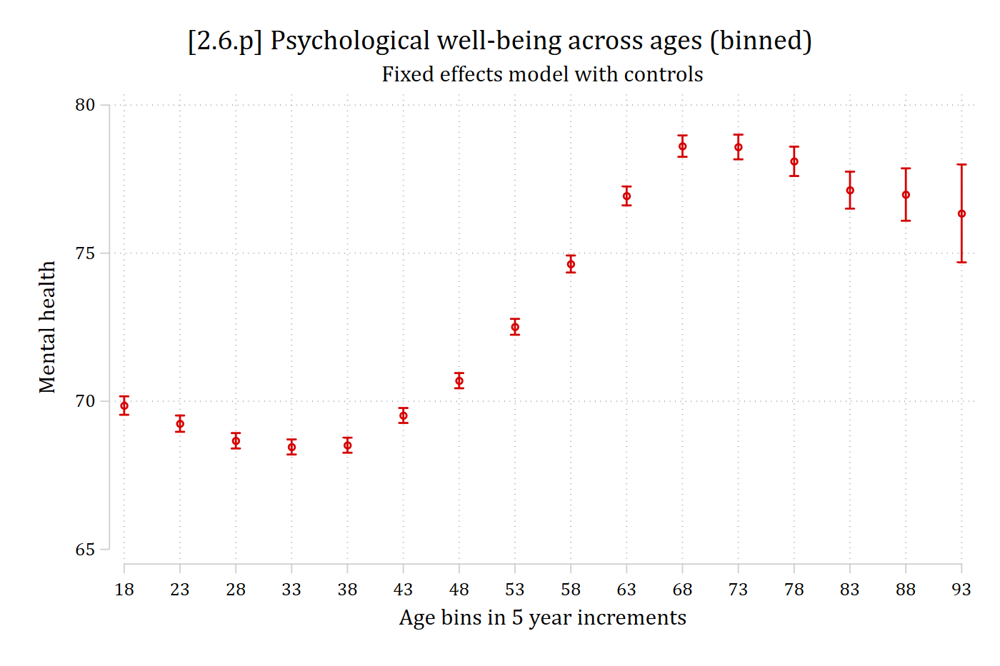{width=80% fig-alt="Predicted mental health for 5-year age bins: dipping slightly through the 30s, rising through the 60s, and declining slightly at the oldest ages."}

\*Note: Two clear "turns" in the slope so need to add both *age^2^* and *age^3^* to model

```{.stata-run}
. xtreg MHscale c.age##c.age##c.age ///
>     c.oroles##c.oroles c.vroles##c.vroles ///
>     c.orolesM c.oroles2M c.vrolesM c.vroles2M ///
>     physfunc ib3.educ c.hhincome i.wave, re

Random-effects GLS regression                   Number of obs     =    242,933
Group variable: ID                              Number of groups  =     29,186

R-squared:                                      Obs per group:
     Within  = 0.0963                                         min =          1
     Between = 0.2652                                         avg =        8.3
     Overall = 0.2412                                         max =         21

                                                Wald chi2(37)     =   33523.87
corr(u_i, X) = 0 (assumed)                      Prob > chi2       =     0.0000

------------------------------------------------------------------------------
     MHscale | Coefficient  Std. err.      z    P>|z|     [95% conf. interval]
-------------+----------------------------------------------------------------
         age |     -1.583      0.046  -34.551   0.000       -1.673      -1.493
             |
 c.age#c.age |      0.035      0.001   36.961   0.000        0.033       0.037
             |
 c.age#c.age#|
       c.age |     -0.000      0.000  -34.643   0.000       -0.000      -0.000
             |
      oroles |      1.551      0.180    8.637   0.000        1.199       1.902
             |
    c.oroles#|
    c.oroles |     -0.118      0.032   -3.684   0.000       -0.181      -0.055
             |
      vroles |      2.018      0.097   20.844   0.000        1.828       2.208
             |
    c.vroles#|
    c.vroles |     -0.290      0.028  -10.257   0.000       -0.345      -0.234
             |
     orolesM |     -0.545      0.477   -1.142   0.253       -1.481       0.391
    oroles2M |      0.595      0.092    6.491   0.000        0.415       0.774
     vrolesM |      6.598      0.411   16.044   0.000        5.792       7.404
    vroles2M |     -1.303      0.124  -10.485   0.000       -1.547      -1.059
    physfunc |      0.252      0.002  146.057   0.000        0.249       0.256
             |
        educ |
      No HS  |     -0.903      0.165   -5.466   0.000       -1.227      -0.579
         HS  |     -0.298      0.166   -1.800   0.072       -0.623       0.027
    College  |      0.835      0.181    4.607   0.000        0.480       1.191
   Graduate  |      0.791      0.213    3.711   0.000        0.373       1.208
             |
    hhincome |      0.057      0.006   10.208   0.000        0.046       0.067
             |
        wave |
          3  |     -0.329      0.171   -1.927   0.054       -0.664       0.006
          4  |     -0.618      0.173   -3.571   0.000       -0.957      -0.279
          5  |     -0.618      0.172   -3.598   0.000       -0.954      -0.281
          6  |     -0.575      0.175   -3.280   0.001       -0.918      -0.231
          7  |     -0.740      0.177   -4.185   0.000       -1.087      -0.394
          8  |     -1.227      0.179   -6.851   0.000       -1.578      -0.876
          9  |     -0.862      0.178   -4.830   0.000       -1.212      -0.512
         10  |     -1.539      0.176   -8.734   0.000       -1.884      -1.194
         11  |     -1.388      0.169   -8.233   0.000       -1.718      -1.058
         12  |     -1.343      0.170   -7.914   0.000       -1.675      -1.010
         13  |     -1.505      0.171   -8.814   0.000       -1.840      -1.171
         14  |     -2.264      0.172  -13.171   0.000       -2.601      -1.927
         15  |     -2.872      0.174  -16.531   0.000       -3.212      -2.531
         16  |     -2.783      0.173  -16.077   0.000       -3.122      -2.444
         17  |     -3.226      0.175  -18.400   0.000       -3.570      -2.882
         18  |     -3.538      0.178  -19.889   0.000       -3.887      -3.190
         19  |     -4.260      0.179  -23.797   0.000       -4.611      -3.909
         20  |     -5.998      0.181  -33.141   0.000       -6.352      -5.643
         21  |     -6.510      0.184  -35.463   0.000       -6.870      -6.150
         22  |     -6.267      0.188  -33.418   0.000       -6.635      -5.900
             |
       _cons |     56.311      0.946   59.538   0.000       54.457      58.164
-------------+----------------------------------------------------------------
     sigma_u |  12.617371
     sigma_e |  11.655081
         rho |  .53958312   (fraction of variance due to u_i)
------------------------------------------------------------------------------

. est store age3_mod

. 
. margins, at(age=(18(2)90))

Predictive margins                                     Number of obs = 242,933
Model VCE: Conventional

Expression: Linear prediction, predict()
1._at:  age = 18
2._at:  age = 20
3._at:  age = 22
4._at:  age = 24
5._at:  age = 26
6._at:  age = 28
7._at:  age = 30
8._at:  age = 32
9._at:  age = 34
10._at: age = 36
11._at: age = 38
12._at: age = 40
13._at: age = 42
14._at: age = 44
15._at: age = 46
16._at: age = 48
17._at: age = 50
18._at: age = 52
19._at: age = 54
20._at: age = 56
21._at: age = 58
22._at: age = 60
23._at: age = 62
24._at: age = 64
25._at: age = 66
26._at: age = 68
27._at: age = 70
28._at: age = 72
29._at: age = 74
30._at: age = 76
31._at: age = 78
32._at: age = 80
33._at: age = 82
34._at: age = 84
35._at: age = 86
36._at: age = 88
37._at: age = 90

------------------------------------------------------------------------------
             |            Delta-method
             |     Margin   std. err.      z    P>|z|     [95% conf. interval]
-------------+----------------------------------------------------------------
         _at |
          1  |     71.206      0.177  402.490   0.000       70.859      71.553
          2  |     70.229      0.153  458.707   0.000       69.929      70.529
          3  |     69.431      0.135  513.102   0.000       69.166      69.696
          4  |     68.801      0.123  559.501   0.000       68.560      69.042
          5  |     68.329      0.115  593.493   0.000       68.104      68.555
          6  |     68.006      0.111  614.689   0.000       67.789      68.223
          7  |     67.821      0.108  626.258   0.000       67.609      68.034
          8  |     67.765      0.107  632.622   0.000       67.555      67.975
          9  |     67.828      0.106  637.540   0.000       67.619      68.036
         10  |     67.999      0.106  643.408   0.000       67.791      68.206
         11  |     68.268      0.105  651.321   0.000       68.063      68.474
         12  |     68.627      0.104  661.334   0.000       68.423      68.830
         13  |     69.064      0.103  672.689   0.000       68.863      69.265
         14  |     69.570      0.102  683.986   0.000       69.371      69.770
         15  |     70.135      0.101  693.382   0.000       69.937      70.333
         16  |     70.749      0.101  698.910   0.000       70.551      70.948
         17  |     71.402      0.102  698.913   0.000       71.202      71.602
         18  |     72.084      0.104  692.483   0.000       71.880      72.288
         19  |     72.785      0.107  679.701   0.000       72.575      72.995
         20  |     73.496      0.111  661.546   0.000       73.278      73.713
         21  |     74.205      0.116  639.527   0.000       73.978      74.432
         22  |     74.904      0.122  615.239   0.000       74.665      75.142
         23  |     75.582      0.128  590.018   0.000       75.331      75.833
         24  |     76.229      0.135  564.775   0.000       75.965      76.494
         25  |     76.836      0.142  539.970   0.000       76.557      77.115
         26  |     77.392      0.150  515.669   0.000       77.098      77.686
         27  |     77.888      0.158  491.641   0.000       77.577      78.198
         28  |     78.313      0.168  467.456   0.000       77.985      78.642
         29  |     78.658      0.178  442.606   0.000       78.310      79.007
         30  |     78.913      0.189  416.631   0.000       78.542      79.284
         31  |     79.067      0.203  389.247   0.000       78.669      79.465
         32  |     79.111      0.219  360.451   0.000       78.681      79.541
         33  |     79.035      0.239  330.565   0.000       78.567      79.504
         34  |     78.829      0.263  300.191   0.000       78.314      79.344
         35  |     78.483      0.291  270.084   0.000       77.913      79.052
         36  |     77.986      0.324  241.003   0.000       77.352      78.620
         37  |     77.330      0.362  213.574   0.000       76.620      78.040
------------------------------------------------------------------------------

. marginsplot, recastci(rline) ciopt(col(eltblue*.6) lpat(dash)) ///
>     plotop(msym(none) lcol(eltblue)) xlab(20(10)90) ///
>     title("[2.6.q] Psychological well-being across ages (cubic specification)"
> , size(medlarge)) ///
>     subtitle("Fixed effects model with controls") ///
>     xtitle("Age at current wave") ytitle("Mental health")

Variables that uniquely identify margins: age

```

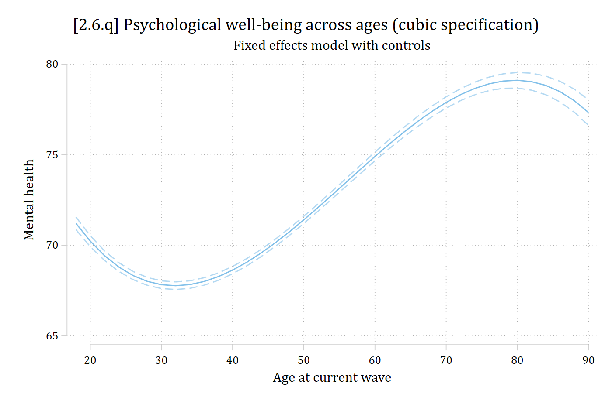{width=80% fig-alt="Predicted mental health from the cubic specification of age: a smooth S-shaped curve."}

```{.stata-run}
. levelsof ageC
18 23 28 33 38 43 48 53 58 63 68 73 78 83 88 93

. global agecats = "`r(levels)'"

. 
. preserve

. rename age ageold

. rename ageC age

. qui xtreg MHscale i.age ///
>     c.oroles##c.oroles c.vroles##c.vroles ///
>     c.orolesM c.oroles2M c.vrolesM c.vroles2M ///
>     physfunc ib3.educ c.hhincome i.wave, re

. qui margins, at(age=($agecats)) saving(ageC_prs, replace)

. restore

. 
. est restore age3_mod
(results age3_mod are active now)

. qui margins, at(age=($agecats)) saving(age3_prs, replace)

. 
. combomarginsplot ageC_prs age3_prs, ///
>     labels("Categorical Model" "Cubic Model") ///
>     title("[2.6.r] Comparison of Predictions for Various Functional Forms of A
> ge", size(medium)) ///
>     ytitle("Mental Health Scale") legend(pos(6) row(1))

  Variables that uniquely identify margins: age _filenumber

```

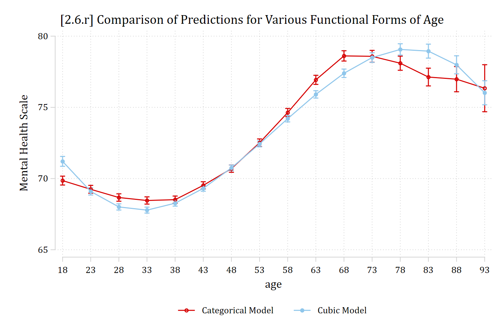{width=80% fig-alt="Predictions from the binned and cubic specifications of age, closely matching each other."}

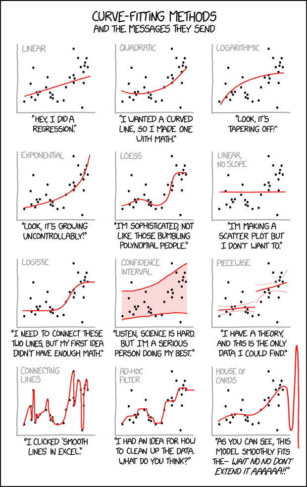{width=50% fig-alt="xkcd comic 'Curve-fitting methods and the messages they send'."}
