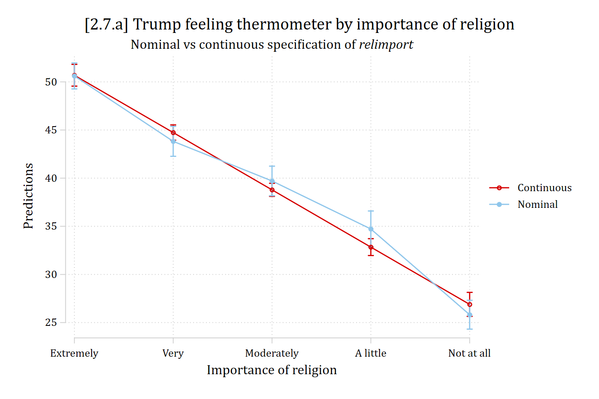
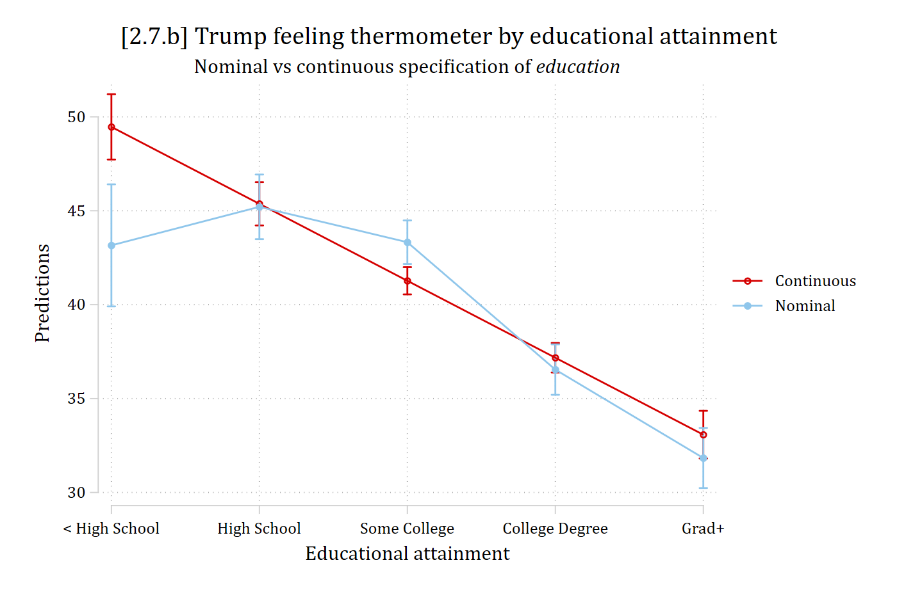
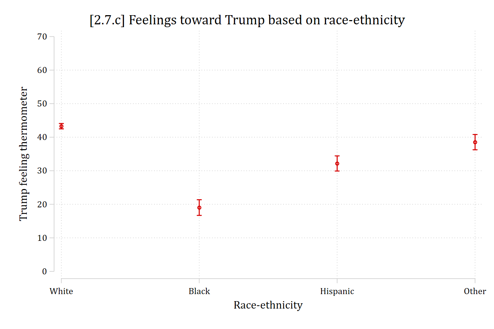
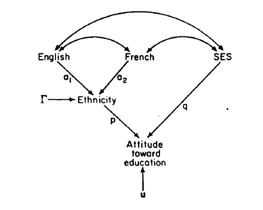

## Ordinal independent variables

- Independent variables can be entered into a regression model one of two ways:
  - Continuous
  - Nominal (n.b., binary is nominal but with only 2 categories)
- For an ordinal IV, you must choose how to enter it (ordinal is not an option)

::: {.callout-note icon="false" appearance="simple"}
**Stata**: Use [factor syntax](https://www.stata.com/links/stata-basics/factor-variable-notation/) with **c.** to specify a continuous predictor; **i.** for a nominal predictor

**R**: Use [**as_numeric**](https://www.rdocumentation.org/packages/sjlabelled/versions/1.2.0/topics/as_numeric) to specify a continuous variable; [**as_factor**](https://www.rdocumentation.org/packages/haven/versions/2.5.4/topics/as_factor) for a nominal variable
:::

### Continuous vs nominal specifications

- A continuous specification is simpler
  - E.g., For a 5-category ordinal IV only need to estimate 1 coefficient
- A nominal is more complicated but always more accurate\*
  - If entering as nominal, need 4 coefficients (representing 4 categories and one omitted reference category)
  - 4 coefficients will always provide a somewhat better fit\* than 1
- Which should you choose? Try both:
  - If inferences are very similar, choose the simpler specification (continuous)
  - If inferences diverge, choose the more complicated but more accurate specification (nominal)

\*We will cover how to provide a significance test of this in the Testing section. But *R*^2^ will always be same or higher in nominal specification (even if not significantly different)

The examples use the 2020 American National Election Studies (ANES):

::: {.panel-tabset group="language"}
## Stata

```{.stata-run}
. use "https://tdmize.github.io/data/data/cda_anes", clear
(American National Election Study 2020 - Pre-election | CDA | 2021-09-26)

. drop if missing(feel_trump, age, hhincome, woman, lgb, race4, ///
>     educ, relimport, wrongtrack)
(1,125 observations deleted)

. 
. regress feel_trump c.relimport i.educ age hhincome i.woman ///
>     i.lgb i.race4 i.wrongtrack

      Source |       SS           df       MS      Number of obs   =     7,155
-------------+----------------------------------   F(13, 7141)     =    506.04
       Model |   5562481.5        13  427883.192   Prob > F        =    0.0000
    Residual |  6038073.21     7,141  845.550093   R-squared       =    0.4795
-------------+----------------------------------   Adj R-squared   =    0.4786
       Total |  11600554.7     7,154  1621.54804   Root MSE        =    29.078

-------------------------------------------------------------------------------
   feel_trump | Coefficient  Std. err.      t    P>|t|     [95% conf. interval]
--------------+----------------------------------------------------------------
    relimport |     -5.949      0.249  -23.879   0.000       -6.438      -5.461
              |
         educ |
2. High sc..  |      1.915      1.851    1.035   0.301       -1.713       5.543
3. Some po..  |      0.002      1.747    0.001   0.999       -3.422       3.426
4. Bachelo..  |     -6.789      1.808   -3.755   0.000      -10.333      -3.244
5. Graduat..  |    -11.486      1.880   -6.108   0.000      -15.173      -7.800
              |
          age |     -0.051      0.021   -2.401   0.016       -0.093      -0.009
     hhincome |     -0.014      0.006   -2.501   0.012       -0.025      -0.003
              |
        woman |
       Woman  |     -4.472      0.700   -6.392   0.000       -5.844      -3.101
              |
          lgb |
         LGB  |    -10.331      1.409   -7.331   0.000      -13.093      -7.568
              |
        race4 |
       Black  |    -24.256      1.274  -19.037   0.000      -26.754     -21.758
    Hispanic  |    -11.116      1.230   -9.038   0.000      -13.527      -8.705
       Other  |     -4.763      1.234   -3.861   0.000       -7.181      -2.345
              |
   wrongtrack |
 Wrong track  |    -49.332      0.832  -59.312   0.000      -50.963     -47.702
        _cons |    107.667      2.319   46.433   0.000      103.121     112.212
-------------------------------------------------------------------------------

. margins, at(relimport=(1(1)5)) saving(con_reli, replace)

Predictive margins                                       Number of obs = 7,155
Model VCE: OLS

Expression: Linear prediction, predict()
1._at: relimport = 1
2._at: relimport = 2
3._at: relimport = 3
4._at: relimport = 4
5._at: relimport = 5

------------------------------------------------------------------------------
             |            Delta-method
             |     Margin   std. err.      t    P>|t|     [95% conf. interval]
-------------+----------------------------------------------------------------
         _at |
          1  |     50.688      0.576   88.008   0.000       49.559      51.817
          2  |     44.739      0.404  110.633   0.000       43.946      45.531
          3  |     38.789      0.346  112.216   0.000       38.112      39.467
          4  |     32.840      0.447   73.509   0.000       31.964      33.716
          5  |     26.891      0.635   42.316   0.000       25.645      28.136
------------------------------------------------------------------------------
(file con_reli.dta not found)

. 
. regress feel_trump i.relimport i.educ age hhincome i.woman ///
>     i.lgb i.race4 i.wrongtrack

      Source |       SS           df       MS      Number of obs   =     7,155
-------------+----------------------------------   F(16, 7138)     =    412.05
       Model |  5569952.94        16  348122.059   Prob > F        =    0.0000
    Residual |  6030601.77     7,138  844.858752   R-squared       =    0.4801
-------------+----------------------------------   Adj R-squared   =    0.4790
       Total |  11600554.7     7,154  1621.54804   Root MSE        =    29.066

-------------------------------------------------------------------------------
   feel_trump | Coefficient  Std. err.      t    P>|t|     [95% conf. interval]
--------------+----------------------------------------------------------------
    relimport |
2. Very im..  |     -6.789      1.037   -6.545   0.000       -8.823      -4.756
3. Moderat..  |    -10.903      1.039  -10.496   0.000      -12.939      -8.867
4. A littl..  |    -15.893      1.193  -13.320   0.000      -18.232     -13.554
5. Not imp..  |    -24.797      1.063  -23.327   0.000      -26.881     -22.713
              |
         educ |
2. High sc..  |      2.052      1.851    1.109   0.268       -1.576       5.680
3. Some po..  |      0.169      1.747    0.097   0.923       -3.256       3.595
4. Bachelo..  |     -6.614      1.809   -3.657   0.000      -10.160      -3.068
5. Graduat..  |    -11.321      1.882   -6.016   0.000      -15.010      -7.632
              |
          age |     -0.051      0.021   -2.395   0.017       -0.093      -0.009
     hhincome |     -0.014      0.006   -2.548   0.011       -0.025      -0.003
              |
        woman |
       Woman  |     -4.465      0.699   -6.384   0.000       -5.836      -3.094
              |
          lgb |
         LGB  |    -10.203      1.409   -7.240   0.000      -12.966      -7.441
              |
        race4 |
       Black  |    -24.244      1.274  -19.034   0.000      -26.741     -21.747
    Hispanic  |    -11.164      1.230   -9.074   0.000      -13.576      -8.752
       Other  |     -4.751      1.233   -3.852   0.000       -7.168      -2.333
              |
   wrongtrack |
 Wrong track  |    -49.298      0.832  -59.257   0.000      -50.929     -47.667
        _cons |    101.470      2.272   44.660   0.000       97.016     105.924
-------------------------------------------------------------------------------

. margins, at(relimport=(1(1)5)) saving(nom_reli, replace)

Predictive margins                                       Number of obs = 7,155
Model VCE: OLS

Expression: Linear prediction, predict()
1._at: relimport = 1
2._at: relimport = 2
3._at: relimport = 3
4._at: relimport = 4
5._at: relimport = 5

------------------------------------------------------------------------------
             |            Delta-method
             |     Margin   std. err.      t    P>|t|     [95% conf. interval]
-------------+----------------------------------------------------------------
         _at |
          1  |     50.616      0.689   73.494   0.000       49.266      51.966
          2  |     43.826      0.793   55.237   0.000       42.271      45.382
          3  |     39.713      0.783   50.732   0.000       38.178      41.247
          4  |     34.723      0.953   36.440   0.000       32.855      36.590
          5  |     25.819      0.765   33.749   0.000       24.319      27.318
------------------------------------------------------------------------------
(file nom_reli.dta not found)

. 
. combomarginsplot con_reli nom_reli, ///
>     labels("Continuous" "Nominal") xtitle("Importance of religion") ///
>     xlab(1 "Extremely" 2 "Very" 3 "Moderately" 4 "A little" 5 "Not at all") //
> /
>     title("[2.7.a] Trump feeling thermometer by importance of religion", size(
> medlarge)) ///
>     subtitle("Nominal vs continuous specification of {it:relimport}")

  Variables that uniquely identify margins: relimport _filenumber

```

{width=80% fig-alt="Predicted Trump feeling thermometer by importance of religion from the continuous and nominal specifications; the two sets of predictions are close."}

## R

```{r}
#| fig-alt: "Predicted Trump feeling thermometer by importance of religion from the continuous and nominal specifications; the two sets of predictions are close."
library(haven)           # import Stata data and labels
library(dplyr)           # data manipulation
library(ggplot2)         # graphs
library(marginaleffects) # predictions and marginal effects
library(cleanplots)      # graph scheme
cleanplots_defaults()

source("https://raw.githubusercontent.com/tdmize/Rfunctions/main/ME_helper_functions.R")

anes <- read_dta("https://tdmize.github.io/data/data/cda_anes.dta")

# Keep only model vars and drop any missing data on them
anes <- anes[c("feel_trump", "age", "hhincome", "woman", "lgb", "race4",
  "educ", "relimport", "wrongtrack")]
anes <- anes[complete.cases(anes), ]

# Treat binary/nominal variables as factors using their value labels
anes <- anes |> mutate(woman = as_factor(woman), lgb = as_factor(lgb),
  race4 = as_factor(race4), wrongtrack = as_factor(wrongtrack))

conmod <- lm(feel_trump ~ as.numeric(relimport) + as_factor(educ) + age + hhincome +
  woman + lgb + race4 + wrongtrack, data = anes)
con_reli <- avg_predictions(conmod, by = "relimport",
  newdata = datagrid(relimport = unique, grid_type = "counterfactual"))
con_reli

nommod <- lm(feel_trump ~ as_factor(relimport) + as_factor(educ) + age + hhincome +
  woman + lgb + race4 + wrongtrack, data = anes)
nom_reli <- avg_predictions(nommod, by = "relimport",
  newdata = datagrid(relimport = unique, grid_type = "counterfactual"))
nom_reli

reli_prs <- bind_rows(Continuous = con_reli, Nominal = nom_reli, .id = "spec")

ggplot(reli_prs, aes(x = relimport, y = estimate, ymin = conf.low, ymax = conf.high,
    color = spec)) +
  geom_pointrange(position = position_dodge(width = 0.2)) +
  geom_line(position = position_dodge(width = 0.2)) +
  scale_x_continuous(breaks = 1:5,
    labels = c("Extremely", "Very", "Moderately", "A little", "Not at all")) +
  labs(title = "[2.7.a] Trump feeling thermometer by importance of religion",
    subtitle = "Nominal vs continuous specification of relimport",
    x = "Importance of religion", y = "Trump feeling thermometer", color = NULL)
```

:::

\*These look similar enough to probably choose the continuous specification. But I would also do some statistical tests to decide (more in the Testing section of the class)

::: {.panel-tabset group="language"}
## Stata

```{.stata-run}
. regress feel_trump c.educ i.relimport age hhincome i.woman ///
>     i.lgb i.race4 i.wrongtrack

      Source |       SS           df       MS      Number of obs   =     7,155
-------------+----------------------------------   F(13, 7141)     =    502.86
       Model |  5544245.54        13  426480.426   Prob > F        =    0.0000
    Residual |  6056309.17     7,141  848.103791   R-squared       =    0.4779
-------------+----------------------------------   Adj R-squared   =    0.4770
       Total |  11600554.7     7,154  1621.54804   Root MSE        =    29.122

-------------------------------------------------------------------------------
   feel_trump | Coefficient  Std. err.      t    P>|t|     [95% conf. interval]
--------------+----------------------------------------------------------------
         educ |     -4.097      0.341  -12.002   0.000       -4.767      -3.428
              |
    relimport |
2. Very im..  |     -6.751      1.039   -6.496   0.000       -8.789      -4.714
3. Moderat..  |    -11.021      1.040  -10.593   0.000      -13.061      -8.982
4. A littl..  |    -15.969      1.195  -13.359   0.000      -18.312     -13.626
5. Not imp..  |    -24.793      1.065  -23.279   0.000      -26.880     -22.705
              |
          age |     -0.055      0.021   -2.574   0.010       -0.097      -0.013
     hhincome |     -0.016      0.006   -2.890   0.004       -0.027      -0.005
              |
        woman |
       Woman  |     -4.329      0.700   -6.187   0.000       -5.701      -2.958
              |
          lgb |
         LGB  |    -10.317      1.412   -7.309   0.000      -13.084      -7.550
              |
        race4 |
       Black  |    -24.192      1.275  -18.967   0.000      -26.692     -21.691
    Hispanic  |    -11.368      1.230   -9.238   0.000      -13.780      -8.955
       Other  |     -4.881      1.235   -3.952   0.000       -7.302      -2.460
              |
   wrongtrack |
 Wrong track  |    -49.475      0.833  -59.405   0.000      -51.108     -47.842
        _cons |    112.350      1.860   60.408   0.000      108.704     115.996
-------------------------------------------------------------------------------

. margins, at(educ=(1(1)5)) saving(con_educ, replace)

Predictive margins                                       Number of obs = 7,155
Model VCE: OLS

Expression: Linear prediction, predict()
1._at: educ = 1
2._at: educ = 2
3._at: educ = 3
4._at: educ = 4
5._at: educ = 5

------------------------------------------------------------------------------
             |            Delta-method
             |     Margin   std. err.      t    P>|t|     [95% conf. interval]
-------------+----------------------------------------------------------------
         _at |
          1  |     49.467      0.887   55.754   0.000       47.728      51.207
          2  |     45.370      0.588   77.196   0.000       44.218      46.522
          3  |     41.273      0.370  111.613   0.000       40.548      41.998
          4  |     37.175      0.401   92.604   0.000       36.388      37.962
          5  |     33.078      0.647   51.122   0.000       31.810      34.347
------------------------------------------------------------------------------
(file con_educ.dta not found)

. 
. regress feel_trump i.educ i.relimport age hhincome i.woman ///
>     i.lgb i.race4 i.wrongtrack

      Source |       SS           df       MS      Number of obs   =     7,155
-------------+----------------------------------   F(16, 7138)     =    412.05
       Model |  5569952.94        16  348122.059   Prob > F        =    0.0000
    Residual |  6030601.77     7,138  844.858752   R-squared       =    0.4801
-------------+----------------------------------   Adj R-squared   =    0.4790
       Total |  11600554.7     7,154  1621.54804   Root MSE        =    29.066

-------------------------------------------------------------------------------
   feel_trump | Coefficient  Std. err.      t    P>|t|     [95% conf. interval]
--------------+----------------------------------------------------------------
         educ |
2. High sc..  |      2.052      1.851    1.109   0.268       -1.576       5.680
3. Some po..  |      0.169      1.747    0.097   0.923       -3.256       3.595
4. Bachelo..  |     -6.614      1.809   -3.657   0.000      -10.160      -3.068
5. Graduat..  |    -11.321      1.882   -6.016   0.000      -15.010      -7.632
              |
    relimport |
2. Very im..  |     -6.789      1.037   -6.545   0.000       -8.823      -4.756
3. Moderat..  |    -10.903      1.039  -10.496   0.000      -12.939      -8.867
4. A littl..  |    -15.893      1.193  -13.320   0.000      -18.232     -13.554
5. Not imp..  |    -24.797      1.063  -23.327   0.000      -26.881     -22.713
              |
          age |     -0.051      0.021   -2.395   0.017       -0.093      -0.009
     hhincome |     -0.014      0.006   -2.548   0.011       -0.025      -0.003
              |
        woman |
       Woman  |     -4.465      0.699   -6.384   0.000       -5.836      -3.094
              |
          lgb |
         LGB  |    -10.203      1.409   -7.240   0.000      -12.966      -7.441
              |
        race4 |
       Black  |    -24.244      1.274  -19.034   0.000      -26.741     -21.747
    Hispanic  |    -11.164      1.230   -9.074   0.000      -13.576      -8.752
       Other  |     -4.751      1.233   -3.852   0.000       -7.168      -2.333
              |
   wrongtrack |
 Wrong track  |    -49.298      0.832  -59.257   0.000      -50.929     -47.667
        _cons |    101.470      2.272   44.660   0.000       97.016     105.924
-------------------------------------------------------------------------------

. margins, at(educ=(1(1)5)) saving(nom_educ, replace)

Predictive margins                                       Number of obs = 7,155
Model VCE: OLS

Expression: Linear prediction, predict()
1._at: educ = 1
2._at: educ = 2
3._at: educ = 3
4._at: educ = 4
5._at: educ = 5

------------------------------------------------------------------------------
             |            Delta-method
             |     Margin   std. err.      t    P>|t|     [95% conf. interval]
-------------+----------------------------------------------------------------
         _at |
          1  |     43.157      1.658   26.033   0.000       39.907      46.407
          2  |     45.209      0.877   51.563   0.000       43.490      46.928
          3  |     43.326      0.592   73.214   0.000       42.166      44.486
          4  |     36.543      0.685   53.343   0.000       35.200      37.885
          5  |     31.836      0.817   38.990   0.000       30.235      33.437
------------------------------------------------------------------------------
(file nom_educ.dta not found)

. 
. combomarginsplot con_educ nom_educ, ///
>     labels("Continuous" "Nominal") ///
>     xlab(1 "< High School" 2 "High School" 3 "Some College" 4 "College Degree"
>  5 "Grad+") ///
>     title("[2.7.b] Trump feeling thermometer by educational attainment", size(
> medlarge)) ///
>     subtitle("Nominal vs continuous specification of {it:education}")

  Variables that uniquely identify margins: educ _filenumber

```

{width=80% fig-alt="Predicted Trump feeling thermometer by educational attainment from the continuous and nominal specifications; the nominal predictions depart from the straight line."}

## R

```{r}
#| fig-alt: "Predicted Trump feeling thermometer by educational attainment from the continuous and nominal specifications; the nominal predictions depart from the straight line."
conmod2 <- lm(feel_trump ~ as.numeric(educ) + as_factor(relimport) + age + hhincome +
  woman + lgb + race4 + wrongtrack, data = anes)
con_educ <- avg_predictions(conmod2, by = "educ",
  newdata = datagrid(educ = unique, grid_type = "counterfactual"))
con_educ

nommod2 <- lm(feel_trump ~ as_factor(educ) + as_factor(relimport) + age + hhincome +
  woman + lgb + race4 + wrongtrack, data = anes)
nom_educ <- avg_predictions(nommod2, by = "educ",
  newdata = datagrid(educ = unique, grid_type = "counterfactual"))
nom_educ

educ_prs <- bind_rows(Continuous = con_educ, Nominal = nom_educ, .id = "spec")

ggplot(educ_prs, aes(x = educ, y = estimate, ymin = conf.low, ymax = conf.high,
    color = spec)) +
  geom_pointrange(position = position_dodge(width = 0.2)) +
  geom_line(position = position_dodge(width = 0.2)) +
  scale_x_continuous(breaks = 1:5, labels = c("< High School", "High School",
    "Some College", "College Degree", "Grad+")) +
  labs(title = "[2.7.b] Trump feeling thermometer by educational attainment",
    subtitle = "Nominal vs continuous specification of education",
    x = "Educational attainment", y = "Trump feeling thermometer", color = NULL)
```

:::

\*These look quite different to me. I would *not* feel comfortable using the continuous specification and would instead use the nominal specification of educational attainment

## Nominal independent variables

- The traditional approach for interpreting nominal IVs involves specifying an omitted reference category and interpreting the coefficients which represent contrasts between the omitted category and each included group
  - An issue with this approach is you do not know how included categories compare to each other
    - This approach also reifies the omitted category as the most important ([Johfre and Freese 2021](https://doi.org/10.1177/0081175020982632))
  - You also do not have any sense of how large an effect the nominal IV has overall (only specific contrasts)
- One partial solution is to plot predictions for all categories of the nominal IV
  - There is no reference group in this approach

::: {.callout-note icon="false" appearance="simple"}
**Stata**: **marginsplot** with **recast(scatter)** for a dot plot; do not use default which connects dots with a line. Or, use **coefplot**

**R**: Use [**plot_predictions**](https://marginaleffects.com/bonus/plot.html) which is a dot plot by default
:::

::: {.panel-tabset group="language"}
## Stata

```{.stata-run}
. regress feel_trump c.relimport i.educ age hhincome i.woman ///
>     i.lgb i.race4 i.wrongtrack

      Source |       SS           df       MS      Number of obs   =     7,155
-------------+----------------------------------   F(13, 7141)     =    506.04
       Model |   5562481.5        13  427883.192   Prob > F        =    0.0000
    Residual |  6038073.21     7,141  845.550093   R-squared       =    0.4795
-------------+----------------------------------   Adj R-squared   =    0.4786
       Total |  11600554.7     7,154  1621.54804   Root MSE        =    29.078

-------------------------------------------------------------------------------
   feel_trump | Coefficient  Std. err.      t    P>|t|     [95% conf. interval]
--------------+----------------------------------------------------------------
    relimport |     -5.949      0.249  -23.879   0.000       -6.438      -5.461
              |
         educ |
2. High sc..  |      1.915      1.851    1.035   0.301       -1.713       5.543
3. Some po..  |      0.002      1.747    0.001   0.999       -3.422       3.426
4. Bachelo..  |     -6.789      1.808   -3.755   0.000      -10.333      -3.244
5. Graduat..  |    -11.486      1.880   -6.108   0.000      -15.173      -7.800
              |
          age |     -0.051      0.021   -2.401   0.016       -0.093      -0.009
     hhincome |     -0.014      0.006   -2.501   0.012       -0.025      -0.003
              |
        woman |
       Woman  |     -4.472      0.700   -6.392   0.000       -5.844      -3.101
              |
          lgb |
         LGB  |    -10.331      1.409   -7.331   0.000      -13.093      -7.568
              |
        race4 |
       Black  |    -24.256      1.274  -19.037   0.000      -26.754     -21.758
    Hispanic  |    -11.116      1.230   -9.038   0.000      -13.527      -8.705
       Other  |     -4.763      1.234   -3.861   0.000       -7.181      -2.345
              |
   wrongtrack |
 Wrong track  |    -49.332      0.832  -59.312   0.000      -50.963     -47.702
        _cons |    107.667      2.319   46.433   0.000      103.121     112.212
-------------------------------------------------------------------------------

. est store ftmod

. 
. margins race4

Predictive margins                                       Number of obs = 7,155
Model VCE: OLS

Expression: Linear prediction, predict()

------------------------------------------------------------------------------
             |            Delta-method
             |     Margin   std. err.      t    P>|t|     [95% conf. interval]
-------------+----------------------------------------------------------------
       race4 |
      White  |     43.283      0.408  106.133   0.000       42.484      44.083
      Black  |     19.027      1.192   15.960   0.000       16.690      21.364
   Hispanic  |     32.167      1.150   27.979   0.000       29.913      34.421
      Other  |     38.521      1.161   33.171   0.000       36.244      40.797
------------------------------------------------------------------------------

. marginsplot, recast(scatter) ///
>     ylab(0(10)70) ytitle("Trump feeling thermometer") ///
>     title("[2.7.c] Feelings toward Trump based on race-ethnicity", size(medlar
> ge))

Variables that uniquely identify margins: race4

```

{width=80% fig-alt="Dot plot of predicted Trump feeling thermometer for White, Black, Hispanic, and Other respondents, with confidence intervals."}

## R

```{r}
#| fig-alt: "Dot plot of predicted Trump feeling thermometer for White, Black, Hispanic, and Other respondents, with confidence intervals."
ftmod <- lm(feel_trump ~ as.numeric(relimport) + as_factor(educ) + age + hhincome +
  woman + lgb + race4 + wrongtrack, data = anes)

plot_predictions(ftmod, by = "race4",
  newdata = datagrid(race4 = unique, grid_type = "counterfactual")) +
  scale_y_continuous(breaks = seq(0, 70, 10), limits = c(0, 70)) +
  labs(title = "[2.7.c] Feelings toward Trump based on race-ethnicity",
    x = NULL, y = "Trump feeling thermometer")
```

:::

### Examining all pairwise comparisons

- To obtain a significance test for all contrasts between all categories, you can conduct pairwise comparisons

::: {.panel-tabset group="language"}
## Stata

```{.stata-run}
. mecompare race4, models(ftmod) pwcompare

Predicting: Linear prediction
Marginal effects (N_ftmod=7155)

                                 |  ME #   Estimate         SE      P>|z|
---------------------------------+---------------------------------------
race4                            |                                       
               Black - White     |                                       
                           ftmod |     1    -24.256      1.274      0.000
            Hispanic - White     |                                       
                           ftmod |     2    -11.116      1.230      0.000
               Other - White     |                                       
                           ftmod |     3     -4.763      1.234      0.000
            Hispanic - Black     |                                       
                           ftmod |     4     13.140      1.632      0.000
               Other - Black     |                                       
                           ftmod |     5     19.494      1.664      0.000
            Other - Hispanic     |                                       
                           ftmod |     6      6.354      1.627      0.000

```

## R

```{r}
avg_comparisons(ftmod, variables = list(race4 = "pairwise"))
```

:::

- *Black adults feel less warmly toward Trump than do White adults*
- *...*
- *Hispanic adults feel more warmly toward Trump than do Black adults*
- Etc.

### Alternative interpretations of nominal IVs

- Some alternatives use different contrasts
- Mean contrasts compare a group to the overall sample mean
  - Limitation is the group being compared is part of the overall sample
- Binary contrasts compare that group to all other groups (pooled)
  - In Stata, use the [**binarycontrast**](https://journals.sagepub.com/doi/full/10.1177/1536867X221083900) command ([Freese and Johfre 2022](https://journals.sagepub.com/doi/full/10.1177/1536867X221083900))
  - In R, [**avg_predictions**](https://marginaleffects.com/man/r/predictions.html) with **hypothesis = \~ meanotherdev** is similar, comparing group's prediction to the mean across all other groups
    - But, doesn't account for differing group sizes

### Quantifying holistic effects of nominal IVs

- An important issue with any pairwise comparison approach is the high chance of a Type I error (false positive)
  - We will cover this more in the Testing section of the class
- Another set of alternatives examine the holistic effect of the IV
  - The sheaf coefficient provides a single value for the overall effect of the nominal IV ([Heise 1972](https://journals.sagepub.com/doi/abs/10.1177/004912417200100201))
    - Key limitation is it has no clear/satisfying interpretation

{width=45% fig-alt="Path diagram from Heise (1972): English, French, and SES combined into a sheaf coefficient for ethnicity predicting attitude toward education."}

::: {.callout-note icon="false" appearance="simple"}
*"There are many cases in which a summary of a nominal or ordinal independent variable's (IV) effect as a holistic construct...is needed and useful for interpretation. For example, does educational attainment or occupational sector have a larger impact on wages? Both variables in this case involve multiple categories and answering this question requires somehow quantifying each IVs' holistic effect" ([Mize and Han 2025](/research/mize_han_socsci_2025.qmd))*
:::

### Marginal effect (ME) inequality statistics

- A new approach summarizes the average level of **inequality** patterned by the nominal IV using marginal effects ([Mize and Han 2025](/research/mize_han_socsci_2025.qmd))
  - I.e., How different the predictions are across the nominal groupings, on average
- Define each pairwise comparison (category *a* vs. *b*) as a ME:

$$pairwise\ comparisons = ME = \eta\left( x_{k} = a,\mathbf{x}_{- k} = {\mathbf{x}_{- k}}^{*} \right) - \eta\left( x_{k} = b,\mathbf{x}_{- k} = {\mathbf{x}_{- k}}^{*} \right);\ for\ all\ b > a$$

- The **unweighted ME inequality** is simply the average of the (absolute values) of all pairwise comparisons

$$unweighted\ ME\ inequality \equiv |unweighted\ average\ ME\ inequality|$$

$$= \frac{Sum\ of\ all\ |pairwise\ comparisons\ of\ MEs|}{\#\ of\ comparisons}$$

$$= \frac{\sum_{a = 1}^{L}\sum_{b = 2;\ b > a}^{L}\left| \eta\left( x_{k} = a,\ \mathbf{x}_{- k} = {\mathbf{x}_{- k}}^{*} \right) - \eta\left( x_{k} = b,\mathbf{x}_{- k} = {\mathbf{x}_{- k}}^{*} \right) \right|}{\frac{L(L - 1)}{2}}$$

- Usually, the various groups of the nominal IV will differ in size, so should be given different weight in the ME inequality, proportional to their size
  - Define weights

$$a\ vs\ b\ contrast\ weight = w_{a,b} = \frac{n_{a} + n_{b}}{N}$$

- The weighted **ME inequality** is then

$$ME\ inequality \equiv |weighted\ average\ ME\ inequality|$$

$$= \sum_{a = 1}^{L}\sum_{b = 2;\ b > a}^{L}\frac{w_{a,b}}{L - 1}*\left| \eta\left( x_{k} = a,\mathbf{x}_{- k} = {\mathbf{x}_{- k}}^{*} \right) - \eta\left( x_{k} = b,\mathbf{x}_{- k} = {\mathbf{x}_{- k}}^{*} \right) \right|$$

> *"...ME inequality can be described as the average difference in outcomes between observations in distinct groups."*
>
> *"Alternatively, ME inequality could be used to quantify a causal effect of a nominal or ordinal IV. In this case, ME inequality summarizes how outcomes would typically change if an observation switched from their current category to another category."* ([Mize and Han 2025](/research/mize_han_socsci_2025.qmd))

### Calculating ME inequalities in Stata and R

- In Stata, use the [**meinequality**](/software/meinequality/index.qmd) command or the **meinequality** option on **mecompare**
- In R, use the [**meinq()** function with **avg_comparisons**](/software/meinequality_r/index.qmd)

::: {.panel-tabset group="language"}
## Stata

```{.stata-run}
. meinequality race4, models(ftmod)

ME Inequality Estimates (N = 7155)

                         |   Estimate   Std. err.           z       P>|z| 
-------------------------+-----------------------------------------------
ME Inequality            |                                               
                   race4 |     13.303       0.699      19.026       0.000 

```

## R

```{r}
avg_comparisons(ftmod, variables = list(race4 = "pairwise"),
  hypothesis = meineq(ftmod))
```

:::

> *On average, members of different racial-ethnic groups differ by about 13 points in their feelings towards Trump*
