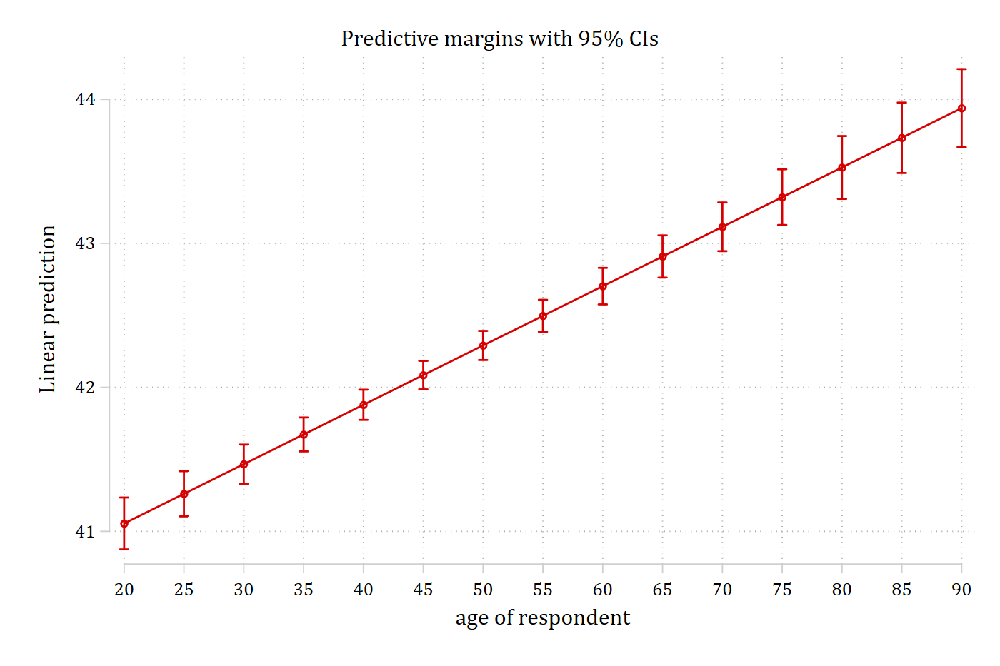
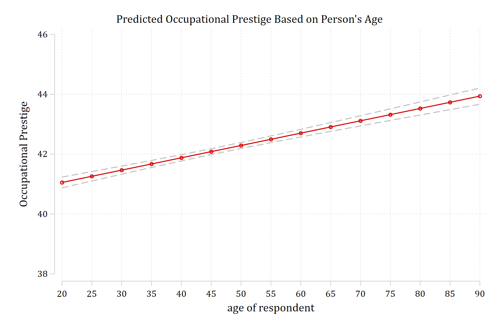

- *You should always use factor syntax when fitting a regression model in Stata*
  - *Factor syntax provides information to Stata about whether an IV should be treated as continuous or as nominal/binary*
  - *Extremely important for calculations of predictions and marginal effects*
    - *Also important when you have "linked" IVs such as polynomials, e.g. age and age^2^*
- *The "**c.**" prefix to an IV tells Stata that variable is to be treated as continuous*
- *The "**i.**" prefix tells Stata the IV should be treated as nominal/binary*
  - *Added benefit of not needing to create a series of dummy variables for nominal IVs with ≥ 3 categories. Stata will make the series of dummies for you*
  - *By default, the first category is omitted as the reference group*
  - *You can change this with **ib#.** where the **\#** indicates which category to omit*
  - *You can omit no categories with **ibn.** ("indicator base none")*
    - *Not commonly used in a regression model; helpful for descriptives*

*Examples below...*

### Example of nominal variables with factor syntax

```{.stata-run}
. use "https://tdmize.github.io/data/data/addhealth4", clear
(addhealth4_dmv.dta | Add Health Wave IV | DMV Workshop)

. 
. sum ibn.race

    Variable |        Obs        Mean    Std. dev.       Min        Max
-------------+---------------------------------------------------------
        race |
      White  |      4,307    .7452984     .435744          0          1
      Black  |      4,307    .2189459    .4135799          0          1
Native Am..  |      4,307    .0058045    .0759747          0          1
      Asian  |      4,307    .0299512    .1704726          0          1

. sum i.race

    Variable |        Obs        Mean    Std. dev.       Min        Max
-------------+---------------------------------------------------------
        race |
      White  |      4,307    .7452984     .435744          0          1
      Black  |      4,307    .2189459    .4135799          0          1
Native Am..  |      4,307    .0058045    .0759747          0          1
      Asian  |      4,307    .0299512    .1704726          0          1

. sum ib2.race

    Variable |        Obs        Mean    Std. dev.       Min        Max
-------------+---------------------------------------------------------
        race |
      White  |      4,307    .7452984     .435744          0          1
Native Am..  |      4,307    .0058045    .0759747          0          1
      Asian  |      4,307    .0299512    .1704726          0          1

```

### Regression models with factor syntax

- For linear regression models in Stata, use the **regress** command:

```stata
regress depvar indepvar1 indepvar2 indepvar3 …
```

```{.stata-run}
. use "https://tdmize.github.io/data/data/cda_gss", clear
(cda_gss.dta |  GSS 1972-2021 CDA - Categorical Data Analysis | date created 202
> 3)

. 
. regress occprest c.age i.woman i.college

      Source |       SS           df       MS      Number of obs   =    58,304
-------------+----------------------------------   F(3, 58300)     =   6232.46
       Model |  2765051.56         3  921683.852   Prob > F        =    0.0000
    Residual |  8621657.35    58,300  147.884346   R-squared       =    0.2428
-------------+----------------------------------   Adj R-squared   =    0.2428
       Total |  11386708.9    58,303  195.302281   Root MSE        =    12.161

-------------------------------------------------------------------------------
     occprest | Coefficient  Std. err.      t    P>|t|     [95% conf. interval]
--------------+----------------------------------------------------------------
          age |      0.041      0.003   14.027   0.000        0.035       0.047
              |
        woman |
       Women  |     -0.178      0.101   -1.756   0.079       -0.376       0.021
              |
      college |
College De..  |     16.422      0.121  136.142   0.000       16.185      16.658
        _cons |     36.621      0.157  233.710   0.000       36.314      36.928
-------------------------------------------------------------------------------

```

### Estimating and Plotting Predictions in Stata

- **mtable** is an SPost13 command that reports tables of predictions

::: {.callout-note icon="false" appearance="simple"}
**mtable**'s columns tell you (1) the name/number of the prediction, (2) what value of the IV the prediction was made at, and (3) the prediction itself (notated "xb" for $\mathbf{x\beta}$ in linear regression models)

Stata syntax to specify a range of values is **start(gap)end**. For example 10(2)20 is just shorthand for 10, 12, 14, 16, 18, 20. Note the second column to see how **age(20(5)90)** is interpreted by Stata
:::

```{.stata-run}
. mtable, at(age=(20(5)90))

Expression: Linear prediction, predict()

           |      age        xb
 ----------+-------------------
         1 |       20    41.055
         2 |       25    41.261
         3 |       30    41.467
         4 |       35    41.673
         5 |       40    41.879
         6 |       45    42.085
         7 |       50    42.291
         8 |       55    42.497
         9 |       60    42.703
        10 |       65    42.909
        11 |       70    43.115
        12 |       75    43.321
        13 |       80    43.527
        14 |       85    43.733
        15 |       90    43.939

Specified values where .n indicates no values specified with at()

           |  No at()
 ----------+---------
   Current |       .n

```

### Plotting predictions

- The easiest way to plot predictions is to make them with **margins** and then plot them with **marginsplot**
  - *Note that **margins** gives you the same output as **mtable**, just in a messier and less helpful format. Therefore, I am running it **quietly** so I don't see the table of predictions again (see below)*
- ***marginsplot** makes the plot of the predictions*
  - *I always recommend letting **marginsplot** make its default plot first before fiddling with options*
  - *Literally: you should just type **marginsplot** and nothing else and see what you get as the first step*
  - *It is helpful to see the default and then edit from there*

```{.stata-run}
. qui margins, at(age=(20(5)90))

. marginsplot

Variables that uniquely identify margins: age

```

{width=80% fig-alt="Default marginsplot: predicted occupational prestige by age with confidence interval caps at each point."}

This is a pretty nice plot given all we had to type was **marginsplot**. However, some options make it more informative

```{.stata-run}
. marginsplot, ///
>     recastci(rline) ciopts(lpat(dash) col(gs12)) ylab(38(2)46) ///
>     title("Predicted Occupational Prestige Based on Person's Age") ///
>     ytitle("Occupational Prestige")

Variables that uniquely identify margins: age

```

{width=80% fig-alt="The same predictions with a title, axis labels, and dashed grey confidence interval lines."}

### Confidence interval options with marginsplot

- For line plots, I dislike the default confidence intervals (**rcap**) that **marginsplot** uses
  - It is up to personal preference, but I also prefer light grey CIs instead of having CIs being the same color as the respective line
- For line plots, using **rarea** or **rline** options for CIs works well
  - You specify these as a **recastci( )** option on your **marginsplot** command

```stata
marginsplot, recastci(rarea)
```

- To change the color of the CIs, use the **ciopts( )** option and then specify the color. The graph above uses a mid-grayscale color: **gs12**

```stata
marginsplot, recastci(rarea) ciopts(col(gs12))
```

- For line plots, I like dashed CIs which you specify with the **lpattern** option or **lpat** for short. E.g. **lpat(dash)**

```stata
marginsplot, recastci(rline) ciopts(col(gs12) lpat(dash))
```
