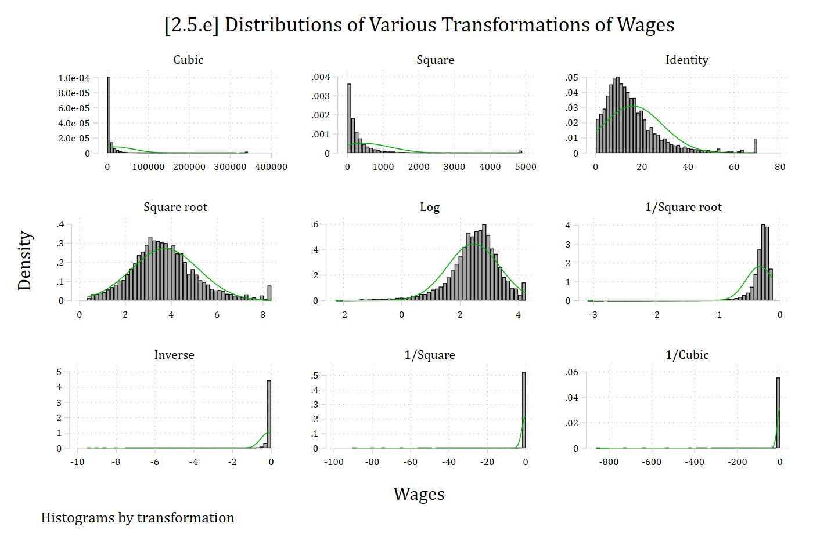
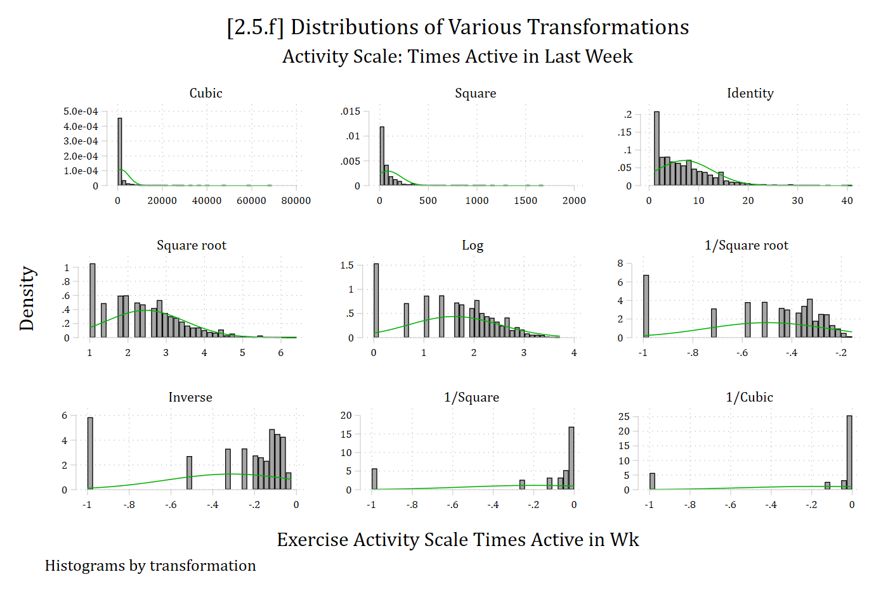

- There are an almost unlimited number of ways you can transform your variables to alter their distribution
  - A non-normal DV is a common rationale for transformation. Note that this is not necessary (linear regression does not require normally distributed DVs)---but can be helpful when the mean does not summarize the distribution well
  - Non-normal IVs are not necessarily problematic---though outliers can influence effects
    - Large confidence intervals will appropriately reflect places in data with few cases
- The Stata command **gladder** is helpful to quickly visualize what various transformations would look like
  - This is based on [Tukey's (1977) ladder of powers](http://onlinestatbook.com/2/transformations/tukey.html) which provides an empirical way to determine whether a transformation will normalize the distribution of a continuous variable
  - With large datasets, the statistical tests for this become all but meaningless---I prefer looking at it visually

```{.stata-run}
. use "https://tdmize.github.io/data/data/gss", clear
(gss.dta | GSS 1972 - 2016 Data | DMV Workshop)

. 
. gladder wages, title("[2.5.e] Distributions of Various Transformations of Wage
> s")

```

{width=80% fig-alt="Histograms of wages under nine transformations from cubic to inverse cubic; the log and square root versions look most normal."}

```{.stata-run}
. use "https://tdmize.github.io/data/data/cda_ah4", clear
(cda_ah4.dta | Add Health Wave 4 - | )

. clonevar exercisSS2 = exercisSS
(5 missing values generated)

. replace exercisSS2 = exercisSS2 + 1
(5,109 real changes made)

. 
. gladder exercisSS2, title("[2.5.f] Distributions of Various Transformations") 
> ///
>     subtitle("Activity Scale: Times Active in Last Week")

```

{width=80% fig-alt="Histograms of the activity scale under nine transformations; none look normal because of a large spike at the lowest value."}

*\*None of the transformations do a great job for this variable---largely because there is a large peak at zero (the modal person reports no physical activity). The best way to deal with this variable as a DV would be a count model (more on that later in the semester!)*
