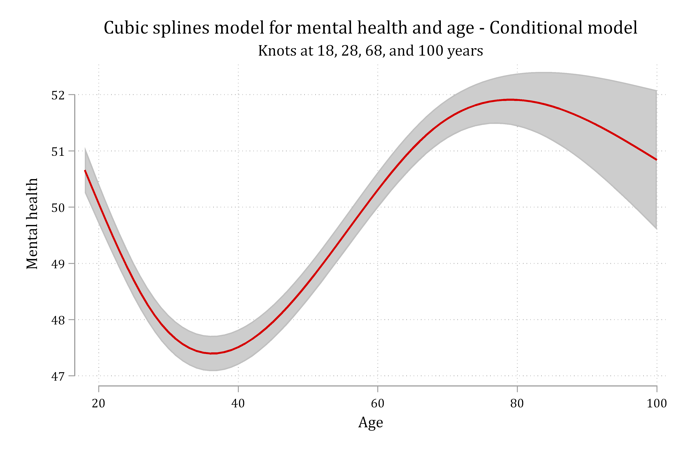
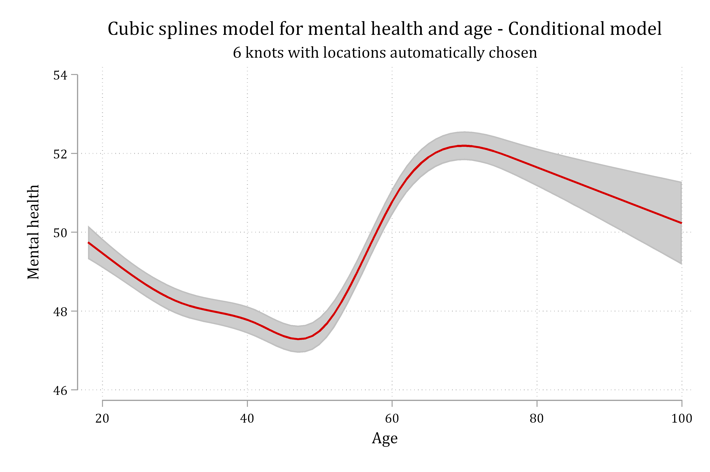
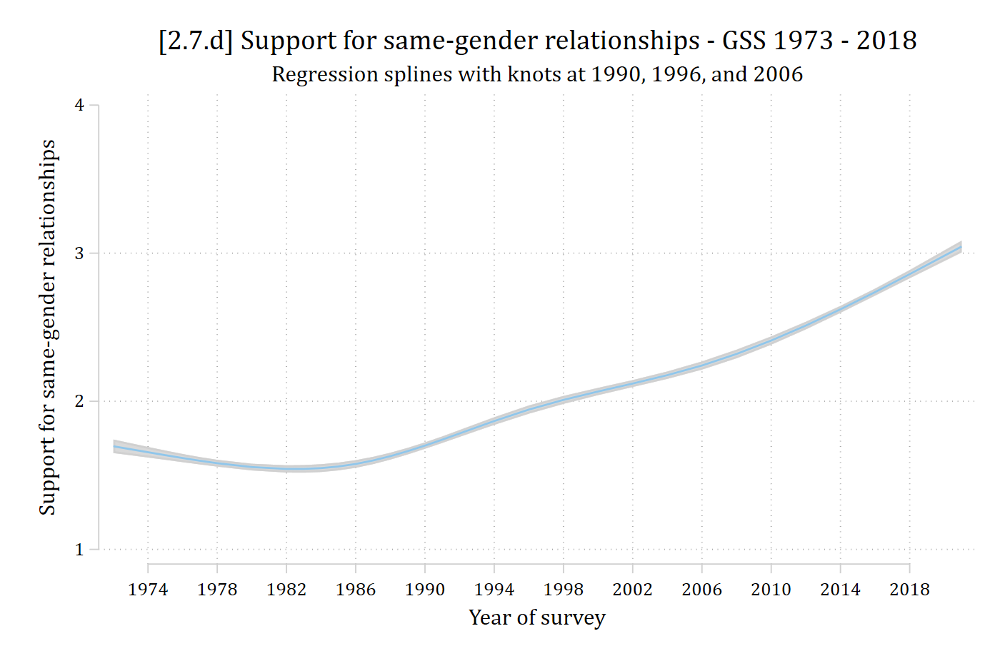

- Stata command **mkspline** will "make spline" variables for you
  - Specify names of new variables and the knot locations
- Which creates the variables:

```{.stata-run}
. use "https://tdmize.github.io/data/data/cda_gss", clear
(cda_gss.dta |  GSS 1972-2021 CDA - Categorical Data Analysis | date created 202
> 3)

. 
. mkspline year_lt90 1990 year_90_96 1996 year_96_06 2006 year_06_18 = year

. codebook year*, c

Variable      Obs Unique      Mean   Min   Max  Label
--------------------------------------------------------------------------------
year        68846     33  1996.465  1972  2021  gss year for this respondent
year1972    68846     33  24.46544     0    49  Years since 1972
year_lt90   68846     17  1986.615  1972  1990  year: (.,1990)
year_90_96  68846      5  3.443904     0     6  year: (1990,1996)
year_96_06  68846      6  4.058014     0    10  year: (1996,2006)
year_06_18  68846      8  2.348662     0    15  year: (2006,.)
--------------------------------------------------------------------------------

```

- Simply add the new spline variables as IVs instead of the original *year* var:

```stata
reg samesexop year_lt90 year_90_96 year_96_06 year_06_18
```

### Plotting spline regression predictions

- To plot predictions from the spline regression model, use the original *year* variable and **over( )** with **margins**. Then plot as normal with **marginsplot**

```stata
margins, over(year)

marginsplot, recastci(rarea) ciopts(col(gs13)) plotopts(msymbol(none)) ///
    xlab(1974(4)2018) ylab(1(1)4) ///
    ytitle("Support for same-gender relationships") xtitle("Year of survey") ///
    title("Support for same-gender relationships - GSS 1973 - 2018", size(medlarge)) ///
    subtitle("Regression splines with knots at 1990, 1996, and 2006")
```

### Cubic splines

- Cubic splines are especially helpful for modeling complex nonlinearities
  - Allows for both changes of directions at "knots" **and** for nonlinearities between the knots
- Can specify where knots are yourself (e.g. after examining the nominal specification)
  - Or, can specify \# of knots and let software find best places
- Note this introduces complications in estimation, plotting, and testing effects
  - I mostly use cubic splines only as exploratory. I would worry about "overfitting" your data if you tried to use them in a confirmatory regression model

{width=80% fig-alt="Cubic spline model for mental health by age with knots at 18, 28, 68, and 100 years."}

{width=80% fig-alt="Cubic spline model for mental health by age with 6 knots at automatically chosen locations."}

### Estimating and plotting cubic spline models

- For cubic splines, use **cubic** option on **mkspline** (see help file for options. By default, it will choose the \# of knots (5) and the locations)
  - Note I recommend using **mkspline2** so you can use **adjustrcspline** to plot the predictions
    - Both are part of [Buis's package **postrcspline**](https://core.ac.uk/download/pdf/6276812.pdf) which is very useful for plotting cubic spline model predictions

```{.stata-run}
. mkspline2 yearS = year, cubic

. reg samesexop yearS*

      Source |       SS           df       MS      Number of obs   =    40,270
-------------+----------------------------------   F(4, 40265)     =   1424.29
       Model |  9029.16605         4  2257.29151   Prob > F        =    0.0000
    Residual |  63813.9208    40,265   1.5848484   R-squared       =    0.1240
-------------+----------------------------------   Adj R-squared   =    0.1239
       Total |  72843.0869    40,269  1.80891224   Root MSE        =    1.2589

------------------------------------------------------------------------------
   samesexop | Coefficient  Std. err.      t    P>|t|     [95% conf. interval]
-------------+----------------------------------------------------------------
      yearS1 |     -0.020      0.003   -6.487   0.000       -0.026      -0.014
      yearS2 |      0.207      0.019   11.009   0.000        0.170       0.243
      yearS3 |     -0.588      0.066   -8.862   0.000       -0.718      -0.458
      yearS4 |      0.647      0.091    7.104   0.000        0.468       0.825
       _cons |     41.284      6.123    6.743   0.000       29.284      53.285
------------------------------------------------------------------------------

. adjustrcspline, ciopts(col(gs13)) ///
>     xlab(1974(4)2018) ylab(1(1)4) ///
>     ytitle("Support for same-gender relationships") xtitle("Year of survey") /
> //
>     title("[2.7.d] Support for same-gender relationships - GSS 1973 - 2018", s
> ize(medlarge)) ///
>     subtitle("Regression splines with knots at 1990, 1996, and 2006")

```

{width=80% fig-alt="Cubic spline predictions of support for same-gender relationships by survey year: flat until about 1990 and rising after."}
