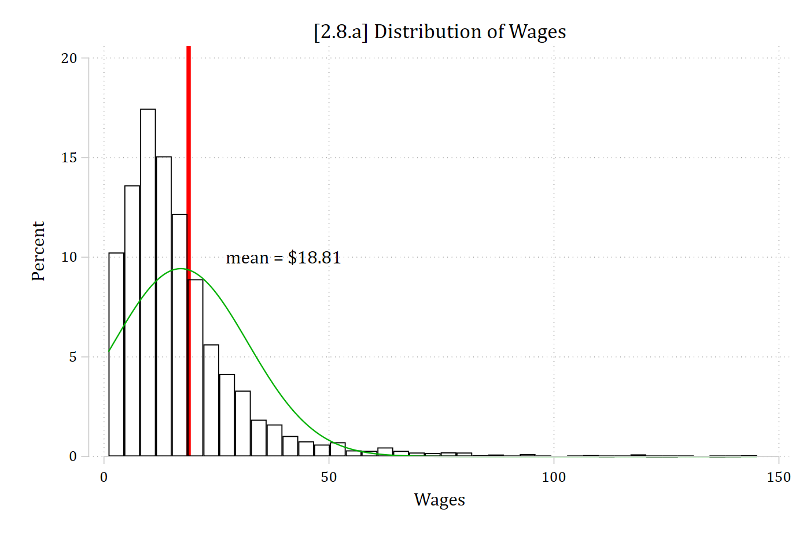
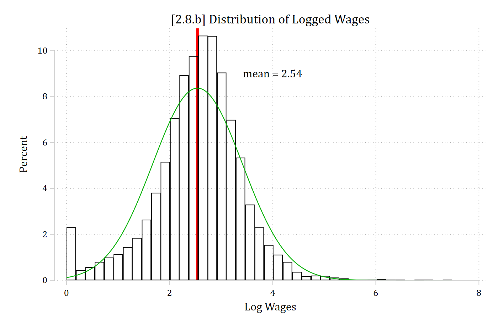
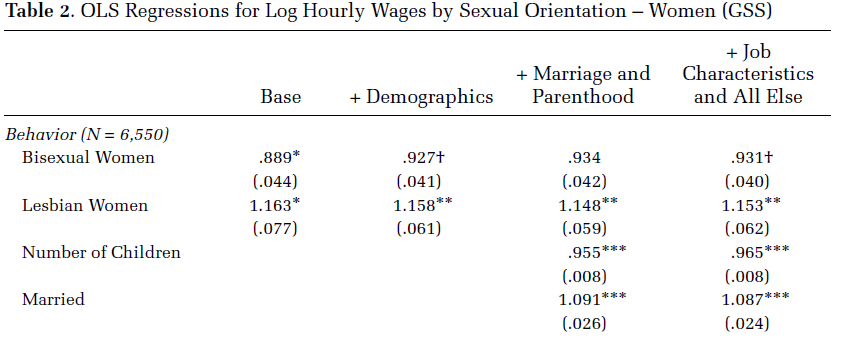
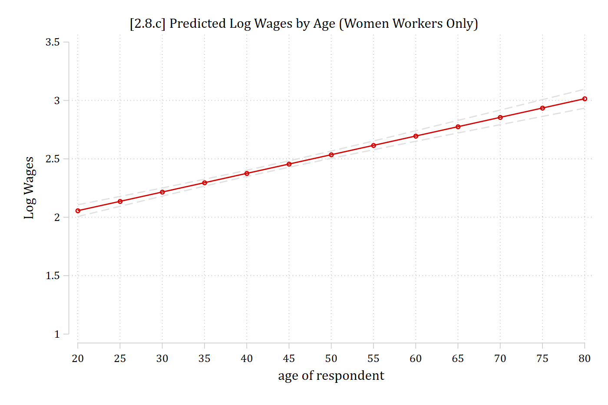
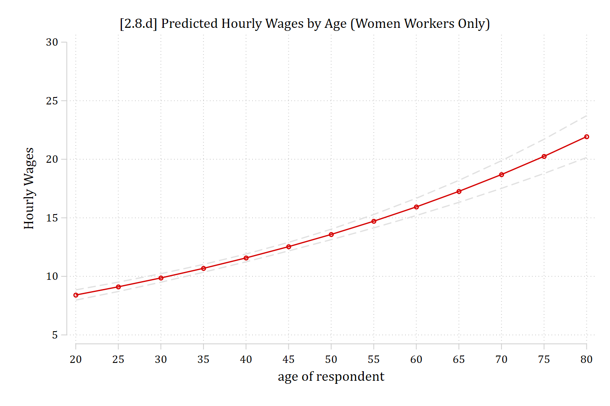
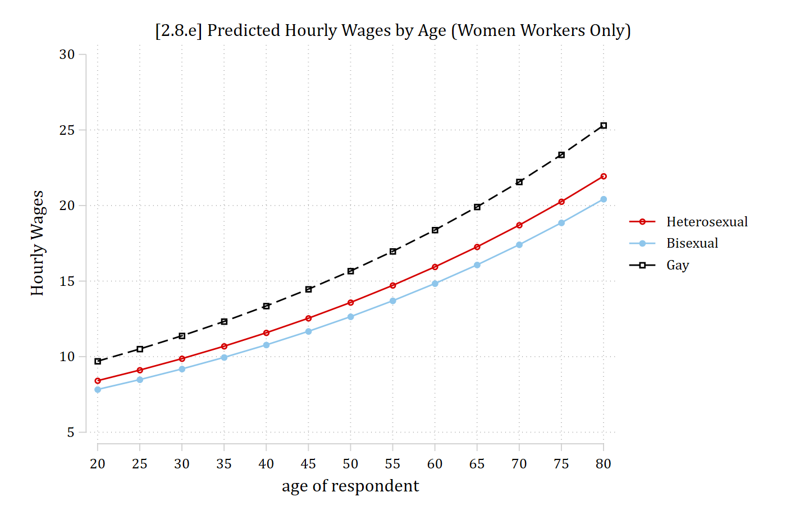
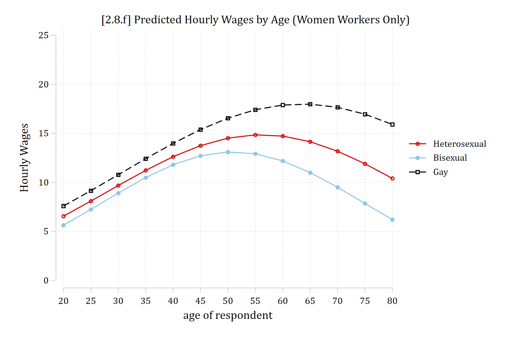

## 2.9 Logged DV regression models

- A linear regression model can be used in which the dependent variable has been logged and then a linear regression model has been fit
  - E.g., Often used when income or wages is the DV due to a strong positive skew
- Logged DV models introduce complications for interpretation for:
  - Coefficients
  - Predictions
  - Marginal effects
- Many of these complications mirror those in binary regression models (e.g., logit and probit)
- Linear regression models with logged DVs are inherently nonlinear via a transformation of the dependent variable
- The DV is the **natural log** of the original variable; e.g. *ln(wages)* is a common DV in labor market analyses
  - Need a refresher on logs and natural logs? The [Wikipedia article](https://en.wikipedia.org/wiki/Natural_logarithm) is quite good. The natural logarithm has the mathematical constant *e* (≈2.718) as its base

$$\log_{e}x = \ln(x) \qquad c = \ln(x) \qquad e^{c} = x \qquad \ln(e) = 1 \qquad e^{1} = e$$

- Why log your DV? Positively skewed DVs are a common motivation\*
  - Recall that regression models expectations (means) and conditional expectations. Is the mean a good summary of a positively skewed distribution? (See graph below)

\*Poisson models are a possible alternative ([Gould 2011](https://blog.stata.com/2011/08/22/use-poisson-rather-than-regress-tell-a-friend/)). More on these in the Count section of the class

```{.stata-run}
. usetdm smi_gss, clear
Loading dataset...
(SMI | Mize 2016 ASR | GSS Data on Sexual Behavior and Wages)

. sum wages logwages

    Variable |        Obs        Mean    Std. dev.       Min        Max
-------------+---------------------------------------------------------
       wages |     13,064    18.81297    38.21546          1     1773.6
    logwages |     13,064    2.541626    .8696813          0   7.480767

. 
. hist wages if wages <= 150, percent title("[2.8.a] Distribution of Wages") ///
>     fc(none) xline(18.81, lcolor(red) lstyle(solid) lwidth(thick)) ///
>     normal text(10 40 "mean = $18.81")
(bin=41, start=1, width=3.5150627)

```

{width=80% fig-alt="Histogram of hourly wages with a normal curve and a red line at the mean of 18.81 dollars; the distribution is strongly right-skewed."}

Is the mean a good summary of this distribution?

```{.stata-run}
. hist logwages, percent title("[2.8.b] Distribution of Logged Wages") ///
>     fc(none) xline(2.54, lcolor(red) lstyle(solid) lwidth(thick)) ///
>     normal text(9 4 "mean = 2.54")
(bin=41, start=0, width=.18245773)

```

{width=80% fig-alt="Histogram of logged hourly wages with a normal curve and a red line at the mean of 2.54; close to symmetric."}

Logging positively skewed variables helps normalize the distribution/pull in outliers

## Logged DV regression models

- First, a little bit more math review:

$$\exp(a + b) = \exp(a)*\exp(b)$$

$$\log\left\lbrack \exp(a + b) \right\rbrack = a + b$$

- An exponential model is ***multiplicative*** on the y metric

$$y = \exp\left( \beta_{0} + \beta_{k}x_{k} + \beta_{2}x_{2} + \varepsilon \right)$$

$$= \exp(\beta_{0})\exp(\beta_{k}x_{k})\exp(\beta_{2}x_{2})\exp(\varepsilon)$$

- To get back to a model that looks like linear regression, we can take the log of the entire model making the model ***loglinear*** \[*y* becomes ln(*y*)\]
  - The model becomes ***additive***---but only in the ln(*y*) metric

## Interpreting logged DV regression models

- The model after taking the natural log:

$$\ln(y) = \ln\left\lbrack \exp\left( \beta_{0} + \beta_{k}x_{k} + \beta_{2}x_{2} + \varepsilon \right) \right\rbrack$$

$$= \beta_{0} + \beta_{k}x_{k} + \beta_{2}x_{2} + \varepsilon$$

- $\beta_{k}$ is interpreted as:
  - For a unit increase in *x~k~*, ***the log of y*** is expected to increase by β~k~ units, holding other variables constant
  - This is an **additive** effect (i.e. each one unit increase in *x~k~* leads to an additional β~k~ units)
- *However, a change in the **log of y*** is often substantively unclear
  - E.g. Do you want to interpret effects in terms of the *log of wages*?
- We can instead interpret **factor changes**: multiplicative effects in the *y* metric (defined below)

### Factor change in y interpretations

- **Start value**: Let y(*x~k~*, $\mathbf{x}_{- k}$) be the value of *y* focusing on *x~k~*:

$$y\left( x_{k},\mathbf{x}_{- k} \right) = \exp(\beta_{0} + \beta_{k}x_{k} + \beta_{2}x_{2} + \varepsilon)$$

$$= \exp(\beta_{0})\exp(\beta_{k}x_{k})\exp(\beta_{2}x_{2})\exp(\varepsilon)$$

- **End value**: y(*x~k~*+1, $\mathbf{x}_{- k}$) is the value of *y* after increasing *x~k~* by 1:

$$y\left( x_{k} + 1,\mathbf{x}_{- k} \right) = \exp(\beta_{0})\exp\left\lbrack \beta_{k}\left( x_{k} + 1 \right) \right\rbrack\exp(\beta_{2}x_{2})\exp(\varepsilon)$$

$$= \exp(\beta_{0})\exp(\beta_{k}x_{k})\exp(\beta_{k})\exp(\beta_{2}x_{2})\exp(\varepsilon)$$

- The ratio y(*x~k~*+1, $\mathbf{x}_{- k}$)/y(*x~k~*, $\mathbf{x}_{- k}$) is the ***factor change*** in *y* for a unit increase in *x~k~*; it is a **multiplicative** effect with an increase in *x~k~* leading to *y* changing by a factor of $\exp(\beta_{k})$:

$$\frac{y_{end}}{y_{start}} = \frac{y(x_{k} + 1,\ \mathbf{x}_{- k})}{y(x_{k},\ \mathbf{x}_{- k})}$$

$$= \frac{\exp\left( \beta_{0} \right)\exp\left( \beta_{k}x_{k} \right)\exp\left( \beta_{k} \right)\exp\left( \beta_{2}x_{2} \right)\exp(\varepsilon)}{\exp\left( \beta_{0} \right)\exp\left( \beta_{k}x_{k} \right)\exp\left( \beta_{2}x_{2} \right)\exp(\varepsilon)} = \exp(\beta_{k})$$

### Interpreting logged DV regression models with factor changes

#### What is a "factor change?" Multiplicative effect:

*Need to know the starting value. E.g.* *y* = 10

- **Factor change of 2**: *y* is doubled or twice as large: 2\*10 = 20
- **Factor change of 0.5**: *y* is reduced in half: 0.5\*10 = 5

#### Factor change ranges

Factor changes larger than 1 indicate a positive effect; there is no upper ceiling on how large the factor change can be

Factor changes between 0 and 1 indicate a negative effect; there is a floor at 0

- If *y* is 2 times larger: *y* doubles (i.e. \*2)
- If *y* is 1.5 times larger: *y* increases by one and a half times (i.e. \*1.5)
- If *y* is 0.5 times smaller: *y* is reduced by half (i.e. \*0.5)
- If *y* is 0 times smaller: *y* is reduced to 0 regardless of its start value (i.e. \* 0)

### Factor change interpretations

- **Factor change interpretation**: for a unit increase in *x~k~*, *y* is expected to be exp(β~k~) **times** larger (or smaller), holding other variables constant
  - The factor change is in the *y* metric \[not *ln(y)*\] but is **multiplicative**; not additive
  - For **multiplicative** effects: Take the starting value and multiply it by exp(β~k~) to determine the ending value
- For example, consider a model for the unconditional gender wage gap in 2018:

```{.stata-run}
. use "https://tdmize.github.io/data/data/cda_gss", clear
(cda_gss.dta |  GSS 1972-2021 CDA - Categorical Data Analysis | date created 202
> 3)

. 
. gen logwages = ln(wages)
(35,686 missing values generated)

. reg logwages i.woman if year == 2018

      Source |       SS           df       MS      Number of obs   =     1,176
-------------+----------------------------------   F(1, 1174)      =     23.13
       Model |  23.8153521         1  23.8153521   Prob > F        =    0.0000
    Residual |  1208.56142     1,174  1.02943903   R-squared       =    0.0193
-------------+----------------------------------   Adj R-squared   =    0.0185
       Total |  1232.37677     1,175   1.0488313   Root MSE        =    1.0146

------------------------------------------------------------------------------
    logwages | Coefficient  Std. err.      t    P>|t|     [95% conf. interval]
-------------+----------------------------------------------------------------
       woman |
      Women  |     -0.285      0.059   -4.810   0.000       -0.401      -0.169
       _cons |      2.646      0.042   62.312   0.000        2.562       2.729
------------------------------------------------------------------------------

. di exp(-0.285)
.75201425

```

- The factor change ($\exp\left( \beta_{woman} \right) = 0.75$) can be interpreted as either\*:

> *Women's hourly wages are lower than men's by a factor of 0.75*
>
> *Women earn 0.75 times less than men*

- Is 0.75 a big effect? Small effect? Medium-sized effect? Effects in a multiplicative metric make contextualizing effect sizes difficult
  - The size of the effect depends on where you start!
  - In this case, the starting value for *x~woman~* is 0 which is men (i.e. they are the reference group)
- For example:
  - If men's hourly wages are \$10:
    - Calculate women's hourly wages as: \$10 \* 0.75 = \$7.50
  - If men's hourly wages are \$30:
    - Calculate women's hourly wages as: \$30 \* 0.75 = \$22.50

**\*NOTE** my use of "by a factor of" or "times" in the interpretations. These are ***necessary*** to indicate the effect is multiplicative; not additive

### Percentage change interpretations

- A complementary interpretation is to translate the factor change exp(β~k~) to a percentage change:

$$100\left\lbrack \frac{y\left( x_{k} + 1,\ \mathbf{x} \right) - y\left( x_{k},\ \mathbf{x} \right)}{y\left( x_{k},\ \mathbf{x} \right)} \right\rbrack = 100\left\lbrack \exp\left( \beta_{k} \right) - 1 \right\rbrack$$

- E.g. If you make \$10/hour and get a raise to \$11/hour, a 10% raise:

$$100\ \frac{\$11 - \$10}{\$10} = 100\left\lbrack \frac{\$11}{\$10} - \frac{\$10}{\$10} \right\rbrack = 100\left\lbrack \frac{\$1}{\$10} \right\rbrack = \frac{100}{\$10} = 10\%$$

- Factor and percentage changes can be used interchangeably; they provide the same information. Pick your favorite and be consistent in your interpretations:
  - For a unit increase in *x~k~*, *y* is expected to change by 100\[exp(β~1~)-1\] percent, holding other variables constant
  - For a unit increase in *x~k~*, y is expected to be exp(β~k~) times larger (or smaller), holding other variables constant

### Logged DV regression model ex: sexual orientation and wages

Example is from [Mize (2016) *ASR*](https://scholar.google.com/scholar?hl=en&as_sdt=0%2C15&q=trenton+mize&btnG=&oq=tren)\*

> ***Analytic Strategy***
>
> *For all analyses, I use the log of wages as the dependent variable to help normalize the distribution and minimize the influence of outliers. All models are linear regression models; I report factor change coefficients in the text and tables that are the exponentiated regression coefficients. The omitted focal independent variable category for all models is heterosexual; factor change coefficients less than one for bisexual or gay/lesbian individuals therefore represent lower earnings than those of heterosexual individuals.*
>
> *... Any remaining unexplained portion of the wage gap is suggestive of discrimination---however, it is impossible to provide a causal test of discrimination without an experimental design. Therefore, unobserved factors outside of those included in the model could still account for any unexplained amount of the wage gap.*

\*NOTE: Minor rewrites here for clarity of example out of context of the full article

{width=80% fig-alt="Excerpt of Table 2 from Mize (2016): OLS regressions for log hourly wages by sexual orientation for women in the GSS."}

::: {.callout-note icon="false" appearance="simple"}
**Side note**: I recommend titling a table "linear regression" rather than "OLS regression" as OLS is the estimator, not the model type.
:::

> *Table 2 shows results of regression models of log wages for women... bisexual women earn 11 percent less than heterosexual women at baseline (e^b^ = .89, p \< .05). After accounting for all other factors, bisexual women still earn 7 percent less than comparable heterosexual women, providing support for Hypothesis 6 (e^b^ = .93, p \< .10)... Lesbian women earn more than heterosexual women at baseline (e^b^ = 1.16, p \< .05). This difference remains significant and substantively similar in size after accounting for all factors (e^b^ = 1.15, p \< .01).*

```{.stata-run}
. * Model from Table 2 of Mize (2016) ASR
. usetdm smi_gss, clear
Loading dataset...
(SMI | Mize 2016 ASR | GSS Data on Sexual Behavior and Wages)

. 
. svy: reg logwages i.partners75 age i.educcat i.race year ///
>     numchild married i.region4 i.metro parttime i.isco88cat ///
>     if male==0, eform(Factor)
(running regress on estimation sample)

Survey: Linear regression

Number of strata =   1                            Number of obs   =      6,550
Number of PSUs   = 336                            Population size = 6,567.8471
                                                  Design df       =        335
                                                  F(26, 310)      =      67.90
                                                  Prob > F        =     0.0000
                                                  R-squared       =     0.2560

-------------------------------------------------------------------------------
              |             Linearized
     logwages |     Factor   std. err.      t    P>|t|     [95% conf. interval]
--------------+----------------------------------------------------------------
   partners75 |
    Bisexual  |      0.931      0.040   -1.658   0.098        0.855       1.013
         Gay  |      1.153      0.062    2.652   0.008        1.037       1.282
              |
          age |      1.016      0.001   15.741   0.000        1.014       1.018
              |
      educcat |
 high school  |      1.389      0.070    6.502   0.000        1.258       1.534
junior col..  |      1.730      0.094   10.032   0.000        1.554       1.926
    bachelor  |      1.899      0.109   11.201   0.000        1.697       2.126
    graduate  |      2.445      0.153   14.283   0.000        2.162       2.765
              |
         race |
       black  |      1.034      0.032    1.077   0.282        0.973       1.100
       other  |      0.999      0.054   -0.023   0.982        0.897       1.112
              |
         year |      0.996      0.002   -2.535   0.012        0.993       0.999
     numchild |      0.965      0.008   -4.316   0.000        0.950       0.981
      married |      1.087      0.024    3.756   0.000        1.040       1.135
              |
      region4 |
     Midwest  |      0.889      0.039   -2.666   0.008        0.815       0.970
       South  |      0.856      0.038   -3.540   0.000        0.785       0.933
        West  |      0.979      0.047   -0.439   0.661        0.891       1.076
              |
      1.metro |      1.050      0.033    1.552   0.122        0.987       1.118
     parttime |      0.842      0.024   -6.000   0.000        0.795       0.891
              |
    isco88cat |
lo control..  |      0.844      0.025   -5.633   0.000        0.795       0.895
routine no..  |      0.659      0.023  -11.957   0.000        0.616       0.706
sempl with..  |      0.717      0.056   -4.252   0.000        0.614       0.836
sempl with..  |      0.557      0.042   -7.763   0.000        0.480       0.646
manual sup..  |      0.916      0.083   -0.963   0.336        0.767       1.095
skilled ma..  |      0.742      0.042   -5.290   0.000        0.665       0.829
semi-unski..  |      0.611      0.025  -12.130   0.000        0.564       0.662
  farm labor  |      0.572      0.078   -4.071   0.000        0.437       0.749
selfempl f..  |      0.645      0.216   -1.310   0.191        0.334       1.246
              |
        _cons |  25685.979  86067.823    3.030   0.003       35.251    1.87e+07
-------------------------------------------------------------------------------

. 
. qui margins, at(age=(20(5)80))

. marginsplot, recastci(rline) ciopts(lpat(dash) col(gs14)) ///
>     title("[2.8.c] Predicted Log Wages by Age (Women Workers Only)") ///
>     ytitle("Log Wages") ylab(1(0.5)3.5)

Variables that uniquely identify margins: age

```

{width=80% fig-alt="Predicted log wages by age for women: a straight rising line."}

The effect on the *log of wages* is linear (but how would you interpret log wages?)

## Interpretation in the natural metric of the DV

- Logged DV regression models can be very useful; however, you almost certainly do not set out to study effects on the *log of wages.* Interpreting the factor change coefficients is one useful alternative
  - Factor change coefficients are in the natural metric of the DV (a plus), but are multiplicative rather than additive (generally, a negative)
- Focusing on interpreting predictions and marginal effects (which are calculated from the predictions) hold key benefits here as you can convert the prediction back into the natural metric of the DV (in this example, *wages*) **and** MEs are additive effects (just like your trusty linear regression coefficients)
- Recall the general formula for a marginal effect:

$$ME = \eta\left( x_{k} = end,\ \mathbf{x}_{- k} = \mathbf{x}^{\mathbf{*}} \right) - \eta\left( x_{k} = start,\ \mathbf{x}_{- k} = \mathbf{x}^{\mathbf{*}} \right)$$

- For our linear regression examples earlier, $\eta$ (the prediction) was easy to solve for as it was just the result of solving the regression equation for $\mathbf{x\beta}$
  - This is because our linear regression model coefficients were already in the natural metric of the DV (e.g. occupational prestige)

### Converting predictions to natural metric of DV

- For logged DV regression models, fairly straightforward to transform the $\mathbf{x\beta}$ prediction (which is in $ln(y)$ metric) back to the natural *y* metric by exponentiating it\*. E.g.

$$\widehat{\ln(wages)} = \mathbf{x\beta}$$

$$\eta = \widehat{wages} = \exp(\mathbf{x\beta})$$

- Note the formula for marginal effects are identical in logged DV regression models as they are in linear models (i.e., the [formulas shown earlier](2-1-marginal-effects.qmd#marginal-effects-defined) in these notes are equally applicable in both types of models)
  - The only difference is that the formula for $\eta$ has changed
  - I.e. We are still interpreting effects in terms of differences in predictions; the only thing that has changed is how we get to the prediction ($\eta$) of interest

\*But [note some important complications](https://www.stata.com/stata-news/news34-2/spotlight/) if you had values \<1 in the original metric of the variable

```{.stata-run}
. qui margins, at(age=(20(5)80)) expression(exp(predict(xb)))

. marginsplot, recastci(rline) ciopts(lpat(dash) col(gs14)) ///
>     title("[2.8.d] Predicted Hourly Wages by Age (Women Workers Only)") ///
>     ytitle("Hourly Wages") ylab(5(5)30)

Variables that uniquely identify margins: age

```

{width=80% fig-alt="Predicted hourly wages by age for women, curving upward."}

Note the nonlinearities. This is despite no *age^2^* coefficient in the model. The model is inherently nonlinear in the wages metric due to ln(wages) used as the DV

```{.stata-run}
. qui margins, at(age=(20(5)80) partners75=(1 2 3)) expression(exp(predict(xb)))

. marginsplot, noci title("[2.8.e] Predicted Hourly Wages by Age (Women Workers 
> Only)") ///
>     ytitle("Hourly Wages") ylab(5(5)30)

Variables that uniquely identify margins: age partners75

```

{width=80% fig-alt="Predicted hourly wages by age for heterosexual, bisexual, and lesbian women: three upward curves that spread apart with age."}

**\*Note** the interaction effect (e.g. size of sexuality gaps vary at different ages) despite no interaction terms in model. Nonlinearities produce interaction effect

*What happens when we add age^2^ to the model? Even more nonlinearities and interaction effects. Just as in linear regression, in loglinear regression the polynomial allows for the slope of the prediction line to change at some point. Here the effect reverses at higher ages.*

```{.stata-run}
. svy: reg logwages i.partners75##c.age##c.age i.educcat i.race year ///
>     numchild married i.region4 i.metro parttime i.isco88cat ///
>     if male==0, eform(Factor)
(running regress on estimation sample)

Survey: Linear regression

Number of strata =   1                            Number of obs   =      6,550
Number of PSUs   = 336                            Population size = 6,567.8471
                                                  Design df       =        335
                                                  F(31, 305)      =      61.30
                                                  Prob > F        =     0.0000
                                                  R-squared       =     0.2715

-------------------------------------------------------------------------------
              |             Linearized
     logwages |     Factor   std. err.      t    P>|t|     [95% conf. interval]
--------------+----------------------------------------------------------------
   partners75 |
    Bisexual  |      0.644      0.386   -0.734   0.463        0.198       2.094
         Gay  |      1.388      0.837    0.543   0.587        0.424       4.548
              |
          age |      1.073      0.006   12.347   0.000        1.061       1.085
              |
   partners75#|
        c.age |
    Bisexual  |      1.020      0.032    0.634   0.526        0.960       1.084
         Gay  |      0.988      0.028   -0.438   0.662        0.934       1.045
              |
  c.age#c.age |      0.999      0.000   -9.638   0.000        0.999       1.000
              |
   partners75#|
  c.age#c.age |
    Bisexual  |      1.000      0.000   -0.678   0.498        0.999       1.000
         Gay  |      1.000      0.000    0.534   0.594        1.000       1.001
              |
      educcat |
 high school  |      1.350      0.067    6.099   0.000        1.226       1.488
junior col..  |      1.639      0.088    9.218   0.000        1.475       1.821
    bachelor  |      1.808      0.102   10.446   0.000        1.617       2.021
    graduate  |      2.313      0.144   13.496   0.000        2.047       2.614
              |
         race |
       black  |      1.020      0.031    0.639   0.524        0.960       1.083
       other  |      0.996      0.054   -0.078   0.938        0.896       1.107
              |
         year |      0.997      0.002   -1.768   0.078        0.994       1.000
     numchild |      0.954      0.008   -5.793   0.000        0.939       0.970
      married |      1.045      0.022    2.047   0.041        1.002       1.089
              |
      region4 |
     Midwest  |      0.896      0.038   -2.574   0.010        0.824       0.974
       South  |      0.864      0.037   -3.398   0.001        0.794       0.940
        West  |      0.972      0.045   -0.602   0.548        0.887       1.066
              |
      1.metro |      1.057      0.033    1.765   0.078        0.994       1.124
     parttime |      0.884      0.025   -4.327   0.000        0.836       0.935
              |
    isco88cat |
lo control..  |      0.845      0.025   -5.637   0.000        0.796       0.896
routine no..  |      0.666      0.023  -11.812   0.000        0.623       0.713
sempl with..  |      0.724      0.056   -4.142   0.000        0.621       0.844
sempl with..  |      0.549      0.041   -8.053   0.000        0.475       0.636
manual sup..  |      0.922      0.080   -0.929   0.354        0.778       1.094
skilled ma..  |      0.745      0.041   -5.339   0.000        0.668       0.830
semi-unski..  |      0.617      0.025  -11.920   0.000        0.570       0.668
  farm labor  |      0.581      0.077   -4.102   0.000        0.448       0.754
selfempl f..  |      0.644      0.221   -1.281   0.201        0.328       1.266
              |
        _cons |    671.048   2236.546    1.953   0.052        0.954    4.72e+05
-------------------------------------------------------------------------------

. est store smimod

. 
. qui margins, at(age=(20(5)80) partners75=(1 2 3)) expression(exp(predict(xb)))

. marginsplot, noci title("[2.8.f] Predicted Hourly Wages by Age (Women Workers 
> Only)") ///
>     ytitle("Hourly Wages") ylab(0(5)25)

Variables that uniquely identify margins: age partners75

```

{width=80% fig-alt="Predicted hourly wages by age for heterosexual, bisexual, and lesbian women: curves that rise, peak in midlife, and fall, at different levels."}

### Logged DV regression models---marginal effects

- The coefficients are no longer directly interpretable when we have quadratic and/or interaction terms as we do for the model presented in the plot above
- Marginal effects can still provide an overall summary for the effects of interest---for this example, the effect of sexual identity for women
  - Remember to exponentiate the predictions when you calculate the MEs so you are in the wage metric instead of the ln(wage) metric \[which will be the default\]

```{.stata-run}
. est restore smimod
(results smimod are active now)

. mchange partners75, expression(exp(predict(xb)))

svy regress: Changes in Margin | Number of obs = 6550

Expression: , exp(predict(xb))

                          |    Change    p-value 
--------------------------+---------------------
partners75                |                     
 Bisexual vs Heterosexual |    -1.191      0.017 
      Gay vs Heterosexual |     1.676      0.019 
          Gay vs Bisexual |     2.867      0.001 

Average prediction

   11.998 


```

> *Bisexual women earn about \$1.19 less an hour than heterosexual women*
>
> *On average, lesbian women earn about \$1.68 more per hour than heterosexual women and about \$2.87 more than bisexual women*

- These interpretations are useful and straightforward summaries of the effect of sexual identity---despite the rather complicated model that produced them
  - I would include these **and** the plot above. Probably start with the overall effects (MEs) and then move on to the complications (plot)
