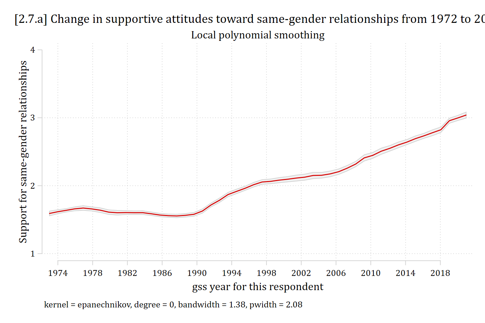
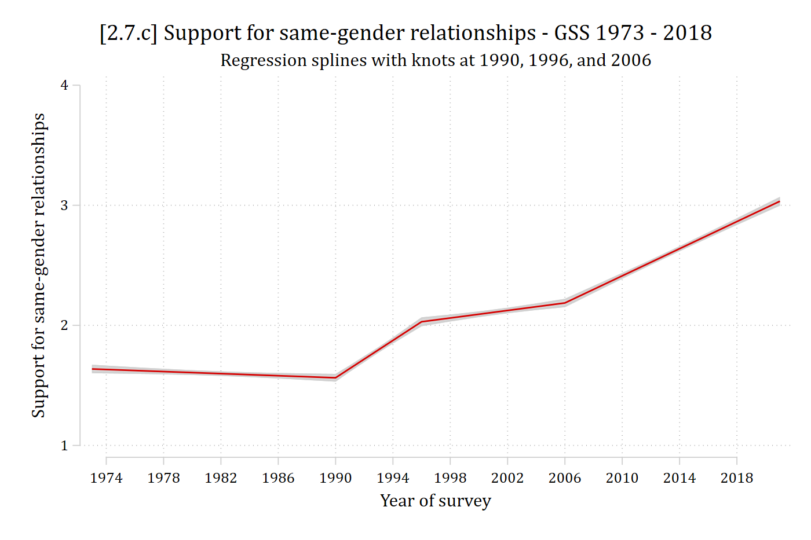

- Sometimes polynomials do not model nonlinearities well enough
  - E.g., Too many turns in the line, very quick changes of direction, etc.
- Splines allow you to specify a structural "break" (AKA a "knot") in the regression line
  - Slope can be completely different before and after the knot (e.g., before and after age 60)
    - Estimate separate coefficient for age \< 60 and age ≥ 60
- Parametric technique; you get a coefficient (and associated SE/CI/*p*-value) for the slope between each knot
  - Works with almost any regression model
- I give only a quick introduction here. For details on splines, [Marsh and Cormier's 2002 Sage QASS](https://methods.sagepub.com/book/spline-regression-models) book is a good and accessible introduction to splines
  - Also see [Edwards and Parry 2018](https://doi.org/10.1177/1094428117715067)
  - See [Appendix A2.8](appendix-2a/a2-8-splines.qmd) and [**mkspline**](https://www.stata.com/manuals/rmkspline.pdf) for some details on cubic splines which combine splines and nonlinearities

{width=50% fig-alt="Scatterplot with a linear spline: a line that falls to a knot and then rises."}

## Linear splines

- How do we estimate the two different slopes shown on the graph above?
  - Create two variables for *x*: one summarizes the relationship \< 60 and one for the relationship ≥ 60
    - Note 60 is the "knot" placement
- First variable summarizes relationship for age \< 60. Defined as:

$${age}_{< 60} = original\ value\ of\ age\ if\ age < 60$$

$${age}_{< 60} = 60\ if\ age \geq 60$$

- Second variable summarizes relationship for $age \geq 60$. Defined as age difference from last knot:

$${age}_{\geq 60} = 0\ if\ age \leq 60$$

$${age}_{\geq 60} = \#\ of\ years\ since\ last\ knot\ (age\ 60)$$

- For example, age 65 is coded as 5 on ${age}_{\geq 60}$; age 80 is coded as 20 on ${age}_{\geq 60}$

::: {.panel-tabset group="language"}
## Stata

```{.stata-run}
. use "https://tdmize.github.io/data/data/cda_gss", clear
(cda_gss.dta |  GSS 1972-2021 CDA - Categorical Data Analysis | date created 202
> 3)

. 
. lpoly samesexop year, ///
>     xlab(1974(4)2018) ylab(1(1)4) noscatter ci legend(off) ///
>     ytitle("Support for same-gender relationships") ///
>     subtitle("Local polynomial smoothing") ///
>     title("[2.7.a] Change in supportive attitudes toward same-gender relations
> hips from 1972 to 2020")

```

{width=80% fig-alt="Local polynomial smooth of support for same-gender relationships by survey year: flat until about 1990, then rising, with changes in slope around 1996 and 2006."}

## R

```{r}
#| fig-alt: "Local polynomial smooth of support for same-gender relationships by survey year: flat until about 1990, then rising, with changes in slope around 1996 and 2006."
library(haven)           # import Stata data and labels
library(dplyr)           # data manipulation
library(ggplot2)         # graphs
library(modelsummary)    # regression tables
library(marginaleffects) # predictions and marginal effects
library(lspline)         # linear splines
library(cleanplots)      # graph scheme
cleanplots_defaults()

gss <- read_dta("https://tdmize.github.io/data/data/cda_gss.dta")

# Keep only the variables used and drop any missing data on them
gss <- gss[c("samesexop", "year")]
gss <- gss[complete.cases(gss), ]
gss <- gss |> mutate(samesexop = as.numeric(samesexop))

ggplot(gss, aes(x = year, y = samesexop)) +
  geom_smooth() +
  scale_x_continuous(breaks = seq(1974, 2018, 4)) +
  scale_y_continuous(breaks = 1:4, limits = c(1, 4)) +
  labs(title = "[2.7.a] Change in supportive attitudes toward same-gender relationships",
    subtitle = "Local polynomial smoothing",
    x = "Year of survey", y = "Support for same-gender relationships")
```

:::

\*Where would you place the "knots" to model this with splines?

### Interpreting linear splines

- Linear splines specify linear relationships between each "knot"
  - I chose knots at 1990, 1996, and 2006 based on graph above
  - Here are the variables we need:

::: {.panel-tabset group="language"}
## Stata

```{.stata-run}
. mkspline year_lt90 1990 year_90_96 1996 year_96_06 2006 year_06_18 = year

. codebook year*, c

Variable      Obs Unique      Mean   Min   Max  Label
--------------------------------------------------------------------------------
year        68846     33  1996.465  1972  2021  gss year for this respondent
year1972    68846     33  24.46544     0    49  Years since 1972
year_lt90   68846     17  1986.615  1972  1990  year: (.,1990)
year_90_96  68846      5  3.443904     0     6  year: (1990,1996)
year_96_06  68846      6  4.058014     0    10  year: (1996,2006)
year_06_18  68846      8  2.348662     0    15  year: (2006,.)
--------------------------------------------------------------------------------

```

## R

```{r}
# lspline() makes one variable for each piece of the spline
summary(lspline(gss$year, knots = c(1990, 1996, 2006)))
```

:::

::: {.panel-tabset group="language"}
## Stata

```{.stata-run}
. reg samesexop year_lt90 year_90_96 year_96_06 year_06_18

      Source |       SS           df       MS      Number of obs   =    40,270
-------------+----------------------------------   F(4, 40265)     =   1442.27
       Model |  9128.86223         4  2282.21556   Prob > F        =    0.0000
    Residual |  63714.2247    40,265   1.5823724   R-squared       =    0.1253
-------------+----------------------------------   Adj R-squared   =    0.1252
       Total |  72843.0869    40,269  1.80891224   Root MSE        =    1.2579

------------------------------------------------------------------------------
   samesexop | Coefficient  Std. err.      t    P>|t|     [95% conf. interval]
-------------+----------------------------------------------------------------
   year_lt90 |     -0.004      0.002   -2.562   0.010       -0.008      -0.001
  year_90_96 |      0.078      0.004   17.418   0.000        0.069       0.087
  year_96_06 |      0.016      0.003    5.502   0.000        0.010       0.021
  year_06_18 |      0.056      0.002   28.645   0.000        0.053       0.060
       _cons |     10.155      3.340    3.040   0.002        3.609      16.702
------------------------------------------------------------------------------

. est store splinemod

. est table splinemod, ///
>     title("[2.7.b] Spline regression model for opinion of same-gender relation
> ships") ///
>     b(%5.3f) star(.05 .01 .001)

[2.7.b] Spline regression model for opinion of same-gender relationships

---------------------------
    Variable | splinemod   
-------------+-------------
   year_lt90 |  -0.004*    
  year_90_96 |   0.078***  
  year_96_06 |   0.016***  
  year_06_18 |   0.056***  
       _cons |  10.155**   
---------------------------
Legend: * p<.05; ** p<.01; *** p<.001

```

## R

```{r}
splinemod <- lm(samesexop ~ lspline(year, knots = c(1990, 1996, 2006)), data = gss)

modelsummary(splinemod, stars = c("*" = .05, "**" = .01, "***" = .001),
  title = "[2.7.b] Spline regression model for opinion of same-gender relationships")
```

:::

- What do the coefficients mean?\*

$$\beta_{year\_lt90} = slope\ if\ year < 1990$$

$$\beta_{year\_90-96} = slope\ if\ year \geq 1990\ \&\ year < 1996$$

$$\beta_{year\_96-06} = slope\ if\ year \geq 1996\ \&\ year < 2006$$

$$\beta_{year\_06-18} = slope\ if\ year > 2006$$

\*We will learn how to test the equality of these coefficients in the 05 Testing section

::: {.panel-tabset group="language"}
## Stata

```{.stata-run}
. margins, over(year)

Predictive margins                                      Number of obs = 40,270
Model VCE: OLS

Expression: Linear prediction, predict()
Over:       year

------------------------------------------------------------------------------
             |            Delta-method
             |     Margin   std. err.      t    P>|t|     [95% conf. interval]
-------------+----------------------------------------------------------------
        year |
       1973  |      1.637      0.018   90.842   0.000        1.602       1.672
       1974  |      1.633      0.017   98.251   0.000        1.600       1.665
       1976  |      1.624      0.014  116.005   0.000        1.597       1.651
       1977  |      1.620      0.013  126.310   0.000        1.595       1.645
       1980  |      1.607      0.010  157.664   0.000        1.587       1.627
       1982  |      1.598      0.010  166.737   0.000        1.579       1.617
       1984  |      1.589      0.010  156.927   0.000        1.570       1.609
       1985  |      1.585      0.011  146.878   0.000        1.564       1.606
       1987  |      1.577      0.013  124.141   0.000        1.552       1.601
       1988  |      1.572      0.014  113.406   0.000        1.545       1.599
       1989  |      1.568      0.015  103.655   0.000        1.538       1.598
       1990  |      1.564      0.016   94.967   0.000        1.531       1.596
       1991  |      1.641      0.014  120.695   0.000        1.615       1.668
       1993  |      1.797      0.011  156.273   0.000        1.774       1.819
       1994  |      1.875      0.013  145.662   0.000        1.849       1.900
       1996  |      2.030      0.019  108.201   0.000        1.993       2.067
       1998  |      2.061      0.015  140.407   0.000        2.033       2.090
       2000  |      2.093      0.012  174.484   0.000        2.069       2.116
       2002  |      2.124      0.012  181.526   0.000        2.101       2.147
       2004  |      2.155      0.014  154.449   0.000        2.128       2.183
       2006  |      2.187      0.018  122.749   0.000        2.152       2.222
       2008  |      2.300      0.015  155.128   0.000        2.271       2.329
       2010  |      2.413      0.012  194.880   0.000        2.388       2.437
       2012  |      2.526      0.011  232.629   0.000        2.504       2.547
       2014  |      2.638      0.011  247.589   0.000        2.618       2.659
       2016  |      2.751      0.012  232.236   0.000        2.728       2.775
       2018  |      2.864      0.014  203.429   0.000        2.837       2.892
       2021  |      3.034      0.019  163.711   0.000        2.997       3.070
------------------------------------------------------------------------------

. marginsplot, recastci(rarea) ciopts(col(gs13)) plotopts(msymbol(none)) ///
>     xlab(1974(4)2018) ylab(1(1)4) ///
>     ytitle("Support for same-gender relationships") xtitle("Year of survey") /
> //
>     title("[2.7.c] Support for same-gender relationships - GSS 1973 - 2018", s
> ize(medlarge)) ///
>     subtitle("Regression splines with knots at 1990, 1996, and 2006")

Variables that uniquely identify margins: year

```

{width=80% fig-alt="Predicted support for same-gender relationships from the spline model: four straight segments joined at 1990, 1996, and 2006."}

## R

```{r}
#| fig-alt: "Predicted support for same-gender relationships from the spline model: four straight segments joined at 1990, 1996, and 2006."
plot_predictions(splinemod, by = "year") +
  scale_x_continuous(breaks = seq(1974, 2018, 4)) +
  scale_y_continuous(breaks = 1:4, limits = c(1, 4)) +
  labs(title = "[2.7.c] Support for same-gender relationships - GSS 1973 - 2018",
    subtitle = "Regression splines with knots at 1990, 1996, and 2006",
    x = "Year of survey", y = "Support for same-gender relationships")
```

:::
