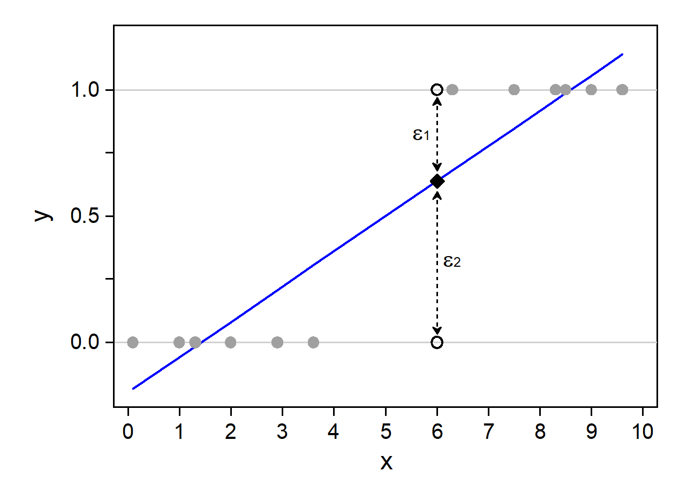
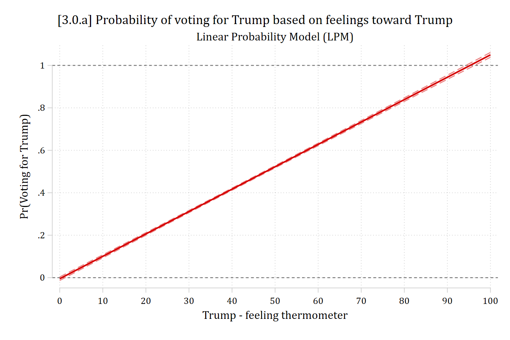
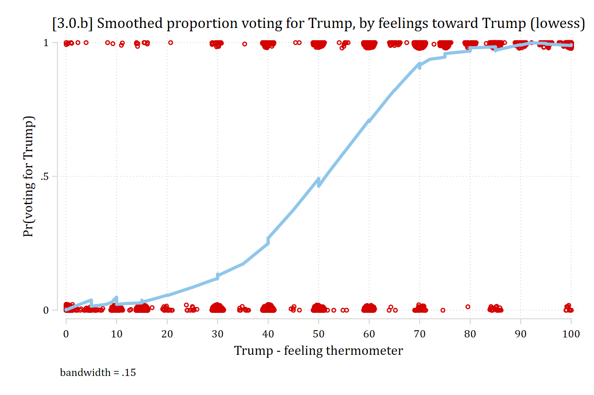
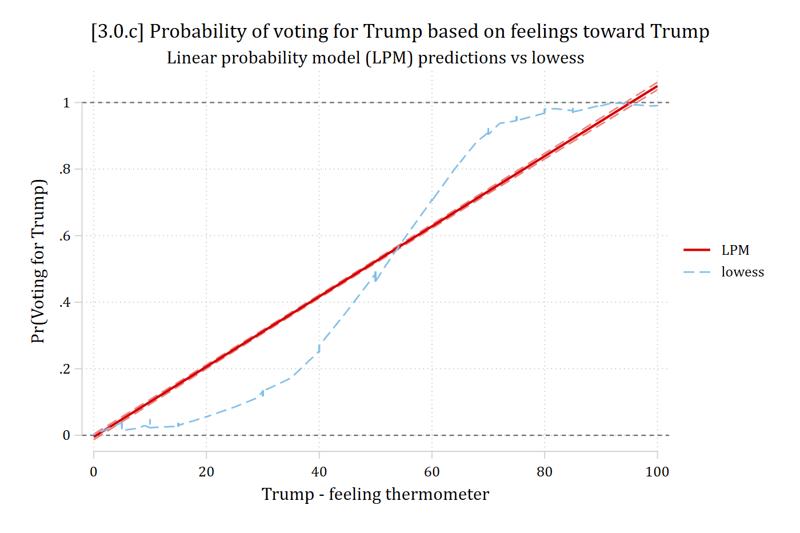

## Expectations for binary DVs

- As with any regression, expectations (means) are being modeled

$$E(y\,|\,\mathbf{x}) = \Pr(y = 1\,|\,\mathbf{x})$$

- With a binary DV coded 0/1, the mean is the proportion of 1's observed
- If DV is whether someone **voted** in the 2024 presidential election
  - In 2024, ≈65% of eligible U.S. voters voted. Consider probabilities of observing the binary values 0 (did not vote) and 1 (did vote):

| *y*-value | Proportion Observed | Probability of Response |
|:---------:|:-------------------:|:-----------------------:|
| 0 | 0.35 | 0.35 |
| 1 | 0.65 | 0.65 |

- Usually, interested in expectations conditional on values of other variables
  - E.g., What if 70% of Republicans voted and only 60% non-Republicans voted?

$$E(y\,|\,x_{Republican} = 0) = \Pr(y = 1\,|\,x_{Republican} = 0) = 0.60$$

$$E(y\,|\,x_{Republican} = 1) = \Pr(y = 1\,|\,x_{Republican} = 1) = 0.70$$

## Why not use a linear model for binary DVs?

- When linear regression (usually estimated via OLS) is used for a binary DV this is referred to as the linear probability model (LPM)

$$E(y_{i}\,|\,\mathbf{x}) = \Pr(y_{i} = 1\,|\,\mathbf{x}) = \beta_{0} + \beta_{1}x_{i1} + \beta_{2}x_{i2} + \beta_{3}x_{i3}$$

- Example
  - 2020 presidential voting intentions: Trump = 1; Not Trump = 0
    - NOTE: Including IVs for age, income, gender, sexuality, race-ethnicity, education, religiosity, etc.

$${presvote}_{i} = \beta_{0} + \beta_{woman}{woman}_{i} + \beta_{educ}{educ}_{i} + \beta_{race}{race}_{i} \ldots$$

$$E({presvote}_{i}\,|\,\mathbf{x}) = \Pr({presvote}_{i} = 1\,|\,\mathbf{x}) = \beta_{0} + \beta_{woman}{woman}_{i} + \beta_{educ}{educ}_{i} + \beta_{race}{race}_{i} \ldots$$

- The model is **linear in the probability of *y***

::: {.panel-tabset group="language"}
## Stata

```{.stata-run}
. use "https://tdmize.github.io/data/data/cda_anes", clear
(American National Election Study 2020 - Pre-election | CDA | 2021-09-26)

. 
. drop if missing(age, hhincome, woman, lgb, race4, ///
>     edyrs, relimport, wrongtrack)
(948 observations deleted)

. 
. regress vote_trump age hhincome i.woman i.lgb i.race4 ///
>     edyrs i.relimport i.wrongtrack

      Source |       SS           df       MS      Number of obs   =     6,857
-------------+----------------------------------   F(13, 6843)     =    412.52
       Model |  732.610452        13  56.3546502   Prob > F        =    0.0000
    Residual |  934.837411     6,843  .136612218   R-squared       =    0.4394
-------------+----------------------------------   Adj R-squared   =    0.4383
       Total |  1667.44786     6,856  .243210015   Root MSE        =    .36961

-------------------------------------------------------------------------------
   vote_trump | Coefficient  Std. err.      t    P>|t|     [95% conf. interval]
--------------+----------------------------------------------------------------
          age |     -0.001      0.000   -2.154   0.031       -0.001      -0.000
     hhincome |     -0.000      0.000   -0.812   0.417       -0.000       0.000
              |
        woman |
       Woman  |     -0.049      0.009   -5.364   0.000       -0.066      -0.031
              |
          lgb |
         LGB  |     -0.129      0.018   -6.982   0.000       -0.165      -0.093
              |
        race4 |
       Black  |     -0.347      0.017  -21.015   0.000       -0.380      -0.315
    Hispanic  |     -0.162      0.016   -9.925   0.000       -0.194      -0.130
       Other  |     -0.089      0.016   -5.515   0.000       -0.121      -0.058
              |
        edyrs |     -0.019      0.002   -9.766   0.000       -0.023      -0.015
              |
    relimport |
2. Very im..  |     -0.085      0.013   -6.332   0.000       -0.111      -0.059
3. Moderat..  |     -0.138      0.013  -10.243   0.000       -0.164      -0.112
4. A littl..  |     -0.183      0.016  -11.816   0.000       -0.214      -0.153
5. Not imp..  |     -0.285      0.014  -20.537   0.000       -0.312      -0.258
              |
   wrongtrack |
 Wrong track  |     -0.561      0.011  -52.030   0.000       -0.583      -0.540
        _cons |      1.368      0.033   41.483   0.000        1.303       1.433
-------------------------------------------------------------------------------

```

## R

```{r}
library(haven)           # import Stata data and labels
library(dplyr)           # data manipulation
library(ggplot2)         # graphs
library(marginaleffects) # predictions and marginal effects
library(cleanplots)      # graph scheme
cleanplots_defaults()

anes <- read_dta("https://tdmize.github.io/data/data/cda_anes.dta")

# Drop any missing data on the model IVs
anes <- anes[complete.cases(anes[c("age", "hhincome", "woman", "lgb", "race4",
  "edyrs", "relimport", "wrongtrack")]), ]

# Treat binary/nominal variables as factors using their value labels
anes <- anes |>
  mutate(woman = as_factor(woman), lgb = as_factor(lgb), race4 = as_factor(race4),
    relimport = as_factor(relimport), wrongtrack = as_factor(wrongtrack)) |>
  droplevels()

lpm1 <- lm(vote_trump ~ age + hhincome + woman + lgb + race4 + edyrs + relimport +
  wrongtrack, data = anes)
summary(lpm1)
```

:::

### Interpreting the linear probability model (LPM)

- An advantage of the LPM is that the coefficients are in terms of probabilities; they are also additive effects
  - **For binary IVs:** Group (coded as 1 on *x~k~*) has a β~k~ higher/lower probability of *y* (=1) than group (coded as 0 on *x~k~*)
  - **For continuous IVs:** A one unit increase in *x~k~* is associated with a β~k~ increase/decrease in the probability of *y* (=1)

> *Black voters are about 34.7 percentage points less likely to vote for Trump than White voters*
>
> *Women are about 4.9 percentage points less likely to vote for Trump*
>
> *Each additional year of age decreases the probability of voting for Trump by .001*
>
> *After controlling for other factors, household income is not related to intentions to vote for Trump*

::: {.callout-note icon="false" appearance="simple"}
**Interpretation Tip**: Probabilities can be converted to **percentage points** by multiplying by 100. Note [you should **not** say **percent**](https://journalistsresource.org/home/percent-change-math-for-journalists/#:~:text=Keep%20in%20mind%20the%20%E2%80%9Cpercent,relation%20to%20a%20previous%20number.) as this is usually used for a multiplicative effect, not a probability
:::

### Problems with the linear probability model

- Heteroscedastic errors & non-normal errors
  - Standard errors, and thus *p*-values and CIs, will be incorrect
    - Using robust SEs can help
    - Whether they help **enough** to entirely fix the problem is unclear
- [King and Roberts (2015)](https://doi.org/10.1093/pan/mpu015) argue convincingly that *"...when misspecification is bad enough to make classical and robust standard errors diverge, assuming that it is nevertheless not so bad as to bias everything else requires considerable optimism. And even if the optimism is warranted, settling for a misspecified model, with or without robust standard errors, will still bias estimators of all but a few quantities of interest."*
  - In other words, using robust SEs does not "fix" the problem---instead, they are an indicator your model is wrong

{width=30% fig-alt="Dr. Evil meme with the caption ROBUST."}

- Nonsensical predictions
  - Predictions outside the logical range of your DV
    - Binary DVs only take on the values of 0 or 1
    - Predicted probabilities can logically only range from 0 to 1
- Measures of model fit (e.g. *R*^2^) are not interpretable
  - More on this later
- Models tailor-made for binary DVs usually produce better model fit
- Substantively unreasonable functional form
  - Want a functional form with reasonable nonlinearities built in that constrain predictions to a logical range
- Unreasonable functional form often produces spurious interaction effects ([Rohrer and Arslan 2021](https://doi.org/10.1177/25152459211007368))

#### Linear probability model---single continuous IV

{width=60% fig-alt="A straight LPM regression line through binary observations at y = 0 and y = 1: the line goes below 0 and above 1, and the errors at each x can only take two values."}

### Nonsensical predictions

- According to the linear probability model (LPM)...
  - A highly-educated black woman has a predicted probability of voting for Trump of **-.301**

::: {.panel-tabset group="language"}
## Stata

```{.stata-run}
. * Make prediction for highly educated black woman
. mtable, at(woman=1 race4=2 edyrs=20 relimport=5 wrongtrack=1)

Expression: Linear prediction, predict()

      xb
--------
  -0.301

Specified values of covariates

           |    woman     race4     edyrs  relimport  wrongtrack
 ----------+----------------------------------------------------
   Current |        1         2        20          5           1

```

## R

```{r}
# Make prediction for highly educated black woman
avg_predictions(lpm1, newdata = datagrid(woman = "Woman", race4 = "Black", edyrs = 20,
  relimport = "5. Not important at all", wrongtrack = "Wrong track",
  grid_type = "counterfactual"))
```

:::

- A unit increase in *x*~k~ results in a ***constant change*** β~k~ in the probability
  - *Substantively* effects of feelings about Trump are likely to be diminishing

::: {.panel-tabset group="language"}
## Stata

```{.stata-run}
. * Add Trump feeling thermometer to model
. sum feel_trump, d

                 Trump - feeling thermometer
-------------------------------------------------------------
      Percentiles      Smallest
 1%            0              0
 5%            0              0
10%            0              0       Obs               7,155
25%            0              0       Sum of wgt.       7,155

50%           30                      Mean           39.65325
                        Largest       Std. dev.      40.26845
75%           85            100
90%          100            100       Variance       1621.548
95%          100            100       Skewness       .3315046
99%          100            100       Kurtosis       1.414096

. regress vote_trump c.feel_trump age hhincome i.woman i.lgb i.race4 ///
>     edyrs i.relimport i.wrongtrack

      Source |       SS           df       MS      Number of obs   =     6,695
-------------+----------------------------------   F(14, 6680)     =   2281.99
       Model |  1346.45847        14  96.1756049   Prob > F        =    0.0000
    Residual |  281.531673     6,680   .04214546   R-squared       =    0.8271
-------------+----------------------------------   Adj R-squared   =    0.8267
       Total |  1627.99014     6,694  .243201396   Root MSE        =    .20529

-------------------------------------------------------------------------------
   vote_trump | Coefficient  Std. err.      t    P>|t|     [95% conf. interval]
--------------+----------------------------------------------------------------
   feel_trump |      0.011      0.000  122.414   0.000        0.010       0.011
          age |     -0.000      0.000   -0.830   0.407       -0.000       0.000
     hhincome |      0.000      0.000    2.958   0.003        0.000       0.000
              |
        woman |
       Woman  |     -0.000      0.005   -0.013   0.989       -0.010       0.010
              |
          lgb |
         LGB  |     -0.019      0.010   -1.832   0.067       -0.039       0.001
              |
        race4 |
       Black  |     -0.082      0.010   -8.501   0.000       -0.100      -0.063
    Hispanic  |     -0.044      0.009   -4.794   0.000       -0.062      -0.026
       Other  |     -0.035      0.009   -3.847   0.000       -0.053      -0.017
              |
        edyrs |      0.002      0.001    1.417   0.157       -0.001       0.004
              |
    relimport |
2. Very im..  |     -0.009      0.008   -1.154   0.249       -0.024       0.006
3. Moderat..  |     -0.014      0.008   -1.895   0.058       -0.029       0.001
4. A littl..  |     -0.018      0.009   -2.067   0.039       -0.036      -0.001
5. Not imp..  |     -0.019      0.008   -2.391   0.017       -0.035      -0.003
              |
   wrongtrack |
 Wrong track  |     -0.030      0.007   -3.999   0.000       -0.044      -0.015
        _cons |      0.017      0.022    0.785   0.432       -0.025       0.059
-------------------------------------------------------------------------------

. 
. mtable, at(feel_trump=(0(10)100))

Expression: Linear prediction, predict()

           | feel_trump        xb
 ----------+---------------------
         1 |          0    -0.005
         2 |         10     0.101
         3 |         20     0.206
         4 |         30     0.312
         5 |         40     0.417
         6 |         50     0.522
         7 |         60     0.628
         8 |         70     0.733
         9 |         80     0.839
        10 |         90     0.944
        11 |        100     1.050

Specified values where .n indicates no values specified with at()

           |  No at()
 ----------+---------
   Current |       .n

```

## R

```{r}
# Add Trump feeling thermometer to model
summary(anes$feel_trump)
lpm2 <- lm(vote_trump ~ feel_trump + age + hhincome + woman + lgb + race4 + edyrs +
  relimport + wrongtrack, data = anes)
summary(lpm2)

avg_predictions(lpm2, by = "feel_trump",
  newdata = datagrid(feel_trump = seq(0, 100, 10), grid_type = "counterfactual"))
```

:::

::: {.callout-note icon="false" appearance="simple"}
Note, observed range in data is 0 to 100 ($\overline{x}$=39.65)
:::

::: {.panel-tabset group="language"}
## Stata

```{.stata-run}
. margins, at(feel_trump=(0(5)100))

Predictive margins                                       Number of obs = 6,695
Model VCE: OLS

Expression: Linear prediction, predict()
1._at:  feel_trump =   0
2._at:  feel_trump =   5
3._at:  feel_trump =  10
4._at:  feel_trump =  15
5._at:  feel_trump =  20
6._at:  feel_trump =  25
7._at:  feel_trump =  30
8._at:  feel_trump =  35
9._at:  feel_trump =  40
10._at: feel_trump =  45
11._at: feel_trump =  50
12._at: feel_trump =  55
13._at: feel_trump =  60
14._at: feel_trump =  65
15._at: feel_trump =  70
16._at: feel_trump =  75
17._at: feel_trump =  80
18._at: feel_trump =  85
19._at: feel_trump =  90
20._at: feel_trump =  95
21._at: feel_trump = 100

------------------------------------------------------------------------------
             |            Delta-method
             |     Margin   std. err.      t    P>|t|     [95% conf. interval]
-------------+----------------------------------------------------------------
         _at |
          1  |     -0.005      0.004   -1.119   0.263       -0.013       0.004
          2  |      0.048      0.004   12.219   0.000        0.040       0.056
          3  |      0.101      0.004   27.938   0.000        0.094       0.108
          4  |      0.153      0.003   46.372   0.000        0.147       0.160
          5  |      0.206      0.003   67.694   0.000        0.200       0.212
          6  |      0.259      0.003   91.684   0.000        0.253       0.264
          7  |      0.312      0.003  117.418   0.000        0.306       0.317
          8  |      0.364      0.003  143.081   0.000        0.359       0.369
          9  |      0.417      0.003  166.212   0.000        0.412       0.422
         10  |      0.470      0.003  184.557   0.000        0.465       0.475
         11  |      0.522      0.003  197.015   0.000        0.517       0.528
         12  |      0.575      0.003  203.896   0.000        0.570       0.581
         13  |      0.628      0.003  206.407   0.000        0.622       0.634
         14  |      0.681      0.003  205.952   0.000        0.674       0.687
         15  |      0.733      0.004  203.709   0.000        0.726       0.740
         16  |      0.786      0.004  200.510   0.000        0.778       0.794
         17  |      0.839      0.004  196.889   0.000        0.830       0.847
         18  |      0.892      0.005  193.166   0.000        0.883       0.901
         19  |      0.944      0.005  189.519   0.000        0.935       0.954
         20  |      0.997      0.005  186.042   0.000        0.986       1.008
         21  |      1.050      0.006  182.779   0.000        1.038       1.061
------------------------------------------------------------------------------

. marginsplot, ///
>     xlab(0(10)100) ytitle("Pr(Voting for Trump)") yline(0 1) ///
>     recastci(rline) ciopt(lpat(dash) color(*.5)) ///
>     plotopt(msym(none) lwid(medthick)) ///
>     title("[3.0.a] Probability of voting for Trump based on feelings toward Tr
> ump", size(medium)) ///
>     subtitle("Linear Probability Model (LPM)")

Variables that uniquely identify margins: feel_trump

```

{width=80% fig-alt="LPM predicted probability of voting for Trump by the Trump feeling thermometer: a straight line rising from about 0 at 0 to above 1 at 100."}

## R

```{r}
#| fig-alt: "LPM predicted probability of voting for Trump by the Trump feeling thermometer: a straight line rising from about 0 at 0 to above 1 at 100."
plot_predictions(lpm2, by = "feel_trump",
  newdata = datagrid(feel_trump = seq(0, 100, 5), grid_type = "counterfactual")) +
  geom_hline(yintercept = c(0, 1), linetype = "dashed") +
  scale_x_continuous(breaks = seq(0, 100, 10)) +
  labs(title = "[3.0.a] Probability of voting for Trump based on feelings toward Trump",
    subtitle = "Linear Probability Model (LPM)",
    x = "Trump - feeling thermometer", y = "Pr(Voting for Trump)")
```

:::

::: {.panel-tabset group="language"}
## Stata

```{.stata-run}
. lowess vote_trump feel_trump, gen(lowpr) ///
>     bwidth(0.15) ylab(#3) jitter(3) lineop(lwid(thick)) ///
>     ytitle("Pr(voting for Trump)") xlab(0(10)100) ///
>     title("[3.0.b] Smoothed proportion voting for Trump, by feelings toward Tr
> ump (lowess)")

```

{width=80% fig-alt="Lowess of voting for Trump by the Trump feeling thermometer over jittered observations at 0 and 1: an S-shaped curve that is flat near 0 at low feelings, rises steeply in the middle, and levels off near 1."}

## R

```{r}
#| fig-alt: "Smoothed proportion voting for Trump by the Trump feeling thermometer over jittered observations at 0 and 1: an S-shaped curve that is flat near 0 at low feelings, rises steeply in the middle, and levels off near 1."
ggplot(anes, aes(x = feel_trump, y = vote_trump)) +
  geom_jitter(width = 1, height = 0.02, shape = 1, color = "#C80000") +
  geom_smooth(color = "#82C0DF", linewidth = 1.2, se = FALSE) +
  scale_x_continuous(breaks = seq(0, 100, 10)) +
  labs(title = "[3.0.b] Smoothed proportion voting for Trump, by feelings toward Trump",
    x = "Trump - feeling thermometer", y = "Pr(voting for Trump)")
```

:::

\*Observed data: diminishing effects at each end of scale, and no values outside 0 to 1

::: {.panel-tabset group="language"}
## Stata

```{.stata-run}
. margins, at(feel_trump=(0(5)100))

Predictive margins                                       Number of obs = 6,695
Model VCE: OLS

Expression: Linear prediction, predict()
1._at:  feel_trump =   0
2._at:  feel_trump =   5
3._at:  feel_trump =  10
4._at:  feel_trump =  15
5._at:  feel_trump =  20
6._at:  feel_trump =  25
7._at:  feel_trump =  30
8._at:  feel_trump =  35
9._at:  feel_trump =  40
10._at: feel_trump =  45
11._at: feel_trump =  50
12._at: feel_trump =  55
13._at: feel_trump =  60
14._at: feel_trump =  65
15._at: feel_trump =  70
16._at: feel_trump =  75
17._at: feel_trump =  80
18._at: feel_trump =  85
19._at: feel_trump =  90
20._at: feel_trump =  95
21._at: feel_trump = 100

------------------------------------------------------------------------------
             |            Delta-method
             |     Margin   std. err.      t    P>|t|     [95% conf. interval]
-------------+----------------------------------------------------------------
         _at |
          1  |     -0.005      0.004   -1.119   0.263       -0.013       0.004
          2  |      0.048      0.004   12.219   0.000        0.040       0.056
          3  |      0.101      0.004   27.938   0.000        0.094       0.108
          4  |      0.153      0.003   46.372   0.000        0.147       0.160
          5  |      0.206      0.003   67.694   0.000        0.200       0.212
          6  |      0.259      0.003   91.684   0.000        0.253       0.264
          7  |      0.312      0.003  117.418   0.000        0.306       0.317
          8  |      0.364      0.003  143.081   0.000        0.359       0.369
          9  |      0.417      0.003  166.212   0.000        0.412       0.422
         10  |      0.470      0.003  184.557   0.000        0.465       0.475
         11  |      0.522      0.003  197.015   0.000        0.517       0.528
         12  |      0.575      0.003  203.896   0.000        0.570       0.581
         13  |      0.628      0.003  206.407   0.000        0.622       0.634
         14  |      0.681      0.003  205.952   0.000        0.674       0.687
         15  |      0.733      0.004  203.709   0.000        0.726       0.740
         16  |      0.786      0.004  200.510   0.000        0.778       0.794
         17  |      0.839      0.004  196.889   0.000        0.830       0.847
         18  |      0.892      0.005  193.166   0.000        0.883       0.901
         19  |      0.944      0.005  189.519   0.000        0.935       0.954
         20  |      0.997      0.005  186.042   0.000        0.986       1.008
         21  |      1.050      0.006  182.779   0.000        1.038       1.061
------------------------------------------------------------------------------

. marginsplot, ///
>     xlab(0(10)100) ytitle("Pr(Voting for Trump)") yline(0 1) ///
>     recastci(rline) ciopt(lpat(dash) color(*.5)) ///
>     plotopt(msym(none) lwid(medthick)) ///
>     title("[3.0.c] Probability of voting for Trump based on feelings toward Tr
> ump", size(medium)) ///
>     subtitle("Linear probability model (LPM) predictions vs lowess") ///
>     addplot(connected lowpr feel_trump, sort msymbol(none) lcol(eltblue)) ///
>     legend(order(2 "LPM" 3 "lowess"))

Variables that uniquely identify margins: feel_trump

```

{width=80% fig-alt="LPM predictions and the lowess curve for voting for Trump by the Trump feeling thermometer: the straight LPM line is above the smoothed curve at low feelings, below it in the middle, and goes above 1 at the top."}

## R

```{r}
#| fig-alt: "LPM predictions and the smoothed proportions voting for Trump by the Trump feeling thermometer: the straight LPM line is above the lowess at low feelings, below it in the middle, and goes above 1 at the top."
lpm_prs <- avg_predictions(lpm2, by = "feel_trump",
  newdata = datagrid(feel_trump = seq(0, 100, 5), grid_type = "counterfactual"))

ggplot(lpm_prs, aes(x = feel_trump, y = estimate)) +
  geom_line(aes(color = "LPM"), linewidth = 1) +
  geom_line(aes(y = conf.low), linetype = "dashed", color = "gray60") +
  geom_line(aes(y = conf.high), linetype = "dashed", color = "gray60") +
  geom_smooth(data = anes, aes(x = feel_trump, y = vote_trump, color = "smoothed"),
    linetype = "dashed", se = FALSE) +
  geom_hline(yintercept = c(0, 1), linetype = "dashed") +
  scale_x_continuous(breaks = seq(0, 100, 10)) +
  labs(title = "[3.0.c] Probability of voting for Trump based on feelings toward Trump",
    subtitle = "Linear probability model (LPM) predictions vs smoothed proportions",
    x = "Trump - feeling thermometer", y = "Pr(Voting for Trump)", color = NULL)
```

:::

## When the LPM diverges from binary logit/probit

- Binary logit and probit models can produce (relatively) linear effects
  - These occur when the predicted probabilities are at middle values in the 0 to 1 continuum
    - E.g., Pr(voting) across ages is always between 0.4 and 0.6
- LPM will diverge more drastically from binary logit/probit when the observed proportion of the DV is closer to 0 or 1 and/or when the conditional probabilities (i.e., conditioning on an IV) are sometimes closer to 0 or 1
  - Nonlinearities are more pronounced here
- LPM and logit/probit also diverge more when you have skewed IVs
  - Most variables in real world data are skewed
  - See this [app by Jeremy Freese](https://jeremyfreese.shinyapps.io/ame_vs_lpm/) for an illustration

### My take on LPM vs binary models

- I have seen no compelling evidence that the LPM will ever be generally better/more accurate than binary logit/probit
  - The LPM will **sometimes** produce estimates that are *similar* to binary logit/probit
  - The LPM will **sometimes** produce estimates that are quite *different* from binary logit/probit
- When the two diverge\*, I would always trust binary logit/probit over the LPM
- I prefer a model that is **always** reasonable over one that is **sometimes** reasonable
- Some hesitation for using binary logit/probit is outdated
  - Lots of software and interpretation tools available now to make binary logit/probit easy and satisfying to interpret

\*Some statistical evidence of how much they diverge for the voting intentions example [later in these notes](3-5-predictions.qmd#on-the-support-of-the-data-logit-vs-lpm)
