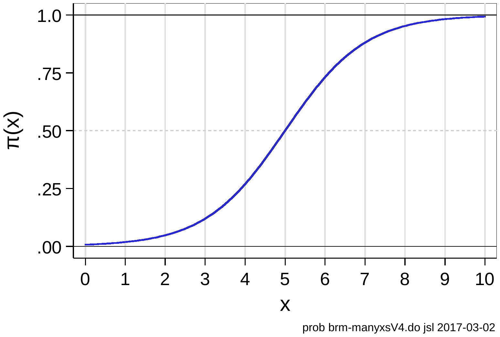
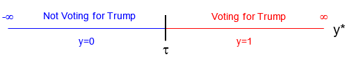
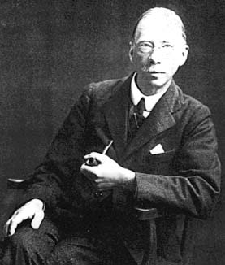
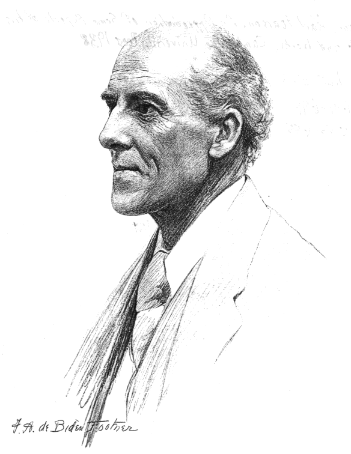

## Probability model / generalized linear model

- The LPM can make predictions of Pr(*y*=1\|**x**) that are \<0 and \>1
- An alternative is to transform Pr(*y*=1\|**x**) so the transformed values ranges from -∞ to ∞ but so that the probabilities remain constrained to be between 0 and 1
- Transform *Pr(y=1\|**x**)* to the ***odds*** ($\Omega$) which range from 0 to ∞

$$Odds(1 \text{ versus } 0\,|\,\mathbf{x}) = \Omega(\mathbf{x}) = \frac{\Pr(y = 1\,|\,\mathbf{x})}{\Pr(y = 0\,|\,\mathbf{x})}$$

- For example, if *voted* is the DV and 60% of the sample reports they voted, then a given person's odds of voting are:

$$\frac{\Pr(y = 1)}{\Pr(y = 0)} = \frac{0.60}{0.40} = 1.5 = \frac{3}{2}$$

### Binary regression as a probability model

- Then transform the ***odds*** to the ***log odds*** (or ***"logit"***) which ranges from -∞ to ∞

$$\ln\left[\frac{\Pr(y = 1\,|\,\mathbf{x})}{\Pr(y = 0\,|\,\mathbf{x})}\right] = \ln\left[\frac{\Pr(y = 1\,|\,\mathbf{x})}{1 - \Pr(y = 1\,|\,\mathbf{x})}\right] = \mathbf{x}\boldsymbol{\beta}$$

- In our hypothetical voting example, a given person's log odds (logit) of voting are:

$$\ln\left[\frac{\Pr(y = 1)}{\Pr(y = 0)}\right] = \ln\left[\frac{3}{2}\right] \approx 0.405$$

- To return to the probability scale, can take the exponential of each side and solve for Pr(*y*=1\|**x**) which will be constrained to be between 0 and 1:

$$\Pr(y = 1\,|\,\mathbf{x}) = \frac{\exp(\mathbf{x}\boldsymbol{\beta})}{1 + \exp(\mathbf{x}\boldsymbol{\beta})}$$

::: {.panel-tabset group="language"}
## Stata

```{.stata-run}
. di exp(0.4055) / [1 + exp(0.4055)]
.60000837

```

## R

```{r}
exp(0.4055) / (1 + exp(0.4055))
```

:::

- Model coefficients from the probability model are linear in the log-odds
- In the probability metric, they are nonlinear, and constrained between 0 and 1

{width=50% fig-alt="An S-shaped logistic curve for the probability of y = 1, rising from near 0 at x = 0 through 0.5 at x = 5 to near 1 at x = 10."}

## A latent variable model

- The same model can be derived assuming a underlying latent continuum for the DV
  - The *unobserved propensity* *y*\* generates the observed *y*

{width=80% fig-alt="A latent y-star line from minus infinity to infinity split at the threshold tau: values below tau are Not Voting for Trump (y = 0); values above are Voting for Trump (y = 1)."}

- *y*\* is linked to the observed *y*:

$$y_{i} = \begin{cases} 1 & \text{if } y_{i}^{*} > \tau \\ 0 & \text{if } y_{i}^{*} \leq \tau \end{cases}$$

- Not all individuals who were observed at *y*=1 are planning to vote for Trump with the same certainty or *"propensity y\* to vote for him"*
  - One person may be considering voting third party
  - Another person may be absolutely certain in their choice
- Near τ (tau) a tiny change in *y*\* changes the value of *y*

## Identification: the scale of y\* cannot be estimated

- The structural model regresses latent *y\** on *x*:

$$y^{*} = \alpha + \beta x + \varepsilon$$

- Since both *y\** and ε are unobserved, we **do not know** their means or variances
  - Must make assumptions
  - These assumptions affect size of β
    - We cannot directly interpret the magnitude of the β's since we don't know the true metric

:::: {.columns}
::: {.column width="75%"}
- Can all binary outcomes be viewed as observed manifestations of an underlying latent variable?
  - **George Udny Yule** believed it was possible to define meaningful coefficients for 2x2 tables without assuming an underlying continuous distribution. ***Binary variables are inherently discrete***
  - **Karl Pearson** disagreed: "If Mr Yule's views are accepted, irreparable damage will be done to the growth of modern statistical theory..." ***Yule's ideas are "half-baked notions" and "specious reasoning"***
:::
::: {.column width="25%"}
{fig-alt="Black-and-white portrait photograph of a man in a suit holding a pipe."}
:::
::::

### Does this debate matter for binary regression models?

:::: {.columns}
::: {.column width="75%"}
- The identical statistical model can be derived four ways:
  - A ***latent variable model***
  - A ***probability model*** without a latent variable
  - A **generalized linear model** (GLM)
  - A ***random utility model*** (RUM) from economic theory\*
- Coefficient estimates are identical from each model
:::
::: {.column width="25%"}
{fig-alt="Pencil sketch portrait of an older man."}
:::
::::

{width=35% fig-alt="Gordon Ramsay meme: HEY KARL, SHUT IT."}

\*Not shown in these notes as it leads to an identical model; see [Long (1997)](https://us.sagepub.com/en-us/nam/regression-models-for-categorical-and-limited-dependent-variables/book6071)
