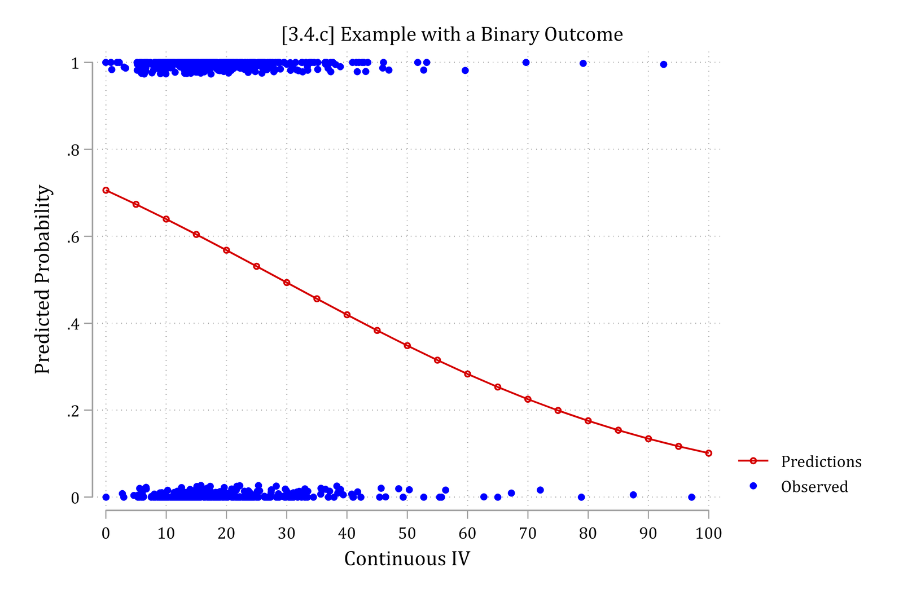
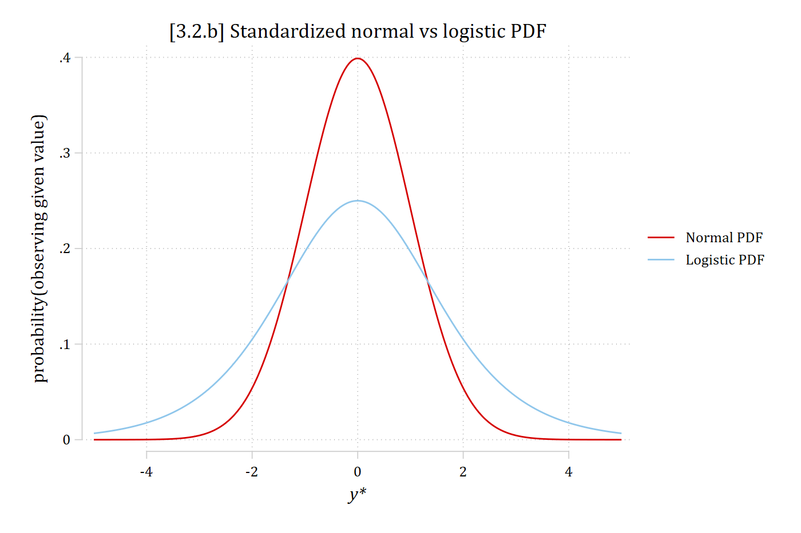
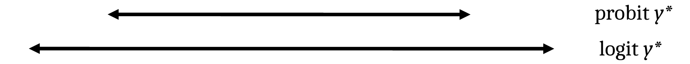
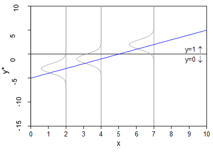
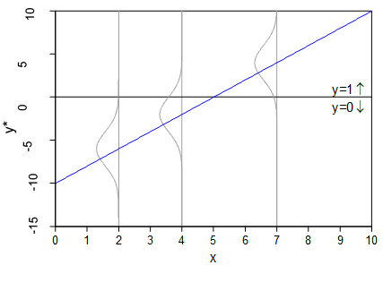
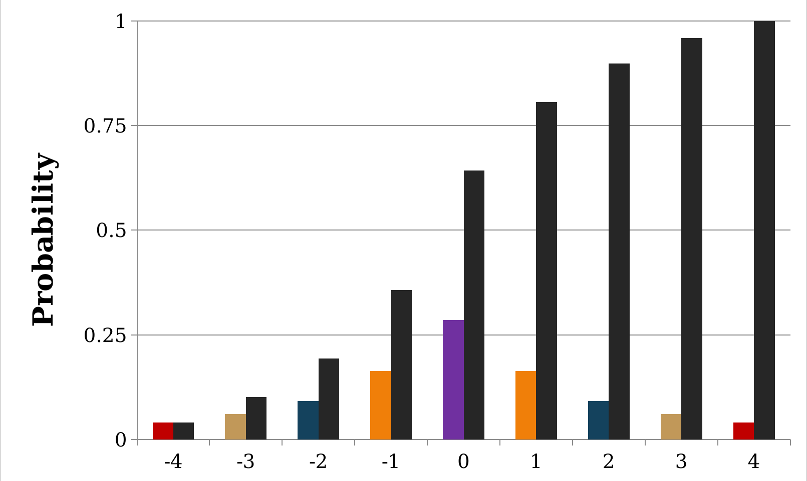
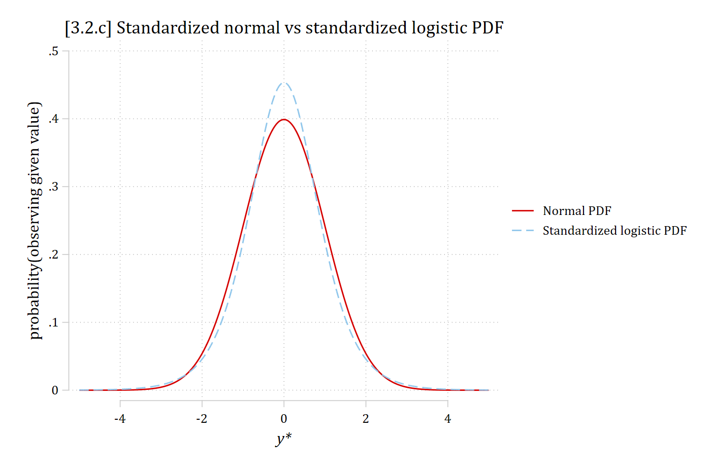
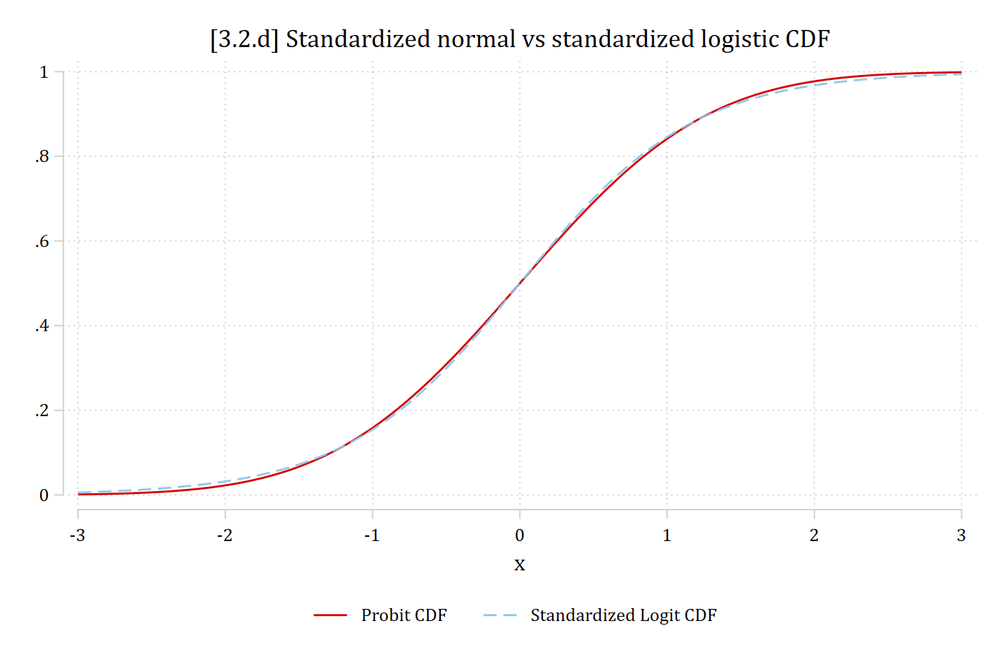
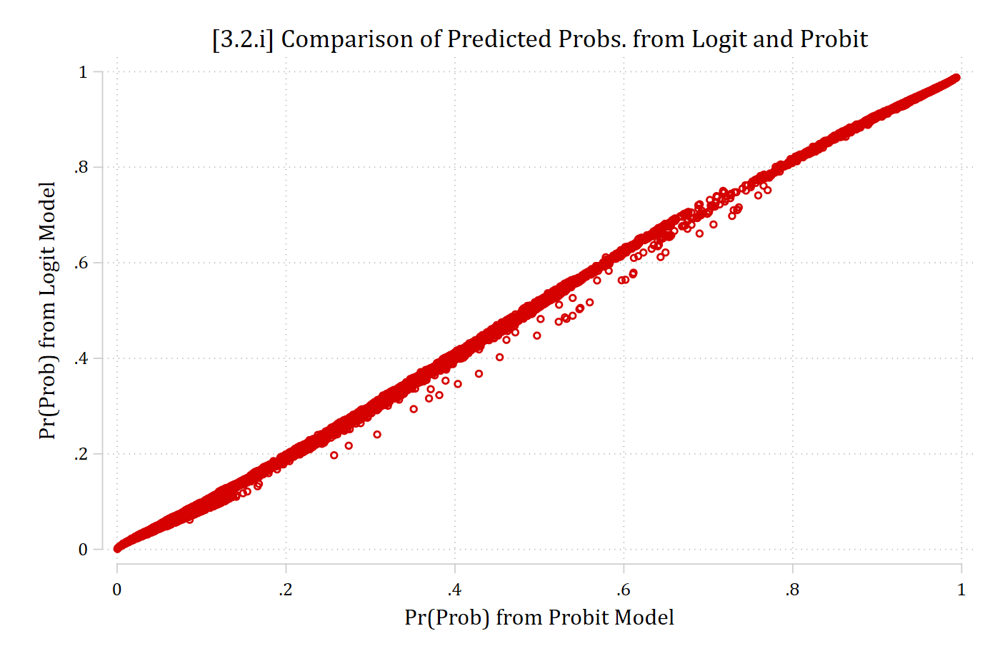

- We cannot estimate the variance of the errors directly in categorical outcome models so we assume part of their distribution. Two ways to think about it:
  - [Latent variable derivation]{.underline}: *y\** is unobserved so we do not know how well we predicted in that metric
  - [Probability model]{.underline}: our predictions are in a different metric than the observed outcomes

{width=60% fig-alt="Predicted probabilities from a binary model, a declining curved line, plotted with the observed outcomes, which sit only at 0 and 1."}

## Identifying assumptions

- All regression models are designed to produce the best fitting line; estimates are chosen so that the mean of the errors is 0
- In all regression models:

$$y_{i} = F(\mathbf{x}_{i}\boldsymbol{\beta}) + e_{i}$$

- I.e., The outcome *y* is a product of some predictable function of the **x** variables (explained variation), and due to some unexplained variation $e_{i}$
- In a linear model, we can calculate $e_{i}$ directly as predictions and outcome are in same metric
- In binary logit/probit, have to assume/set the error distribution
  - This effectively changes the scale of *y\**

### Assuming the error distribution

- The probability model shown in the [prior section](3-1-binary-model-derivations.qmd#probability-model-generalized-linear-model) is a **binary logistic (logit) model**, with an assumption that the error variance is $\frac{\pi^{2}}{3}$ (SD ≈ 1.81)---made so that calculating predicted probabilities is easy

$$Logit: \Pr(y_{i} = 1\,|\,\mathbf{x}_{i}) = \Lambda(\mathbf{x}_{i}\widehat{\boldsymbol{\beta}}) = \frac{\exp(\mathbf{x}_{i}\widehat{\boldsymbol{\beta}})}{1 + \exp(\mathbf{x}_{i}\widehat{\boldsymbol{\beta}})}$$

- A near identical model, the **binary probit model**, can be derived by assuming normally distributed errors (variance and SD = 1)
  - But calculating probabilities is much harder and requires calculus

$$Probit: \Pr(y_{i} = 1\,|\,\mathbf{x}_{i}) = \Phi(\mathbf{x}_{i}\widehat{\boldsymbol{\beta}}) = \int_{-\infty}^{\mathbf{x}_{i}\widehat{\boldsymbol{\beta}}} \frac{1}{\sqrt{2\pi}}\exp\left(-\frac{t^{2}}{2}\right)dt$$

::: {.panel-tabset group="language"}
## Stata

```{.stata-run}
. twoway function phi = normalden(x), range(-5 5) || ///
>     function psi = exp(x) / (1 + exp(x))^2, range(-5 5) || ///
>     , ytitle("probability(observing given value)") xtitle("{it:y*}") ///
>     xlab(-4(2)4) title("[3.2.b] Standardized normal vs logistic PDF") ///
>     legend(order(1 "Normal PDF" 2 "Logistic PDF"))

```

{width=80% fig-alt="The standard normal PDF, taller and narrower, and the logistic PDF, shorter and wider, both centered at 0."}

## R

```{r}
#| fig-alt: "The standard normal PDF, taller and narrower, and the logistic PDF, shorter and wider, both centered at 0."
library(haven)           # import Stata data and labels
library(dplyr)           # data manipulation
library(ggplot2)         # graphs
library(modelsummary)    # tables of results
library(cleanplots)      # graph scheme
cleanplots_defaults()

ggplot() +
  stat_function(fun = dnorm, aes(color = "Normal PDF"), xlim = c(-5, 5)) +
  stat_function(fun = dlogis, aes(color = "Logistic PDF"), xlim = c(-5, 5)) +
  scale_x_continuous(breaks = seq(-4, 4, 2)) +
  scale_color_discrete(limits = c("Normal PDF", "Logistic PDF")) +
  labs(title = "[3.2.b] Standardized normal vs logistic PDF",
    x = "y*", y = "probability(observing given value)", color = NULL)
```

:::

Effectively, logit's *y\** will have a larger range than probit's

{width=60% fig-alt="Two double-headed arrows: a shorter one labeled probit y-star and a longer one labeled logit y-star."}

### Graphical illustration of identification assumption

- The size of the *β*'s cannot be interpreted directly since their magnitude reflects both:
  - The relationship between the *x*'s and *y*\*
  - ***Arbitrary*** identifying assumptions

:::: {.columns}
::: {.column width="50%"}
{fig-alt="Latent y-star regressed on x with a shallower line and narrower error distributions at several values of x."}
:::
::: {.column width="50%"}
{fig-alt="The same relationship with a steeper line and wider error distributions: the y-star scale is stretched."}
:::
::::

- Effectively, logit and probit models are on different scales, with logit assuming a *y\** with a wider range

## Comparing logit and probit

::: {.panel-tabset group="language"}
## Stata

```{.stata-run}
. use "https://tdmize.github.io/data/data/cda_anes", clear
(American National Election Study 2020 - Pre-election | CDA | 2021-09-26)

. 
. drop if missing(age, hhincome, woman, lgb, race4, ///
>     edyrs, relimport, wrongtrack)
(948 observations deleted)

. 
. qui logit vote_trump hhincome edyrs i.woman i.lgb i.race4 ///
>     i.relimport i.wrongtrack c.age##c.age

. est store logitmod

. 
. qui probit vote_trump hhincome edyrs i.woman i.lgb i.race4 ///
>     i.relimport i.wrongtrack c.age##c.age

. est store probitmod

. 
. * Compare coefficients
. esttab logitmod probitmod, nobase label mtitles("Logit" "Probit") ///
>     b(3) z(3) title("[3.2.h] Comparing coef estimates from logit and probit")

[3.2.h] Comparing coef estimates from logit and probit
----------------------------------------------------
                              (1)             (2)   
                            Logit          Probit   
----------------------------------------------------
Voting for Trump                                    
Household income (~)       -0.000          -0.000   
                         (-0.897)        (-1.085)   

Education in years         -0.140***       -0.078***
                         (-9.539)        (-9.444)   

Woman                      -0.355***       -0.197***
                         (-5.289)        (-5.170)   

LGB                        -1.164***       -0.623***
                         (-6.607)        (-6.798)   

Black                      -2.928***       -1.531***
                        (-15.543)       (-17.253)   

Hispanic                   -1.185***       -0.642***
                         (-9.382)        (-9.285)   

Other                      -0.648***       -0.348***
                         (-5.419)        (-5.225)   

2. Very important          -0.598***       -0.346***
                         (-6.170)        (-6.152)   

3. Moderately impo~t       -0.950***       -0.543***
                         (-9.817)        (-9.713)   

4. A little import~t       -1.200***       -0.687***
                        (-10.841)       (-10.831)   

5. Not important a~l       -1.949***       -1.091***
                        (-18.279)       (-18.475)   

Wrong track                -3.308***       -1.897***
                        (-33.781)       (-37.652)   

Age of R                    0.027*          0.015*  
                          (2.129)         (2.096)   

Age of R # Age of R        -0.000*         -0.000*  
                         (-2.509)        (-2.399)   

Constant                    5.268***        2.952***
                         (13.692)        (13.854)   
----------------------------------------------------
Observations                 6857            6857   
----------------------------------------------------
z statistics in parentheses
* p<0.05, ** p<0.01, *** p<0.001

```

## R

```{r}
anes <- read_dta("https://tdmize.github.io/data/data/cda_anes.dta")

# Drop any missing data on the model IVs
anes <- anes[complete.cases(anes[c("age", "hhincome", "woman", "lgb", "race4",
  "edyrs", "relimport", "wrongtrack")]), ]

# Treat binary/nominal variables as factors using their value labels
anes <- anes |>
  mutate(woman = as_factor(woman), lgb = as_factor(lgb), race4 = as_factor(race4),
    relimport = as_factor(relimport), wrongtrack = as_factor(wrongtrack)) |>
  droplevels()

logitmod <- glm(vote_trump ~ hhincome + edyrs + woman + lgb + race4 + relimport +
  wrongtrack + age + I(age^2), family = binomial(link = "logit"), data = anes)

probitmod <- glm(vote_trump ~ hhincome + edyrs + woman + lgb + race4 + relimport +
  wrongtrack + age + I(age^2), family = binomial(link = "probit"), data = anes)

# Compare coefficients
modelsummary(list("Logit" = logitmod, "Probit" = probitmod),
  statistic = "({statistic})", fmt = 3,
  stars = c("*" = .05, "**" = .01, "***" = .001),
  gof_map = "nobs",
  title = "[3.2.h] Comparing coef estimates from logit and probit")
```

:::

### Correlation and ratio of logit/probit coefficients

:::: {.columns}
::: {.column width="45%"}
| **Correlation(logit, probit)** | |
|:------|------:|
| betas | 0.9995 |
| *z*-stat on beta | 0.9980 |
:::
::: {.column width="10%"}
:::
::: {.column width="45%"}
| **Ratio(logit / probit)** | |
|:------|------:|
| betas | 1.7819 |
| *z*-stat on beta | 0.9816 |
:::
::::

- β's differ by a factor of about 1.8
  - Sound familiar? $\frac{\pi}{\sqrt{3}} \approx 1.81$
- *z* statistics (in parentheses [above](#comparing-logit-and-probit)) are roughly equal

## Comparing logit and probit distributions

- Predicted probabilities, Pr(*y* =1), are a function of the cumulative density function

The **PDF** is in colors; the **CDF** is in black

{width=70% fig-alt="Bar chart of a discrete distribution from -4 to 4: colored bars for the PDF peak at 0, and black bars for the CDF rise from near 0 at -4 to 1 at 4."}

::: {.panel-tabset group="language"}
## Stata

```{.stata-run}
. twoway function phi = normalden(x), range(-5 5) || ///
>     function psi_std = (c(pi)/sqrt(3))*exp(c(pi)*x/sqrt(3)) / ///
>         (1 + exp(c(pi)*x/sqrt(3)))^2, range(-5 5) lpat(dash) || ///
>     , ytitle("probability(observing given value)") xtitle("{it:y*}") ///
>     xlab(-4(2)4) title("[3.2.c] Standardized normal vs standardized logistic P
> DF") ///
>     legend(order(1 "Normal PDF" 2 "Standardized logistic PDF"))

```

{width=80% fig-alt="The standard normal PDF and the standardized logistic PDF almost overlap; the logistic is slightly taller at the center."}

## R

```{r}
#| fig-alt: "The standard normal PDF and the standardized logistic PDF almost overlap; the logistic is slightly taller at the center."
# Standardized logistic: logistic with variance 1
ggplot() +
  stat_function(fun = dnorm, aes(color = "Normal PDF"), xlim = c(-5, 5)) +
  stat_function(fun = dlogis, args = list(scale = sqrt(3) / pi),
    aes(color = "Standardized logistic PDF"), xlim = c(-5, 5), linetype = "dashed") +
  scale_x_continuous(breaks = seq(-4, 4, 2)) +
  labs(title = "[3.2.c] Standardized normal vs standardized logistic PDF",
    x = "y*", y = "probability(observing given value)", color = NULL)
```

:::

\*For comparability, I've standardized the logistic distribution, to see how they differ

::: {.panel-tabset group="language"}
## Stata

```{.stata-run}
. twoway function Probit = normal(x), range(-3 3) || ///
>     function StdLogit = logistic(1.701*x), range(-3 3) lpat(dash) || ///
>     , title("[3.2.d] Standardized normal vs standardized logistic CDF") ///
>     xlab(-3(1)3) legend(order(1 "Probit CDF" 2 "Standardized Logit CDF") pos(6
> ) row(1))

```

{width=80% fig-alt="The probit CDF and the standardized logit CDF from -3 to 3: the two S-shaped curves are all but identical."}

## R

```{r}
#| fig-alt: "The probit CDF and the standardized logit CDF from -3 to 3: the two S-shaped curves are all but identical."
ggplot() +
  stat_function(fun = pnorm, aes(color = "Probit CDF"), xlim = c(-3, 3)) +
  stat_function(fun = function(x) plogis(1.701 * x),
    aes(color = "Standardized Logit CDF"), xlim = c(-3, 3), linetype = "dashed") +
  scale_x_continuous(breaks = -3:3) +
  labs(title = "[3.2.d] Standardized normal vs standardized logistic CDF",
    x = "x", y = NULL, color = NULL) +
  theme(legend.position = "bottom")
```

:::

\*In the CDFs, the two distributions are all but identical, so predicted probabilities from logit and probit are all but identical

## Comparing predicted probabilities

::: {.panel-tabset group="language"}
## Stata

```{.stata-run}
. est restore logitmod
(results logitmod are active now)

. predict prlogit
(option pr assumed; Pr(vote_trump))

. lab var prlogit "Pr(Prob) from Logit Model"

. 
. est restore probitmod
(results probitmod are active now)

. predict prprobit
(option pr assumed; Pr(vote_trump))

. lab var prprobit "Pr(Prob) from Probit Model"

. 
. scatter prlogit prprobit, ///
>     title("[3.2.i] Comparison of Predicted Probs. from Logit and Probit")

. 
. pwcorr prlogit prprobit

             |  prlogit prprobit
-------------+------------------
     prlogit |   1.0000 
    prprobit |   0.9996   1.0000 

```

{width=80% fig-alt="Scatterplot of predicted probabilities from the logit model against those from the probit model: the points fall almost exactly on a straight 45-degree line."}

## R

```{r}
#| fig-alt: "Scatterplot of predicted probabilities from the logit model against those from the probit model: the points fall almost exactly on a straight 45-degree line."
anes$prlogit <- predict(logitmod, newdata = anes, type = "response")
anes$prprobit <- predict(probitmod, newdata = anes, type = "response")

ggplot(anes, aes(x = prprobit, y = prlogit)) +
  geom_point() +
  labs(title = "[3.2.i] Comparison of Predicted Probs. from Logit and Probit",
    x = "Pr(Prob) from Probit Model", y = "Pr(Prob) from Logit Model")

cor(anes$prlogit, anes$prprobit, use = "complete.obs")
```

:::

## Review of identification in BRM

- The magnitude of the β's depends on the scale of the outcome
  - The size of the estimated β's ***cannot be directly interpreted*** as reflecting substantive effect size
- ***The identifying assumption does not affect Pr(y=1\|x)***
  - Probabilities, and marginal effects calculated from them, can be interpreted without concern about identification
- This identification issue makes the coefficients have poor properties for determining:
  - Effect sizes
  - Group comparisons
  - Differences across nested models
    - E.g., Mediation
  - Interaction effects (AKA moderation)
