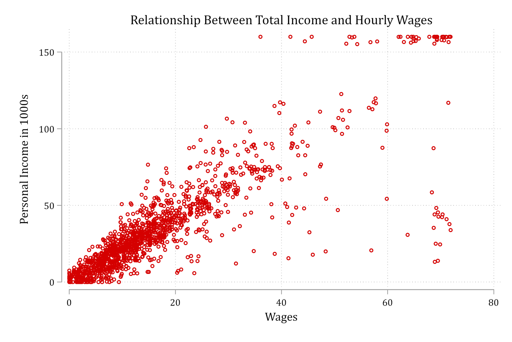
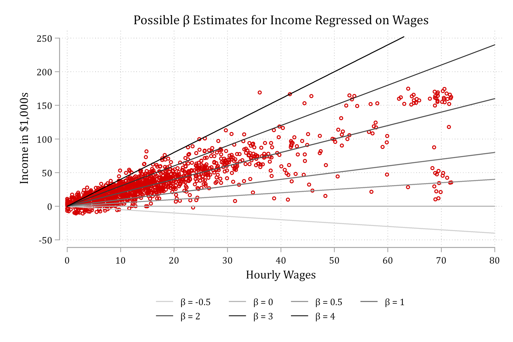
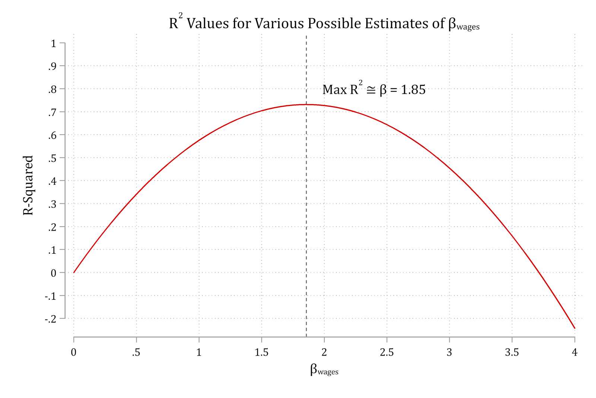
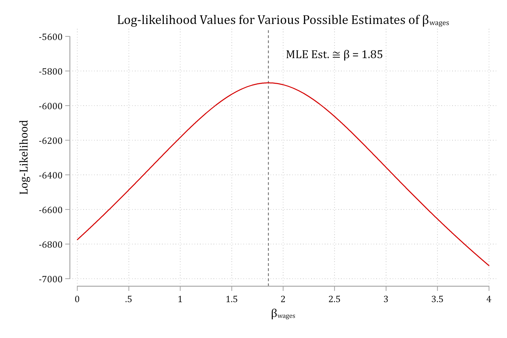
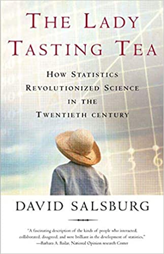

- We cannot use OLS to obtain logit/probit model estimates\*
  - Instead, we use maximum likelihood estimation (MLE or just ML)
- ML finds estimates that **maximize the likelihood of what is observed in the data**
  - No other values of the parameters increase your chance of observing your data
    - That is, the parameter estimates that do the best job of describing the relationships in the data
- For linear regression, OLS estimates are the same as ML estimates\*\*
  - For the rest of the models we cover in this class, we do not have a neat closed-form mathematical solution like OLS and instead rely on MLE to obtain our parameter estimates

\*But see a potential logit/OLS solution proposed by [Allison 2020](https://statisticalhorizons.com/better-predicted-probabilities/)

\*\*For details on hypothesis testing / standard error estimation, see [Appendix 3B](appendix-3b-maximum-likelihood.qmd)

### Graphical view of ML estimation in linear regression

{width=70% fig-alt="Scatterplot of personal income in 1000s against hourly wages: income rises with wages."}

- If you had to guess, what value of β would you choose?
  - I.e., What β would best fit the relationship observed in the data?

### Maximum likelihood estimation (MLE)

{width=70% fig-alt="The income and wages scatterplot with candidate regression lines for beta from -0.5 to 4."}

- MLE auditions various parameter estimates (β here) and then compares measures of model fit to determine the β that best fits the patterns in the data

{width=70% fig-alt="R-squared for possible estimates of beta: an inverted U that peaks at beta of about 1.85."}

- For linear regression, we can calculate an *R*^2^ from models auditioning various possible β estimates. Top of the curve = β that produces the largest *R*^2^

## MLE: maximize the log-likelihood

- For most models, cannot calculate a straightforward *R*^2^ to measure model fit
  - Instead, we rely on maximizing the log-likelihood, which represents **overall model fit** on a single dimension---similar to *R*^2^
  - Goal of MLE: find what value of the parameters (e.g. *β*'s and α) that produce the largest log-likelihood value (i.e., that maximize the model fit)

{width=70% fig-alt="Log-likelihood for possible estimates of beta: an inverted U that peaks at the ML estimate of beta of about 1.85."}

### Comparing OLS and ML estimates

- The example above of income regressed on wages showed that β ≈1.85 was the parameter value that produced the largest *R*^2^ as well as the largest log-likelihood
  - Compare the linear regression results below from **regress** (OLS) and **gsem** (MLE)

::: {.panel-tabset group="language"}
## Stata

```{.stata-run}
. use "https://tdmize.github.io/data/data/gss", clear
(gss.dta | GSS 1972 - 2016 Data | DMV Workshop)

. keep if year == 2016
(59,599 observations deleted)

. 
. * Check OLS estimate of beta
. reg income wages

      Source |       SS           df       MS      Number of obs   =     1,379
-------------+----------------------------------   F(1, 1377)      =   3745.93
       Model |  1091476.43         1  1091476.43   Prob > F        =    0.0000
    Residual |  401225.255     1,377  291.376366   R-squared       =    0.7312
-------------+----------------------------------   Adj R-squared   =    0.7310
       Total |  1492701.69     1,378   1083.2378   Root MSE        =     17.07

------------------------------------------------------------------------------
      income | Coefficient  Std. err.      t    P>|t|     [95% conf. interval]
-------------+----------------------------------------------------------------
       wages |      1.857      0.030   61.204   0.000        1.797       1.916
       _cons |      3.408      0.703    4.846   0.000        2.029       4.788
------------------------------------------------------------------------------

. 
. * Check MLE estimate of beta
. gsem (income <- wages)

Iteration 0:  Log likelihood = -5868.3631  
Iteration 1:  Log likelihood = -5868.3631  

Generalized structural equation model                    Number of obs = 1,379
Response: income  
Family:   Gaussian
Link:     Identity
Log likelihood = -5868.3631

-------------------------------------------------------------------------------
              | Coefficient  Std. err.      z    P>|z|     [95% conf. interval]
--------------+----------------------------------------------------------------
income        |
        wages |      1.857      0.030   61.248   0.000        1.798       1.916
        _cons |      3.408      0.703    4.850   0.000        2.031       4.785
--------------+----------------------------------------------------------------
 var(e.income)|    290.954     11.080                       270.027     313.502
-------------------------------------------------------------------------------

```

## R

```{r}
library(haven)           # import Stata data and labels
library(dplyr)           # data manipulation
library(sjmisc)          # frequency tables

gss <- read_dta("https://tdmize.github.io/data/data/gss.dta")
gss <- gss |> filter(year == 2016)

# Check OLS estimate of beta
summary(lm(income ~ wages, data = gss))

# Check MLE estimate of beta
mlmod <- glm(income ~ wages, family = gaussian, data = gss)
summary(mlmod)
logLik(mlmod)
```

:::

### When is the N large enough to justify MLE?

- ML estimates are *consistent*, *normal*, and *efficient*... in infinitely large samples
  - But, also perform well in moderately large samples
  - [Long (1997)](https://us.sagepub.com/en-us/nam/regression-models-for-categorical-and-limited-dependent-variables/book6071) gives the following general guidance:
    - It is risky to use MLE for *N* \< 100
    - *N* \> 500 is generally safe
- *N*'s should be larger in some cases
  - With *lots of parameters*, more observations are needed (\> 10 per parameter)
  - Little variation in an IV can cause difficulties
  - Little variation in the DV can cause problems
    - E.g., For binary DVs, "rare events" and "exact" methods are designed for this case
- Some categorical models usually require more observations (e.g., ordinal and nominal regression models)

## Potential ML issues: perfect prediction

- ***Perfect prediction*** is a pseudo problem
  - To illustrate, let's predict voting intentions based on political views and party affiliation:

::: {.panel-tabset group="language"}
## Stata

```{.stata-run}
. use "https://tdmize.github.io/data/data/cda_anes", clear
(American National Election Study 2020 - Pre-election | CDA | 2021-09-26)

. 
. drop if missing(age, hhincome, woman, lgb, race4, ///
>     edyrs, relimport, wrongtrack)
(948 observations deleted)

. 
. logit vote_trump i.polviews7##i.partyid

note: 1.polviews7#2.partyid != 0 predicts failure perfectly;
      1.polviews7#2.partyid omitted and 30 obs not used.

note: 1.polviews7#6.partyid != 0 predicts success perfectly;
      1.polviews7#6.partyid omitted and 2 obs not used.

note: 2.polviews7#5.partyid != 0 predicts success perfectly;
      2.polviews7#5.partyid omitted and 6 obs not used.

note: 6.polviews7#3.partyid != 0 predicts failure perfectly;
      6.polviews7#3.partyid omitted and 7 obs not used.

note: 7.polviews7#2.partyid != 0 predicts success perfectly;
      7.polviews7#2.partyid omitted and 2 obs not used.

note: 7.polviews7#4.partyid != 0 predicts success perfectly;
      7.polviews7#4.partyid omitted and 1 obs not used.

note: 7.polviews7#6.partyid != 0 predicts success perfectly;
      7.polviews7#6.partyid omitted and 20 obs not used.

note: 6.polviews7#2.partyid omitted because of collinearity.
note: 6.polviews7#6.partyid omitted because of collinearity.
Iteration 0:  Log likelihood =   -4031.77  
Iteration 1:  Log likelihood =  -1475.277  
Iteration 2:  Log likelihood =   -1397.83  
Iteration 3:  Log likelihood = -1356.9964  
Iteration 4:  Log likelihood = -1356.3547  
Iteration 5:  Log likelihood = -1356.3522  
Iteration 6:  Log likelihood = -1356.3522  

Logistic regression                                    Number of obs =   5,929
                                                       LR chi2(41)   = 5350.84
                                                       Prob > chi2   =  0.0000
Log likelihood = -1356.3522                            Pseudo R2     =  0.6636

-------------------------------------------------------------------------------
   vote_trump | Coefficient  Std. err.      z    P>|z|     [95% conf. interval]
--------------+----------------------------------------------------------------
    polviews7 |
  2. Liberal  |     -0.164      1.158   -0.141   0.888       -2.432       2.105
3. Slightl..  |     -0.297      1.417   -0.209   0.834       -3.074       2.481
4. Moderat..  |      2.133      1.045    2.041   0.041        0.085       4.181
5. Slightl..  |      1.757      1.426    1.232   0.218       -1.039       4.552
6. Conserv..  |      2.718      1.242    2.188   0.029        0.283       5.153
7. Extreme..  |      3.337      1.466    2.277   0.023        0.465       6.210
              |
      partyid |
2. Not ver..  |      1.872      0.956    1.958   0.050       -0.001       3.745
3. Indepen..  |      0.914      1.420    0.643   0.520       -1.870       3.698
4. Indepen..  |      3.779      1.271    2.973   0.003        1.287       6.271
5. Indepen..  |      5.283      1.734    3.048   0.002        1.886       8.681
6. Not ver..  |      5.119      0.785    6.525   0.000        3.581       6.656
7. Strong ..  |      6.382      1.293    4.936   0.000        3.848       8.916
              |
    polviews7#|
      partyid |
1. Extreme.. #|
2. Not ver..  |      0.000  (empty)
1. Extreme.. #|
6. Not ver..  |      0.000  (empty)
  2. Liberal #|
2. Not ver..  |     -1.578      1.501   -1.051   0.293       -4.521       1.364
  2. Liberal #|
3. Indepen..  |      0.772      1.615    0.478   0.633       -2.394       3.937
  2. Liberal #|
4. Indepen..  |     -0.601      1.523   -0.395   0.693       -3.586       2.383
  2. Liberal #|
5. Indepen..  |      0.000  (empty)
  2. Liberal #|
6. Not ver..  |     -0.078      1.335   -0.058   0.954       -2.695       2.540
  2. Liberal #|
7. Strong ..  |      1.550      1.758    0.882   0.378       -1.895       4.995
3. Slightl.. #|
2. Not ver..  |      0.296      1.445    0.205   0.838       -2.537       3.129
3. Slightl.. #|
3. Indepen..  |      0.353      1.833    0.193   0.847       -3.239       3.945
3. Slightl.. #|
4. Indepen..  |      0.559      1.649    0.339   0.735       -2.673       3.791
3. Slightl.. #|
5. Indepen..  |      0.297      2.057    0.144   0.885       -3.735       4.328
3. Slightl.. #|
6. Not ver..  |      0.628      1.337    0.470   0.639       -1.992       3.248
3. Slightl.. #|
7. Strong ..  |      0.584      1.758    0.332   0.740       -2.862       4.031
4. Moderat.. #|
2. Not ver..  |     -0.597      1.021   -0.584   0.559       -2.598       1.405
4. Moderat.. #|
3. Indepen..  |     -0.877      1.486   -0.590   0.555       -3.790       2.036
4. Moderat.. #|
4. Indepen..  |     -1.399      1.311   -1.067   0.286       -3.969       1.171
4. Moderat.. #|
5. Indepen..  |     -1.738      1.765   -0.984   0.325       -5.198       1.722
4. Moderat.. #|
6. Not ver..  |     -1.578      0.852   -1.851   0.064       -3.249       0.093
4. Moderat.. #|
7. Strong ..  |     -1.002      1.367   -0.733   0.464       -3.682       1.678
5. Slightl.. #|
2. Not ver..  |     -0.032      1.476   -0.022   0.983       -2.926       2.862
5. Slightl.. #|
3. Indepen..  |      0.379      1.848    0.205   0.838       -3.244       4.002
5. Slightl.. #|
4. Indepen..  |     -0.253      1.646   -0.154   0.878       -3.478       2.973
5. Slightl.. #|
5. Indepen..  |     -0.678      2.015   -0.337   0.736       -4.628       3.271
5. Slightl.. #|
6. Not ver..  |     -0.546      1.292   -0.422   0.673       -3.079       1.988
5. Slightl.. #|
7. Strong ..  |     -0.679      1.674   -0.405   0.685       -3.960       2.602
6. Conserv.. #|
2. Not ver..  |      0.000  (omitted)
6. Conserv.. #|
3. Indepen..  |      0.000  (empty)
6. Conserv.. #|
4. Indepen..  |      0.444      1.566    0.284   0.777       -2.625       3.513
6. Conserv.. #|
5. Indepen..  |     -0.126      1.903   -0.066   0.947       -3.855       3.603
6. Conserv.. #|
6. Not ver..  |      0.000  (omitted)
6. Conserv.. #|
7. Strong ..  |      0.558      1.520    0.367   0.714       -2.422       3.537
7. Extreme.. #|
2. Not ver..  |      0.000  (empty)
7. Extreme.. #|
3. Indepen..  |      1.032      2.272    0.454   0.650       -3.420       5.485
7. Extreme.. #|
4. Indepen..  |      0.000  (empty)
7. Extreme.. #|
5. Indepen..  |     -0.881      2.124   -0.415   0.678       -5.043       3.282
7. Extreme.. #|
6. Not ver..  |      0.000  (empty)
7. Extreme.. #|
7. Strong ..  |      0.163      1.775    0.092   0.927       -3.317       3.642
              |
        _cons |     -5.283      1.003   -5.270   0.000       -7.248      -3.318
-------------------------------------------------------------------------------

```

## R

```{r}
#| warning: true
anes <- read_dta("https://tdmize.github.io/data/data/cda_anes.dta")

# Drop any missing data on the IVs used earlier in the section
anes <- anes[complete.cases(anes[c("age", "hhincome", "woman", "lgb", "race4",
  "edyrs", "relimport", "wrongtrack")]), ]

ppmod <- glm(vote_trump ~ as_factor(polviews7) * as_factor(partyid),
  family = binomial(link = "logit"), data = anes)
```

:::

- We receive an error message and some observations are excluded from the model
- What is the issue? Let's examine the 30 observations dropped

::: {.panel-tabset group="language"}
## Stata

```{.stata-run}
. fre polviews7 partyid

polviews7 -- Political views - 7 category
------------------------------------------------------------------------------
                                 |      Freq.    Percent      Valid       Cum.
---------------------------------+--------------------------------------------
Valid   1 1. Extremely liberal   |        341       4.65       5.42       5.42
        2 2. Liberal             |       1118      15.25      17.76      23.17
        3 3. Slightly liberal    |        838      11.43      13.31      36.48
        4 4. Moderate; middle of |       1605      21.89      25.49      61.98
          the road               |                                            
        5 5. Slightly            |        718       9.79      11.40      73.38
          conservative           |                                            
        6 6. Conservative        |       1298      17.70      20.62      94.00
        7 7. Extremely           |        378       5.16       6.00     100.00
          conservative           |                                            
        Total                    |       6296      85.87     100.00           
Missing .                        |       1036      14.13                      
Total                            |       7332     100.00                      
------------------------------------------------------------------------------

partyid -- Party identification
-------------------------------------------------------------------------------
                                  |      Freq.    Percent      Valid       Cum.
----------------------------------+--------------------------------------------
Valid   1 1. Strong Democrat      |       1804      24.60      24.63      24.63
        2 2. Not very strong      |        821      11.20      11.21      35.84
          Democrat                |                                            
        3 3. Independent-Democrat |        887      12.10      12.11      47.95
        4 4. Independent          |        790      10.77      10.78      58.73
        5 5.                      |        769      10.49      10.50      69.23
          Independent-Republican  |                                            
        6 6. Not very strong      |        744      10.15      10.16      79.39
          Republican              |                                            
        7 7. Strong Republican    |       1510      20.59      20.61     100.00
        Total                     |       7325      99.90     100.00           
Missing .                         |          7       0.10                      
Total                             |       7332     100.00                      
-------------------------------------------------------------------------------

. tab vote_trump if polviews7 == 1 & partyid == 2

    Voting for Trump |      Freq.     Percent        Cum.
---------------------+-----------------------------------
Not voting for Trump |         30      100.00      100.00
---------------------+-----------------------------------
               Total |         30      100.00

```

## R

```{r}
frq(anes, polviews7, partyid)

anes |>
  filter(polviews7 == 1, partyid == 2) |>
  frq(vote_trump)
```

:::

::: {.callout-note icon="false" appearance="simple"}
- *polviews7* = 1 are "extremely liberal"
- *partyid* = 2 are "Democrats"
:::

- Everyone in this category reports they are **not** voting for Trump. I.e., There is no variation in this category
  - The odds of *not* voting for Trump for *extremely liberal Democrats* are 30/0, which is undefined

### Exact estimation for small samples

:::: {.columns}
::: {.column width="70%"}
- Maximum likelihood can be biased in small samples and cannot estimate parameters when there is "perfect prediction"
- Exact logistic regression ([**exlogistic**](https://www.stata.com/features/overview/exact-logistic-regression/) in Stata; [**elrm**](https://www.rdocumentation.org/packages/elrm/versions/1.2.6/topics/elrm) in R) computes exact estimates in small samples but is computationally intensive
  - Small samples are not an issue
  - Perfect prediction is not an issue
- R.A. Fisher devised exact tests when Muriel Bristol claimed she could detect whether tea or milk was added first to her cup. He asked her to taste 8 cups of tea, 4 with tea added first and 4 with milk first, and decide whether milk or tea was added first. He had to figure out how to perform a test with so few observations. Essentially, he counted every possible outcome
:::
::: {.column width="30%"}
{fig-alt="A teapot, a milk jug, and a cup of tea with milk."}

{fig-alt="Cover of David Salsburg's book The Lady Tasting Tea: How Statistics Revolutionized Science in the Twentieth Century."}
:::
::::

### Firth's penalized maximum likelihood estimation

- Exact logistic methods work well but are very computationally intensive
  - In addition, it is difficult to interpret anything other than the coefficients
    - E.g., Predicted probabilities and marginal effects (MEs) are difficult to obtain with current software
- An alternative is Firth's penalized maximum likelihood (PML) estimation
  - [Rainey and McCaskey (2021)](https://doi.org/10.1017/psrm.2021.9) show that in small samples, PML produces better coefficient and SE estimates than normal MLE
  - [Rainey 2024](https://doi.org/10.1017/pan.2023.28) provides additional details for obtaining unbiased significance tests even in the case of perfect prediction
- In Stata, the user-written command [**firthlogit**](http://fmwww.bc.edu/RePEc/bocode/f/firthlogit.html) implements the PML estimator; in R, [**logistf**](https://www.rdocumentation.org/packages/logistf/versions/1.26.1/topics/logistf)
