- Probabilities are fundamental for interpreting the binary regression model. We can convert our **xβ** predictions to predicted probabilities:

$$Logit: \Pr(y_{i} = 1\,|\,\mathbf{x}_{i}) = \Lambda(\mathbf{x}_{i}\widehat{\boldsymbol{\beta}}) = \frac{\exp(\mathbf{x}_{i}\widehat{\boldsymbol{\beta}})}{1 + \exp(\mathbf{x}_{i}\widehat{\boldsymbol{\beta}})}$$

$$Probit: \Pr(y_{i} = 1\,|\,\mathbf{x}_{i}) = \Phi(\mathbf{x}_{i}\widehat{\boldsymbol{\beta}}) = \int_{-\infty}^{\mathbf{x}_{i}\widehat{\boldsymbol{\beta}}} \frac{1}{\sqrt{2\pi}}\exp\left(-\frac{t^{2}}{2}\right)dt$$

- As the models are nonlinear and "fully interactive" the critical decision is at which values of $\mathbf{x}_{i}$ you want to examine the predictions
  - Focus on areas of data of most interest
  - Absent a theoretically important area, focus on averages

## Possible range of predicted probabilities

- The logit and probit functional form constrain predicted probabilities to be between 0 and 1
  - No non-sensical prediction problems like in the LPM
  - Consider the ANES 2020 voting intentions data

::: {.panel-tabset group="language"}
## Stata

```{.stata-run}
. use "https://tdmize.github.io/data/data/cda_anes", clear
(American National Election Study 2020 - Pre-election | CDA | 2021-09-26)

. drop if missing(age, hhincome, woman, lgb, race4, ///
>     edyrs, relimport, wrongtrack)
(948 observations deleted)

. 
. qui regress vote_trump age hhincome i.woman i.lgb i.race4 ///
>     edyrs i.relimport i.wrongtrack

. 
. * Make prediction for highly educated black woman
. mtable, at(woman=1 race4=2 edyrs=20 relimport=5 wrongtrack=1)

Expression: Linear prediction, predict()

      xb
--------
  -0.301

Specified values of covariates

           |    woman     race4     edyrs  relimport  wrongtrack
 ----------+----------------------------------------------------
   Current |        1         2        20          5           1

. 
. qui logit vote_trump age hhincome i.woman i.lgb i.race4 ///
>     edyrs i.relimport i.wrongtrack

. 
. * Make prediction for highly educated black woman
. mtable, at(woman=1 race4=2 edyrs=20 relimport=5 wrongtrack=1)

Expression: Pr(vote_trump), predict()

   Pr(y)
--------
   0.004

Specified values of covariates

           |    woman     race4     edyrs  relimport  wrongtrack
 ----------+----------------------------------------------------
   Current |        1         2        20          5           1

```

## R

```{r}
library(haven)           # import Stata data and labels
library(dplyr)           # data manipulation
library(sjmisc)          # frequency tables
library(ggplot2)         # graphs
library(marginaleffects) # predictions and marginal effects
library(questionr)       # odds ratios
library(cleanplots)      # graph scheme
cleanplots_defaults()

# Center changes in continuous IVs on each observation's value
options(marginaleffects_contrast_direction = "center")

anes <- read_dta("https://tdmize.github.io/data/data/cda_anes.dta")

# Drop any missing data on the model IVs
anes <- anes[complete.cases(anes[c("age", "hhincome", "woman", "lgb", "race4",
  "edyrs", "relimport", "wrongtrack")]), ]

# Treat binary/nominal variables as factors using their value labels
anes <- anes |>
  mutate(woman = as_factor(woman), lgb = as_factor(lgb), race4 = as_factor(race4),
    relimport = as_factor(relimport), wrongtrack = as_factor(wrongtrack),
    college = as_factor(college)) |>
  droplevels()

lpm1 <- lm(vote_trump ~ age + hhincome + woman + lgb + race4 + edyrs + relimport +
  wrongtrack, data = anes)

# Make prediction for highly educated black woman
avg_predictions(lpm1, newdata = datagrid(woman = "Woman", race4 = "Black", edyrs = 20,
  relimport = "5. Not important at all", wrongtrack = "Wrong track",
  grid_type = "counterfactual"))

logit1 <- glm(vote_trump ~ age + hhincome + woman + lgb + race4 + edyrs + relimport +
  wrongtrack, family = binomial(link = "logit"), data = anes)

# Make prediction for highly educated black woman
avg_predictions(logit1, newdata = datagrid(woman = "Woman", race4 = "Black", edyrs = 20,
  relimport = "5. Not important at all", wrongtrack = "Wrong track",
  grid_type = "counterfactual"))
```

:::

::: {.callout-note icon="false" appearance="simple"}
The LPM produces a non-sensical -.30 predicted probability that a highly educated black woman would vote for Trump

A logit model produces a reasonable 0.004 pr. prob -- indicating the woman is highly unlikely to vote for Trump
:::

::: {.panel-tabset group="language"}
## Stata

```{.stata-run}
. qui regress vote_trump age hhincome i.woman i.lgb i.race4 ///
>     edyrs i.relimport i.wrongtrack feel_trump

. qui margins, at(feel_trump=(0(5)100)) saving(lpm_tr, replace)

. 
. qui logit vote_trump age hhincome i.woman i.lgb i.race4 ///
>     edyrs i.relimport i.wrongtrack feel_trump

. qui margins, at(feel_trump=(0(5)100)) saving(logit_tr, replace)

. 
. sort feel_trump // needed for ensuing plot

. lowess vote_trump feel_trump, bwidth(0.15) gen(low_trump) nograph

. 
. combomarginsplot lpm_tr logit_tr, ///
>     yline(0 1) recastci(rline) ciopt(lpat(dash) color(*.5)) ///
>     plotopt(msym(none) lwid(medthick)) ///
>     addplot(connected low_trump feel_trump, ylab(0(0.2)1) xlab(0(10)100) ///
>     msym(none) lcol(gs8) lwid(medthick) legend(order(3 "LPM" 4 "Logit" 5 "Lowe
> ss")) ///
>     title("[3.11.b2] Predicted probability of voting for Trump based on feelin
> gs toward Trump", size(medium)) ///
>     subtitle("Comparison of linear probability model (LPM), logit, and lowess"
> , size(small)) ///
>     ytitle("Pr(voting for Trump)"))

  Variables that uniquely identify margins: feel_trump _filenumber

```

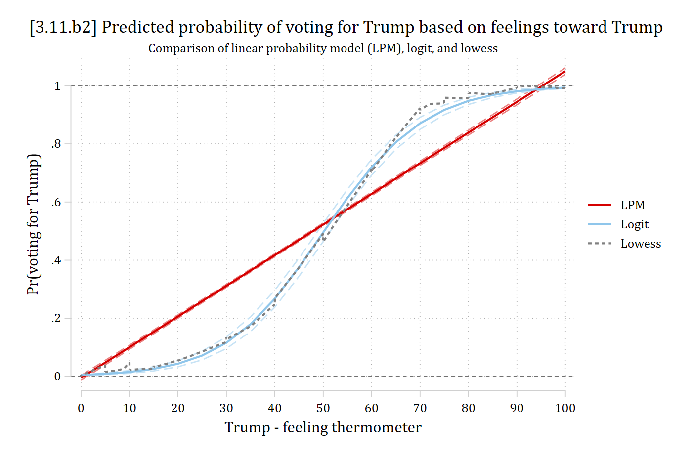{width=80% fig-alt="Predicted probability of voting for Trump by the Trump feeling thermometer from the LPM, the logit, and the lowess: the logit's S-curve follows the lowess closely while the straight LPM line does not."}

## R

```{r}
#| fig-alt: "Predicted probability of voting for Trump by the Trump feeling thermometer from the LPM, the logit, and smoothed proportions: the logit's S-curve follows the smoothed curve closely while the straight LPM line does not."
lpm2 <- lm(vote_trump ~ age + hhincome + woman + lgb + race4 + edyrs + relimport +
  wrongtrack + feel_trump, data = anes)
lpm_tr <- avg_predictions(lpm2, by = "feel_trump",
  newdata = datagrid(feel_trump = seq(0, 100, 5), grid_type = "counterfactual"))

logit2 <- glm(vote_trump ~ age + hhincome + woman + lgb + race4 + edyrs + relimport +
  wrongtrack + feel_trump, family = binomial(link = "logit"), data = anes)
logit_tr <- avg_predictions(logit2, by = "feel_trump",
  newdata = datagrid(feel_trump = seq(0, 100, 5), grid_type = "counterfactual"))

trump_prs <- bind_rows(LPM = lpm_tr, Logit = logit_tr, .id = "model")

ggplot(trump_prs, aes(x = feel_trump, y = estimate, color = model)) +
  geom_line(linewidth = 1) +
  geom_line(aes(y = conf.low), linetype = "dashed") +
  geom_line(aes(y = conf.high), linetype = "dashed") +
  geom_smooth(data = anes, aes(x = feel_trump, y = vote_trump, color = "Smoothed"),
    se = FALSE) +
  geom_hline(yintercept = c(0, 1), linetype = "dashed") +
  scale_color_discrete(limits = c("LPM", "Logit", "Smoothed")) +
  scale_x_continuous(breaks = seq(0, 100, 10)) +
  labs(title = "[3.11.b2] Predicted probability of voting for Trump based on feelings toward Trump",
    subtitle = "Comparison of linear probability model (LPM), logit, and smoothed proportions",
    x = "Trump - feeling thermometer", y = "Pr(voting for Trump)", color = NULL)
```

:::

## On the support of the data: logit vs LPM

Where is your data? Where do you want to examine the effects?

::: {.panel-tabset group="language"}
## Stata

```{.stata-run}
. * Add distribution of feel_trump (IV) to plot
. qui logit vote_trump age hhincome i.woman i.lgb i.race4 ///
>     edyrs i.relimport i.wrongtrack feel_trump

. qui margins, at(feel_trump=(0(5)100))

. marginsplot, ///
>     xlab(0(10)100) ///
>     ytitle("Pr(Voting for Trump)") ///
>     recastci(rline) ciopt(lpat(dash) color(*.5)) ///
>     plotopt(msym(none) lwid(medthick)) ///
>     title("[3.5.b] Predicted probability of voting for Trump based on feelings
>  toward Trump") ///
>     subtitle("Kernel density plot show distribution of feeling thermometer", s
> ize(small)) ///
>     addplot(kdensity feel_trump, ///
>     ylab(-.3 " " 0(.2)1) yaxis(2) yscale(range(0 0.1) off alt axis(2))) ///
>     legend(off)

Variables that uniquely identify margins: feel_trump

```

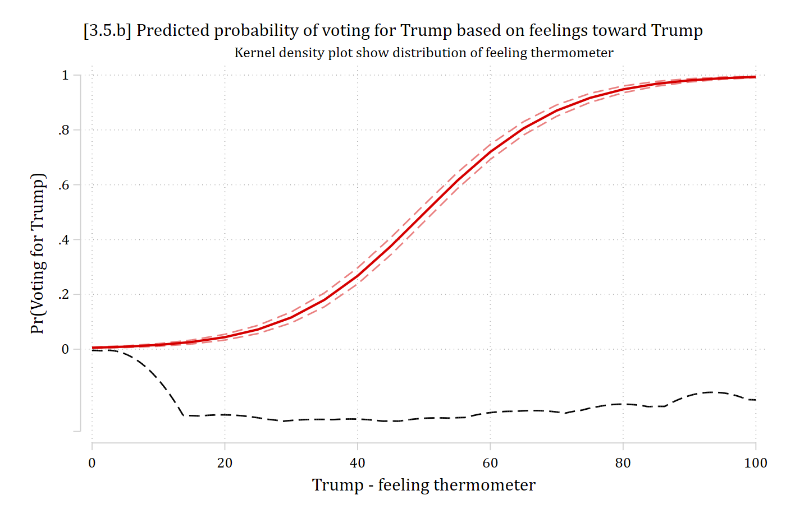{width=80% fig-alt="Logit predicted probability of voting for Trump by the Trump feeling thermometer, an S-curve, with a kernel density of the thermometer beneath it: most observations are at the low and high ends of the thermometer, where the curve is flat."}

## R

```{r}
#| fig-alt: "Logit predicted probability of voting for Trump by the Trump feeling thermometer, an S-curve, with a kernel density of the thermometer beneath it: most observations are at the low and high ends of the thermometer, where the curve is flat."
ggplot(logit_tr, aes(x = feel_trump, y = estimate)) +
  geom_line(linewidth = 1) +
  geom_line(aes(y = conf.low), linetype = "dashed", color = "gray60") +
  geom_line(aes(y = conf.high), linetype = "dashed", color = "gray60") +
  # kernel density of feel_trump, scaled to sit below the predictions
  geom_density(data = anes, aes(x = feel_trump, y = after_stat(-0.3 + 0.25 * density / max(density))),
    inherit.aes = FALSE, color = "gray40") +
  scale_x_continuous(breaks = seq(0, 100, 10)) +
  scale_y_continuous(breaks = seq(0, 1, 0.2)) +
  labs(title = "[3.5.b] Predicted probability of voting for Trump based on feelings toward Trump",
    subtitle = "Kernel density plot show distribution of feeling thermometer",
    x = "Trump - feeling thermometer", y = "Pr(Voting for Trump)")
```

:::

- We can compare +SD effects across the LPM and logit

::: {.panel-tabset group="language"}
## Stata

```{.stata-run}
. // Compare LPM to logit
. qui regress vote_trump c.feel_trump age hhincome i.woman i.lgb i.race4 ///
>     i.college i.relimport i.wrongtrack

. est store lpm

. 
. qui logit vote_trump c.feel_trump age hhincome i.woman i.lgb i.race4 ///
>     i.college i.relimport i.wrongtrack

. est store logit_m

. 
. * Compare average effects across models
. mecompare feel_trump, models(lpm logit_m) amount(sd)

mecompare uses vce(robust) for all models. Standard errors from mecompare will d
> iffer from the specified model(s) because vce(robust) was not used on at least
>  one of the models specified in the models( ) option. We strongly recommend re
> fitting the first (regress) and second (logit) models with vce(robust). See vc
> e_option for details on vce(robust).

Predicting: Linear prediction (lpm), Pr(vote_trump) (logit_m)
Marginal effects and cross-model differences (N_lpm=6695) (N_logit_m=6695)

                                 |  ME #   Estimate  Robust SE      P>|z|
---------------------------------+---------------------------------------
feel trump + SD (centered)       |                                       
                             lpm |     1      0.432      0.004      0.000
                         logit m |     2      0.166      0.004      0.000
                      Difference |     3      0.266      0.004      0.000

```

## R

```{r}
# Compare LPM to logit (keep the observations used in both models)
anes_m <- anes[complete.cases(anes[c("vote_trump", "feel_trump", "college")]), ]

lpm <- lm(vote_trump ~ feel_trump + age + hhincome + woman + lgb + race4 + college +
  relimport + wrongtrack, data = anes_m)

logit_m <- glm(vote_trump ~ feel_trump + age + hhincome + woman + lgb + race4 + college +
  relimport + wrongtrack, family = binomial(link = "logit"), data = anes_m)

# Compare average effects across models
sd_feel <- sd(anes_m$feel_trump)
avg_comparisons(lpm, variables = list(feel_trump = sd_feel))
avg_comparisons(logit_m, variables = list(feel_trump = sd_feel))
```

:::

- The LPM suggests an effect that is 2.6 times larger than the logit
  - Why? Most of the data is at the extremes of the feeling thermometer, where effects are relatively flat / small

::: {.panel-tabset group="language"}
## Stata

```{.stata-run}
. * Compare effects where most data is: ends of feeling thermometer
. mecompare feel_trump, models(lpm logit_m) start(feel_trump=0) amount(10) uncen
> ter

mecompare uses vce(robust) for all models. Standard errors from mecompare will d
> iffer from the specified model(s) because vce(robust) was not used on at least
>  one of the models specified in the models( ) option. We strongly recommend re
> fitting the first (regress) and second (logit) models with vce(robust). See vc
> e_option for details on vce(robust).

Predicting: Linear prediction (lpm), Pr(vote_trump) (logit_m)
Marginal effects and cross-model differences (N_lpm=6695) (N_logit_m=6695)

                                 |  ME #   Estimate  Robust SE      P>|z|
---------------------------------+---------------------------------------
feel trump + 10 (uncentered)     |                                       
                             lpm |     1      0.105      0.001      0.000
                         logit m |     2      0.010      0.001      0.000
                      Difference |     3      0.095      0.002      0.000

```

## R

```{r}
# Compare effects where most data is: ends of feeling thermometer
avg_comparisons(lpm, variables = list(feel_trump = c(0, 10)))
avg_comparisons(logit_m, variables = list(feel_trump = c(0, 10)))
```

:::

- It is important to ensure even control variables are specified and modeled correctly
  - The estimates for your focal IV are correct only if the rest of the model is correctly specified
  - Here, even a binary IV (which LPM usually handles well), shows a wonky false positive in the LPM, because the feeling thermometer variable in the model is so off

::: {.panel-tabset group="language"}
## Stata

```{.stata-run}
. mecompare wrongtrack, models(lpm logit_m)

mecompare uses vce(robust) for all models. Standard errors from mecompare will d
> iffer from the specified model(s) because vce(robust) was not used on at least
>  one of the models specified in the models( ) option. We strongly recommend re
> fitting the first (regress) and second (logit) models with vce(robust). See vc
> e_option for details on vce(robust).

Predicting: Linear prediction (lpm), Pr(vote_trump) (logit_m)
Marginal effects and cross-model differences (N_lpm=6695) (N_logit_m=6695)

                                 |  ME #   Estimate  Robust SE      P>|z|
---------------------------------+---------------------------------------
wrongtrack                       |                                       
    Wrong track - Right trac     |                                       
                             lpm |     1     -0.030      0.010      0.002
                         logit m |     2     -0.008      0.006      0.193
                      Difference |     3     -0.022      0.005      0.000

```

## R

```{r}
avg_comparisons(lpm, variables = "wrongtrack")
avg_comparisons(logit_m, variables = "wrongtrack")
```

:::

- The LPM's unrealistic functional form can also often impose false interaction effects ([Rohrer and Arslan 2021](https://doi.org/10.1177/25152459211007368))

::: {.panel-tabset group="language"}
## Stata

```{.stata-run}
. * Show incorrect interactions LPM can enforce
. qui logit vote_trump c.feel_trump##i.wrongtrack age hhincome ///
>     i.woman i.lgb i.race4 i.college i.relimport

. est store logXmod

. 
. qui regress vote_trump c.feel_trump##i.wrongtrack age hhincome ///
>     i.woman i.lgb i.race4 i.college i.relimport

. est store lpmXmod

. 
. * Calculate AMEs of feeling thermometer, across categories of wrong track
. mecompare feel_trump, by(wrongtrack) amount(sd) models(logXmod lpmXmod)

mecompare uses vce(robust) for all models. Standard errors from mecompare will d
> iffer from the specified model(s) because vce(robust) was not used on at least
>  one of the models specified in the models( ) option. We strongly recommend re
> fitting the first (logit) and second (regress) models with vce(robust). See vc
> e_option for details on vce(robust).

Predicting: Pr(vote_trump) (logXmod), Linear prediction (lpmXmod)
Marginal effects and cross-model differences (N_logXmod=6695) (N_lpmXmod=6695)

                                 |  ME #   Estimate  Robust SE      P>|z|
---------------------------------+---------------------------------------
feel trump + SD (centered)       |                                       
             logXmod Right track |     1      0.190      0.010      0.000
             logXmod Wrong track |     2      0.167      0.003      0.000
             lpmXmod Right track |     3      0.335      0.017      0.000
             lpmXmod Wrong track |     4      0.444      0.004      0.000
          Difference Right track |     5     -0.145      0.026      0.000
          Difference Wrong track |     6     -0.277      0.005      0.000

. metest, clear

. metest 1 - 2, add rowname("Interaction 2nd diff:Logit")

                                 |  estimate         se     pvalue 
---------------------------------+--------------------------------
Interaction 2nd diff             |                                
                           Logit |     0.023      0.010      0.025 

. metest 3 - 4, add rowname("Interaction 2nd diff:LPM")

                                 |  estimate         se     pvalue 
---------------------------------+--------------------------------
Interaction 2nd diff             |                                
                           Logit |     0.023      0.010      0.025 
                             LPM |    -0.109      0.018      0.000 

```

## R

```{r}
# Show incorrect interactions LPM can enforce
logXmod <- glm(vote_trump ~ feel_trump * wrongtrack + age + hhincome + woman + lgb +
  race4 + college + relimport, family = binomial(link = "logit"), data = anes_m)

lpmXmod <- lm(vote_trump ~ feel_trump * wrongtrack + age + hhincome + woman + lgb +
  race4 + college + relimport, data = anes_m)

# Calculate AMEs of feeling thermometer, across categories of wrong track
avg_comparisons(logXmod, variables = list(feel_trump = sd_feel), by = "wrongtrack",
  newdata = datagrid(wrongtrack = unique, grid_type = "counterfactual"))
avg_comparisons(lpmXmod, variables = list(feel_trump = sd_feel), by = "wrongtrack",
  newdata = datagrid(wrongtrack = unique, grid_type = "counterfactual"))

# Interaction 2nd differences: Right track - Wrong track
avg_comparisons(logXmod, variables = list(feel_trump = sd_feel), by = "wrongtrack",
  newdata = datagrid(wrongtrack = unique, grid_type = "counterfactual"),
  hypothesis = ~ revpairwise)
avg_comparisons(lpmXmod, variables = list(feel_trump = sd_feel), by = "wrongtrack",
  newdata = datagrid(wrongtrack = unique, grid_type = "counterfactual"),
  hypothesis = ~ revpairwise)
```

:::

::: {.callout-note icon="false" appearance="simple"}
LPM suggests a significant interaction in the opposite direction to the true effect
:::

## Ways of using predictions for interpretation

- *Predictions at observed values of x~k~ and/or at the observed values of **x**~--k~*
  - *Predictions at the means of **x**~--k~ (i.e., the control variables)*
- *Graphs*: predictions at many (or all) levels of focal independent variables
- *Marginal effects*: changes in predictions for a change in an IV holding other variables (e.g., controls) constant (or at observed values)
- *Ideal types*/*profiles*: predictions at specific constellations of multiple IV values of substantive interest
- Risk ratios: ratios of probabilities
  - Multiplicative effect on the probability

## Parameters and Probabilities

- In the linear regression model:
  - The intercept (α) moves the entire regression line "up and down"
  - The slope (β) is the rate of change
    - That is, how steep the line is
- Consider the binary regression model with a single *x*:

$$\begin{aligned}
Logit: &\quad \Pr(y = 1\,|\,x) = \Lambda({\color{green}{\alpha}} + {\color{blue}{\beta}}x) \\
Probit: &\quad \Pr(y = 1\,|\,x) = \Phi({\color{green}{\alpha}} + {\color{blue}{\beta}}x)
\end{aligned}$$

### Changing the slope

Smaller the slope, greater change in *x* required for a given change in Pr(*y*)

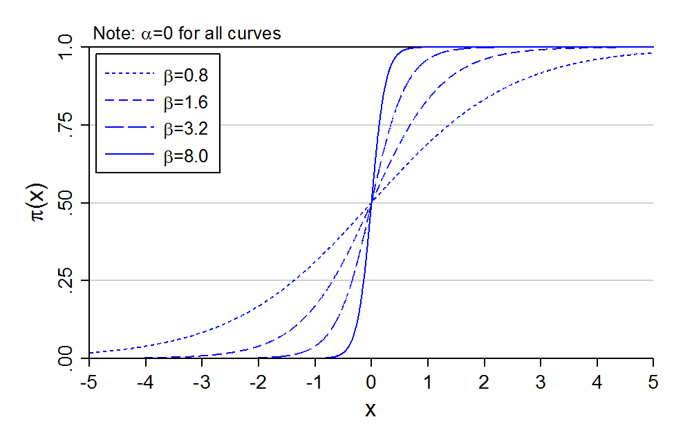{width=60% fig-alt="Probability curves with alpha = 0 and beta of 0.8, 1.6, 3.2, and 8.0: the larger beta, the steeper the S-curve."}

#### Changing β changes the effect of x

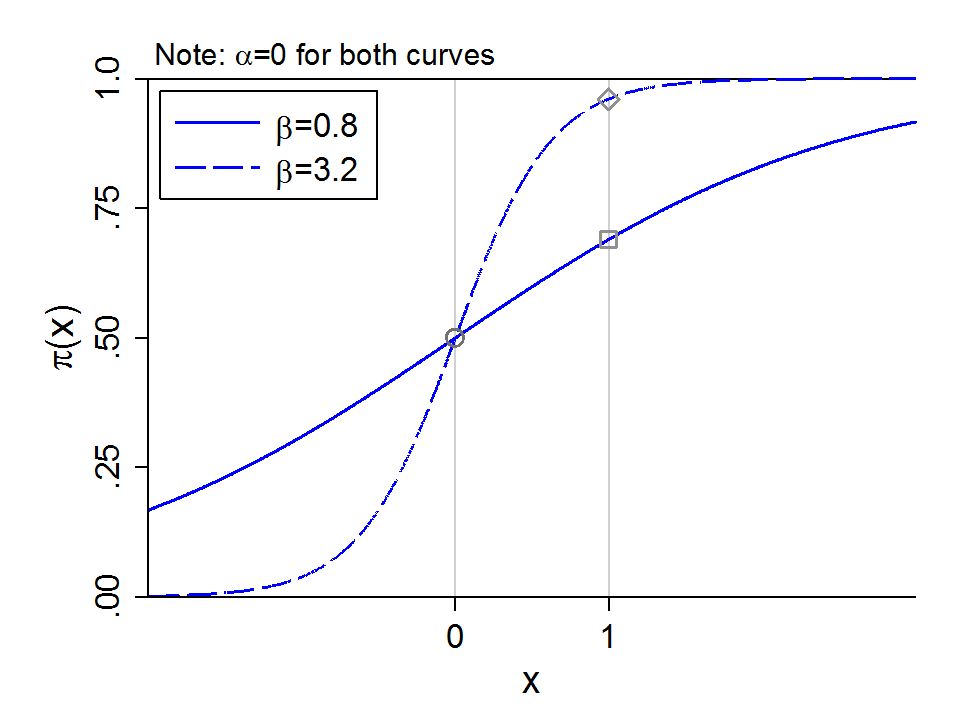{width=60% fig-alt="Probability curves with beta = 0.8 and beta = 3.2: the change in probability from x = 0 to x = 1 is much larger for the steeper curve."}

### Changing the intercept

**Smaller** intercept, curve moves **right**

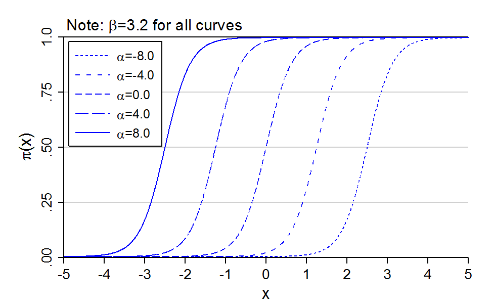{width=60% fig-alt="Probability curves with beta = 3.2 and alpha from -8 to 8: the S-curve keeps its shape and shifts right as alpha gets smaller."}

#### Changing α changes the effect of x

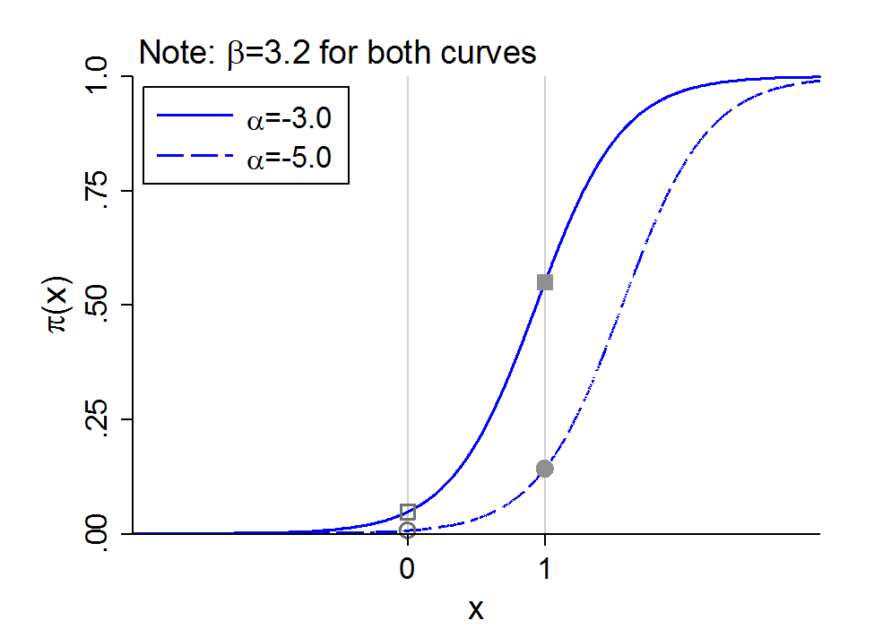{width=60% fig-alt="Probability curves with beta = 3.2 and alpha of -3 and -5: the change in probability from x = 0 to x = 1 differs between the two curves."}

NOTE: This is why binary models are "inherently interactive." Imagine the intercept shift (α) was due to a binary variable for college completion (=1). The effect of other variables (e.g., *x* could be age) are now automatically different for each group

### Inherent interactions for continuous IVs

- The same phenomenon of inherent interactions occurs for two continuous IVs
  - Consider two continuous IVs: *x~1~* and *x~2~*
- The intercept effectively absorbs the level of *x~2~* causing an intercept shift
- The model is:

$$\Pr(y = 1\,|\,x_{1}, x_{2}) = \Phi(-4 + .6x_{1} + .5x_{2})$$

- If x~2~=0 (curve with squares below):

$$\Pr(y = 1\,|\,x_{1}, x_{2} = 0) = \Phi(-4 + .6x_{1} + [.5 \times 0]) = \Phi(-4 + .6x_{1})$$

- If x~2~=5 (curve with circles below):

$$\Pr(y = 1\,|\,x_{1}, x_{2} = 5) = \Phi(-4 + .6x_{1} + [.5 \times 5]) = \Phi([-4 + 2.5] + .6x_{1}) = {\color{blue}{\Phi(-1.5 + .6x_{1})}}$$

#### How x~2~ "affects the effect" of x~1~

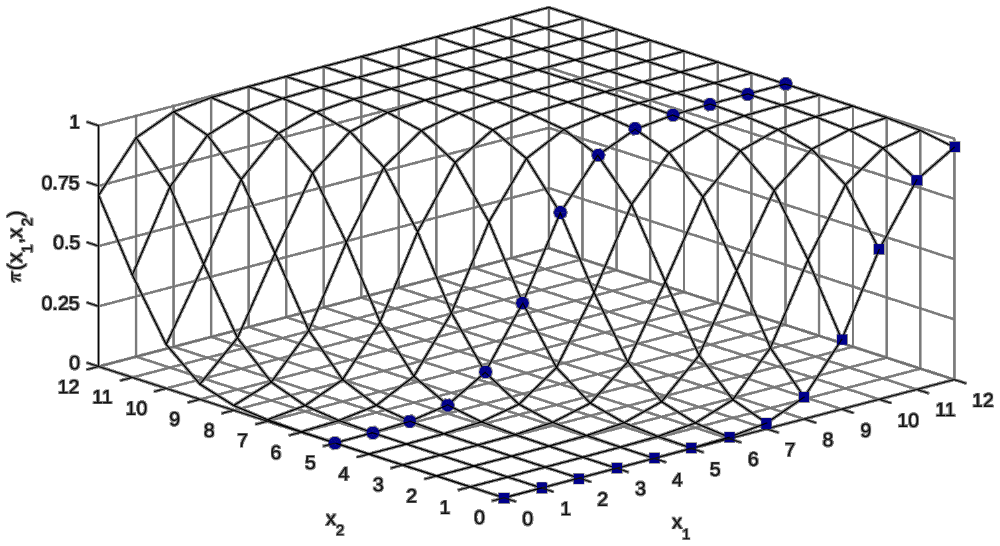{width=70% fig-alt="Three-dimensional surface of the probability over x1 and x2: the curve for x2 = 0, marked with squares, and the curve for x2 = 5, marked with circles, rise at different values of x1."}

### Does the empirical relationship need to be S-shaped?

- Does anyone in the sample need to have a probability near 0 or 1?
  - Can the relationship be relatively linear?
  - Can changes in *x*'s change the probability from 0 to 1 in the sample?

#### Where is your observed data located?

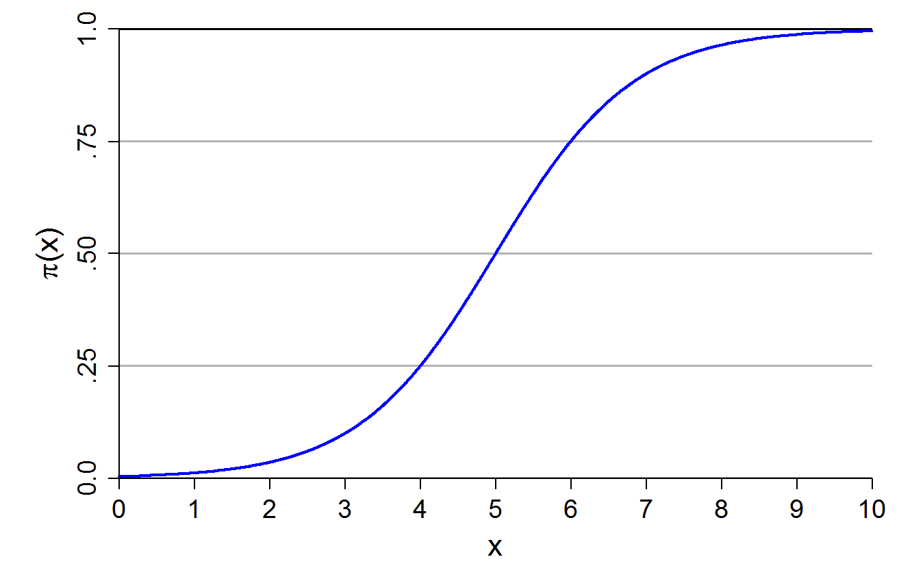{width=60% fig-alt="A full S-shaped probability curve from near 0 to near 1 as x goes from 0 to 10."}

:::: {.columns}
::: {.column width="50%"}
**If only low or high probabilities are observed, very nonlinear**

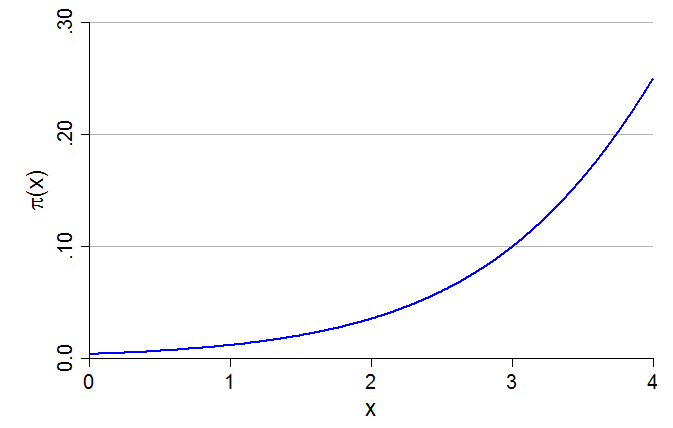{fig-alt="Only the bottom of the S-curve: probabilities from near 0 to 0.25, curving upward."}
:::
::: {.column width="50%"}
**Change is mostly linear in middle of probability curve**

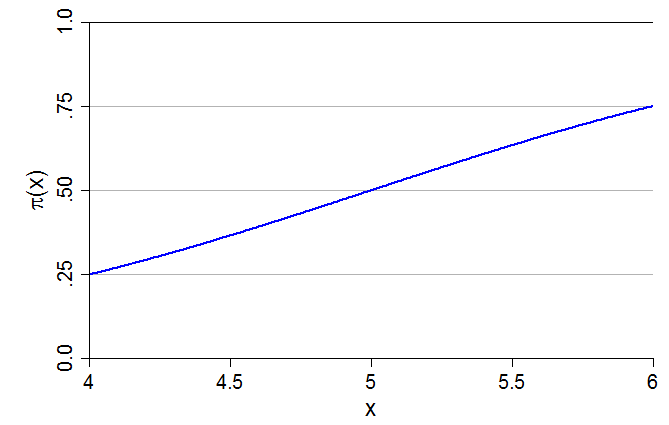{fig-alt="Only the middle of the S-curve: probabilities from 0.25 to 0.75, close to a straight line."}
:::
::::

Both of these are examples of just part of the logit probability curve being observed in the data (e.g., graph on left could be what you would observe for a rare outcome \[i.e., few 1s on the DV\]). Do you think the linear probability model (LPM) would predict similar probabilities? For one or the other? Both? Why?

#### Negative relations are possible

:::: {.columns}
::: {.column width="50%"}
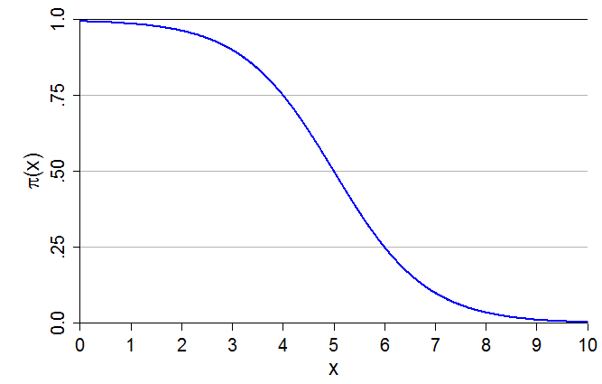{fig-alt="A decreasing S-shaped probability curve from near 1 to near 0."}
:::
::: {.column width="50%"}
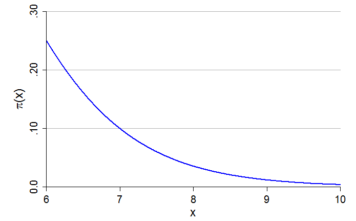{fig-alt="Only the bottom of a decreasing curve: probabilities falling from 0.25 toward 0."}
:::
::::

*And so on.*

- Note that these nonlinearities exist without any polynomials in the model for independent variables (e.g., *x* could be *age*---there is no *x*^2^ in our model)
  - See [Appendix 3E](appendix-3e-functional-forms.qmd) for the effect of adding polynomial specifications of the IVs

## GSS example: marijuana legalization

- Let's revisit our GSS example for support for legalizing marijuana use, but keep all available years (1975 to 2022)

*Do you think the use of marijuana should be made legal or not?*

::: {.panel-tabset group="language"}
## Stata

```{.stata-run}
. use "https://tdmize.github.io/data/data/cda_gss22", clear
(GSS 1972-2022 CDA - Categorical Data Analysis | 2024-12-03)

. 
. drop if missing(grass, age, conserv, faminc, college, woman, race4)
(37,924 observations deleted)

. recode grass 2 = 0
(0 changes made to grass)

. lab def glab 0"not be legal" 1 "should be legal"

. lab val grass glab

. fre grass

grass -- should marijuana be made legal
-----------------------------------------------------------------------
                          |      Freq.    Percent      Valid       Cum.
--------------------------+--------------------------------------------
Valid   0 not be legal    |      21358      61.97      61.97      61.97
        1 should be legal |      13108      38.03      38.03     100.00
        Total             |      34466     100.00     100.00           
-----------------------------------------------------------------------

. 
. * Create year since 1975 variable
. gen year1975 = year - 1975

. lab var year1975 "years since 1975"

```

## R

```{r}
gss <- read_dta("https://tdmize.github.io/data/data/cda_gss22.dta")

# Drop any missing data on model vars
gss <- gss[complete.cases(gss[c("grass", "age", "conserv", "faminc", "college",
  "woman", "race4")]), ]
frq(gss, grass)

# Create year since 1975 variable
gss <- gss |> mutate(year1975 = as.numeric(year) - 1975)
```

:::

::: {.panel-tabset group="language"}
## Stata

```{.stata-run}
. hist year if grass <= ., width(2) percent fcol(none) ///
>     title("[3.6.a] Percent of observations per year of the GSS")
(bin=24, start=1975, width=2)

```

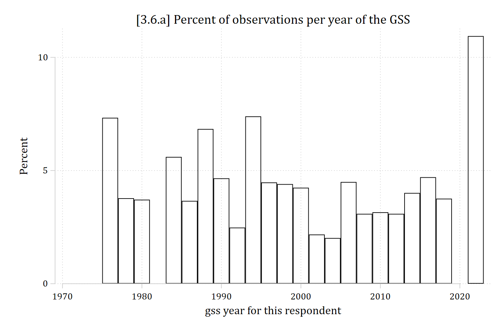{width=80% fig-alt="Histogram of the percent of observations in each two-year span of GSS years from 1975 to 2022: most spans have 2 to 7 percent, and the last span, 2021 to 2022, has about 11 percent."}

## R

```{r}
#| fig-alt: "Histogram of the percent of observations in each two-year span of GSS years from 1975 to 2022: most spans have 2 to 7 percent, and the last span, 2021 to 2022, has about 11 percent."
ggplot(gss, aes(x = as.numeric(year))) +
  geom_histogram(aes(y = after_stat(100 * count / sum(count))),
    binwidth = 2, boundary = 1975, closed = "left", fill = NA, color = "black") +
  labs(title = "[3.6.a] Percent of observations per year of the GSS",
    x = "gss year for this respondent", y = "Percent")
```

:::

::: {.panel-tabset group="language"}
## Stata

```{.stata-run}
. // binary logit model; or option for odds ratios
. logit grass c.age c.year1975##c.year1975 i.conserv ///
>     c.faminc i.degree i.woman i.race4, or

Iteration 0:  Log likelihood = -22892.973  
Iteration 1:  Log likelihood =  -19104.79  
Iteration 2:  Log likelihood =  -19063.87  
Iteration 3:  Log likelihood = -19063.784  
Iteration 4:  Log likelihood = -19063.784  

Logistic regression                                    Number of obs =  34,466
                                                       LR chi2(13)   = 7658.38
                                                       Prob > chi2   =  0.0000
Log likelihood = -19063.784                            Pseudo R2     =  0.1673

-------------------------------------------------------------------------------
        grass | Odds ratio   Std. err.      z    P>|z|     [95% conf. interval]
--------------+----------------------------------------------------------------
          age |      0.976      0.001  -29.637   0.000        0.975       0.978
     year1975 |      0.957      0.003  -12.883   0.000        0.951       0.964
              |
   c.year1975#|
   c.year1975 |      1.002      0.000   31.223   0.000        1.002       1.002
              |
      conserv |
Conservative  |      0.433      0.012  -30.040   0.000        0.410       0.457
       faminc |      0.999      0.000   -1.145   0.252        0.999       1.000
              |
       degree |
 high school  |      1.274      0.049    6.304   0.000        1.182       1.374
associate/..  |      1.435      0.085    6.079   0.000        1.277       1.612
  bachelor's  |      1.583      0.075    9.700   0.000        1.443       1.737
    graduate  |      1.782      0.102   10.080   0.000        1.593       1.994
              |
        woman |
       Women  |      0.669      0.017  -15.930   0.000        0.636       0.703
              |
        race4 |
       Black  |      0.856      0.033   -4.026   0.000        0.793       0.923
       Other  |      0.510      0.036   -9.554   0.000        0.445       0.586
    Hispanic  |      0.438      0.025  -14.631   0.000        0.392       0.489
              |
        _cons |      1.288      0.077    4.206   0.000        1.145       1.449
-------------------------------------------------------------------------------
Note: _cons estimates baseline odds.

. est store mjmod

```

## R

```{r}
# Treat binary/nominal variables as factors using their value labels
gss <- gss |>
  mutate(conserv = as_factor(conserv), degree = as_factor(degree),
    woman = as_factor(woman), race4 = as_factor(race4)) |>
  droplevels()

mjmod <- glm(grass ~ age + poly(year1975, 2, raw = TRUE) + conserv + faminc + degree +
  woman + race4, data = gss, family = binomial(link = "logit"))

odds.ratio(mjmod, level = .95)
```

:::

### Odds ratio (OR) interpretations

> *Each additional year of age decreases the odds of supporting marijuana legalization by a factor of 0.98*
>
> *Conservatives' odds of supporting legalized marijuana are 0.43 times lower than non-conservatives*

- Are these large effects or small effects?
  - Do you have a sense of age's effect size?
  - 0.43 is a large effect size in the odds metric (odds reduce more than half)
    - Can you guess how different the two groups are in terms of percentage points?
- The *year* variable\* shows significant linear and quadratic coefficients, but it is all but impossible to interpret its effect given the model is already nonlinear
- To know substantive effect size, and to understand nonlinearities, must interpret in terms of predictions

\*Variables with only very large values like *year* can cause problems. Solution: create a years since first observed year variable, here *year1975* = *year* - 1975

::: {.panel-tabset group="language"}
## Stata

```{.stata-run}
. qui margins, at(age=(18(2)88))

. marginsplot, ///
>     plotop(msymbol(none) lcol(purple)) ///
>     recastci(rline) ciopt(lpat(dash) lcol(purple*.3)) ///
>     ylab(0(.1)1) ytitle("Pr(support legal marijuana)") xtitle("Age") ///
>     xlab(20(10)90) ///
>     title("[3.6.b] Probability of supporting marijuana legalization by age (GS
> S)", size(*1.2))

Variables that uniquely identify margins: age

```

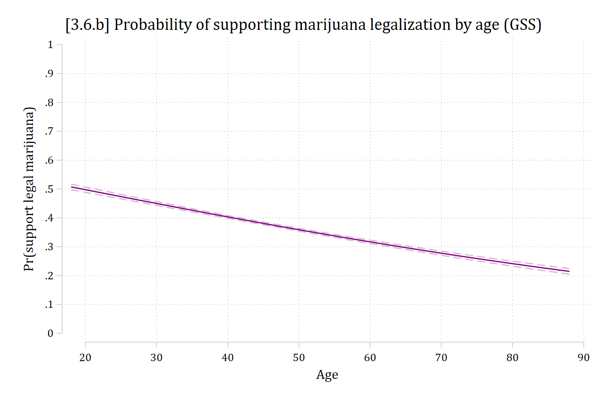{width=80% fig-alt="Predicted probability of supporting marijuana legalization by age: a nearly straight line falling from about 0.5 at age 18 to about 0.22 at age 88."}

## R

```{r}
#| fig-alt: "Predicted probability of supporting marijuana legalization by age: a nearly straight line falling from about 0.5 at age 18 to about 0.22 at age 88."
plot_predictions(mjmod, by = "age",
  newdata = datagrid(age = seq(18, 88, 2), grid_type = "counterfactual")) +
  scale_y_continuous(breaks = seq(0, 1, 0.1), limits = c(0, 1)) +
  scale_x_continuous(breaks = seq(20, 90, 10)) +
  labs(title = "[3.6.b] Probability of supporting marijuana legalization by age (GSS)",
    x = "Age", y = "Pr(support legal marijuana)")
```

:::

::: {.panel-tabset group="language"}
## Stata

```{.stata-run}
. qui margins conserv, at(age=(18(2)90))

. marginsplot, ///
>     plotop(msymbol(none)) recastci(rline) ciopt(lpat(dash) lcol(*.3)) ///
>     ylab(0(.1)1) ytitle("Pr(support legal marijuana)") xtitle("Age") ///
>     xlab(20(10)90) ///
>     title("[3.6.d] Probability of supporting marijuana legalization by age (GS
> S)", size(*1.2))

Variables that uniquely identify margins: age conserv

```

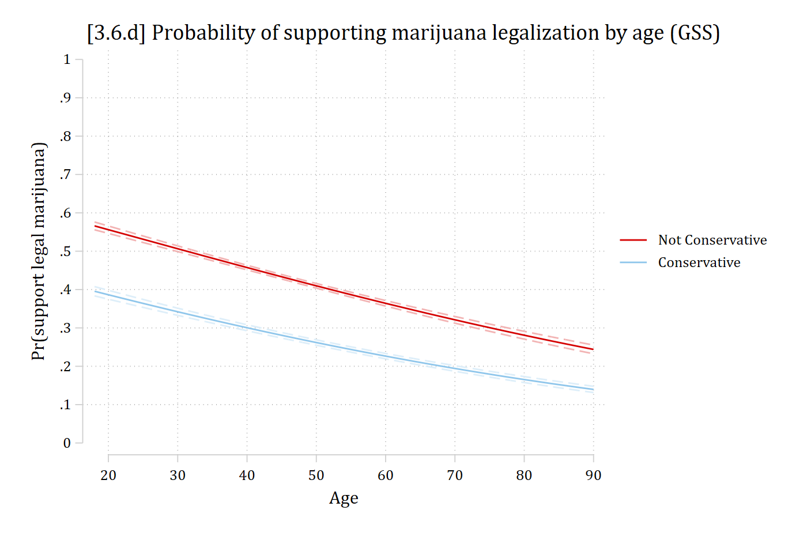{width=80% fig-alt="Predicted probability of supporting marijuana legalization by age for non-conservatives and conservatives: both lines fall with age, and conservatives are lower at every age."}

## R

```{r}
#| fig-alt: "Predicted probability of supporting marijuana legalization by age for non-conservatives and conservatives: both lines fall with age, and conservatives are lower at every age."
plot_predictions(mjmod, by = c("age", "conserv"),
  newdata = datagrid(age = seq(18, 90, 2), conserv = unique,
    grid_type = "counterfactual")) +
  scale_y_continuous(breaks = seq(0, 1, 0.1), limits = c(0, 1)) +
  scale_x_continuous(breaks = seq(20, 90, 10)) +
  labs(title = "[3.6.d] Probability of supporting marijuana legalization by age (GSS)",
    x = "Age", y = "Pr(support legal marijuana)", color = NULL, fill = NULL)
```

:::

::: {.panel-tabset group="language"}
## Stata

```{.stata-run}
. qui margins, at(year1975=(0(1)47))

. marginsplot, ///
>     plotop(msymbol(none)) recastci(rline) ciopt(lpat(dash) lcol(*.3)) ///
>     ylab(0(.1)1) ytitle("Pr(support legal marijuana)") xtitle("Year of survey"
> ) ///
>     xlab(0 "1975" 10 "1985" 20 "1995" 30 "2005" 40 "2015" 47 "2022") ///
>     title("[3.6.c] Probability of supporting marijuana legalization over time 
> (GSS)", size(*1.2))

Variables that uniquely identify margins: year1975

```

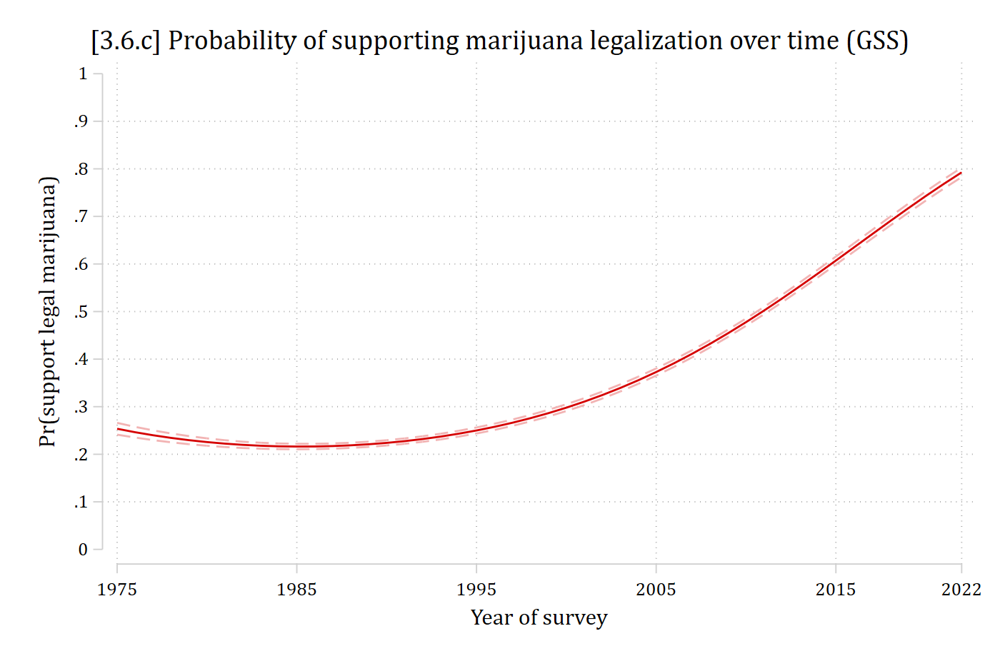{width=80% fig-alt="Predicted probability of supporting marijuana legalization by survey year: a U-shaped curve that dips slightly from 1975 to around 1990 and then rises steeply to about 0.8 in 2022."}

## R

```{r}
#| fig-alt: "Predicted probability of supporting marijuana legalization by survey year: a U-shaped curve that dips slightly from 1975 to around 1990 and then rises steeply to about 0.8 in 2022."
plot_predictions(mjmod, by = "year1975",
  newdata = datagrid(year1975 = 0:47, grid_type = "counterfactual")) +
  scale_y_continuous(breaks = seq(0, 1, 0.1), limits = c(0, 1)) +
  scale_x_continuous(breaks = c(0, 10, 20, 30, 40, 47),
    labels = c("1975", "1985", "1995", "2005", "2015", "2022")) +
  labs(title = "[3.6.c] Probability of supporting marijuana legalization over time (GSS)",
    x = "Year of survey", y = "Pr(support legal marijuana)")
```

:::
