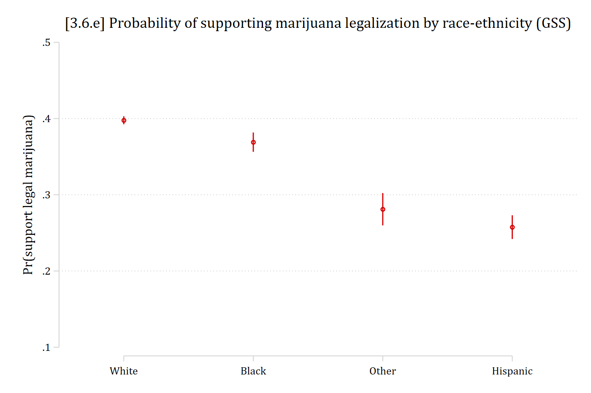

- Plots of predictions are always my go to method to understand an effect
  - But, also want to quantify the effect with concrete \#s and significance tests
  - In a binary logit/probit, I want that effect in the metric of predicted probabilities
- A **marginal effect** in binary logit/probit is

  **The difference in Pr(y = 1\|x) for a change in *x~k~* of δ, holding other independent variables constant**

- It is often the best choice to provide a **summary of the effect** of a variable
  - I recommend presenting a table of AMEs or MEMs in your paper instead of a table of ORs (which is more typical). See [Doan and Mize 2020](https://sociologicalscience.com/articles-v7-21-504/) for an example

### Marginal effects defined: changes in probabilities

- Note, in what follows η ("eta") is denoting a prediction---almost always the predicted probability is of primary interest for binary logit/probit models
- Compute probabilities at start and end values of *x~k~*

$$ME = \eta(x_{k} = end, \mathbf{x}_{-k} = \mathbf{x}^{*}) - \eta(x_{k} = start, \mathbf{x}_{-k} = \mathbf{x}^{*})$$

- Starting and ending values of the focal IV $x_{k}$ can be any values of substantive interest. For binary IVs, there are only two logical choices: 0 and 1

$${ME}_{binary} = \eta(x_{k} = 1, \mathbf{x}_{-k} = \mathbf{x}^{*}) - \eta(x_{k} = 0, \mathbf{x}_{-k} = \mathbf{x}^{*})$$

- For example, can compare a prediction for the non-religious (=0) to religious (=1)
- For continuous IVs, many more choices for starting and ending values. Commonly:
  - *start* = mean of $x_{k}$, or observed value
  - *end* = + 1 above *start*, + SD above *start*

## Summarizing marginal effects

### Review: Marginal effect at the mean (MEM)

- The **marginal effect at the mean** (MEM) is the effect with all other variables in **x**~*-k*~ (controls) at their means

$$MEM = \eta(x_{k} = end, \mathbf{x}_{-k} = \overline{\mathbf{x}}) - \eta(x_{k} = start, \mathbf{x}_{-k} = \overline{\mathbf{x}})$$

- E.g., For a continuous variable (e.g. *age*) could compare predictions at the mean and at the mean + 1, with all controls (**x**~*-k*~) at means:

$${MEM}_{continuous\ IV} = \eta(x_{k} = \overline{x}_{k} + 1, \mathbf{x}_{-k} = \overline{\mathbf{x}}) - \eta(x_{k} = \overline{x}_{k}, \mathbf{x}_{-k} = \overline{\mathbf{x}})$$

- MEM interpretation is the effect on the probability for "the average person" or "someone who is average on all characteristics included in the model"

### Review: Average marginal effect (AME)

- We can compute a marginal effect for each observation in the data
  - Compute prediction at *start* (observed) and *end* (hypothetical change) values
  - The difference is the effect for that specific observation (ME~i~)\*

$${ME}_{i} = \eta(x_{k} = {end}_{i}, \mathbf{x}_{-k} = \mathbf{x}_{-k,i}) - \eta(x_{k} = {start}_{i}, \mathbf{x}_{-k} = \mathbf{x}_{-k,i})$$

- **Average marginal effect** (AME) is the mean across all observations
  - Compute ME for each observation using observed values of **x**~*-k,i*~ and average

$$AME = \frac{1}{N}\sum_{i = 1}^{N}\left\{\eta(x_{k} = {end}_{i}, \mathbf{x}_{-k} = \mathbf{x}_{-k,i}) - \eta(x_{k} = {start}_{i}, \mathbf{x}_{-k} = \mathbf{x}_{-k,i})\right\}$$

- Interpretations of an AME is what the effect is "on average" in the sample
  - AMEs are my personal go-to default summary measure of an effect for categorical models
  - In my reading the AME is increasingly becoming the most popular method of interpretation across many fields

\*See [Appendix 3D](appendix-3d-me-distribution.qmd) for ways to examine the distribution of ${ME}_{i}$s across a sample

## Interpreting marginal effects for binary IVs

The examples use the GSS marijuana legalization model from [3.5](3-5-predictions.qmd#gss-example-marijuana-legalization):

::: {.panel-tabset group="language"}
## Stata

```{.stata-run}
. use "https://tdmize.github.io/data/data/cda_gss22", clear
(GSS 1972-2022 CDA - Categorical Data Analysis | 2024-12-03)

. 
. drop if missing(grass, age, conserv, faminc, college, woman, race4)
(37,924 observations deleted)

. recode grass 2 = 0
(0 changes made to grass)

. lab def glab 0"not be legal" 1 "should be legal"

. lab val grass glab

. 
. * Create year since 1975 variable
. gen year1975 = year - 1975

. lab var year1975 "years since 1975"

. 
. qui logit grass c.age c.year1975##c.year1975 i.conserv ///
>     c.faminc i.degree i.woman i.race4, or

. est store mjmod

. 
. * marginal effects for focal variables
. mecompare conserv, models(mjmod)

Predicting: Pr(grass)
Marginal effects (N_mjmod=34466)

                                 |  ME #   Estimate         SE      P>|z|
---------------------------------+---------------------------------------
conserv                          |                                       
    Conservativ - Not Conser     |                                       
                           mjmod |     1     -0.153      0.005      0.000

```

## R

```{r}
library(haven)           # import Stata data and labels
library(dplyr)           # data manipulation
library(ggplot2)         # graphs
library(marginaleffects) # predictions and marginal effects
library(cleanplots)      # graph scheme
cleanplots_defaults()

source("https://raw.githubusercontent.com/tdmize/Rfunctions/main/ME_helper_functions.R")

# Center changes in continuous IVs on each observation's value
options(marginaleffects_contrast_direction = "center")

gss <- read_dta("https://tdmize.github.io/data/data/cda_gss22.dta")

# Drop any missing data on model vars
gss <- gss[complete.cases(gss[c("grass", "age", "conserv", "faminc", "college",
  "woman", "race4")]), ]

# Create year since 1975 variable; treat binary/nominal variables as factors
gss <- gss |>
  mutate(year1975 = as.numeric(year) - 1975,
    conserv = as_factor(conserv), degree = as_factor(degree),
    woman = as_factor(woman), race4 = as_factor(race4)) |>
  droplevels()

mjmod <- glm(grass ~ age + poly(year1975, 2, raw = TRUE) + conserv + faminc + degree +
  woman + race4, data = gss, family = binomial(link = "logit"))

# marginal effects for focal variables
avg_comparisons(mjmod, variables = "conserv")
```

:::

> *On average, conservatives have a .15 lower probability of supporting marijuana legalization than do non-conservatives*
>
> [Different wording]{.underline}:
>
> *Conservatives are about 15 percentage points less supportive of marijuana legalization, compared to non-conservatives*

- You may also want to report the actual conditional probabilities for each category of the binary IV, rather than just the difference out of context
  - Note you still want to refer to the significance test of the marginal effect. E.g.,

::: {.panel-tabset group="language"}
## Stata

```{.stata-run}
. * show each predictions for each category of focal binary IV
. est restore mjmod
(results mjmod are active now)

. margins conserv

Predictive margins                                      Number of obs = 34,466
Model VCE: OIM

Expression: Pr(grass), predict()

-------------------------------------------------------------------------------
              |            Delta-method
              |     Margin   std. err.      z    P>|z|     [95% conf. interval]
--------------+----------------------------------------------------------------
      conserv |
Not Conser..  |      0.433      0.003  145.163   0.000        0.427       0.439
Conservative  |      0.279      0.004   74.284   0.000        0.272       0.287
-------------------------------------------------------------------------------

```

## R

```{r}
# show each predictions for each category of focal binary IV
avg_predictions(mjmod, variables = "conserv", by = "conserv")
```

:::

> *The predicted probability of supporting marijuana legalization for non-conservatives is about 0.43 --- compared to a significantly lower predicted probability of about 0.28 for conservatives (M.E. = -0.15 , p \< 0.001)*

::: {.callout-note icon="false" appearance="simple"}
**Interpretation tip**: To refer to a marginal effect, I often just use ME or M.E. in text. A capital ∆ (Delta) is another common notation.
:::

## Interpreting marginal effects for continuous IVs

- For continuous IVs, can interpret a one-unit discrete change, a one standard deviation discrete change, or the instantaneous rate of change (slope)---or another custom $\delta$ amount (e.g., +10 years of *age*)
  - I generally default to +SD absent a theoretically informed choice

::: {.panel-tabset group="language"}
## Stata

```{.stata-run}
. sum age year1975

    Variable |        Obs        Mean    Std. dev.       Min        Max
-------------+---------------------------------------------------------
         age |     34,466    46.01648    17.19265         18         89
    year1975 |     34,466    23.55458    14.61027          0         47

. mecompare age year1975, amount(sd) models(mjmod)

Predicting: Pr(grass)
Marginal effects (N_mjmod=34466)

                                 |  ME #   Estimate         SE      P>|z|
---------------------------------+---------------------------------------
age + SD (centered)              |                                       
                           mjmod |     1     -0.076      0.002      0.000
---------------------------------+---------------------------------------
year1975 + SD (centered)         |                                       
                           mjmod |     2      0.157      0.002      0.000

```

## R

```{r}
summary(gss[c("age", "year1975")])
sd(gss$age)
sd(gss$year1975)

avg_comparisons(mjmod, variables = list(age = sd(gss$age), year1975 = sd(gss$year1975)))
```

:::

> *On average, a standard deviation increase in age (about 17 years) is associated with being about 8 percentage points less supportive of marijuana legalization*
>
> *Samples collected about 15 years later (*${ME}_{year + SD}$*), are about 16 percentage points more supportive of legalizing marijuana than earlier samples*

### Marginal effects at specific values of interest

- Year is a variable with meaningful values
  - A SD increase is somewhat awkward for a year variable
  - Effects across the entire range or trimmed range (5^th^ to 95^th^ percentile) are informative here

::: {.panel-tabset group="language"}
## Stata

```{.stata-run}
. mecompare year1975, amount(trimrange) models(mjmod)

Predicting: Pr(grass)
Marginal effects (N_mjmod=34466)

                                 |  ME #   Estimate         SE      P>|z|
---------------------------------+---------------------------------------
year1975(5-95%)                  |                                       
                           mjmod |     1      0.546      0.007      0.000

```

## R

```{r}
trimrange <- quantile(gss$year1975, c(.05, .95))
avg_comparisons(mjmod, variables = list(year1975 = trimrange))
```

:::

> *Support for marijuana legalization has changed dramatically over the years of the GSS. Since the question began being asked in 1975, to the latest survey in 2022, support for legalization has increased by almost 55 percentage points*

## AME vs MEM: Which should you use?

- While MEMs and AMEs are usually quite similar in size, the MEM and AME are **not identical** for categorical DV models

::: {.panel-tabset group="language"}
## Stata

```{.stata-run}
. * Compare AME vs MEM
. mecompare age, amount(sd) models(mjmod) dec(5) atmeans // MEM

Predicting: Pr(grass)
Marginal effects (N_mjmod=34466)

                                 |  ME #   Estimate         SE      P>|z|
---------------------------------+---------------------------------------
age + SD (centered)              |                                       
                           mjmod |     1   -0.07862    0.00257    0.00000

. mecompare age, amount(sd) models(mjmod) dec(5)         // AME

Predicting: Pr(grass)
Marginal effects (N_mjmod=34466)

                                 |  ME #   Estimate         SE      P>|z|
---------------------------------+---------------------------------------
age + SD (centered)              |                                       
                           mjmod |     1   -0.07640    0.00246    0.00000

```

## R

```{r}
# Compare AME vs MEM
comparisons(mjmod, variables = list(age = sd(gss$age)), newdata = "mean") # MEM
avg_comparisons(mjmod, variables = list(age = sd(gss$age)))               # AME
```

:::

- [Hanmer and Kalkan (2013 *AJPS*)](https://gvpt.umd.edu/sites/gvpt.umd.edu/files/pubs/Hanmer%20and%20Kalkan%20AJPS%20Behind%20the%20Curve.pdf) show that there are situations where AME and MEM diverge and that the AME tends to perform better. However, in my experience they are almost identical and if you do find differences this is likely due to an idiosyncrasy in your data rather than a real substantive difference in the effect of your IV. Absent a meaningful difference between the two, I prefer the AME as the interpretation is more straightforward, less cumbersome, and more satisfying

## Logit vs probit revisited: AMEs\*

:::: {.columns}
::: {.column width="45%"}
| **Correlation(logit, probit)** | |
|:------|------:|
| betas | 0.9995 |
| *z*-stat on beta | 0.9980 |
| AMEs | 0.9997 |
| *z*-stat on AMEs | 0.9992 |
:::
::: {.column width="10%"}
:::
::: {.column width="45%"}
| **Ratio(logit / probit)** | |
|:------|------:|
| betas | 1.7819 |
| *z*-stat on beta | 0.9816 |
| AMEs | 1.0269 |
| *z*-stat on AMEs | 1.0139 |
:::
::::

- AMEs are all but identical across logit and probit
- *z* statistics on AMEs are very similar across logit and probit
- If predictions and/or marginal effects are of interest: the choice of whether to use logit or probit does not matter
  - The identifying assumption about the variance of the errors has almost no influence on predictions or marginal effects

**\*NOTE**: The table above is based on the models predicting support for Trump [shown earlier](3-2-scaling-identification.qmd#comparing-logit-and-probit)

## Interpreting marginal effects for nominal IVs

::: {.panel-tabset group="language"}
## Stata

```{.stata-run}
. * plot predictions for each category
. est restore mjmod
(results mjmod are active now)

. qui margins race4, post

. coefplot, vertical ylab(.1(.1).5) ytitle("Pr(support legal marijuana)") ///
>     title("[3.6.e] Probability of supporting marijuana legalization by race-et
> hnicity (GSS)")

```

{width=80% fig-alt="Predicted probability of supporting marijuana legalization by race-ethnicity with confidence intervals: about 0.40 for White, 0.37 for Black, 0.28 for Other, and 0.26 for Hispanic adults."}

## R

```{r}
#| fig-alt: "Predicted probability of supporting marijuana legalization by race-ethnicity with confidence intervals: about 0.40 for White, 0.37 for Black, 0.28 for Other, and 0.26 for Hispanic adults."
# plot predictions for each category
plot_predictions(mjmod, by = "race4",
  newdata = datagrid(race4 = unique, grid_type = "counterfactual")) +
  scale_y_continuous(breaks = seq(.1, .5, .1), limits = c(.1, .5)) +
  labs(title = "[3.6.e] Probability of supporting marijuana legalization by race-ethnicity (GSS)",
    x = NULL, y = "Pr(support legal marijuana)")
```

:::

- I always present the graph of predictions for a nominal IV, as it does not have a reference category / gives each group an equal amount of visual emphasis
- The default interpretation for nominal IVs is generally to compare the prediction for each included category to an omitted reference category
  - But reference category is often arbitrary
  - And other contrasts are of interest
- To avoid a reference category, compute all pairwise comparisons of predictions. Each pairwise comparison is a marginal effect

$$pairwise\ comparisons = ME = \eta(x_{k} = a, \mathbf{x}_{-k} = \mathbf{x}_{-k}^{*}) - \eta(x_{k} = b, \mathbf{x}_{-k} = \mathbf{x}_{-k}^{*});\ for\ all\ b > a$$

::: {.panel-tabset group="language"}
## Stata

```{.stata-run}
. * ME pairwise comparisons
. mecompare race4, models(mjmod) pwcompare

Predicting: Pr(grass)
Marginal effects (N_mjmod=34466)

                                 |  ME #   Estimate         SE      P>|z|
---------------------------------+---------------------------------------
race4                            |                                       
               Black - White     |                                       
                           mjmod |     1     -0.029      0.007      0.000
               Other - White     |                                       
                           mjmod |     2     -0.117      0.011      0.000
            Hispanic - White     |                                       
                           mjmod |     3     -0.140      0.008      0.000
               Other - Black     |                                       
                           mjmod |     4     -0.088      0.013      0.000
            Hispanic - Black     |                                       
                           mjmod |     5     -0.111      0.010      0.000
            Hispanic - Other     |                                       
                           mjmod |     6     -0.024      0.013      0.078

```

## R

```{r}
# ME pairwise comparisons
avg_comparisons(mjmod, variables = list(race4 = "pairwise"))
```

:::

> *Black adults have slightly lower probabilities of supporting marijuana legalization than White adults, though the effect size is small (ME = -0.03)*
>
> *Hispanic adults are about 14 percentage points less supportive of marijuana legalization than are White adults*
>
> *Etc.*

### Marginal effects (ME) inequality

- Issues with pairwise comparisons are many unhypothesized contrasts tested and no overarching answer about nominal IV's effect size
- The weighted **ME inequality** solves both issues *([Mize and Han 2025](/research/mize_han_socsci_2025.qmd))*

$$ME\ inequality \equiv |weighted\ average\ ME\ inequality| = \sum_{a = 1}^{L}\sum_{b = 2;\ b > a}^{L}\frac{w_{a,b}}{L - 1} \left|\eta(x_{k} = a, \mathbf{x}_{-k} = \mathbf{x}_{-k}^{*}) - \eta(x_{k} = b, \mathbf{x}_{-k} = \mathbf{x}_{-k}^{*})\right|$$

- Where $w_{a,b}$ is a weight reflecting the sample sizes of each *a* and *b* category

::: {.callout-note icon="false" appearance="simple"}
In Stata, use the [**meinequality**](/software/meinequality/index.qmd) command or the **meinequality** option on **mecompare**

In R, use the [**meineq()** function with **avg_comparisons**](/software/meinequality_r/index.qmd)
:::

::: {.panel-tabset group="language"}
## Stata

```{.stata-run}
. * ME inequality
. meinequality race4, models(mjmod)

ME Inequality Estimates (N = 34466)

                         |   Estimate   Std. err.           z       P>|z| 
-------------------------+-----------------------------------------------
ME Inequality            |                                               
                   race4 |      0.092       0.005      17.739       0.000 

```

## R

```{r}
# ME inequality
avg_comparisons(mjmod, variables = list(race4 = "pairwise"),
  hypothesis = meineq(mjmod))
```

:::

> *Individuals from different racial-ethnic groups differ by about 9 percentage points, on average, in their support for legalizing marijuana (p \< .001)*

## Summary of marginal effects

- A summary measure of the "effect" of a variable is often useful
  - For linear additive effects in linear regression models the estimated coefficients are usually used (coefficient = ME; but only in this special case)
    - For nonlinear effects the regression coefficients do not directly indicate the magnitude of the effect in the natural metric of the DV
    - In the binary logit model odds ratios are often used, but are limited in their interpretability as discussed above
- In most cases, measures of the change in the probability for a change in an IV (i.e., **marginal effects**) are the most helpful and intuitive way to summarize the effect
  - AME and MEM are generally almost identical; I prefer AME as a single measure in most cases due to its more elegant/satisfying interpretation
  - However, when there are meaningful or theoretically important values of your IVs to examine **you should examine the effects at these values**
    - Summary measures are only summaries and average over what may be important variation in the effect of interest
