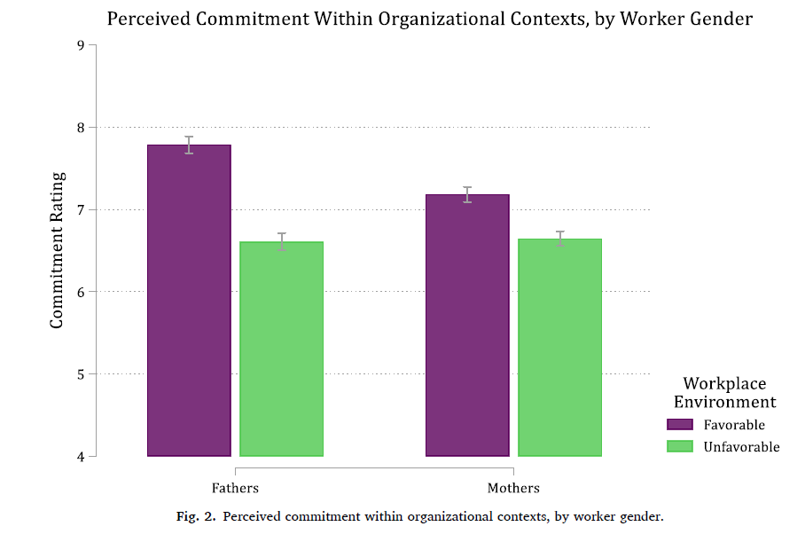

- Think about the substantive issue your model is describing. What types of people are you interested in? What are interesting clusters of characteristics about your observations? That is, what combined values of multiple IVs represent interesting/important "types" of people to examine?
  - These sets of characteristics are called ***ideal types*** or *profiles* ("ideal type" from Max Weber)

:::: {.columns}
::: {.column width="70%"}
*"**Ideal type:** a common mental construct in the social sciences derived from observable reality although not conforming to it in detail because of deliberate simplification and exaggeration. It is not ideal in the sense that it is excellent, nor is it an average; it is, rather, a constructed ideal used to approximate reality by selecting and accentuating certain elements."*

*(quote from [Britannica](https://www.britannica.com/topic/ideal-type); ideal type courtesy of [Weber 1921](https://archive.org/stream/MaxWeberEconomyAndSociety/MaxWeberEconomyAndSociety_djvu.txt))*
:::
::: {.column width="30%"}
{fig-alt="Sepia portrait photograph of Max Weber."}
:::
::::

- Defining ideal types forces you to think about where you want to look in the data
  - Comparing predictions across ideal types helps you understand your data and the effects of variables individually and jointly

## Defining ideal types

- Let's jump back to our model predicting support for Trump
  - What ideal types of voters might be interesting or important to look at?
- One ideal type might be "the average voter"---i.e., someone who is average on all model variables\*
- What **combination of characteristics** of voters might be particularly important for predicting whether someone supported Trump for president?
  - That is, what "types" of voters are you interested in?

\*I prefer thinking of MEMs as ideal types for a hypothetical average person in the data, rather than as a summary measure

## Predictions for ideal types

Operational definitions of ideal types:

- "Average Voter" = average of predictions for everyone in sample
- "MAGA Man" = Man, 70, high school degree, white, 30k income, Midwest
- "Romney Repub" = Man, 40, college degree, white, 150k income, Northeast
- "Dem Base" = Woman, 30, college degree, black, 50k income, West

::: {.callout-note icon="false" appearance="simple"}
See [Appendix 3A](appendix-3a-stata.qmd#a3.15-computing-predictions-for-ideal-types) for how to calculate these in Stata

In R, use [predictions](https://marginaleffects.com/man/r/predictions.html)
:::

::: {.panel-tabset group="language"}
## Stata

```{.stata-run}
. * 2016 US Election Data
. use "https://tdmize.github.io/data/data/cda_pew", clear
(cda_pew.dta | Pew Politics Survey Oct 2016 CDA - Categorical Data Analysis| 201
> 7)

. 
. * Recode data for example
. clonevar trump = presvote2
(753 missing values generated)

. lab var trump "Voting for Trump"

. 
. gen religB = relattend
(35 missing values generated)

. lab var religB "Attends Relig Services"

. recode religB 1/3 = 0 4/6 = 1
(2,548 changes made to religB)

. lab def relblab 0"Not Religious" 1"Religious"

. lab val religB relblab

. 
. logit trump i.woman c.age ib4.educ i.race i.polparty3 ///
>     i.religB c.income ib3.region, or

Iteration 0:  Log likelihood = -1100.0474  
Iteration 1:  Log likelihood = -498.51013  
Iteration 2:  Log likelihood = -480.61257  
Iteration 3:  Log likelihood = -477.44122  
Iteration 4:  Log likelihood = -477.43563  
Iteration 5:  Log likelihood = -477.43563  

Logistic regression                                    Number of obs =   1,604
                                                       LR chi2(16)   = 1245.22
                                                       Prob > chi2   =  0.0000
Log likelihood = -477.43563                            Pseudo R2     =  0.5660

-------------------------------------------------------------------------------
        trump | Odds ratio   Std. err.      z    P>|z|     [95% conf. interval]
--------------+----------------------------------------------------------------
        woman |
       Woman  |      0.593      0.103   -3.014   0.003        0.422       0.833
          age |      1.014      0.005    2.662   0.008        1.004       1.024
              |
         educ |
Less than HS  |      0.676      0.436   -0.608   0.543        0.191       2.393
   HS Degree  |      2.914      0.745    4.183   0.000        1.765       4.811
Some College  |      1.330      0.291    1.301   0.193        0.866       2.044
Graduate D..  |      0.606      0.145   -2.085   0.037        0.379       0.970
              |
         race |
       Black  |      0.038      0.022   -5.638   0.000        0.012       0.118
    Hispanic  |      0.342      0.113   -3.257   0.001        0.180       0.652
  Other Race  |      0.519      0.178   -1.908   0.056        0.264       1.018
              |
    polparty3 |
 Independent  |      0.110      0.023  -10.711   0.000        0.073       0.165
    Democrat  |      0.004      0.001  -19.238   0.000        0.002       0.006
              |
       religB |
   Religious  |      2.322      0.401    4.880   0.000        1.656       3.257
       income |      0.998      0.002   -0.962   0.336        0.995       1.002
              |
       region |
   Northeast  |      0.762      0.183   -1.128   0.259        0.476       1.221
     Midwest  |      0.805      0.177   -0.985   0.325        0.523       1.239
        West  |      0.643      0.145   -1.957   0.050        0.413       1.001
              |
        _cons |      6.001      2.495    4.310   0.000        2.657      13.557
-------------------------------------------------------------------------------
Note: _cons estimates baseline odds.

. est store trumpmod

. 
. * Build a table of ideal types
. qui mtable, clear rowname("Average")

. qui mtable, at(woman=0 age=70 educ=2 race=1 income=30 region=2) ///
>     below rowname("MAGA Man")

. local MAGA "`r(atspec)'"

. qui mtable, at(woman=0 age=40 educ=4 race=1 income=150 region=1) ///
>     below rowname("Romney Repub")

. local Romney "`r(atspec)'"

. mtable, at(woman=1 age=30 educ=4 race=2 income=50 region=4) ///
>     below rowname("Dem Base") twidth(15) post ///
>     title("Pr(Trump) for Various Ideal Types of Voters")

Pr(Trump) for Various Ideal Types of Voters

Expression: Pr(trump), predict()

                 |    Pr(y)
 ----------------+---------
         Average |    0.440
        MAGA Man |    0.608
    Romney Repub |    0.434
        Dem Base |    0.061

Specified values where .n indicates no values specified with at()

           |  No at()     woman       age      educ      race    income 
 ----------+------------------------------------------------------------
     Set 1 |       .n         .         .         .         .         . 
     Set 2 |        .         0        70         2         1        30 
     Set 3 |        .         0        40         4         1       150 
   Current |        .         1        30         4         2        50 

           |   region
 ----------+---------
     Set 1 |        .
     Set 2 |        2
     Set 3 |        1
   Current |        4

```

## R

```{r}
library(haven)           # import Stata data and labels
library(dplyr)           # data manipulation
library(marginaleffects) # predictions and marginal effects

# 2016 US Election Data
pew <- read_dta("https://tdmize.github.io/data/data/cda_pew.dta")

# Recode data for example; treat binary/nominal variables as factors
pew <- pew |>
  mutate(trump = as.numeric(presvote2),
    religB = factor(if_else(relattend >= 4, "Religious", "Not Religious")),
    woman = as_factor(woman), educ = as_factor(educ), race = as_factor(race),
    polparty3 = as_factor(polparty3), region = as_factor(region),
    clintongend = as_factor(clintongend), student = as_factor(student),
    polviews = as_factor(polviews)) |>
  droplevels()

trumpmod <- glm(trump ~ woman + age + educ + race + polparty3 + religB + income + region,
  family = binomial(link = "logit"), data = pew)
summary(trumpmod)

# Ideal types: set each type's values, averaging over the other IVs
maga <- datagrid(model = trumpmod, woman = "Man", age = 70, educ = "HS Degree",
  race = "White", income = 30, region = "Midwest", grid_type = "counterfactual")
romney <- datagrid(model = trumpmod, woman = "Man", age = 40, educ = "Bachelors Degree",
  race = "White", income = 150, region = "Northeast", grid_type = "counterfactual")
dembase <- datagrid(model = trumpmod, woman = "Woman", age = 30, educ = "Bachelors Degree",
  race = "Black", income = 50, region = "West", grid_type = "counterfactual")

avg_predictions(trumpmod)                     # Average
avg_predictions(trumpmod, newdata = maga)     # MAGA Man
avg_predictions(trumpmod, newdata = romney)   # Romney Repub
avg_predictions(trumpmod, newdata = dembase)  # Dem Base
```

:::

> *The average person in the sample has a .44 predicted probability of voting for Trump*
>
> *A Romney republican has a .43 predicted probability of voting for Trump, compared to a .61 predicted probability of supporting Trump for a MAGA man*

::: {.panel-tabset group="language"}
## Stata

```{.stata-run}
. * Make predictions simultaneously in order to test predictions
. est restore trumpmod
(results trumpmod are active now)

. mtable, at(`MAGA') at(`Romney') post atright

Expression: Pr(trump), predict()

           |    Pr(y)       age      educ    income    region
 ----------+-------------------------------------------------
         1 |    0.608        70         2        30         2
         2 |    0.434        40         4       150         1

Specified values of covariates

           |    woman      race
 ----------+-------------------
   Current |        0         1

. * Test if they are different
. metest 2 - 1

                                 |  estimate         se     pvalue 
---------------------------------+--------------------------------
                 2__at - 1bn__at |    -0.173      0.040      0.000 

```

## R

```{r}
# Make predictions simultaneously in order to test predictions
types <- bind_rows("MAGA Man" = maga, "Romney Repub" = romney, .id = "type")
# Test if they are different: Romney Repub - MAGA Man
avg_predictions(trumpmod, newdata = types, by = "type", hypothesis = ~ pairwise)
```

:::

### Ideal types continued: women's voting intentions

- Consider these ideal types suggested by a CDA student soon after the 2016 election:
  - Soccer Mom = middle-aged middle-class woman
  - 2^nd^ Wave Feminist = Older woman who is somewhat liberal and thinks gender is a factor in how political candidates are viewed
  - Post-feminist Gen Z = Young (college-age) woman who is somewhat liberal and thinks gender no longer matters for how political candidates are viewed

::: {.panel-tabset group="language"}
## Stata

```{.stata-run}
. // Comparing Liberal Women Across Generations //
. logit trump i.woman c.age##c.age##i.clintongend i.educ i.race ///
>     i.student i.religB c.income ib3.region i.polviews, or

Iteration 0:  Log likelihood = -1100.7653  
Iteration 1:  Log likelihood = -543.38658  
Iteration 2:  Log likelihood = -512.16808  
Iteration 3:  Log likelihood = -509.63923  
Iteration 4:  Log likelihood = -509.63279  
Iteration 5:  Log likelihood = -509.63279  

Logistic regression                                    Number of obs =   1,604
                                                       LR chi2(23)   = 1182.26
                                                       Prob > chi2   =  0.0000
Log likelihood = -509.63279                            Pseudo R2     =  0.5370

-------------------------------------------------------------------------------
        trump | Odds ratio   Std. err.      z    P>|z|     [95% conf. interval]
--------------+----------------------------------------------------------------
        woman |
       Woman  |      0.844      0.141   -1.013   0.311        0.608       1.172
          age |      1.069      0.037    1.913   0.056        0.998       1.144
              |
  c.age#c.age |      0.999      0.000   -2.207   0.027        0.999       1.000
              |
  clintongend |
    A Factor  |      0.242      0.389   -0.883   0.377        0.010       5.637
              |
  clintongend#|
        c.age |
    A Factor  |      0.965      0.062   -0.551   0.582        0.851       1.095
              |
  clintongend#|
  c.age#c.age |
    A Factor  |      1.000      0.001    0.680   0.497        0.999       1.002
              |
         educ |
   HS Degree  |      3.620      1.758    2.649   0.008        1.397       9.376
Some College  |      2.973      1.422    2.278   0.023        1.164       7.592
Bachelors ..  |      2.616      1.268    1.984   0.047        1.012       6.766
Graduate D..  |      1.254      0.635    0.446   0.655        0.464       3.384
              |
         race |
       Black  |      0.009      0.005   -8.553   0.000        0.003       0.026
    Hispanic  |      0.138      0.044   -6.275   0.000        0.074       0.256
  Other Race  |      0.764      0.265   -0.778   0.437        0.387       1.506
              |
      student |
     Student  |      1.864      0.665    1.744   0.081        0.926       3.753
              |
       religB |
   Religious  |      1.391      0.234    1.959   0.050        1.000       1.934
       income |      1.000      0.002   -0.299   0.765        0.996       1.003
              |
       region |
   Northeast  |      0.783      0.179   -1.069   0.285        0.499       1.227
     Midwest  |      0.877      0.186   -0.621   0.535        0.579       1.328
        West  |      0.675      0.151   -1.754   0.079        0.435       1.047
              |
     polviews |
Conservative  |      0.388      0.138   -2.661   0.008        0.193       0.779
    Moderate  |      0.046      0.016   -8.698   0.000        0.023       0.092
     Liberal  |      0.005      0.002  -11.724   0.000        0.002       0.012
Very liberal  |      0.004      0.003   -8.084   0.000        0.001       0.015
              |
        _cons |      3.008      3.039    1.090   0.276        0.415      21.785
-------------------------------------------------------------------------------
Note: _cons estimates baseline odds.

. est store femmod

. 
. * Build a table of ideal types
. qui mtable, clear rowname("Average")

. qui mtable, ///
>     at(woman=1 age=50 race=1 income=100 educ=4 polviews=3) ///
>     below rowname("Soccer Mom")

. qui mtable, ///
>     at(woman=1 age=60 race=1 income=75 clintongend=1 polviews=4 educ=4) ///
>     below rowname("2nd Wave Feminist")

. local secondwave "`r(atspec)'"

. mtable, ///
>     at(woman=1 age=20 race=1 income=10 clintongend=0 polviews=4 student=1) ///
>     below rowname("Post-feminist Gen Z") twidth(20) post ///
>     title("Pr(Trump) for Various Ideal Types of Voters")

Pr(Trump) for Various Ideal Types of Voters

Expression: Pr(trump), predict()

                      |    Pr(y)
 ---------------------+---------
              Average |    0.441
           Soccer Mom |    0.435
    2nd Wave Feminist |    0.018
  Post-feminist Gen Z |    0.147

Specified values where .n indicates no values specified with at()

           |  No at()     woman       age      educ      race    income 
 ----------+------------------------------------------------------------
     Set 1 |       .n         .         .         .         .         . 
     Set 2 |        .         1        50         4         1       100 
     Set 3 |        .         1        60         4         1        75 
   Current |        .         1        20         .         1        10 

           | polviews  clintongend   student
 ----------+--------------------------------
     Set 1 |        .            .         .
     Set 2 |        3            .         .
     Set 3 |        4            1         .
   Current |        4            0         1

. local genz "`r(atspec)'"

. 
. * Make predictions simultaneously in order to test predictions
. est restore femmod
(results femmod are active now)

. mtable, at(`secondwave') at(`genz') post atright

Expression: Pr(trump), predict()

           |                                         2.        3.        4.
           |    Pr(y)       age     clinto~d      educ      educ      educ 
 ----------+---------------------------------------------------------------
         1 |    0.018        60            1         0         0         1 
         2 |    0.147        20            0         .         .         . 

           |        5.         1.          
           |     educ    student    income
 ----------+------------------------------
         1 |        0          .        75
         2 |        .          1        10

Specified values of covariates

           |    woman      race  polviews
 ----------+-----------------------------
   Current |        1         1         4

. * Test if they are different
. metest 2 - 1

                                 |  estimate         se     pvalue 
---------------------------------+--------------------------------
                 2__at - 1bn__at |     0.129      0.051      0.012 

```

## R

```{r}
femmod <- glm(trump ~ woman + poly(age, 2, raw = TRUE) * clintongend + educ + race +
  student + religB + income + region + polviews,
  family = binomial(link = "logit"), data = pew)
summary(femmod)

# Ideal types
soccer <- datagrid(model = femmod, woman = "Woman", age = 50, race = "White", income = 100,
  educ = "Bachelors Degree", polviews = "Moderate", grid_type = "counterfactual")
secondwave <- datagrid(model = femmod, woman = "Woman", age = 60, race = "White",
  income = 75, clintongend = "A Factor", polviews = "Liberal", educ = "Bachelors Degree",
  grid_type = "counterfactual")
genz <- datagrid(model = femmod, woman = "Woman", age = 20, race = "White", income = 10,
  clintongend = "Not a Factor", polviews = "Liberal", student = "Student",
  grid_type = "counterfactual")

avg_predictions(femmod)                         # Average
avg_predictions(femmod, newdata = soccer)       # Soccer Mom
avg_predictions(femmod, newdata = secondwave)   # 2nd Wave Feminist
avg_predictions(femmod, newdata = genz)         # Post-feminist Gen Z

# Make predictions simultaneously in order to test predictions
femtypes <- bind_rows("2nd Wave Feminist" = secondwave, "Post-feminist Gen Z" = genz,
  .id = "type")
# Test if they are different: Post-feminist Gen Z - 2nd Wave Feminist
avg_predictions(femmod, newdata = femtypes, by = "type", hypothesis = ~ pairwise)
```

:::

> *As operationalized for our study, those we term "second wave feminists" have a predicted probability of supporting Trump of almost zero (Pr = 0.02). In contrast, a liberal college aged woman who does not think gender affected Clinton's campaign (i.e. a "post-feminist gen Z"), has a predicted probability of supporting Trump of 0.15---a significant gap between these two ideal types (∆ = 0.13, p = 0.01)*

## Published ideal type example

> *Although we find evidence that particular aspects of organizational policy and workplace culture about paid parental leave influence perceptions of worker commitment, it is important to recognize that organizational cultures are not a product of a single policy. Instead, an organizational culture reflects multiple policies and multiple aspects of workers' attitudes and behaviors.*
>
> *To illustrate the impact of organizational culture in a holistic way, we estimate predicted values of perceived commitment based on two ideal types of organizational culture: (1) favorable workplace environment and (2) unfavorable workplace environment (Long and Freese, 2014; Mize, 2019).*
>
> *We define a **favorable workplace environment** as +1 SD weeks of leave offered and +1 SD wage replacement for mothers, and +1 SD weeks of leave offered, +1 SD wage replacement, a supportive workplace culture, and a "paternity" leave policy for fathers ... In contrast, we define an **unfavorable workplace environment** as...*
>
> *(Quote from [Petts, Mize, and Kaufman 2022](https://doi.org/10.1016/j.ssresearch.2021.102651))*

{width=70% fig-alt="Bar graph of perceived commitment rating by workplace environment for fathers and mothers: commitment is higher in the favorable environment than the unfavorable one for both, with the larger gap for fathers."}

\*From [Petts, Mize, and Kaufman 2022](https://doi.org/10.1016/j.ssresearch.2021.102651)
