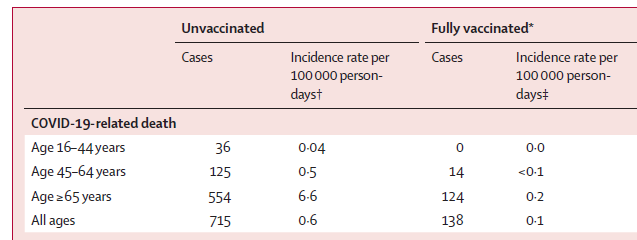

- Risk ratios (AKA relative risk) are relatively common in certain areas, e.g., epidemiology
  - If the baseline probability (i.e., "risk") in the population is well-known---risk ratios can be informative
  - Sometimes used to portray results from randomized control trials (e.g., vaccine efficacy rates are a version of a risk ratio)
- Risk ratios (RRs) are a way to present changes in probabilities in terms of multiplicative---rather than additive effects
- Recall my [caution above](3-4-coefficient-interpretations.qmd#considerations-when-interpreting-odds-ratios-ors) about not being able to interpret an odds ratio (OR) in terms of "doubling the chance" or making something "half as likely to occur"
  - These are risk ratio statements---multiplicative effects in the metric of **probabilities**
  - *"It is well known... that most people misinterpret odds ratios as risk ratios..." ([Norton et al. 2013](https://www.stata-journal.com/article.html?article=st0306))*

## Calculating risk ratios

- Recall the formula for the marginal effect at the mean (MEM):

$$MEM = \eta(x_{k} = end, \mathbf{x} = \overline{\mathbf{x}}) - \eta(x_{k} = start, \mathbf{x} = \overline{\mathbf{x}})$$

  - For the MEM, we are **subtracting** a prediction at an ending value from a prediction at a starting value
- A risk ratio (RR) simply quantifies the effect in terms of a **ratio** of ending/starting values rather than a difference (as the MEM or AME does)\*

$$RR = \frac{\eta(x_{k} = end, \mathbf{x} = \mathbf{x}^{*})}{\eta(x_{k} = start, \mathbf{x} = \mathbf{x}^{*})}$$

- Risk ratios are generally used to interpret group differences (e.g., men compared to women; participants in the treatment condition compared to participants in the control condition; etc.)
  - Below, I represent the grouping variable as g (which equals 0 or 1)

$$RR = \frac{\eta(g = 1, \mathbf{x} = \mathbf{x}^{*})}{\eta(g = 0, \mathbf{x} = \mathbf{x}^{*})}$$

\*Note we have the same options here as with marginal effects for what to do with the covariates in **x\***

### Risk ratio example: cognition among older adults

- Risk ratios most often used in health research (hence "risk" terminology)
- Health and Retirement Study data (older adults) from 2020
  - [DV]{.underline}: Very low, dementia level score on cognitive test (0/1)

::: {.panel-tabset group="language"}
## Stata

```{.stata-run}
. // Health and Retirement Study 2020
. use "https://tdmize.github.io/data/data/cda_hrs", clear
(cda_hrs.dta | Health & Retirement Study 2020)

. 
. drop if missing(cogB, marstatB, collegeB, woman, age, nlivsib)
(774 observations deleted)

. fre cogB marstatB

cogB -- Dementia-range cognition
-----------------------------------------------------------
              |      Freq.    Percent      Valid       Cum.
--------------+--------------------------------------------
Valid   0 no  |      14366      96.10      96.10      96.10
        1 yes |        583       3.90       3.90     100.00
        Total |      14949     100.00     100.00           
-----------------------------------------------------------

marstatB -- Currently married
-----------------------------------------------------------------------------
                                |      Freq.    Percent      Valid       Cum.
--------------------------------+--------------------------------------------
Valid   0 not currently married |       5863      39.22      39.22      39.22
        1 currently married     |       9086      60.78      60.78     100.00
        Total                   |      14949     100.00     100.00           
-----------------------------------------------------------------------------

. rename marstatB married

```

## R

```{r}
library(haven)           # import Stata data and labels
library(dplyr)           # data manipulation
library(sjmisc)          # frequency tables
library(marginaleffects) # predictions and marginal effects

# Health and Retirement Study 2020
hrs <- read_dta("https://tdmize.github.io/data/data/cda_hrs.dta")

hrs <- hrs[complete.cases(hrs[c("cogB", "marstatB", "collegeB", "woman", "age",
  "nlivsib")]), ]
frq(hrs, cogB, marstatB)
hrs <- hrs |> rename(married = marstatB)
```

:::

- [IVs]{.underline}:
  - [Focal]{.underline}: college degree (0/1)
  - [Controls]{.underline}: married, woman, age

::: {.panel-tabset group="language"}
## Stata

```{.stata-run}
. * Predict dementia level poor cognition binary
. logit cogB i.collegeB i.married i.woman c.age, or

Iteration 0:  Log likelihood = -2462.8569  
Iteration 1:  Log likelihood = -2308.2881  
Iteration 2:  Log likelihood = -2279.0977  
Iteration 3:  Log likelihood = -2278.6349  
Iteration 4:  Log likelihood = -2278.6335  
Iteration 5:  Log likelihood = -2278.6335  

Logistic regression                                     Number of obs = 14,949
                                                        LR chi2(4)    = 368.45
                                                        Prob > chi2   = 0.0000
Log likelihood = -2278.6335                             Pseudo R2     = 0.0748

-------------------------------------------------------------------------------
         cogB | Odds ratio   Std. err.      z    P>|z|     [95% conf. interval]
--------------+----------------------------------------------------------------
     collegeB |
bachelor's..  |      0.233      0.037   -9.254   0.000        0.171       0.317
              |
      married |
currently ..  |      0.554      0.051   -6.430   0.000        0.463       0.664
              |
        woman |
       woman  |      0.805      0.073   -2.379   0.017        0.673       0.962
          age |      1.049      0.004   12.079   0.000        1.041       1.057
        _cons |      0.003      0.001  -19.121   0.000        0.001       0.005
-------------------------------------------------------------------------------
Note: _cons estimates baseline odds.

. est store cogmod

```

## R

```{r}
# Treat binary variables as factors using their value labels
hrs <- hrs |>
  mutate(collegeB = as_factor(collegeB), married = as_factor(married),
    woman = as_factor(woman))

# Predict dementia level poor cognition binary
cogmod <- glm(cogB ~ collegeB + married + woman + age,
  family = binomial(link = "logit"), data = hrs)
summary(cogmod)
```

:::

- First, make predictions for each category of the binary/nominal IV

::: {.panel-tabset group="language"}
## Stata

```{.stata-run}
. * Risk ratio, averaging over observed values
. est restore cogmod
(results cogmod are active now)

. margins collegeB, post

Predictive margins                                      Number of obs = 14,949
Model VCE: OIM

Expression: Pr(cogB), predict()

-------------------------------------------------------------------------------
              |            Delta-method
              |     Margin   std. err.      z    P>|z|     [95% conf. interval]
--------------+----------------------------------------------------------------
     collegeB |
no bachelo..  |      0.048      0.002   23.964   0.000        0.044       0.052
bachelor's..  |      0.012      0.002    6.758   0.000        0.008       0.015
-------------------------------------------------------------------------------

```

## R

```{r}
avg_predictions(cogmod, variables = "collegeB", by = "collegeB")
```

:::

> *Older adults without a college degree have a 0.048 probability of having very low dementia-level cognition, compared to only a 0.012 probability for older adults with college degree*

- MEs and RRs are based on same information (two predicted probabilities)
  - One subtracts the two (MEs)
  - One divides them to get the multiplicative effect (RR)

::: {.panel-tabset group="language"}
## Stata

```{.stata-run}
. * Replicate mecompare's AME
. metest 1 - 2

                                 |  estimate         se     pvalue 
---------------------------------+--------------------------------
       0bn_collegeB - 1_collegeB |     0.036      0.003      0.000 

```

## R

```{r}
# no bachelor's - bachelor's or higher
avg_predictions(cogmod, variables = "collegeB", by = "collegeB",
  hypothesis = ~ revpairwise)
```

:::

::: {.callout-note icon="false" appearance="simple"}
This replicates what **mecompare** and **avg_comparisons** calculates
:::

> ***AME**: Older adults without college degrees have a 0.036 higher probability of having very low dementia-level cognition than do older adults with a college degree*

::: {.panel-tabset group="language"}
## Stata

```{.stata-run}
. * Compute risk ratio with metest, which # refers to row of prediction
. metest 1 / 2

                                 |  estimate         se     pvalue 
---------------------------------+--------------------------------
       0bn_collegeB / 1_collegeB |     4.056      0.624      0.000 

```

## R

```{r}
# no bachelor's / bachelor's or higher
avg_predictions(cogmod, variables = "collegeB", by = "collegeB",
  hypothesis = ratio ~ revpairwise)
```

:::

> ***RR**: The risk of having dementia-level cognition is 4.056 times higher for older adults without a college degree*

## Should you use MEs or risk ratios (RRs)?

- This example from [Haas et al. 2021](https://doi.org/10.1016/S0140-6736(21)00947-8) which tracked COVID cases and deaths in Israel after widespread availability of the Pfizer vaccine
  - [DV]{.underline}: COVID-19 related deaths
  - [IV]{.underline}: Vaccinated or not (assume roughly equal \#s in each group for simplicity)
  - [IV]{.underline}: Data is divided into three age strata: 16 - 44, 45 - 64, and 65+

{width=60% fig-alt="COVID-19-related death rows of Table 2 from Haas et al. (2021): COVID-19-related deaths among unvaccinated and fully vaccinated people by age group: 36 versus 0 deaths for ages 16 to 44, 125 versus 14 for ages 45 to 64, 554 versus 124 for ages 65 and older, and 715 versus 138 for all ages."}

\*Table 2 from [Haas et al. 2021](https://doi.org/10.1016/S0140-6736(21)00947-8)

### Vaccine efficacy (RRs)

- What is vaccine efficacy against death?
  - Simplest calculation is what % of deaths were among the unvaccinated

$${efficacy}_{16-44} = 1 - \frac{0}{0 + 36} \approx 100\%$$

$${efficacy}_{45-64} = 1 - \frac{14}{14 + 125} \approx 89.93\%$$

$${efficacy}_{65+} = 1 - \frac{124}{124 + 554} \approx 81.71\%$$

- How effective is the vaccine? If you are young, it reduces your chance of dying from COVID by approximately 100%
  - It is less effective at preventing death for older adults
  - These are **risk ratios**
    - They are useful for determining if a vaccine works and how effective it is among different groups

### Risk difference (ME) for COVID death

- But how many people did the vaccine prevent from dying?
  - Calculate the simple difference in deaths across each group

$${deaths\ prevented}_{16-44} = 36 - 0 = 36$$

$${deaths\ prevented}_{45-64} = 125 - 14 = 111$$

$${deaths\ prevented}_{65+} = 554 - 124 = 430$$

- About 111 people 45 - 64 years old died unnecessarily: their deaths could have been prevented by getting vaccinated
  - This risk difference is a **marginal effect** as it calculates the **difference** in deaths for each age group

### Should you use the marginal effect (ME) or risk ratio (RR)?

- Refer back to the results above
  - The vaccine is more efficacious for younger people
  - Despite being less efficacious for older people, the vaccine prevents far more deaths among older people than among younger people
- **The RR and ME point in opposite directions about the vaccine's effect based on age**
  - Why? Base rates of deaths are much higher for older people
- Given this conflicting evidence, which would you use?
  - If you were in charge of giving out the first vaccines, when they were still limited, who would you prioritize access for?
    - Older or younger adults?
    - Why?
- Do you want to decide if the vaccine works and whether it should be approved?
  - Use the RR
- Do you want to help the most people?
  - E.g., Who should you give the first available doses to?
    - Use the ME: prioritizing older people getting vaccinated will prevent the most deaths *despite the fact the efficacy RR is lower for older people*

## More thoughts on risk ratios

*"For each set of 100,000 people who have one drink a day per year, 918 can expect to experience one of the 23 alcohol-related problems in any year. Of those who drink nothing, 914 can expect to experience a problem. This means that 99,082 are unaffected, and 914 will have an issue no matter what. Only 4 in 100,000 people who consume a drink a day may have a problem caused by the drinking, according to this study." ([Carroll 2018](https://www.nytimes.com/2018/08/28/upshot/alcohol-health-risks-study-worry.html))*

- Recall the [NY Times Upshot](https://www.nytimes.com/2018/08/28/upshot/alcohol-health-risks-study-worry.html) article about the risk of alcohol-related diseases based on \# of drinks consumed
  - A large risk ratio does not necessarily translate into a large number of people affected

:::: {.columns}
::: {.column width="25%"}
{fig-alt="Ina Garten holding a cocktail shaker and a cocktail."}
:::
::: {.column width="25%"}
{fig-alt="Ina Garten drinking from an enormous cocktail glass."}
:::
::::

### More thoughts on RRs vs MEs

- RR effect sizes are harder to understand and often misinterpreted
  - Because negative effects are bounded between 0 and 1, easy to misunderstand effect size
    - E.g., 20 is the same size RR as 0.05 just in the opposite direction
  - There is an upper bound on effect size for common but not rare outcomes
- Sometimes a multiplicate effect may be of theoretical/substantive interest---in this case, I would recommend using an RR instead of relying on the odds ratio (OR)
  - I would only consider RRs for summaries of an effect (e.g., to replace ORs in a regression table)
- I find it odd that many scholars argue for multiplicative effects only with binary DVs
  - We can calculate multiplicative effects in linear models---but this is rarely done
- Here, a linear model using HRS that predicts \# of siblings (which is really a count)

::: {.panel-tabset group="language"}
## Stata

```{.stata-run}
. // Show a risk ratio calculation in linear model
. regress nlivsib i.collegeB i.married i.woman c.age

      Source |       SS           df       MS      Number of obs   =    14,949
-------------+----------------------------------   F(4, 14944)     =    229.64
       Model |  6163.72331         4  1540.93083   Prob > F        =    0.0000
    Residual |  100278.753    14,944  6.71030201   R-squared       =    0.0579
-------------+----------------------------------   Adj R-squared   =    0.0577
       Total |  106442.477    14,948  7.12085072   Root MSE        =    2.5904

-------------------------------------------------------------------------------
      nlivsib | Coefficient  Std. err.      t    P>|t|     [95% conf. interval]
--------------+----------------------------------------------------------------
     collegeB |
bachelor's..  |     -1.030      0.048  -21.400   0.000       -1.125      -0.936
              |
      married |
currently ..  |     -0.088      0.045   -1.944   0.052       -0.177       0.001
              |
        woman |
       woman  |      0.055      0.044    1.231   0.218       -0.032       0.141
          age |     -0.043      0.002  -21.193   0.000       -0.047      -0.039
        _cons |      6.632      0.152   43.665   0.000        6.334       6.930
-------------------------------------------------------------------------------

```

## R

```{r}
# Show a risk ratio calculation in linear model
sibmod <- lm(nlivsib ~ collegeB + married + woman + age, data = hrs)
summary(sibmod)
```

:::

> ***Coefficient / ME**: Older adults with college degrees have about one fewer sibling than do older adults without college degrees*

::: {.panel-tabset group="language"}
## Stata

```{.stata-run}
. * Risk ratio, averaging over observed values
. margins collegeB, post

Predictive margins                                      Number of obs = 14,949
Model VCE: OLS

Expression: Linear prediction, predict()

-------------------------------------------------------------------------------
              |            Delta-method
              |     Margin   std. err.      t    P>|t|     [95% conf. interval]
--------------+----------------------------------------------------------------
     collegeB |
no bachelo..  |      3.693      0.025  148.948   0.000        3.644       3.741
bachelor's..  |      2.662      0.041   64.700   0.000        2.582       2.743
-------------------------------------------------------------------------------

```

## R

```{r}
avg_predictions(sibmod, variables = "collegeB", by = "collegeB")
```

:::

- We can calculate a risk ratio in a linear model just as with a binary model by dividing the predictions

::: {.panel-tabset group="language"}
## Stata

```{.stata-run}
. * Compute risk ratio with metest, which # refers to row of prediction
. metest 2 / 1

                                 |  estimate         se     pvalue 
---------------------------------+--------------------------------
       1_collegeB / 0bn_collegeB |     0.721      0.012      0.000 

```

## R

```{r}
# bachelor's or higher / no bachelor's
avg_predictions(sibmod, variables = "collegeB", by = "collegeB",
  hypothesis = ratio ~ pairwise)
```

:::

:::: {.columns}
::: {.column width="70%"}
> ***Risk ratio**: Older adults with college degrees have about 0.72 times fewer siblings than do older adults without college degrees*
:::
::: {.column width="30%"}
{fig-alt="Cartoon of a confused person surrounded by question marks."}
:::
::::

- In general, I find graphs of predicted probabilities and marginal effects to be more helpful, more easily interpretable, and more satisfying summaries of effects
- Marginal effects summarize effects in an intuitive and additive metric
  - MEs are the most similar method of interpretation to how the coefficients are interpreted in linear regression so the most familiar/easiest for most people to understand
  - Effect size is also easier to understand, as the impact of a multiplicative effect (e.g., OR or RR) is dependent on the starting point / base rate

{width=45% fig-alt="Star Wars meme: NEVER TELL ME THE RATIOS."}
