## Overview

- Assume **xβ** does not have polynomial terms (e.g., only *age* in model; no *age^2^*)
- As *x~k~* increases, either the probability:
  - Always increases with *x~k~* approaching 1.0
  - Always decreases with *x~k~* approaching 0.0
- Substantively:
  - Should it only increase or only decrease?
    - Should it change directions at some point?
  - Should the probability ever reach 1? 0?

## Adding nonlinearities to a nonlinear model

- Consider model where *x* is age with other controls

$$\Pr(y = 1\,|\,\mathbf{x}) = \Lambda(\beta_{0} + \beta_{1}x + \beta_{2}x^{2} + \cdots)$$

- ***x* and *x^2^* are *linked*** since you when *x* changes *x^2^* must change
  - If *x*=1, then *x^2^*=1
  - If *x*=2, then *x^2^*=4
  - If *x*=10, then *x^2^*=100
- With polynomials as IVs, you are not limited to probabilities that uniformly increase or uniformly decrease with *x*
  - You also allow the probability to not go all the way to 1 and/or not go all the way to 0
- As in linear regression, the significance test on the *x^2^* coefficient determines whether adding the squared term explains additional variation (i.e. whether you have statistical evidence to keep it in the model)
  - Determining exactly what effect the squared term has on the predicted probabilities is difficult to determine without graphing the predictions

### Front view of logit with x and x^2^

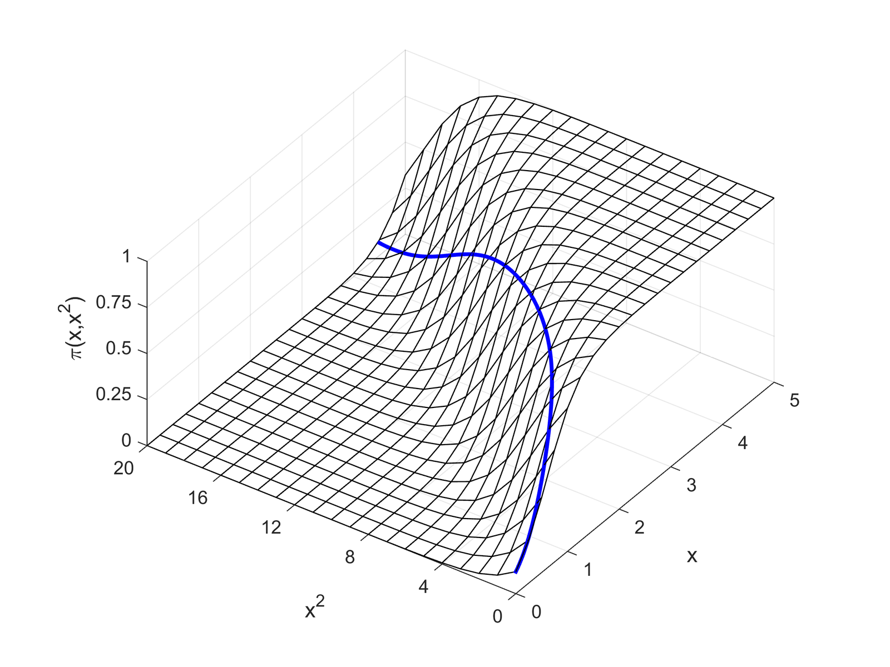{width=60% fig-alt="Three-dimensional surface of the probability over x and x-squared, viewed from the front, with the curve traced by the linked values of x and x-squared."}

### Side view of logit with x and x^2^

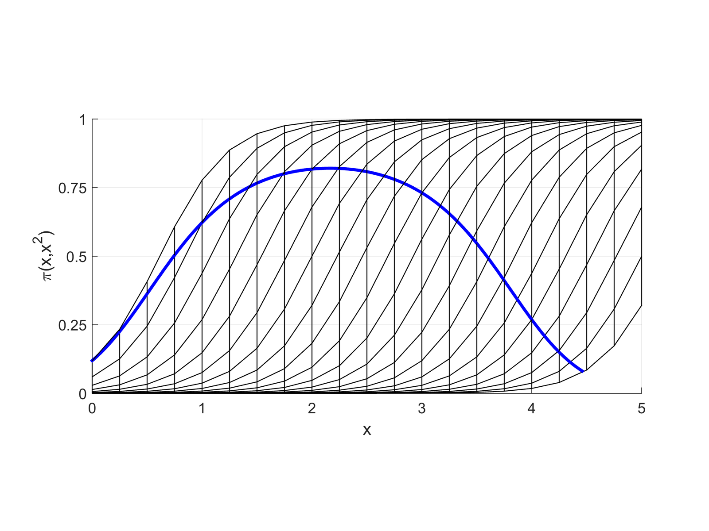{width=60% fig-alt="The same surface viewed from the side: the probability traced by x and x-squared rises and then falls."}

\*Remember that where your data falls on the curve will vary---so you may only see part of this relationship for your specific model in your specific dataset

## Lowess for assessing nonlinearities

- *Lowess plots* show a moving average of *y* as *x* changes
- When a continuous IV is potentially important, a lowess is an essential first step
  - It is very difficult to suss out the correct functional form in logit/probit models without flexible exploratory methods such as lowess
- Examples below from HRS: The Health and Retirement Study 2006
  - We have three different DVs of interest:

| | | |
|:-----|:-----|:-----|
| *arthritis* | 1=arthritis | 0=no arthritis |
| *diabetes* | 1=has diabetes | 0=no diabetes |
| *goodhlth* | 1=good self-rated health | 0=not good |

- Age has a *qualitatively different effect* on each outcome

::: {.panel-tabset group="language"}
## Stata

```{.stata-run}
. // Health & Retirement Study 2006
. use "https://tdmize.github.io/data/data/hrs06", clear
(hrs06_dmv.dta | Health & Retirement Study 2006 | DMV Workshop)

. 
. * Listwise deletion for model vars
. drop if missing(arthritis, diabetes, goodhlth, age, woman, ed4cat, race)
(129 observations deleted)

. drop if race == 0
(0 observations deleted)

. drop if age < 50 // only examining older adults
(401 observations deleted)

. 
. * lowess plots for all three
. lowess arthritis age, gen(lowarth) bwidth(0.7) nograph

. lowess diabetes age, gen(lowdiab) bwidth(0.7) nograph

. lowess goodhlth age, gen(lowgh) bwidth(0.7) nograph

. 
. graph twoway ///
>     (connected lowarth age, sort msym(none)) ///
>     (connected lowdiab age, sort msym(none)) ///
>     (connected lowgh age, sort msym(none)), ///
>     ylab(0(0.2)1) xlab(50(10)105) ytitle("Pr(y = 1)") ///
>     legend(order(1 "Arthritis" 2 "Diabetes" 3 "Good Health")) ///
>     title("Lowess Fit for Various Health Outcomes")

```

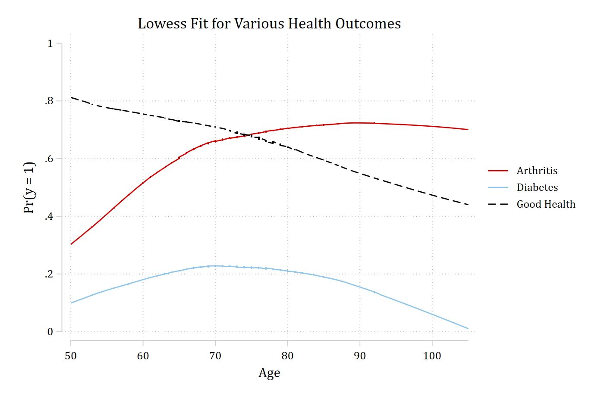{width=80% fig-alt="Lowess curves by age for three health outcomes: arthritis rises from about 0.3 at 50 and levels off near 0.7, diabetes rises to about 0.22 near 70 and then falls, and good health declines steadily from about 0.8."}

## R

```{r}
#| fig-alt: "Lowess curves by age for three health outcomes: arthritis rises from about 0.3 at 50 and levels off near 0.7, diabetes rises to about 0.22 near 70 and then falls, and good health declines steadily from about 0.8."
library(haven)           # import Stata data and labels
library(dplyr)           # data manipulation
library(ggplot2)         # graphs
library(marginaleffects) # predictions and marginal effects
library(cleanplots)      # graph scheme
cleanplots_defaults()

# Health & Retirement Study 2006
hrs <- read_dta("https://tdmize.github.io/data/data/hrs06.dta")

# Listwise deletion for model vars; only examining older adults
hrs <- hrs[complete.cases(hrs[c("arthritis", "diabetes", "goodhlth", "age", "woman",
  "ed4cat", "race")]), ]
hrs <- hrs |>
  filter(race != 0, age >= 50) |>
  mutate(female = as_factor(female), ed4cat = as_factor(ed4cat), race = as_factor(race)) |>
  droplevels()

# lowess for all three
lowarth <- as.data.frame(lowess(hrs$age, hrs$arthritis, f = 0.7, iter = 0))
lowdiab <- as.data.frame(lowess(hrs$age, hrs$diabetes, f = 0.7, iter = 0))
lowgh <- as.data.frame(lowess(hrs$age, hrs$goodhlth, f = 0.7, iter = 0))

lows <- bind_rows(Arthritis = lowarth, Diabetes = lowdiab, "Good Health" = lowgh,
  .id = "outcome")

ggplot(lows, aes(x = x, y = y, color = outcome)) +
  geom_line() +
  scale_y_continuous(breaks = seq(0, 1, 0.2), limits = c(0, 1)) +
  scale_x_continuous(breaks = seq(50, 105, 10)) +
  labs(title = "Lowess Fit for Various Health Outcomes",
    x = "Age", y = "Pr(y = 1)", color = NULL)
```

:::

### How to model these functional forms with logit/probit?

- First, recognize that lowess shows a bivariate relationship---you also want to consider how the relationship will be affected after conditioning on other variables
  - Plot predictions from your full model and compare to lowess
    - Plots below control for gender, education, and race
  - If necessary, explore polynomials or other transformations of your IVs
- Can also consider the "treat a coarsened version of your continuous IV as nominal" approach we discussed at the end of the [02-Nonlinear Linear Regression notes](../02/2-7-categorical-ivs.qmd)
  - This approach has the benefit of allowing control variables

::: {.panel-tabset group="language"}
## Stata

```{.stata-run}
. * Arthritis
. qui logit arthritis c.age i.female i.ed4cat i.race

. qui margins, at(age=(50(1)105))

. marginsplot, noci plotopts(msym(none) lcol(eltblue)) ///
>     addplot(connected lowarth age, sort ylab(0(0.2)1) xlab(50(10)105) ///
>     msym(none) lcol(red*1.2) legend(order(1 "Pred. Prob" 2 "Lowess")) ///
>     title("Arthritis: Comparison of Logit Predictions and Lowess Fit"))

Variables that uniquely identify margins: age

```

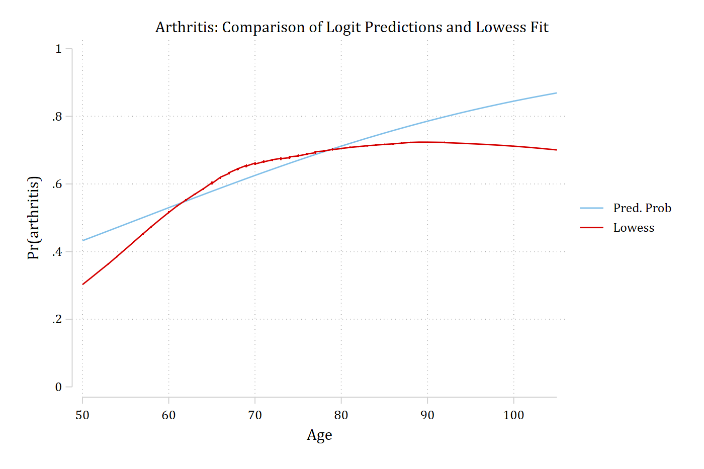{width=80% fig-alt="Arthritis: logit predictions with age only rise steadily, while the lowess rises steeply and then levels off near age 80."}

## R

```{r}
#| fig-alt: "Arthritis: logit predictions with age only rise steadily, while the lowess rises steeply and then levels off near age 80."
# Arthritis
arth1 <- glm(arthritis ~ age + female + ed4cat + race,
  family = binomial(link = "logit"), data = hrs)
arth1_prs <- avg_predictions(arth1, by = "age",
  newdata = datagrid(age = 50:105, grid_type = "counterfactual"))

ggplot() +
  geom_line(data = arth1_prs, aes(x = age, y = estimate, color = "Pred. Prob")) +
  geom_line(data = lowarth, aes(x = x, y = y, color = "Lowess")) +
  scale_color_manual(values = c("Pred. Prob" = "#82C0DF", "Lowess" = "#C80000")) +
  scale_y_continuous(breaks = seq(0, 1, 0.2), limits = c(0, 1)) +
  scale_x_continuous(breaks = seq(50, 105, 10)) +
  labs(title = "Arthritis: Comparison of Logit Predictions and Lowess Fit",
    x = "Age", y = "Pr(Arthritis)", color = NULL)
```

:::

::: {.panel-tabset group="language"}
## Stata

```{.stata-run}
. * Diabetes
. qui logit diabetes c.age i.female i.ed4cat i.race

. qui margins, at(age=(50(1)105))

. marginsplot, noci plotopts(msym(none) lcol(eltblue)) ///
>     addplot(connected lowdiab age, sort ylab(0(0.1)0.5) xlab(50(10)105) ///
>     msym(none) lcol(red*1.2) legend(order(1 "Pred. Prob" 2 "Lowess")) ///
>     title("Diabetes: Comparison of Logit Predictions and Lowess Fit"))

Variables that uniquely identify margins: age

```

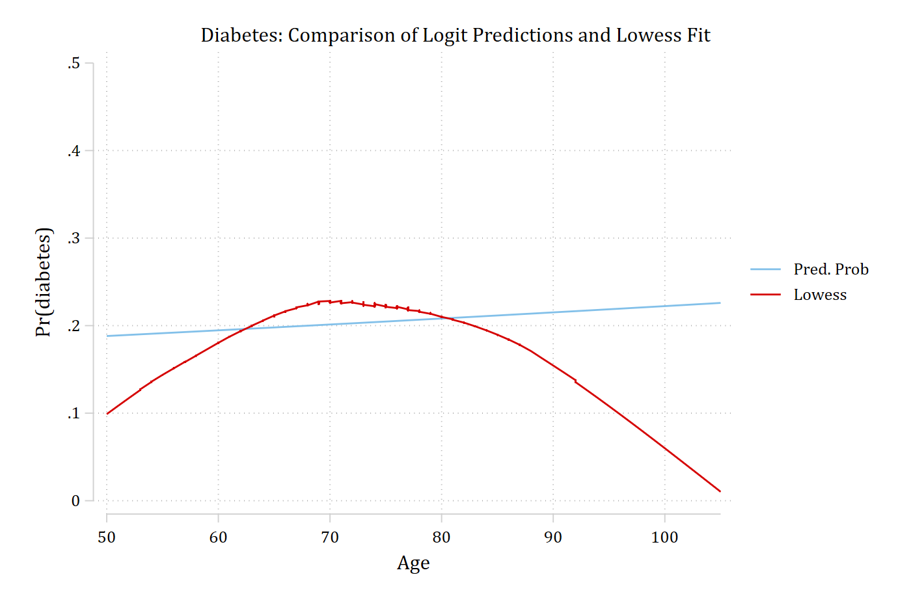{width=80% fig-alt="Diabetes: logit predictions with age only are nearly flat, while the lowess rises to a peak near age 70 and then falls toward 0."}

## R

```{r}
#| fig-alt: "Diabetes: logit predictions with age only are nearly flat, while the lowess rises to a peak near age 70 and then falls toward 0."
# Diabetes
diab1 <- glm(diabetes ~ age + female + ed4cat + race,
  family = binomial(link = "logit"), data = hrs)
diab1_prs <- avg_predictions(diab1, by = "age",
  newdata = datagrid(age = 50:105, grid_type = "counterfactual"))

ggplot() +
  geom_line(data = diab1_prs, aes(x = age, y = estimate, color = "Pred. Prob")) +
  geom_line(data = lowdiab, aes(x = x, y = y, color = "Lowess")) +
  scale_color_manual(values = c("Pred. Prob" = "#82C0DF", "Lowess" = "#C80000")) +
  scale_y_continuous(breaks = seq(0, 0.5, 0.1), limits = c(0, 0.5)) +
  scale_x_continuous(breaks = seq(50, 105, 10)) +
  labs(title = "Diabetes: Comparison of Logit Predictions and Lowess Fit",
    x = "Age", y = "Pr(Diabetes)", color = NULL)
```

:::

::: {.panel-tabset group="language"}
## Stata

```{.stata-run}
. * Good Health (self-rated)
. qui logit goodhlth c.age i.female i.ed4cat i.race

. qui margins, at(age=(50(1)105))

. marginsplot, noci plotopts(msym(none) lcol(eltblue)) ///
>     addplot(connected lowgh age, sort ylab(0(0.2)1) xlab(50(10)105) ///
>     msym(none) lcol(red*1.2) legend(order(1 "Pred. Prob" 2 "Lowess")) ///
>     title("Good Self-Rated Health: Comparison of Logit Predictions and Lowess 
> Fit"))

Variables that uniquely identify margins: age

```

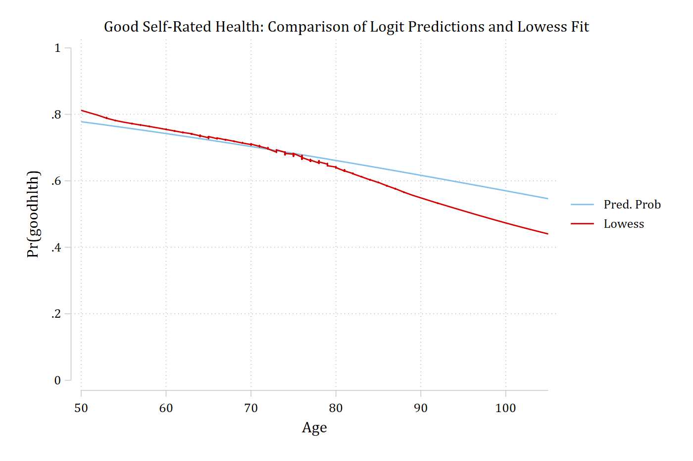{width=80% fig-alt="Good self-rated health: logit predictions with age only decline steadily and follow the lowess closely, which declines a little faster at the oldest ages."}

## R

```{r}
#| fig-alt: "Good self-rated health: logit predictions with age only decline steadily and follow the lowess closely, which declines a little faster at the oldest ages."
# Good Health (self-rated)
gh1 <- glm(goodhlth ~ age + female + ed4cat + race,
  family = binomial(link = "logit"), data = hrs)
gh1_prs <- avg_predictions(gh1, by = "age",
  newdata = datagrid(age = 50:105, grid_type = "counterfactual"))

ggplot() +
  geom_line(data = gh1_prs, aes(x = age, y = estimate, color = "Pred. Prob")) +
  geom_line(data = lowgh, aes(x = x, y = y, color = "Lowess")) +
  scale_color_manual(values = c("Pred. Prob" = "#82C0DF", "Lowess" = "#C80000")) +
  scale_y_continuous(breaks = seq(0, 1, 0.2), limits = c(0, 1)) +
  scale_x_continuous(breaks = seq(50, 105, 10)) +
  labs(title = "Good Self-Rated Health: Comparison of Logit Predictions and Lowess Fit",
    x = "Age", y = "Pr(Goodhlth)", color = NULL)
```

:::

## Logit models for arthritis

- Models shown below are estimated with controls for *gender*, *education*, and *race*
  - Three models are estimated with:
    - *age*
    - *age* *age^2^*
    - *age age^2^* *age^3^*
- Predicted probabilities across observed values of age in the sample are plotted
- Compare predictions to lowess plot

::: {.callout-note icon="false" appearance="simple"}
**mgen** is an SPost command for making predictions that can then be plotted. **marginsplot** is generally easier to work with, but some cases require a more flexible approach like **mgen**
:::

::: {.panel-tabset group="language"}
## Stata

```{.stata-run}
. // Arthritis - Flexible Functional Form of Age //
. qui logit arthritis c.age i.female i.ed4cat i.race

. mgen, at(age=(50(1)105)) stub(age1) replace

Predictions from: margins, at(age=(50(1)105)) predict(pr)

Variable   Obs Unique      Mean       Min       Max  Label
--------------------------------------------------------------------------------
age1pr1     56     56   .676567  .4323203  .8691937  pr(y=arthritis) from mar...
age1ll1     56     56  .6652496  .4161267  .8552951  95% lower limit
age1ul1     56     56  .6878843  .4485139  .8830923  95% upper limit
age1age     56     56      77.5        50       105  Age
--------------------------------------------------------------------------------

. 
. qui logit arthritis c.age##c.age i.female i.ed4cat i.race

. mgen, at(age=(50(1)105)) stub(age2) replace

Predictions from: margins, at(age=(50(1)105)) predict(pr)

Variable   Obs Unique      Mean       Min       Max  Label
--------------------------------------------------------------------------------
age2pr1     56     56  .6057882   .303966  .7191476  pr(y=arthritis) from mar...
age2ll1     56     56  .5850555  .2821458  .7092258  95% lower limit
age2ul1     56     56  .6265208  .3257862  .7295174  95% upper limit
age2age     56     56      77.5        50       105  Age
--------------------------------------------------------------------------------

. 
. qui logit arthritis c.age##c.age##c.age i.female i.ed4cat i.race

. mgen, at(age=(50(1)105)) stub(age3) replace

Predictions from: margins, at(age=(50(1)105)) predict(pr)

Variable   Obs Unique      Mean       Min       Max  Label
--------------------------------------------------------------------------------
age3pr1     56     56  .6154233  .2882557  .7135574  pr(y=arthritis) from mar...
age3ll1     56     56  .5867074  .2585671  .7010445  95% lower limit
age3ul1     56     56  .6441393  .3179443  .7264258  95% upper limit
age3age     56     56      77.5        50       105  Age
--------------------------------------------------------------------------------

. 
. graph twoway ///
>     connected lowarth age, sort msym(none) lcol(red*1.2) || ///
>     connected age1pr age1age, msym(none) lcol(eltblue) || ///
>     connected age2pr age1age, msym(none) lcol(gs8) lpat(longdash) || ///
>     connected age3pr age1age, msym(none) lcol(black) lpat(shortdash) ||, ///
>     ylab(0(0.2)1) xlab(50(10)105) ytitle("Pr(Arthritis)") ///
>     title("Arthritis: Comparison of Predictions for Various Functional Forms o
> f Age") ///
>     legend(order(1 "Lowess" 2 "Age Only" 3 "Quadratic Age" 4 "Cubic Age"))

```

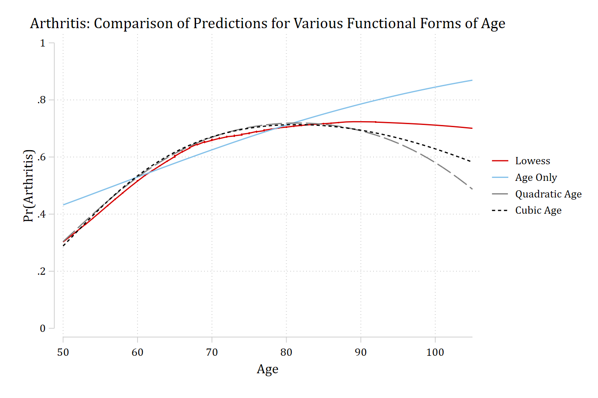{width=80% fig-alt="Arthritis predictions by age from models with age only, quadratic age, and cubic age, with the lowess: the quadratic and cubic models follow the lowess's rise and leveling off, though both fall below it at the oldest ages."}

## R

```{r}
#| fig-alt: "Arthritis predictions by age from models with age only, quadratic age, and cubic age, with the lowess: the quadratic and cubic models follow the lowess's rise and leveling off, though both fall below it at the oldest ages."
# Arthritis - Flexible Functional Form of Age
arth2 <- glm(arthritis ~ poly(age, 2, raw = TRUE) + female + ed4cat + race,
  family = binomial(link = "logit"), data = hrs)
arth3 <- glm(arthritis ~ poly(age, 3, raw = TRUE) + female + ed4cat + race,
  family = binomial(link = "logit"), data = hrs)

arth_prs <- bind_rows(
  "Age Only" = arth1_prs,
  "Quadratic Age" = avg_predictions(arth2, by = "age",
    newdata = datagrid(age = 50:105, grid_type = "counterfactual")),
  "Cubic Age" = avg_predictions(arth3, by = "age",
    newdata = datagrid(age = 50:105, grid_type = "counterfactual")),
  .id = "model")

ggplot() +
  geom_line(data = lowarth, aes(x = x, y = y, color = "Lowess")) +
  geom_line(data = arth_prs, aes(x = age, y = estimate, color = model, linetype = model)) +
  scale_color_discrete(limits = c("Lowess", "Age Only", "Quadratic Age", "Cubic Age")) +
  scale_linetype_manual(values = c("Age Only" = "solid", "Quadratic Age" = "longdash",
    "Cubic Age" = "dashed"), guide = "none") +
  scale_y_continuous(breaks = seq(0, 1, 0.2), limits = c(0, 1)) +
  scale_x_continuous(breaks = seq(50, 105, 10)) +
  labs(title = "Arthritis: Comparison of Predictions for Various Functional Forms of Age",
    x = "Age", y = "Pr(Arthritis)", color = NULL)
```

:::

Should we be worried the cubic isn't perfect at high ages? CIs and rug plots help here

::: {.panel-tabset group="language"}
## Stata

```{.stata-run}
. * Preferred Model with CIs and Rug Plot
. qui logit arthritis c.age##c.age##c.age i.female i.ed4cat i.race

. 
. capture drop pipe where

. gen pipe = "|" if age != . // What rug looks like

. gen age2 = age + runiform()

. gen where = 0.0 // Where on y-axis to put 1st rug

. 
. qui margins, at(age=(50(1)105))

. 
. marginsplot, recastci(rline) ciopts(lpat(dash) col(gs12)) ///
>     plotopts(msym(none) lcol(gs4)) ///
>     addplot(scatter where age2, ///
>         ms(none) mlabel(pipe) mlabcol(gs4) mlabpos(0) || ///
>     connected lowarth age, sort ///
>         ms(none) lcol(red) lpat(solid) ylab(0(0.2)1) xlab(50(10)105) ///
>         legend(order(2 "Logit Age^3" 4 "Lowess"))) ///
>     title("Arthritis: Lowess vs Logit with Age, Age^2, and Age^3")

Variables that uniquely identify margins: age

```

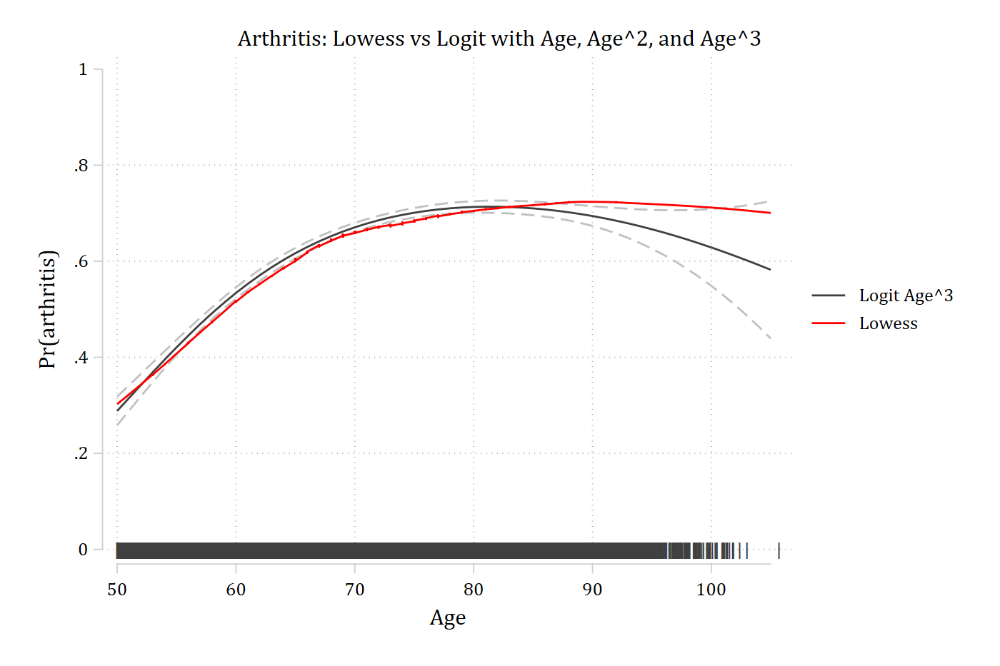{width=80% fig-alt="Arthritis predictions from the cubic age model with confidence intervals, the lowess, and a rug of observed ages: the intervals widen at the oldest ages, where there are few observations."}

## R

```{r}
#| fig-alt: "Arthritis predictions from the cubic age model with confidence intervals, the lowess, and a rug of observed ages: the intervals widen at the oldest ages, where there are few observations."
# Preferred Model with CIs and Rug Plot
arth3_prs <- filter(arth_prs, model == "Cubic Age")

ggplot() +
  geom_line(data = arth3_prs, aes(x = age, y = estimate, color = "Logit Age^3")) +
  geom_line(data = arth3_prs, aes(x = age, y = conf.low), linetype = "dashed", color = "gray70") +
  geom_line(data = arth3_prs, aes(x = age, y = conf.high), linetype = "dashed", color = "gray70") +
  geom_line(data = lowarth, aes(x = x, y = y, color = "Lowess")) +
  geom_rug(data = hrs, aes(x = jitter(age)), sides = "b", alpha = 0.1) +
  scale_color_manual(values = c("Logit Age^3" = "gray30", "Lowess" = "#C80000")) +
  scale_y_continuous(breaks = seq(0, 1, 0.2), limits = c(0, 1)) +
  scale_x_continuous(breaks = seq(50, 105, 10)) +
  labs(title = "Arthritis: Lowess vs Logit with Age, Age^2, and Age^3",
    x = "Age", y = "Pr(Arthritis)", color = NULL)
```

:::

### Interpreting effects with polynomial IVs

- Interpreting the models is no more difficult now than it already was: the model was already nonlinear; now it is just nonlinear with a different functional form

::: {.panel-tabset group="language"}
## Stata

```{.stata-run}
. qui logit arthritis c.age##c.age##c.age i.female i.ed4cat i.race

. mchange age, delta(10)

logit: Changes in Pr(y) | Number of obs = 17007

Expression: Pr(arthritis), predict(pr)

             |    Change    p-value 
-------------+---------------------
age          |                     
          +1 |     0.010      0.000 
      +delta |     0.064      0.000 
    Marginal |     0.011      0.000 

Average predictions

             |        no  arthritis 
-------------+---------------------
  Pr(y|base) |     0.386      0.614 

1: Delta equals 10.

```

## R

```{r}
# +1, +10, and the instantaneous change (slope) in age
avg_comparisons(arth3, variables = list(age = 1))
avg_comparisons(arth3, variables = list(age = 10))
avg_slopes(arth3, variables = "age")
```

:::

> *On average, a 10 year increase in age increases the predicted probability of having arthritis by about 0.06*

- Cautions about the average effect not telling the whole story still apply equally:

::: {.panel-tabset group="language"}
## Stata

```{.stata-run}
. mchange age, at(age=50) delta(10)

logit: Changes in Pr(y) | Number of obs = 17007

Expression: Pr(arthritis), predict(pr)

             |    Change    p-value 
-------------+---------------------
age          |                     
          +1 |     0.027      0.000 
      +delta |     0.246      0.000 
    Marginal |     0.027      0.000 

Average predictions

             |        no  arthritis 
-------------+---------------------
  Pr(y|base) |     0.712      0.288 

Base values of regressors

             |       age 
-------------+----------
          at |        50 

1: Delta equals 10.

. mchange age, at(age=90) delta(10)

logit: Changes in Pr(y) | Number of obs = 17007

Expression: Pr(arthritis), predict(pr)

             |    Change    p-value 
-------------+---------------------
age          |                     
          +1 |    -0.005      0.020 
      +delta |    -0.065      0.058 
    Marginal |    -0.004      0.019 

Average predictions

             |        no  arthritis 
-------------+---------------------
  Pr(y|base) |     0.306      0.694 

Base values of regressors

             |       age 
-------------+----------
          at |        90 

1: Delta equals 10.

```

## R

```{r}
# +10 years, starting from age 50 and from age 90
avg_comparisons(arth3, variables = list(age = c(50, 60)))
avg_comparisons(arth3, variables = list(age = c(90, 100)))
```

:::

> *A 10 year increase in age increases the predicted probability of having arthritis by about 0.25 for someone who is 50 years old; however, the same 10 year increase in age has no effect on the probability of having arthritis for someone who is 90 years old*

## Logit models for diabetes

::: {.panel-tabset group="language"}
## Stata

```{.stata-run}
. // Diabetes - Flexible Functional Form of Age //
. qui logit diabetes c.age i.female i.ed4cat i.race

. mgen, at(age=(50(1)105)) stub(age1) replace

Predictions from: margins, at(age=(50(1)105)) predict(pr)

Variable   Obs Unique      Mean       Min       Max  Label
--------------------------------------------------------------------------------
age1pr1     56     56  .2066418  .1881504  .2259534  pr(y=diabetes) from margins
age1ll1     56     56  .1951985   .175789   .202862  95% lower limit
age1ul1     56     56  .2180852  .2005117  .2490448  95% upper limit
age1age     56     56      77.5        50       105  Age
--------------------------------------------------------------------------------

. 
. qui logit diabetes c.age##c.age i.female i.ed4cat i.race

. mgen, at(age=(50(1)105)) stub(age2) replace

Predictions from: margins, at(age=(50(1)105)) predict(pr)

Variable   Obs Unique      Mean       Min       Max  Label
--------------------------------------------------------------------------------
age2pr1     56     56  .1648949  .0414273  .2349523  pr(y=diabetes) from margins
age2ll1     56     56  .1528349  .0263709  .2261579  95% lower limit
age2ul1     56     56  .1769549  .0564837  .2437467  95% upper limit
age2age     56     56      77.5        50       105  Age
--------------------------------------------------------------------------------

. 
. qui logit diabetes c.age##c.age##c.age i.female i.ed4cat i.race

. mgen, at(age=(50(1)105)) stub(age3) replace

Predictions from: margins, at(age=(50(1)105)) predict(pr)

Variable   Obs Unique      Mean       Min       Max  Label
--------------------------------------------------------------------------------
age3pr1     56     56  .1623058   .026356  .2359179  pr(y=diabetes) from margins
age3ll1     56     56  .1474487  .0036263  .2268765  95% lower limit
age3ul1     56     56  .1771628  .0490858  .2451921  95% upper limit
age3age     56     56      77.5        50       105  Age
--------------------------------------------------------------------------------

. 
. graph twoway ///
>     (connected lowdiab age, sort msym(none) lcol(red*1.2)) ///
>     (connected age1pr age1age, msym(none) lcol(eltblue)) ///
>     (connected age2pr age1age, msym(none) lcol(gs8) lpat(longdash)) ///
>     (connected age3pr age1age, msym(none) lcol(black) lpat(shortdash)), ///
>     ylab(0(0.1).5) xlab(50(10)105) ytitle("Pr(Diabetes)") ///
>     title("Diabetes: Comparison of Predictions for Various Functional Forms of
>  Age") ///
>     legend(order(1 "Lowess" 2 "Age Only" 3 "Quadratic Age" 4 "Cubic Age"))

```

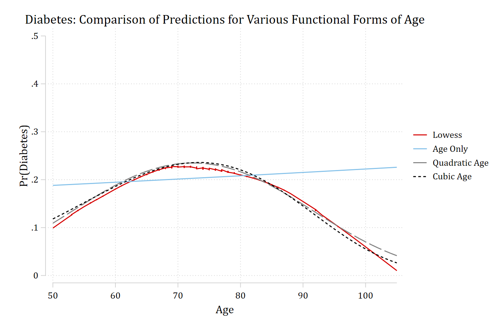{width=80% fig-alt="Diabetes predictions by age from models with age only, quadratic age, and cubic age, with the lowess: the age-only line is nearly flat, while the quadratic and cubic models rise to a peak near age 70 and fall, closely matching the lowess."}

## R

```{r}
#| fig-alt: "Diabetes predictions by age from models with age only, quadratic age, and cubic age, with the lowess: the age-only line is nearly flat, while the quadratic and cubic models rise to a peak near age 70 and fall, closely matching the lowess."
# Diabetes - Flexible Functional Form of Age
diab2 <- glm(diabetes ~ poly(age, 2, raw = TRUE) + female + ed4cat + race,
  family = binomial(link = "logit"), data = hrs)
diab3 <- glm(diabetes ~ poly(age, 3, raw = TRUE) + female + ed4cat + race,
  family = binomial(link = "logit"), data = hrs)

diab_prs <- bind_rows(
  "Age Only" = diab1_prs,
  "Quadratic Age" = avg_predictions(diab2, by = "age",
    newdata = datagrid(age = 50:105, grid_type = "counterfactual")),
  "Cubic Age" = avg_predictions(diab3, by = "age",
    newdata = datagrid(age = 50:105, grid_type = "counterfactual")),
  .id = "model")

ggplot() +
  geom_line(data = lowdiab, aes(x = x, y = y, color = "Lowess")) +
  geom_line(data = diab_prs, aes(x = age, y = estimate, color = model, linetype = model)) +
  scale_color_discrete(limits = c("Lowess", "Age Only", "Quadratic Age", "Cubic Age")) +
  scale_linetype_manual(values = c("Age Only" = "solid", "Quadratic Age" = "longdash",
    "Cubic Age" = "dashed"), guide = "none") +
  scale_y_continuous(breaks = seq(0, 0.5, 0.1), limits = c(0, 0.5)) +
  scale_x_continuous(breaks = seq(50, 105, 10)) +
  labs(title = "Diabetes: Comparison of Predictions for Various Functional Forms of Age",
    x = "Age", y = "Pr(Diabetes)", color = NULL)
```

:::

Would you feel comfortable publishing the model with *age^1^* only?

::: {.panel-tabset group="language"}
## Stata

```{.stata-run}
. * Preferred Model with CIs and Rug Plot
. qui logit diabetes c.age##c.age i.female i.ed4cat i.race

. est store diabmod

. 
. qui margins, at(age=(50(1)105))

. 
. marginsplot, recastci(rline) ciopts(lpat(dash) col(gs12)) ///
>     plotopts(msym(none) lcol(gs4)) ///
>     addplot(scatter where age2, ///
>         ms(none) mlabel(pipe) mlabcol(gs4) mlabpos(0) || ///
>     connected lowdiab age, sort ///
>         ms(none) lcol(red) lpat(solid) ylab(0(0.1).5) xlab(50(10)105) ///
>         legend(order(2 "Logit Age^2" 4 "Lowess"))) ///
>     title("Diabetes: Lowess vs Logit with Age and Age^2")

Variables that uniquely identify margins: age

```

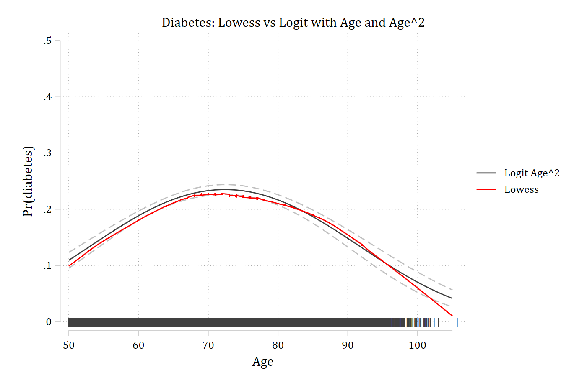{width=80% fig-alt="Diabetes predictions from the quadratic age model with confidence intervals, the lowess, and a rug of observed ages: the quadratic follows the lowess's rise and fall closely."}

## R

```{r}
#| fig-alt: "Diabetes predictions from the quadratic age model with confidence intervals, the lowess, and a rug of observed ages: the quadratic follows the lowess's rise and fall closely."
# Preferred Model with CIs and Rug Plot
diab2_prs <- filter(diab_prs, model == "Quadratic Age")

ggplot() +
  geom_line(data = diab2_prs, aes(x = age, y = estimate, color = "Logit Age^2")) +
  geom_line(data = diab2_prs, aes(x = age, y = conf.low), linetype = "dashed", color = "gray70") +
  geom_line(data = diab2_prs, aes(x = age, y = conf.high), linetype = "dashed", color = "gray70") +
  geom_line(data = lowdiab, aes(x = x, y = y, color = "Lowess")) +
  geom_rug(data = hrs, aes(x = jitter(age)), sides = "b", alpha = 0.1) +
  scale_color_manual(values = c("Logit Age^2" = "gray30", "Lowess" = "#C80000")) +
  scale_y_continuous(breaks = seq(0, 0.5, 0.1), limits = c(0, 0.5)) +
  scale_x_continuous(breaks = seq(50, 105, 10)) +
  labs(title = "Diabetes: Lowess vs Logit with Age and Age^2",
    x = "Age", y = "Pr(Diabetes)", color = NULL)
```

:::

{width=12% fig-alt="Chef's kiss emoji."}

### Interpreting effects with polynomial IVs

- Because of the nature of the effect of age on Pr(diabetes), this is a case where you might not want to report the average at all (i.e. the effect appears positive for some; no effect for some; negative for others)

::: {.panel-tabset group="language"}
## Stata

```{.stata-run}
. qui logit diabetes c.age##c.age i.female i.ed4cat i.race

. mchange age, at(age=50) delta(10) amount(delta)

logit: Changes in Pr(y) | Number of obs = 17007

Expression: Pr(diabetes), predict(pr)

             |    Change    p-value 
-------------+---------------------
age          |                     
      +delta |     0.079      0.000 

Average predictions

             |        no   diabetes 
-------------+---------------------
  Pr(y|base) |     0.891      0.109 

Base values of regressors

             |       age 
-------------+----------
          at |        50 

1: Delta equals 10.

. mchange age, at(age=70) delta(10) amount(delta)

logit: Changes in Pr(y) | Number of obs = 17007

Expression: Pr(diabetes), predict(pr)

             |    Change    p-value 
-------------+---------------------
age          |                     
      +delta |    -0.017      0.000 

Average predictions

             |        no   diabetes 
-------------+---------------------
  Pr(y|base) |     0.767      0.233 

Base values of regressors

             |       age 
-------------+----------
          at |        70 

1: Delta equals 10.

. mchange age, at(age=90) delta(10) amount(delta)

logit: Changes in Pr(y) | Number of obs = 17007

Expression: Pr(diabetes), predict(pr)

             |    Change    p-value 
-------------+---------------------
age          |                     
      +delta |    -0.078      0.000 

Average predictions

             |        no   diabetes 
-------------+---------------------
  Pr(y|base) |     0.852      0.148 

Base values of regressors

             |       age 
-------------+----------
          at |        90 

1: Delta equals 10.

```

## R

```{r}
# +10 years, starting from age 50, 70, and 90
avg_comparisons(diab2, variables = list(age = c(50, 60)))
avg_comparisons(diab2, variables = list(age = c(70, 80)))
avg_comparisons(diab2, variables = list(age = c(90, 100)))
```

:::

### Example write-up of complex nonlinear relationship

> *Age has a highly nonlinear effect on the predicted probability of having diabetes (n.b all models control for gender, race, and education). As shown in Figure #, the probability of having diabetes increases steadily from age 50 to around age 75, but then reverses, with aging associated with a decreasing probability of diabetes at older ages. For example, for a 50 year old, a 10 year increase in age increases the predicted probability of diabetes by about 0.08 (averaging over all observations). In contrast, a 10 year increase in age has a very small effect on the probability of diabetes for someone who is 70 (∆ = -0.02). However, for someone who is 90, the effect of age is again large but now negative---with a 10 year increase in age **decreasing** the probability of diabetes by about 0.08.*

[General Tips]{.underline}

1. Always include a plot for effects that are nonlinear
2. Start by describing the general pattern in nontechnical terms
3. Next, add specific details such as effect sizes based on marginal effects and (optionally) information on statistical significance

## Logit models for good health

::: {.panel-tabset group="language"}
## Stata

```{.stata-run}
. * Preferred Model with CIs and Rug Plot (Age Only)
. qui logit goodhlth c.age i.female i.ed4cat i.race

. qui margins, at(age=(50(1)105))

. 
. marginsplot, recastci(rline) ciopts(lpat(dash) col(gs12)) ///
>     plotopts(msym(none) lcol(gs4)) ///
>     addplot(scatter where age2, ///
>         ms(none) mlabel(pipe) mlabcol(gs4) mlabpos(0) || ///
>     connected lowgh age, sort ///
>         ms(none) lcol(red) lpat(solid) ylab(0(0.1)1) xlab(50(10)105) ///
>         legend(off) ysize(4) xsize(4)) ///
>     title("Good Health: Logit with Age Only", size(large)) ///
>     name(prgh_age, replace)

Variables that uniquely identify margins: age

. 
. * Preferred Model with CIs and Rug Plot (Age and Age^2)
. qui logit goodhlth c.age##c.age i.female i.ed4cat i.race

. qui margins, at(age=(50(1)105))

. 
. marginsplot, recastci(rline) ciopts(lpat(dash) col(gs12)) ///
>     plotopts(msym(none) lcol(gs4)) ///
>     addplot(scatter where age2, ///
>         ms(none) mlabel(pipe) mlabcol(gs4) mlabpos(0) || ///
>     connected lowgh age, sort ///
>         ms(none) lcol(red) lpat(solid) ylab(0(0.1)1) xlab(50(10)105) ///
>         legend(off) ysize(4) xsize(4)) ytitle("") ///
>     title("Good Health: Logit with Age and Age{superscript:2}", size(large)) /
> //
>     name(prgh_age2, replace)

Variables that uniquely identify margins: age

. 
. graph combine prgh_age prgh_age2

```

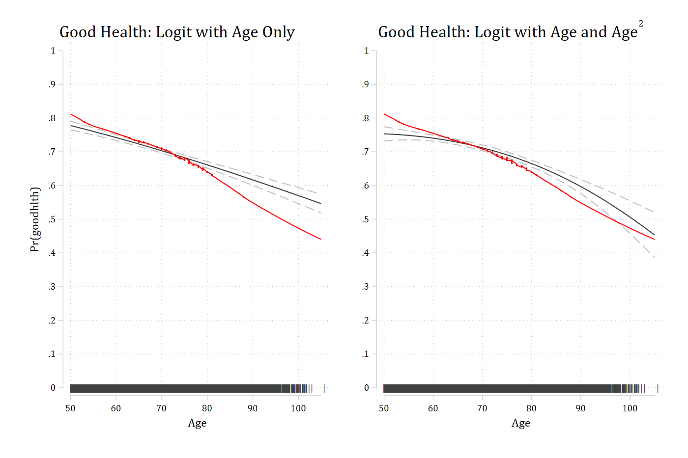{width=80% fig-alt="Two panels of good health predictions with confidence intervals, the lowess, and a rug of ages: the age-only model and the quadratic model both decline with age and look much alike."}

## R

```{r}
#| fig-alt: "Two panels of good health predictions with confidence intervals, the lowess, and a rug of ages: the age-only model and the quadratic model both decline with age and look much alike."
#| fig-width: 9
gh2 <- glm(goodhlth ~ poly(age, 2, raw = TRUE) + female + ed4cat + race,
  family = binomial(link = "logit"), data = hrs)

gh_prs <- bind_rows(
  "Good Health: Logit with Age Only" = gh1_prs,
  "Good Health: Logit with Age and Age^2" = avg_predictions(gh2, by = "age",
    newdata = datagrid(age = 50:105, grid_type = "counterfactual")),
  .id = "model")

ggplot(gh_prs, aes(x = age, y = estimate)) +
  geom_line(color = "gray30") +
  geom_line(aes(y = conf.low), linetype = "dashed", color = "gray70") +
  geom_line(aes(y = conf.high), linetype = "dashed", color = "gray70") +
  geom_line(data = lowgh, aes(x = x, y = y), color = "#C80000") +
  geom_rug(data = hrs, aes(x = jitter(age)), inherit.aes = FALSE, sides = "b", alpha = 0.1) +
  facet_wrap(~ model) +
  scale_y_continuous(breaks = seq(0, 1, 0.1), limits = c(0, 1)) +
  scale_x_continuous(breaks = seq(50, 105, 10)) +
  labs(x = "Age", y = "Pr(Goodhlth)")
```

:::

Which would you choose? Does the added complexity (and extra degree of freedom) buy enough benefit to be worth it?
