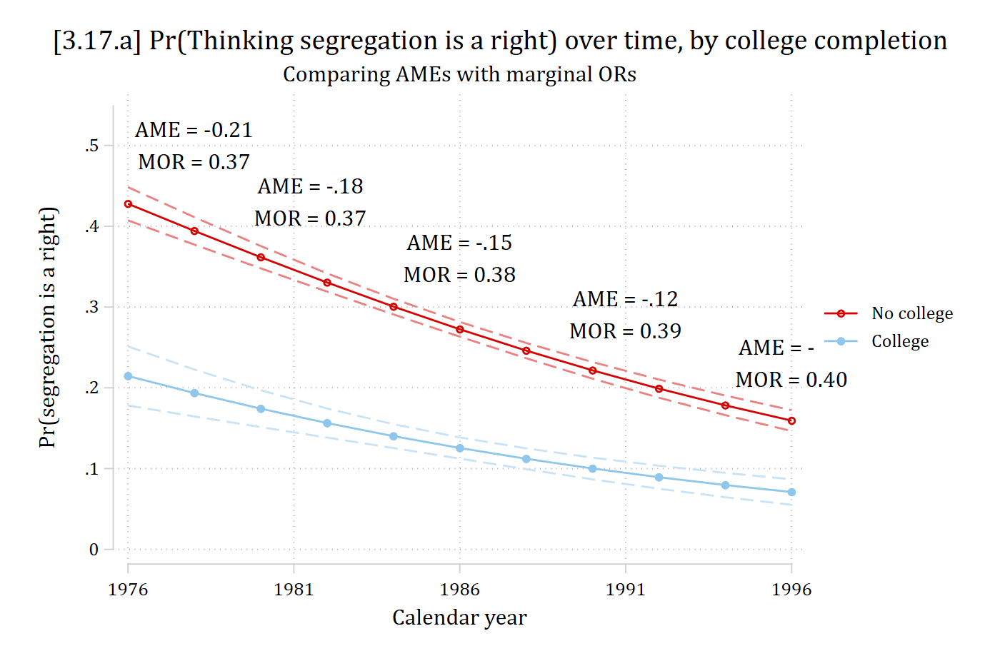

- A new method of interpretation is the marginal odds ratio ([Karlson and Jann 2023](https://sociologicalscience.com/articles-v10-10-332/)). The method:
  - Use the two predictions from an average marginal effect (i.e., predictions averaged over all observation)
  - Convert each prediction to odds
  - Divide the two odds obtain the odds ratio
- A reminder, the AME is:

$$AME = \frac{1}{N}\sum_{i = 1}^{N}\left\{\eta(x_{k} = {end}_{i}, \mathbf{x}_{-k} = \mathbf{x}_{-k,i}) - \eta(x_{k} = {start}_{i}, \mathbf{x}_{-k} = \mathbf{x}_{-k,i})\right\}$$

- A marginal odds ratio (MOR) is:

$$MOR = \frac{odds\left[\frac{1}{N}\sum_{i = 1}^{N}\eta(x_{k} = {end}_{i}, \mathbf{x}_{-k} = \mathbf{x}_{-k,i})\right]}{odds\left[\frac{1}{N}\sum_{i = 1}^{N}\eta(x_{k} = {start}_{i}, \mathbf{x}_{-k} = \mathbf{x}_{-k,i})\right]}$$

The example replicates Karlson and Jann (2023) Table 2 and Figure 1 (GSS); the MORs in the figure are from their Table 2:

::: {.panel-tabset group="language"}
## Stata

```{.stata-run}
. use "https://tdmize.github.io/data/data/MORs-gss", clear

. 
. fre year

year -- GSS YEAR FOR THIS RESPONDENT
-----------------------------------------------------------
              |      Freq.    Percent      Valid       Cum.
--------------+--------------------------------------------
Valid   1976  |        840       6.86       6.86       6.86
        1977  |        906       7.40       7.40      14.27
        1980  |        950       7.76       7.76      22.03
        1982  |       1128       9.22       9.22      31.24
        1984  |        926       7.57       7.57      38.81
        1985  |        999       8.16       8.16      46.97
        1987  |       1157       9.45       9.45      56.43
        1988  |        626       5.11       5.11      61.54
        1989  |        664       5.43       5.43      66.97
        1990  |        610       4.98       4.98      71.95
        1991  |        657       5.37       5.37      77.32
        1993  |        729       5.96       5.96      83.27
        1994  |       1405      11.48      11.48      94.75
        1996  |        642       5.25       5.25     100.00
        Total |      12239     100.00     100.00           
-----------------------------------------------------------

. 
. * Logit model (fully interacted with year)
. logit racseg c.year##(i.col c.age i.race i.marital c.polviews i.female)

Iteration 0:  Log likelihood = -6860.6371  
Iteration 1:  Log likelihood = -6237.4239  
Iteration 2:  Log likelihood = -6200.5001  
Iteration 3:  Log likelihood = -6200.2352  
Iteration 4:  Log likelihood = -6200.2352  

Logistic regression                                    Number of obs =  12,239
                                                       LR chi2(21)   = 1320.80
                                                       Prob > chi2   =  0.0000
Log likelihood = -6200.2352                            Pseudo R2     =  0.0963

-------------------------------------------------------------------------------
       racseg | Coefficient  Std. err.      z    P>|z|     [95% conf. interval]
--------------+----------------------------------------------------------------
         year |     -0.111      0.021   -5.353   0.000       -0.152      -0.071
        1.col |    -12.100     21.661   -0.559   0.576      -54.554      30.354
          age |     -1.430      0.616   -2.322   0.020       -2.637      -0.223
              |
         race |
       black  |    -52.864     38.078   -1.388   0.165     -127.496      21.767
       other  |     -2.587     56.352   -0.046   0.963     -113.034     107.860
              |
      marital |
     widowed  |    -21.443     25.741   -0.833   0.405      -71.895      29.009
    divorced  |     -8.235     23.185   -0.355   0.722      -53.677      37.206
   separated  |    -36.811     42.728   -0.862   0.389     -120.556      46.934
never marr..  |     -7.353     28.690   -0.256   0.798      -63.585      48.879
              |
     polviews |     -0.515      5.754   -0.090   0.929      -11.793      10.762
     1.female |     11.334     15.216    0.745   0.456      -18.488      41.157
              |
   col#c.year |
           1  |      0.006      0.011    0.513   0.608       -0.016       0.027
              |
 c.year#c.age |      0.001      0.000    2.360   0.018        0.000       0.001
              |
  race#c.year |
       black  |      0.026      0.019    1.360   0.174       -0.011       0.064
       other  |      0.001      0.028    0.048   0.962       -0.054       0.057
              |
      marital#|
       c.year |
     widowed  |      0.011      0.013    0.848   0.397       -0.014       0.036
    divorced  |      0.004      0.012    0.358   0.721       -0.019       0.027
   separated  |      0.019      0.022    0.865   0.387       -0.024       0.061
never marr..  |      0.004      0.014    0.260   0.795       -0.025       0.032
              |
       c.year#|
   c.polviews |      0.000      0.003    0.103   0.918       -0.005       0.006
              |
female#c.year |
           1  |     -0.006      0.008   -0.748   0.455       -0.021       0.009
              |
        _cons |    218.501     41.253    5.297   0.000      137.646     299.355
-------------------------------------------------------------------------------

. est store rsmod

. 
. margins, dydx(col) at(year=(1976(5)1996)) post

Average marginal effects                                Number of obs = 12,239
Model VCE: OIM

Expression: Pr(racseg), predict()
dy/dx wrt:  1.col
1._at: year = 1976
2._at: year = 1981
3._at: year = 1986
4._at: year = 1991
5._at: year = 1996

------------------------------------------------------------------------------
             |            Delta-method
             |      dy/dx   std. err.      z    P>|z|     [95% conf. interval]
-------------+----------------------------------------------------------------
0.col        |  (base outcome)
-------------+----------------------------------------------------------------
1.col        |
         _at |
          1  |     -0.213      0.021   -9.970   0.000       -0.255      -0.171
          2  |     -0.181      0.012  -14.893   0.000       -0.205      -0.157
          3  |     -0.147      0.008  -17.910   0.000       -0.163      -0.131
          4  |     -0.115      0.009  -12.904   0.000       -0.133      -0.098
          5  |     -0.088      0.010   -8.547   0.000       -0.109      -0.068
------------------------------------------------------------------------------
Note: dy/dx for factor levels is the discrete change from the base level.

. 
. * Pr() reduction in gap from 76 to 96
. lincom _b[1.col:5._at] - _b[1.col:1bn._at]

 ( 1)  - [1.col]1bn._at + [1.col]5._at = 0

------------------------------------------------------------------------------
             | Coefficient  Std. err.      z    P>|z|     [95% conf. interval]
-------------+----------------------------------------------------------------
         (1) |      0.125      0.028    4.520   0.000        0.071       0.179
------------------------------------------------------------------------------

. * % reduction in gap from 76 to 96
. nlcom ((_b[1.col:5._at] - _b[1.col:1bn._at])/_b[1.col:1bn._at]) * 100

       _nl_1: ((_b[1.col:5._at] - _b[1.col:1bn._at])/_b[1.col:1bn._at]) * 100

------------------------------------------------------------------------------
             | Coefficient  Std. err.      z    P>|z|     [95% conf. interval]
-------------+----------------------------------------------------------------
       _nl_1 |    -58.509      7.673   -7.625   0.000      -73.548     -43.469
------------------------------------------------------------------------------

```

## R

```{r}
library(haven)           # import Stata data and labels
library(dplyr)           # data manipulation
library(ggplot2)         # graphs
library(marginaleffects) # predictions and marginal effects
library(cleanplots)      # graph scheme
cleanplots_defaults()

gss <- read_dta("https://tdmize.github.io/data/data/MORs-gss.dta")

table(gss$year)

# Treat binary/nominal variables as factors
gss <- gss |>
  mutate(year = as.numeric(year), racseg = as.numeric(racseg),
    col = factor(col, labels = c("No college", "College")), race = as_factor(race),
    marital = as_factor(marital), female = factor(female)) |>
  droplevels()

# Logit model (fully interacted with year)
rsmod <- glm(racseg ~ year * (col + age + race + marital + polviews + female),
  family = binomial(link = "logit"), data = gss)
summary(rsmod)

ames <- avg_comparisons(rsmod, variables = "col", by = "year",
  newdata = datagrid(year = seq(1976, 1996, 5), grid_type = "counterfactual"))
ames

# Pr() reduction in gap from 76 to 96
hypotheses(ames, hypothesis = "b5 - b1 = 0")
# % reduction in gap from 76 to 96
hypotheses(ames, hypothesis = "(b5 - b1) / b1 * 100 = 0")
```

:::

::: {.panel-tabset group="language"}
## Stata

```{.stata-run}
. // Figure 1 replication from Karlson & Jann 2023
. est restore rsmod
(results rsmod are active now)

. qui margins col, at(year=(1976(2)1996))

. marginsplot, recastci(rline) ciopt(col(*.5) lpat(dash)) ///
>     xtitle("Calendar year") legend(order(3 "No college" 4 "College")) ///
>     ytitle("Pr(segregation is a right)") ///
>     xlabel(1976(5)1996) ylabel(0(.1).55) ///
>     title("[3.17.a] Pr(Thinking segregation is a right) over time, by college 
> completion", size(medlarge)) ///
>     subtitle("Comparing AMEs with marginal ORs") ///
>     text(.52 1978 "AME = -0.21" .48 1978 "MOR = 0.37" ///
>         .45 1981.5 "AME = -.18" .41 1981.5 "MOR = 0.37" ///
>         .38 1986 "AME = -.15" .34 1986 "MOR = 0.38" ///
>         .31 1991 "AME = -.12" .27 1991 "MOR = 0.39" ///
>         .25 1996 "AME = -.09" .21 1996 "MOR = 0.40")

Variables that uniquely identify margins: year col

```

{width=80% fig-alt="Predicted probability of thinking segregation is a right by year for adults with and without college: both decline from 1976 to 1996 and the gap narrows, with the AME shrinking from -0.21 to -0.09 while the MOR stays near 0.37 to 0.40."}

## R

```{r}
#| fig-alt: "Predicted probability of thinking segregation is a right by year for adults with and without college: both decline from 1976 to 1996 and the gap narrows, with the AME shrinking from -0.21 to -0.09 while the MOR stays near 0.37 to 0.40."
# Figure 1 replication from Karlson & Jann 2023
rs_prs <- avg_predictions(rsmod, by = c("year", "col"),
  newdata = datagrid(year = seq(1976, 1996, 2), col = unique, grid_type = "counterfactual"))

ggplot(rs_prs, aes(x = year, y = estimate, color = col)) +
  geom_line() +
  geom_point() +
  geom_line(aes(y = conf.low), linetype = "dashed", alpha = 0.5) +
  geom_line(aes(y = conf.high), linetype = "dashed", alpha = 0.5) +
  annotate("text", x = c(1978, 1978, 1981.5, 1981.5, 1986, 1986, 1991, 1991, 1996, 1996),
    y = c(.52, .48, .45, .41, .38, .34, .31, .27, .25, .21),
    label = c("AME = -0.21", "MOR = 0.37", "AME = -.18", "MOR = 0.37", "AME = -.15",
      "MOR = 0.38", "AME = -.12", "MOR = 0.39", "AME = -.09", "MOR = 0.40")) +
  scale_x_continuous(breaks = seq(1976, 1996, 5), limits = c(1975, 1998)) +
  scale_y_continuous(breaks = seq(0, .5, .1), limits = c(0, .55)) +
  labs(title = "[3.17.a] Pr(Thinking segregation is a right) over time, by college completion",
    subtitle = "Comparing AMEs with marginal ORs",
    x = "Calendar year", y = "Pr(segregation is a right)", color = NULL)
```

:::

\*AME has declined by 58.5% between 1976 and 1996; MOR has barely changed

\*My replication of Figure 1 from [Karlson and Jann 2023](https://sociologicalscience.com/articles-v10-10-332/)

## Thoughts on the marginal odds ratio

- [Karlson and Jann (2023)](https://sociologicalscience.com/articles-v10-10-332/) make a convincing case that the marginal odds ratio has better statistical properties than the odds ratio you obtain by exponentiating the logit coefficients
  - E.g., Better for comparing effects across models
- While I agree it has nicer properties than a traditional OR---I do not see any reason to prefer it over a ME as a default interpretation strategy
- Sometimes, multiplicative/ratio effects are of interest (see [Risk Ratio section](3-9-risk-ratios.qmd); though I think these cases are rare)
  - However, I can think of no reason to preference a marginal odds ratio interpretation over a risk ratio interpretation in this case
    - Both are multiplicate/ratio effects, but the risk ratio avoids the unnecessary (and confusing) nonlinear transformation into the odds metric
