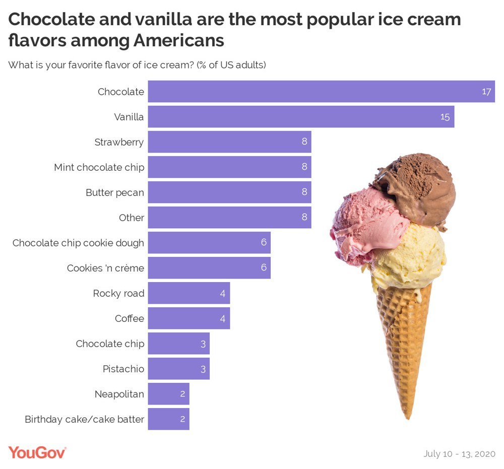
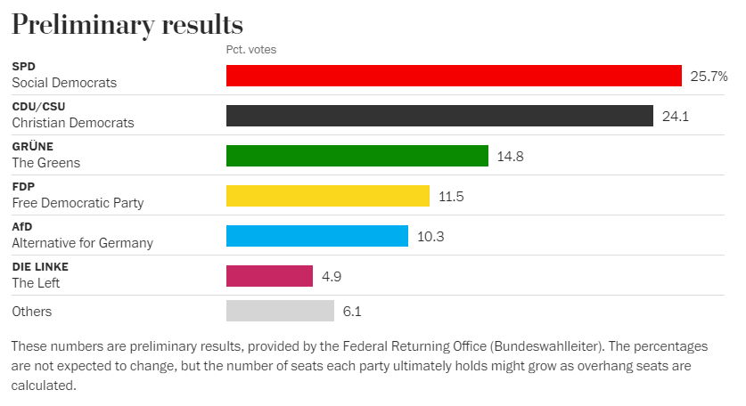
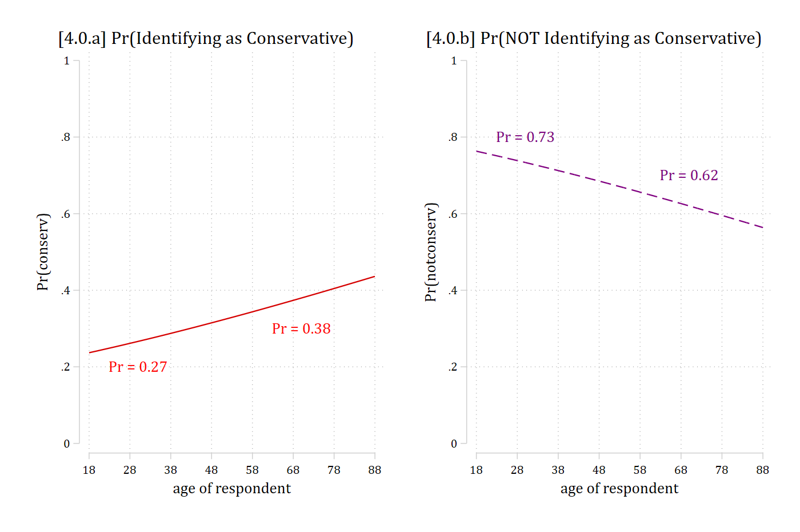
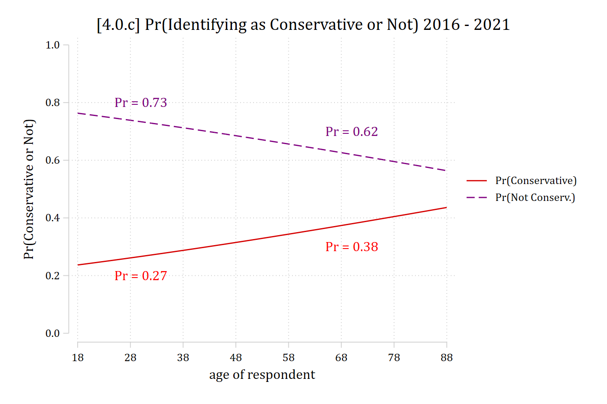

:::: {.columns}
::: {.column width="60%"}
{fig-alt="YouGov bar chart of Americans' favorite ice cream flavors (July 2020): chocolate 17%, vanilla 15%, then strawberry, mint chocolate chip, butter pecan, and other at 8% each, down to birthday cake at 2%."}
:::
::: {.column width="40%"}
{fig-alt="Three furry puppets: two pink ones and an orange-haired green one."}

::: {.callout-note icon="false" appearance="simple"}
[Ma nominal!](https://www.youtube.com/watch?v=8N_tupPBtWQ)
:::
:::
::::

{width=60% fig-alt="German Election 2021."}

{width=75% fig-alt="Preliminary results of the 2021 German election (percent of votes): SPD 25.7, CDU/CSU 24.1, Greens 14.8, FDP 11.5, AfD 10.3, The Left 4.9, others 6.1."}

## Level of measurement

*"measurement...is defined as the assignment of numerals to objects or events according to rules."* ([Stevens 1946](http://science.sciencemag.org/content/103/2684/677))

- [S.S. Stevens (1946)](http://science.sciencemag.org/content/103/2684/677) introduced terms **nominal** and **ordinal**
  - ***Nominal scales*** have numbers assigned to categories as labels with **no ordering implied** by the numbers
  - ***Ordinal scales*** have numbers indicating **rank ordering on *one* attribute**
- Hotly debated and critiqued when it was proposed, his taxonomy is now firmly established
- ***Ordinal models*** assume his definition of ordinal for the DV (and more)
- **Nominal models** do not make assumptions about the relationship among categories of the DV\*

\*But see the discussion of the IIA assumption at end of these notes ([4.6](4-6-iia.qmd))

## The bias-efficiency trade-off

```stata
regress y x1 x2 x3      // true model
regress y x1            // bias
regress y x1 x2 x3 x4   // inefficiency
```

#### Effects of assuming wrong level of measurement

| **Model choice** (assumed level of DV for analysis) | **True level of DV:** Nominal | Ordinal | Continuous\* |
|:------|:------:|:------:|:------:|
| Nominal | **Ideal** | *Inefficient* | *Inefficient* |
| Ordinal | ***Biased*** | **Ideal** | *Inefficient* |
| Continuous | ***Biased*** | ***Biased*** | **Ideal** |

\*I am not distinguishing between interval and ratio variables here

- If outcome is ordinal and model is nominal, it is inefficient, but often safe choice
  - The only way to be sure an ordinal model fits the data is to examine a nominal model for the same DV

## Multinomial logit as an extension of binary logit

- Example: Political views at different ages
  - Data: GSS 2016 -- 2021

**Binary Example #1**:

> [DV]{.underline}: Identify as "conservative = 1" or "not conservative = 0"
>
> [IV]{.underline}: Age
>
> [Controls]{.underline}: Gender, race, education, family income, employment status, marital status, parental status

**Binary Example #2**:

> [DV]{.underline}: Identify as "not conservative = 1" or "conservative = 0"
>
> [IV]{.underline}: Age
>
> [Controls]{.underline}: Gender, race, education, family income, employment status, marital status, parental status

::: {.panel-tabset group="language"}
## Stata

```{.stata-run}
. use "https://tdmize.github.io/data/data/cda_gss", clear
(cda_gss.dta |  GSS 1972-2021 CDA - Categorical Data Analysis | date created 202
> 3)

. 
. keep if year >= 2016 & year <= 2021
(59,599 observations deleted)

. 
. gen notconserv = conserv
(280 missing values generated)

. lab var notconserv "Not Conservative"

. recode notconserv 0=1 1=0
(8,967 changes made to notconserv)

. lab def notlab 0"Conservative" 1"Not Conservative"

. lab val notconserv notlab

. 
. drop if missing(conserv, age, woman, race3, college, married, parent, faminc)
(1,421 observations deleted)

. 
. *4.0.a Conservative = 1
. qui logit conserv c.age i.woman i.race3 i.college ///
>     i.married i.parent c.faminc i.employed

. est store conmod

. qui margins, at(age=(18(2)88)) saving(conmod, replace)

. marginsplot, xlab(18(10)88) ylab(0(0.2)1) noci ///
>     title("[4.0.a] Pr(Identifying as Conservative)", size(medlarge)) ///
>     text(.2 30 "Pr = 0.27" .3 70 "Pr = 0.38", color(red)) ///
>     plotopts(msym(none)) saving(conserv, replace)

Variables that uniquely identify margins: age
(file conserv.gph not found)
file conserv.gph saved

. 
. *4.0.b Not Conservative = 1
. qui logit notconserv c.age i.woman i.race3 i.college ///
>     i.married i.parent c.faminc i.employed

. est store notconmod

. qui margins, at(age=(18(2)88)) saving(notconmod, replace)

. marginsplot, xlab(18(10)88) ylab(0(0.2)1) noci ///
>     title("[4.0.b] Pr(NOT Identifying as Conservative)", size(medlarge)) ///
>     text(.8 30 "Pr = 0.73" .7 70 "Pr = 0.62", color(purple)) ///
>     plotopts(msym(none) lcol(purple) lpat(dash)) saving(notcon, replace)

Variables that uniquely identify margins: age
(file notcon.gph not found)
file notcon.gph saved

. 
. graph combine conserv.gph notcon.gph, scale(1.1)

```

{width=90% fig-alt="Two panels of predicted probabilities by age from 18 to 88: [4.0.a] Pr(conservative) rises from about 0.24 to 0.43 (0.27 at age 30, 0.38 at age 70); [4.0.b] Pr(not conservative) falls from about 0.76 to 0.57 (0.73 at 30, 0.62 at 70)."}

## R

```{r}
#| fig-alt: "Two panels of predicted probabilities by age from 18 to 88: [4.0.a] Pr(conservative) rises from about 0.24 to 0.43 (0.27 at age 30, 0.38 at age 70); [4.0.b] Pr(not conservative) falls from about 0.76 to 0.57 (0.73 at 30, 0.62 at 70)."
#| fig-width: 9.5
library(haven)           # import Stata data and labels
library(dplyr)           # data manipulation
library(ggplot2)         # graphs
library(nnet)            # multinomial logit: multinom()
library(marginaleffects) # predictions and marginal effects
library(cleanplots)      # graph scheme
cleanplots_defaults()

# Center changes in continuous IVs on each observation's value
options(marginaleffects_contrast_direction = "center")

gss <- read_dta("https://tdmize.github.io/data/data/cda_gss.dta")

gss <- gss |> filter(year >= 2016 & year <= 2021)

# Keep model variables; drop any missing data
gss <- gss[c("conserv", "polviews3", "age", "woman", "race3", "college",
  "married", "parent", "faminc", "employed")]
gss <- gss[complete.cases(gss[c("conserv", "age", "woman", "race3", "college",
  "married", "parent", "faminc")]), ]

# Not conservative = 1; treat binary/nominal variables as factors
gss <- gss |>
  mutate(notconserv = 1 - conserv,
    across(c(polviews3, woman, race3, college, married, parent, employed), as_factor)) |>
  droplevels()

# 4.0.a Conservative = 1
conmod <- glm(conserv ~ age + woman + race3 + college + married + parent +
  faminc + employed, data = gss, family = binomial(link = "logit"))

# 4.0.b Not Conservative = 1
notconmod <- glm(notconserv ~ age + woman + race3 + college + married + parent +
  faminc + employed, data = gss, family = binomial(link = "logit"))

# Predictions at ages 18 to 88 from each model
pr_age <- bind_rows(
  "[4.0.a] Pr(Identifying as Conservative)" = avg_predictions(conmod, by = "age",
    newdata = datagrid(age = seq(18, 88, 2), grid_type = "counterfactual")),
  "[4.0.b] Pr(NOT Identifying as Conservative)" = avg_predictions(notconmod, by = "age",
    newdata = datagrid(age = seq(18, 88, 2), grid_type = "counterfactual")),
  .id = "model")

pr_labels <- data.frame(model = rep(unique(pr_age$model), each = 2),
  age = c(30, 70, 30, 70), y = c(.2, .3, .8, .7),
  label = c("Pr = 0.27", "Pr = 0.38", "Pr = 0.73", "Pr = 0.62"))

ggplot(pr_age, aes(x = age, y = estimate, color = model, linetype = model)) +
  geom_line() +
  geom_text(data = pr_labels, aes(y = y, label = label), show.legend = FALSE) +
  facet_wrap(~ model) +
  scale_color_manual(values = c("red", "purple")) +
  scale_linetype_manual(values = c("solid", "dashed")) +
  scale_x_continuous(breaks = seq(18, 88, 10)) +
  scale_y_continuous(breaks = seq(0, 1, .2), limits = c(0, 1)) +
  labs(x = "age of respondent", y = "Pr(y = 1)") +
  theme(legend.position = "none")
```

:::

The models are identical. Choice of how to code DV is arbitrary\*

\*Good practice to code your binary DV in line with direction of your hypotheses

::: {.panel-tabset group="language"}
## Stata

```{.stata-run}
. *4.0.c
. combomarginsplot conmod notconmod, ///
>     labels("Pr(Conservative)" "Pr(Not Conserv.)") noci ///
>     file1opts(msym(none)) ///
>     file2opts(msym(none) lcol(purple) lpat(dash)) ///
>     xlab(18(10)88) ylab(0(0.2)1) ytitle("Pr(Conservative or Not)") ///
>     title("[4.0.c] Pr(Identifying as Conservative or Not) 2016 - 2021", size(m
> edlarge)) ///
>     text(.2 30 "Pr = 0.27" .3 70 "Pr = 0.38", color(red)) ///
>     text(.8 30 "Pr = 0.73" .7 70 "Pr = 0.62", color(purple))

  Variables that uniquely identify margins: age _filenumber

```

{width=80% fig-alt="[4.0.c] Both lines on one graph by age: Pr(conservative) rises from about 0.24 to 0.43 and Pr(not conservative) falls from about 0.76 to 0.57; the two lines mirror each other around 0.5."}

## R

```{r}
#| fig-alt: "[4.0.c] Both lines on one graph by age: Pr(conservative) rises from about 0.24 to 0.43 and Pr(not conservative) falls from about 0.76 to 0.57; the two lines mirror each other around 0.5."
# 4.0.c
pr_age <- pr_age |>
  mutate(outcome = ifelse(model == unique(model)[1], "Pr(Conservative)", "Pr(Not Conserv.)"))

ggplot(pr_age, aes(x = age, y = estimate, color = outcome, linetype = outcome)) +
  geom_line() +
  annotate("text", x = c(30, 70), y = c(.2, .3), label = c("Pr = 0.27", "Pr = 0.38"),
    color = "red") +
  annotate("text", x = c(30, 70), y = c(.8, .7), label = c("Pr = 0.73", "Pr = 0.62"),
    color = "purple") +
  scale_color_manual(values = c("red", "purple")) +
  scale_linetype_manual(values = c("solid", "dashed")) +
  scale_x_continuous(breaks = seq(18, 88, 10)) +
  scale_y_continuous(breaks = seq(0, 1, .2), limits = c(0, 1)) +
  labs(title = "[4.0.c] Pr(Identifying as Conservative or Not) 2016 - 2021",
    x = "age of respondent", y = "Pr(Conservative or Not)", color = NULL, linetype = NULL)
```

:::

We usually only plot Pr(*y* = 1) because Pr(*y* = 0) is redundant information

### Average marginal effects in binary logit

::: {.panel-tabset group="language"}
## Stata

```{.stata-run}
. *Conservative = 1
. mecompare age, amount(sd) model(conmod)

Predicting: Pr(conserv)
Marginal effects (N_conmod=7823)

                                 |  ME #   Estimate         SE      P>|z|
---------------------------------+---------------------------------------
age + SD (centered)              |                                       
                          conmod |     1      0.049      0.006      0.000

. 
. *Not Conservative = 1
. mecompare age, amount(sd) model(notconmod)

Predicting: Pr(notconserv)
Marginal effects (N_notconmod=7823)

                                 |  ME #   Estimate         SE      P>|z|
---------------------------------+---------------------------------------
age + SD (centered)              |                                       
                       notconmod |     1     -0.049      0.006      0.000

```

## R

```{r}
# Conservative = 1
avg_comparisons(conmod, variables = list(age = sd(gss$age)))

# Not Conservative = 1
avg_comparisons(notconmod, variables = list(age = sd(gss$age)))
```

:::

### Binary logit model with new notation

- Usually we think of binary logit as modeling Pr(*y* = 1)
  - An equivalent way to present the model is the Pr(*y* = A) vs Pr(*y* = B)
    - A = 1 and B = 0
- The logit model is *linear in the logit* for outcome A versus B

$$\ln\left[\frac{\Pr(y = A\,|\,\mathbf{x})}{\Pr(y = B\,|\,\mathbf{x})}\right] = \beta_{0,A|B} + \beta_{x_{1},A|B}\,x_{1,i} + \ldots + \beta_{x_{k},A|B}\,x_{k,i}$$

- Exponentiated coefficients represent the multiplicative effect of a one-unit increase in *x~k~* on the odds of outcome A vs B
- We can obtain predicted probabilities of category A and B with:

$$\Pr(y = A\,|\,\mathbf{x}) = \frac{\exp(\mathbf{x}_{i}\boldsymbol{\beta})}{1 + \exp(\mathbf{x}_{i}\boldsymbol{\beta})}$$

$$\Pr(y = B\,|\,\mathbf{x}) = 1 - \Pr(y = A\,|\,\mathbf{x})$$

### Multinomial logit as an extension of binary logit

- Multinomial logit is no more complicated than binary logit
  - The recommended methods of interpretation are the same:
    - Marginal effects (especially AMEs)
    - Plots of predicted probabilities
  - The limitations/problems with coefficients and odds ratios from binary logit apply equally to multinomial logit
- Multinomial logit requires examining more effects at once
  - For binary logit, we have two categories of the DV but we usually only report Pr(*y* = 1) to avoid redundancy
  - For multinomial logit, you have as many predicted probabilities and MEs as you have DV categories. E.g., Pr(*y* = A), Pr(*y* = B), Pr(*y* = C)
    - E.g., If there are five outcome categories, there are five MEs for each independent variable
- Summarizing---and simplifying for your readers---the overall patterns of effects is key to effectively interpret and present multinomial logit models
  - This can be cumbersome and difficult to do well as there can be lots of effects to consider for a single model

### Example: Political views and age --- 3 category DV

- Data: GSS 2016 -- 2021

**Multinomial Example** -- Identical to above except for three DV categories:

> [DV]{.underline}: Identify as: "liberal = 1"; "moderate = 2"; "conservative = 3"
>
> [IV]{.underline}: Age
>
> [Controls]{.underline}: Gender, race, education, family income, employment status, marital status, parental status

{width=80% fig-alt="[4.2.a] Predicted probabilities of each political ideology by age with confidence intervals: Pr(liberal) falls from about 0.35 to 0.27, Pr(moderate) falls from about 0.41 to 0.29, and Pr(conservative) rises from about 0.24 to 0.44; the conservative line crosses the others in the late 40s to 50s."}

It is now necessary to examine Pr(*y* = 1), Pr(*y* = 2), **and** Pr(*y* = 3) (the code for this graph is in [4.2](4-2-predicted-probabilities.qmd#plots-of-predicted-probabilities))

### Average marginal effects in multinomial logit

::: {.panel-tabset group="language"}
## Stata

```{.stata-run}
. qui mlogit polviews3 c.age i.woman i.race3 i.college ///
>     i.married i.parent c.faminc i.employed

. est store pol3mod

. 
. mecompare age, amount(sd) model(pol3mod)

Predicting: Pr(polviews3)
Marginal effects (N_pol3mod=7823)

                                 |  ME #   Estimate         SE      P>|z|
---------------------------------+---------------------------------------
age + SD (centered)              |                                       
               Liberal - pol3mod |     1     -0.020      0.006      0.001
              Moderate - pol3mod |     2     -0.029      0.006      0.000
          Conservative - pol3mod |     3      0.049      0.006      0.000

```

## R

```{r}
pol3mod <- multinom(polviews3 ~ age + woman + race3 + college + married + parent +
  faminc + employed, data = gss, trace = FALSE)

avg_comparisons(pol3mod, variables = list(age = sd(gss$age)))
```

:::

- Because there are three outcome categories, there are three predicted probability curves for age (see plot above) and three AMEs for age (see above)
  - Do these AMEs correspond to your intuition from the graph?
- But before we get to interpretation, some background
