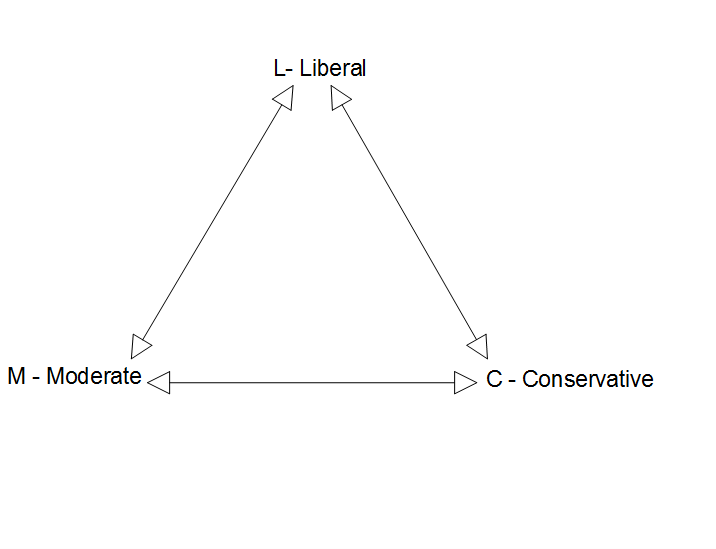

- The multinomial logit model *simultaneously estimates binary logit models* for all comparisons among outcome categories (e.g., A vs B, A vs C, B vs C)
- Model estimation is complicated by large number of parameters
  - With 5 outcomes, there are 10 binary logits
  - With 10 outcomes, there are 45 binary logits
    - This leads to **a lot** of coefficient estimates
- In terms of coefficients, there are **many** contrasts that could be tested and interpreted
  - However, coefficients are limited in ways discussed in the binary model, and in more ways in the nominal model
- In terms of marginal effects, there are only as many marginal effects (MEs) as there are categories of your DV
  - With 5 outcomes, there are 5 MEs for each IV
  - With 10 outcomes, there are 10 MEs for each IV

## Multinomial logit with three outcomes

Categories L, M, and C with *n~L~*, *n~M~*, and *n~C~* observations in each category

{width=60% fig-alt="Triangle diagram with L - Liberal at the top and M - Moderate and C - Conservative at the bottom corners; a two-headed arrow connects each pair of outcomes."}

::: {.panel-tabset group="language"}
## Stata

```{.stata-run}
. use "https://tdmize.github.io/data/data/cda_gss", clear
(cda_gss.dta |  GSS 1972-2021 CDA - Categorical Data Analysis | date created 202
> 3)

. 
. keep if year >= 2016 & year <= 2021
(59,599 observations deleted)

. 
. drop if missing(conserv, age, woman, race3, college, married, parent, faminc)
(1,421 observations deleted)

. 
. fre polviews3

polviews3 -- Political View Categories
--------------------------------------------------------------------
                       |      Freq.    Percent      Valid       Cum.
-----------------------+--------------------------------------------
Valid   1 Liberal      |       2492      31.84      31.84      31.84
        2 Moderate     |       2791      35.66      35.66      67.51
        3 Conservative |       2543      32.49      32.49     100.00
        Total          |       7826     100.00     100.00           
--------------------------------------------------------------------

```

## R

```{r}
library(haven)           # import Stata data and labels
library(dplyr)           # data manipulation
library(sjmisc)          # frq() frequency tables
library(nnet)            # multinomial logit: multinom()
library(marginaleffects) # hypothesis tests
library(car)             # Anova()

gss <- read_dta("https://tdmize.github.io/data/data/cda_gss.dta")

gss <- gss |> filter(year >= 2016 & year <= 2021)

# Keep model variables; drop any missing data
gss <- gss[c("polviews3", "age", "woman", "race3", "college", "married", "parent",
  "faminc", "employed", "conserv")]
gss <- gss[complete.cases(gss[c("conserv", "age", "woman", "race3", "college",
  "married", "parent", "faminc")]), ]

frq(gss$polviews3)

# Treat binary/nominal variables as factors
gss <- gss |>
  mutate(across(c(polviews3, woman, race3, college, married, parent, employed), as_factor)) |>
  droplevels()
```

:::

### Multinomial logit is a set of binary logits that are simultaneously estimated

- [***L vs M***]{.underline} using *n~L~* + *n~M~* observations

  $$\ln\left[\frac{\Pr(L\,|\,\mathbf{x}_{i})}{\Pr(M\,|\,\mathbf{x}_{i})}\right] = \beta_{0,L|M} + \boldsymbol{\beta}_{X,L|M}\,\mathbf{x}_{i}$$

  - Where **x**~*i*~ includes all focal IVs and control variables in the model

- [***M vs C***]{.underline} using *n~M~* + *n~C~* observations

$$\ln\left[\frac{\Pr(M\,|\,\mathbf{x}_{i})}{\Pr(C\,|\,\mathbf{x}_{i})}\right] = \beta_{0,M|C} + \boldsymbol{\beta}_{X,M|C}\,\mathbf{x}_{i}$$

- [***L vs C***]{.underline} using *n~L~* + *n~C~* observations

$$\ln\left[\frac{\Pr(L\,|\,\mathbf{x}_{i})}{\Pr(C\,|\,\mathbf{x}_{i})}\right] = \beta_{0,L|C} + \boldsymbol{\beta}_{X,L|C}\,\mathbf{x}_{i}$$

### Minimal sets of coefficient estimates

- Because of mathematical links among odds, some coefficients are "extra"
  - $\beta_{L|M} = \beta_{L|C} + \beta_{C|M}$
  - From any two of L/M, L/C, and C/M, you can compute the third
- With *J* outcome categories you only need *J* - 1 comparisons/sets of coefficients
- Each set of *J* - 1 comparisons is a ***minimal set***
  - Different software computes different minimal sets

::: {.panel-tabset group="language"}
## Stata

- In Stata, use the [**mlogit**](https://www.stata.com/manuals/rmlogit.pdf) command
  - Default base/reference outcome category is one with most observations
  - Change base/reference category with **base(#)** option

```stata
mlogit …, base(3)
```

## R

- In R, use the [**multinom**](https://www.rdocumentation.org/packages/nnet/versions/7.3-20/topics/multinom) function in the **nnet** package
  - Default base/reference outcome category is first one
  - To change base/reference category, need to change the reference level in the variable itself before fitting model using [**relevel**](https://www.rdocumentation.org/packages/stats/versions/3.6.2/topics/relevel)

```r
gss$polviews3 <- relevel(gss$polviews3, ref = "Moderate")

multinom(polviews3 ~ age + woman + race3 …, data = gss)
```

:::

### mlogit estimates a minimal set of coefficients

::: {.panel-tabset group="language"}
## Stata

```{.stata-run}
. mlogit polviews3 c.age i.woman i.race3 i.college ///
>     i.married i.parent c.faminc i.employed

Iteration 0:  Log likelihood = -8584.7295  
Iteration 1:  Log likelihood = -8197.0737  
Iteration 2:  Log likelihood = -8195.2338  
Iteration 3:  Log likelihood = -8195.2335  

Multinomial logistic regression                         Number of obs =  7,823
                                                        LR chi2(18)   = 778.99
                                                        Prob > chi2   = 0.0000
Log likelihood = -8195.2335                             Pseudo R2     = 0.0454

-------------------------------------------------------------------------------
    polviews3 | Coefficient  Std. err.      z    P>|z|     [95% conf. interval]
--------------+----------------------------------------------------------------
Liberal       |
          age |      0.001      0.002    0.518   0.604       -0.003       0.005
              |
        woman |
       Women  |     -0.004      0.058   -0.065   0.948       -0.118       0.110
              |
        race3 |
       black  |      0.014      0.080    0.175   0.861       -0.143       0.171
       other  |      0.003      0.095    0.029   0.977       -0.183       0.189
              |
      college |
College De..  |      0.902      0.064   14.071   0.000        0.776       1.028
              |
      married |
     Married  |     -0.084      0.065   -1.298   0.194       -0.211       0.043
              |
       parent |
      Parent  |     -0.519      0.069   -7.476   0.000       -0.655      -0.383
       faminc |      0.004      0.001    3.746   0.000        0.002       0.005
              |
     employed |
         Yes  |     -0.063      0.064   -0.995   0.320       -0.188       0.061
        _cons |     -0.219      0.121   -1.816   0.069       -0.456       0.017
--------------+----------------------------------------------------------------
Moderate      |  (base outcome)
--------------+----------------------------------------------------------------
Conservative  |
          age |      0.014      0.002    7.329   0.000        0.010       0.018
              |
        woman |
       Women  |     -0.272      0.057   -4.770   0.000       -0.384      -0.160
              |
        race3 |
       black  |     -0.596      0.087   -6.822   0.000       -0.767      -0.424
       other  |     -0.405      0.101   -4.011   0.000       -0.603      -0.207
              |
      college |
College De..  |      0.171      0.066    2.602   0.009        0.042       0.299
              |
      married |
     Married  |      0.275      0.062    4.410   0.000        0.153       0.397
              |
       parent |
      Parent  |      0.105      0.073    1.433   0.152       -0.039       0.249
       faminc |      0.001      0.001    1.505   0.132       -0.000       0.003
              |
     employed |
         Yes  |      0.119      0.064    1.867   0.062       -0.006       0.243
        _cons |     -0.935      0.127   -7.365   0.000       -1.184      -0.686
-------------------------------------------------------------------------------

. est store pol3mod

```

## R

```{r}
# Moderate as the base/reference category (Stata's default here)
gss$polviews3 <- relevel(gss$polviews3, ref = "Moderate")

pol3mod <- multinom(polviews3 ~ age + woman + race3 + college + married + parent +
  faminc + employed, data = gss, trace = FALSE)
summary(pol3mod)
```

:::

### Minimal sets vs all possible contrasts

- Do not judge statistical significance using tests from a minimal set (which is what Stata and R produce by default)
- Calculating all coefficients for all contrasts yourself is cumbersome. The **spost13** command **listcoef** in Stata will do this for you\*
  - Wrapping your head around this many coefficients/contrasts is difficult:

::: {.panel-tabset group="language"}
## Stata

```{.stata-run}
. listcoef, help

mlogit (N=7823): Factor change in the odds of polviews3 

Variable: age (sd=17.361)
------------------------------------------------------------------------------
                             |         b        z    P>|z|       e^b   e^bStdX
-----------------------------+------------------------------------------------
Liberal      vs Moderate     |    0.0010    0.518    0.604     1.001     1.017
Liberal      vs Conservative |   -0.0130   -6.489    0.000     0.987     0.799
Moderate     vs Liberal      |   -0.0010   -0.518    0.604     0.999     0.983
Moderate     vs Conservative |   -0.0139   -7.329    0.000     0.986     0.785
Conservative vs Liberal      |    0.0130    6.489    0.000     1.013     1.252
Conservative vs Moderate     |    0.0139    7.329    0.000     1.014     1.274
------------------------------------------------------------------------------

Variable: 1.woman (sd=0.498)
------------------------------------------------------------------------------
                             |         b        z    P>|z|       e^b   e^bStdX
-----------------------------+------------------------------------------------
Liberal      vs Moderate     |   -0.0038   -0.065    0.948     0.996     0.998
Liberal      vs Conservative |    0.2684    4.515    0.000     1.308     1.143
Moderate     vs Liberal      |    0.0038    0.065    0.948     1.004     1.002
Moderate     vs Conservative |    0.2722    4.770    0.000     1.313     1.145
Conservative vs Liberal      |   -0.2684   -4.515    0.000     0.765     0.875
Conservative vs Moderate     |   -0.2722   -4.770    0.000     0.762     0.873
------------------------------------------------------------------------------

Variable: 2.race3 (sd=0.349)
------------------------------------------------------------------------------
                             |         b        z    P>|z|       e^b   e^bStdX
-----------------------------+------------------------------------------------
Liberal      vs Moderate     |    0.0140    0.175    0.861     1.014     1.005
Liberal      vs Conservative |    0.6096    6.581    0.000     1.840     1.237
Moderate     vs Liberal      |   -0.0140   -0.175    0.861     0.986     0.995
Moderate     vs Conservative |    0.5955    6.822    0.000     1.814     1.231
Conservative vs Liberal      |   -0.6096   -6.581    0.000     0.544     0.808
Conservative vs Moderate     |   -0.5955   -6.822    0.000     0.551     0.812
------------------------------------------------------------------------------

Variable: 3.race3 (sd=0.292)
------------------------------------------------------------------------------
                             |         b        z    P>|z|       e^b   e^bStdX
-----------------------------+------------------------------------------------
Liberal      vs Moderate     |    0.0028    0.029    0.977     1.003     1.001
Liberal      vs Conservative |    0.4079    3.872    0.000     1.504     1.126
Moderate     vs Liberal      |   -0.0028   -0.029    0.977     0.997     0.999
Moderate     vs Conservative |    0.4051    4.011    0.000     1.500     1.125
Conservative vs Liberal      |   -0.4079   -3.872    0.000     0.665     0.888
Conservative vs Moderate     |   -0.4051   -4.011    0.000     0.667     0.889
------------------------------------------------------------------------------

Variable: 1.college (sd=0.485)
------------------------------------------------------------------------------
                             |         b        z    P>|z|       e^b   e^bStdX
-----------------------------+------------------------------------------------
Liberal      vs Moderate     |    0.9020   14.071    0.000     2.465     1.549
Liberal      vs Conservative |    0.7312   11.234    0.000     2.078     1.426
Moderate     vs Liberal      |   -0.9020  -14.071    0.000     0.406     0.645
Moderate     vs Conservative |   -0.1708   -2.602    0.009     0.843     0.920
Conservative vs Liberal      |   -0.7312  -11.234    0.000     0.481     0.701
Conservative vs Moderate     |    0.1708    2.602    0.009     1.186     1.086
------------------------------------------------------------------------------

Variable: 1.married (sd=0.498)
------------------------------------------------------------------------------
                             |         b        z    P>|z|       e^b   e^bStdX
-----------------------------+------------------------------------------------
Liberal      vs Moderate     |   -0.0840   -1.298    0.194     0.919     0.959
Liberal      vs Conservative |   -0.3589   -5.454    0.000     0.698     0.836
Moderate     vs Liberal      |    0.0840    1.298    0.194     1.088     1.043
Moderate     vs Conservative |   -0.2749   -4.410    0.000     0.760     0.872
Conservative vs Liberal      |    0.3589    5.454    0.000     1.432     1.196
Conservative vs Moderate     |    0.2749    4.410    0.000     1.316     1.147
------------------------------------------------------------------------------

Variable: 1.parent (sd=0.450)
------------------------------------------------------------------------------
                             |         b        z    P>|z|       e^b   e^bStdX
-----------------------------+------------------------------------------------
Liberal      vs Moderate     |   -0.5187   -7.476    0.000     0.595     0.792
Liberal      vs Conservative |   -0.6239   -8.543    0.000     0.536     0.755
Moderate     vs Liberal      |    0.5187    7.476    0.000     1.680     1.263
Moderate     vs Conservative |   -0.1053   -1.433    0.152     0.900     0.954
Conservative vs Liberal      |    0.6239    8.543    0.000     1.866     1.324
Conservative vs Moderate     |    0.1053    1.433    0.152     1.111     1.048
------------------------------------------------------------------------------

Variable: faminc (sd=35.539)
------------------------------------------------------------------------------
                             |         b        z    P>|z|       e^b   e^bStdX
-----------------------------+------------------------------------------------
Liberal      vs Moderate     |    0.0035    3.746    0.000     1.004     1.134
Liberal      vs Conservative |    0.0021    2.275    0.023     1.002     1.077
Moderate     vs Liberal      |   -0.0035   -3.746    0.000     0.996     0.882
Moderate     vs Conservative |   -0.0015   -1.505    0.132     0.999     0.950
Conservative vs Liberal      |   -0.0021   -2.275    0.023     0.998     0.929
Conservative vs Moderate     |    0.0015    1.505    0.132     1.001     1.053
------------------------------------------------------------------------------

Variable: 1.employed (sd=0.493)
------------------------------------------------------------------------------
                             |         b        z    P>|z|       e^b   e^bStdX
-----------------------------+------------------------------------------------
Liberal      vs Moderate     |   -0.0633   -0.995    0.320     0.939     0.969
Liberal      vs Conservative |   -0.1820   -2.730    0.006     0.834     0.914
Moderate     vs Liberal      |    0.0633    0.995    0.320     1.065     1.032
Moderate     vs Conservative |   -0.1187   -1.867    0.062     0.888     0.943
Conservative vs Liberal      |    0.1820    2.730    0.006     1.200     1.094
Conservative vs Moderate     |    0.1187    1.867    0.062     1.126     1.060
------------------------------------------------------------------------------
       b = raw coefficient
       z = z-score for test of b=0
   P>|z| = p-value for z-test
     e^b = exp(b) = factor change in odds for unit increase in X
 e^bStdX = exp(b*SD of X) = change in odds for SD increase in X

```

## R

```{r}
# All contrasts among the outcomes: refit the model with each outcome
# category as the base/reference category
all_contrasts <- function(model, term) {
  data <- eval(model$call$data)
  y <- all.vars(formula(model))[1]
  out <- lapply(model$lev, function(ref) {
    data[[y]] <- relevel(data[[y]], ref = ref)
    s <- summary(update(model, data = data))
    b <- s$coefficients[, term]
    z <- b / s$standard.errors[, term]
    data.frame(contrast = paste(rownames(s$coefficients), "vs", ref),
      b = round(b, 4), z = round(z, 3), p = round(2 * pnorm(-abs(z)), 3),
      exp_b = round(exp(b), 3), row.names = NULL)
  })
  do.call(rbind, out)
}

all_contrasts(pol3mod, "age")
all_contrasts(pol3mod, "womanWomen")
all_contrasts(pol3mod, "race3black")
```

:::

\*I don't know of an easy way to automate this in R

- You don't want to interpret all of these possible contrasts in order to determine whether your independent variable of interest has an overall effect or not

## Testing that a variable has no overall effect

- The hypothesis that *x~k~* has no effect involves a joint test of all *J* - 1 coefficients for a given IV. E.g., Consider the null hypothesis that *age* has no overall effect on political views; with 3 outcome categories this is a joint test of 2 age coefficients:

$$H_{0}: \beta_{age,L|M} = \beta_{age,C|M} = 0$$

- We can use either Wald or likelihood-ratio tests (details on these in the Testing & Fit section of the class). Consider the Wald test:

::: {.panel-tabset group="language"}
## Stata

```{.stata-run}
. test [Liberal]age [Conservative]age

 ( 1)  [Liberal]age = 0
 ( 2)  [Conservative]age = 0

           chi2(  2) =   63.56
         Prob > chi2 =    0.0000

```

## R

```{r}
hypotheses(pol3mod, joint = c("Liberal:age", "Conservative:age"), joint_test = "chisq")
```

:::

*Age has a significant effect on political views (p \< 0.001)*

::: {.callout-note icon="false" appearance="simple"}
In Stata, the **spost13** command **mlogtest** will calculate joint tests for all IVs

In R use **Anova(*modname*, type = 2)**
:::

::: {.panel-tabset group="language"}
## Stata

```{.stata-run}
. mlogtest

Wald tests for independent variables (N=7823)

  Ho: All coefficients associated with given variable(s) are 0

                 |      chi2    df   P>chi2
-----------------+-------------------------
             age |    63.564     2    0.000
         1.woman |    28.775     2    0.000
         2.race3 |    56.007     2    0.000
         3.race3 |    19.721     2    0.000
       1.college |   223.593     2    0.000
       1.married |    33.705     2    0.000
        1.parent |    88.415     2    0.000
          faminc |    14.420     2    0.001
      1.employed |     7.716     2    0.021

```

## R

```{r}
# Likelihood-ratio tests (race3 is tested as one variable)
Anova(pol3mod, type = 2)
```

:::

#### Example interpretations:

> *- Whether someone has a college degree or not has a significant effect on political views (p \< 0.001)*
>
> *- Gender has a significant overall effect on political views (p \< 0.001)*
