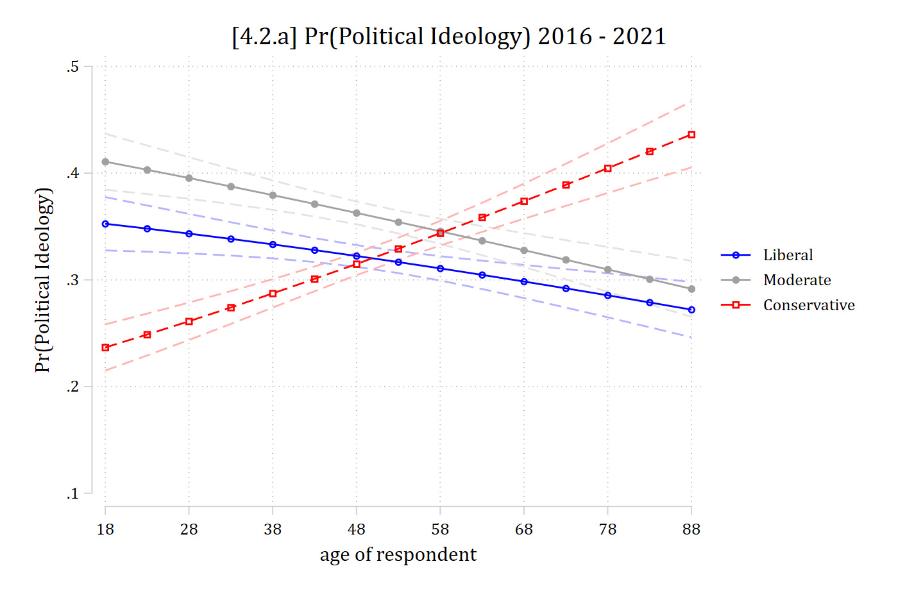
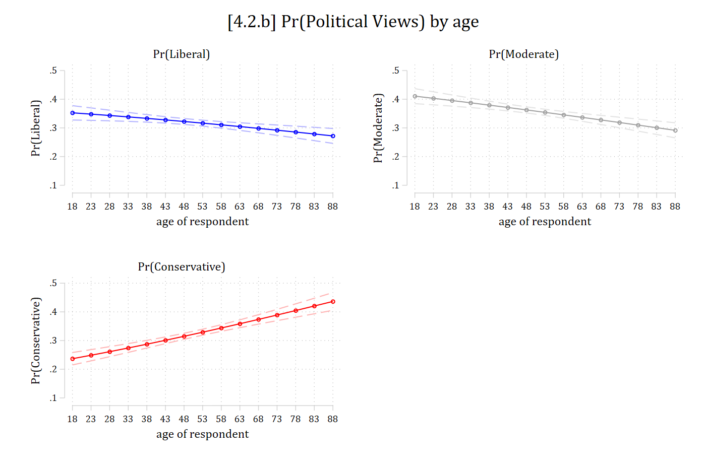

- Although tests of the coefficients are valid to test for overall effects, I do not suggest relying on the coefficients to understand your model
  - Coefficients are limited as a measure of effect size (just as in binary logit)
  - Coefficients rescale across models and thus cannot be used to compare effect size across models (more on this later)
  - There are an overwhelming and highly redundant number of coefficients to consider
- Marginal effects and predicted probabilities are more satisfying, less problematic, and simpler ways to understand nominal models

## Predicted probabilities in multinomial logit

- We motivated multinomial logit as a set of binary logits
- $\mathbf{x}_{i}\boldsymbol{\beta}$ is in log-odds, e.g., Log(Pr~A~/Pr~B~)
  - We can solve the equations in terms of predicted probabilities
- If *y* has *J* total categories 1 to *J*, let $\eta$ be the prediction of interest for a specific category *j*: $\Pr(y = j\,|\,\mathbf{x})$ which is the predicted probability of category *j* given certain values of **x**

$$\eta = \Pr(y = j) = \frac{\exp(\mathbf{x}_{i}\boldsymbol{\beta}_{j|J})}{\sum_{j = 1}^{J}\exp(\mathbf{x}_{i}\boldsymbol{\beta}_{j|J})}$$

- Predicted probabilities and marginal effects in multinomial logit are interpreted as the probability of category *j* out of all possible categories
  - Numerator is probability of category *j*
  - Denominator is the sum of the probability of all categories
- You get the same predicted probabilities regardless of the base/reference category you use in the estimation of the model

### Plots of predicted probabilities

- Plots---while always recommended---are especially helpful with multiple outcome categories
- As nominal models produce multiple prediction lines, including CIs can sometimes make the plot impossible to read with so many overlapping lines
  - An alternative is to make separate panels for each outcome category (see following examples)
- Always include a legend so the reader knows which line is for which DV category

::: {.panel-tabset group="language"}
## Stata

::: {.callout-note icon="false" appearance="simple"}
Stata builds the plot CIs first, then lines. So, graph aspects 1, 2, and 3 are CIs. To label the lines themselves, start the legend at *J* + 1 (4 here)
:::

```{.stata-run}
. use "https://tdmize.github.io/data/data/cda_gss", clear
(cda_gss.dta |  GSS 1972-2021 CDA - Categorical Data Analysis | date created 202
> 3)

. 
. keep if year >= 2016 & year <= 2021
(59,599 observations deleted)

. 
. drop if missing(conserv, age, woman, race3, college, married, parent, faminc)
(1,421 observations deleted)

. 
. *3 category political views var
. qui mlogit polviews3 c.age i.woman i.race3 i.college ///
>     i.married i.parent c.faminc i.employed

. est store pol3mod

. 
. *4.2.a
. qui margins, at(age=(18(5)88))

. *custom plot with colors to match politics
. marginsplot, xlab(18(10)88) ylab(0.1(0.1)0.5) ///
>     legend(order(4 "Liberal" 5 "Moderate" 6 "Conservative")) ///
>     ytitle("Pr(Political Ideology)") ///
>     title("[4.2.a] Pr(Political Ideology) 2016 - 2021", size(medlarge)) ///
>     plot1opts(lcol(blue) mcol(blue)) plot2opts(lcol(gs10) mcol(gs10)) ///
>     plot3opts(lcol(red) mcol(red)) ///
>     ci1opts(recast(rline) lpat(dash) lcol(blue*.3)) ///
>     ci2opts(recast(rline) lpat(dash) lcol(gs10*.3)) ///
>     ci3opts(recast(rline) lpat(dash) lcol(red*.3))

Variables that uniquely identify margins: age

```

{width=80% fig-alt="[4.2.a] Predicted probabilities of each political ideology by age with confidence intervals: Pr(liberal) falls from about 0.35 to 0.27, Pr(moderate) falls from about 0.41 to 0.29, and Pr(conservative) rises from about 0.24 to 0.44; the conservative line crosses the others in the late 40s to 50s."}

## R

::: {.callout-note icon="false" appearance="simple"}
R's **plot_predictions** default would hold controls at model person. To get average predictions, need the **newdata** statement with a "counterfactual" **grid_type.** Add **"group"** to the **by** function to get separate lines for each outcome
:::

```{r}
#| fig-alt: "[4.2.a] Predicted probabilities of each political ideology by age with confidence intervals: Pr(liberal) falls from about 0.35 to 0.27, Pr(moderate) falls from about 0.41 to 0.29, and Pr(conservative) rises from about 0.24 to 0.44; the conservative line crosses the others in the late 40s to 50s."
library(haven)           # import Stata data and labels
library(dplyr)           # data manipulation
library(ggplot2)         # graphs
library(nnet)            # multinomial logit: multinom()
library(marginaleffects) # predictions and marginal effects
library(cleanplots)      # graph scheme
cleanplots_defaults()

gss <- read_dta("https://tdmize.github.io/data/data/cda_gss.dta")

gss <- gss |> filter(year >= 2016 & year <= 2021)

# Keep model variables; drop any missing data
gss <- gss[c("polviews3", "age", "woman", "race3", "college", "married", "parent",
  "faminc", "employed", "conserv")]
gss <- gss[complete.cases(gss[c("conserv", "age", "woman", "race3", "college",
  "married", "parent", "faminc")]), ]

# Treat binary/nominal variables as factors
gss <- gss |>
  mutate(across(c(polviews3, woman, race3, college, married, parent, employed), as_factor)) |>
  droplevels()

# 3 category political views var
pol3mod <- multinom(polviews3 ~ age + woman + race3 + college + married + parent +
  faminc + employed, data = gss, trace = FALSE)

# 4.2.a
plot_predictions(pol3mod, by = c("age", "group"),
  newdata = datagrid(age = seq(18, 88, 5), grid_type = "counterfactual")) +
  scale_color_manual(values = c("blue", "gray60", "red")) +
  scale_fill_manual(values = c("blue", "gray60", "red")) +
  scale_x_continuous(breaks = seq(18, 88, 10)) +
  scale_y_continuous(breaks = seq(.1, .5, .1), limits = c(.1, .5)) +
  labs(title = "[4.2.a] Pr(Political Ideology) 2016 - 2021",
    x = "age of respondent", y = "Pr(Political Ideology)", color = NULL, fill = NULL)
```

:::

### Plots of small multiples

- The plot above includes each outcome on a single graph
  - In this case, it is still fairly easy to read
- The more outcome categories you have and the larger your CIs are, the less legible these graphs become (due to overlapping lines)
- An alternative approach is to plot "small multiples" which is legible even with many outcomes
  - I.e., The same type of graph repeated in separate panels
  - In this case, one panel for each outcome

::: {.panel-tabset group="language"}
## Stata

#### Plots of small multiples in Stata

- Easy in Stata, just cumbersome:
  - Make a prediction for each outcome separately using the **predict(outcome(#))** option on **margins**
  - Make the graph with **marginsplot** per usual
    - Include a **title( )** to denote the outcome
    - Save each graph in memory via a **name( )** option
  - Combine the graphs into one via **graph combine**

```{.stata-run}
. *4.2.b: same graph, but small multiples, with separate panels for each outcome
. qui margins, at(age=(18(5)88)) predict(outcome(1))

. marginsplot, title("Pr(Liberal)") name(pr_lib, replace) ///
>     ytitle("Pr(Liberal)") ylab(0.1(0.1)0.5) ///
>     plotopts(lcol(blue) mcol(blue)) ciopts(recast(rline) lpat(dash) lcol(blue*
> .3))

Variables that uniquely identify margins: age

. 
. qui margins, at(age=(18(5)88)) predict(outcome(2))

. marginsplot, title("Pr(Moderate)") name(pr_mod, replace) ///
>     ytitle("Pr(Moderate)") ylab(0.1(0.1)0.5) ///
>     plotopts(lcol(gs10) mcol(gs10)) ciopts(recast(rline) lpat(dash) lcol(gs10*
> .3))

Variables that uniquely identify margins: age

. 
. qui margins, at(age=(18(5)88)) predict(outcome(3))

. marginsplot, title("Pr(Conservative)") name(pr_con, replace) ///
>     ytitle("Pr(Conservative)") ylab(0.1(0.1)0.5) ///
>     plotopts(lcol(red) mcol(red)) ciopts(recast(rline) lpat(dash) lcol(red*.3)
> )

Variables that uniquely identify margins: age

. 
. graph combine pr_lib pr_mod pr_con, ///
>     title("[4.2.b] Pr(Political Views) by age")

```

{width=80% fig-alt="[4.2.b] Three panels, one per outcome, of predicted probabilities by age with confidence intervals: Pr(liberal) and Pr(moderate) decline with age, and Pr(conservative) rises from about 0.24 to 0.44."}

## R

- In R, use **ggplot**'s **facet_wrap** function

```{r}
#| fig-alt: "[4.2.b] Three panels, one per outcome, of predicted probabilities by age with confidence intervals: Pr(liberal) and Pr(moderate) decline with age, and Pr(conservative) rises from about 0.24 to 0.44."
#| fig-width: 9.5
# 4.2.b: same graph, but small multiples, with separate panels for each outcome
plot_predictions(pol3mod, by = c("age", "group"),
  newdata = datagrid(age = seq(18, 88, 5), grid_type = "counterfactual")) +
  facet_wrap(~ group) +
  scale_color_manual(values = c("blue", "gray60", "red")) +
  scale_fill_manual(values = c("blue", "gray60", "red")) +
  scale_x_continuous(breaks = seq(18, 88, 10)) +
  scale_y_continuous(breaks = seq(.1, .5, .1), limits = c(.1, .5)) +
  labs(title = "[4.2.b] Pr(Political Views) by age",
    x = "age of respondent", y = "Pr(Political Views)") +
  theme(legend.position = "none")
```

:::
