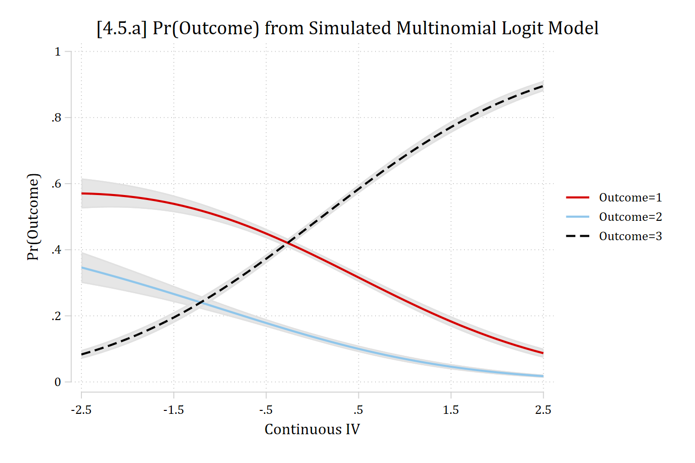
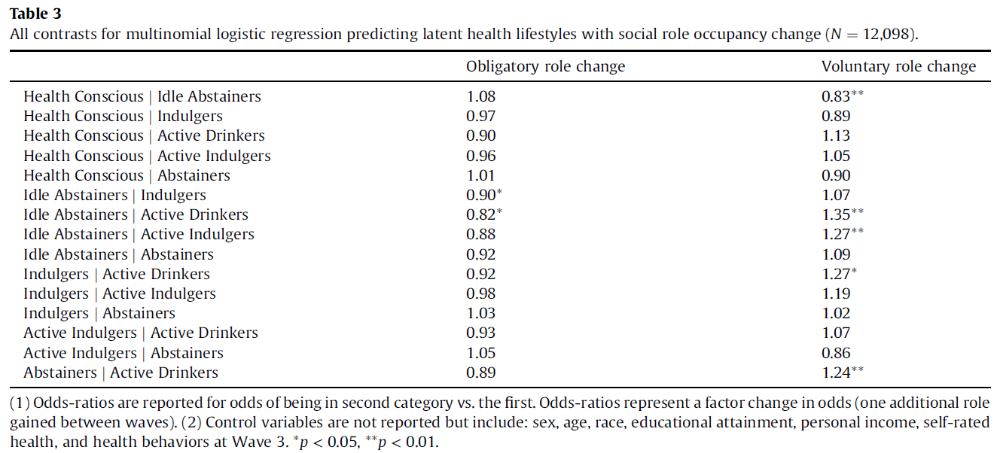
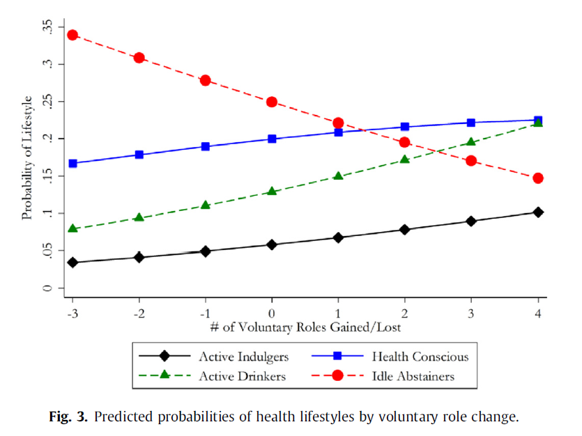

- Similar to binary logit, multinomial logit can also be interpreted by exponentiating the regression coefficients
  - The coefficients represent the dynamics among the outcome categories
    - These are in terms of **a specific outcome category** compared **to a specific other outcome category**
      - E.g., The odds of being in *category 1* compared to the odds of being in *category 3*
    - Note this is different than what the MEs summarize (probability of **a specific outcome category** out of **all possible outcome categories**)
      - E.g., The probability of being in *category 1* out of the probability of being in any of *categories 1, 2, 3, 4, ... J*
- Because of this discrepancy in what the coefficients and the MEs summarize, the coefficients can have confusing and non-intuitive relationships to the MEs

*Consider an example I simulated below...*

::: {.panel-tabset group="language"}
## Stata

```{.stata-run}
. *Show simulation of mlogit where MEs and coefs diverge
. clear

. set seed 3704

. set obs 5000
Number of observations (_N) was 0, now 5,000.

. gen x1 = rnormal()

. gen x2 = rnormal()

. 
. gen xb1 = ln(.5) + ln(1.5)*x1 + ln(.5)*x2

. gen xb2 = ln(2) + ln(.33)*x1 + ln(2)*x2

. 
. gen p1 = 1 / ( 1 + exp(xb2) )

. gen p2 = exp(xb1) / ( 1 + exp(xb1) + exp(xb2) )

. gen p3 = exp(xb2) / ( 1 + exp(xb1) + exp(xb2) )

. 
. gen u = runiform()

. 
. gen y = cond(u < p1, 1, ///
>     cond(u < p1 + p2, 2, 3 ))

. 
. qui mlogit y x1 x2, base(1) rrr

. est store simmod

. *4.5.a
. qui margins, at(x2=(-2.5(.1)2.5))

. marginsplot, recastci(rarea) ciopt(col(gs14)) ///
>     plotopts(lwid(medthick) msym(none)) xlab(-2.5(1)2.5) ///
>     xtitle("Continuous IV") ytitle("Pr(Outcome)") ///
>     title("[4.5.a] Pr(Outcome) from Simulated Multinomial Logit Model", size(m
> edlarge))

Variables that uniquely identify margins: x2

```

{width=80% fig-alt="[4.5.a] Predicted probabilities of three outcomes across the continuous IV from -2.5 to 2.5: Pr(outcome 1) falls from about 0.57 to 0.09, Pr(outcome 2) falls from about 0.35 to 0.02, and Pr(outcome 3) rises from about 0.08 to 0.89."}

## R

```{r}
#| fig-alt: "[4.5.a] Predicted probabilities of three outcomes across the continuous IV from -2.5 to 2.5: Pr(outcome 1) falls from about 0.57 to 0.09, Pr(outcome 2) falls from about 0.35 to 0.02, and Pr(outcome 3) rises from about 0.08 to 0.89."
library(haven)           # import Stata data and labels
library(dplyr)           # data manipulation
library(ggplot2)         # graphs
library(nnet)            # multinomial logit: multinom()
library(marginaleffects) # predictions and marginal effects
library(cleanplots)      # graph scheme
cleanplots_defaults()

# Center changes in continuous IVs on each observation's value
options(marginaleffects_contrast_direction = "center")

# Show simulation of a multinomial logit where MEs and coefs diverge
# (R's random numbers differ from Stata's, so the estimates differ a little)
set.seed(3704)
n <- 5000
sim <- data.frame(x1 = rnorm(n), x2 = rnorm(n)) |>
  mutate(xb1 = log(.5) + log(1.5) * x1 + log(.5) * x2,
    xb2 = log(2) + log(.33) * x1 + log(2) * x2,
    p1 = 1 / (1 + exp(xb2)),
    p2 = exp(xb1) / (1 + exp(xb1) + exp(xb2)),
    p3 = exp(xb2) / (1 + exp(xb1) + exp(xb2)),
    u = runif(n),
    y = factor(case_when(u < p1 ~ 1, u < p1 + p2 ~ 2, TRUE ~ 3)))

simmod <- multinom(y ~ x1 + x2, data = sim, trace = FALSE)

# 4.5.a
plot_predictions(simmod, by = c("x2", "group"),
  newdata = datagrid(x2 = seq(-2.5, 2.5, .1), grid_type = "counterfactual")) +
  scale_x_continuous(breaks = seq(-2.5, 2.5, 1)) +
  labs(title = "[4.5.a] Pr(Outcome) from Simulated Multinomial Logit Model",
    x = "Continuous IV", y = "Pr(Outcome)", color = "Outcome", fill = "Outcome")
```

:::

Write down your general interpretation of the effect of the continuous IV (*x2*)

## Comparing MEs and coefficients in multinomial logit

- Below are the AMEs for *x2* (from the model graphed above):

::: {.panel-tabset group="language"}
## Stata

```{.stata-run}
. *AMEs for +SD for x2
. mecompare x2, amount(sd) model(simmod)

Predicting: Pr(y)
Marginal effects (N_simmod=5000)

                                 |  ME #   Estimate         SE      P>|z|
---------------------------------+---------------------------------------
x2 + SD (centered)               |                                       
              Outcome 1 - simmod |     1     -0.114      0.006      0.000
              Outcome 2 - simmod |     2     -0.071      0.005      0.000
              Outcome 3 - simmod |     3      0.186      0.005      0.000

```

## R

```{r}
# AMEs for +SD for x2
avg_comparisons(simmod, variables = list(x2 = sd(sim$x2)))
```

:::

- How do these compare to your descriptions of the effect of *x2* that you wrote down based only on the graph shown above?

::: {.panel-tabset group="language"}
## Stata

```{.stata-run}
. *All ORs for x2
. est restore simmod
(results simmod are active now)

. listcoef x2

mlogit (N=5000): Factor change in the odds of y 

Variable: x2 (sd=0.999)
------------------------------------------------------------------------------
                             |         b        z    P>|z|       e^b   e^bStdX
-----------------------------+------------------------------------------------
1            vs 2            |    0.1858    3.776    0.000     1.204     1.204
1            vs 3            |   -1.2784  -25.272    0.000     0.278     0.279
2            vs 1            |   -0.1858   -3.776    0.000     0.830     0.831
2            vs 3            |   -1.4642  -24.046    0.000     0.231     0.232
3            vs 1            |    1.2784   25.272    0.000     3.591     3.584
3            vs 2            |    1.4642   24.046    0.000     4.324     4.315
------------------------------------------------------------------------------

```

## R

```{r}
# All contrasts among the outcomes: refit the model with each outcome
# category as the base/reference category
all_contrasts <- function(model, term) {
  data <- eval(model$call$data)
  y <- all.vars(formula(model))[1]
  out <- lapply(model$lev, function(ref) {
    data[[y]] <- relevel(data[[y]], ref = ref)
    s <- summary(update(model, data = data))
    b <- s$coefficients[, term]
    z <- b / s$standard.errors[, term]
    data.frame(contrast = paste(rownames(s$coefficients), "vs", ref),
      b = round(b, 4), z = round(z, 3), p = round(2 * pnorm(-abs(z)), 3),
      exp_b = round(exp(b), 3), row.names = NULL)
  })
  do.call(rbind, out)
}

# All ORs for x2
all_contrasts(simmod, "x2")
```

:::

- Note, column "**b**" is the log-odds; column "**e\^b**" is exp(b) which are the conditional odds ratios
- To start, let's examine the effects for category 3 (odds of category 3 compared to odds of category 2 and category 1)
  - Do these match your general impressions of the effects of *x2*?
- What about the effect of category 1 vs 2---the odds of category 1 compared to category 2?
  - Do these match your general impressions of the effects of *x2*?

## Multinomial logit is a set of binary logits that are simultaneously estimated

*Recall back to our example of political views (Conservative, Moderate, Liberal):*

- [***L vs M***]{.underline} using *n*~L~ + *n*~M~ observations

$$\ln\left[\frac{\Pr(L\,|\,\mathbf{x}_{i})}{\Pr(M\,|\,\mathbf{x}_{i})}\right] = \beta_{0,L|M} + \boldsymbol{\beta}_{X,L|M}\,\mathbf{x}_{i}$$

> [Interpretation]{.underline}: For a unit increase in *x~k~* the odds of category **L** versus category **M** change by a factor of exp(β~k,\ L\|M~), conditional on not being in any other categories

- *The "conditional on not being in any other categories" part is important and what distinguishes an exponentiated coefficient in multinomial logit from a true odds ratio from binary logit*
  - In the example above **only** the observations in categories **L** or **M** are being compared
  - Observations in category **C** are not used---the odds ratio for **L** vs **M** is *conditional on* the observation not being in category **C**

### Odds ratios (ORs) vs conditional ORs

- Consider a binary outcome *conservative/not* and gender (*woman*=1) as an IV

  Pr(conserv = 1 \| woman = 0) = .3594

  Pr(conserv = 1 \| woman = 1) = .2962

::: {.panel-tabset group="language"}
## Stata

```{.stata-run}
. use "https://tdmize.github.io/data/data/cda_gss", clear
(cda_gss.dta |  GSS 1972-2021 CDA - Categorical Data Analysis | date created 202
> 3)

. 
. keep if year >= 2016 & year <= 2021
(59,599 observations deleted)

. 
. drop if missing(conserv, age, woman, race3, college, married, parent, faminc)
(1,421 observations deleted)

. 
. *Show that OR in binary logit = ratio of two risk ratios
. tab conserv woman, col

+-------------------+
| Key               |
|-------------------|
|     frequency     |
| column percentage |
+-------------------+

                 |        Woman R
  Conservative R |       Men      Women |     Total
-----------------+----------------------+----------
Not Conservative |     2,280      3,003 |     5,283 
                 |     64.06      70.38 |     67.51 
-----------------+----------------------+----------
    Conservative |     1,279      1,264 |     2,543 
                 |     35.94      29.62 |     32.49 
-----------------+----------------------+----------
           Total |     3,559      4,267 |     7,826 
                 |    100.00     100.00 |    100.00 

```

## R

```{r}
gss <- read_dta("https://tdmize.github.io/data/data/cda_gss.dta")

gss <- gss |> filter(year >= 2016 & year <= 2021)

# Keep model variables; drop any missing data
gss <- gss[c("conserv", "polviews3", "age", "woman", "race3", "college",
  "married", "parent", "faminc", "employed")]
gss <- gss[complete.cases(gss[c("conserv", "age", "woman", "race3", "college",
  "married", "parent", "faminc")]), ]

# Treat binary/nominal variables as factors
gss <- gss |>
  mutate(across(c(polviews3, woman, race3, college, married, parent, employed), as_factor)) |>
  droplevels()

# Show that OR in binary logit = ratio of two risk ratios
table(as_factor(gss$conserv), gss$woman)
round(100 * prop.table(table(as_factor(gss$conserv), gss$woman), margin = 2), 2)  # column %
```

:::

#### Odds ratios in binary logit

::: {.panel-tabset group="language"}
## Stata

```{.stata-run}
. di "Odds of being conservative for women = " .2962 / (1 - .2962)
Odds of being conservative for women = .4208582

. di "Odds of being conservative for men = " .3594 / (1 - .3594)
Odds of being conservative for men = .56103653

. di "Odds ratio of women / men = " .4208582 / .56103653
Odds ratio of women / men = .75014402

. 
. logit conserv i.woman, or nolog

Logistic regression                                     Number of obs =  7,826
                                                        LR chi2(1)    =  35.21
                                                        Prob > chi2   = 0.0000
Log likelihood = -4916.995                              Pseudo R2     = 0.0036

------------------------------------------------------------------------------
     conserv | Odds ratio   Std. err.      z    P>|z|     [95% conf. interval]
-------------+----------------------------------------------------------------
       woman |
      Women  |      0.750      0.036   -5.932   0.000        0.682       0.825
       _cons |      0.561      0.020  -16.548   0.000        0.524       0.601
------------------------------------------------------------------------------
Note: _cons estimates baseline odds.

```

## R

```{r}
# Odds of being conservative for women
.2962 / (1 - .2962)
# Odds of being conservative for men
.3594 / (1 - .3594)
# Odds ratio of women / men
.4208582 / .56103653

genmod <- glm(conserv ~ woman, data = gss, family = binomial(link = "logit"))
exp(cbind(OR = coef(genmod), confint.default(genmod)))
```

:::

The odds ratio (OR) from a binary logit is the ratio of women to men's odds

### Nominal DVs and conditional ORs

::: {.panel-tabset group="language"}
## Stata

```{.stata-run}
. tab polviews3 woman, col

+-------------------+
| Key               |
|-------------------|
|     frequency     |
| column percentage |
+-------------------+

   Political |
        View |        Woman R
  Categories |       Men      Women |     Total
-------------+----------------------+----------
     Liberal |     1,100      1,392 |     2,492 
             |     30.91      32.62 |     31.84 
-------------+----------------------+----------
    Moderate |     1,180      1,611 |     2,791 
             |     33.16      37.75 |     35.66 
-------------+----------------------+----------
Conservative |     1,279      1,264 |     2,543 
             |     35.94      29.62 |     32.49 
-------------+----------------------+----------
       Total |     3,559      4,267 |     7,826 
             |    100.00     100.00 |    100.00 

```

## R

```{r}
table(gss$polviews3, gss$woman)
round(100 * prop.table(table(gss$polviews3, gss$woman), margin = 2), 2)  # column %
```

:::

- Recall from [above](#odds-ratios-in-binary-logit) the OR for gender (woman=1): .4208582 / .56103653 = .75014402

### Conditional odds ratios / "relative risk ratios"

::: {.panel-tabset group="language"}
## Stata

```{.stata-run}
. mlogit polviews3 i.woman, base(1) rrr nolog cformat(%6.4f)

Multinomial logistic regression                         Number of obs =  7,826
                                                        LR chi2(2)    =  37.07
                                                        Prob > chi2   = 0.0000
Log likelihood = -8569.4951                             Pseudo R2     = 0.0022

------------------------------------------------------------------------------
   polviews3 |        RRR   Std. err.      z    P>|z|     [95% conf. interval]
-------------+----------------------------------------------------------------
Liberal      |  (base outcome)
-------------+----------------------------------------------------------------
Moderate     |
       woman |
      Women  |     1.0789     0.0600    1.364   0.172       0.9674      1.2032
       _cons |     1.0727     0.0450    1.675   0.094       0.9881      1.1646
-------------+----------------------------------------------------------------
Conservative |
       woman |
      Women  |     0.7810     0.0442   -4.370   0.000       0.6990      0.8725
       _cons |     1.1627     0.0478    3.666   0.000       1.0727      1.2603
------------------------------------------------------------------------------
Note: _cons estimates baseline relative risk for each outcome.

```

## R

```{r}
pol3mod <- multinom(polviews3 ~ woman, data = gss, trace = FALSE)
exp(coef(pol3mod))
```

:::

- The conditional OR for *women* is 0.7810 in the conservative panel---which does not match the OR of 0.750 we calculated above. Why do you think this is?

\* Quick terminology note: Stata uses the term "relative risk ratio" ([rationale for term here](https://www.stata.com/statalist/archive/2005-04/msg00678.html)) which is a synonym for conditional odds ratio; this is the exponentiated regression coefficient

#### Calculating conditional ORs / relative risk ratios (RRRs)

::: {.panel-tabset group="language"}
## Stata

```{.stata-run}
. di "Women: pr(conserv) conditional on not being moderate = " .2962 / (.2962 + 
> .3262)
Women: pr(conserv) conditional on not being moderate = .47589974

. di "Men: pr(conserv) conditional on not being moderate = " .3594 / (.3594 + .3
> 091)
Men: pr(conserv) conditional on not being moderate = .53762154

. 
. di "Women: Odds(conserv) conditional on not being moderate = " .47589974 / (1 
> - .47589974)
Women: Odds(conserv) conditional on not being moderate = .90803187

. di "Men: Odds(conserv) conditional on not being moderate = " .53762154 / (1 - 
> .53762154)
Men: Odds(conserv) conditional on not being moderate = 1.1627305

. di "Odds ratio of women / men conditional on not being moderate = " .90803187 
> / 1.1627305
Odds ratio of women / men conditional on not being moderate = .78094784

```

## R

```{r}
# Women: pr(conserv) conditional on not being moderate
.2962 / (.2962 + .3262)
# Men: pr(conserv) conditional on not being moderate
.3594 / (.3594 + .3091)

# Women: Odds(conserv) conditional on not being moderate
.47589974 / (1 - .47589974)
# Men: Odds(conserv) conditional on not being moderate
.53762154 / (1 - .53762154)
# Odds ratio of women / men conditional on not being moderate
.90803187 / 1.1627305
```

:::

::: {.callout-note icon="false" appearance="simple"}
Remember that the coefficients **mlogit** reports are conditional on not being in other categories---here, the coefficient in conservative panel is for Conservative vs Liberal (the base/reference category), *conditional on not being moderate*
:::

## Interpreting conditional ORs / RRRs

- Because of this "conditional" nature of the coefficients in multinomial logit, it is not strictly appropriate to refer to them as odds ratios
  - Some call these "conditional odds ratios" (an [interesting discussion here](https://www.statalist.org/forums/forum/general-stata-discussion/general/545887-multinomial-logit-interpretation-rrr-vs-cor))
  - Others conceptualize them as "relative risk ratios" (Stata's term, [explained here](https://www.stata.com/statalist/archive/2005-04/msg00678.html))---TLDR: mathematically a ratio of two risk ratios (conditional on not being in other categories) is equivalent to a conditional odds ratio
  - [Long and Freese 2014](https://www.stata.com/bookstore/regression-models-categorical-dependent-variables/) refer to them simply as odds ratios
    - Within sociology, referring to them as "odds ratios" is not problematic and you generally will be understood
    - May not be the case in other fields
      - Within or outside of sociology, it cannot hurt to note your understanding of this distinction in your Analytic Strategy section of your paper. E.g., Feel free to copy this for your needs:

> *I report exponentiated coefficients from the multinomial logit models, which represent conditional odds ratios (AKA relative risk ratios)---referred to simply as "odds ratios" in what follows (see Long and Freese 2014).*

### Interpreting ORs in multinomial logit

::: {.panel-tabset group="language"}
## Stata

- In Stata, the SPost command **listcoef** will calculate ORs for all contrasts for you

```{.stata-run}
. qui mlogit polviews3 c.age i.woman i.race3 i.college ///
>     i.married i.parent c.faminc i.employed

. est store pol3mod

. 
. listcoef age

mlogit (N=7823): Factor change in the odds of polviews3 

Variable: age (sd=17.361)
------------------------------------------------------------------------------
                             |         b        z    P>|z|       e^b   e^bStdX
-----------------------------+------------------------------------------------
Liberal      vs Moderate     |    0.0010    0.518    0.604     1.001     1.017
Liberal      vs Conservative |   -0.0130   -6.489    0.000     0.987     0.799
Moderate     vs Liberal      |   -0.0010   -0.518    0.604     0.999     0.983
Moderate     vs Conservative |   -0.0139   -7.329    0.000     0.986     0.785
Conservative vs Liberal      |    0.0130    6.489    0.000     1.013     1.252
Conservative vs Moderate     |    0.0139    7.329    0.000     1.014     1.274
------------------------------------------------------------------------------

```

## R

- In R, would need to refit model changing the reference outcome category

```{r}
pol3mod <- multinom(polviews3 ~ age + woman + race3 + college + married + parent +
  faminc + employed, data = gss, trace = FALSE)

all_contrasts(pol3mod, "age")
```

:::

Each contrast appears twice (e.g., Liberal vs Moderate and Moderate vs Liberal), so half of the coefficients and significance tests are redundant; there are only three unique ORs. Which direction of the contrast to interpret depends on your research question, but there is no reason to interpret both

### Interpreting ORs in multinomial logit: continuous IV

> *For a one year increase in age, the odds of identifying as conservative compared to moderate increase by a factor of 1.014 (holding all else constant)*
>
> *For a one-year increase in age, the odds of identifying as conservative instead of liberal increase by a factor of 1.013 (all else equal)*
>
> *Age has no significant effect on the odds of identifying as liberal compared to moderate (p = ns)*

{width=70% fig-alt="[4.2.a] Predicted probabilities of each political ideology by age with confidence intervals: Pr(liberal) falls from about 0.35 to 0.27, Pr(moderate) falls from about 0.41 to 0.29, and Pr(conservative) rises from about 0.24 to 0.44."}

::: {.callout-note icon="false" appearance="simple"}
Do the ORs interpreted above tell the whole story? Would you be able to ascertain that age has a negative effect on the probability of identifying as moderate? A positive effect on the probability of identifying as conservative? Etc.
:::

### Interpreting ORs in multinomial logit: nominal IV

::: {.panel-tabset group="language"}
## Stata

```{.stata-run}
. listcoef college

mlogit (N=7823): Factor change in the odds of polviews3 

Variable: 1.college (sd=0.485)
------------------------------------------------------------------------------
                             |         b        z    P>|z|       e^b   e^bStdX
-----------------------------+------------------------------------------------
Liberal      vs Moderate     |    0.9020   14.071    0.000     2.465     1.549
Liberal      vs Conservative |    0.7312   11.234    0.000     2.078     1.426
Moderate     vs Liberal      |   -0.9020  -14.071    0.000     0.406     0.645
Moderate     vs Conservative |   -0.1708   -2.602    0.009     0.843     0.920
Conservative vs Liberal      |   -0.7312  -11.234    0.000     0.481     0.701
Conservative vs Moderate     |    0.1708    2.602    0.009     1.186     1.086
------------------------------------------------------------------------------

```

## R

```{r}
all_contrasts(pol3mod, "collegeCollege Degree")
```

:::

> *For those with college degrees, the odds of identifying as liberal are 2.465 times higher than the odds of identifying as moderate (compared to those without college degrees)*
>
> *The odds of identifying as liberal over conservative increase by a factor of 2.078 for those with a college degree*
>
> *The odds of identifying as conservative compared to moderate are 1.186 times higher for those with a college degree*

{width=90% fig-alt="Table 3 from Mize (2017): odds ratios for all contrasts among five latent health lifestyles (Health Conscious, Idle Abstainers, Indulgers, Active Drinkers, Active Indulgers, Abstainers) for obligatory and voluntary role change; for example, Health Conscious versus Idle Abstainers is 1.08 for obligatory role change and 0.83 (p < 0.01) for voluntary role change."}

> *"... the first row of the table indicates that obligatory role change does not distinguish between membership in the Idle Abstainer and Health Conscious lifestyle at Wave 4 (OR = 1.08, ns), but that gaining an additional voluntary role between waves is associated with lower odds of being in the Idle Abstainer lifestyle compared to being in the Health Conscious lifestyle (OR = 0.83, 95% CI \[0.73, 0.93\])."* ([Mize 2017](https://doi.org/10.1016/j.socscimed.2017.02.017))

{width=60% fig-alt="Figure 3 from Mize (2017): predicted probabilities of health lifestyles by the number of voluntary roles gained or lost, from -3 to 4: Idle Abstainers falls from about 0.34 to 0.15, Health Conscious rises from about 0.17 to 0.22, Active Drinkers rises from about 0.08 to 0.22, and Active Indulgers rises from about 0.03 to 0.10."}
