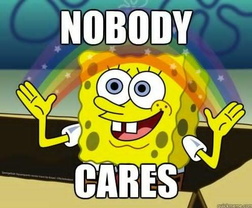

- An assumption of the multinomial logit model is the Independence of Irrelevant Alternatives (IIA)
  - IIA states that the odds of two outcomes do **not** depend on other outcomes
    - E.g., The odds of Liberal vs Moderate does not depend on what other options there are
- Intuitively, this means that dropping one of the outcome categories would not influence the relationships observed between the remaining outcome categories
  - This is a strict assumption; it is probably usually violated
  - I am not aware of any consistently accurate tests of this assumption/the current tests are problematic ([Cheng and Long 2007](https://journals.sagepub.com/doi/abs/10.1177/0049124106292361))
- The consequences of the IIA assumption for interpretation depends on your goals
  - Do you view your model as descriptive *of the data you have*? Are you focused primarily on prediction? Do you want to claim that your results would hold with a different questionnaire (e.g., if Socialist, Liberal, Moderate, Conservative, and Fascist were all answer options)?

## Why IIA fails: McFadden's (1974) buses

:::: {.columns}
::: {.column width="70%"}
- A person has two choices

$$\Pr(\text{car}) = 1/2 \quad \text{and} \quad \Pr(\text{red bus}) = 1/2$$

- The odds of taking the car versus a red bus

$$\frac{\Pr(\text{car})}{\Pr(\text{red bus})} = \frac{1/2}{1/2} = 1$$

- A new bus company opens with identical service & blue buses
:::
::: {.column width="30%"}
{fig-alt="Cartoon of a red double-decker bus."}

{width=80% fig-alt="Cartoon of a smiling blue bus."}
:::
::::

- IIA ***requires***

$$\Pr(\text{car}) = 1/3; \quad \Pr(\text{red bus}) = 1/3; \quad \Pr(\text{blue bus}) = 1/3$$

- This is necessary so that the conditional odds remain constant

$$\frac{\Pr(\text{car})}{\Pr(\text{red bus})} = 1 = \frac{1/3}{1/3}$$

- Intuitively, we would expect a violation of IIA

$$\Pr(\text{car}) = 1/2; \quad \Pr(\text{red bus}) = 1/4; \quad \Pr(\text{blue bus}) = 1/4$$

## Formal tests of IIA

- Several tests of IIA have been proposed
  - All compare the multinomial logit coefficients from a full model *f* when all *J* categories are included in the model, and the coefficient estimates from a restricted model *r* when *J* - 1 categories are included in the model
  - E.g., The [McFadden, Tye, and Train (1977)](http://onlinepubs.trb.org/Onlinepubs/trr/1977/637/637-007.pdf) test:

    $$MTT = -2\left[L_{r}(\widehat{\boldsymbol{\beta}}^{f}) - L_{r}(\widehat{\boldsymbol{\beta}}^{r})\right]$$

    - Intuition is to recreate situation where one outcome category was not included on questionnaire
- [Cheng and Long (2007)](https://journals.sagepub.com/doi/abs/10.1177/0049124106292361) find all of the tests have very poor statistical properties
  - None of the tests work well in all cases
  - *"Our overall conclusion, based on the simulations ... and our evaluation of other data structures, is that tests of the IIA assumption ... are unsatisfactory for applied work" (p.598)*

## Implications of the IIA assumption for interpretation

- So, we cannot reliably test whether the IIA assumption is violated or not
  - Question is: do we care?
- What are you willing to assume about your model? We generally do not make assumptions such as *"these results would hold exactly if a different questionnaire was used"*
  - E.g., Whether Liberal or Moderate is more likely is plausibly affected by the omission of the option of Socialist on the questionnaire
    - However, this same logic would affect most any model as changes to available response options clearly might change some observed relationships at the level of the individual outcome categories

{width=30% fig-alt="SpongeBob meme with a rainbow between his hands: NOBODY CARES."}

### The irrelevance of the independence of irrelevant alternatives assumption

- If your goal is to examine relationships **given the set of data you have,** I find the IIA assumption largely irrelevant:

> *"The assumption here is that the ability of the independent variables to distinguish between categories of the dependent variable would be similar even if participants had been given different choices. In many cases, this is implausible... However, such a hypothetical is rarely of direct interest in social science studies: we usually are fine accepting that results may differ slightly with different survey instruments with different response options. For the work I do, I agree with [Tutz (2021)](https://doi.org/10.1177/0081175020979689) that 'In sociology, the objective is often to analyze the response behavior in questionnaires without assuming that relationships would be identical if response options differed. Then no alternative settings are needed, and the problem of irrelevant alternatives is of no relevance.'"* ([Mize 2023](https://statisticalhorizons.com/discrete-choice-analysis-what-our-choices-reveal-about-preferences-tradeoffs-and-alternatives/))
