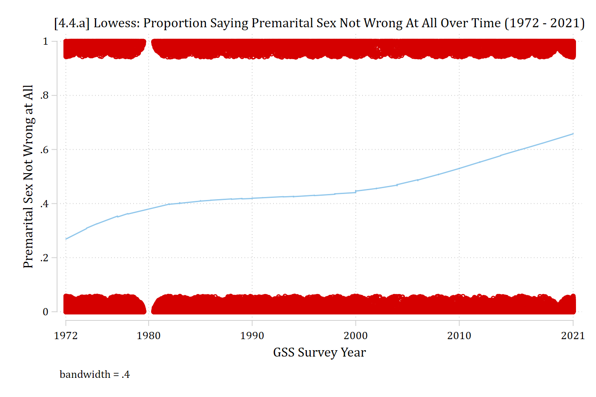

## Testing that outcomes can be combined

- Sometimes, you might want to combine outcome categories
  - E.g., You might think that the process you are studying is a binary outcome process even though it was measured as a nominal outcome
    - E.g., Although both "strongly agree" and "agree" were asked you think these could be combined
- If the independent variables jointly have no effect on the odds of category 1 vs category 2, we say category 1 and category 2 are **indistinguishable**
- The hypothesis that L and M are indistinguishable is

  $$H_{0}: \beta_{1,L|M} = \beta_{2,L|M} = \ldots = \beta_{k,L|M} = 0$$

  - I.e., That all of the IVs jointly considered have no significant predictive power as to whether an observation falls in category L or M

### Wald tests for combining outcomes

- Tests of indistinguishability can be computed for all pairs of outcomes
  - The SPost command **mlogtest, combine** will do this for you

::: {.panel-tabset group="language"}
## Stata

```{.stata-run}
. use "https://tdmize.github.io/data/data/cda_gss", clear
(cda_gss.dta |  GSS 1972-2021 CDA - Categorical Data Analysis | date created 202
> 3)

. 
. keep if year >= 2016 & year <= 2021
(59,599 observations deleted)

. 
. drop if missing(conserv, age, woman, race3, college, married, parent, faminc)
(1,421 observations deleted)

. 
. *3 category political views var
. qui mlogit polviews3 c.age i.woman i.race3 i.college ///
>     i.married i.parent c.faminc i.employed

. est store pol3mod

. 
. mlogtest, combine

Wald tests for combining alternatives (N=7823)

  Ho: All coefficients except intercepts associated with a given pair
      of alternatives are 0 (i.e., alternatives can be combined)

                 |      chi2    df   P>chi2
-----------------+-------------------------
Liberal & Mode~e |   379.293     9    0.000
Liberal & Cons~a |   455.146     9    0.000
Moderate & Con~a |   256.685     9    0.000

```

## R

```{r}
library(haven)           # import Stata data and labels
library(dplyr)           # data manipulation
library(sjmisc)          # frq() frequency tables
library(ggplot2)         # graphs
library(nnet)            # multinomial logit: multinom()
library(cleanplots)      # graph scheme
cleanplots_defaults()

gss <- read_dta("https://tdmize.github.io/data/data/cda_gss.dta")

gss <- gss |> filter(year >= 2016 & year <= 2021)

# Keep model variables; drop any missing data
gss <- gss[c("polviews3", "polviews", "age", "woman", "race3", "college", "married",
  "parent", "faminc", "income", "employed", "conserv", "year")]
gss <- gss[complete.cases(gss[c("conserv", "age", "woman", "race3", "college",
  "married", "parent", "faminc")]), ]

# Treat binary/nominal variables as factors
gss <- gss |>
  mutate(across(c(polviews3, woman, race3, college, married, parent, employed), as_factor)) |>
  droplevels()

# 3 category political views var
pol3mod <- multinom(polviews3 ~ age + woman + race3 + college + married + parent +
  faminc + employed, data = gss, trace = FALSE)

# Wald tests for combining each pair of outcomes (like mlogtest, combine):
# all coefficients except the intercepts are the same for the two outcomes
combine_tests <- function(model) {
  b <- coef(model)  # one row per outcome (other than the base outcome)
  V <- vcov(model)
  bvec <- setNames(as.vector(t(b)), colnames(V))
  outcomes <- model$lev
  terms <- colnames(b)[-1]
  pairs <- combn(outcomes, 2)
  out <- lapply(seq_len(ncol(pairs)), function(i) {
    o1 <- pairs[1, i]
    o2 <- pairs[2, i]
    # differences between the two outcomes' coefficients (base outcome = 0)
    L <- matrix(0, length(terms), length(bvec), dimnames = list(terms, names(bvec)))
    for (t in terms) {
      if (o1 != outcomes[1]) L[t, paste0(o1, ":", t)] <- 1
      if (o2 != outcomes[1]) L[t, paste0(o2, ":", t)] <- -1
    }
    d <- L %*% bvec
    chi2 <- as.numeric(t(d) %*% solve(L %*% V %*% t(L)) %*% d)
    data.frame(outcomes = paste(o1, "&", o2), chi2 = round(chi2, 3), df = length(terms),
      p = round(pchisq(chi2, length(terms), lower.tail = FALSE), 3))
  })
  do.call(rbind, out)
}

combine_tests(pol3mod)
```

:::

> *We have evidence that we should **not** combine outcome categories; i.e., our model is able to distinguish between all three outcome categories.*

### Testing that outcomes can be combined: 7 categories

- Consider a situation where we had more outcome categories. In fact, the GSS asks political views as a seven-category measure that I simplified into three for the examples above:

::: {.panel-tabset group="language"}
## Stata

```{.stata-run}
. fre polviews

polviews -- think of self as liberal or conservative
-------------------------------------------------------------------------------
                                  |      Freq.    Percent      Valid       Cum.
----------------------------------+--------------------------------------------
Valid   1 extremely liberal       |        415       5.30       5.30       5.30
        2 liberal                 |       1123      14.35      14.35      19.65
        3 slightly liberal        |        954      12.19      12.19      31.84
        4 moderate, middle of the |       2791      35.66      35.66      67.51
          road                    |                                            
        5 slightly conservative   |       1019      13.02      13.02      80.53
        6 conservative            |       1189      15.19      15.19      95.72
        7 extremely conservative  |        335       4.28       4.28     100.00
        Total                     |       7826     100.00     100.00           
-------------------------------------------------------------------------------

```

## R

```{r}
frq(gss$polviews)
```

:::

- Note I shortened the value labels below so they aren't truncated to:

  1 = E_Lib, 2 = Lib, 3 = S_Lib, 4 = Mod, 5 = S_Cons, 6 = Cons, 7 = E_Cons

::: {.panel-tabset group="language"}
## Stata

```{.stata-run}
. *Try 7 category political views var
. clonevar polviews7 = polviews

. lab def pol7lab 1"E_Lib" 2"Lib" 3"S_Lib" 4"Mod" ///
>     5"S_Cons" 6"Cons" 7"E_Cons"

. lab val polviews7 pol7lab

. 
. qui mlogit polviews7 c.age i.woman i.race3 i.college ///
>     i.married i.parent c.income i.employed if year == 2016, rrr

. 
. mlogtest, combine

Wald tests for combining alternatives (N=1553)

  Ho: All coefficients except intercepts associated with a given pair
      of alternatives are 0 (i.e., alternatives can be combined)

                 |      chi2    df   P>chi2
-----------------+-------------------------
     E_Lib & Lib |     8.583     9    0.477
   E_Lib & S_Lib |    11.306     9    0.255
     E_Lib & Mod |    26.320     9    0.002
  E_Lib & S_Cons |    18.834     9    0.027
    E_Lib & Cons |    16.021     9    0.066
  E_Lib & E_Cons |    24.624     9    0.003
     Lib & S_Lib |    11.966     9    0.215
       Lib & Mod |    63.873     9    0.000
    Lib & S_Cons |    34.535     9    0.000
      Lib & Cons |    35.251     9    0.000
    Lib & E_Cons |    40.236     9    0.000
     S_Lib & Mod |    27.305     9    0.001
  S_Lib & S_Cons |    14.663     9    0.101
    S_Lib & Cons |    17.529     9    0.041
  S_Lib & E_Cons |    29.590     9    0.001
    Mod & S_Cons |    35.097     9    0.000
      Mod & Cons |    44.732     9    0.000
    Mod & E_Cons |    21.756     9    0.010
   S_Cons & Cons |    10.403     9    0.319
 S_Cons & E_Cons |    25.531     9    0.002
   Cons & E_Cons |    21.056     9    0.012

```

## R

```{r}
# Try 7 category political views var
gss <- gss |>
  mutate(polviews7 = factor(polviews, levels = 1:7,
    labels = c("E_Lib", "Lib", "S_Lib", "Mod", "S_Cons", "Cons", "E_Cons")))

# Income in $1,000s so R computes the standard errors accurately
# (the tests do not depend on the units of income)
pol7mod <- multinom(polviews7 ~ age + woman + race3 + college + married + parent +
  I(income / 1000) + employed, data = gss, subset = year == 2016,
  trace = FALSE, maxit = 500)

combine_tests(pol7mod)
```

:::

### A warning: Inconsistencies and over-fitting

- The above tests suggest S_Cons = Cons
  - They also suggest S_Cons = S_Lib
    - Algebraically, this should mean Cons = S_Lib
    - However, this is not true (Cons = S_Lib rejected at *p* \< 0.05)
- **Tests of hypotheses are not algebraic statements**
  - Finding that one contrast suggests combining categories does not suggest that other contrasts will suggest the same
- Tests for combining outcome categories can be useful to check whether a theoretically motivated reason for combining categories is also statistically justified
  - I recommend against blindly combining categories based on statistical criterion alone *(would you combine slightly liberal and slightly conservative?)*
  - Instead, these tests should generally be used as evidence for or against a theoretically reasonable combination of categories
- Be careful not to ***over-fit*** your data
  - I.e., Even if you don't find evidence that two categories can be distinguished **in your specific model** doesn't mean those categories couldn't be distinguished in other samples or in other model specifications

## Nonlinear functional forms

- In exploratory analyses, I found time to have a functional form I did not expect the normal multinomial logit functional form to accommodate
- The largest category "not wrong at all" appears to be the main culprit
- Unfortunately, **lowess** doesn't allow categorical DVs to assess functional form
- An easy trick is to create a binary variable for the category you are examining with *category of interest* = 1; *all others* = 0

::: {.panel-tabset group="language"}
## Stata

```{.stata-run}
. use "https://tdmize.github.io/data/data/cda_gss", clear
(cda_gss.dta |  GSS 1972-2021 CDA - Categorical Data Analysis | date created 202
> 3)

. 
. // Data cleaning //
. gen religous = attend
(665 missing values generated)

. lab var religous "Religious Attendee"

. recode religous 0/3 = 0 4/8 = 1
(55,475 changes made to religous)

. lab def religlab 0"Not Religious" 1"Religious"

. lab val religous religlab

. 
. drop if missing(premarsx, college, age, woman, race3, year1972, religous)
(28,360 observations deleted)

. 
. *4.4.a - Lowess Plots to Assess Functional Form //
. gen premarsxB = premarsx

. lab var premarsxB "Premarital Sex Not Wrong at All"

. recode premarsxB 1/3 = 0 4=1
(40,486 changes made to premarsxB)

. lab def preblab 0"Wrong" 1"Not Wrong"

. lab val premarsxB preblab

. 
. lowess premarsxB year1972, bwidth(0.4) jitter(8) ///
>     xlab(0"1972" 8"1980" 18"1990" 28"2000" 38"2010" 49"2021") xtitle("GSS Surv
> ey Year") ///
>     title("[4.4.a] Lowess: Proportion Saying Premarital Sex Not Wrong At All O
> ver Time (1972 - 2021)", size(medsmall))

```

{width=80% fig-alt="[4.4.a] Lowess curve of the proportion saying premarital sex is not wrong at all, by GSS survey year, over jittered points at 0 and 1: it rises from about 0.27 in 1972 to about 0.40 by 1980, stays nearly flat around 0.40 to 0.45 until about 2000, then rises to about 0.66 in 2021."}

## R

```{r}
#| fig-width: 9.5
#| fig-alt: "[4.4.a] Smoothed curve of the proportion saying premarital sex is not wrong at all, by GSS survey year, over jittered points at 0 and 1: it rises from about 0.27 in 1972 to about 0.40 by 1980, stays nearly flat around 0.40 to 0.45 until about 2000, then rises to about 0.66 in 2021."
gss <- read_dta("https://tdmize.github.io/data/data/cda_gss.dta")

# Data cleaning: religious attendee = attends about once a month or more
gss <- gss |>
  mutate(religous = case_when(attend <= 3 ~ 0, attend >= 4 ~ 1))

# Keep model variables; drop any missing data
gss <- gss[c("premarsx", "college", "age", "woman", "race3", "year1972", "religous")]
gss <- gss[complete.cases(gss), ]

# 4.4.a - Smoothed plot to assess functional form
gss <- gss |>
  mutate(premarsxB = ifelse(premarsx == 4, 1, 0),  # 1 = not wrong at all
    year1972 = as.numeric(year1972))

ggplot(gss, aes(x = year1972, y = premarsxB)) +
  geom_jitter(width = .3, height = .04, color = "red", alpha = .05, size = .5) +
  geom_smooth(color = "skyblue3") +
  scale_x_continuous(breaks = c(0, 8, 18, 28, 38, 49),
    labels = c("1972", "1980", "1990", "2000", "2010", "2021")) +
  labs(title = "[4.4.a] Smoothed: Proportion Saying Premarital Sex Not Wrong At All Over Time (1972 - 2021)",
    x = "GSS Survey Year", y = "Premarital Sex Not Wrong at All") +
  theme(plot.title.position = "plot", plot.title = element_text(size = rel(.9)))
```

:::

Difficult to guess specification needed in categorical models. Try *year^2^* and also *year^3^*

### BIC as a guide for specification of time\*

::: {.panel-tabset group="language"}
## Stata

```{.stata-run}
. *Examine BICs for different specifications of time
. qui mlogit premarsx c.year1972 ///
>     i.religous i.college c.age i.woman i.race3

. est store year1

. qui mlogit premarsx c.year1972##c.year1972 ///
>     i.religous i.college c.age i.woman i.race3

. est store year2

. qui mlogit premarsx c.year1972##c.year1972##c.year1972 ///
>     i.religous i.college c.age i.woman i.race3

. est store year3

. 
. esttab year1 year2 year3, drop(*) bic ///
>     title("Comparison of BICs for Various Specifications of Time") ///
>     mtitles("Year^1" "Year^2" "Year^3")

Comparison of BICs for Various Specifications of Time
------------------------------------------------------------
                      (1)             (2)             (3)   
                   Year^1          Year^2          Year^3   
------------------------------------------------------------
------------------------------------------------------------
N                   40486           40486           40486   
BIC               90520.3         90517.6         90442.0   
------------------------------------------------------------
t statistics in parentheses
* p<0.05, ** p<0.01, *** p<0.001

```

## R

```{r}
# Treat binary/nominal variables as factors
gss <- gss |>
  mutate(across(c(premarsx, college, woman, race3), as_factor),
    religous = factor(religous, labels = c("Not Religious", "Religious"))) |>
  droplevels()

# Examine BICs for different specifications of time
# (year in decades inside the polynomials; the BICs are the same)
year1 <- multinom(premarsx ~ year1972 +
  religous + college + age + woman + race3, data = gss, trace = FALSE)
year2 <- multinom(premarsx ~ poly(I(year1972 / 10), 2, raw = TRUE) +
  religous + college + age + woman + race3, data = gss, trace = FALSE)
year3 <- multinom(premarsx ~ poly(I(year1972 / 10), 3, raw = TRUE) +
  religous + college + age + woman + race3, data = gss, trace = FALSE)

# Comparison of BICs for Various Specifications of Time
data.frame(model = c("Year^1", "Year^2", "Year^3"),
  N = nrow(gss), BIC = round(c(BIC(year1), BIC(year2), BIC(year3)), 1))
```

:::

\* From experience, I can say it is somewhat uncommon for the BIC to support such a complicated multinomial logit model because each additional polynomial adds *J* - 1 coefficients to the model; However the large sample size here (*N* \> 40,000) likely affords us the statistical power for the more complicated model
