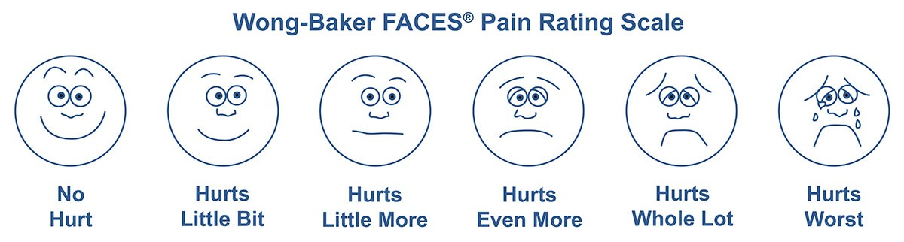
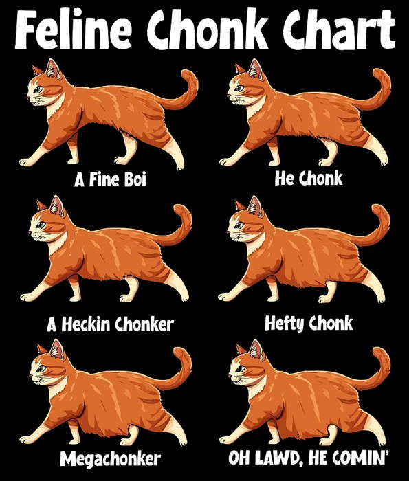
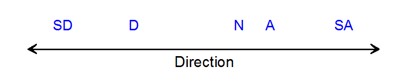
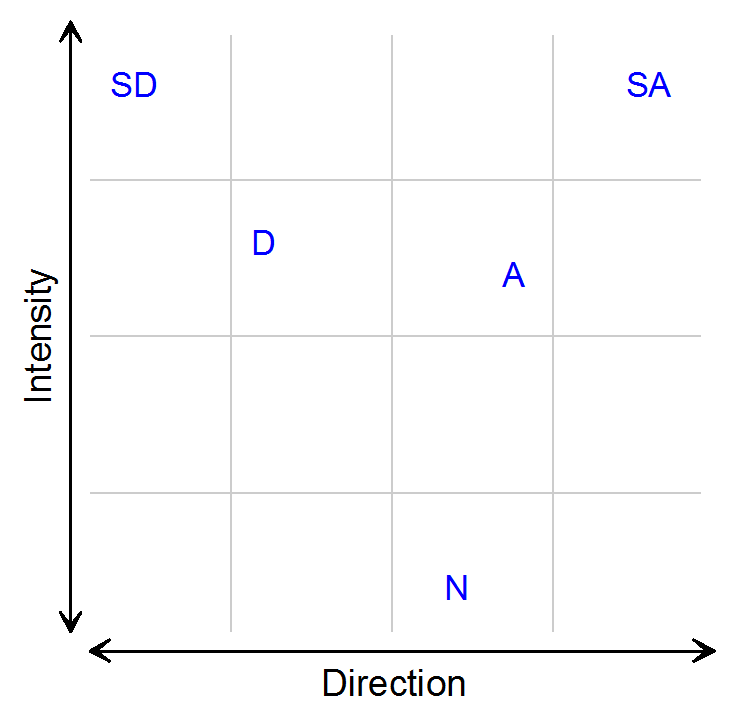
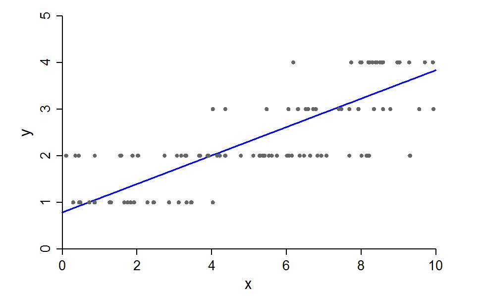
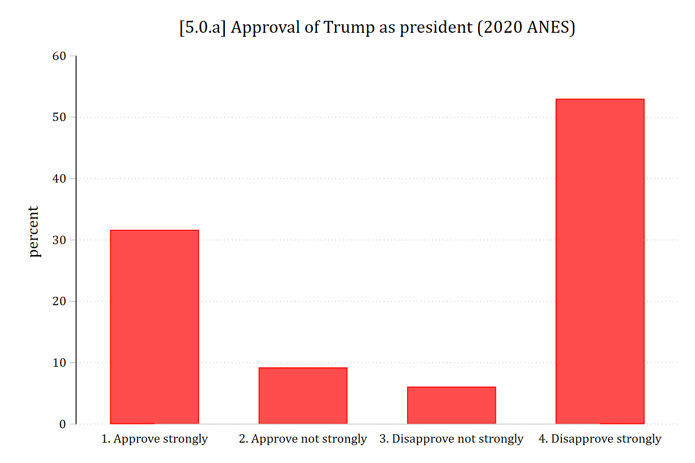

:::: {.columns}
::: {.column width="60%"}
{fig-alt="Wong-Baker FACES Pain Rating Scale: six cartoon faces from a smiling face labeled No Hurt, through Hurts Little Bit, Hurts Little More, Hurts Even More, and Hurts Whole Lot, to a crying face labeled Hurts Worst."}

::: {.callout-note icon="false" appearance="simple"}
\*Can assign values (e.g., 1 to 6) to these items but only ordering is meaningful; spacing between categories is not meaningful/consistent
:::
:::
::: {.column width="40%"}
{fig-alt="Feline Chonk Chart: six orange cats from thinnest to fattest labeled A Fine Boi, He Chonk, A Heckin Chonker, Hefty Chonk, Megachonker, and OH LAWD HE COMIN."}
:::
::::

## What does ordinality mean?

- An **ordinal variable** has:
  - Categories **ordered on a single dimension**
  - Unknown distances between categories

{width=70% fig-alt="A line with arrows at both ends labeled Direction, with SD, D, N, A, and SA placed along it at unequal distances."}

- An **ordinal model** is defined by the nature of the **relationship** between independent variables and outcomes ([Anderson 1984](https://www.jstor.org/stable/pdf/2345457.pdf))
  - That is, the IVs are associated with a DV in an ordinal relationship
- [Anderson (1984)](https://www.jstor.org/stable/pdf/2345457.pdf) shows that the following pattern between an ordinal DV and continuous IV must be found for the relationship to be ordinal (see below)
  - I.e., This is the relationship assumed by an ordinal model

::: {.panel-tabset group="language"}
## Stata

```{.stata-run}
. *Simulate data to show ordinal model
. clear

. set seed 30004

. set obs 2000
Number of observations (_N) was 0, now 2,000.

. matrix P = (1, 0.2 \ 0.2, 1) // Small correlation

. corr2data x1 x2, n(2000) cov(P)

. gen c = rnormal(0,10)

. gen b = c

. replace b = 0 in 1/1000
(1,000 real changes made)

. replace b = 1 in 1001/2000
(1,000 real changes made)

. gen ystar = 0 + 0.2*(c) + 2*(b) + rnormal()

. 
. *Cut ystar into five categories with equal numbers of observations
. xtile y = ystar, nq(5)

. 
. ** Ordinal Models **
. 
. // Equal distribution in each outcome category //
. qui ologit y c.c i.b x1 x2

. 
. *Pr(probs)
. qui margins, at(c=(-30(.5)30)) atmeans

. marginsplot, noci plotopts(msym(none) lwidth(medthick) lpat(solid)) ///
>     xlab(-30(10)30) xtitle("Continuous IV") ytitle("Pr({it:y} = {it:j})") ///
>     title("Ordinal Logit Functional Form: Equal Probability in Each of 5 DV Ca
> tegories", size(medium)) ///
>     subtitle("Probability of each category {it:j}") ///
>     scheme(cleanplots5)

Variables that uniquely identify margins: c

```

{width=80% fig-alt="Ordinal logit functional form with five equally likely categories: across the continuous IV from -30 to 30, Pr(outcome 1) falls from about 1 to 0, Pr(outcome 5) rises from 0 to about 1, and outcomes 2, 3, and 4 are hill-shaped curves that peak one after another (at about 0.57, 0.51, and 0.57)."}

## R

```{r}
#| fig-alt: "Ordinal logit functional form with five equally likely categories: across the continuous IV from -30 to 30, Pr(outcome 1) falls from about 1 to 0, Pr(outcome 5) rises from 0 to about 1, and outcomes 2, 3, and 4 are hill-shaped curves that peak one after another (at about 0.57, 0.51, and 0.57)."
library(haven)           # import Stata data and labels
library(dplyr)           # data manipulation
library(ggplot2)         # graphs
library(MASS)            # ordinal logit: polr(); mvrnorm()
library(marginaleffects) # predictions and marginal effects
library(cleanplots)      # graph scheme
cleanplots_defaults()

# Simulate data to show ordinal model
# (R's random numbers differ from Stata's, so the estimates differ a little)
set.seed(30004)
n <- 2000
sim <- as.data.frame(mvrnorm(n, mu = c(0, 0), Sigma = matrix(c(1, .2, .2, 1), 2),
  empirical = TRUE))  # x1 and x2 with a small correlation
names(sim) <- c("x1", "x2")
sim <- sim |>
  mutate(c = rnorm(n, 0, 10),
    b = rep(0:1, each = n / 2),
    ystar = 0 + 0.2 * c + 2 * b + rnorm(n),
    y = factor(ntile(ystar, 5)))  # five categories with equal numbers of observations

# Equal distribution in each outcome category
simmod <- polr(y ~ c + b + x1 + x2, data = sim, Hess = TRUE)

# Pr(probs) with the other IVs at their means
pr_sim <- predictions(simmod, newdata = datagrid(c = seq(-30, 30, .5)))

ggplot(pr_sim, aes(x = c, y = estimate, color = group)) +
  geom_line(linewidth = 1) +
  scale_color_viridis_d(option = "cividis", end = .95, direction = -1,
    labels = paste0("Outcome=", 1:5)) +
  scale_x_continuous(breaks = seq(-30, 30, 10)) +
  labs(title = "Ordinal Logit Functional Form: Equal Probability in Each of 5 DV Categories",
    subtitle = "Probability of each category j",
    x = "Continuous IV", y = "Pr(y = j)", color = NULL) +
  theme(plot.title.position = "plot")
```

:::

Note that cumulatively the five Pr(*y* = *j*) must sum to one at any given value of *x*

## Is the outcome ordered?

- Because values **can be ordered** does not mean it is **substantively meaningful to order categories**
- A variable can be **partially ordered** such as SA, A, D, SD, Don't Know
- A variable can be ordered on **multiple dimensions**
  - Likert scale items\* usually reflect two dimensions, not one

::: {.callout-note icon="false" appearance="simple"}
[Stats tip]{.underline}: Ordinal $\neq$ Likert. Likert is a more specific category, referring to a "strongly disagree" to "strongly agree" set of response options. The name comes from the scale's inventor, Rensis Likert.
:::

| Strongly Disagree | Disagree | Neutral | Agree | Strongly Agree |
|:------:|:------:|:------:|:------:|:------:|
| 1 | 2 | 3 | 4 | 5 |

### Multiple ordering of a Likert scale

:::: {.columns}
::: {.column width="60%"}
{fig-alt="Grid with Direction on the horizontal axis and Intensity on the vertical axis: SD and SA sit at the top left and top right (high intensity), D and A in the middle, and N at the bottom center (low intensity)."}
:::
::: {.column width="40%"}
::: {.callout-note icon="false" appearance="simple"}
How a given independent variable influences the outcome depends on the relationship of interest. For example, some opinions might show partisan differences; these could possibly be that liberals and conservatives **differ on how much they agree or disagree** about something, but also possibly **how likely they are to report strong opinions** about something (or both)
:::
:::
::::

### Ordinal is not interval

- Researchers often treat ordinal variables as interval (e.g., in a linear regression)
  - Doing this treats the category spacing as real and meaningful information
    - In addition, we lose any ability to examine how things are associated with each individual outcome category

{width=60% fig-alt="Scatterplot of an ordinal y with values 1 to 4 against x from 0 to 10, with a straight linear regression line rising from about 0.8 to 3.8 through the rows of points."}

## When can I treat ordinal as continuous?

- Linear regression for an ordinal DV imposes equidistance spacing among outcome categories
  - Can bias conclusions (see [Liddell and Kruschke 2018](https://www.sciencedirect.com/science/article/pii/S0022103117307746))
  - Model assumptions (e.g., homoscedasticity of residuals) are likely violated which can bias your standard error estimates/significance testing
  - Imposition of linearity can lead to spurious interaction effects ([Rohrer and Arslan 2021](https://doi.org/10.1177/25152459211007368))
- While there are no hard and fast rules, some methodological work ([Rhemtulla et al. 2012](http://psychmodels.ucdavis.edu/uploads/8/6/3/9/86398102/rhemtullabrosseauliardsavalei_pm.pdf); [McNeish and Savord 2025](https://dx.doi.org/10.1037/met0000784)) suggests:
  - If you have **4 or fewer categories** you should **use an ordinal model**
  - If you have **≥ 5 categories**, can usually treat as continuous ***if*** outcome is ≈normally distributed
  - But, with complications like (a) outcome is skewed and/or (b) have a multilevel or longitudinal model, **need 7+ categories** to treat as continuous

#### Effects of assuming wrong level of measurement

| **Model choice** (assumed level of DV for analysis) | **True level of DV:** Nominal | Ordinal | Continuous\* |
|:------|:------:|:------:|:------:|
| Nominal | **Ideal** | *Inefficient* | *Inefficient* |
| Ordinal | ***Biased*** | **Ideal** | *Inefficient* |
| Continuous | ***Biased*** | ***Biased*** | **Ideal** |

\*I am not distinguishing between interval and ratio variables here

- An ordinal model will always be more accurate than treating outcomes as continuous (but sometimes with small benefit)
  - Do you want a model that is always right, or one that is sometimes right and sometimes notably biased? ([Liddell and Kruschke 2018](https://www.sciencedirect.com/science/article/pii/S0022103117307746))
- To examine dynamics for specific outcome categories, must use an ordinal model

::: {.panel-tabset group="language"}
## Stata

```{.stata-run}
. *2020 ANES
. use "https://tdmize.github.io/data/data/cda_anes", clear
(American National Election Study 2020 - Pre-election | CDA | 2021-09-26)

. 
. *Distribution of ordinal DV
. graph bar, over(trumpapprove4) ylab(0(10)60) ///
>     title("[5.0.a] Approval of Trump as president (2020 ANES)")

```

{width=80% fig-alt="[5.0.a] Bar chart of approval of Trump as president in the 2020 ANES: about 32% approve strongly, 9% approve not strongly, 6% disapprove not strongly, and 53% disapprove strongly."}

## R

```{r}
#| fig-alt: "[5.0.a] Bar chart of approval of Trump as president in the 2020 ANES: about 32% approve strongly, 9% approve not strongly, 6% disapprove not strongly, and 53% disapprove strongly."
# 2020 ANES
anes <- read_dta("https://tdmize.github.io/data/data/cda_anes.dta")

# Distribution of ordinal DV
anes |>
  filter(!is.na(trumpapprove4)) |>
  count(trumpapprove4 = as_factor(trumpapprove4)) |>
  mutate(percent = 100 * n / sum(n)) |>
  ggplot(aes(x = trumpapprove4, y = percent)) +
  geom_col(width = .6) +
  scale_x_discrete(drop = TRUE) +
  scale_y_continuous(breaks = seq(0, 60, 10), limits = c(0, 60)) +
  labs(title = "[5.0.a] Approval of Trump as president (2020 ANES)", x = NULL)
```

:::
