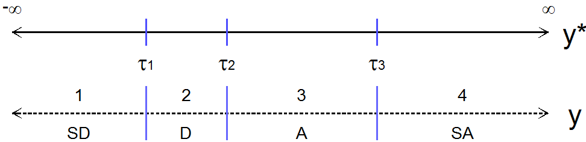
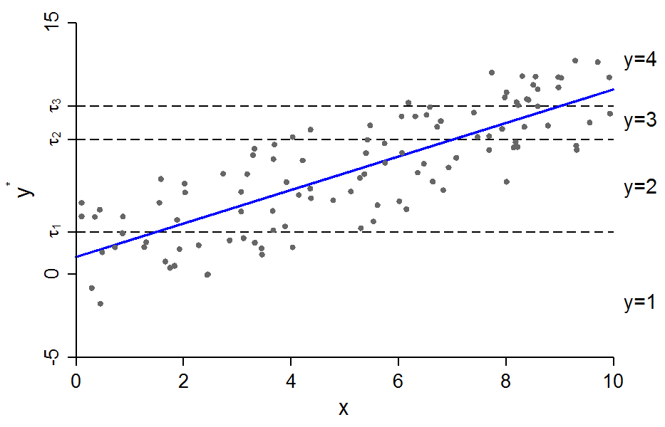
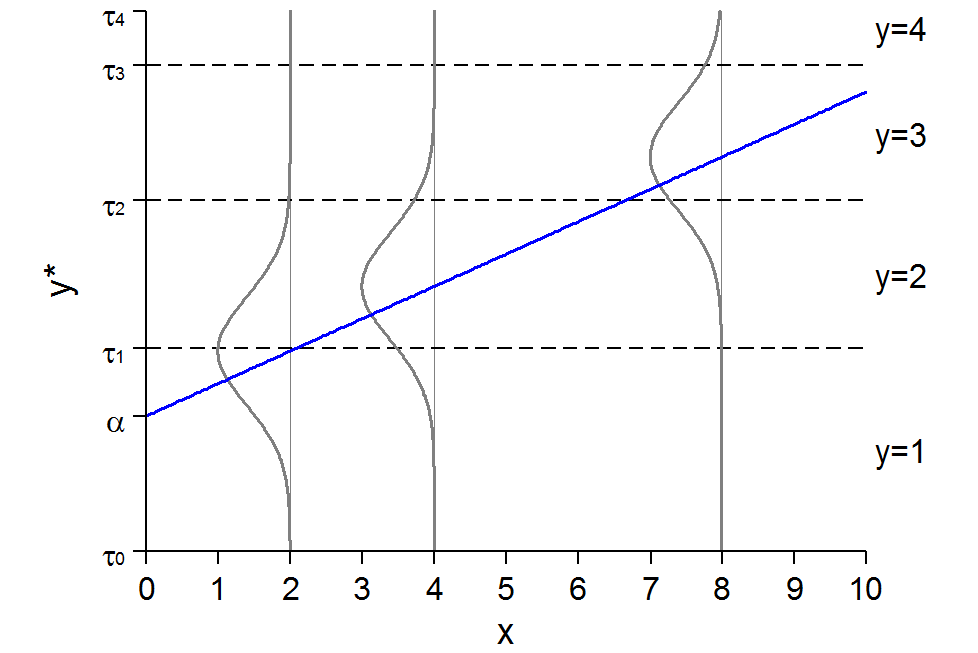
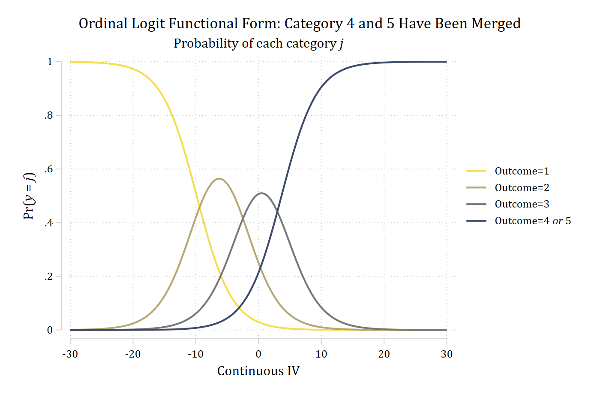

## Structural model relating x's to y\*

- The structural model can be conceptualized in an identical fashion to the binary regression model
- In a latent variable *y\** formulation---substantively---we are assuming a latent continuous dependent variable *y\** exists and that someone's place on *y\** is the cause of their observed category choice *y*
  - Our data only has partial information: the categorical (ordinal) *y*
- The structural model:

$$y^{*} = \mathbf{x}_{i}\boldsymbol{\beta} + \varepsilon$$

## Measurement model linking y\* to y

- Just as in binary regression, we don't observe *y\**
  - With ordinal DVs we observe an ordinal variable *y* with *J* total categories
    - Each individual category = *j*

{width=80% fig-alt="A latent y-star line from minus infinity to infinity split by three thresholds tau 1, tau 2, and tau 3 into four observed categories of y: 1 SD, 2 D, 3 A, and 4 SA."}

- Observed *y* is theoretically obtained from *y\** by dividing it into segments by thresholds τ~j~ (tau)

$$y_{i} = j \quad \text{if} \quad \tau_{j-1} \leq y_{i}^{*} < \tau_{j}$$

$$y_{i} = \begin{cases} 1 \Rightarrow \text{SD-Strongly Disagree} & \text{if } \tau_{0} = -\infty \leq y_{i}^{*} < \tau_{1} \\ 2 \Rightarrow \text{D-Disagree} & \text{if } \tau_{1} \leq y_{i}^{*} < \tau_{2} \\ 3 \Rightarrow \text{A-Agree} & \text{if } \tau_{2} \leq y_{i}^{*} < \tau_{3} \\ 4 \Rightarrow \text{SA-Strongly Agree} & \text{if } \tau_{3} \leq y_{i}^{*} < \tau_{4} = \infty \end{cases}$$

{width=70% fig-alt="Scatterplot of latent y-star against x from 0 to 10 with a rising regression line; three dashed horizontal lines at the thresholds tau 1, tau 2, and tau 3 divide the points into the observed categories y = 1 to y = 4."}

Conceptually, imagine we measured the true latent variable (*y\**) and then decided later to collapse the continuous variable into four ordered categories

#### Since y\* is latent we focus on Pr(y = j \| x)

{width=70% fig-alt="Latent y-star rising linearly with x, with normal error distributions drawn at x = 2, 4, and 8; dashed lines at the thresholds tau 1, tau 2, and tau 3 split each distribution into the probabilities of y = 1 to y = 4."}

Conceptually, *y\** is responsible for the observed categories of *y*. Remember we don't actually observe *y\** (so we can't directly estimate slope of the blue line). Instead, we need to take the information we do have on the proportion of responses in each category of *y*, make some assumptions, and extrapolate to *y\** (and thus the blue line)

### Assumptions & predicted probabilities for ordered models

{width=80% fig-alt="A latent y-star line split by thresholds tau 1, tau 2, and tau 3 into four observed categories of y: 1 SD, 2 D, 3 A, and 4 SA."}

- To get predictions, we examine whether predicted *y\** is between thresholds
  - Example: *y* = 2 when *y*\* is between τ~1~ and τ~2~

$$\Pr(y = 2\,|\,\mathbf{x}) = \Pr(\tau_{1} \leq y^{*} < \tau_{2}\,|\,\mathbf{x})$$

- Expanding *y*\*

$$\Pr(y = 2\,|\,\mathbf{x}) = \Pr(\tau_{1} \leq \alpha + \beta x + \varepsilon < \tau_{2}\,|\,\mathbf{x})$$

- We need some additional assumptions about α and ε to identify the model (below)

### Identification

- Because *y\** is unobserved we do not know its scale. To set the scale of *y\** and to compute Pr(*y* = *j* \| **x**) we need to make some assumptions which affect the scale/metric of the DV:
  - Ordered probit assumes: $\varepsilon \sim N(0, 1)$
  - Ordered logit assumes: $\varepsilon \sim \lambda(0, \pi^{2}/3)$
- We cannot estimate all of the thresholds\* and the intercept
  - One of two sets of identifying assumptions are often used

    Alternative 1: $\tau_{1} = 0$

    Alternative 2: $\alpha = 0$

- These alternatives lead to different *parameterizations*. But the parameterization chosen:
  - Does not affect the βs
  - Does not affect the significance tests of the βs
  - Does not affect the predicted probabilities of specific outcomes

**\*Note** only *J* -- 1 thresholds are needed (refer back to the continuum above; how many thresholds needed to know which category an observation is in?)

## Potential software issues

- Numerical methods for maximum likelihood estimation are readily available, although in practice the ordinal model can be a difficult model for obtaining convergence
  - Generally, takes longer to converge than most other categorical DV models
- Different software packages will use different parameterizations
- Small *n*'s in a category can lead to failure to converge
  - You can merge adjacent categories and only lose information... if the model assumptions are correct!

{width=70% fig-alt="Ordinal logit functional form with five equally likely categories: Pr(outcome 1) falls and Pr(outcome 5) rises across the continuous IV, with hill-shaped curves for outcomes 2, 3, and 4 in between."}

(The code for this graph is in [5.0](5-0-ordinal-outcomes.qmd#what-does-ordinality-mean))

### Merging adjacent categories

- Our observed *y* above has 5 categories. We can merge categories 4 and 5 and lose some information but not our ability to estimate the model
  - Critically, our estimates in terms of *y\** should be identical regardless as to whether we use all 5 categories or just the 4
  - However, we lose the ability with the 4 category DV to separately examine the Pr(*y* = 4) and the Pr(*y* = 5)

::: {.panel-tabset group="language"}
## Stata

```{.stata-run}
. * Simulated data from 5.0 (see the code there)
. 
. // Merge categories to demonstrate only lose info
. gen y_merge_4_5 = y

. recode y_merge_4_5 4 5 = 4
(400 changes made to y_merge_4_5)

. tab y y_merge_4_5

         5 |
 quantiles |                 y_merge_4_5
  of ystar |         1          2          3          4 |     Total
-----------+--------------------------------------------+----------
         1 |       400          0          0          0 |       400 
         2 |         0        400          0          0 |       400 
         3 |         0          0        400          0 |       400 
         4 |         0          0          0        400 |       400 
         5 |         0          0          0        400 |       400 
-----------+--------------------------------------------+----------
     Total |       400        400        400        800 |     2,000 

. 
. // Equal distribution in each outcome category //
. qui ologit y_merge_4_5 c.c i.b x1 x2

. 
. *Pr(probs)
. qui margins, at(c=(-30(.5)30)) atmeans

. marginsplot, noci plotopts(msym(none) lwidth(medthick) lpat(solid)) ///
>     xlab(-30(10)30) xtitle("Continuous IV") ytitle("Pr({it:y} = {it:j})") ///
>     title("Ordinal Logit Functional Form: Category 4 and 5 Have Been Merged", 
> size(medium)) ///
>     subtitle("Probability of each category {it:j}") ///
>     legend(order(1 "Outcome=1" 2 "Outcome=2" 3 "Outcome=3" 4 "Outcome=4 {it:or
> } 5")) ///
>     scheme(cleanplots5)

Variables that uniquely identify margins: c

```

{width=80% fig-alt="Ordinal logit functional form after merging categories 4 and 5: the curves for outcomes 1, 2, and 3 are the same as with five categories, and the merged outcome 4 or 5 rises from 0 to about 1 across the continuous IV."}

## R

```{r}
#| include: false
library(haven)
library(dplyr)
library(ggplot2)
library(MASS)
library(marginaleffects)
library(cleanplots)
cleanplots_defaults()

set.seed(30004)
n <- 2000
sim <- as.data.frame(mvrnorm(n, mu = c(0, 0), Sigma = matrix(c(1, .2, .2, 1), 2),
  empirical = TRUE))
names(sim) <- c("x1", "x2")
sim <- sim |>
  mutate(c = rnorm(n, 0, 10), b = rep(0:1, each = n / 2),
    ystar = 0 + 0.2 * c + 2 * b + rnorm(n), y = factor(ntile(ystar, 5)))
```

```{r}
#| fig-alt: "Ordinal logit functional form after merging categories 4 and 5: the curves for outcomes 1, 2, and 3 are the same as with five categories, and the merged outcome 4 or 5 rises from 0 to about 1 across the continuous IV."
# Simulated data from 5.0 (see the code there)

# Merge categories to demonstrate only lose info
sim <- sim |>
  mutate(y_merge_4_5 = factor(ifelse(as.numeric(y) >= 4, 4, as.numeric(y))))
table(sim$y, sim$y_merge_4_5)

# Equal distribution in each outcome category
mergemod <- polr(y_merge_4_5 ~ c + b + x1 + x2, data = sim, Hess = TRUE)

# Pr(probs) with the other IVs at their means
pr_merge <- predictions(mergemod, newdata = datagrid(c = seq(-30, 30, .5)))

ggplot(pr_merge, aes(x = c, y = estimate, color = group)) +
  geom_line(linewidth = 1) +
  scale_color_manual(values = viridisLite::cividis(5, end = .95, direction = -1)[1:4],
    labels = c("Outcome=1", "Outcome=2", "Outcome=3", "Outcome=4 or 5")) +
  scale_x_continuous(breaks = seq(-30, 30, 10)) +
  labs(title = "Ordinal Logit Functional Form: Category 4 and 5 Have Been Merged",
    subtitle = "Probability of each category j",
    x = "Continuous IV", y = "Pr(y = j)", color = NULL) +
  theme(plot.title.position = "plot")
```

:::
