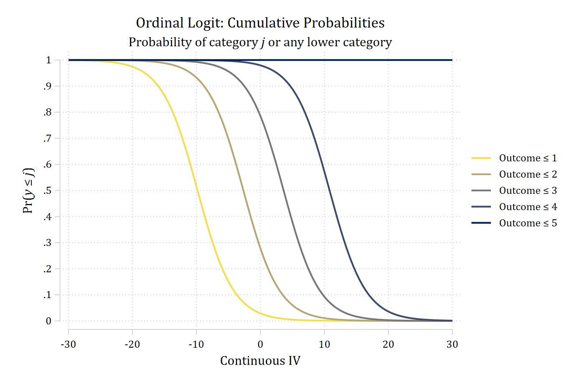
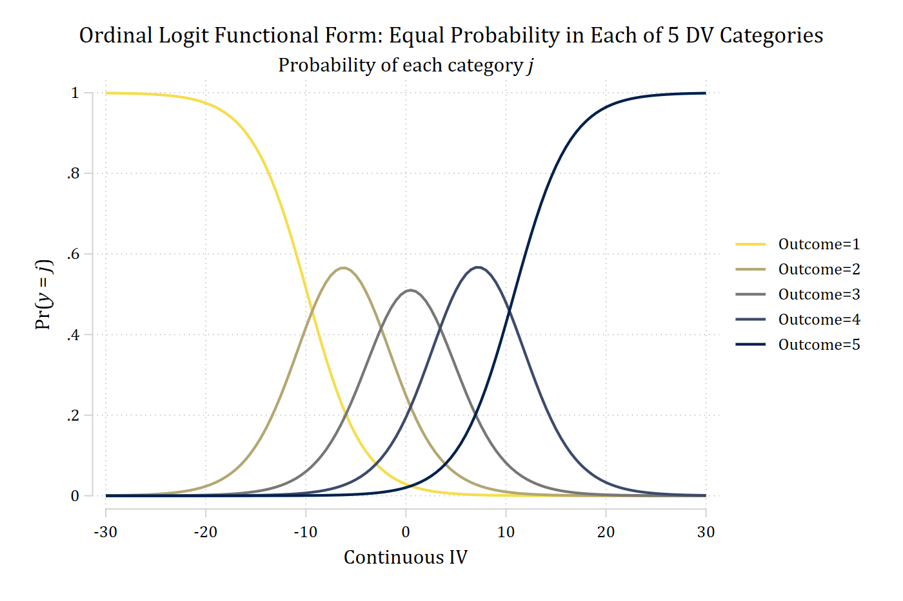
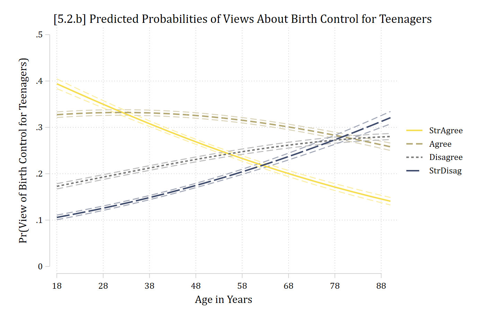
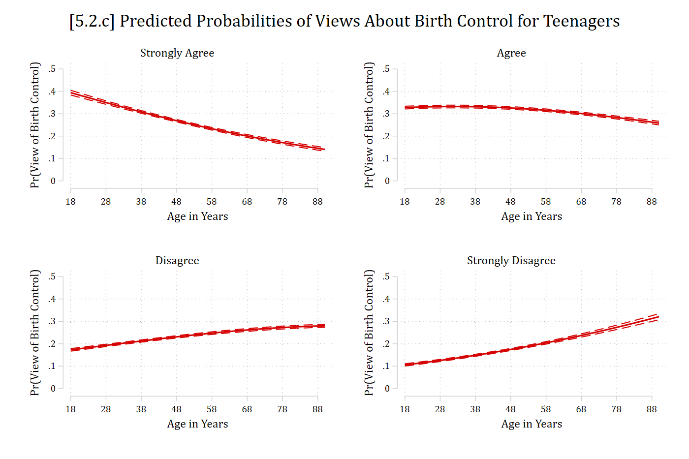
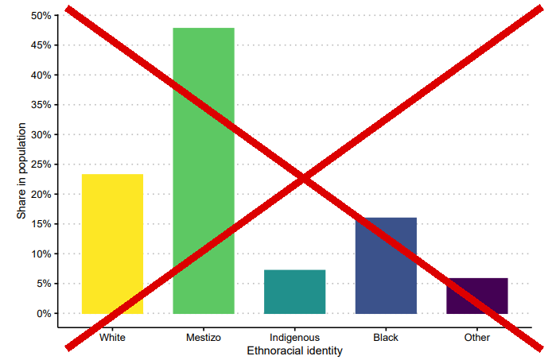
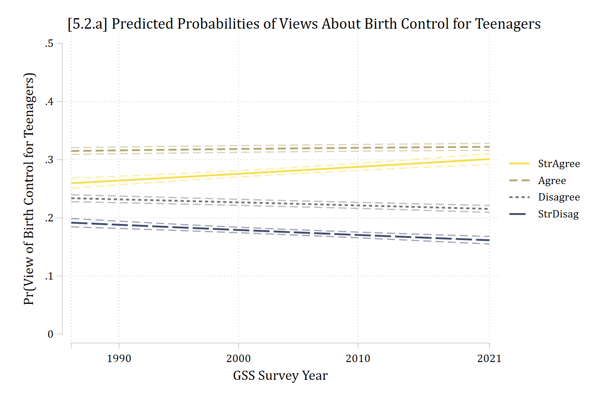
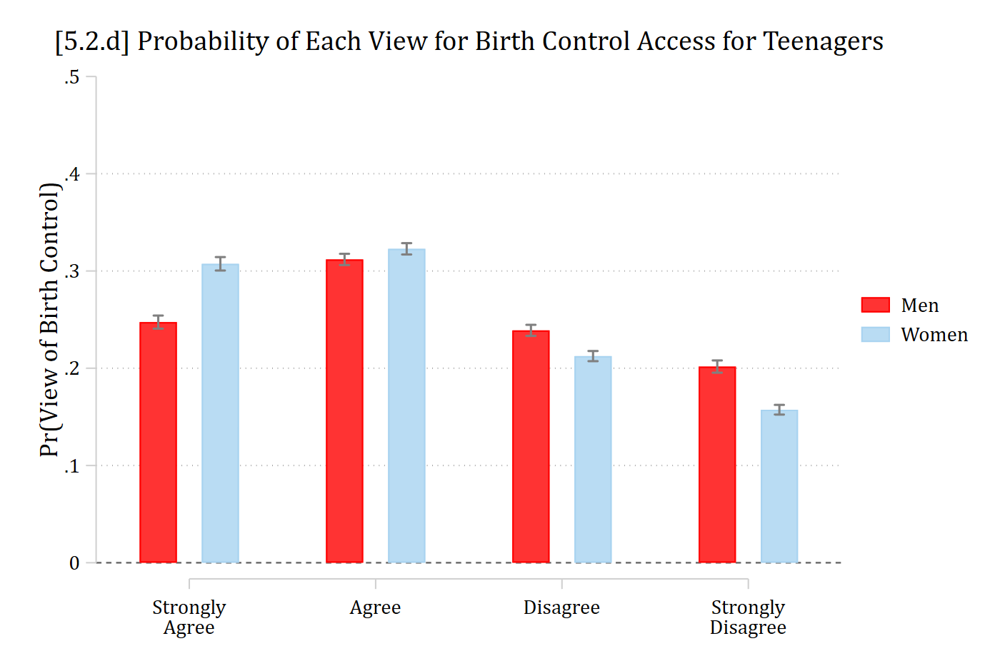
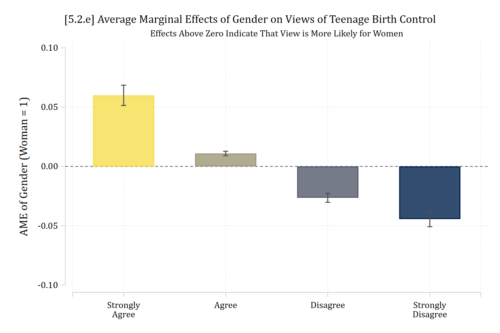
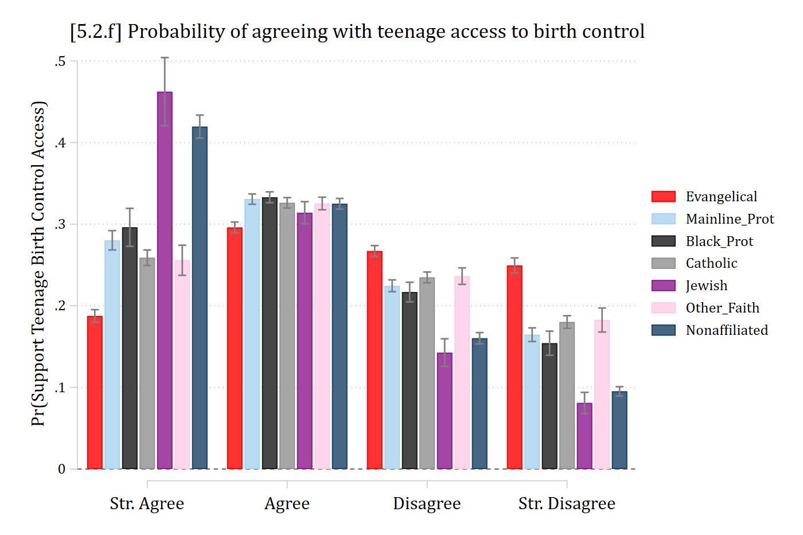

## Example: Attitudes about birth control access for teenagers

- GSS 1986 -- 2021
  - DV: *"Methods of birth control should be available to teenagers between the ages of 14 and 16 even if their parents do not approve"*
  - IVs: Year, age, gender, religiosity, education, race, income

::: {.callout-note icon="false" appearance="simple"}
In Stata, use the [**ologit**](https://www.stata.com/manuals/rologit.pdf) command

In R, use the [**polr**](https://www.rdocumentation.org/packages/MASS/versions/7.3-65/topics/polr) function in the MASS package
:::

::: {.panel-tabset group="language"}
## Stata

```{.stata-run}
. use "https://tdmize.github.io/data/data/cda_gss", clear
(cda_gss.dta |  GSS 1972-2021 CDA - Categorical Data Analysis | date created 202
> 3)

. 
. lab def likertlab 1"StrAgree" 2"Agree" 3"Disagree" 4"StrDisag"

. lab val pillok likertlab

. 
. gen religous = attend
(665 missing values generated)

. lab var religous "Religious Attendee"

. recode religous 0/3 = 0 4/8 = 1
(55,475 changes made to religous)

. lab def religlab 0"Not Religious" 1"Religious"

. lab val religous religlab

. 
. drop if year < 1986
(18,586 observations deleted)

. drop if missing(pillok, year1972, religous, college, age, woman, race3, faminc
> )
(25,267 observations deleted)

. 
. fre pillok

pillok -- birth control to teenagers 14-16
----------------------------------------------------------------
                   |      Freq.    Percent      Valid       Cum.
-------------------+--------------------------------------------
Valid   1 StrAgree |       7033      28.14      28.14      28.14
        2 Agree    |       7968      31.88      31.88      60.02
        3 Disagree |       5588      22.36      22.36      82.38
        4 StrDisag |       4404      17.62      17.62     100.00
        Total      |      24993     100.00     100.00           
----------------------------------------------------------------

```

## R

```{r}
library(haven)           # import Stata data and labels
library(dplyr)           # data manipulation
library(sjmisc)          # frq() frequency tables
library(ggplot2)         # graphs
library(MASS)            # ordinal logit: polr()
library(marginaleffects) # predictions and marginal effects
library(cleanplots)      # graph scheme
cleanplots_defaults()

source("https://raw.githubusercontent.com/tdmize/Rfunctions/main/ME_helper_functions.R")

# Center changes in continuous IVs on each observation's value
options(marginaleffects_contrast_direction = "center")

gss <- read_dta("https://tdmize.github.io/data/data/cda_gss.dta")

# Religious attendee = attends about once a month or more
gss <- gss |>
  mutate(religous = case_when(attend <= 3 ~ 0, attend >= 4 ~ 1)) |>
  filter(year >= 1986)

# Keep model variables; drop any missing data
gss <- gss[c("pillok", "year1972", "religous", "college", "age", "woman", "race3",
  "faminc", "reltrad", "degree")]
gss <- gss[complete.cases(gss[c("pillok", "year1972", "religous", "college", "age",
  "woman", "race3", "faminc")]), ]

# Ordinal DV as a factor with short labels; binary/nominal variables as factors
gss <- gss |>
  mutate(pillok = factor(pillok, levels = 1:4,
      labels = c("StrAgree", "Agree", "Disagree", "StrDisag")),
    religous = factor(religous, labels = c("Not Religious", "Religious")),
    across(c(college, woman, race3, reltrad, degree), as_factor),
    year1972 = as.numeric(year1972)) |>
  droplevels()

frq(gss$pillok)
```

:::

### Ordered logit example

::: {.panel-tabset group="language"}
## Stata

```{.stata-run}
. ologit pillok c.year1972 c.age i.woman i.religous i.college i.race3 c.faminc

Iteration 0:  Log likelihood = -34042.826  
Iteration 1:  Log likelihood = -32738.626  
Iteration 2:  Log likelihood = -32731.234  
Iteration 3:  Log likelihood =  -32731.23  
Iteration 4:  Log likelihood =  -32731.23  

Ordered logistic regression                            Number of obs =  24,993
                                                       LR chi2(8)    = 2623.19
                                                       Prob > chi2   =  0.0000
Log likelihood = -32731.23                             Pseudo R2     =  0.0385

-------------------------------------------------------------------------------
       pillok | Coefficient  Std. err.      z    P>|z|     [95% conf. interval]
--------------+----------------------------------------------------------------
     year1972 |     -0.006      0.001   -5.827   0.000       -0.008      -0.004
          age |      0.020      0.001   28.640   0.000        0.019       0.021
              |
        woman |
       Women  |     -0.319      0.023  -13.628   0.000       -0.365      -0.273
              |
     religous |
   Religious  |      0.886      0.024   36.615   0.000        0.838       0.933
              |
      college |
College De..  |     -0.247      0.028   -8.892   0.000       -0.302      -0.193
              |
        race3 |
       black  |     -0.113      0.035   -3.250   0.001       -0.181      -0.045
       other  |      0.119      0.045    2.623   0.009        0.030       0.208
              |
       faminc |      0.001      0.000    1.545   0.122       -0.000       0.001
--------------+----------------------------------------------------------------
        /cut1 |     -0.120      0.048                        -0.215      -0.025
        /cut2 |      1.334      0.049                         1.238       1.431
        /cut3 |      2.556      0.051                         2.456       2.657
-------------------------------------------------------------------------------

. est store pillmod

```

## R

```{r}
pillmod <- polr(pillok ~ year1972 + age + woman + religous + college + race3 + faminc,
  data = gss, Hess = TRUE)
summary(pillmod)
```

:::

**\*NOTE 1:** What Stata calls "cuts" are the estimated thresholds (τ's)

**\*NOTE 2:** Coefficient interpretations in [Section 5.3](5-3-coefficients.qmd)

## Predicted probabilities

- Per usual, we will start by focusing on interpreting the model in terms of predicted probabilities
- The model predicts the probability of being in category *j* or any lower category:

$$\Pr(y \leq j) = \frac{\exp(\tau_{j} - \mathbf{x}_{i}\boldsymbol{\beta})}{1 + \exp(\tau_{j} - \mathbf{x}_{i}\boldsymbol{\beta})}$$

- The model is a cumulative probability model (hence why it is sometimes referred to as the cumulative logit model)
  - $\Pr(y \leq j)$ represents the **probability of observing category *j* or any lower category**

::: {.panel-tabset group="language"}
## Stata

```{.stata-run}
. * Simulated data from 5.0 (see the code there)
. qui ologit y c.c i.b x1 x2

. 
. *Cumulative probabilities
. mgen, at(c=(-30(.5)30)) atmeans replace

Predictions from: margins, at(c=(-30(.5)30)) atmeans predict(outcome())

Variable   Obs Unique      Mean       Min       Max  Label
--------------------------------------------------------------------------------
_pr1       121    121  .3375535  6.38e-07  .9992714  pr(y=1) from margins
_ll1       121    121  .3281113  1.59e-07  .9989169  95% lower limit
_ul1       121    121  .3469957  1.12e-06  .9996259  95% upper limit
_c         121    121         0       -30        30  c
_Cpr1      121    121  .3375535  6.38e-07  .9992714  pr(y<=1)
_pr2       121    121  .1183478  7.66e-06  .5649652  pr(y=2) from margins
_ll2       121    121  .1053867  2.76e-06  .5270951  95% lower limit
_ul2       121    121  .1313089  .0000126   .603016  95% upper limit
_Cpr2      121    121  .4559013  8.30e-06  .9999439  pr(y<=2)
_pr3       121    121  .1039361  .0000502  .5102128  pr(y=3) from margins
_ll3       121    121  .0926852  .0000218  .4733877  95% lower limit
_ul3       121    121   .115187  .0000786  .5470378  95% upper limit
_Cpr3      121    121  .5598374  .0000789  .9999941  pr(y<=3)
_pr4       121    121  .1187696  5.45e-06  .5667576  pr(y=4) from margins
_ll4       121    121   .105821  1.86e-06  .5290154  95% lower limit
_ul4       121    121  .1317181  9.04e-06  .6044999  95% upper limit
_Cpr4      121    120   .678607  .0010341  .9999995  pr(y<=4)
_pr5       121    121   .321393  4.50e-07  .9989659  pr(y=5) from margins
_ll5       121    121  .3120077  1.04e-07  .9984826  95% lower limit
_ul5       121    121  .3307783  7.96e-07  .9994493  95% upper limit
_Cpr5      121      4         1  .9999999         1  pr(y<=5)
--------------------------------------------------------------------------------

Specified values of covariates

        1.                      
        b         x1         x2 
-------------------------------
       .5   4.02e-09   5.06e-10 

. 
. *Show cumulative probabilities as <= a given category
. gen prLE1 = (_pr1)
(1,879 missing values generated)

. gen prLE2 = (_pr1 + _pr2)
(1,879 missing values generated)

. gen prLE3 = (_pr1 + _pr2 + _pr3)
(1,879 missing values generated)

. gen prLE4 = (_pr1 + _pr2 + _pr3 + _pr4)
(1,879 missing values generated)

. gen prLE5 = (_pr1 + _pr2 + _pr3 + _pr4 + _pr5)
(1,879 missing values generated)

. 
. graph twoway connected prLE1 prLE2 prLE3 prLE4 prLE5 _c, ///
>     title("Ordinal Logit: Cumulative Probabilities") ///
>     subtitle("Probability of category {it:j} or any lower category") ///
>     msym(i i i i i) lwid(medthick medthick medthick medthick medthick) ///
>     lpat(solid solid solid solid solid) ///
>     ylabel(0(0.1)1) xlab(-30(10)30) ///
>     ytitle("Pr({it:y} {&le} {it:j})") xtitle("Continuous IV") ///
>     legend(order(1 "Outcome {&le} 1" 2 "Outcome {&le} 2" ///
>         3 "Outcome {&le} 3" 4 "Outcome {&le} 4" ///
>         5 "Outcome {&le} 5")) ///
>     scheme(cleanplots5)

```

{width=80% fig-alt="Ordinal logit cumulative probabilities across the continuous IV: four S-shaped curves for Pr(y ≤ 1) to Pr(y ≤ 4) fall from 1 to 0, each shifted to the right of the one before, and Pr(y ≤ 5) is a flat line at 1."}

## R

```{r}
#| include: false
set.seed(30004)
n <- 2000
sim <- as.data.frame(mvrnorm(n, mu = c(0, 0), Sigma = matrix(c(1, .2, .2, 1), 2),
  empirical = TRUE))
names(sim) <- c("x1", "x2")
sim <- sim |>
  mutate(c = rnorm(n, 0, 10), b = rep(0:1, each = n / 2),
    ystar = 0 + 0.2 * c + 2 * b + rnorm(n), y = factor(ntile(ystar, 5)))
```

```{r}
#| fig-alt: "Ordinal logit cumulative probabilities across the continuous IV: four S-shaped curves for Pr(y ≤ 1) to Pr(y ≤ 4) fall from 1 to 0, each shifted to the right of the one before, and Pr(y ≤ 5) is a flat line at 1."
# Simulated data from 5.0 (see the code there)
simmod <- polr(y ~ c + b + x1 + x2, data = sim, Hess = TRUE)

# Cumulative probabilities: Pr(y <= j) is the sum of Pr(y = 1) to Pr(y = j)
pr_cum <- predictions(simmod, newdata = datagrid(c = seq(-30, 30, .5))) |>
  group_by(c) |>
  mutate(cumulative = cumsum(estimate))

ggplot(pr_cum, aes(x = c, y = cumulative, color = group)) +
  geom_line(linewidth = 1) +
  scale_color_viridis_d(option = "cividis", end = .95, direction = -1,
    labels = paste("Outcome ≤", 1:5)) +
  scale_x_continuous(breaks = seq(-30, 30, 10)) +
  scale_y_continuous(breaks = seq(0, 1, .1)) +
  labs(title = "Ordinal Logit: Cumulative Probabilities",
    subtitle = "Probability of category j or any lower category",
    x = "Continuous IV", y = "Pr(y ≤ j)", color = NULL)
```

:::

### Predicted probabilities in ordinal models

- Instead of the cumulative probabilities, the probabilities of a given outcome category *j* are usually of most interest (i.e., these are often $\eta$ for ordinal logit). Can calculate the probability for a specific outcome category *j* for an ordinal DV with *J* total categories:

$$\eta = \Pr(y = j) = \frac{\exp(\mathbf{x}_{i}\boldsymbol{\beta} - \tau_{j-1})}{1 + \exp(\mathbf{x}_{i}\boldsymbol{\beta} - \tau_{j-1})} - \frac{\exp(\mathbf{x}_{i}\boldsymbol{\beta} - \tau_{j})}{1 + \exp(\mathbf{x}_{i}\boldsymbol{\beta} - \tau_{j})}$$

  - That is, we calculate the probability between the thresholds
    - Note this formula is for the middle categories (*j* = 2 ... *J* -- 1)
- For the 1^st^ and final category *J* the formulas simplify to:

$$\eta = \Pr(y = 1) = \frac{\exp(\tau_{1} - \mathbf{x}_{i}\boldsymbol{\beta})}{1 + \exp(\tau_{1} - \mathbf{x}_{i}\boldsymbol{\beta})}$$

$$\eta = \Pr(y = J) = \frac{\exp(\mathbf{x}_{i}\boldsymbol{\beta} - \tau_{J-1})}{1 + \exp(\mathbf{x}_{i}\boldsymbol{\beta} - \tau_{J-1})}$$

{width=70% fig-alt="Ordinal logit functional form with five equally likely categories: Pr(outcome 1) falls and Pr(outcome 5) rises across the continuous IV, with hill-shaped curves for outcomes 2, 3, and 4 in between."}

(The code for this graph is in [5.0](5-0-ordinal-outcomes.qmd#what-does-ordinality-mean))

### Plots of predicted probabilities

- Plots---while always recommended---are especially helpful with multiple outcome categories
- As ordinal models produce multiple prediction lines, including CIs can sometimes make the plot impossible to read with so many overlapping lines
  - An alternative is to make separate panels for each outcome category
- Always include a legend so the reader knows which line is for which DV category

::: {.panel-tabset group="language"}
## Stata

::: {.callout-note icon="false" appearance="simple"}
Stata builds the plot CIs first, then lines. So, graph aspects 1, 2, 3, and 4 are CIs. To label the lines themselves, start the legend at *J* + 1 (5 here)
:::

```{.stata-run}
. *5.2.b - predictions for continuous IV age
. est restore pillmod
(results pillmod are active now)

. qui margins, at(age=(18(4)90))

. marginsplot, recastci(rline) ciopt(lpat(dash) col(*.5)) ///
>     plotop(lwid(*1.5) msym(none)) ylab(0(.1).5) ///
>     xlabel(18(10)88) xtitle("Age in Years") ///
>     ytitle("Pr(View of Birth Control for Teenagers)") ///
>     title("[5.2.b] Predicted Probabilities of Views About Birth Control for Te
> enagers", size(*1.1)) ///
>     legend(order(5 "StrAgree" 6 "Agree" 7 "Disagree" 8 "StrDisag")) ///
>     scheme(cleanplots5)

Variables that uniquely identify margins: age

```

{width=80% fig-alt="[5.2.b] Predicted probabilities of each view of birth control for teenagers by age from 18 to 90: strongly agree falls from about 0.39 to 0.14, agree stays near 0.33 then falls to about 0.26, disagree rises from about 0.17 to 0.28, and strongly disagree rises from about 0.11 to 0.32."}

## R

::: {.callout-note icon="false" appearance="simple"}
R's **plot_predictions** default would hold controls at modal person. To get average predictions, need the **newdata** statement with a "counterfactual" **grid_type**. Add **"group"** to the **by** function to get separate lines for each outcome
:::

```{r}
#| fig-alt: "[5.2.b] Predicted probabilities of each view of birth control for teenagers by age from 18 to 90: strongly agree falls from about 0.39 to 0.14, agree stays near 0.33 then falls to about 0.26, disagree rises from about 0.17 to 0.28, and strongly disagree rises from about 0.11 to 0.32."
# 5.2.b - predictions for continuous IV age
plot_predictions(pillmod, by = c("age", "group"),
  newdata = datagrid(age = seq(18, 90, 4), grid_type = "counterfactual")) +
  scale_color_viridis_d(option = "cividis", end = .95, direction = -1) +
  scale_fill_viridis_d(option = "cividis", end = .95, direction = -1) +
  scale_x_continuous(breaks = seq(18, 88, 10)) +
  scale_y_continuous(breaks = seq(0, .5, .1), limits = c(0, .5)) +
  labs(title = "[5.2.b] Predicted Probabilities of Views About Birth Control for Teenagers",
    x = "Age in Years", y = "Pr(View of Birth Control for Teenagers)",
    color = NULL, fill = NULL) +
  theme(plot.title.position = "plot")
```

:::

::: {.panel-tabset group="language"}
## Stata

```{.stata-run}
. *5.2.c - same plot of age but as small multiples
. *NOTE: use colorpalette to get RGB codes for colors in scheme
. **(otherwise, all plots will use default 1st color)
. colorpalette cleanplots5, globals

globals:
                    p1 : "246 221 77"
                    p2 : "179 167 114"
                    p3 : "119 119 118"
                    p4 : "62 74 107"
                    p5 : "0 32 77"

. 
. qui margins, at(age=(18(4)90)) predict(outcome(1))

. marginsplot, recastci(rline) ciopt(lpat(dash) col($civ1)) ///
>     plotop(lcol($civ1) lwid(*1.5) msym(none)) ylab(0(.1).5) ///
>     xlabel(18(10)88) xtitle("Age in Years") ///
>     ytitle("Pr(View of Birth Control)") ///
>     title("Strongly Agree") name(pr1, replace)

Variables that uniquely identify margins: age

. 
. qui margins, at(age=(18(4)90)) predict(outcome(2))

. marginsplot, recastci(rline) ciopt(lpat(dash) col($civ2)) ///
>     plotop(lcol($civ2) lwid(*1.5) msym(none)) ylab(0(.1).5) ///
>     xlabel(18(10)88) xtitle("Age in Years") ///
>     ytitle("Pr(View of Birth Control)") ///
>     title("Agree") name(pr2, replace)

Variables that uniquely identify margins: age

. 
. qui margins, at(age=(18(4)90)) predict(outcome(3))

. marginsplot, recastci(rline) ciopt(lpat(dash) col($civ3)) ///
>     plotop(lcol($civ3) lwid(*1.5) msym(none)) ylab(0(.1).5) ///
>     xlabel(18(10)88) xtitle("Age in Years") ///
>     ytitle("Pr(View of Birth Control)") ///
>     title("Disagree") name(pr3, replace)

Variables that uniquely identify margins: age

. 
. qui margins, at(age=(18(4)90)) predict(outcome(4))

. marginsplot, recastci(rline) ciopt(lpat(dash) col($civ4)) ///
>     plotop(lcol($civ4) lwid(*1.5) msym(none)) ylab(0(.1).5) ///
>     xlabel(18(10)88) xtitle("Age in Years") ///
>     ytitle("Pr(View of Birth Control)") ///
>     title("Strongly Disagree") name(pr4, replace)

Variables that uniquely identify margins: age

. 
. graph combine pr1 pr2 pr3 pr4, ///
>     title("[5.2.c] Predicted Probabilities of Views About Birth Control for Te
> enagers")

```

{width=80% fig-alt="[5.2.c] Four panels, one per view, of predicted probabilities by age with confidence intervals: strongly agree falls with age, agree is flat then falls slightly, disagree rises slightly, and strongly disagree rises."}

## R

```{r}
#| fig-alt: "[5.2.c] Four panels, one per view, of predicted probabilities by age with confidence intervals: strongly agree falls with age, agree is flat then falls slightly, disagree rises slightly, and strongly disagree rises."
#| fig-width: 9
#| fig-height: 6.5
# 5.2.c - same plot of age but as small multiples
plot_predictions(pillmod, by = c("age", "group"),
  newdata = datagrid(age = seq(18, 90, 4), grid_type = "counterfactual")) +
  facet_wrap(~ group, labeller = as_labeller(c(StrAgree = "Strongly Agree",
    Agree = "Agree", Disagree = "Disagree", StrDisag = "Strongly Disagree"))) +
  scale_color_viridis_d(option = "cividis", end = .95, direction = -1) +
  scale_fill_viridis_d(option = "cividis", end = .95, direction = -1) +
  scale_x_continuous(breaks = seq(18, 88, 10)) +
  scale_y_continuous(breaks = seq(0, .5, .1), limits = c(0, .5)) +
  labs(title = "[5.2.c] Predicted Probabilities of Views About Birth Control for Teenagers",
    x = "Age in Years", y = "Pr(View of Birth Control)") +
  theme(plot.title.position = "plot", legend.position = "none")
```

:::

### Nominal and ordinal color palettes

- Most graphics themes' palettes are nominal
  - I.e., They do not imply ordering by the color choices
  - **cleanplots**, which I use in these notes, defaults to a nominal palette
    - Available in [Stata](/software/cleanplots/index.qmd) and [R](/software/cleanplots_r/index.qmd)
- It is sometimes useful to use an ordinal palette to have the visual reflect the ordering in the variable (e.g., for educational degrees)
  - The [**cividis** and **viridis** palettes](https://cran.r-project.org/web/packages/viridis/vignettes/intro-to-viridis.html) are my favorite for an ordinal palette
  - Note you should not use an ordinal palette for a nominal variable (falsely implies ordering)

:::: {.columns}
::: {.column width="15%"}
{fig-alt="A vertical color bar of the viridis palette, from yellow at the top through green and teal to dark purple at the bottom."}
:::
::: {.column width="55%"}
{fig-alt="Bar chart of the share of the population by ethnoracial identity (White, Mestizo, Indigenous, Black, Other) drawn in viridis colors, crossed out with a large red X."}
:::
::: {.column width="30%"}
::: {.callout-note icon="false" appearance="simple"}
Should use a nominal palette for a race-ethnicity variable
:::
:::
::::

::: {.panel-tabset group="language"}
## Stata

- For an ordinal palette, in Stata use **scheme(cleanplots#)** as an option on a single graph (changes colors for just that one graph)
  - Where **\#** = number of colors (e.g., \# of outcome categories)
  - Default color palette is cividis (very colorblind friendly); viridis (pretty colorblind friendly) is available as **cleanplots#v**
    - Ordered light to dark
    - For reverse order (dark to light), specify **cleanplots#r** or **cleanplots#vr**

```stata
marginsplot, … scheme(cleanplots4)
```

## R

- For an ordinal palette, in R add **scale_fill_viridis_d()** or **scale_color_viridis_d()** (changes colors for just that one graph)
  - With the **\_d** functions (discrete), the number of colors automatically matches the number of categories
  - Default scheme is viridis; can specify **option = "cividis"**
    - For light to dark, specify direction = -1
      - Default is dark to light
    - Specify end = 0.95 to avoid colors that are too light on a white background.

```r
p + scale_fill_viridis_d(option = "cividis", end = 0.95, direction = -1)
```

:::

## Marginal effects

- The marginal effects from ordinal models are interpreted **identically** to those from multinomial logit

  *MEM: The difference in Pr(y = j \| **x**) for a change in x~k~ of δ, holding other control variables at their means*

  *AME: On average, the difference in Pr(y = j \| **x**) for a change in x~k~ of δ*

  - Always for the probability of a given category *j*
  - And have *J* total Pr(*y* = *j*), and thus *J* total MEs
- For the MEM, we hold the control variables ($\mathbf{x}_{-k}$) at their means ($\overline{\mathbf{x}}$)

$$MEM = \eta(x_{k} = end, \mathbf{x}_{-k} = \overline{\mathbf{x}}) - \eta(x_{k} = start, \mathbf{x}_{-k} = \overline{\mathbf{x}})$$

- The **average marginal effect** (AME) averages an observation specific marginal effect over all observations in the data:

$$AME = \frac{1}{N}\sum_{i = 1}^{N}\left\{\eta(x_{k} = {end}_{i}, \mathbf{x}_{-k} = \mathbf{x}_{-k,i}) - \eta(x_{k} = {start}_{i}, \mathbf{x}_{-k} = \mathbf{x}_{-k,i})\right\}$$

### Average marginal effect (AME) for continuous IV

::: {.panel-tabset group="language"}
## Stata

```{.stata-run}
. mecompare age, amount(sd) model(pillmod)

Predicting: Pr(pillok)
Marginal effects (N_pillmod=24993)

                                 |  ME #   Estimate         SE      P>|z|
---------------------------------+---------------------------------------
age + SD (centered)              |                                       
              StrAgree - pillmod |     1     -0.064      0.002      0.000
                 Agree - pillmod |     2     -0.011      0.001      0.000
              Disagree - pillmod |     3      0.028      0.001      0.000
              StrDisag - pillmod |     4      0.047      0.002      0.000

```

## R

```{r}
avg_comparisons(pillmod, variables = list(age = sd(gss$age)))
```

:::

> *Age patterns views about teenager's access to birth control in the US, with older adults less likely to support teenagers having access to birth control without their parent's consent. For example, a standard deviation increase in age (about 17 years) is associated with a 6 percentage point decline in "strongly agreeing" that teenagers should have access to birth control. In contrast, the probability of "strongly disagreeing" increases by about 5 percentage points as someone ages a standard deviation. There are smaller, but similarly patterned effects on the probability of "agreeing" (ME~+SD~ = -0.011) and "disagreeing" for increases in age (ME~+SD~ = 0.028).*

::: {.panel-tabset group="language"}
## Stata

```{.stata-run}
. *NOTE: scheme(cleanplots#) applies ordinal color scheme just to that one
. **graph. # specifies how many colors
. 
. *5.2.a - predictions for continuous IV year
. est restore pillmod
(results pillmod are active now)

. qui margins, at(year1972=(14(1)49))

. marginsplot, recastci(rline) ciopt(lpat(dash) col(*.5)) ///
>     plotop(lwid(*1.5) msym(none)) ///
>     ylab(0(.1).5) xtitle("GSS Survey Year") ///
>     xlab(14 " " 18 28 38 49) ///
>     ytitle("Pr(View of Birth Control for Teenagers)") ///
>     title("[5.2.a] Predicted Probabilities of Views About Birth Control for Te
> enagers", size(*1.1)) ///
>     legend(order(5 "StrAgree" 6 "Agree" 7 "Disagree" 8 "StrDisag")) ///
>     scheme(cleanplots5)

Variables that uniquely identify margins: year1972

```

{width=80% fig-alt="[5.2.a] Predicted probabilities of each view of birth control for teenagers by GSS survey year from 1986 to 2021: strongly agree rises slightly from about 0.26 to 0.30, agree stays near 0.32, disagree falls slightly from about 0.23 to 0.21, and strongly disagree falls slightly from about 0.19 to 0.16."}

## R

```{r}
#| fig-alt: "[5.2.a] Predicted probabilities of each view of birth control for teenagers by GSS survey year from 1986 to 2021: strongly agree rises slightly from about 0.26 to 0.30, agree stays near 0.32, disagree falls slightly from about 0.23 to 0.21, and strongly disagree falls slightly from about 0.19 to 0.16."
# 5.2.a - predictions for continuous IV year
plot_predictions(pillmod, by = c("year1972", "group"),
  newdata = datagrid(year1972 = 14:49, grid_type = "counterfactual")) +
  scale_color_viridis_d(option = "cividis", end = .95, direction = -1) +
  scale_fill_viridis_d(option = "cividis", end = .95, direction = -1) +
  scale_x_continuous(breaks = c(18, 28, 38, 49), labels = c("1990", "2000", "2010", "2021")) +
  scale_y_continuous(breaks = seq(0, .5, .1), limits = c(0, .5)) +
  labs(title = "[5.2.a] Predicted Probabilities of Views About Birth Control for Teenagers",
    x = "GSS Survey Year", y = "Pr(View of Birth Control for Teenagers)",
    color = NULL, fill = NULL) +
  theme(plot.title.position = "plot")
```

:::

### Example marginal effect interpretations

::: {.panel-tabset group="language"}
## Stata

```{.stata-run}
. mecompare year1972, amount(range) model(pillmod)

Predicting: Pr(pillok)
Marginal effects (N_pillmod=24993)

                                 |  ME #   Estimate         SE      P>|z|
---------------------------------+---------------------------------------
year1972(min-max)                |                                       
              StrAgree - pillmod |     1      0.041      0.007      0.000
                 Agree - pillmod |     2      0.007      0.001      0.000
              Disagree - pillmod |     3     -0.018      0.003      0.000
              StrDisag - pillmod |     4     -0.030      0.005      0.000

```

## R

```{r}
avg_comparisons(pillmod, variables = list(year1972 = "minmax"))
```

:::

> *The effect of time has been to increase widespread acceptance of birth control, though change in opinions has been small in magnitude. Specifically, since the GSS began asking this question in 1986, to the latest survey in 2021, people have become more likely to strongly agree or agree that teenagers should have widespread access to birth control (ME~st_agree~ = 0.041; ME~agree~ = 0.007). In contrast, in more recent years people are less likely to disagree or strongly disagree with teenage birth control access (ME~disagree~ = -0.018; ME~st_disagree~ = -0.030). It is worth noting that although all of these changes are statistically significant, all are relatively small in substantive size.*

### Plots of binary/nominal IVs

::: {.panel-tabset group="language"}
## Stata

- In Stata, **marginsplot** is not ideal for plots of predictions for nominal/ordinal outcome models
  - Instead, store predictions from **margins** and plot with [**coefplot**](https://repec.sowi.unibe.ch/stata/coefplot/getting-started.html)

::: {.callout-note icon="false" appearance="simple"}
**coefplot** will use the saved estimate names for the legend, so save time by naming them neatly
:::

```{.stata-run}
. // 5.2.d - Show pr() of each nominal (binary) IV level
. est restore pillmod
(results pillmod are active now)

. qui margins, at(woman=0) post

. est store Men

. est restore pillmod
(results pillmod are active now)

. qui margins, at(woman=1) post

. est store Women

. 
. coefplot Men Women, ///
>     recast(bar) barw(0.2) vertical yline(0) ylab(0(.1).5) ///
>     ciopts(recast(rcap) color(gs8)) citop scale(1.1) ///
>     xlab(1 `" "Strongly" "Agree" "' 2 "Agree" 3 "Disagree" 4 `" "Strongly" "Di
> sagree" "') ///
>     ytitle("Pr(View of Birth Control)") ///
>     title("[5.2.d] Probability of Each View for Birth Control Access for Teena
> gers")

```

{width=80% fig-alt="[5.2.d] Bar chart of the predicted probability of each view for men and women: strongly agree about 0.25 for men and 0.31 for women, agree about 0.31 and 0.32, disagree about 0.24 and 0.21, strongly disagree about 0.20 and 0.16."}

## R

- In R, use [**plot_predictions**](https://marginaleffects.com/bonus/plot.html), the **facet_wrap** function, and include **"group"** in the **by** function for a fairly nice dot plot
  - Make sure to specify the counterfactual **grid_type** in **newdata** for average predictions, rather than predictions for a modal person

```{r}
#| fig-alt: "[5.2.d] Dot plot of the predicted probability of each view for men and women: strongly agree about 0.25 for men and 0.31 for women, agree about 0.31 and 0.32, disagree about 0.24 and 0.21, strongly disagree about 0.20 and 0.16."
#| fig-width: 9.5
# 5.2.d - Show pr() of each nominal (binary) IV level
plot_predictions(pillmod, by = c("woman", "group"),
  newdata = datagrid(woman = unique, grid_type = "counterfactual")) +
  facet_wrap(~ group, nrow = 1) +
  scale_color_viridis_d(option = "cividis", end = .95, direction = -1) +
  scale_y_continuous(breaks = seq(0, .5, .1), limits = c(0, .5)) +
  labs(title = "[5.2.d] Probability of Each View for Birth Control Access for Teenagers",
    x = NULL, y = "Pr(View of Birth Control)") +
  theme(plot.title.position = "plot", legend.position = "none")
```

:::

#### Plots of marginal effects for binary IVs

::: {.panel-tabset group="language"}
## Stata

- In Stata, estimate MEs using **margins, dydx( )** and then plot with **marginsplot**
  - Works well as dot plot with **recast(scatter)** or bar chart with **recast(bar)**
  - Add **yline(0)** to easily see where a null effect is
  - Default is all same color dots/bars; to apply an ordinal palette, specify **\_predict** in **xdimension()** and **plotdimension()** options

```{.stata-run}
. *5.2.e - MEs for graph above (MEs for woman)
. est restore pillmod
(results pillmod are active now)

. qui margins, dydx(woman) post

. *marginsplot defaults to bars of the same color; specify _predict in the
. **xdimension() and plotdimension() to apply ordinal color scheme()
. marginsplot, recast(bar) ciopts(color(gs5)) ///
>     xdimension(_predict) plotdimension(_predict) legend(off) ///
>     xlab(0.5 " " 1 `" "Strongly" "Agree" "' 2 "Agree" ///
>         3 "Disagree" 4 `" "Strongly" "Disagree" "' 4.5 " ") ///
>     yline(0) plotopts(barw(0.6)) ylab(-.1(.05).1, format(%4.2f)) ///
>     ytitle("AME of Gender (Woman = 1)") xtitle("") ///
>     title("[5.2.e] Average Marginal Effects of Gender on Views of Teenage Birt
> h Control") ///
>     subtitle("Effects Above Zero Indicate That View is More Likely for Women",
>  size(small)) ///
>     scheme(cleanplots4)

Variables that uniquely identify margins:

```

{width=80% fig-alt="[5.2.e] Bar chart, in ordinal colors from light to dark, of the average marginal effects of gender (woman = 1) on each view: about 0.06 for strongly agree, 0.01 for agree, -0.03 for disagree, and -0.04 for strongly disagree."}

## R

- In R, use [**plot_comparisons**](https://marginaleffects.com/man/r/plot_comparisons.html) and include **"group"** in the **by** function for a fairly nice dot plot
  - Add **geom_hline(yintercept = 0)** to easily see where a null effect is

```{r}
#| fig-alt: "[5.2.e] Bar chart, in ordinal colors from light to dark, of the average marginal effects of gender (woman = 1) on each view: about 0.06 for strongly agree, 0.01 for agree, -0.03 for disagree, and -0.04 for strongly disagree."
# 5.2.e - MEs for gender (woman = 1) as a bar chart in ordinal colors
me_woman <- avg_comparisons(pillmod, variables = "woman")

ggplot(me_woman, aes(x = group, y = estimate, fill = group)) +
  geom_col(width = .6) +
  geom_errorbar(aes(ymin = conf.low, ymax = conf.high), width = .1, color = "gray30") +
  geom_hline(yintercept = 0, linetype = "dashed") +
  scale_fill_viridis_d(option = "cividis", end = .95, direction = -1) +
  scale_x_discrete(labels = c("Strongly\nAgree", "Agree", "Disagree", "Strongly\nDisagree")) +
  scale_y_continuous(breaks = seq(-.1, .1, .05), limits = c(-.1, .1)) +
  labs(title = "[5.2.e] Average Marginal Effects of Gender on Views of Teenage Birth Control",
    subtitle = "Effects Above Zero Indicate That View is More Likely for Women",
    x = NULL, y = "AME of Gender (Woman = 1)") +
  theme(plot.title.position = "plot", legend.position = "none")
```

```{r}
#| fig-alt: "Dot plot of the same average marginal effects of gender with confidence intervals and a dashed line at zero."
# Dot plot version
plot_comparisons(pillmod, variables = "woman", by = "group") +
  geom_hline(yintercept = 0, linetype = "dashed") +
  labs(x = NULL, y = "AME of Gender (Woman = 1)")
```

:::

### Average marginal effect (AME) for binary IV

::: {.panel-tabset group="language"}
## Stata

```{.stata-run}
. mecompare woman, model(pillmod)

Predicting: Pr(pillok)
Marginal effects (N_pillmod=24993)

                                 |  ME #   Estimate         SE      P>|z|
---------------------------------+---------------------------------------
woman                            |                                       
                 Women - Men     |                                       
              StrAgree - pillmod |     1      0.060      0.004      0.000
                 Agree - pillmod |     2      0.011      0.001      0.000
              Disagree - pillmod |     3     -0.026      0.002      0.000
              StrDisag - pillmod |     4     -0.044      0.003      0.000

```

## R

```{r}
avg_comparisons(pillmod, variables = "woman")
```

:::

> *In general, women are more supportive of teenagers having access to birth control than are men. Women have a 0.060 higher probability of "strongly agreeing"---and a 0.011 higher probability of agreeing---that teenagers should have access to birth control regardless of their parent's consent. In contrast, women have lower probabilities of disagreeing or strongly disagreeing, compared to men's opinions (∆~disagree~ = -0.026, ∆~strongly\ disagree~ = -0.044)*

::: {.callout-note icon="false" appearance="simple"}
[Interpretation tip]{.underline}: $\Delta$ or just "ME" are common ways to denote a marginal effect. It is useful to denote the outcome category in a subscript.
:::

### Predictions and MEs for multi-category nominal IV

::: {.panel-tabset group="language"}
## Stata

```{.stata-run}
. ***************
. // Nominal IVs with 3+ categories //
. ***************
. *Add a nominal version of educational attainment and religious affiliation
. qui ologit pillok c.year1972 c.age i.woman i.reltrad ///
>     i.degree i.race3 c.faminc

. est store pillmod2

. 
. *5.2.f - Show pr() of each group
. est restore pillmod2
(results pillmod2 are active now)

. qui margins, at(reltrad=1) post

. est store Evangelical

. est restore pillmod2
(results pillmod2 are active now)

. qui margins, at(reltrad=2) post

. est store Mainline_Prot

. est restore pillmod2
(results pillmod2 are active now)

. qui margins, at(reltrad=3) post

. est store Black_Prot

. est restore pillmod2
(results pillmod2 are active now)

. qui margins, at(reltrad=4) post

. est store Catholic

. est restore pillmod2
(results pillmod2 are active now)

. qui margins, at(reltrad=5) post

. est store Jewish

. est restore pillmod2
(results pillmod2 are active now)

. qui margins, at(reltrad=6) post

. est store Other_Faith

. est restore pillmod2
(results pillmod2 are active now)

. qui margins, at(reltrad=7) post

. est store Nonaffiliated

. 
. coefplot Evangelical Mainline_Prot Black_Prot Catholic Jewish Other_Faith Nona
> ffiliated, ///
>     recast(bar) barw(0.11) vertical yline(0) ylab(0(.1).5) ///
>     ciopts(recast(rcap) color(gs8)) citop ///
>     xlab(1 "Str. Agree" 2 "Agree" 3 "Disagree" 4 "Str. Disagree", labsize(meds
> mall)) ///
>     ytitle("Pr(Support Teenage Birth Control Access)") ///
>     title("[5.2.f] Probability of agreeing with teenage access to birth contro
> l")

```

{width=80% fig-alt="[5.2.f] Bar chart of the predicted probability of each view for seven religious traditions: Jewish (about 0.46) and nonaffiliated (about 0.42) respondents are most likely to strongly agree and Evangelicals least likely (about 0.19), while Evangelicals are most likely to strongly disagree (about 0.25)."}

## R

```{r}
#| fig-alt: "[5.2.f] Bar chart of the predicted probability of each view for seven religious traditions: Jewish (about 0.46) and nonaffiliated (about 0.42) respondents are most likely to strongly agree and Evangelicals least likely (about 0.19), while Evangelicals are most likely to strongly disagree (about 0.25)."
#| fig-width: 9.5
# Nominal IVs with 3+ categories: add religious tradition and educational degree
gss2 <- gss[complete.cases(gss[c("reltrad", "degree")]), ] |>
  droplevels()

pillmod2 <- polr(pillok ~ year1972 + age + woman + reltrad + degree + race3 + faminc,
  data = gss2, Hess = TRUE)

# 5.2.f - Show pr() of each group
pr_reltrad <- avg_predictions(pillmod2, by = c("reltrad", "group"),
  newdata = datagrid(reltrad = unique, grid_type = "counterfactual"))

ggplot(pr_reltrad, aes(x = group, y = estimate, fill = reltrad)) +
  geom_col(position = position_dodge(width = .9), width = .85) +
  geom_errorbar(aes(ymin = conf.low, ymax = conf.high),
    position = position_dodge(width = .9), width = .2, color = "gray50") +
  scale_x_discrete(labels = c("Str. Agree", "Agree", "Disagree", "Str. Disagree")) +
  scale_y_continuous(breaks = seq(0, .5, .1), limits = c(0, .5)) +
  labs(title = "[5.2.f] Probability of agreeing with teenage access to birth control",
    x = NULL, y = "Pr(Support Teenage Birth Control Access)", fill = NULL) +
  theme(plot.title.position = "plot")
```

:::

### ME inequality for nominal IVs

- Combining nominal or ordinal IVs with nominal or ordinal outcomes presents a challenge of an overwhelming number of predictions and marginal effects to examine
  - The \# of MEs for nominal/ordinal IVs in nominal/ordinal DV models = the \# of outcome categories \* the \# of pairwise comparisons of the nominal/ordinal IV
    - For a nominal independent variable with *L* categories and a nominal or ordinal outcome with $\Lambda$ outcome categories

$$\#\ of\ MEs = \Lambda * \frac{L(L - 1)}{2}$$

- In this example

$$\#\ of\ MEs = 4 * \frac{7(7 - 1)}{2} = 84$$

  - 84 marginal effects; this is untenable
- One solution, simplify down to the ME inequality per outcome category $\lambda$ ([Mize and Han 2025](/research/mize_han_socsci_2025.qmd))

$${ME\ inequality}_{\lambda} \equiv |average\ weighted\ ME\ inequality|_{\lambda} = \sum_{a = 1}^{L}\sum_{b = 2;\ b > a}^{L}\frac{w_{a,b}}{L - 1} \left|\eta_{\lambda}(x_{k} = a, \mathbf{x}_{-k} = \mathbf{x}_{-k}^{*}) - \eta_{\lambda}(x_{k} = b, \mathbf{x}_{-k} = \mathbf{x}_{-k}^{*})\right|$$

  - There are always only as many ME inequalities as there are outcome categories
    - Here, we simplify from 84 MEs to 4 ME inequalities
- In Stata, use the [**meinequality**](/software/meinequality/index.qmd) command or the **meinequality** option of **mecompare**
  - In R, use the [**meineq()** function on **avg_comparisons**](/software/meinequality_r/index.qmd)

::: {.panel-tabset group="language"}
## Stata

```{.stata-run}
. *ME inequality (can also add meinequality option on mecompare)
. meinequality reltrad, model(pillmod2)

ME Inequality Estimates (N = 23785)

                         |   Estimate   Std. err.           z       P>|z| 
-------------------------+-----------------------------------------------
reltrad ME Ineq.         |                                               
            Pr(StrAgree) |      0.109       0.005      22.821       0.000 
               Pr(Agree) |      0.015       0.001      13.697       0.000 
            Pr(Disagree) |      0.050       0.002      23.504       0.000 
            Pr(StrDisag) |      0.069       0.003      27.500       0.000 

```

## R

```{r}
# ME inequality
avg_comparisons(pillmod2, variables = list(reltrad = "pairwise"),
  hypothesis = meineq(pillmod2))
```

:::

> *On average, individuals from different religious traditions differ by almost 11 percentage points in their probability of strongly agreeing with teenage access to birth control. There are only slight differences in the probability of agreeing (ME inequality = 0.015). Differences in the probability of disagreeing or strongly disagreeing are moderate in size (ME inequalities = 0.050, 0.069).*

## Total marginal effects

- With a linear or binary outcome, a single ME summarizes the total effect of a continuous or binary IV
  - [Mize and Han (2025)](/research/mize_han_socsci_2025.qmd) suggest that similar logic can be applied in nominal and ordinal outcome models by aggregating the effect of a single IV across each outcome category
  - That is, an IV's total effect is its holistic effect across all outcomes
    - Then, the **total ME** statistic is simply the sum of all the marginal effects for that IV (using absolute values) divided by two\*

$$total\ ME = \frac{\sum_{\lambda = 1}^{\Lambda}\left|\eta_{\lambda}(x_{k} = end, \mathbf{x}_{-k} = \mathbf{x}_{-k}^{*}) - \eta_{\lambda}(x_{k} = start, \mathbf{x}_{-k} = \mathbf{x}_{-k}^{*})\right|}{2}$$

> *"The total ME represents the proportion of observations that are predicted to change outcomes given a change in the independent variable. Put another way, this represents the complete effect of the independent variable across all outcome categories."* ([Mize and Han 2025](/research/mize_han_socsci_2025.qmd))

\*The *total ME* is divided by two to account for the fact that MEs in multi-outcome models are symmetric/zero-sum.

- In Stata, use the [**totalme**](/software/totalme/index.qmd) command or the **totalme** option of **mecompare**
  - In R, use the [**totalme()** function on **avg_comparisons**](/software/totalme_r/index.qmd)

::: {.panel-tabset group="language"}
## Stata

```{.stata-run}
. *continuous and binary IVs
. totalme woman age, amount(trimrange) model(pillmod2)

Total ME Estimates (N = 23785)

                         |   Estimate   Std. err.           z       P>|z| 
-------------------------+-----------------------------------------------
woman                    |                                               
            Women vs Men |      0.063       0.005      11.620       0.000 
-------------------------+-----------------------------------------------
age                      |                                               
               p5 to p95 |      0.272       0.009      30.217       0.000 

```

## R

```{r}
# continuous and binary IVs
avg_comparisons(pillmod2, variables = list(woman = "reference",
  age = quantile(gss2$age, c(.05, .95))),
  hypothesis = totalme(pillmod2))
```

:::

> *Women and men differ by about 6 percentage points total in their opinion of teenage birth control access*
>
> *Age shows a notably larger effect, with changes across the trimmed range of age (22 to 78) predicted to shift opinions about teenage birth control access by over 27 total percentage points*

### Total marginal effect inequality statistics

- We can combine the *ME inequality* approach to summarizing nominal and ordinal IV effects with the *total ME* approach developed in the prior section to obtain a single summary measure
  - In this case, the *total ME inequality* for a nominal or ordinal IV is simply the sum of the ${ME\ inequality}_{\lambda}$ measures divided by two.

$$total\ ME\ inequality = \frac{\sum_{\lambda = 1}^{\Lambda}{ME\ inequality}_{\lambda}}{2}$$

- The default statistic for **totalme** after a nominal model is the total ME inequality

::: {.panel-tabset group="language"}
## Stata

```{.stata-run}
. *nominal IV gives the total ME inequality
. totalme reltrad, model(pillmod2)

Total ME Estimates (N = 23785)

                         |   Estimate   Std. err.           z       P>|z| 
-------------------------+-----------------------------------------------
reltrad                  |                                               
          total ME Ineq. |      0.122       0.005      24.499       0.000 

```

## R

```{r}
# nominal IV gives the total ME inequality
avg_comparisons(pillmod2, variables = list(reltrad = "pairwise"),
  hypothesis = totalme(pillmod2))
```

:::

> *Individuals from different religious traditions differ by 12 percentage points total in their views of teenage birth control access*

### Total marginal effects for comparing effects

- Total marginal effects are especially helpful if you want to compare effects
  - How would you determine if age or college had a larger effect when there are four MEs for each IV?
    - The total ME provides one \# per IV
- Tests of interaction and cross-model comparisons like mediation similarly benefit from a total ME
  - Is the effect of age different for men and women?
    - Instead of testing per outcome category, total ME gives one answer
  - Does SES explain part of the racial-ethnic gaps?
    - Calculate a total ME for *race* in a model with and without SES
