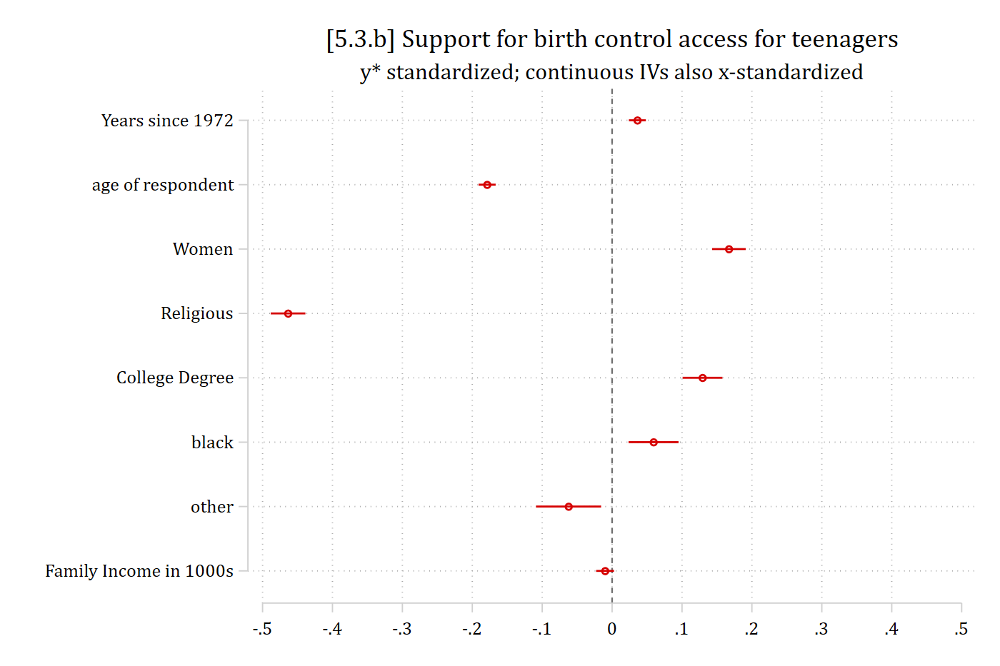

{width=35% fig-alt="Stata 17 logo."}

- For all sets of lecture notes, there is an accompanying replication Stata do-file ([available here](https://drive.google.com/drive/folders/1E0tqULBiY1WKic3A6pSG0_vFlcP-dhcF?usp=sharing) or on Brightspace)
  - This includes all of the Stata code necessary to recreate anything in the slides
- In this Appendix, I include some comments, notes, and examples for things that are new or that might be hard to follow without more detail
- For more streamlined, less complicated, and more notated do-files showing the basics of the types of analyses covered in this section, see the [Assignment example code](https://drive.google.com/drive/folders/1kcmZsaKoyZ4Y51X9BjmCZMuLGsw4GKNx?usp=sharing) (also available on Brightspace)

## A5.2 Marginal effects and plots of predictions

- Predictions and plots of predictions for ordinal logit (**ologit** in Stata) use identical syntax as that for **mlogit** and are interpreted in the exact same way. E.g.

```stata
qui margins, at(year1972=(14(1)49))

marginsplot, noci … options … ///
    legend(order(1 "StrAgree" 2 "Agree" 3 "Disagree" 4 "StrDisag"))
```

- Either **margins** or **mchange** can be used for calculating marginal effects. E.g.

```stata
mchange year1972, amount(sd)
```

### Plotting predictions and marginal effects for nominal IVs

- Plotting nominal IVs is exactly the same as in multinomial logit. There are two options:
  - Plots of predictions for (1) each outcome category, and (2) each category of the nominal IV
  - Plots of marginal effects

```stata
*Plots of predictions
est restore pillmod
margins, at(woman=0) post
est store Men
est restore pillmod
margins, at(woman=1) post
est store Women

coefplot (Men, color(eltblue)) (Women, color(red*1.2)), ///
    recast(bar) barw(0.2) vertical yline(0) ylab(0(.1).5) ///
    ciopts(recast(rcap) color(gs8)) citop scale(1.1)

*Plot of marginal effects
est restore pillmod
qui margins, dydx(woman)

marginsplot, recast(bar) ciopts(color(gs5)) ///
    xlab(0.5 " " 1 `" "Strongly" "Agree" "' 2 "Agree" ///
        3 "Disagree" 4 `" "Strongly" "Disagree" "' 4.5 " ") ///
    yline(0) plotopts(barw(0.6) color(ltblue))
```

## A5.3 Plotting standardized coefficients

- In Stata, you can use the [**coefplot**](https://repec.sowi.unibe.ch/stata/coefplot/getting-started.html) command to plot coefficients from regression models
  - I don't recommend plotting odds ratios, especially not if you want to compare across models
    - +1 effect often not meaningful; effect size unclear; etc.
  - But, plotting *y\** standardized coefficients can be useful
- In Stata, there is no built-in way to plot standardized coefficients
  - But, the **transform( )** option allows you to standardize them manually
    - Specify **\* = @ / *latentSD***
    - Where the ***latentSD*** is that shown in **listcoef, std** (see [5.3](5-3-coefficients.qmd#y-standardized-coefficients-in-ordinal-logit))
  - I always add an **xline(0)** with **coefplot**s to easily see which effects are statistically significant
- To fully (xy) standardize the continuous IVs, use the rescale option

::: {.panel-tabset group="language"}
## Stata

```{.stata-run}
. use "https://tdmize.github.io/data/data/cda_gss", clear
(cda_gss.dta |  GSS 1972-2021 CDA - Categorical Data Analysis | date created 202
> 3)

. 
. *Reverse coded DV so interpretations are more natural
. clonevar pillokR = pillok
(40,407 missing values generated)

. lab def likrlab 1"StrDisag" 2"Disagree" 3"Agree" 4"StrAgree"

. recode pillokR 1=4 2=3 3=2 4=1
(28,439 changes made to pillokR)

. lab val pillokR likrlab

. 
. gen religous = attend
(665 missing values generated)

. lab var religous "Religious Attendee"

. recode religous 0/3 = 0 4/8 = 1
(55,475 changes made to religous)

. lab def religlab 0"Not Religious" 1"Religious"

. lab val religous religlab

. 
. drop if year < 1986
(18,586 observations deleted)

. drop if missing(pillok, year1972, religous, college, age, woman, race3, faminc
> )
(25,267 observations deleted)

. 
. qui ologit pillokR c.year1972 c.age i.woman i.religous ///
>     i.college i.race3 c.faminc, or

. est store pillmod

. 
. *Can use coefplot to plot estimates; need to specify transform option
. *  and divide by Latent SD for y* standardized coefs
. coefplot, transform(* = @/1.9105) xline(0) xlab(-.5(.1).5) ///
>     title("[5.3.a] Support for birth control access for teenagers") ///
>     subtitle("y* standardized coefficients from ordinal logit")

. *To fully (xy) standardize continuous IVs, use the rescale option
. coefplot, rescale(year1972 = 11.007 age = 17.164 faminc = 31.757) ///
>     transform(* = @/1.9105) xline(0) xlab(-.5(.1).5) ///
>     title("[5.3.b] Support for birth control access for teenagers") ///
>     subtitle("y* standardized; continuous IVs also x-standardized")

```

{width=80% fig-alt="[5.3.a] Dot plot of y-star standardized coefficients from the ordinal logit with confidence intervals: religious about -0.46, other race about -0.06, women about 0.17, college degree about 0.13, Black about 0.06, and year, age, and family income near 0."}

{width=80% fig-alt="[5.3.b] Dot plot of the same coefficients with the continuous IVs also x-standardized: age is now about -0.18 and year about 0.04, with the other coefficients unchanged."}

## R

- In R, use [**modelplot**](https://modelsummary.com/vignettes/modelplot.html) and specify a **function()** in **scale_x_continuous** that divides by the calculated SD of *y\**
  - Add the zero null effect line as a **geom_vline()**

```{r}
#| fig-alt: "[5.3.a] Dot plot of y-star standardized coefficients from the ordinal logit with confidence intervals: religious about -0.46, other race about -0.06, women about 0.17, college degree about 0.13, Black about 0.06, and year, age, and family income near 0."
library(haven)           # import Stata data and labels
library(dplyr)           # data manipulation
library(ggplot2)         # graphs
library(MASS)            # ordinal logit: polr()
library(modelsummary)    # modelplot()
library(cleanplots)      # graph scheme
cleanplots_defaults()

gss <- read_dta("https://tdmize.github.io/data/data/cda_gss.dta")

# Religious attendee = attends about once a month or more
gss <- gss |>
  mutate(religous = case_when(attend <= 3 ~ 0, attend >= 4 ~ 1)) |>
  filter(year >= 1986)

# Keep model variables; drop any missing data
gss <- gss[c("pillok", "year1972", "religous", "college", "age", "woman", "race3", "faminc")]
gss <- gss[complete.cases(gss), ]

# Reverse coded DV so interpretations are more natural
gss <- gss |>
  mutate(pillokR = factor(5 - pillok, levels = 1:4,
      labels = c("StrDisag", "Disagree", "Agree", "StrAgree")),
    religous = factor(religous, labels = c("Not Religious", "Religious")),
    across(c(college, woman, race3), as_factor),
    year1972 = as.numeric(year1972)) |>
  droplevels()

pillmod <- polr(pillokR ~ year1972 + age + woman + religous + college + race3 + faminc,
  data = gss, Hess = TRUE)

# SD of y* (latent SD)
sdystar <- sqrt(var(pillmod$lp) + pi^2/3)

# 5.3.a: coefficients plotted on the axis of y* standardized coefficients
modelplot(pillmod, coef_omit = "\\|", ci_method = "wald") +
  scale_x_continuous(breaks = seq(-.5, .5, .1) * sdystar, limits = c(-.5, .5) * sdystar,
    labels = function(x) round(x / sdystar, 2)) +
  geom_vline(xintercept = 0, linetype = "dashed") +
  labs(title = "[5.3.a] Support for birth control access for teenagers",
    subtitle = "y* standardized coefficients from ordinal logit")
```

```{r}
#| fig-alt: "[5.3.b] Dot plot of the same coefficients with the continuous IVs also x-standardized: age is now about -0.18 and year about 0.04, with the other coefficients unchanged."
# 5.3.b: y* standardized; continuous IVs also x-standardized
std_coefs <- data.frame(term = names(coef(pillmod)), b = coef(pillmod),
  se = sqrt(diag(vcov(pillmod)))[names(coef(pillmod))]) |>
  mutate(sdx = case_when(term == "year1972" ~ sd(gss$year1972),
      term == "age" ~ sd(gss$age), term == "faminc" ~ sd(gss$faminc), TRUE ~ 1),
    estimate = b * sdx / sdystar,
    conf.low = (b - 1.96 * se) * sdx / sdystar,
    conf.high = (b + 1.96 * se) * sdx / sdystar,
    term = factor(term, levels = rev(term)))

ggplot(std_coefs, aes(x = estimate, y = term)) +
  geom_pointrange(aes(xmin = conf.low, xmax = conf.high)) +
  geom_vline(xintercept = 0, linetype = "dashed") +
  scale_x_continuous(breaks = seq(-.5, .5, .1), limits = c(-.5, .5)) +
  labs(title = "[5.3.b] Support for birth control access for teenagers",
    subtitle = "y* standardized; continuous IVs also x-standardized", x = NULL, y = NULL)
```

:::
