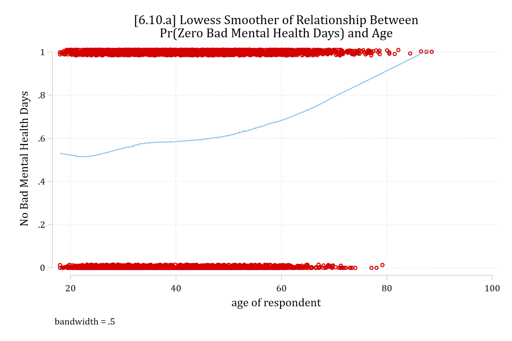
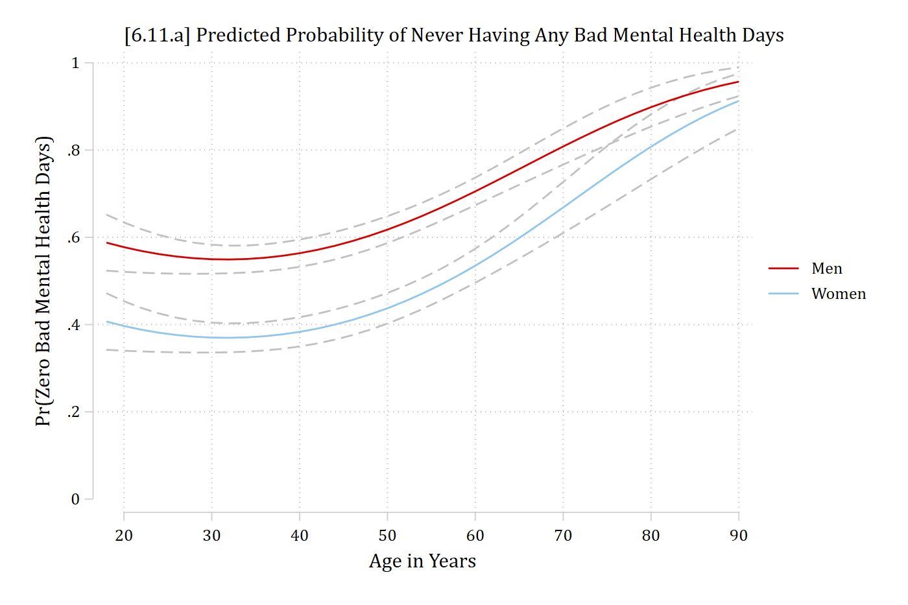
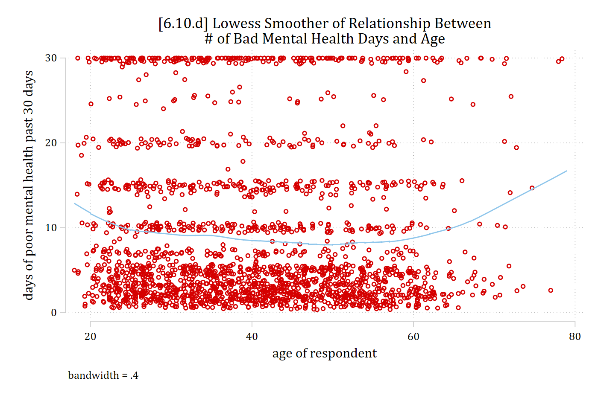
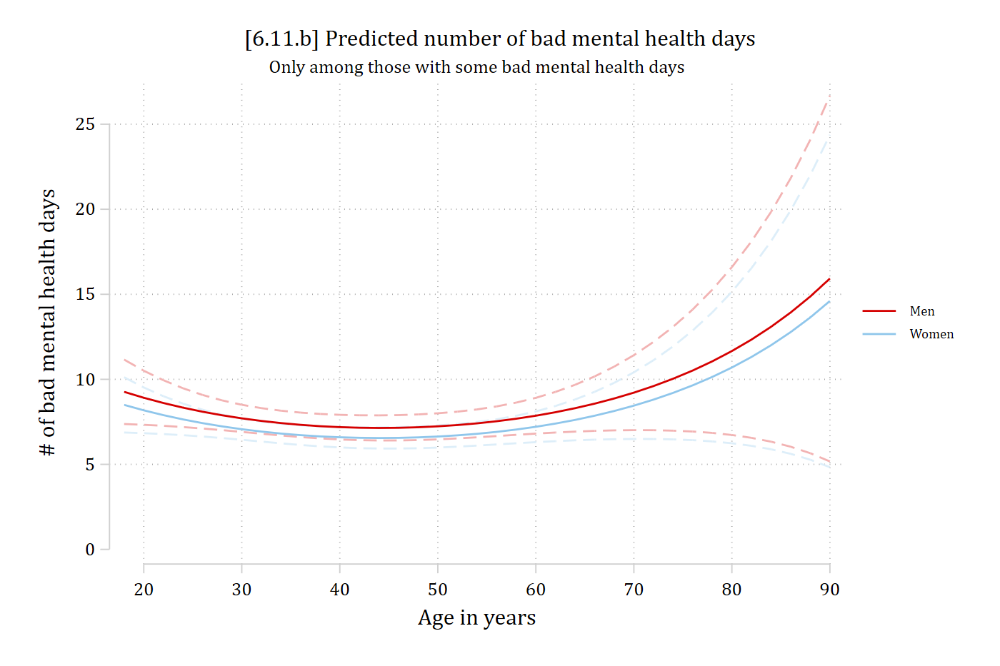
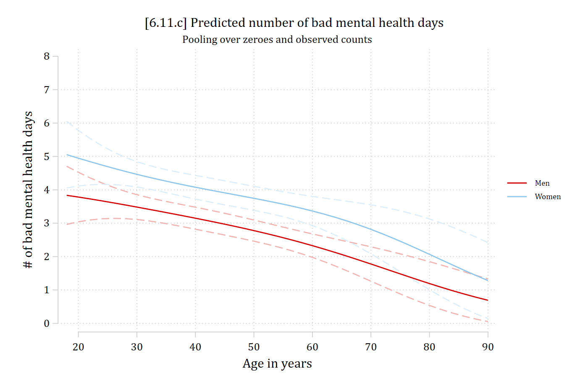

- There are many different predictions of interest in zero-inflated count models:
  - **Predicted rate**
    - For everyone in the sample (including the zeroes)
    - For just those with observed counts (non-zeroes)
  - **Pr(zero count)**
    - Almost always of interest with a zero-inflated model
  - **Pr(specific non-zero count \[e.g., 10\])**
  - **Pr(range of counts)**
- See [Stata Appendix A6](appendix-a6-stata.qmd) for code and discussion of various options
  - Note the Appendix is highly recommended as the options for these models are tricky
- For the **marginaleffects** package in R, see the [**type** of supported prediction](https://marginaleffects.com/man/r/predictions.html) for each model

::: {.panel-tabset group="language"}
## Stata

```{.stata-run}
. use "https://tdmize.github.io/data/data/cda_gss", clear
(cda_gss.dta |  GSS 1972-2021 CDA - Categorical Data Analysis | date created 202
> 3)

. keep if year >= 2002 & year <= 2014
(50,180 observations deleted)

. 
. *Data management
. gen notrelig = relig
(106 missing values generated)

. lab var notrelig "R Not Religious"

. recode notrelig 1 2 11 = 0 4 = 1 3 5/10 12/13 = .
(18,560 changes made to notrelig)

. lab def notrlab 0"Christian" 1"Not Religious"

. lab val notrelig notrlab

. 
. drop if missing(mntlhlth, physhlth, woman, race3, year, college, ///
>     parent, faminc, metro, notrelig, married)
(13,623 observations deleted)

. 
. *Zero-inflated negative binomial model
. qui zinb mntlhlth i.woman i.married c.age##c.age c.faminc##c.faminc ///
>     i.race3 i.college i.parent i.notrelig i.year, ///
>     inflate(i.woman i.married c.age##c.age c.faminc ///
>     i.race3 i.college i.parent i.notrelig i.year) irr zip

. est store mhmod

```

## R

```{r}
library(haven)           # import Stata data and labels
library(dplyr)           # data manipulation
library(ggplot2)         # graphs
library(pscl)            # zero-inflated models: zeroinfl()
library(marginaleffects) # predictions and marginal effects
library(cleanplots)      # graph scheme
cleanplots_defaults()

# Center changes in continuous IVs on each observation's value (as mecompare does)
options(marginaleffects_contrast_direction = "center")

gss <- read_dta("https://tdmize.github.io/data/data/cda_gss.dta")
gss <- gss |> filter(year >= 2002 & year <= 2014)

# Data management: Christian (Protestant, Catholic, Christian) vs not religious
gss <- gss |>
  mutate(notrelig = case_when(relig %in% c(1, 2, 11) ~ 0, relig == 4 ~ 1))

# Keep model variables; drop any missing data
gss <- gss[c("mntlhlth", "physhlth", "woman", "race3", "year", "college", "parent",
  "faminc", "metro", "notrelig", "married", "age")]
gss <- gss[complete.cases(gss), ]

# Treat binary/nominal variables as factors
gss <- gss |>
  mutate(across(c(woman, married, race3, college, parent), as_factor),
    notrelig = factor(notrelig, labels = c("Christian", "Not Religious")),
    year = factor(year))

# Zero-inflated negative binomial model
mhmod <- zeroinfl(mntlhlth ~ woman + married + poly(age, 2) + poly(faminc, 2) +
    race3 + college + parent + notrelig + year |
    woman + married + poly(age, 2) + faminc + race3 + college + parent + notrelig + year,
  data = gss, dist = "negbin")
```

:::

## Predictions and marginal effects for inflation part of the model

- You can estimate predictions and marginal effects for the inflation (logit) part of the model
  - These are interpreted just as you would any ME from a logit model \[but remember these are the Pr(always in the zero group)\]

::: {.panel-tabset group="language"}
## Stata

- Use the **predict(pr)** option on **mecompare** (and/or **margins**)

```stata
margins woman, at(age=(18(2)90)) predict(pr)
marginsplot …

mecompare woman age, model(mhmod) amount(sd) predict(pr)
```

## R

- Use the **type = "zero"** option on **plot_predictions** and **avg_comparisons**

```r
plot_predictions(mhmod, by = c("age", "woman"), type = "zero",
  newdata = datagrid(age = seq(18, 90, 2), woman = unique, grid_type = "counterfactual"))
avg_comparisons(mhmod, variables = list(woman = "reference", age = sd(gss$age)), type = "zero")
```

:::

::: {.panel-tabset group="language"}
## Stata

```{.stata-run}
. *6.10.a - lowess for 0 or >0
. gen mntlhlth0 = mntlhlth

. lab var mntlhlth0 "No Bad Mental Health Days"

. recode mntlhlth0 0=1 1/30 = 0
(5,043 changes made to mntlhlth0)

. 
. lowess mntlhlth0 age, bw(0.5) jitter(2) ///
>     title("[6.10.a] Lowess Smoother of Relationship Between" ///
>     "Pr(Zero Bad Mental Health Days) and Age")

```

{width=80% fig-alt="[6.10.a] Jittered scatterplot of having no bad mental health days (1) or some (0) by age, with a lowess line: the share with no bad days is about 0.52 at age 20, dips slightly in the 20s, and then rises steadily to about 0.9 by age 85."}

## R

```{r}
#| fig-alt: "[6.10.a] Jittered scatterplot of having no bad mental health days (1) or some (0) by age, with a lowess line: the share with no bad days is about 0.52 at age 20, dips slightly in the 20s, and then rises steadily to about 0.9 by age 85."
# 6.10.a - lowess for 0 or >0
gss <- gss |> mutate(mntlhlth0 = as.numeric(mntlhlth == 0))

low0 <- as.data.frame(lowess(gss$age, gss$mntlhlth0, f = 0.5, iter = 0))

ggplot(gss, aes(x = age, y = mntlhlth0)) +
  geom_jitter(width = 0, height = .02, shape = 1, color = "red", alpha = .5) +
  geom_line(data = low0, aes(x = x, y = y), color = "steelblue", linewidth = 1) +
  labs(title = "[6.10.a] Lowess Smoother of Relationship Between\nPr(Zero Bad Mental Health Days) and Age",
    x = "age of respondent", y = "No Bad Mental Health Days")
```

:::

> To double-check predictions and MEs are giving you what you want, helpful to use lowess or other exploratory techniques first. Here DV is binary, 1 = no bad mental health days.

::: {.panel-tabset group="language"}
## Stata

```{.stata-run}
. *6.11.a - Plot probability of being in the never poor mental health group
. *   by gender. Use option predict(pr)
. est restore mhmod
(results mhmod are active now)

. qui margins woman, at(age=(18(2)90)) predict(pr)

. marginsplot, recastci(rline) ciopts(lpat(dash) col(gs12)) ylab(0(.2)1) ///
>     plotopts(msym(i)) xlab(20(10)90) ///
>     title("[6.11.a] Predicted Probability of Never Having Any Bad Mental Healt
> h Days") ///
>     ytitle("Pr(Zero Bad Mental Health Days)") xtitle("Age in Years")

Variables that uniquely identify margins: age woman

```

{width=80% fig-alt="[6.11.a] Predicted probability of being in the always-zero group (never having bad mental health days) by age, with confidence intervals: for men it dips from about 0.6 at age 18 to 0.55 around age 30 and then rises to about 0.97 at 90; women's probabilities are lower, about 0.4 in the 20s and 30s, rising to about 0.93 at 90."}

## R

```{r}
#| fig-alt: "[6.11.a] Predicted probability of being in the always-zero group (never having bad mental health days) by age, with confidence intervals: for men it dips from about 0.6 at age 18 to 0.55 around age 30 and then rises to about 0.97 at 90; women's probabilities are lower, about 0.4 in the 20s and 30s, rising to about 0.93 at 90."
# 6.11.a - Plot probability of being in the never poor mental health group
#   by gender. Use type = "zero"
plot_predictions(mhmod, by = c("age", "woman"), type = "zero",
  newdata = datagrid(age = seq(18, 90, 2), woman = unique, grid_type = "counterfactual")) +
  scale_x_continuous(breaks = seq(20, 90, 10)) +
  scale_y_continuous(breaks = seq(0, 1, .2), limits = c(0, 1)) +
  labs(title = "[6.11.a] Predicted Probability of Never Having Any Bad Mental Health Days",
    x = "Age in Years", y = "Pr(Zero Bad Mental Health Days)", color = NULL, fill = NULL)
```

:::

{width=45% fig-alt="Two-panel Simpsons meme: Bart says This is the worst day of my life, and Homer replies The worst day of your life so far."}

#### Marginal effects for inflation part of the model

::: {.panel-tabset group="language"}
## Stata

```{.stata-run}
. *AMEs for Pr(Always Zero Group). Use option predict(pr)
. mecompare woman age, model(mhmod) amount(sd) predict(pr)

Predicting: Pr(mntlhlth=0)
Marginal effects (N_mhmod=5036)

                                 |  ME #   Estimate         SE      P>|z|
---------------------------------+---------------------------------------
woman                            |                                       
                 Women - Men     |                                       
                           mhmod |     1     -0.177      0.017      0.000
---------------------------------+---------------------------------------
age + SD (centered)              |                                       
                           mhmod |     2      0.053      0.009      0.000

```

## R

```{r}
# AMEs for Pr(Always Zero Group). Use type = "zero"
avg_comparisons(mhmod, variables = list(woman = "reference", age = sd(gss$age)),
  type = "zero")
```

:::

> *Women have a 0.18 lower predicted probability of never having bad mental health days, compared to men*
>
> *A standard deviation increase in age (about 13 years) is associated with about a 5 percentage point increase in never having bad mental health days*
>
> *Etc.*

## Predictions and marginal effects for the rate or probability of specific outcomes

- Remember the zero-inflated model coefficients are only for those who have non-zero counts
- Similarly, for predictions and MEs for the count part of the model, it is often of most interest to obtain predictions for only the count part of a zero-inflated model reflecting only those who have non-zero counts
  - This is the unique thing the zero-inflated model can do
- Here too it is useful to use lowess or similar before jumping to model predictions and MEs just to double-check you are estimating what you want

::: {.panel-tabset group="language"}
## Stata

```{.stata-run}
. *6.10.d - lowess for the non-zero counts
. lowess mntlhlth age if mntlhlth != 0, bw(0.4) jitter(3) ///
>     title("[6.10.d] Lowess Smoother of Relationship Between" ///
>     "# of Bad Mental Health Days and Age")

```

{width=80% fig-alt="[6.10.d] Jittered scatterplot of the number of bad mental health days by age, among those with at least one bad day, with a lowess line: the line is about 9 days at age 20, dips to about 7 in middle age, and rises to about 12 by age 80."}

## R

```{r}
#| fig-alt: "[6.10.d] Jittered scatterplot of the number of bad mental health days by age, among those with at least one bad day, with a lowess line: the line is about 9 days at age 20, dips to about 7 in middle age, and rises to about 12 by age 80."
# 6.10.d - lowess for the non-zero counts
nonzero <- gss |> filter(mntlhlth != 0)
low1 <- as.data.frame(lowess(nonzero$age, nonzero$mntlhlth, f = 0.4, iter = 0))

ggplot(nonzero, aes(x = age, y = mntlhlth)) +
  geom_jitter(width = .5, height = .5, shape = 1, color = "red", alpha = .5) +
  geom_line(data = low1, aes(x = x, y = y), color = "steelblue", linewidth = 1) +
  labs(title = "[6.10.d] Lowess Smoother of Relationship Between\n# of Bad Mental Health Days and Age",
    x = "age of respondent", y = "days of poor mental health past 30 days")
```

:::

> This is the general relationship we should expect to observe from the count part of the model, based only on observations with observed counts

### Predictions for observed counts in Stata and R

::: {.panel-tabset group="language"}
## Stata

- Use a custom **expression( )** on **margins**; pass this to **mecompare** in a **marginsopt( )**
  - Where the **equation( )** is named by the DV

```{.stata-run}
. *6.11.b - Plot predicted rates including only those with observed counts
. ** Use custom expression(); equation() is named by DV
. est restore mhmod
(results mhmod are active now)

. qui margins woman, at(age=(18(2)90)) ///
>     expression(exp(predict(equation(mntlhlth))))

. marginsplot, ylab(0(5)25) recastci(rline) ciopt(lpat(dash) col(*.3)) ///
>     plotopts(msym(i)) xlab(20(10)90) ///
>     title("[6.11.b] Predicted number of bad mental health days") ///
>     subtitle("Only among those with some bad mental health days", size(*.8)) /
> //
>     ytitle("# of bad mental health days") xtitle("Age in years") ///
>     legend(size(vsmall))

Variables that uniquely identify margins: age woman

```

{width=80% fig-alt="[6.11.b] Predicted number of bad mental health days by age, only among those with some bad days, with confidence intervals: about 9 days at age 18, dipping to about 7 around ages 35 to 55, and rising to about 15 to 16 at 90, with wide intervals at the oldest ages; men and women are similar."}

## R

- Use the **type = "count"** option on **plot_predictions** and **avg_comparisons**

```{r}
#| fig-alt: "[6.11.b] Predicted number of bad mental health days by age, only among those with some bad days, with confidence intervals: about 9 days at age 18, dipping to about 7 around ages 35 to 55, and rising to about 15 to 16 at 90, with wide intervals at the oldest ages; men and women are similar."
# 6.11.b - Plot predicted rates including only those with observed counts
# Use type = "count"
plot_predictions(mhmod, by = c("age", "woman"), type = "count",
  newdata = datagrid(age = seq(18, 90, 2), woman = unique, grid_type = "counterfactual")) +
  scale_x_continuous(breaks = seq(20, 90, 10)) +
  scale_y_continuous(breaks = seq(0, 25, 5)) +
  coord_cartesian(ylim = c(0, 25)) +
  labs(title = "[6.11.b] Predicted number of bad mental health days",
    subtitle = "Only among those with some bad mental health days",
    x = "Age in years", y = "# of bad mental health days", color = NULL, fill = NULL)
```

:::

### Marginal effects for count part of the model

::: {.panel-tabset group="language"}
## Stata

```{.stata-run}
. *AMEs for predicted rate *among those who are not always zeroes*
. ** Use custom expression(); equation() is named by DV
. mecompare woman age college, model(mhmod) amount(sd) ///
>     marginsopt(expression(exp(predict(equation(mntlhlth)))))

Predicting: exp(predict(equation(mntlhlth)))
Marginal effects (N_mhmod=5036)

                                 |  ME #   Estimate         SE      P>|z|
---------------------------------+---------------------------------------
woman                            |                                       
                 Women - Men     |                                       
                           mhmod |     1     -0.636      0.414      0.124
---------------------------------+---------------------------------------
age + SD (centered)              |                                       
                           mhmod |     2     -0.172      0.265      0.516
---------------------------------+---------------------------------------
college                          |                                       
    College Deg - No Col Deg     |                                       
                           mhmod |     3     -2.710      0.395      0.000

```

## R

```{r}
# AMEs for predicted rate *among those who are not always zeroes*
# Use type = "count"
avg_comparisons(mhmod, variables = list(woman = "reference", age = sd(gss$age),
  college = "reference"), type = "count")
```

:::

> ***Among those who report some bad mental health days...***
>
> - *there is no difference in the number of bad mental health days reported between men and women*
> - *overall, there is no effect of age on the number of bad mental health days*
> - *having a college degree is associated with 2.7 fewer poor mental health days each month*

## Predictions and marginal effects on the rate for all observations

- Remember that the results above are **for those who report some bad mental health days** (i.e., have non-zero counts for the DVs)
- The default in both Stata and R is to predict for the full sample, which is a combination of both the always and sometimes zero groups
  - These can be interpreted as you would interpret rates of predictions for specific outcomes from negative binomial or Poisson
  - This represents effects in the whole population/sample, including the always zeroes
    - This mixes the always zeroes and the sometimes zeroes
- Personally, I don't see much advantage here over a regular negative binomial model as predictions will be very similar in the ZINB ([Allison 2012](https://statisticalhorizons.com/zero-inflated-models/))
  - But, maybe want to show this as baseline / overall effect, and then break down effects on zero/not (inflation equation) and on observed counts (count equation)

::: {.panel-tabset group="language"}
## Stata

```{.stata-run}
. *6.11.c - Plot predicted rates for everyone, including the zeroes
. * This is margins default
. est restore mhmod
(results mhmod are active now)

. qui margins woman, at(age=(18(2)90))

. marginsplot, ylab(0(1)8) recastci(rline) ciopt(lpat(dash) col(*.3)) ///
>     plotopts(msym(i)) xlab(20(10)90) ///
>     title("[6.11.c] Predicted number of bad mental health days") ///
>     subtitle("Pooling over zeroes and observed counts", size(*.8)) ///
>     ytitle("# of bad mental health days") xtitle("Age in years") ///
>     legend(size(vsmall))

Variables that uniquely identify margins: age woman

```

{width=80% fig-alt="[6.11.c] Predicted number of bad mental health days by age for everyone, pooling the zeroes and the observed counts, with confidence intervals: women's predictions fall from about 5 at age 18 to about 1.3 at 90, and men's from about 4 to 0.7; women are predicted to have more bad days than men at every age."}

## R

```{r}
#| fig-alt: "[6.11.c] Predicted number of bad mental health days by age for everyone, pooling the zeroes and the observed counts, with confidence intervals: women's predictions fall from about 5 at age 18 to about 1.3 at 90, and men's from about 4 to 0.7; women are predicted to have more bad days than men at every age."
# 6.11.c - Plot predicted rates for everyone, including the zeroes
# This is the default
plot_predictions(mhmod, by = c("age", "woman"),
  newdata = datagrid(age = seq(18, 90, 2), woman = unique, grid_type = "counterfactual")) +
  scale_x_continuous(breaks = seq(20, 90, 10)) +
  scale_y_continuous(breaks = 0:8) +
  coord_cartesian(ylim = c(0, 8)) +
  labs(title = "[6.11.c] Predicted number of bad mental health days",
    subtitle = "Pooling over zeroes and observed counts",
    x = "Age in years", y = "# of bad mental health days", color = NULL, fill = NULL)
```

:::

### Marginal effects on the rate for all observations

::: {.panel-tabset group="language"}
## Stata

```{.stata-run}
. *AMEs for predicted rate for all observations (mixes the always and sometimes 
> zeroes)
. ** The default
. mecompare woman age, model(mhmod) amount(sd)

Predicting: Predicted number of events
Marginal effects (N_mhmod=5036)

                                 |  ME #   Estimate         SE      P>|z|
---------------------------------+---------------------------------------
woman                            |                                       
                 Women - Men     |                                       
                           mhmod |     1      0.991      0.205      0.000
---------------------------------+---------------------------------------
age + SD (centered)              |                                       
                           mhmod |     2     -0.521      0.132      0.000

```

## R

```{r}
# AMEs for predicted rate for all observations (mixes the always and sometimes zeroes)
# The default
avg_comparisons(mhmod, variables = list(woman = "reference", age = sd(gss$age)))
```

:::

> *On average, across the entire sample, women report about one more bad mental health day than do men (ME = 0.991)*
>
> *Considering both observed zeroes and observed counts, the overall average effect of a standard deviation increase in age is a 0.521 reduction in bad mental health days*

\*Note the differences in the results compared to the MEs on the count among those who report some bad mental health days
