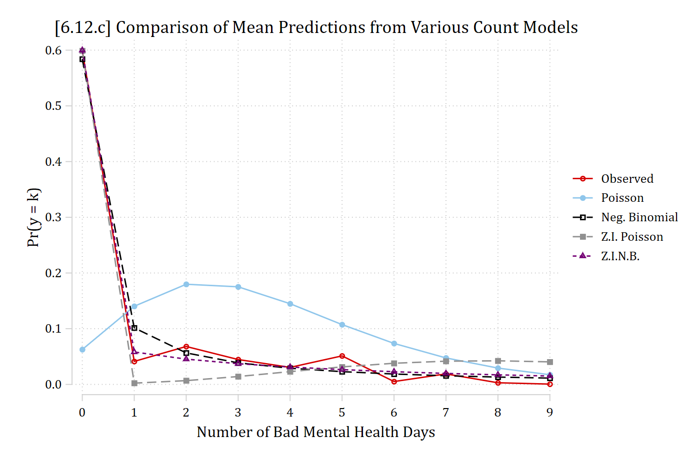
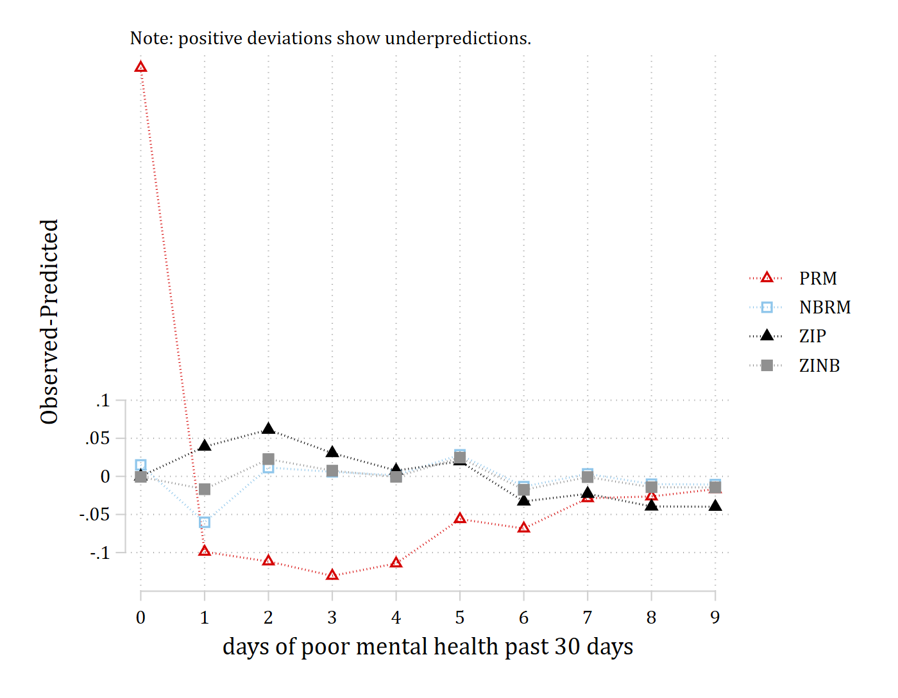
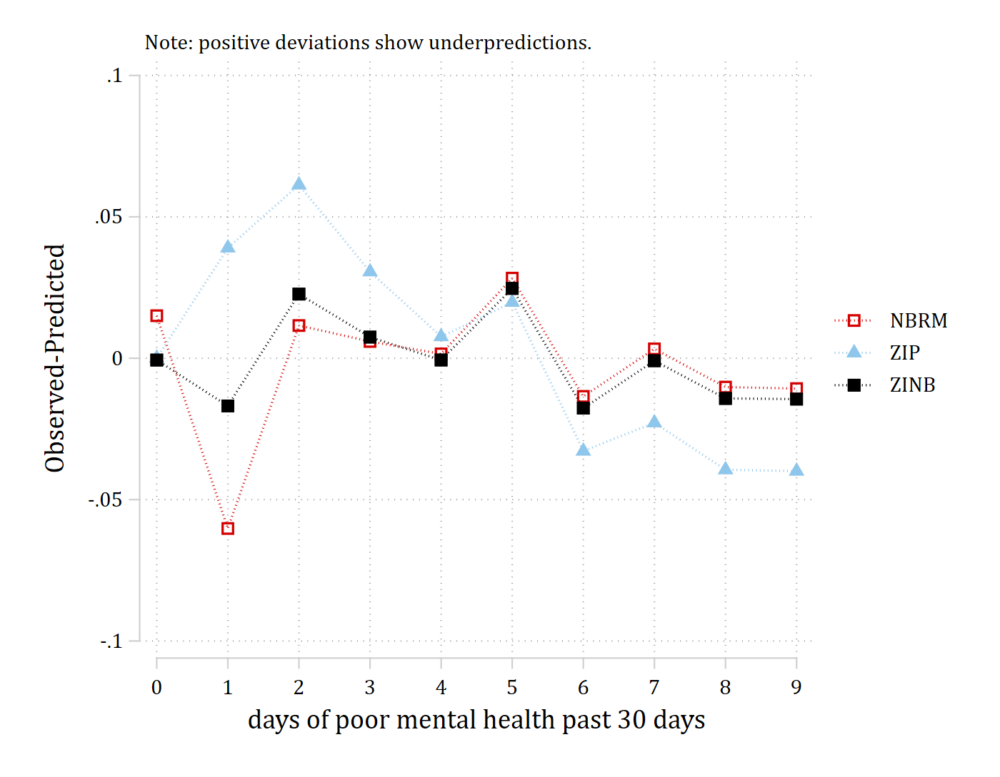

#### Count models we have considered:

- Poisson regression
- Negative binomial regression model
- Zero inflated Poisson model
- Zero inflated negative binomial model

## countfit for model selection

- **countfit** (in Stata) and my R clone **countfit()** will estimate all four of these count models for you and produce many diagnostics and tests to choose the best count model for your data
- **countfit** is an SPost13 program that was so successful that SAS released *countreg* without citing **countfit**
  - Even though they even used Scott Long's dataset as an example!
  - Pravin Trivedi suggested they change their name to **count(er)fit**

### Comparing mean observed probabilities

- The mean predicted probability at observed values is

$$\overline{\Pr}(y = m) = \frac{1}{N}\sum_{i = 1}^{N}\Pr(y_{i} = m\,|\,\mathbf{x}_{i})$$

- The observed probability in the data

$$\Pr_{observed}(y = m) = \frac{n_{y = m}}{N}$$

- Can plot the **difference** between observed and mean predicted probabilities as an informal diagnostic for model fit

$$difference = \Pr_{observed}(y = m) - \overline{\Pr}(y = m)$$

::: {.panel-tabset group="language"}
## Stata

```{.stata-run}
. use "https://tdmize.github.io/data/data/cda_gss", clear
(cda_gss.dta |  GSS 1972-2021 CDA - Categorical Data Analysis | date created 202
> 3)

. keep if year >= 2002 & year <= 2014
(50,180 observations deleted)

. 
. *Data management
. gen notrelig = relig
(106 missing values generated)

. lab var notrelig "R Not Religious"

. recode notrelig 1 2 11 = 0 4 = 1 3 5/10 12/13 = .
(18,560 changes made to notrelig)

. lab def notrlab 0"Christian" 1"Not Religious"

. lab val notrelig notrlab

. 
. drop if missing(mntlhlth, physhlth, woman, race3, year, college, ///
>     parent, faminc, metro, notrelig, married)
(13,623 observations deleted)

. 
. *6.12.c - compare predictions to choose model
. qui poisson mntlhlth i.woman i.married c.age##c.age c.faminc##c.faminc ///
>     i.race3 i.college i.parent i.notrelig i.year, irr

. qui mgen, pr(0/9) meanpred stub(p) replace

. 
. qui nbreg mntlhlth i.woman i.married c.age##c.age c.faminc##c.faminc ///
>     i.race3 i.college i.parent i.notrelig i.year, irr

. qui mgen, pr(0/9) meanpred stub(nb) replace

. 
. qui zip mntlhlth i.woman i.married c.age##c.age c.faminc##c.faminc ///
>     i.race3 i.college i.parent i.notrelig i.year, ///
>     inflate(i.woman i.married c.age##c.age c.faminc ///
>     i.race3 i.college i.parent i.notrelig i.year)

. qui mgen, pr(0/9) meanpred stub(zp) replace

. 
. qui zinb mntlhlth i.woman i.married c.age##c.age c.faminc##c.faminc ///
>     i.race3 i.college i.parent i.notrelig i.year, ///
>     inflate(i.woman i.married c.age##c.age c.faminc ///
>     i.race3 i.college i.parent i.notrelig i.year)

. qui mgen, pr(0/9) meanpred stub(znb) replace

. 
. twoway connected pobeq ppreq nbpreq zppreq znbpreq pval, ///
>     ylab(0(.1).6, format(%3.1f)) ///
>     xlab(0(1)9) ytitle("Pr(y = k)") xtitle("Number of Bad Mental Health Days")
>  ///
>     title("[6.12.c] Comparison of Mean Predictions from Various Count Models")
>  ///
>     legend(order(1 "Observed" 2 "Poisson" 3 "Neg. Binomial" 4 "Z.I. Poisson" 5
>  "Z.I.N.B."))

```

{width=80% fig-alt="[6.12.c] Observed proportions of 0 to 9 bad mental health days with the average predicted probabilities from four count models: about 60% observed at 0, which the negative binomial, zero-inflated Poisson, and zero-inflated negative binomial all match closely while the Poisson predicts only about 6%; the Poisson also over-predicts 1 to 6 days, and the zero-inflated Poisson under-predicts 1 to 3 days."}

## R

```{r}
#| fig-alt: "[6.12.c] Observed proportions of 0 to 9 bad mental health days with the average predicted probabilities from four count models: about 60% observed at 0, which the negative binomial, zero-inflated Poisson, and zero-inflated negative binomial all match closely while the Poisson predicts only about 6%; the Poisson also over-predicts 1 to 6 days, and the zero-inflated Poisson under-predicts 1 to 3 days."
library(haven)           # import Stata data and labels
library(dplyr)           # data manipulation
library(tidyr)           # reshape data: pivot_longer()
library(ggplot2)         # graphs
library(MASS)            # negative binomial: glm.nb()
library(pscl)            # zero-inflated models: zeroinfl()
library(cleanplots)      # graph scheme
cleanplots_defaults()

source("https://raw.githubusercontent.com/tdmize/Rfunctions/main/Count_helper_functions.R")

gss <- read_dta("https://tdmize.github.io/data/data/cda_gss.dta")
gss <- gss |> filter(year >= 2002 & year <= 2014)

# Data management: Christian (Protestant, Catholic, Christian) vs not religious
gss <- gss |>
  mutate(notrelig = case_when(relig %in% c(1, 2, 11) ~ 0, relig == 4 ~ 1))

# Keep model variables; drop any missing data
gss <- gss[c("mntlhlth", "physhlth", "woman", "race3", "year", "college", "parent",
  "faminc", "metro", "notrelig", "married", "age")]
gss <- gss[complete.cases(gss), ]

# Treat binary/nominal variables as factors
gss <- gss |>
  mutate(across(c(woman, married, race3, college, parent), as_factor),
    notrelig = factor(notrelig, labels = c("Christian", "Not Religious")),
    year = factor(year))

# 6.12.c - compare predictions to choose model
count_f <- mntlhlth ~ woman + married + poly(age, 2) + poly(faminc, 2) + race3 + college +
  parent + notrelig + year
zero_f <- mntlhlth ~ woman + married + poly(age, 2) + poly(faminc, 2) + race3 + college +
  parent + notrelig + year |
  woman + married + poly(age, 2) + faminc + race3 + college + parent + notrelig + year

pmod <- glm(count_f, family = "poisson", data = gss)
nbmod <- glm.nb(count_f, data = gss)
zipmod <- zeroinfl(zero_f, data = gss, dist = "poisson")
zinbmod <- zeroinfl(zero_f, data = gss, dist = "negbin")

# Observed proportions and average predicted probabilities of 0 to 9 days
meanpred <- data.frame(k = 0:9) |>
  mutate(Observed = sapply(k, function(j) mean(gss$mntlhlth == j)),
    Poisson = sapply(k, function(j) mean(dpois(j, fitted(pmod)))),
    "Neg. Binomial" = sapply(k, function(j)
      mean(dnbinom(j, size = nbmod$theta, mu = fitted(nbmod)))),
    "Z.I. Poisson" = colMeans(predict(zipmod, type = "prob", at = 0:9)),
    "Z.I.N.B." = colMeans(predict(zinbmod, type = "prob", at = 0:9))) |>
  pivot_longer(-k, names_to = "model", values_to = "pr") |>
  mutate(model = factor(model, levels = unique(model)))

ggplot(meanpred, aes(x = k, y = pr, color = model)) +
  geom_line() + geom_point() +
  scale_x_continuous(breaks = 0:9) +
  scale_y_continuous(breaks = seq(0, .6, .1), limits = c(0, .6)) +
  labs(title = "[6.12.c] Comparison of Mean Predictions from Various Count Models",
    x = "Number of Bad Mental Health Days", y = "Pr(y = k)", color = NULL)
```

:::

::: {.panel-tabset group="language"}
## Stata

```{.stata-run}
. *6.12.a
. countfit mntlhlth i.woman i.married c.age##c.age c.faminc##c.faminc ///
>     i.race3 i.college i.parent i.notrelig i.year, ///
>     inflate(i.woman i.married c.age##c.age c.faminc ///
>     i.race3 i.college i.parent i.notrelig i.year) replace forcevuong

--------------------------------------------------------------------------------
                      Variable |    PRM        NBRM         ZIP        ZINB     
-------------------------------+------------------------------------------------
mntlhlth                       |
                       Woman R |                                                
                        Women  |     1.310       1.339       0.917       0.917  
                               |     17.35        4.23       -5.59       -1.56  
                               |                                                
             Currently Married |                                                
                      Married  |     0.778       0.775       0.949       0.899  
                               |    -14.19       -3.33       -2.98       -1.77  
             age of respondent |     0.999       1.000       0.971       0.967  
                               |     -0.30       -0.01       -7.63       -2.43  
                               |
                   c.age#c.age |     1.000       1.000       1.000       1.000  
                               |     -3.03       -0.68        7.45        2.42  
        Family Income in 1000s |     0.988       0.987       0.990       0.989  
                               |    -13.89       -3.37      -12.02       -3.97  
                               |
             c.faminc#c.faminc |     1.000       1.000       1.000       1.000  
                               |      7.85        2.09        8.88        2.85  
                               |                                                
            race of respondent |                                                
                        black  |     0.681       0.697       0.970       0.965  
                               |    -16.80       -3.65       -1.33       -0.44  
                        other  |     0.900       0.875       1.020       1.026  
                               |     -3.80       -1.05        0.73        0.26  
                               |                                                
          R Has College Degree |                                                
               College Degree  |     0.781       0.737       0.724       0.665  
                               |    -12.61       -3.80      -16.39       -6.49  
                               |                                                
                        Parent |                                                
                       Parent  |     1.205       1.132       1.106       1.062  
                               |      9.97        1.47        5.34        0.92  
                               |                                                
               R Not Religious |                                                
                Not Religious  |     1.188       1.175       1.031       1.032  
                               |      9.50        1.85        1.67        0.48  
                               |                                                
  gss year for this respondent |                                                
                         2006  |     0.758       0.735       0.827       0.778  
                               |    -13.75       -3.44       -9.45       -3.55  
                         2010  |     0.951       0.939       0.887       0.840  
                               |     -2.42       -0.64       -5.73       -2.35  
                         2014  |     0.863       0.864       0.954       0.912  
                               |     -7.03       -1.51       -2.23       -1.20  
                      Constant |     6.630       6.807      24.220      24.782  
                               |     25.63        5.55       41.70       11.38  
-------------------------------+------------------------------------------------
lnalpha                        |
                      Constant |                 5.404                   1.331  
                               |                 58.61                    4.68  
-------------------------------+------------------------------------------------
inflate                        |
                               |                                                
                       Woman R |                                                
                        Women  |                             0.534       0.469  
                               |                            -10.30      -10.06  
                               |                                                
             Currently Married |                                                
                      Married  |                             1.407       1.405  
                               |                              5.05        4.15  
             age of respondent |                             0.961       0.946  
                               |                             -2.62       -3.09  
                               |
                   c.age#c.age |                             1.001       1.001  
                               |                              3.92        4.38  
        Family Income in 1000s |                             1.004       1.004  
                               |                              3.93        3.08  
                               |                                                
            race of respondent |                                                
                        black  |                             1.810       1.974  
                               |                              6.63        6.47  
                        other  |                             1.251       1.305  
                               |                              2.01        1.99  
                               |                                                
          R Has College Degree |                                                
               College Degree  |                             0.874       0.745  
                               |                             -1.90       -3.26  
                               |                                                
                        Parent |                                                
                       Parent  |                             0.851       0.844  
                               |                             -2.18       -1.87  
                               |                                                
               R Not Religious |                                                
                Not Religious  |                             0.764       0.736  
                               |                             -3.58       -3.26  
                               |                                                
  gss year for this respondent |                                                
                         2006  |                             1.186       1.125  
                               |                              2.18        1.25  
                         2010  |                             0.873       0.800  
                               |                             -1.57       -2.08  
                         2014  |                             1.220       1.214  
                               |                              2.35        1.92  
                      Constant |                             2.312       2.407  
                               |                              2.70        2.39  
-------------------------------+------------------------------------------------
Statistics                     |                                                
                         alpha |                 5.404                          
                             N |      5036        5036        5036        5036  
                            ll | -2.64e+04   -9668.477   -1.42e+04   -9440.701  
                           bic | 52903.251   19473.344   28702.860   19137.134  
                           aic | 52805.385   19368.954   28513.653   18941.403  
--------------------------------------------------------------------------------
                                                                     Legend: b/t
Comparison of Mean Observed and Predicted Count

            Maximum       At      Mean
Model     Difference    Value    |Diff|
---------------------------------------------
PRM         0.536         0      0.119
NBRM       -0.060         1      0.016
ZIP         0.061         2      0.029
ZINB        0.025         5      0.012

PRM: Predicted and actual probabilities

Count   Actual    Predicted    |Diff|   Pearson
------------------------------------------------
0        0.599       0.063      0.536   2.3e+04
1        0.041       0.140      0.099   351.763
2        0.068       0.180      0.112   349.479
3        0.045       0.175      0.131   489.795
4        0.031       0.145      0.114   454.131
5        0.051       0.107      0.056   147.882
6        0.005       0.074      0.068   320.466
7        0.019       0.048      0.029    87.116
8        0.003       0.029      0.026   119.133
9        0.001       0.017      0.017    81.702
------------------------------------------------
Sum      0.863       0.978      1.188   2.6e+04

NBRM: Predicted and actual probabilities

Count   Actual    Predicted    |Diff|   Pearson
------------------------------------------------
0        0.599       0.584      0.015     1.954
1        0.041       0.102      0.060   179.837
2        0.068       0.057      0.012    11.930
3        0.045       0.039      0.006     4.589
4        0.031       0.029      0.002     0.412
5        0.051       0.023      0.028   176.561
6        0.005       0.019      0.013    49.143
7        0.019       0.016      0.003     3.556
8        0.003       0.013      0.010    39.787
9        0.001       0.011      0.011    51.201
------------------------------------------------
Sum      0.863       0.891      0.160   518.970

ZIP: Predicted and actual probabilities

Count   Actual    Predicted    |Diff|   Pearson
------------------------------------------------
0        0.599       0.599      0.000     0.000
1        0.041       0.002      0.039  3349.801
2        0.068       0.007      0.061  2773.615
3        0.045       0.014      0.031   333.235
4        0.031       0.023      0.008    12.752
5        0.051       0.031      0.020    62.595
6        0.005       0.038      0.033   142.883
7        0.019       0.042      0.023    62.953
8        0.003       0.042      0.039   184.618
9        0.001       0.040      0.040   197.998
------------------------------------------------
Sum      0.863       0.839      0.293  7120.451

ZINB: Predicted and actual probabilities

Count   Actual    Predicted    |Diff|   Pearson
------------------------------------------------
0        0.599       0.600      0.001     0.003
1        0.041       0.058      0.017    24.620
2        0.068       0.045      0.023    57.099
3        0.045       0.037      0.007     7.585
4        0.031       0.031      0.001     0.060
5        0.051       0.027      0.025   115.701
6        0.005       0.023      0.018    68.744
7        0.019       0.020      0.001     0.199
8        0.003       0.017      0.014    59.202
9        0.001       0.015      0.014    69.900
------------------------------------------------
Sum      0.863       0.873      0.120   403.112

Tests and Fit Statistics

PRM            BIC= 52903.251  AIC= 52805.385  Prefer  Over  Evidence
-------------------------------------------------------------------------
  vs NBRM      BIC= 19473.344  dif= 33429.907  NBRM    PRM   Very strong
               AIC= 19368.954  dif= 33436.431  NBRM    PRM
               LRX2=33438.431  prob=    0.000  NBRM    PRM   p=0.000    
-------------------------------------------------------------------------
  vs ZIP       BIC= 28702.860  dif= 24200.391  ZIP     PRM   Very strong
               AIC= 28513.653  dif= 24291.732  ZIP     PRM
               Vuong=  32.061  prob=    0.000  ZIP     PRM   p=0.000    
-------------------------------------------------------------------------
  vs ZINB      BIC= 19137.134  dif= 33766.117  ZINB    PRM   Very strong
               AIC= 18941.403  dif= 33863.982  ZINB    PRM
-------------------------------------------------------------------------
NBRM           BIC= 19473.344  AIC= 19368.954  Prefer  Over  Evidence
-------------------------------------------------------------------------
  vs ZIP       BIC= 28702.860  dif= -9229.516  NBRM    ZIP   Very strong
               AIC= 28513.653  dif= -9144.700  NBRM    ZIP
-------------------------------------------------------------------------
  vs ZINB      BIC= 19137.134  dif=   336.210  ZINB    NBRM  Very strong
               AIC= 18941.403  dif=   427.551  ZINB    NBRM
               Vuong=  12.249  prob=    0.000  ZINB    NBRM  p=0.000    
-------------------------------------------------------------------------
ZIP            BIC= 28702.860  AIC= 28513.653  Prefer  Over  Evidence
-------------------------------------------------------------------------
  vs ZINB      BIC= 19137.134  dif=  9565.726  ZINB    ZIP   Very strong
               AIC= 18941.403  dif=  9572.250  ZINB    ZIP
               LRX2= 9574.250  prob=    0.000  ZINB    ZIP   p=0.000    
-------------------------------------------------------------------------

Vuong test is not appropriate for testing zero-inflation. To force the
the computation of the test, use option -forcevuong-.

```

{width=80% fig-alt="[6.12.a] Observed minus average predicted probability of 0 to 9 bad mental health days for the Poisson, negative binomial, zero-inflated Poisson, and zero-inflated negative binomial models: the Poisson misses badly, under-predicting zeros by about 0.54 and over-predicting 1 to 4 days by about 0.1, while the other three models stay close to 0."}

## R

```{r}
#| fig-alt: "[6.12.a] Observed minus average predicted probability of 0 to 9 bad mental health days for the Poisson, negative binomial, zero-inflated Poisson, and zero-inflated negative binomial models: the Poisson misses badly, under-predicting zeros by about 0.54 and over-predicting 1 to 4 days by about 0.1, while the other three models stay close to 0."
# 6.12.a
cf <- countfit(mntlhlth ~ woman + married + poly(age, 2) + poly(faminc, 2) +
    race3 + college + parent + notrelig + year,
  inflate = ~ woman + married + poly(age, 2) + faminc + race3 + college + parent +
    notrelig + year,
  data = gss)

cf$pic +
  labs(title = "[6.12.a] Comparison of various count model predictions")
```

:::

> \*The Poisson model is such a bad choice it is clearer to omit it from the plot

::: {.panel-tabset group="language"}
## Stata

```{.stata-run}
. *6.12.b - remove the poisson by listing which models to try as options
. countfit mntlhlth i.woman i.married c.age##c.age c.faminc##c.faminc ///
>     i.race3 i.college i.parent i.notrelig i.year, ///
>     inflate(i.woman i.married c.age##c.age c.faminc ///
>     i.race3 i.college i.parent i.notrelig i.year) ///
>     nbreg zip zinb replace

--------------------------------------------------------------------
                      Variable |   NBRM         ZIP        ZINB     
-------------------------------+------------------------------------
mntlhlth                       |
                       Woman R |                                    
                        Women  |     1.339       0.917       0.917  
                               |      4.23       -5.59       -1.56  
                               |                                    
             Currently Married |                                    
                      Married  |     0.775       0.949       0.899  
                               |     -3.33       -2.98       -1.77  
             age of respondent |     1.000       0.971       0.967  
                               |     -0.01       -7.63       -2.43  
                               |
                   c.age#c.age |     1.000       1.000       1.000  
                               |     -0.68        7.45        2.42  
        Family Income in 1000s |     0.987       0.990       0.989  
                               |     -3.37      -12.02       -3.97  
                               |
             c.faminc#c.faminc |     1.000       1.000       1.000  
                               |      2.09        8.88        2.85  
                               |                                    
            race of respondent |                                    
                        black  |     0.697       0.970       0.965  
                               |     -3.65       -1.33       -0.44  
                        other  |     0.875       1.020       1.026  
                               |     -1.05        0.73        0.26  
                               |                                    
          R Has College Degree |                                    
               College Degree  |     0.737       0.724       0.665  
                               |     -3.80      -16.39       -6.49  
                               |                                    
                        Parent |                                    
                       Parent  |     1.132       1.106       1.062  
                               |      1.47        5.34        0.92  
                               |                                    
               R Not Religious |                                    
                Not Religious  |     1.175       1.031       1.032  
                               |      1.85        1.67        0.48  
                               |                                    
  gss year for this respondent |                                    
                         2006  |     0.735       0.827       0.778  
                               |     -3.44       -9.45       -3.55  
                         2010  |     0.939       0.887       0.840  
                               |     -0.64       -5.73       -2.35  
                         2014  |     0.864       0.954       0.912  
                               |     -1.51       -2.23       -1.20  
                      Constant |     6.807      24.220      24.782  
                               |      5.55       41.70       11.38  
-------------------------------+------------------------------------
lnalpha                        |
                      Constant |     5.404                   1.331  
                               |     58.61                    4.68  
-------------------------------+------------------------------------
inflate                        |
                               |                                    
                       Woman R |                                    
                        Women  |                 0.534       0.469  
                               |                -10.30      -10.06  
                               |                                    
             Currently Married |                                    
                      Married  |                 1.407       1.405  
                               |                  5.05        4.15  
             age of respondent |                 0.961       0.946  
                               |                 -2.62       -3.09  
                               |
                   c.age#c.age |                 1.001       1.001  
                               |                  3.92        4.38  
        Family Income in 1000s |                 1.004       1.004  
                               |                  3.93        3.08  
                               |                                    
            race of respondent |                                    
                        black  |                 1.810       1.974  
                               |                  6.63        6.47  
                        other  |                 1.251       1.305  
                               |                  2.01        1.99  
                               |                                    
          R Has College Degree |                                    
               College Degree  |                 0.874       0.745  
                               |                 -1.90       -3.26  
                               |                                    
                        Parent |                                    
                       Parent  |                 0.851       0.844  
                               |                 -2.18       -1.87  
                               |                                    
               R Not Religious |                                    
                Not Religious  |                 0.764       0.736  
                               |                 -3.58       -3.26  
                               |                                    
  gss year for this respondent |                                    
                         2006  |                 1.186       1.125  
                               |                  2.18        1.25  
                         2010  |                 0.873       0.800  
                               |                 -1.57       -2.08  
                         2014  |                 1.220       1.214  
                               |                  2.35        1.92  
                      Constant |                 2.312       2.407  
                               |                  2.70        2.39  
-------------------------------+------------------------------------
Statistics                     |                                    
                         alpha |     5.404                          
                             N |      5036        5036        5036  
                            ll | -9668.477   -1.42e+04   -9440.701  
                           bic | 19473.344   28702.860   19137.134  
                           aic | 19368.954   28513.653   18941.403  
--------------------------------------------------------------------
                                                         Legend: b/t
Comparison of Mean Observed and Predicted Count

            Maximum       At      Mean
Model     Difference    Value    |Diff|
---------------------------------------------
NBRM       -0.060         1      0.016
ZIP         0.061         2      0.029
ZINB        0.025         5      0.012

NBRM: Predicted and actual probabilities

Count   Actual    Predicted    |Diff|   Pearson
------------------------------------------------
0        0.599       0.584      0.015     1.954
1        0.041       0.102      0.060   179.837
2        0.068       0.057      0.012    11.930
3        0.045       0.039      0.006     4.589
4        0.031       0.029      0.002     0.412
5        0.051       0.023      0.028   176.561
6        0.005       0.019      0.013    49.143
7        0.019       0.016      0.003     3.556
8        0.003       0.013      0.010    39.787
9        0.001       0.011      0.011    51.201
------------------------------------------------
Sum      0.863       0.891      0.160   518.970

ZIP: Predicted and actual probabilities

Count   Actual    Predicted    |Diff|   Pearson
------------------------------------------------
0        0.599       0.599      0.000     0.000
1        0.041       0.002      0.039  3349.801
2        0.068       0.007      0.061  2773.615
3        0.045       0.014      0.031   333.235
4        0.031       0.023      0.008    12.752
5        0.051       0.031      0.020    62.595
6        0.005       0.038      0.033   142.883
7        0.019       0.042      0.023    62.953
8        0.003       0.042      0.039   184.618
9        0.001       0.040      0.040   197.998
------------------------------------------------
Sum      0.863       0.839      0.293  7120.451

ZINB: Predicted and actual probabilities

Count   Actual    Predicted    |Diff|   Pearson
------------------------------------------------
0        0.599       0.600      0.001     0.003
1        0.041       0.058      0.017    24.620
2        0.068       0.045      0.023    57.099
3        0.045       0.037      0.007     7.585
4        0.031       0.031      0.001     0.060
5        0.051       0.027      0.025   115.701
6        0.005       0.023      0.018    68.744
7        0.019       0.020      0.001     0.199
8        0.003       0.017      0.014    59.202
9        0.001       0.015      0.014    69.900
------------------------------------------------
Sum      0.863       0.873      0.120   403.112

Tests and Fit Statistics

-------------------------------------------------------------------------
NBRM           BIC= 19473.344  AIC= 19368.954  Prefer  Over  Evidence
-------------------------------------------------------------------------
  vs ZIP       BIC= 28702.860  dif= -9229.516  NBRM    ZIP   Very strong
               AIC= 28513.653  dif= -9144.700  NBRM    ZIP
-------------------------------------------------------------------------
  vs ZINB      BIC= 19137.134  dif=   336.210  ZINB    NBRM  Very strong
               AIC= 18941.403  dif=   427.551  ZINB    NBRM
               Vuong=       .  prob=        .  ZINB    NBRM  p=.        
-------------------------------------------------------------------------
ZIP            BIC= 28702.860  AIC= 28513.653  Prefer  Over  Evidence
-------------------------------------------------------------------------
  vs ZINB      BIC= 19137.134  dif=  9565.726  ZINB    ZIP   Very strong
               AIC= 18941.403  dif=  9572.250  ZINB    ZIP
               LRX2= 9574.250  prob=    0.000  ZINB    ZIP   p=0.000    
-------------------------------------------------------------------------

Vuong test is not appropriate for testing zero-inflation. To force the
the computation of the test, use option -forcevuong-.

```

{width=80% fig-alt="[6.12.b] Observed minus average predicted probability of 0 to 9 bad mental health days without the Poisson model: the negative binomial over-predicts 1 day by about 0.06, the zero-inflated Poisson under-predicts 1 to 3 days by up to about 0.06 and over-predicts 6 to 9 days, and the zero-inflated negative binomial stays within about 0.025 of 0."}

## R

```{r}
#| fig-alt: "[6.12.b] Observed minus average predicted probability of 0 to 9 bad mental health days without the Poisson model: the negative binomial over-predicts 1 day by about 0.06, the zero-inflated Poisson under-predicts 1 to 3 days by up to about 0.06 and over-predicts 6 to 9 days, and the zero-inflated negative binomial stays within about 0.025 of 0."
# 6.12.b - remove the Poisson by listing which models to compare
cf2 <- countfit(mntlhlth ~ woman + married + poly(age, 2) + poly(faminc, 2) +
    race3 + college + parent + notrelig + year,
  inflate = ~ woman + married + poly(age, 2) + faminc + race3 + college + parent +
    notrelig + year,
  data = gss, models = c("NBRM", "ZIP", "ZINB"))

cf2$pic +
  labs(title = "[6.12.b] Comparison of predictions from count models (w/o Poisson)")
```

:::

## Statistical tests to compare count models

#### Likelihood Ratio tests of nested models

- ***Poisson*** vs ***Negative Binomial***: Test the dispersion parameter α
  - *Reported in the **nbreg** output and with **odTest** in R*
- ***Zero Inflated Poisson*** vs ***Zero Inflated Negative Binomial*** can be compared the same way
  - *In Stata, reported with the **zip** option with **zinb**; no automated way in R, but **countfit()** reports it*
    - We found evidence above to prefer **zinb** to **zip** (i.e., that the overdispersion parameter α is needed)

### Tests of non-nested count models

- Poisson and zero inflated Poisson are not nested; negative binomial and zero inflated negative binomial are not nested
  - For zero inflated Poisson to reduce to Poisson, ψ must equal 0
    - You cannot constrain the parameters to make ψ = 0
- Tests we will discuss soon for non-nested models apply here
  - AIC and BIC
    - But remember that AIC and BIC are just guidelines and not statistical tests
- Additionally, a Vuong statistical test can be used to compare the zero inflated model to its non-inflated counterparts

### Vuong tests

- The Vuong test compares non-nested models
  - $\Pr_{1}(y_{i}\,|\,\mathbf{x}_{i})$ is probability of *y~i~* from the first model
  - $\Pr_{2}(y_{i}\,|\,\mathbf{x}_{i})$ is probability of *y~i~* for the second model
  - Define

$$m_{i} = \ln\left[\frac{\Pr_{1}(y_{i}\,|\,\mathbf{x}_{i})}{\Pr_{2}(y_{i}\,|\,\mathbf{x}_{i})}\right]$$

  - Let $\overline{m} = \sum_{i = 1}^{N} m_{i}/N$ and $s_{m}$ be the standard deviation of $m_{i}$
  - The Vuong statistic is

$$V = \frac{\sqrt{N}\,\overline{m}}{s_{m}} \sim N$$

- If *V* \> 1.96, the first model is favored
- If *V* \< -1.96, the second model is favored

### countfit for comparing count models

- *countfit and countfit() will perform lots of statistical tests and other calculations for comparing among the four different count models*
  - *This produces **lots** of output and tests*
  - *In my opinion, the tables of "Comparison of Mean Observed and Predicted Count" and the table of "Tests and Fit Statistics" are most helpful*
    - *The graph of observed -- predicted (shown above) is also very helpful*
- Results suggest:
  - The ZINB (zero inflated negative binomial) does the best---on average
  - Although the NBRM (negative binomial) does a pretty good job
  - The NBRM does miss somewhat badly at Pr(*y* = 1) while the ZINB never misses all that badly

> The ZINB is the best model based on the statistical tests
