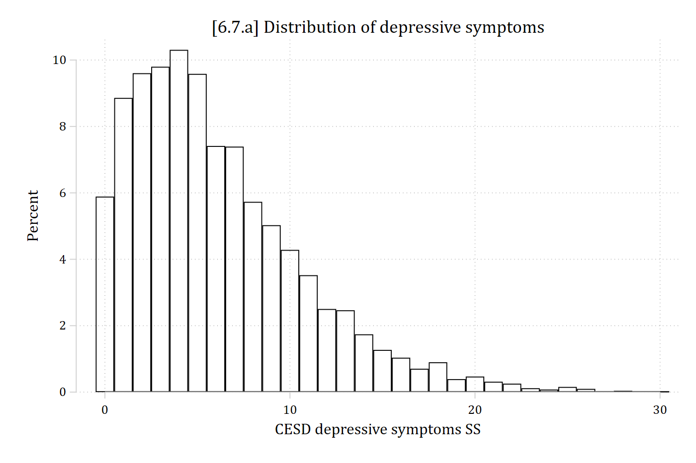
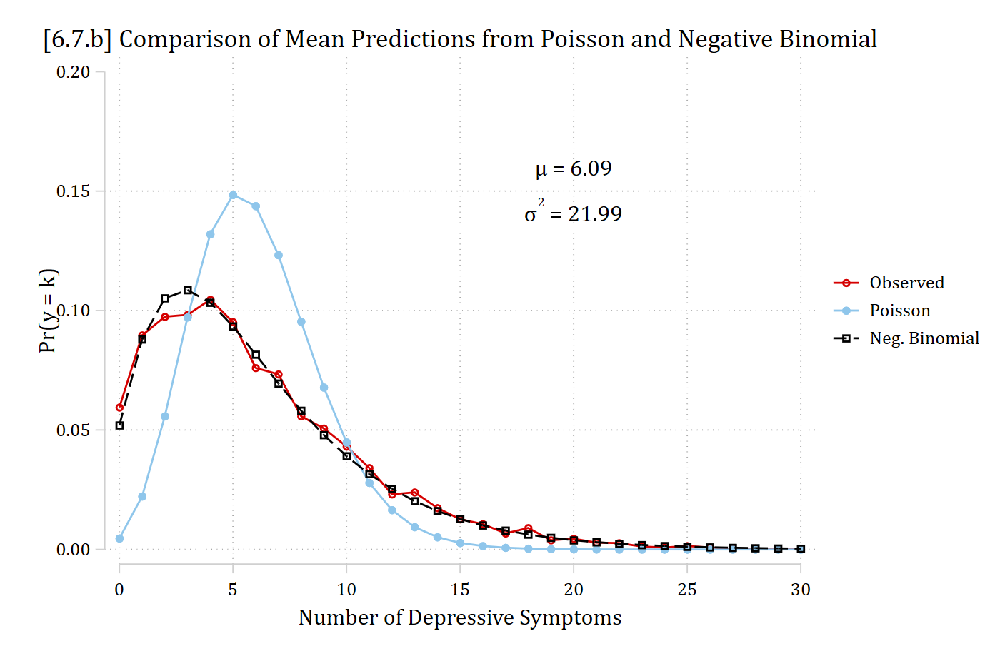
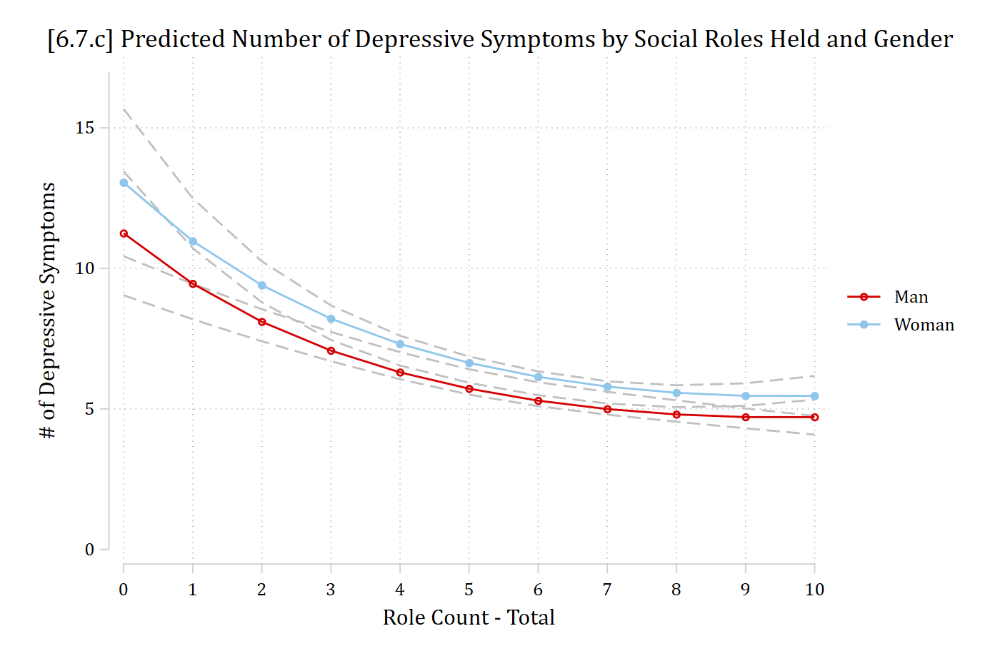
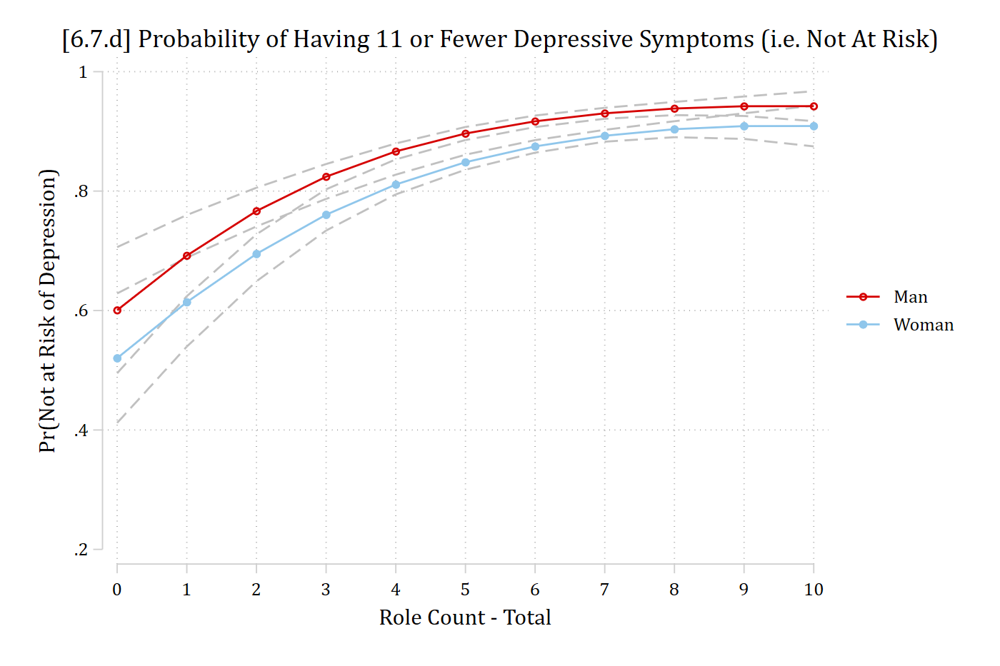
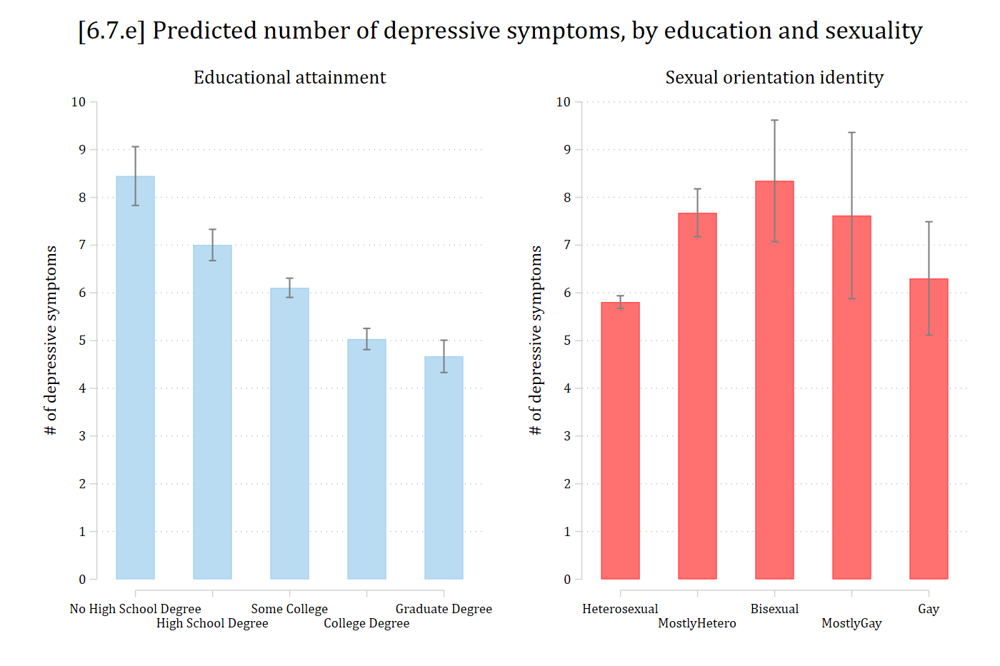

- Add Health Wave 4 (young adults)
- DV: \# of depressive symptoms (0 to 30)
  - Clear evidence of overdispersion

::: {.panel-tabset group="language"}
## Stata

```{.stata-run}
. use "https://tdmize.github.io/data/data/cda_ah4", clear
(cda_ah4.dta | Add Health Wave 4 - | )

. 
. *DV has non-integer values, so need to round to make it work for a count model
. replace depressSS = depressSS * 10
(4,812 real changes made)

. replace depressSS = round(depressSS, 1)
(3,206 real changes made)

. tabstat depressSS, stat(mean var sd) format(%4.2f)

    Variable |      Mean  Variance        SD
-------------+------------------------------
   depressSS |      6.09     21.99      4.69
--------------------------------------------

```

## R

```{r}
library(haven)           # import Stata data and labels
library(dplyr)           # data manipulation
library(sjmisc)          # frq() frequency tables
library(tidyr)           # reshape data: pivot_longer()
library(ggplot2)         # graphs
library(MASS)            # negative binomial: glm.nb()
library(pscl)            # odTest()
library(marginaleffects) # predictions and marginal effects
library(cleanplots)      # graph scheme
cleanplots_defaults()

source("https://raw.githubusercontent.com/tdmize/Rfunctions/main/ME_helper_functions.R")

ah4 <- read_dta("https://tdmize.github.io/data/data/cda_ah4.dta")

# DV has non-integer values, so need to round to make it work for a count model
ah4 <- ah4 |> mutate(depressSS = round(depressSS * 10))

ah4 |> summarise(mean = mean(depressSS, na.rm = TRUE), var = var(depressSS, na.rm = TRUE),
  sd = sd(depressSS, na.rm = TRUE))
```

:::

- IVs: *Gender* and social *roles* held (0 to 10)
  - Social roles: Employee, student, parent, spouse, girlfriend/boyfriend, child, sibling, friend, volunteer, teammate, religion
  - It is of theoretical interest as to whether role accumulation has diminishing returns, so including both *roles* and *roles^2^* coefficients ([Mize and Kincaid 2025](https://www.trentonmize.com/research/mize_kincaid_asr_2025.html))
    - Squared term allows for more pronounced nonlinearities and/or different nonlinearities than the standard count model functional form
- Controls: income, age, race

::: {.panel-tabset group="language"}
## Stata

```{.stata-run}
. *6.7.a
. hist depressSS, percent discrete fcol(none) ///
>     title("[6.7.a] Distribution of depressive symptoms")
(start=0, width=1)

```

{width=80% fig-alt="[6.7.a] Histogram of the number of depressive symptoms from 0 to 30: most respondents have 1 to 8 symptoms, the peak is about 10% at 4 symptoms, and the distribution has a long right tail."}

## R

```{r}
#| fig-alt: "[6.7.a] Histogram of the number of depressive symptoms from 0 to 30: most respondents have 1 to 8 symptoms, the peak is about 10% at 4 symptoms, and the distribution has a long right tail."
# 6.7.a
ggplot(ah4, aes(x = depressSS)) +
  geom_histogram(aes(y = after_stat(100 * count / sum(count))), binwidth = 1,
    fill = NA, color = "black") +
  labs(title = "[6.7.a] Distribution of depressive symptoms",
    x = "CESD depressive symptoms SS", y = "Percent")
```

:::

::: {.panel-tabset group="language"}
## Stata

```{.stata-run}
. *6.7.b - compare predictions to choose model
. qui nbreg depressSS i.woman c.role##c.role c.income c.age i.race, irr

. qui mgen, pr(0/30) meanpred stub(nb) replace

. 
. qui poisson depressSS i.woman c.role##c.role c.income c.age i.race, irr

. qui mgen, pr(0/30) meanpred stub(p) replace

. 
. twoway connected pobeq ppreq nbpreq pval, ylab(0(.05).2, format(%4.2f)) ///
>     xlab(0(5)30) ytitle("Pr(y = k)") xtitle("Number of Depressive Symptoms") /
> //
>     title("[6.7.b] Comparison of Mean Predictions from Poisson and Negative Bi
> nomial") ///
>     text(.15 20 "{&mu} = 6.09" " " "{&sigma}{sup:2} = 21.99") ///
>     legend(order(1 "Observed" 2 "Poisson" 3 "Neg. Binomial"))

```

{width=80% fig-alt="[6.7.b] Observed proportions of each number of depressive symptoms with average predicted probabilities from the Poisson and negative binomial models: the Poisson predictions are too peaked, about 0.15 at 5 symptoms and near 0 at 0 to 1, while the negative binomial predictions closely match the observed proportions across the whole range."}

## R

```{r}
#| fig-alt: "[6.7.b] Observed proportions of each number of depressive symptoms with average predicted probabilities from the Poisson and negative binomial models: the Poisson predictions are too peaked, about 0.15 at 5 symptoms and near 0 at 0 to 1, while the negative binomial predictions closely match the observed proportions across the whole range."
# Keep model variables; drop any missing data
dep <- ah4[c("depressSS", "woman", "role", "income", "age", "race")]
dep <- dep[complete.cases(dep), ]
dep <- dep |> mutate(across(c(woman, race), as_factor))

# 6.7.b - compare predictions to choose model
nbdep <- glm.nb(depressSS ~ woman + poly(role, 2, raw = TRUE) + income + age + race,
  data = dep)
pdep <- glm(depressSS ~ woman + poly(role, 2, raw = TRUE) + income + age + race,
  family = "poisson", data = dep)

meanpred <- data.frame(k = 0:30) |>
  mutate(Observed = sapply(k, function(j) mean(dep$depressSS == j)),
    Poisson = sapply(k, function(j) mean(dpois(j, fitted(pdep)))),
    "Neg. Binomial" = sapply(k, function(j)
      mean(dnbinom(j, size = nbdep$theta, mu = fitted(nbdep))))) |>
  pivot_longer(-k, names_to = "type", values_to = "pr") |>
  mutate(type = factor(type, levels = c("Observed", "Poisson", "Neg. Binomial")))

ggplot(meanpred, aes(x = k, y = pr, color = type)) +
  geom_line() + geom_point() +
  annotate("text", x = 20, y = .15, label = 'mu == "6.09"', parse = TRUE) +
  annotate("text", x = 20, y = .135, label = 'sigma^2 == "21.99"', parse = TRUE) +
  scale_x_continuous(breaks = seq(0, 30, 5)) +
  scale_y_continuous(breaks = seq(0, .2, .05), limits = c(0, .2)) +
  labs(title = "[6.7.b] Comparison of Mean Predictions from Poisson and Negative Binomial",
    x = "Number of Depressive Symptoms", y = "Pr(y = k)", color = NULL)
```

:::

> Poisson does quite a bad job; negative binomial is remarkably effective here at matching the true distribution of the DV

::: {.panel-tabset group="language"}
## Stata

```{.stata-run}
. nbreg depressSS i.woman c.role##c.role c.income c.age i.race, irr

Fitting Poisson model:

Iteration 0:  Log likelihood = -16083.744  
Iteration 1:  Log likelihood = -16083.732  
Iteration 2:  Log likelihood = -16083.732  

Fitting constant-only model:

Iteration 0:  Log likelihood = -14080.722  
Iteration 1:  Log likelihood =  -13685.13  
Iteration 2:  Log likelihood = -13685.002  
Iteration 3:  Log likelihood = -13685.002  

Fitting full model:

Iteration 0:  Log likelihood = -13519.543  
Iteration 1:  Log likelihood = -13510.817  
Iteration 2:  Log likelihood =   -13510.8  
Iteration 3:  Log likelihood =   -13510.8  

Negative binomial regression                            Number of obs =  4,896
                                                        LR chi2(8)    = 348.41
Dispersion: mean                                        Prob > chi2   = 0.0000
Log likelihood = -13510.8                               Pseudo R2     = 0.0127

-------------------------------------------------------------------------------
    depressSS |        IRR   Std. err.      z    P>|z|     [95% conf. interval]
--------------+----------------------------------------------------------------
        woman |
       Woman  |      1.160      0.026    6.527   0.000        1.110       1.213
         role |      0.832      0.030   -5.031   0.000        0.775       0.894
              |
c.role#c.role |      1.010      0.003    2.979   0.003        1.003       1.016
              |
       income |      0.996      0.000   -9.581   0.000        0.995       0.997
          age |      1.011      0.006    1.798   0.072        0.999       1.023
              |
         race |
       Black  |      1.109      0.029    4.029   0.000        1.055       1.167
Native Ame..  |      0.974      0.123   -0.213   0.832        0.760       1.247
       Asian  |      1.180      0.074    2.639   0.008        1.043       1.334
              |
        _cons |      9.139      1.806   11.196   0.000        6.204      13.462
--------------+----------------------------------------------------------------
     /lnalpha |     -0.898      0.030                        -0.957      -0.839
--------------+----------------------------------------------------------------
        alpha |      0.407      0.012                         0.384       0.432
-------------------------------------------------------------------------------
Note: Estimates are transformed only in the first equation to incidence-rate
      ratios.
Note: _cons estimates baseline incidence rate.
LR test of alpha=0: chibar2(01) = 5145.87              Prob >= chibar2 = 0.000

. est store nbmod

```

## R

```{r}
summary(nbdep)

# Exponentiated coefficients
exp(coef(nbdep))

odTest(nbdep)
```

:::

- Significant evidence of overdispersion suggests the negative binomial fits better than the Poisson model
- *Women's rates of depressive symptoms are 1.16 times higher than men*
- Social roles' effect is harder to ascertain because of both the *roles* and *roles^2^* terms and because of the inherent nonlinearities of the model
  - The significant coefficient on *roles^2^* suggest we should leave that term in

::: {.panel-tabset group="language"}
## Stata

```{.stata-run}
. *6.7.c - Predictions on rate/count
. est restore nbmod
(results nbmod are active now)

. qui margins woman, at(role=(0(1)10))

. marginsplot, recastci(rline) ciopts(lpat(dash) col(gs12)) ylab(0(5)17) ///
>     ytitle("# of Depressive Symptoms") ///
>     title("[6.7.c] Predicted Number of Depressive Symptoms by Social Roles Hel
> d and Gender", size(medium))

Variables that uniquely identify margins: role woman

```

{width=80% fig-alt="[6.7.c] Predicted number of depressive symptoms by number of social roles held, with confidence intervals: predictions fall steeply from about 11 (men) and 13 (women) with no roles to about 6 with 5 roles, then level off near 5 with 10 roles; women are predicted to have slightly more symptoms than men throughout."}

## R

```{r}
#| fig-alt: "[6.7.c] Predicted number of depressive symptoms by number of social roles held, with confidence intervals: predictions fall steeply from about 11 (men) and 13 (women) with no roles to about 6 with 5 roles, then level off near 5 with 10 roles; women are predicted to have slightly more symptoms than men throughout."
# 6.7.c - Predictions on rate/count
plot_predictions(nbdep, by = c("role", "woman"),
  newdata = datagrid(role = 0:10, woman = unique, grid_type = "counterfactual")) +
  scale_x_continuous(breaks = 0:10) +
  scale_y_continuous(breaks = seq(0, 15, 5)) +
  coord_cartesian(ylim = c(0, 17)) +
  labs(title = "[6.7.c] Predicted Number of Depressive Symptoms by Social Roles Held and Gender",
    x = "Role Count - Total", y = "# of Depressive Symptoms", color = NULL, fill = NULL)
```

:::

## AMEs on the rate of depressive symptoms

::: {.panel-tabset group="language"}
## Stata

```{.stata-run}
. *MEs on the rate
. mecompare woman role, model(nbmod)

Predicting: Predicted number of events
Marginal effects (N_nbmod=4896)

                                 |  ME #   Estimate         SE      P>|z|
---------------------------------+---------------------------------------
woman                            |                                       
                 Woman - Man     |                                       
                           nbmod |     1      0.889      0.136      0.000
---------------------------------+---------------------------------------
role + 1 (centered)              |                                       
                           nbmod |     2     -0.458      0.047      0.000

```

## R

```{r}
# Center changes in continuous IVs on each observation's value (as mecompare does)
options(marginaleffects_contrast_direction = "center")

# MEs on the rate
avg_comparisons(nbdep, variables = list(woman = "reference", role = 1))
```

:::

> *On average, women report about 0.89 more depressive symptoms than men*
>
> *On average, an additional role is predicted to reduce depressive symptoms by 0.46*

- Because of the pronounced nonlinearities, do not want to only report average effect for *roles* (see the graph above)
  - Based on graph (and/or percentiles), show effects at low value, and high value

::: {.panel-tabset group="language"}
## Stata

```{.stata-run}
. mecompare role, model(nbmod) start(role=(0 7)) uncenter

Predicting: Predicted number of events
Marginal effects (N_nbmod=4896)

                                 |  ME #   Estimate         SE      P>|z|
---------------------------------+---------------------------------------
role + 1 (uncentered)            |                                       
                            at 0 |     1     -1.955      0.536      0.000
                            at 7 |     2     -0.208      0.076      0.006

```

## R

```{r}
# Forward (uncentered) changes from the values given in datagrid()
options(marginaleffects_contrast_direction = "forward")

avg_comparisons(nbdep, variables = list(role = 1), by = "role",
  newdata = datagrid(role = c(0, 7), grid_type = "counterfactual"))
```

:::

> *The average effect of an additional social role is a 0.46 reduction in depressive symptoms. However, social roles have a diminishing effect. For example, for someone with zero social roles, gaining an additional role is predicted to reduce depressive symptoms by almost 2. In contrast, a change from 7 to 8 social roles is predicted to reduce depressive symptoms by only about 0.21.*

### Bonus: difference in marginal effects

- In Stata, test the difference in the two MEs above with [**metest**](https://www.trentonmize.com/software/metest/)
- In R, specify a difference in MEs as a **hypothesis** on **avg_comparisons**

::: {.panel-tabset group="language"}
## Stata

```{.stata-run}
. metest 2 - 1

                                 |  estimate         se     pvalue 
---------------------------------+--------------------------------
             role_at7 - role_at0 |     1.747      0.592      0.003 

```

## R

```{r}
avg_comparisons(nbdep, variables = list(role = 1), by = "role",
  newdata = datagrid(role = c(0, 7), grid_type = "counterfactual"),
  hypothesis = "b2 - b1 = 0")
```

:::

> *The marginal effect of a +1 increase in social roles is larger (more negative) at 0 roles than at 7 roles (difference p \< .01).*

## Effects on cumulative probabilities

- Scores above 12 on the CES-D depression scale are considered "at risk" for depression (e.g., see [Roberts et al. 1990](https://psycnet.apa.org/record/1990-29878-001); [McLeod et al. 2012](https://www.ncbi.nlm.nih.gov/pmc/articles/PMC3752654/))
- Rather than dichotomizing the depression scale for analysis you can treat this properly as a count and analyze cumulative probabilities for 12 or more symptoms
  - Or for 11 or fewer symptoms (i.e., "not at risk")

::: {.panel-tabset group="language"}
## Stata

```{.stata-run}
. *6.7.d - Predictions for low range of depressive symptoms (0 to 11)
. est restore nbmod
(results nbmod are active now)

. qui margins woman, at(role=(0(1)10)) predict(pr(0,11))

. marginsplot, recastci(rline) ciopts(lpat(dash) col(gs12)) ylab(.2(.2)1) ///
>     ytitle("Pr(Not at Risk of Depression)") ///
>     title("[6.7.d] Probability of Having 11 or Fewer Depressive Symptoms (i.e.
>  Not At Risk)", size(medium))

Variables that uniquely identify margins: role woman

```

{width=80% fig-alt="[6.7.d] Probability of having 11 or fewer depressive symptoms (not at risk of depression) by number of social roles, with confidence intervals: it rises from about 0.60 (men) and 0.52 (women) with no roles to about 0.94 and 0.91 with 10 roles."}

## R

```{r}
#| fig-alt: "[6.7.d] Probability of having 11 or fewer depressive symptoms (not at risk of depression) by number of social roles, with confidence intervals: it rises from about 0.60 (men) and 0.52 (women) with no roles to about 0.94 and 0.91 with 10 roles."
# 6.7.d - Predictions for low range of depressive symptoms (0 to 11)
pr0_11 <- predictions(nbdep, type = "response",
  newdata = datagrid(role = 0:10, woman = unique, grid_type = "counterfactual"),
  hypothesis = ~ I(mean(pnbinom(11, size = nbdep$theta, mu = x))) | role + woman)

ggplot(pr0_11, aes(role, estimate, ymin = conf.low, ymax = conf.high, color = woman, fill = woman)) +
  geom_ribbon(alpha = .2, color = NA) + geom_line() +
  scale_x_continuous(breaks = 0:10) +
  scale_y_continuous(breaks = seq(.2, 1, .2), limits = c(.2, 1)) +
  labs(title = "[6.7.d] Probability of Having 11 or Fewer Depressive Symptoms (i.e. Not At Risk)",
    x = "Role Count - Total", y = "Pr(Not at Risk of Depression)", color = NULL, fill = NULL)
```

:::

## Nominal IVs

- Adding two nominal IVs to our model for depressive symptoms

::: {.panel-tabset group="language"}
## Stata

```{.stata-run}
. fre educ orient5 if educ < . & orient5 < .

educ -- Education Categories
-----------------------------------------------------------------------------
                                |      Freq.    Percent      Valid       Cum.
--------------------------------+--------------------------------------------
Valid   0 No High School Degree |        385       7.61       7.61       7.61
        1 High School Degree    |        994      19.64      19.64      27.25
        2 Some College          |       2019      39.90      39.90      67.15
        3 College Degree        |       1208      23.87      23.87      91.03
        4 Graduate Degree       |        454       8.97       8.97     100.00
        Total                   |       5060     100.00     100.00           
-----------------------------------------------------------------------------

orient5 -- Sexual Orientation Identity 5
--------------------------------------------------------------------
                       |      Freq.    Percent      Valid       Cum.
-----------------------+--------------------------------------------
Valid   1 Heterosexual |       4363      86.23      86.23      86.23
        2 MostlyHetero |        509      10.06      10.06      96.28
        3 Bisexual     |         86       1.70       1.70      97.98
        4 MostlyGay    |         40       0.79       0.79      98.77
        5 Gay          |         62       1.23       1.23     100.00
        Total          |       5060     100.00     100.00           
--------------------------------------------------------------------

. qui nbreg depressSS i.woman i.educ i.orient5 c.age i.race, irr

. est store nbnom

```

## R

```{r}
# Keep model variables; drop any missing data
nom <- ah4[c("depressSS", "woman", "educ", "orient5", "age", "race")]
nom <- nom[complete.cases(nom), ]
nom <- nom |> mutate(across(c(woman, educ, orient5, race), as_factor))

# Frequencies for those with valid values on both IVs
nomfre <- ah4[!is.na(ah4$educ) & !is.na(ah4$orient5), ]
frq(nomfre$educ)
frq(nomfre$orient5)

nbnom <- glm.nb(depressSS ~ woman + educ + orient5 + age + race, data = nom)
```

:::

::: {.panel-tabset group="language"}
## Stata

```{.stata-run}
. *6.7.e - Plots of predictions
. qui margins educ, post

. coefplot, vertical recast(bar) barw(0.5) color(eltblue*.7) ///
>     ciopts(recast(rcap) color(gs8)) citop xlabel(, alternate) ///
>     ylab(0(1)10) ytitle("# of depressive symptoms") ///
>     title("Educational attainment") name(pr_educ, replace)

. 
. est restore nbnom
(results nbnom are active now)

. qui margins orient5, post

. coefplot, vertical recast(bar) barw(0.5) color(*.7) ///
>     ciopts(recast(rcap) color(gs8)) citop xlabel(, alternate) ///
>     ylab(0(1)10) ytitle("# of depressive symptoms") ///
>     title("Sexual orientation identity") name(pr_orient, replace)

. 
. graph combine pr_educ pr_orient, ///
>     title("[6.7.e] Predicted number of depressive symptoms, by education and s
> exuality")

```

{width=80% fig-alt="[6.7.e] Two bar charts of the predicted number of depressive symptoms with confidence intervals: by education, from about 8.4 with no high school degree down to about 4.7 with a graduate degree; by sexual orientation identity, about 5.8 for heterosexual, 7.7 for mostly heterosexual, 8.3 for bisexual, 7.6 for mostly gay, and 6.3 for gay respondents."}

## R

```{r}
#| fig-alt: "[6.7.e] Two bar charts of the predicted number of depressive symptoms with confidence intervals: by education, from about 8.4 with no high school degree down to about 4.7 with a graduate degree; by sexual orientation identity, about 5.8 for heterosexual, 7.7 for mostly heterosexual, 8.3 for bisexual, 7.6 for mostly gay, and 6.3 for gay respondents."
#| fig-width: 9.5
# 6.7.e - Plots of predictions
pr_educ <- avg_predictions(nbnom, by = "educ",
  newdata = datagrid(educ = unique, grid_type = "counterfactual"))
pr_orient <- avg_predictions(nbnom, by = "orient5",
  newdata = datagrid(orient5 = unique, grid_type = "counterfactual"))

pr_nom <- bind_rows(
  "Educational attainment" = mutate(pr_educ, group = as.character(educ)),
  "Sexual orientation identity" = mutate(pr_orient, group = as.character(orient5)),
  .id = "iv") |>
  mutate(group = factor(group, levels = unique(group)))

ggplot(pr_nom, aes(x = group, y = estimate, fill = iv)) +
  geom_col(width = .5) +
  geom_errorbar(aes(ymin = conf.low, ymax = conf.high), width = .1, color = "gray50") +
  facet_wrap(~ iv, scales = "free_x") +
  scale_x_discrete(labels = scales::label_wrap(12)) +
  scale_y_continuous(breaks = 0:10, limits = c(0, 10)) +
  labs(title = "[6.7.e] Predicted number of depressive symptoms, by education and sexuality",
    x = NULL, y = "# of depressive symptoms") +
  theme(legend.position = "none")
```

:::

### Marginal effects

- The default coefficient and marginal effect interpretations will be contrasts with an omitted reference category
  - Ask for all pairwise comparisons with the **pwcompare** option of **mecompare** or ask for **"pairwise"** with **avg_comparisons**
    - But, be careful with Type I errors (false positives) given so many contrasts tested

::: {.panel-tabset group="language"}
## Stata

```{.stata-run}
. *MEs; all pairwise comparisons with pwcompare
. mecompare educ orient5, model(nbnom) pwcompare

Predicting: Predicted number of events
Marginal effects (N_nbnom=5056)

                                 |  ME #   Estimate         SE      P>|z|
---------------------------------+---------------------------------------
educ                             |                                       
    High School - No High Sc     |                                       
                           nbnom |     1     -1.444      0.354      0.000
    Some Colleg - No High Sc     |                                       
                           nbnom |     2     -2.341      0.330      0.000
    College Deg - No High Sc     |                                       
                           nbnom |     3     -3.413      0.335      0.000
    Graduate De - No High Sc     |                                       
                           nbnom |     4     -3.776      0.359      0.000
    Some Colleg - High Schoo     |                                       
                           nbnom |     5     -0.897      0.196      0.000
    College Deg - High Schoo     |                                       
                           nbnom |     6     -1.969      0.203      0.000
    Graduate De - High Schoo     |                                       
                           nbnom |     7     -2.333      0.241      0.000
    College Deg - Some Colle     |                                       
                           nbnom |     8     -1.073      0.153      0.000
    Graduate De - Some Colle     |                                       
                           nbnom |     9     -1.436      0.201      0.000
    Graduate De - College De     |                                       
                           nbnom |    10     -0.363      0.207      0.079
---------------------------------+---------------------------------------
orient5                          |                                       
    MostlyHeter - Heterosexu     |                                       
                           nbnom |    11      1.871      0.265      0.000
     Bisexual - Heterosexual     |                                       
                           nbnom |    12      2.540      0.653      0.000
    MostlyGay - Heterosexual     |                                       
                           nbnom |    13      1.814      0.890      0.042
          Gay - Heterosexual     |                                       
                           nbnom |    14      0.496      0.610      0.416
     Bisexual - MostlyHetero     |                                       
                           nbnom |    15      0.669      0.694      0.335
    MostlyGay - MostlyHetero     |                                       
                           nbnom |    16     -0.057      0.924      0.951
          Gay - MostlyHetero     |                                       
                           nbnom |    17     -1.375      0.658      0.037
        MostlyGay - Bisexual     |                                       
                           nbnom |    18     -0.726      1.100      0.509
              Gay - Bisexual     |                                       
                           nbnom |    19     -2.044      0.888      0.021
             Gay - MostlyGay     |                                       
                           nbnom |    20     -1.318      1.075      0.220

```

## R

```{r}
avg_comparisons(nbnom, variables = list(educ = "pairwise", orient5 = "pairwise"))
```

:::

{width=12% fig-alt="Grimacing face emoji."} {width=12% fig-alt="Grimacing face emoji."} {width=12% fig-alt="Grimacing face emoji."}

### Marginal effect inequality

- The **marginal effect (ME) inequality** summarizes the holistic effect of a nominal IV by calculating the average (absolute) pairwise comparison between categories of a nominal IV
  - By default, weighted so larger categories receive proportional weight to their share of the sample
  - In Stata, use the [**meinequality**](/software/meinequality/index.qmd) command or the **meinequality** option of **mecompare**
  - In R, use the [**meineq()** function on **avg_comparisons**](/software/meinequality_r/index.qmd)

::: {.panel-tabset group="language"}
## Stata

```{.stata-run}
. *Nominal IVs and ME inequality
. meinequality educ orient5, model(nbnom)

ME Inequality Estimates (N = 5056)

                         |   Estimate   Std. err.           z       P>|z| 
-------------------------+-----------------------------------------------
ME Inequality            |                                               
                    educ |      1.692       0.124      13.654       0.000 
                 orient5 |      1.598       0.279       5.724       0.000 

```

## R

```{r}
avg_comparisons(nbnom, variables = list(educ = "pairwise", orient5 = "pairwise"),
  hypothesis = meineq(nbnom))
```

:::

> - *Individuals with differing amounts of educational attainment differ by about 1.7 depressive symptoms, on average.*
> - *Differences across sexual orientation identity groups average about 1.6 depressive symptoms.*

#### Bonus: tests of equality of ME inequalities

- To test the equality of two MEs---including ME inequalities---use [**metest**](https://www.trentonmize.com/software/metest/) in Stata or the [**hypotheses**](https://marginaleffects.com/man/r/hypotheses.html) function in R

::: {.panel-tabset group="language"}
## Stata

```{.stata-run}
. *Bonus: test equality of ME inequalities using mecompare & metest
. mecompare educ orient5, model(nbnom) meinequality

Predicting: Predicted number of events
Marginal effects (N_nbnom=5056)

                                 |  ME #   Estimate         SE      P>|z|
---------------------------------+---------------------------------------
educ                             |                                       
                   ME Inequality |     1      1.692      0.124      0.000
    High School - No High Sc     |                                       
                           nbnom |     2     -1.444      0.354      0.000
    Some Colleg - No High Sc     |                                       
                           nbnom |     3     -2.341      0.330      0.000
    College Deg - No High Sc     |                                       
                           nbnom |     4     -3.413      0.335      0.000
    Graduate De - No High Sc     |                                       
                           nbnom |     5     -3.776      0.359      0.000
---------------------------------+---------------------------------------
orient5                          |                                       
                   ME Inequality |     6      1.598      0.279      0.000
    MostlyHeter - Heterosexu     |                                       
                           nbnom |     7      1.871      0.265      0.000
     Bisexual - Heterosexual     |                                       
                           nbnom |     8      2.540      0.653      0.000
    MostlyGay - Heterosexual     |                                       
                           nbnom |     9      1.814      0.890      0.042
          Gay - Heterosexual     |                                       
                           nbnom |    10      0.496      0.610      0.416

. metest 1 - 6

                                 |  estimate         se     pvalue 
---------------------------------+--------------------------------
    educ_MEineq - orient5_MEineq |     0.094      0.307      0.758 

```

## R

```{r}
meineq_nbnom <- avg_comparisons(nbnom,
  variables = list(educ = "pairwise", orient5 = "pairwise"),
  hypothesis = meineq(nbnom))

hypotheses(meineq_nbnom, hypothesis = "b1 - b2 = 0")
```

:::

> *Education and sexuality have similar sized overall effects on depressive symptoms (difference p = n.s.).*
