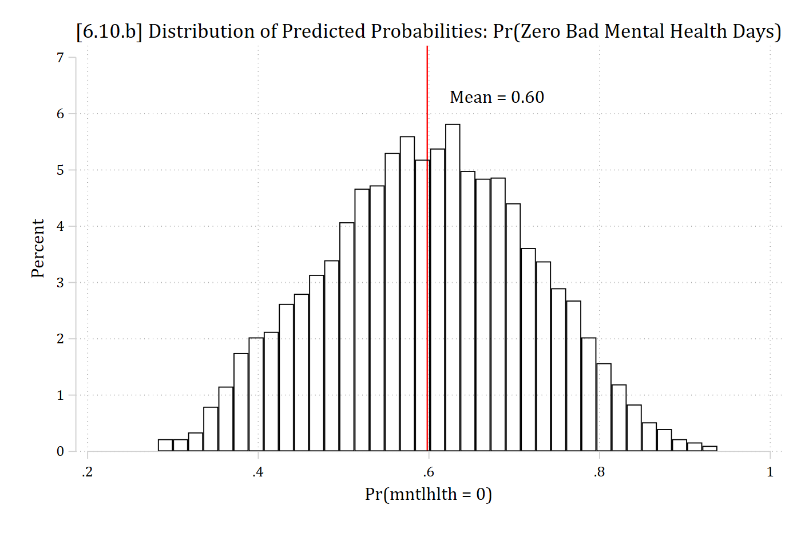

{width=35% fig-alt="Stata 17 logo."}

- For all sets of lecture notes, there is an accompanying replication Stata do-file ([available here](https://drive.google.com/drive/folders/1E0tqULBiY1WKic3A6pSG0_vFlcP-dhcF?usp=sharing) or on Brightspace)
  - This includes all of the Stata code necessary to recreate anything in the slides
- In this Appendix, I include some comments, notes, and examples for things that are new or that might be hard to follow without more detail
- For more streamlined, less complicated, and more notated do-files showing the basics of the types of analyses covered in this section, see the [Assignment example code](https://drive.google.com/drive/folders/1kcmZsaKoyZ4Y51X9BjmCZMuLGsw4GKNx?usp=sharing) (also available on Brightspace)

## A6.4 Poisson regression model in Stata

```{.stata-run}
. use "https://tdmize.github.io/data/data/cda_ah4", clear
(cda_ah4.dta | Add Health Wave 4 - | )

. 
. poisson drinktime i.woman c.age i.college i.race c.income ///
>     i.spouserole i.parrole

Iteration 0:  Log likelihood =  -11915.53  
Iteration 1:  Log likelihood = -11915.529  

Poisson regression                                     Number of obs =   4,983
                                                       LR chi2(9)    = 1610.51
                                                       Prob > chi2   =  0.0000
Log likelihood = -11915.529                            Pseudo R2     =  0.0633

-------------------------------------------------------------------------------
    drinktime | Coefficient  Std. err.      z    P>|z|     [95% conf. interval]
--------------+----------------------------------------------------------------
        woman |
       Woman  |     -0.496      0.021  -23.208   0.000       -0.538      -0.454
          age |     -0.051      0.005   -9.265   0.000       -0.061      -0.040
              |
      college |
College De..  |     -0.253      0.023  -10.869   0.000       -0.298      -0.207
              |
         race |
       Black  |     -0.367      0.026  -14.069   0.000       -0.418      -0.316
Native Ame..  |      0.286      0.093    3.085   0.002        0.104       0.467
       Asian  |     -0.132      0.058   -2.282   0.023       -0.246      -0.019
              |
       income |      0.003      0.000    7.931   0.000        0.002       0.004
              |
   spouserole |
     Married  |     -0.131      0.022   -6.065   0.000       -0.173      -0.089
              |
      parrole |
      Parent  |     -0.225      0.023   -9.697   0.000       -0.271      -0.180
        _cons |      2.642      0.154   17.153   0.000        2.340       2.944
-------------------------------------------------------------------------------

```

### Factor change in rate with irr option

Factor changes are referred to as "incident rate ratios" in Poisson; hence the option **irr** which will exponentiate the coefficients for you.

```{.stata-run}
. poisson drinktime i.woman c.age i.college i.race c.income ///
>     i.spouserole i.parrole, irr

Iteration 0:  Log likelihood =  -11915.53  
Iteration 1:  Log likelihood = -11915.529  

Poisson regression                                     Number of obs =   4,983
                                                       LR chi2(9)    = 1610.51
                                                       Prob > chi2   =  0.0000
Log likelihood = -11915.529                            Pseudo R2     =  0.0633

-------------------------------------------------------------------------------
    drinktime |        IRR   Std. err.      z    P>|z|     [95% conf. interval]
--------------+----------------------------------------------------------------
        woman |
       Woman  |      0.609      0.013  -23.208   0.000        0.584       0.635
          age |      0.951      0.005   -9.265   0.000        0.940       0.961
              |
      college |
College De..  |      0.777      0.018  -10.869   0.000        0.742       0.813
              |
         race |
       Black  |      0.693      0.018  -14.069   0.000        0.658       0.729
Native Ame..  |      1.330      0.123    3.085   0.002        1.110       1.595
       Asian  |      0.876      0.051   -2.282   0.023        0.782       0.982
              |
       income |      1.003      0.000    7.931   0.000        1.002       1.004
              |
   spouserole |
     Married  |      0.877      0.019   -6.065   0.000        0.841       0.915
              |
      parrole |
      Parent  |      0.798      0.019   -9.697   0.000        0.763       0.835
        _cons |     14.040      2.162   17.153   0.000       10.381      18.987
-------------------------------------------------------------------------------
Note: _cons estimates baseline incidence rate.

```

> *Women's rates of drinking are lower than men's by a factor of about 0.61*
>
> *Aging each year is associated with a 0.95 times decrease in the number of drinks consumed in a sitting*

### Plots of the predicted rate

- The default for predictions and marginal effects is in the metric of the rate

```stata
qui margins, at(age=(24(1)33) woman=(0 1))
marginsplot, recastci(rline) ciopts(lpat(dash)) ylab(0(1)4) ///
    …titleoptions…
```

#### Marginal effect on the rate

```{.stata-run}
. mchange woman

poisson: Changes in mu | Number of obs = 4983

Expression: Predicted number of drinktime, predict()

              |    Change    p-value 
--------------+---------------------
woman         |                     
 Woman vs Man |    -1.038      0.000 

Average prediction

    2.123 


```

> *On average, women consume about one fewer drink in a typical sitting than do men (ME = -1.038; p \< 0.001).*

```{.stata-run}
. mchange age, amount(delta) delta(5) at(age=(25))

poisson: Changes in mu | Number of obs = 4983

Expression: Predicted number of drinktime, predict()

             |    Change    p-value 
-------------+---------------------
age          |                     
      +delta |    -0.562      0.000 

Average prediction

    2.515 

Base values of regressors

             |       age 
-------------+----------
          at |        25 

1: Delta equals 5.

```

> *Aging from 25 to 30 is associated with consuming about ½ fewer drinks per sitting (ME = -0.562; p \< 0.001).*

### Calculating probability of exact counts with margins

- The default with **margins** after count models is to predict the rate. You can also predict probabilities for specific outcomes with the **predict(pr(#))** option

```stata
qui margins, at(age=(21(1)35) woman=(0 1)) predict(pr(0))

marginsplot, recastci(rline) ciopts(lpat(dash)) ylab(0(.1).3) xlab(21(2)35) ///
    … titleoptions …
```

- Cumulative probabilities can be calculated by specifying the range of specific outcomes with **predict(pr(# , #))**. E.g. For the cumulative probability that someone consumes between 4 to the max observed (18) number of drinks per sitting:

```stata
qui margins, at(age=(21(1)35) woman=(0 1)) predict(pr(4,18))

marginsplot, recastci(rline) ciopts(lpat(dash)) ylab(0(.1).7) xlab(21(2)35) ///
    … titleoptions …
```

## A6.5 Generating mean predictions to plot

- The SPost command **mgen, meanpred** computes mean and observed probabilities of specific counts

```{.stata-run}
. mgen, pr(0/20) meanpred stub(pmod) replace

Predictions from: 

Variable   Obs Unique      Mean        Min       Max  Label
--------------------------------------------------------------------------------
pmodval     21     21        10          0        20  Average Drinks Each Time
pmodobeq    21     18   .047619          0  .4184226  Observed proportion
pmodoble    21     17   .898923   .4184226         1  Observed cum. proportion
pmodpreq    21     21   .047619   2.56e-09   .257077  Avg predicted Pr(y=#)
pmodprle    21     19   .898923   .1594405         1  Avg predicted cum. Pr(y=#)
pmodob_pr   21     21  6.83e-10  -.1529229  .2589821  Observed - Avg Pr(y=#)
--------------------------------------------------------------------------------

```

```stata
twoway connected pmodobeq pmodpreq pmodval, ylab(0(.1).4) xlab(0(2)20) ///
    ytitle("Pr(y = k)") xtitle("Number of Drinks in Typical Sitting") ///
    title("Comparison of Observed vs Poisson Model Average Predictions") ///
    legend(order(1 "Observed" 2 "Poisson Pred"))
```

## A6.6 Negative binomial model in Stata with nbreg

```{.stata-run}
. nbreg drinktime i.woman c.age i.college i.race c.income ///
>     i.spouserole i.parrole, irr

Fitting Poisson model:

Iteration 0:  Log likelihood =  -11915.53  
Iteration 1:  Log likelihood = -11915.529  

Fitting constant-only model:

Iteration 0:  Log likelihood =  -9756.951  
Iteration 1:  Log likelihood =  -9665.495  
Iteration 2:  Log likelihood = -9664.4348  
Iteration 3:  Log likelihood = -9664.4348  

Fitting full model:

Iteration 0:  Log likelihood = -9484.6092  
Iteration 1:  Log likelihood = -9465.6951  
Iteration 2:  Log likelihood = -9465.4713  
Iteration 3:  Log likelihood = -9465.4713  

Negative binomial regression                            Number of obs =  4,983
                                                        LR chi2(9)    = 397.93
Dispersion: mean                                        Prob > chi2   = 0.0000
Log likelihood = -9465.4713                             Pseudo R2     = 0.0206

-------------------------------------------------------------------------------
    drinktime |        IRR   Std. err.      z    P>|z|     [95% conf. interval]
--------------+----------------------------------------------------------------
        woman |
       Woman  |      0.618      0.026  -11.631   0.000        0.569       0.670
          age |      0.949      0.011   -4.713   0.000        0.929       0.970
              |
      college |
College De..  |      0.756      0.035   -6.112   0.000        0.691       0.827
              |
         race |
       Black  |      0.718      0.034   -6.953   0.000        0.653       0.788
Native Ame..  |      1.332      0.282    1.353   0.176        0.879       2.019
       Asian  |      0.897      0.101   -0.964   0.335        0.718       1.119
              |
       income |      1.003      0.001    4.040   0.000        1.002       1.005
              |
   spouserole |
     Married  |      0.884      0.038   -2.887   0.004        0.812       0.961
              |
      parrole |
      Parent  |      0.777      0.035   -5.658   0.000        0.712       0.848
        _cons |     14.481      4.518    8.567   0.000        7.857      26.691
--------------+----------------------------------------------------------------
     /lnalpha |      0.284      0.034                         0.217       0.352
--------------+----------------------------------------------------------------
        alpha |      1.329      0.046                         1.243       1.421
-------------------------------------------------------------------------------
Note: Estimates are transformed only in the first equation to incidence-rate
      ratios.
Note: _cons estimates baseline incidence rate.
LR test of alpha=0: chibar2(01) = 4900.12              Prob >= chibar2 = 0.000

```

### Predictions and marginal effects

- The same **margins** commands and tools can be used as with Poisson
  - As with Poisson, **margins** will default to predicted rates after a negative binomial model, but can also be used to calculate predicted probabilities of specific counts

#### Marginal effects for Pr(y = 0)

- After negative binomial, can easily calculate marginal effects for the probability that *y* = 0 (or any value of interest)

```{.stata-run}
. mchange woman income, predict(pr(0)) amount(sd)

nbreg: Changes in Pr(y=0) | Number of obs = 4983

Expression: Pr(drinktime=0), predict(pr(0))

              |    Change    p-value 
--------------+---------------------
woman         |                     
 Woman vs Man |     0.098      0.000 
income        |                     
          +SD |    -0.018      0.000 

Average prediction

    0.385 


```

## A6.7 Effects on cumulative probabilities

- For cumulative probabilities, specify the range for margins
  - Here, probability of experiencing between 0 and 11 depressive symptoms

```stata
qui margins, at(role=(0(1)10) woman=(0 1)) predict(pr(0,11))

marginsplot, recastci(rline) ciopts(lpat(dash) col(gs12)) ///
    … titleoptions …
```

## A6.10 zip and zinb for zero inflated count models in Stata

```stata
zinb mntlhlth i.woman i.married c.age##c.age c.faminc##c.faminc ///
    i.race3 i.college i.parent i.notrelig i.year, ///
    inflate(i.woman i.married c.age##c.age c.faminc ///
    i.race3 i.college i.parent i.notrelig i.year) irr zip
```

- The first part of the model specification is for the count model (the same syntax as you would use with **nbreg**)
  - As an option, you specify the inflation model IVs with **inflate( )**
- The option **zip** will provide the likelihood ratio test for whether the overdispersion parameter α is needed (i.e. the test of ZINB \[zero inflated negative binomial\] vs ZIP \[zero inflated Poisson\])
- The option **irr** will report exponentiated coefficients for the count part of the model (i.e. "incident rate ratios")
  - An annoying omission is that there is not an option to exponentiate the coefficients in the inflation logit part of the model (for odds ratios)
    - Do this yourself with **di exp(β)**

### Comparing logit to inflation part of zero-inflated model

```{.stata-run}
. use "https://tdmize.github.io/data/data/cda_gss", clear
(cda_gss.dta |  GSS 1972-2021 CDA - Categorical Data Analysis | date created 202
> 3)

. keep if year >= 2002 & year <= 2014
(50,180 observations deleted)

. 
. *Data management
. gen notrelig = relig
(106 missing values generated)

. lab var notrelig "R Not Religious"

. recode notrelig 1 2 11 = 0 4 = 1 3 5/10 12/13 = .
(18,560 changes made to notrelig)

. lab def notrlab 0"Christian" 1"Not Religious"

. lab val notrelig notrlab

. 
. drop if missing(mntlhlth, physhlth, woman, race3, year, college, ///
>     parent, faminc, metro, notrelig, married)
(13,623 observations deleted)

. 
. qui zinb mntlhlth i.woman i.married c.age##c.age c.faminc##c.faminc ///
>     i.race3 i.college i.parent i.notrelig i.year, ///
>     inflate(i.woman i.married c.age##c.age c.faminc ///
>     i.race3 i.college i.parent i.notrelig i.year) irr zip

. est store coefs_zinb

. 
. qui margins, dydx(*) predict(pr) post

. est store MEs_inflate

. 
. est restore coefs_zinb
(results coefs_zinb are active now)

. qui margins, dydx(*) expression(exp(predict(equation(mntlhlth)))) post

. est store MEs_zinb

. 
. *Compare to logit for 0 or >0
. gen mntlhlth0 = mntlhlth

. lab var mntlhlth0 "No Bad Mental Health Days"

. recode mntlhlth0 0=1 1/30 = 0
(5,043 changes made to mntlhlth0)

. 
. qui logit mntlhlth0 i.woman i.married c.age##c.age c.faminc ///
>     i.race3 i.college i.parent i.notrelig i.year

. est store coefs_logit

. qui margins, dydx(*) post

. est store MEs_logit

. 
. est table MEs_inflate MEs_logit, star stats(N) b(%9.3f) vsquish ///
>     title("[6.10.c] Comparing MEs from ZINB and logit for Pr(zero)")

[6.10.c] Comparing MEs from ZINB and logit for Pr(zero)

--------------------------------------------
    Variable | MEs_inflate     MEs_logit    
-------------+------------------------------
       woman |
      Women  |    -0.177***      -0.143***  
     married |
    Married  |     0.078***       0.077***  
         age |     0.004***       0.004***  
      faminc |     0.001**        0.001***  
       race3 |
      black  |     0.153***       0.128***  
      other  |     0.061*         0.050*    
     college |
College D..  |    -0.067**       -0.030     
      parent |
     Parent  |    -0.039         -0.036*    
    notrelig |
Not Relig..  |    -0.070**       -0.062***  
        year |
       2006  |     0.027          0.039*    
       2010  |    -0.051*        -0.031     
       2014  |     0.045          0.045*    
-------------+------------------------------
           N |      5036           5036     
--------------------------------------------
    Legend: * p<0.05; ** p<0.01; *** p<0.001

```

::: {.callout-note icon="false" appearance="simple"}
To help wrap our heads around what the model is doing, I've compared the inflation estimates of the ZINB to those from a binary logit model predicting whether someone is a zero or not for the DV *mntlhlth*

As you can see, results are very similar
:::

```{.stata-run}
. *6.10.b - Distribution of Pr(zero)
. est restore coefs_logit
(results coefs_logit are active now)

. predict przero
(option pr assumed; Pr(mntlhlth0))
(7 missing values generated)

. lab var przero "Pr(mntlhlth = 0)"

. hist przero, percent fcolor(none) ylab(0(1)7) ///
>     xline(0.598, lcol(red) lpat(solid)) text(6.3 .68 "Mean = 0.60") ///
>     title("[6.10.b] Distribution of Predicted Probabilities: Pr(Zero Bad Menta
> l Health Days)")
(bin=37, start=.28230062, width=.01772226)

```

{width=80% fig-alt="[6.10.b] Histogram of the logit model's predicted probabilities of having zero bad mental health days: roughly bell-shaped from about 0.3 to 0.95, centered near the mean of 0.60, which is marked with a red line."}

### Comparing nbreg to count part of zero-inflated model

```{.stata-run}
. *Compare to regular count model for >0, weighted by 1 - przero
. qui nbreg mntlhlth i.woman i.married c.age##c.age c.faminc##c.faminc ///
>     i.race3 i.college i.parent i.notrelig i.year [iweight = 1-przero] ///
>     if mntlhlth != 0, irr

. est store coefs_nbreg

. qui margins, dydx(*) post

. est store MEs_nbreg

. 
. est table MEs_zinb MEs_nbreg, star stats(N) b(%9.3f) vsquish ///
>     title("[6.10.e] Comparing MEs from ZINB and NBREG for non-zero counts")

[6.10.e] Comparing MEs from ZINB and NBREG for non-zero counts

--------------------------------------------
    Variable |   MEs_zinb      MEs_nbreg    
-------------+------------------------------
       woman |
      Women  |    -0.636         -0.716     
     married |
    Married  |    -0.773         -0.654     
         age |    -0.013         -0.035     
      faminc |    -0.058***      -0.066**   
       race3 |
      black  |    -0.261         -0.383     
      other  |     0.192          0.521     
     college |
College D..  |    -2.710***      -2.650***  
      parent |
     Parent  |     0.438          0.800     
    notrelig |
Not Relig..  |     0.236          0.314     
        year |
       2006  |    -1.839***      -1.717*    
       2010  |    -1.328*        -1.257     
       2014  |    -0.730         -0.704     
-------------+------------------------------
           N |      5036           2019     
--------------------------------------------
    Legend: * p<0.05; ** p<0.01; *** p<0.001

```

::: {.callout-note icon="false" appearance="simple"}
To help wrap our heads around what the model is doing, I've compared the count estimates from the ZINB to those from a negative binomial model predicting the non-zero counts of the DV *mntlhlth*, weighting the results by the probability someone is (not) a zero

As you can see, results are very similar
:::

## A6.11 Plots of predictions & MEs in zero inflated models

- As the inflation part of the model is a logit, plots and marginal effects are of most interest
  - The option **predict(pr)** makes predictions as to whether someone is always in the zero group or not
    - It can be confusing that this is Pr(in the always zero group)
  - Note **predict(pr)** is not the same as **predict(pr(0))**
    - **predict(pr)** is the probability that someone is always in the zero group or not
    - **predict(pr(0))** is the probability of a zero count (combining people in the always zero group and sometimes zero group)

```stata
qui margins, at(age=(18(2.5)103) woman=(0 1)) predict(pr)
marginsplot, recastci(rline) ciopts(lpat(dash) col(gs12)) … options …

qui margins, at(age=(18(2.5)103) married=(0 1)) predict(pr)
marginsplot, recastci(rline) ciopts(lpat(dash) col(gs12)) … options …

qui margins, at(age=(18(2.5)103) woman=(0 1) married=(0 1)) predict(pr)
marginsplot, noci … options …
```

### Marginal effects for inflation part of the model

- You can use **mchange** to estimate marginal effects for the inflation (logit) part of the model using the **predict(pr)** option
  - These are interpreted just as you would any ME from a logit model \[but remember these are the Pr(always in the zero group)\]

```{.stata-run}
. est restore coefs_zinb
(results coefs_zinb are active now)

. mchange woman married age faminc, amount(sd) predict(pr)

zinb: Changes in PrAll0 | Number of obs = 5036

Expression: Pr(mntlhlth = always 0), predict(pr)

                        |    Change    p-value 
------------------------+---------------------
woman                   |                     
           Women vs Men |    -0.177      0.000 
married                 |                     
 Married vs Not Married |     0.078      0.000 
age                     |                     
                    +SD |     0.082      0.000 
faminc                  |                     
                    +SD |     0.030      0.002 

Average prediction

    0.513 


```

### Plots of predictions for the rate or probability of specific outcomes

- By default, **margins** predicts a combination of both the always and sometimes zero groups
- These can be interpreted as you would interpret rates of predictions for specific outcomes from **nbreg**
  - See examples in [6.11](6-11-predictions-mes.qmd)
- It is unclear to me the advantage of **zinb** (besides possibly a slightly better fit) over **nbreg** if this is your interest
  - The default on **margins** is to predict the rate (i.e. expected count)
  - You can also plot probabilities of specific outcomes with the option **predict(pr(#))** or **predict(pr(#, #))** for a range

### Plots of predictions for only the count part of model

- Frustratingly, Stata does not make it easy to obtain predictions for only the count part of the **zip** or **zinb** model
- Here is a solution for the predicted rate (remember the interpretation is **for someone who is not always a zero**):
  - To only include the count part of the model in the predictions, you must include the option **expression(exp(predict(equation(mntlhlth))))**
    - **exp( )** exponentiates the linear prediction which gives you the expected rate
    - **equation( )** specifies which coefficients to use to make the predictions; where I have *mntlhlth* you should put whatever your count DV is
  - There is plausibly a way to do this for probabilities of specific outcomes for someone who is not always a zero but this would be quite difficult

```stata
*Plot predicted rates
qui margins, at(age=(18(2.5)103) woman=(0 1) married=(0 1)) ///
    expression(exp(predict(equation(mntlhlth))))

marginsplot, noci plotopts(msym(i)) … options …
```

### Marginal effects for count part of the model

- Have to specify you want to exponentiate the predictions from the count part of the model (which is named whatever the dependent variable is named; here, *mntlhlth*)

```{.stata-run}
. mchange woman married age faminc, amount(sd) ///
>     expression(exp(predict(equation(mntlhlth))))

zinb: Changes in Margin | Number of obs = 5036

Expression: , exp(predict(equation(mntlhlth)))

                        |    Change    p-value 
------------------------+---------------------
woman                   |                     
           Women vs Men |    -0.636      0.124 
married                 |                     
 Married vs Not Married |    -0.773      0.075 
age                     |                     
                    +SD |     0.390      0.283 
faminc                  |                     
                    +SD |    -1.321      0.000 

Average prediction

    7.345 


```

#### Marginal effects on the rate for all observations

- Remember that the results above are **for those who report some bad mental health days**
- The default prediction with **margins** after zero-inflated models is for the rate (expected count) for all observations
  - This mixes the always zeroes and the sometimes zeroes

```{.stata-run}
. mchange woman married age faminc, amount(sd)

zinb: Changes in mu | Number of obs = 5036

Expression: Predicted number of mntlhlth, predict()

                        |    Change    p-value 
------------------------+---------------------
woman                   |                     
           Women vs Men |     0.991      0.000 
married                 |                     
 Married vs Not Married |    -0.940      0.000 
age                     |                     
                    +SD |    -0.551      0.000 
faminc                  |                     
                    +SD |    -0.851      0.000 

Average prediction

    3.563 


```

\*Note the differences in the results compared to those above

## A6.12 Model selection for count models

- **countfit** will perform all of the relevant tests for you
  - By default it compares Poisson, negative binomial, zero inflated Poisson, and zero inflated negative binomial
  - It reports the statistical tests and makes the graphs shown in [6.12](6-12-model-selection.qmd) (observed -- predicted)
  - Syntax is the same as **zip** or **zinb**
    - *Adding the **replace** option is helpful if you run **countfit** multiple times*
    - *There is lots and lots of output*
      - *In my opinion, the tables of "Comparison of Mean Observed and Predicted Count" and the table of "Tests and Fit Statistics" are most helpful*
      - *The graph is also very helpful*

```stata
countfit mntlhlth i.woman i.married c.age##c.age c.faminc##c.faminc ///
    i.race3 i.college i.parent i.notrelig i.year, ///
    inflate(i.woman i.married c.age##c.age c.faminc ///
    i.race3 i.college i.parent i.notrelig i.year) replace
```

### Troubleshooting with countfit

- Zero inflated models can be tricky to obtain convergence---especially if there is not actually an excess of zeros
- If **countfit** does not produce any output, add the option **noisily** to see where it is getting stuck
  - You can ask for **countfit** to only compare particular models by adding the options **prm nbreg zip zinb**
    - *This is the default (to compare all four)*
    - *Remove the one that won't converge to still get the output of comparisons for the others*
- If one of the models does not converge, this is pretty compelling evidence that is not the best model...
