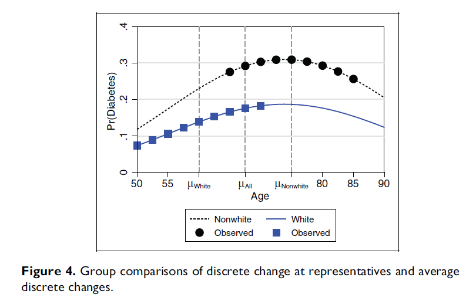
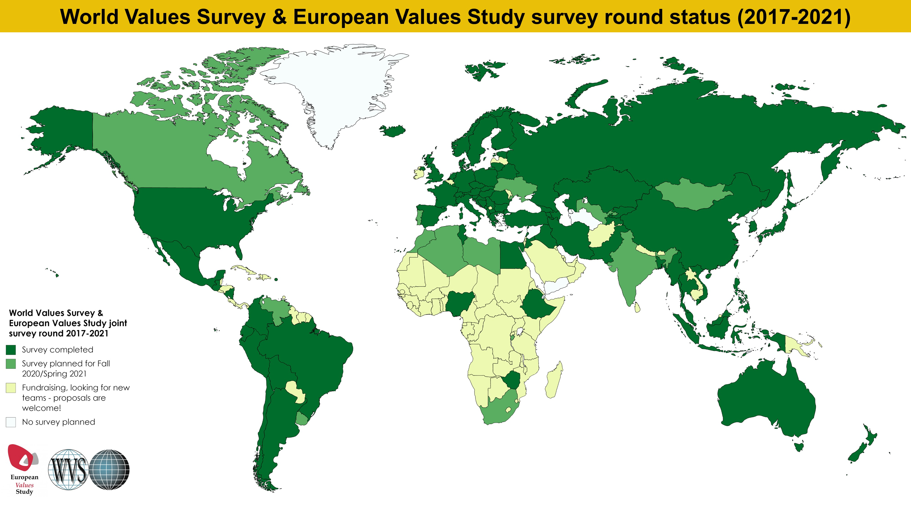
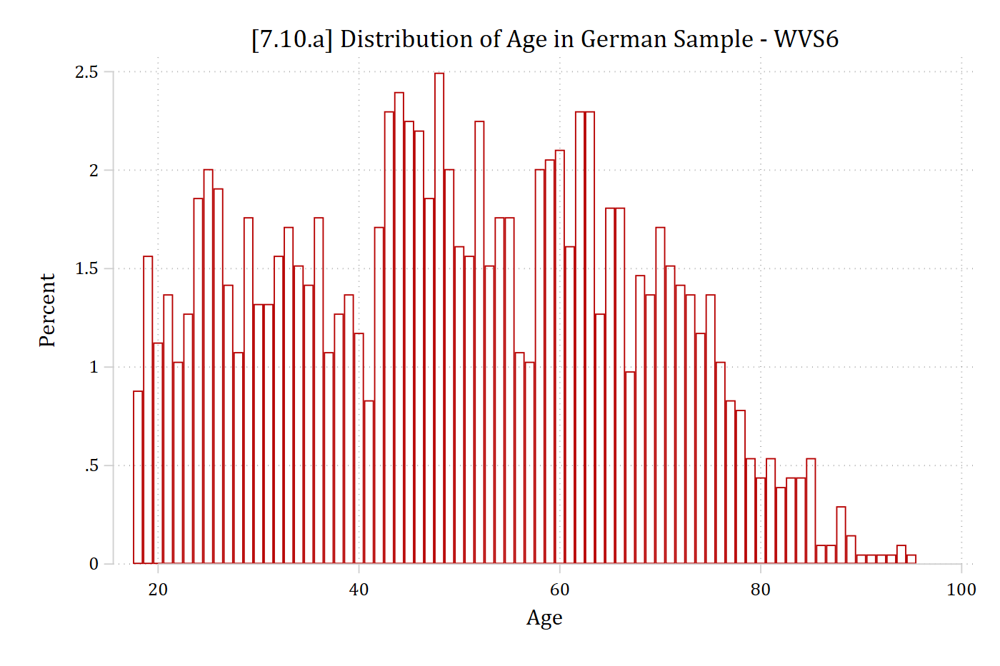
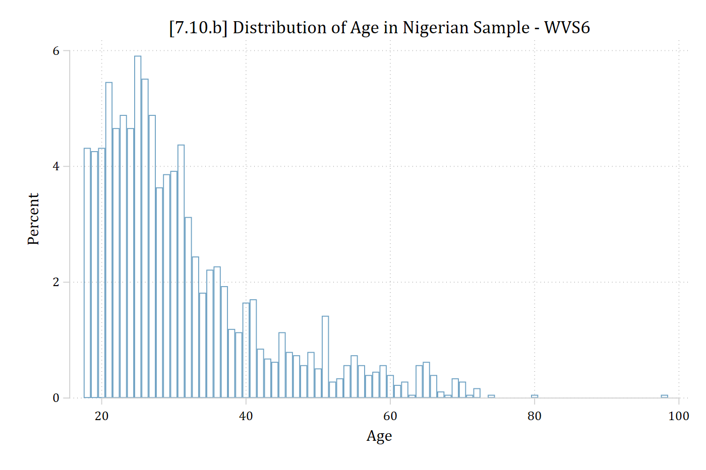
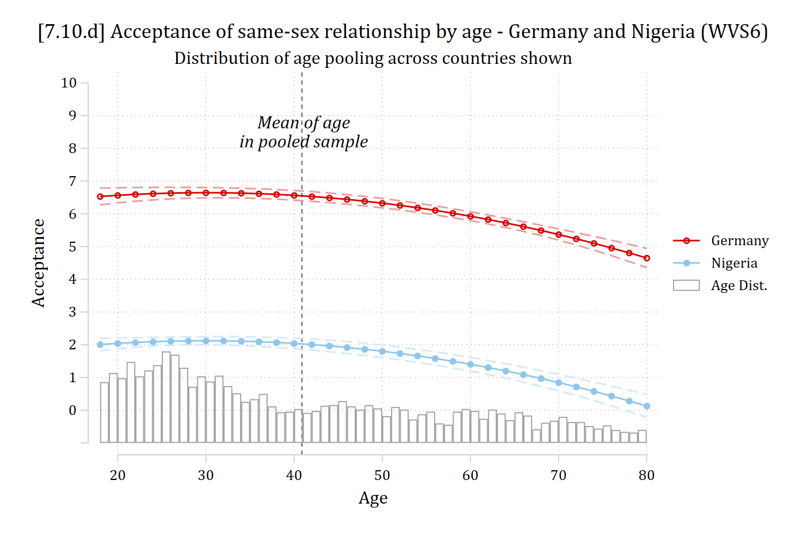
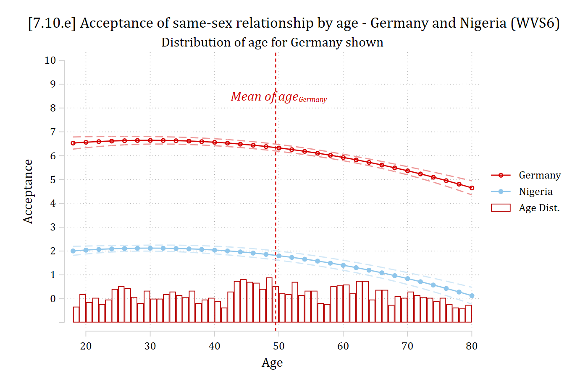
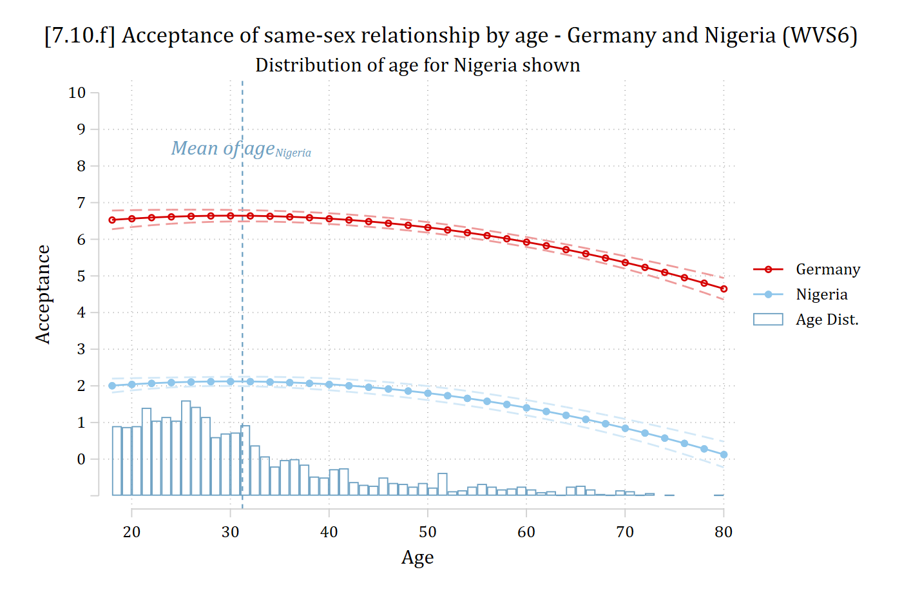

- With nonlinear effects the marginal effect size will depend on the value of the IV
  - (Average) marginal effects use the sample-specific IV values for calculations
    - Comparing across groups complicates this

{width=55% fig-alt="Figure 4 from Long and Mustillo (2021): Pr(diabetes) by age (50 to 90) for whites and nonwhites, with the observed values for each group and the mean age of each group marked on the x-axis. Group comparisons of discrete change at representatives and average discrete changes."}

::: {.callout-note icon="false" appearance="simple"}
\*Figure from [Long and Mustillo 2021](https://doi.org/10.1177%2F0049124118799374)
:::

## Separate models for each group

- One popular approach to examining interaction effects is to estimate separate models for different groups that would otherwise be involved in the interaction term
  - E.g., Instead of including gender in the interaction term, estimate separate models for each gender
  - E.g., [Mize 2016](https://doi.org/10.1177/0003122416674025) makes the argument for allowing all factors to vary for men and women:

> *"Men and women follow different paths to eventual labor market outcomes, with certain factors differentially affecting men and women. For example, parenthood has different effects based on gender---therefore, I estimate and present separate models for men and for women. Estimating separate models allows the effect of all the model variables to vary for men and women, including the effect of sexual orientation." ([Mize 2016](https://doi.org/10.1177/0003122416674025))*

### Pros and cons of separate model approach

- Estimating separate models has the (potentially) advantageous effect of letting ***all*** independent variables' effects vary across groups\*
  - Compared to only those that are interacted with the grouping variable
  - This is easy to do with the [Mize, Doan, and Long 2019](https://doi.org/10.1177/0081175019852763) SUEST approach we just covered
- It can also be clearer to present interactions when estimating separate models
  - Separate set of estimates for each group make clear what effects for each group are
- The choice is sometimes framed as a bias-efficiency trade-off ([Blackwell and Olson 2021](http://www.doi.org/10.1017/pan.2021.19))
  - Estimating separate models includes estimating many more coefficients and is thus generally more accurate\* / less biased\*
  - But this may be more complicated than warranted and can be an inefficient use of the data (increasing chance of a Type II error \[false negative\])
- However, I think this is better thought of as a causal estimand question, than as a bias-efficiency tradeoff

## An important aside on which observations to use

- The title of this subsection may provoke confusion---surely the answer is always... all of them?
  - Not necessarily so! The answer is: **it depends on what you want to know**
- Imagine a binary *race-ethnicity* comparison (e.g., *White or Black*) X continuous (*age*) interaction effect. Consider this a group comparison question: Of primary interest is how effects (e.g., of aging) differ for Black and White adults
  - Should you use the observations of White adults to estimate the AME of age for Black adults?
    - Usually---we **do** indeed include **all** observations when we estimate the AME of age for one group
  - However, we **could** only use the observations for, e.g., Black adults, when we estimate the predictions and/or AME of age for Black adults
- Sometimes, the decision about which observations to use can change your answer
  - More likely with highly nonlinear effects and/or where the distribution of the focal IV (age here) and/or the control variables differ dramatically across the groups

### Which observations should I use?

- What is the causal question of interest to you?
- **If Black and White adults had similar characteristics *except for their race* would the effects of aging be the same?**
  - Use all observations treating race as a counterfactual
  - This helps control for the differences across groups
- ***Given that Black and White adults have different characteristics*, what is the effect of aging for each group?**
  - Use only the observations for a given group when calculating predictions and MEs for that group
    - Reflects the fact that groups differ on many baseline factors which will affect how a change in a focal IV affects them

#### Which observations to use?

- Neither causal question above is better nor always preferred
  - We usually ask the first question: this is the goal of most multiple regression models and why we include control variables; we attempt to set "all else equal" and then examine the unique effect remaining of our focal IV
  - FWIW this is what we are typically taught to do/how to think about regression modeling so I find it to be a good default in most cases
- However, if you are proposing an intervention---how that will affect people will depend on the characteristics of that population; so, the second causal question is of greater interest
  - E.g., The age of most people in that group will matter for the intervention's success
- Note that if you fit a separate model for different groups, the ME calculations will of course only use the observations from the relevant model (i.e., for that group)
  - Thus, results can differ both due to differing effects/slopes and/or because of differing distributions

## Real-world example of distributional differences

- Consider a cross-national comparative study with *age* as the focal IV
  - Data: [World Values Survey](https://www.worldvaluessurvey.org/)
  - What is the effect of aging on attitudes? (e.g., [Kiley and Vaisey 2020](https://doi.org/10.1177/0003122420921538))
- Both Germany (median age = 47.8) and Nigeria (median age = 18.6) are included in the survey

{width=60% fig-alt="World map of World Values Survey and European Values Study survey round status (2017-2021), with participating countries shaded in green."}

::: {.panel-tabset group="language"}
## Stata

```{.stata-run}
. *World Values Survey 6
. use "https://tdmize.github.io/data/data/lvm_wvs6", clear
(World Values Survey 6 2010 - 2014 | LVM | 2019-01-28)

. drop if age < 18
(93 observations deleted)

. 
. *7.10.a - Germany
. hist age if country == 276, discrete percent fcol(none) lcol(red*1.4) ///
>     title("[7.10.a] Distribution of Age in German Sample - WVS6")
(start=18, width=1)

```

{width=80% fig-alt="[7.10.a] Histogram of age (in single years) in the German WVS6 sample: ages are spread fairly evenly from about 18 to 80, mostly between 1% and 2.5% per year of age, thinning out past 80."}

## R

```{r}
#| fig-alt: "[7.10.a] Histogram of age (in single years) in the German WVS6 sample: ages are spread fairly evenly from about 18 to 80, mostly between 1% and 2.5% per year of age, thinning out past 80."
library(haven)           # import Stata data and labels
library(dplyr)           # data manipulation
library(ggplot2)         # graphs
library(marginaleffects) # predictions and marginal effects
library(cleanplots)      # graph scheme
cleanplots_defaults()

# World Values Survey 6
wvs <- read_dta("https://tdmize.github.io/data/data/lvm_wvs6.dta") |>
  filter(age >= 18)

age_hist <- function(cntry, color, title) {
  ggplot(filter(wvs, country == cntry), aes(x = age)) +
    geom_histogram(aes(y = after_stat(100 * count / sum(count))), binwidth = 1,
      fill = NA, color = color) +
    labs(title = title, x = "Age", y = "Percent")
}

# 7.10.a - Germany
age_hist(276, "red", "[7.10.a] Distribution of Age in German Sample - WVS6")
```

:::

::: {.panel-tabset group="language"}
## Stata

```{.stata-run}
. *7.10.b - Nigeria
. hist age if country == 566, discrete percent fcol(none) lcol(eltblue*1.2) ///
>     title("[7.10.b] Distribution of Age in Nigerian Sample - WVS6")
(start=18, width=1)

```

{width=80% fig-alt="[7.10.b] Histogram of age (in single years) in the Nigerian WVS6 sample: heavily concentrated among young adults, with about 4% to 6% at each age from 18 to the late 20s and steadily fewer at older ages; very few respondents are over 60."}

## R

```{r}
#| fig-alt: "[7.10.b] Histogram of age (in single years) in the Nigerian WVS6 sample: heavily concentrated among young adults, with about 4% to 6% at each age from 18 to the late 20s and steadily fewer at older ages; very few respondents are over 60."
# 7.10.b - Nigeria
age_hist(566, "skyblue", "[7.10.b] Distribution of Age in Nigerian Sample - WVS6")
```

:::

### Example model to compare groups

- Typically, we would fit a single model including both countries' samples with a nominal indicator for *country*

$$\widehat{{acceptance}_{i}} = \beta_{0} + \beta_{age}{age}_{i} + \beta_{{age}^{2}}{{age}^{2}}_{i} + \beta_{country}{country}_{i}$$

- The default/typical prediction and marginal effect would then use all observations
  - E.g., Would use **both** Germans **and** Nigerians for predictions about Germany
- This is answering the causal question: **if German and Nigerian adults had similar characteristics *except for where they live* would the effects of aging be the same?**
  - Use all observations treating country as a counterfactual
    - This helps control for the differences in distributions across groups

::: {.panel-tabset group="language"}
## Stata

```{.stata-run}
. *DV: Is homosexuality justifiable?
. *model relationship allowing nonlinear effect of age
. qui reg Jgaylesbian c.age##c.age i.country ///
>     if country == 276 | country == 566

. est store glmod

. 
. *7.10.d - add a histogram to show distribution of age in combined sample.
. *   show where MEM would be calculated
. gen insample = e(sample)

. sum age if insample

    Variable |        Obs        Mean    Std. dev.       Min        Max
-------------+---------------------------------------------------------
         age |      3,735    40.88648    17.67899         18         98

. qui margins country, at(age=(18(2)80))

. marginsplot, recastci(rline) ciopts(lpat(dash) lcol(*.4)) ///
>     ytitle("Acceptance") ///
>     title("[7.10.d] Acceptance of same-sex relationship by age - Germany and N
> igeria (WVS6)", size(medium)) ///
>     subtitle("Distribution of age pooling across countries shown") ///
>     addplot(hist age if insample & age <= 80, width(1) lcol(gs10) ///
>     fcol(none) yaxis(2) yscale(range(0 0.15) off alt axis(2) ) ///
>     ylab(-1(1)10 -1" ") xlab(20(10)80) ///
>     legend(order(3 "Germany" 4 "Nigeria" 5 "Age Dist."))) ///
>     xline(40.89) text(8.5 41.1 "{it:Mean of age}" "{it:in pooled sample}")

Variables that uniquely identify margins: age country

```

{width=80% fig-alt="[7.10.d] Predicted acceptance of same-sex relationships (0 to 10) by age (18 to 80) for Germany and Nigeria, with confidence intervals, over a histogram of the pooled age distribution of the German and Nigerian samples and a vertical line at their mean age (about 41). Germany's predictions are about 6.6 from age 18 to 50, then fall to about 4.7 at 80; Nigeria's are parallel and lower, about 2 at younger ages falling to near 0 at 80."}

## R

```{r}
#| fig-alt: "[7.10.d] Predicted acceptance of same-sex relationships (0 to 10) by age (18 to 80) for Germany and Nigeria, with confidence intervals, over a histogram of the pooled age distribution of the German and Nigerian samples and a vertical line at their mean age (about 41). Germany's predictions are about 6.6 from age 18 to 50, then fall to about 4.7 at 80; Nigeria's are parallel and lower, about 2 at younger ages falling to near 0 at 80."
# DV: Is homosexuality justifiable?
# model relationship allowing nonlinear effect of age
gn <- wvs |>
  filter(country %in% c(276, 566)) |>
  select(Jgaylesbian, age, country)
gn <- gn[complete.cases(gn), ] |>
  mutate(country = droplevels(as_factor(country)))

glmod <- lm(Jgaylesbian ~ age + I(age^2) + country, data = gn)

# 7.10.d - add a histogram to show distribution of age in combined sample.
#   show where MEM would be calculated
mean(gn$age)
pr <- avg_predictions(glmod, by = c("age", "country"),
  newdata = datagrid(age = seq(18, 80, 2), country = unique, grid_type = "counterfactual"))

# Age histogram scaled to the plot (bar height of 11 = top share of the sample)
pr_hist <- function(ages, mean_age, label, color, top = .15) {
  ggplot(pr, aes(x = age)) +
    geom_histogram(data = filter(ages, age <= 80),
      aes(y = after_stat(11 * density / top)), binwidth = 1, fill = NA, color = color) +
    geom_ribbon(aes(ymin = conf.low, ymax = conf.high, fill = country), alpha = .2) +
    geom_line(aes(y = estimate, color = country)) +
    geom_vline(xintercept = mean_age, linetype = "dashed", color = color) +
    annotate("text", x = mean_age + 1, y = 8.5, label = label, hjust = 0,
      fontface = "italic", color = color) +
    scale_x_continuous(breaks = seq(20, 80, 10)) +
    scale_y_continuous(breaks = 0:10) +
    coord_cartesian(ylim = c(-.5, 10)) +
    labs(x = "Age", y = "Acceptance", color = NULL, fill = NULL)
}

pr_hist(gn, 40.89, "Mean of age\nin pooled sample", "gray50") +
  labs(title = "[7.10.d] Acceptance of same-sex relationship by age - Germany and Nigeria (WVS6)",
    subtitle = "Distribution of age pooling across countries shown")
```

:::

### MEs using all observations

::: {.panel-tabset group="language"}
## Stata

```{.stata-run}
. // Use all obs for MEs //
. *mecompare option by() uses full sample of obs for each ME
. mecompare age, by(country) model(glmod)

Predicting: Linear prediction
Marginal effects (N_glmod=3735)

                                 |  ME #   Estimate         SE      P>|z|
---------------------------------+---------------------------------------
age + 1 (centered)               |                                       
                         Germany |     1     -0.017      0.003      0.000
                         Nigeria |     2     -0.017      0.003      0.000

```

## R

```{r}
# Changes in continuous IVs centered on the observed values, like mecompare
options(marginaleffects_contrast_direction = "center")

# Use all obs for MEs
avg_comparisons(glmod, variables = list(age = 1), by = "country",
  newdata = datagrid(country = unique, grid_type = "counterfactual"))
```

:::

> *For both Germany and Nigeria, the average effect of aging is to decrease support for same-sex relationships by 0.017 (i.e., older adults are less supportive)*

::: {.callout-note icon="false" appearance="simple"}
- In Stata, **mecompare**'s **by( )** option will include the full sample; the same as **margins** **at( )** option
- In R, the **by** option combined with **newdata** and a **"counterfactual" gridtype** does the same
:::

### MEs using country-specific observations

- Alternatively, we could ask: ***Given that German and Nigerian adults have different characteristics, including different age distributions*, what is the effect of aging for each group?**
- For this approach, we use only the observations for a given group when calculating predictions and MEs for that group
  - Reflects the fact that groups differ on many factors which will affect how a change in a focal IV affects them
- Could accomplish this with separate models or by one model but selecting group-specific observations for ME calculations
  - Separate models effectively adds an interaction between *country* and *age* (and any controls)

::: {.panel-tabset group="language"}
## Stata

```{.stata-run}
. *7.10.e - add histograms of Germany-specific distribution of age
. sum age if country == 276

    Variable |        Obs        Mean    Std. dev.       Min        Max
-------------+---------------------------------------------------------
         age |      2,044    49.51027    17.69072         18         95

. est restore glmod
(results glmod are active now)

. qui margins country, at(age=(18(2)80))

. marginsplot, recastci(rline) ciopts(lpat(dash) lcol(*.4)) ///
>     ytitle("Acceptance") ///
>     title("[7.10.e] Acceptance of same-sex relationship by age - Germany and N
> igeria (WVS6)", size(medium)) ///
>     subtitle("Distribution of age for Germany shown") ///
>     addplot(hist age if country == 276 & age <= 80, width(1) lcol(gs10) ///
>     fcol(none) lcol(red*1.4) yaxis(2) yscale(range(0 0.15) off alt axis(2) ) /
> //
>     ylab(-1(1)10 -1" ") xlab(20(10)80) ///
>     legend(order(3 "Germany" 4 "Nigeria" 5 "Age Dist."))) ///
>     xline(49.51, lcol(red*1.2)) ///
>     text(8.5 50 "{it:Mean of age{sub:Germany}}", col(red*1.2))

Variables that uniquely identify margins: age country

```

{width=80% fig-alt="[7.10.e] The same predictions of acceptance by age for Germany and Nigeria, now over a histogram of the German age distribution (spread evenly from 18 to 80) with a vertical line at Germany's mean age (about 49.5)."}

## R

```{r}
#| fig-alt: "[7.10.e] The same predictions of acceptance by age for Germany and Nigeria, now over a histogram of the German age distribution (spread evenly from 18 to 80) with a vertical line at Germany's mean age (about 49.5)."
# 7.10.e - add histograms of Germany-specific distribution of age
germany <- filter(wvs, country == 276)
mean(germany$age)
pr_hist(germany, 49.51, "Mean of age (Germany)", "red") +
  labs(title = "[7.10.e] Acceptance of same-sex relationship by age - Germany and Nigeria (WVS6)",
    subtitle = "Distribution of age for Germany shown")
```

:::

::: {.panel-tabset group="language"}
## Stata

```{.stata-run}
. *7.10.f - add histograms of Nigeria-specific distributions of age
. sum age if country == 566

    Variable |        Obs        Mean    Std. dev.       Min        Max
-------------+---------------------------------------------------------
         age |      1,759    31.22399    11.68714         18         98

. est restore glmod
(results glmod are active now)

. qui margins country, at(age=(18(2)80))

. marginsplot, recastci(rline) ciopts(lpat(dash) lcol(*.4)) ///
>     ytitle("Acceptance") ///
>     title("[7.10.f] Acceptance of same-sex relationship by age - Germany and N
> igeria (WVS6)", size(medium)) ///
>     subtitle("Distribution of age for Nigeria shown") ///
>     addplot(hist age if country == 566 & age <= 80, width(1) lcol(gs10) ///
>     fcol(none) lcol(eltblue*1.2) yaxis(2) yscale(range(0 0.25) off alt axis(2)
>  ) ///
>     ylab(-1(1)10 -1" ") xlab(20(10)80) ///
>     legend(order(3 "Germany" 4 "Nigeria" 5 "Age Dist."))) ///
>     xline(31.22, lcol(eltblue*1.2)) ///
>     text(8.5 31.1 "{it:Mean of age{sub:Nigeria}}", col(eltblue*1.2))

Variables that uniquely identify margins: age country

```

{width=80% fig-alt="[7.10.f] The same predictions of acceptance by age for Germany and Nigeria, now over a histogram of the Nigerian age distribution (concentrated at young ages) with a vertical line at Nigeria's mean age (about 31)."}

## R

```{r}
#| fig-alt: "[7.10.f] The same predictions of acceptance by age for Germany and Nigeria, now over a histogram of the Nigerian age distribution (concentrated at young ages) with a vertical line at Nigeria's mean age (about 31)."
# 7.10.f - add histograms of Nigeria-specific distributions of age
nigeria <- filter(wvs, country == 566)
mean(nigeria$age)
pr_hist(nigeria, 31.22, "Mean of age (Nigeria)", "skyblue3", top = .25) +
  labs(title = "[7.10.f] Acceptance of same-sex relationship by age - Germany and Nigeria (WVS6)",
    subtitle = "Distribution of age for Nigeria shown")
```

:::

::: {.panel-tabset group="language"}
## Stata

```{.stata-run}
. // Use country-specific observations for MEs //
. *mecompare option over() uses group subsample only obs for each ME
. mecompare age, over(country) model(glmod)

Predicting: Linear prediction
Marginal effects (N_glmod=3735)

                                 |  ME #   Estimate         SE      P>|z|
---------------------------------+---------------------------------------
age + 1 (centered)               |                                       
                         Germany |     1     -0.031      0.003      0.000
                         Nigeria |     2     -0.002      0.005      0.710

```

## R

```{r}
# Use country-specific observations for MEs
mes <- avg_comparisons(glmod, variables = list(age = 1), by = "country")
mes
```

:::

- *In Germany, the average effect of aging is a decrease in support for same-sex relationships by 0.03 points (p \< .001)*
- *In Nigeria, there is no association between aging and support for same-sex relationships (p = n.s.)*

::: {.panel-tabset group="language"}
## Stata

```{.stata-run}
. metest 1 - 2

                                 |  estimate         se     pvalue 
---------------------------------+--------------------------------
 age_countr~276 - age_countr~566 |    -0.029      0.005      0.000 

```

## R

```{r}
hypotheses(mes, hypothesis = "b1 - b2 = 0")
```

:::

*Aging has a significantly larger effect in Germany than in Nigeria*

::: {.callout-note icon="false" appearance="simple"}
- In Stata, **mecompare**'s **over( )** option will include only the group's subsample; the same as **margins** **over( )** option
- In R, the **by** option without a **newdata** statement does the same
:::

## Separate models concluding thoughts

- I see people often choose to fit separate models for different groups without fully considering the implications. If you fit separate models
  - There is effectively an interaction between *group* and **all variables in the models**
  - Estimate of coefficients, predictions, and marginal effects will reflect **only the observations in that group**
    - Effects can vary across groups because of differences in slopes, and/or due to differences in distributions of the IVs
- This is **not** a "setting all else equal" estimand
  - Separate models is inherently a ***given these groups differ in their characteristics, how would a change in this variable affect this group*?**
    - This is a reasonable estimand in some cases, but is not typically how we think of effects after controlling for differences
    - Think carefully before making this choice
- By default, I would use a combined model with interactions between the grouping variable and specific IVs you want to allow to differ across groups
  - And, I would use all observations for predictions and MEs by default, to fully set all else equal
