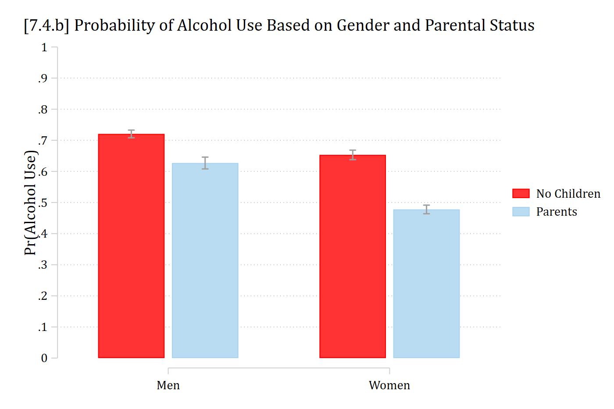
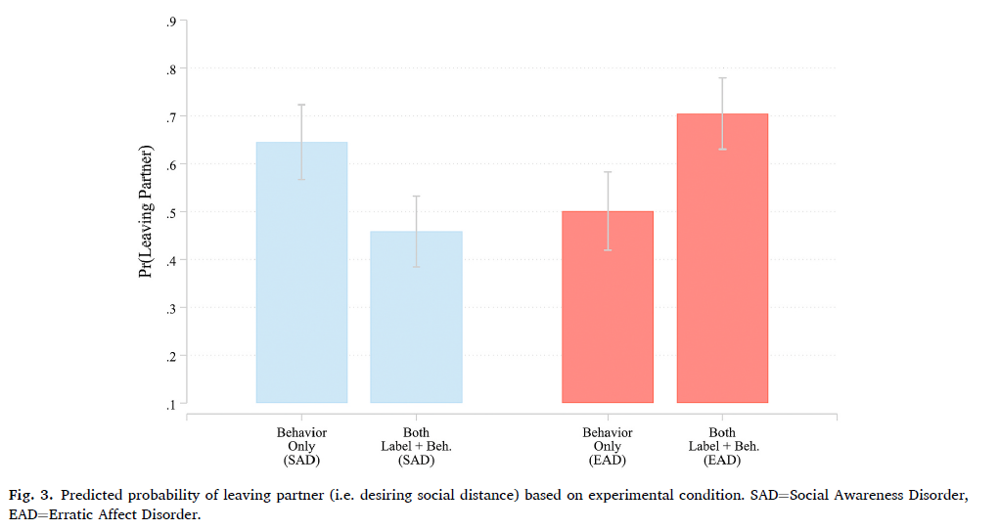
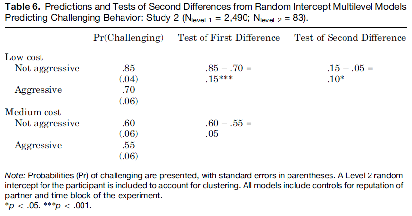
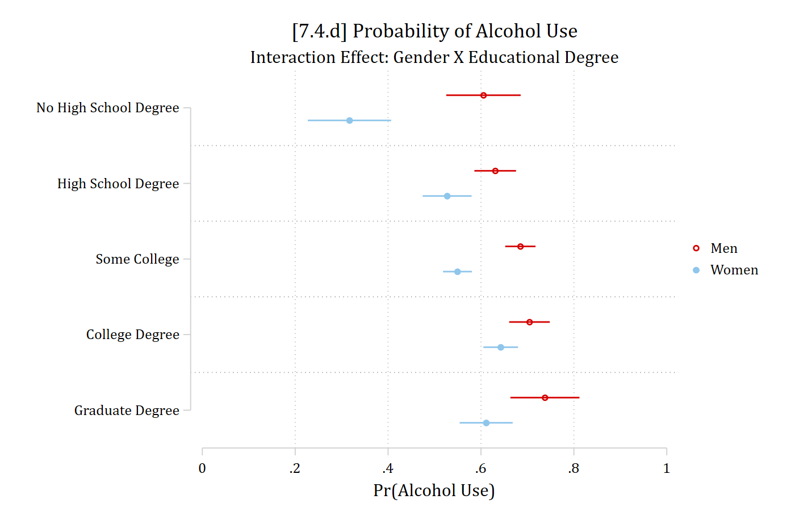
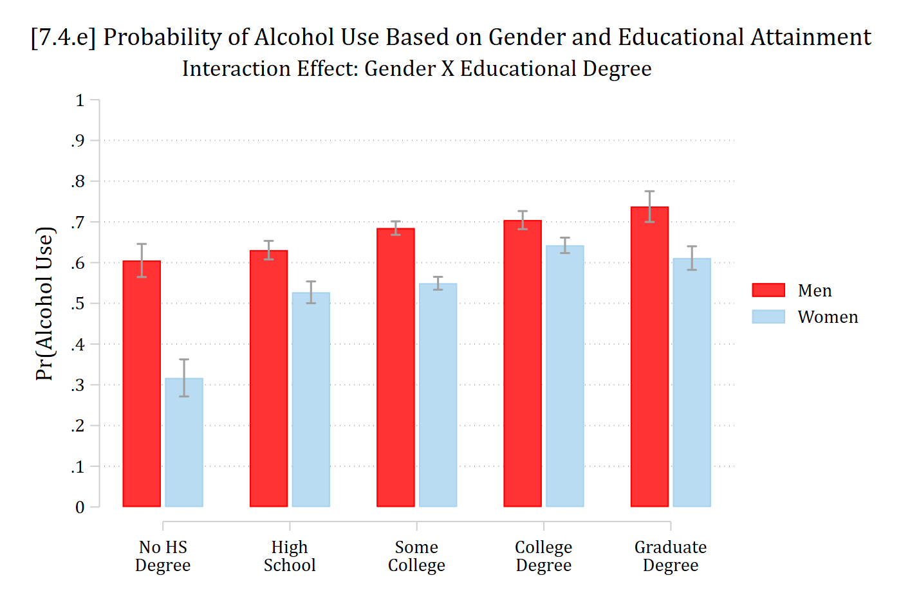
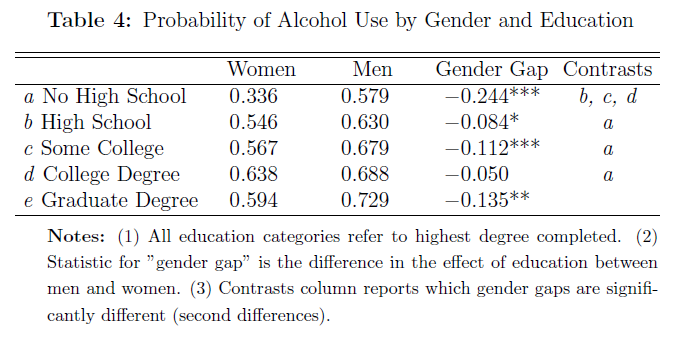
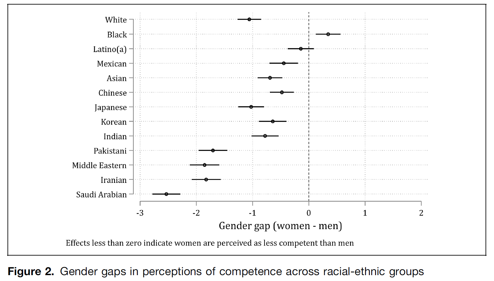
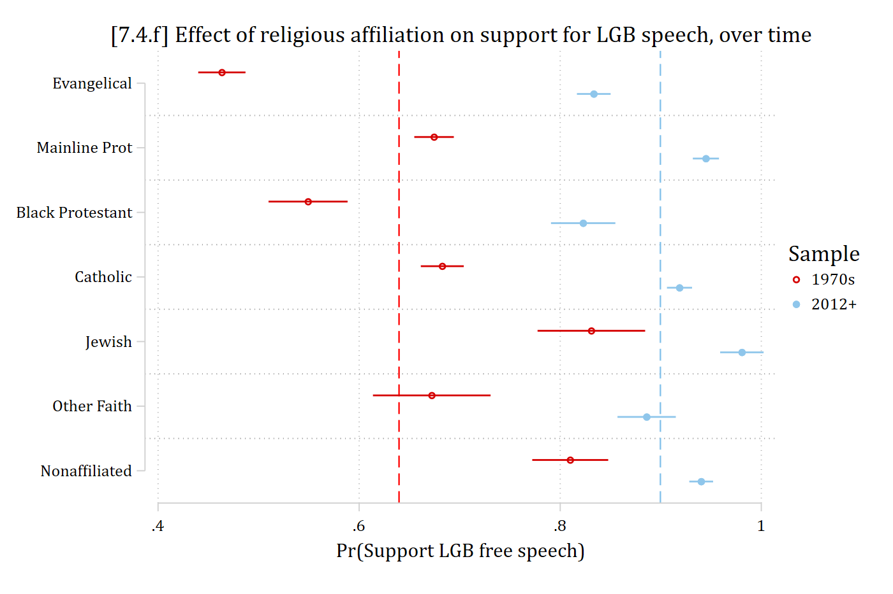

- Interactions with two nominal variables are usually the easiest to handle because there are not multiple values of the IV to consider: e.g., for a binary variable like *college*, you should make tests at 0 and 1
  - Tables sometimes suffice to convey this information
  - Still a good idea to make a plot for your own understanding, regardless of whether it ends up in your paper or not
    - Direction of effects and effect size is easier to understand visually than in a table
- As with all nonlinear interaction effects, rely on tests of the second difference and ignore the coefficient on the interaction (product) term

#### Ex: nominal X nominal interactions

- Following examples from Add Health Wave 4 (young adults):
  - **DV**: Current alcohol user
  - **Focal IV**: parental status (0/1)
  - **Moderating IV**: gender (man/woman)
  - \+ controls

::: {.panel-tabset group="language"}
## Stata

```{.stata-run}
. use "https://tdmize.github.io/data/data/addhealth4", clear
(addhealth4_dmv.dta | Add Health Wave IV | DMV Workshop)

. 
. fre alcB

alcB -- Drank Alcohol Last Month Dummy
-----------------------------------------------------------
              |      Freq.    Percent      Valid       Cum.
--------------+--------------------------------------------
Valid   0 No  |       1657      38.47      38.47      38.47
        1 Yes |       2650      61.53      61.53     100.00
        Total |       4307     100.00     100.00           
-----------------------------------------------------------

. qui logit alcB i.woman##i.parrole c.age i.race i.educ c.wages, or nolog

. est store alcmod

```

## R

```{r}
library(haven)           # import Stata data and labels
library(dplyr)           # data manipulation
library(ggplot2)         # graphs
library(sjmisc)          # frequency tables
library(marginaleffects) # predictions and marginal effects
library(cleanplots)      # graph scheme
cleanplots_defaults()

ah4 <- read_dta("https://tdmize.github.io/data/data/addhealth4.dta")

frq(ah4, alcB)

# Treat binary/nominal variables as factors
ah4 <- ah4 |>
  mutate(across(c(woman, parrole, race, educ), as_factor))

alc <- glm(alcB ~ woman * parrole + age + race + educ + wages, data = ah4,
  family = binomial(link = "logit"))
```

:::

## Bar charts or dot plots of predictions

- Bar charts are a common method of visualizing interaction effects between nominal IVs
  - E.g., Experiments often have nominal X nominal interactions by design and the results are often presented using bar charts
- In most cases, a dot plot can be used for an identical purpose

::: {.panel-tabset group="language"}
## Stata

- In Stata, **marginsplot** is limited for bar charts; the user-written command **coefplot** is a more flexible choice
  - See [Appendix A7.4](appendix-a7-stata.qmd#a7.4-nominal-x-nominal-interactions) for details

```{.stata-run}
. *7.4.b - Bar chart with coefplot; parental status bars within gender
. *NOTE: Need to make and store predictions separately for those with and withou
> t
. *children for plot to have different colors for parents/non-parents
. est restore alcmod
(results alcmod are active now)

. qui margins, at(woman=(0 1) parrole=(0)) post

. est store prnokid

. 
. est restore alcmod
(results alcmod are active now)

. qui margins, at(woman=(0 1) parrole=(1)) post

. est store prkids

. 
. coefplot prnokid prkids, ///
>     recast(bar) vertical barw(0.3) ciopts(recast(rcap) color(gs10)) ///
>     citop level(68) ylab(0(.1)1) xlab(1 "Men" 2 "Women") ///
>     legend(order(1 "No Children" 3 "Parents")) ///
>     ytitle("Pr(Alcohol Use)") scale(1.1) ///
>     title("[7.4.b] Probability of Alcohol Use Based on Gender and Parental Sta
> tus")

```

{width=80% fig-alt="[7.4.b] Bar chart of the predicted probability of alcohol use for men and women, with and without children, with standard error bars. Men: about 0.72 without children and 0.63 as parents. Women: about 0.65 without children and 0.48 as parents. The parenthood gap is larger for women."}

## R

- In R, use **plot_predictions** (default is dot plot)

```r
plot_predictions(alc, by = c("woman", "parrole"),
  newdata = datagrid(woman = unique, parrole = unique, grid_type = "counterfactual"))
```

- For a bar chart in R, save **avg_predictions** and pass to **ggplot**

```{r}
#| fig-alt: "[7.4.b] Bar chart of the predicted probability of alcohol use for men and women, with and without children, with standard error bars. Men: about 0.72 without children and 0.63 as parents. Women: about 0.65 without children and 0.48 as parents. The parenthood gap is larger for women."
# 7.4.b - Bar chart; parental status bars within gender, with SE bars (68% CIs)
pr <- avg_predictions(alc, by = c("woman", "parrole"), conf_level = .68,
  newdata = datagrid(woman = unique, parrole = unique, grid_type = "counterfactual"))

ggplot(pr, aes(x = woman, y = estimate, fill = parrole)) +
  geom_col(position = position_dodge(.7), width = .6) +
  geom_errorbar(aes(ymin = conf.low, ymax = conf.high), color = "gray60",
    position = position_dodge(.7), width = .1) +
  scale_y_continuous(breaks = seq(0, 1, .1), limits = c(0, 1)) +
  labs(title = "[7.4.b] Probability of Alcohol Use Based on Gender and Parental Status",
    x = NULL, y = "Pr(Alcohol Use)", fill = NULL)
```

:::

### Example bar chart to visualize interaction

{width=70% fig-alt="Figure 3 from Manago and Mize (2022): bar chart of the predicted probability of leaving a partner (desiring social distance) by experimental condition, for behavior only and for both a label and behavior, under Social Awareness Disorder and Erratic Affect Disorder, with confidence intervals."}

\*Figure from [Manago and Mize 2022 *SSR*](https://doi.org/10.1016/j.ssresearch.2021.102690)

## Second differences (binary IVs)

::: {.panel-tabset group="language"}
## Stata

```{.stata-run}
. *Predictions
. est restore alcmod
(results alcmod are active now)

. mtable, at(woman=(0 1) parrole=(0 1)) post

Expression: Pr(alcB), predict()

           |    woman   parrole     Pr(y)
 ----------+-----------------------------
         1 |        0         0     0.720
         2 |        0         1     0.627
         3 |        1         0     0.653
         4 |        1         1     0.478

Specified values where .n indicates no values specified with at()

           |  No at()
 ----------+---------
   Current |       .n

```

## R

```{r}
# Predictions
avg_predictions(alc, by = c("woman", "parrole"),
  newdata = datagrid(woman = unique, parrole = unique, grid_type = "counterfactual"))
```

:::

::: {.callout-note icon="false" appearance="simple"}
MEs and 2^nd^ differences are based on these four values: each combination of the binary IVs
:::

- Identical procedure for calculating MEs and 2^nd^ differences
  - **Stata**: **mecompare** and **metest**
  - **R**: **avg_comparisons**, then add **hypothesis** option

::: {.panel-tabset group="language"}
## Stata

```{.stata-run}
. *MEs for effect of parenthood, by gender
. mecompare parrole, by(woman) model(alcmod)

Predicting: Pr(alcB)
Marginal effects (N_alcmod=4307)

                                 |  ME #   Estimate         SE      P>|z|
---------------------------------+---------------------------------------
parrole                          |                                       
        Parent - No Children     |                                       
                             Man |     1     -0.093      0.023      0.000
                           Woman |     2     -0.175      0.021      0.000

```

```{.stata-run}
. *2nd difference: if parenthood has same effect for men and women
. metest 2 - 1

                                 |  estimate         se     pvalue 
---------------------------------+--------------------------------
 parrole_woma~1 - parrole_woma~0 |    -0.082      0.030      0.007 

```

## R

```{r}
# MEs for effect of parenthood, by gender
avg_comparisons(alc, variables = "parrole", by = "woman",
  newdata = datagrid(woman = unique, grid_type = "counterfactual"))

# 2nd difference: if parenthood has same effect for men and women
avg_comparisons(alc, variables = "parrole", by = "woman",
  newdata = datagrid(woman = unique, grid_type = "counterfactual"),
  hypothesis = "b2 - b1 = 0")
```

:::

> *Both men and women are less likely to drink alcohol if they are parents (both MEs p \< 0.001). However, parenthood has a stronger negative effect on the probability of alcohol use for women (∆~women~ = -0.175) than it does for men (∆~men~ = -0.093; second difference = 0.082, p \< 0.01).*

#### Nominal X nominal interactions---example table

{width=80% fig-alt="Table 6 from Benard, Berg, and Mize (2017): predictions and tests of second differences from random intercept multilevel models predicting challenging behavior. Low cost: not aggressive .85, aggressive .70, first difference .15 (p < .001); medium cost: not aggressive .60, aggressive .55, first difference .05; second difference .10 (p < .05)."}

Table from [Benard, Berg, and Mize 2017 *SPQ*](http://journals.sagepub.com/doi/abs/10.1177/0190272517728904)

## Nominal X nominal interactions (multi-category IVs)

- Testing for interaction is no more difficult when your nominal IV has more than two categories. However, the number of contrasts to present and test increase rapidly

::: {.panel-tabset group="language"}
## Stata

```{.stata-run}
. ///////////////////////////////////
> // 3+ multi-category nominal IVs //
. fre educ

educ -- Education Categories
-----------------------------------------------------------------------------
                                |      Freq.    Percent      Valid       Cum.
--------------------------------+--------------------------------------------
Valid   0 No High School Degree |        245       5.69       5.69       5.69
        1 High School Degree    |        780      18.11      18.11      23.80
        2 Some College          |       1766      41.00      41.00      64.80
        3 College Degree        |       1095      25.42      25.42      90.23
        4 Graduate Degree       |        421       9.77       9.77     100.00
        Total                   |       4307     100.00     100.00           
-----------------------------------------------------------------------------

. 
. qui logit alcB i.educ##i.woman c.age i.race c.income, or

. estimates store alcedmod

```

## R

```{r}
# 3+ multi-category nominal IVs
frq(ah4, educ)

alc2 <- glm(alcB ~ educ * woman + age + race + income, data = ah4,
  family = binomial(link = "logit"))
```

:::

- *It is always a good idea to make a plot even if you do not present it in the paper*
  - *You can use bar charts here too---though they can become busy with lots of categories*
  - *Dot plots are best solution if graph would be too crowded with bars*

::: {.panel-tabset group="language"}
## Stata

```{.stata-run}
. *7.4.d - a dot plot with coefplot
. est restore alcedmod
(results alcedmod are active now)

. qui margins educ, at(woman=0) post

. est store menprs

. 
. est restore alcedmod
(results alcedmod are active now)

. qui margins educ, at(woman=1) post

. est store womprs

. 
. *NOTE: Quirk is CIs are actually the 1st and 3rd thing being plotted;
. *   for legend, label the 2nd and 4th (the markers)
. coefplot menprs womprs, ///
>     xtitle("Pr(Alcohol Use)") xlab(0(0.2)1) ///
>     title("[7.4.d] Probability of Alcohol Use", size(medium)) ///
>     subtitle("Interaction Effect: Gender X Educational Degree") ///
>     legend(order(2 "Men" 4 "Women"))

```

{width=80% fig-alt="[7.4.d] Dot plot of the predicted probability of alcohol use with confidence intervals for men and women at each education level. Men's probabilities rise from about 0.60 (no high school degree) to about 0.74 (graduate degree). Women's are lower at every level: about 0.32 without a high school degree, then about 0.53 to 0.64 for the other degrees. The gender gap is largest without a high school degree."}

## R

```{r}
#| fig-alt: "[7.4.d] Dot plot of the predicted probability of alcohol use with confidence intervals for men and women at each education level. Men's probabilities rise from about 0.60 (no high school degree) to about 0.74 (graduate degree). Women's are lower at every level: about 0.32 without a high school degree, then about 0.53 to 0.64 for the other degrees. The gender gap is largest without a high school degree."
# 7.4.d - a dot plot
pr2 <- avg_predictions(alc2, by = c("educ", "woman"),
  newdata = datagrid(educ = unique, woman = unique, grid_type = "counterfactual"))

ggplot(pr2, aes(x = estimate, y = educ, color = woman)) +
  geom_pointrange(aes(xmin = conf.low, xmax = conf.high),
    position = position_dodge(.4)) +
  scale_y_discrete(limits = rev) +
  scale_x_continuous(breaks = seq(0, 1, .2), limits = c(0, 1)) +
  labs(title = "[7.4.d] Probability of Alcohol Use",
    subtitle = "Interaction Effect: Gender X Educational Degree",
    x = "Pr(Alcohol Use)", y = NULL, color = NULL)
```

:::

::: {.panel-tabset group="language"}
## Stata

```{.stata-run}
. *7.4.e - Bar chart with SE bars
. est restore alcedmod
(results alcedmod are active now)

. qui margins, at(educ=(0(1)4) woman=(0)) post

. est store prmen

. 
. est restore alcedmod
(results alcedmod are active now)

. qui margins, at(educ=(0(1)4) woman=(1)) post

. est store prwom

. 
. coefplot prmen prwom, ///
>     recast(bar) vertical barw(0.3) ciopts(recast(rcap) color(gs10)) ///
>     citop level(68) ylab(0(.1)1) legend(order(1 "Men" 3 "Women")) ///
>     xlab(1 `" "No HS" "Degree" "' 2 `" "High" "School" "' ///
>         3 `" "Some" "College" "' 4 `" "College" "Degree" "' 5 `" "Graduate" "D
> egree" "') ///
>     ytitle("Pr(Alcohol Use)") scale(1.1) ///
>     title("[7.4.e] Probability of Alcohol Use Based on Gender and Educational 
> Attainment", span) ///
>     subtitle("Interaction Effect: Gender X Educational Degree")

```

{width=80% fig-alt="[7.4.e] Bar chart of the predicted probability of alcohol use for men and women at five education levels, with standard error bars. Men: about 0.60, 0.63, 0.68, 0.70, and 0.74 from no high school degree to graduate degree. Women: about 0.32, 0.53, 0.55, 0.64, and 0.61. Women are lower at every level, with the largest gap for those without a high school degree."}

## R

```{r}
#| fig-alt: "[7.4.e] Bar chart of the predicted probability of alcohol use for men and women at five education levels, with standard error bars. Men: about 0.60, 0.63, 0.68, 0.70, and 0.74 from no high school degree to graduate degree. Women: about 0.32, 0.53, 0.55, 0.64, and 0.61. Women are lower at every level, with the largest gap for those without a high school degree."
# 7.4.e - Bar chart with SE bars (68% CIs)
pr2 <- avg_predictions(alc2, by = c("educ", "woman"), conf_level = .68,
  newdata = datagrid(educ = unique, woman = unique, grid_type = "counterfactual"))

ggplot(pr2, aes(x = educ, y = estimate, fill = woman)) +
  geom_col(position = position_dodge(.7), width = .6) +
  geom_errorbar(aes(ymin = conf.low, ymax = conf.high), color = "gray60",
    position = position_dodge(.7), width = .1) +
  scale_x_discrete(labels = c("No HS\nDegree", "High\nSchool", "Some\nCollege",
    "College\nDegree", "Graduate\nDegree")) +
  scale_y_continuous(breaks = seq(0, 1, .1), limits = c(0, 1)) +
  labs(title = "[7.4.e] Probability of Alcohol Use Based on Gender and Educational Attainment",
    subtitle = "Interaction Effect: Gender X Educational Degree",
    x = NULL, y = "Pr(Alcohol Use)", fill = NULL)
```

:::

### Joint tests of overall interaction effect

- Because we have a binary (2 category) focal IV \* a nominal (5 category) moderating IV, we have five 1^st^ differences (MEs) to examine
- To determine whether an interaction exists we need to examine the equality of the 1^st^ differences
  - Often, useful to start with an omnibus or joint test before continuing to individual tests
    - I.e., Overall, are the 1^st^ differences equivalent or different in size?
      - If different, proceed to examining what differences exist
    - But, sometimes a specific difference is hypothesized
      - If so, test this directly

#### Joint tests in Stata and R

::: {.panel-tabset group="language"}
## Stata

- **In Stata**, use **mecompare** and then **metest** for joint test (1 = 2 = 3 = ... J)

```{.stata-run}
. // MEs (1st differences)
. mecompare woman, by(educ) model(alcedmod)

Predicting: Pr(alcB)
Marginal effects (N_alcedmod=4307)

                                 |  ME #   Estimate         SE      P>|z|
---------------------------------+---------------------------------------
woman                            |                                       
                 Woman - Man     |                                       
           No High School Degree |     1     -0.288      0.061      0.000
              High School Degree |     2     -0.104      0.035      0.003
                    Some College |     3     -0.136      0.023      0.000
                  College Degree |     4     -0.062      0.029      0.033
                 Graduate Degree |     5     -0.126      0.048      0.008

```

```{.stata-run}
. *Start with a joint test of equality of all MEs
. metest 1 = 2 = 3 = 4 = 5

Tests of equality

                                 |      chi2         df     pvalue 
---------------------------------+--------------------------------
                       1=2=3=4=5 |    12.390      4.000      0.015 

```

## R

- **In R**, use **avg_comparisons** for MEs

```{r}
# MEs (1st differences)
avg_comparisons(alc2, variables = "woman", by = "educ",
  newdata = datagrid(educ = unique, grid_type = "counterfactual"))
```

- For joint test, ask for 2^nd^ diffs with **hypothesis = \~reference** and save as object
- Then, test equality with **hypotheses** and option **joint = TRUE**

```{r}
# Start with a joint test of equality of all MEs
diffs <- avg_comparisons(alc2, variables = "woman", by = "educ",
  newdata = datagrid(educ = unique, grid_type = "counterfactual"),
  hypothesis = ~ reference)
hypotheses(diffs, joint = TRUE, joint_test = "chisq")
```

:::

> *Gender has a different effect across the levels of educational attainment, suggesting an interaction effect (joint test of MEs p = .015)*

### Hypothesized tests of 2^nd^ differences

- Whenever a specific 2^nd^ difference is hypothesized, test that 2^nd^ difference directly and don't correct the *p*-value ([Mize and Han 2025](/research/mize_han_socsci_2025.qmd))

> *Ex H: Gender gaps in alcohol use will be larger for those who do not complete high school than for individuals with a high school degree*

::: {.panel-tabset group="language"}
## Stata

```{.stata-run}
. *If a specific 2nd diff is hypothesized, test that directly
. metest 2 - 1

                                 |  estimate         se     pvalue 
---------------------------------+--------------------------------
     woman_educ_1 - woman_educ_0 |     0.185      0.070      0.008 

```

## R

```{r}
# If a specific 2nd diff is hypothesized, test that directly
avg_comparisons(alc2, variables = "woman", by = "educ",
  newdata = datagrid(educ = unique, grid_type = "counterfactual"),
  hypothesis = "b2 - b1 = 0")
```

:::

> *The gender gap, with women less likely to drink than men, is larger for those without a high school degree (ME~woman~ = -0.288) than for those with a high school degree (ME~woman~ = -0.104; 2^nd^ diff. = 0.185, p \< .01).*

- If you test for all 2^nd^ differences, beware of Type I errors (false positives), and consider correcting the *p*-values for multiple comparisons ([Mize and Han 2025](/research/mize_han_socsci_2025.qmd))
  - Or, use an ME inequality to determine interaction (see below)

#### Nominal X nominal---example table

{width=70% fig-alt="Table 4 from Mize (2019): probability of alcohol use by gender and education. Women: .336, .546, .567, .638, .594; men: .579, .630, .679, .688, .729 for no high school, high school, some college, college degree, and graduate degree. Gender gaps: -.244***, -.084*, -.112***, -.050, -.135**, with a column showing which gender gaps are significantly different."}

\*From [Mize 2019](/research/mize_2019_SocSci.qmd)

#### Nominal X nominal---example 2^nd^ difference graph

{width=70% fig-alt="Figure 2 from Mize (2025): gender gaps (women minus men) in perceptions of competence across racial-ethnic groups, shown as points with confidence intervals for groups from White, Black, and Latino(a) to Middle Eastern, Iranian, and Saudi Arabian. Most gaps are negative, ranging from about -2.5 to 0.3."}

\*From [Mize 2025](/research/mize_2025_spq.qmd)

## ME inequality tests of interaction

- Sometimes, interest is in a nominal IV as a holistic construct
  - Consider these research questions

> *RQ: In the labor market, is there more racial-ethnic inequality among men or among women?*

> *RQ: Has the role of religion in patterning social attitudes declined in recent years?*

- For these examples, *race-ethnicity* and *religion* as overall constructs are the focal IVs; not predicting specific category vs category comparisons
- A benefit of using the ME inequality is it provides a single test and answer to the research question / hypothesis, so has no issue with multiple comparisons
- The **unweighted ME inequality\*** is simply the average of the (absolute values) of all pairwise comparisons *([Mize and Han 2025](/research/mize_han_socsci_2025.qmd))*

$$unweighted\ ME\ inequality \equiv |unweighted\ average\ ME\ inequality|$$

$$= \frac{Sum\ of\ all\ |pairwise\ comparisons\ of\ MEs|}{\#\ of\ comparisons}$$

$$= \frac{\sum_{a = 1}^{L}\sum_{b = 2;\ b > a}^{L}\left| \eta\left( x_{k} = a,\ \mathbf{x}_{- k} = {\mathbf{x}_{- k}}^{*} \right) - \eta\left( x_{k} = b,\mathbf{x}_{- k} = {\mathbf{x}_{- k}}^{*} \right) \right|}{\frac{L(L - 1)}{2}}$$

- Calculate the ME inequality at each value of the moderating IV
  - Test their equality as the 2^nd^ difference test of interaction
- In Stata, use the **meinequality** option on [**mecompare**](/software/mecompare/interactions/index.qmd)
  - Focal IV goes in *varlist*; moderating IV in **by()**
- In R, use the [**meineq()** function with **avg_comparisons**](/software/meinequality_r/index.qmd)

\*[Mize and Han 2025](/research/mize_han_socsci_2025.qmd) recommend the weighted version in most cases, but not this one, as weighting would conflate the changing religious compositions of the samples with the differences in MEs

### ME inequality interaction example

- **DV**: The variable *spklgb* asks respondents if they think an openly LGB person should be allowed to give a (pro-LGB?) speech in their community
  - The GSS *spk\** items measure support for various free speech rights
- **Moderating IV**: *year* of survey
  - Binarized for simplicity: 1970s sample vs. recent sample (2012 or later)
- **Focal IV**: Religious affiliation in 7 categories\*

::: {.panel-tabset group="language"}
## Stata

```{.stata-run}
. use "https://tdmize.github.io/data/data/cda_gss", clear
(cda_gss.dta |  GSS 1972-2021 CDA - Categorical Data Analysis | date created 202
> 3)

. 
. *DV: allow an LGB person to give a speech
. gen spklgb = spkhomo
(28,919 missing values generated)

. lab var spklgb "Allow LGB person to give speech"

. lab def spklgb 0 "Don't Allow" 1 "Allow"

. lab val spklgb spklgb

. 
. *Moderating IV: 1970s (1973-1980) vs recent (2012+) samples
. gen recentyears = 0 if year <= 1980
(56,726 missing values generated)

. replace recentyears = 1 if year >= 2012 & !missing(year)
(13,759 real changes made)

. lab def recentyears 0 "1970s" 1 "2012+"

. lab val recentyears recentyears

. 
. drop if missing(spklgb, recentyears, reltrad, age, woman)
(54,827 observations deleted)

. 
. fre spklgb recentyears reltrad

spklgb -- Allow LGB person to give speech
-------------------------------------------------------------------
                      |      Freq.    Percent      Valid       Cum.
----------------------+--------------------------------------------
Valid   0 Don't Allow |       3231      23.05      23.05      23.05
        1 Allow       |      10788      76.95      76.95     100.00
        Total         |      14019     100.00     100.00           
-------------------------------------------------------------------

recentyears
-------------------------------------------------------------
                |      Freq.    Percent      Valid       Cum.
----------------+--------------------------------------------
Valid   0 1970s |       6972      49.73      49.73      49.73
        1 2012+ |       7047      50.27      50.27     100.00
        Total   |      14019     100.00     100.00           
-------------------------------------------------------------

reltrad -- Religous Tradition
------------------------------------------------------------------------
                           |      Freq.    Percent      Valid       Cum.
---------------------------+--------------------------------------------
Valid   1 Evangelical      |       3323      23.70      23.70      23.70
        2 Mainline Prot    |       2918      20.81      20.81      44.52
        3 Black Protestant |       1088       7.76       7.76      52.28
        4 Catholic         |       3496      24.94      24.94      77.22
        5 Jewish           |        301       2.15       2.15      79.36
        6 Other Faith      |        693       4.94       4.94      84.31
        7 Nonaffiliated    |       2200      15.69      15.69     100.00
        Total              |      14019     100.00     100.00           
------------------------------------------------------------------------

```

## R

```{r}
gss <- read_dta("https://tdmize.github.io/data/data/cda_gss.dta")

# DV: allow an LGB person to give a speech
# Moderating IV: 1970s (1973-1980) vs recent (2012+) samples
lgb <- gss |>
  mutate(spklgb = spkhomo,
    recentyears = case_when(year <= 1980 ~ 0, year >= 2012 ~ 1)) |>
  select(spklgb, recentyears, reltrad, age, woman)
lgb <- lgb[complete.cases(lgb), ] |>
  mutate(recentyears = factor(recentyears, levels = 0:1, labels = c("1970s", "2012+")),
    across(c(reltrad, woman), as_factor))

frq(lgb, spklgb, recentyears, reltrad)
```

:::

::: {.panel-tabset group="language"}
## Stata

```{.stata-run}
. qui logit spklgb i.reltrad##i.recentyears c.age i.woman

. est store lgbmod

. 
. *7.4.f - Predictions by religious tradition in each period
. qui margins, at(recentyears=(0 1))

. matrix avgpr = r(b)

. 
. est restore lgbmod
(results lgbmod are active now)

. qui margins reltrad, at(recentyears=0) post

. est store pr1970s

. 
. est restore lgbmod
(results lgbmod are active now)

. qui margins reltrad, at(recentyears=1) post

. est store pr2012

. 
. coefplot pr1970s pr2012, xtitle("Pr(Support LGB free speech)") ///
>     xline(`=avgpr[1,1]', lpat(dash) lcol(red)) ///
>     xline(`=avgpr[1,2]', lpat(dash) lcol(eltblue)) ///
>     legend(order(2 "1970s" 4 "2012+") title("Sample")) ///
>     title("[7.4.f] Effect of religious affiliation on support for LGB speech, 
> over time")

```

{width=80% fig-alt="[7.4.f] Dot plot of the predicted probability of supporting an LGB person's free speech by religious tradition, in the 1970s and in 2012 or later, with dashed lines at each period's average. In the 1970s probabilities range from about 0.46 (Evangelical) and 0.55 (Black Protestant) to about 0.83 (Jewish), around an average near 0.64. In 2012 or later all traditions are higher, from about 0.82 to 0.98, around an average near 0.90, and the traditions are much closer together."}

## R

```{r}
#| fig-alt: "[7.4.f] Dot plot of the predicted probability of supporting an LGB person's free speech by religious tradition, in the 1970s and in 2012 or later, with dashed lines at each period's average. In the 1970s probabilities range from about 0.46 (Evangelical) and 0.55 (Black Protestant) to about 0.83 (Jewish), around an average near 0.64. In 2012 or later all traditions are higher, from about 0.82 to 0.98, around an average near 0.90, and the traditions are much closer together."
lgbmod <- glm(spklgb ~ reltrad * recentyears + age + woman, data = lgb,
  family = binomial(link = "logit"))

# 7.4.f - Predictions by religious tradition in each period
avgpr <- avg_predictions(lgbmod, by = "recentyears",
  newdata = datagrid(recentyears = unique, grid_type = "counterfactual"))
pr <- avg_predictions(lgbmod, by = c("reltrad", "recentyears"),
  newdata = datagrid(reltrad = unique, recentyears = unique, grid_type = "counterfactual"))

ggplot(pr, aes(x = estimate, y = reltrad, color = recentyears)) +
  geom_vline(data = avgpr, aes(xintercept = estimate, color = recentyears),
    linetype = "dashed") +
  geom_pointrange(aes(xmin = conf.low, xmax = conf.high),
    position = position_dodge(.4)) +
  scale_y_discrete(limits = rev) +
  labs(title = "[7.4.f] Effect of religious affiliation on support for LGB speech, over time",
    x = "Pr(Support LGB free speech)", y = NULL, color = "Sample")
```

:::

\*The distribution of religious affiliation has changed substantially over time, hence the decision to use the **unweighted** ME inequality here

::: {.panel-tabset group="language"}
## Stata

```{.stata-run}
. mecompare reltrad, by(recentyears) meinequality(unweighted) model(lgbmod)

Predicting: Pr(spklgb)
Marginal effects (N_lgbmod=14019)

                                 |  ME #   Estimate         SE      P>|z|
---------------------------------+---------------------------------------
reltrad                          |                                       
              Unwgt ME Ineq.     |                                       
                           1970s |     1      0.156      0.010      0.000
                           2012+ |     2      0.072      0.006      0.000
    Mainline Pr - Evangelica     |                                       
                           1970s |     3      0.211      0.016      0.000
                           2012+ |     4      0.112      0.011      0.000
    Black Prote - Evangelica     |                                       
                           1970s |     5      0.086      0.023      0.000
                           2012+ |     6     -0.011      0.018      0.567
      Catholic - Evangelical     |                                       
                           1970s |     7      0.219      0.016      0.000
                           2012+ |     8      0.085      0.011      0.000
        Jewish - Evangelical     |                                       
                           1970s |     9      0.368      0.030      0.000
                           2012+ |    10      0.147      0.014      0.000
    Other Faith - Evangelica     |                                       
                           1970s |    11      0.209      0.032      0.000
                           2012+ |    12      0.053      0.017      0.002
    Nonaffiliat - Evangelica     |                                       
                           1970s |    13      0.347      0.023      0.000
                           2012+ |    14      0.107      0.011      0.000

```

## R

```{r}
# ME inequality functions
source("https://raw.githubusercontent.com/tdmize/Rfunctions/main/ME_helper_functions.R")

meq <- avg_comparisons(lgbmod, variables = list(reltrad = "pairwise"), by = "recentyears",
  newdata = datagrid(recentyears = unique, grid_type = "counterfactual"),
  hypothesis = meineq(lgbmod, weighted = FALSE))
meq
```

:::

> *Individuals from different religious traditions differed by about 16 percentage points in their opinions in the 1970s.*

> *In more recent years, religious traditions differ by only about 7 percentage points, on average.*

::: {.panel-tabset group="language"}
## Stata

```{.stata-run}
. metest 2 - 1

                                 |  estimate         se     pvalue 
---------------------------------+--------------------------------
 reltrad_MEin~1 - reltrad_MEin~0 |    -0.084      0.012      0.000 

```

## R

```{r}
hypotheses(meq, hypothesis = "b2 - b1 = 0")
```

:::

> *Religious tradition had a larger effect on patterning opinions in the 1970s than it does in more recent years; the overall effect has declined by over 8 percentage points (2^nd^ differences in ME inequalities, p \< .001).*
