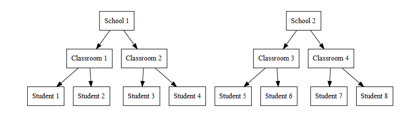
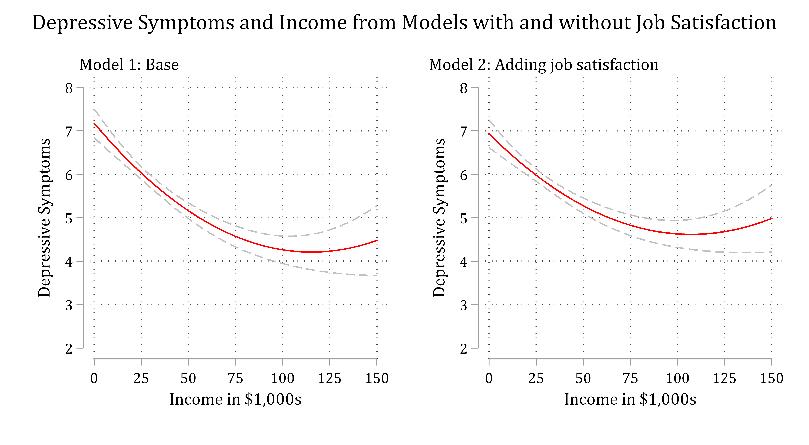
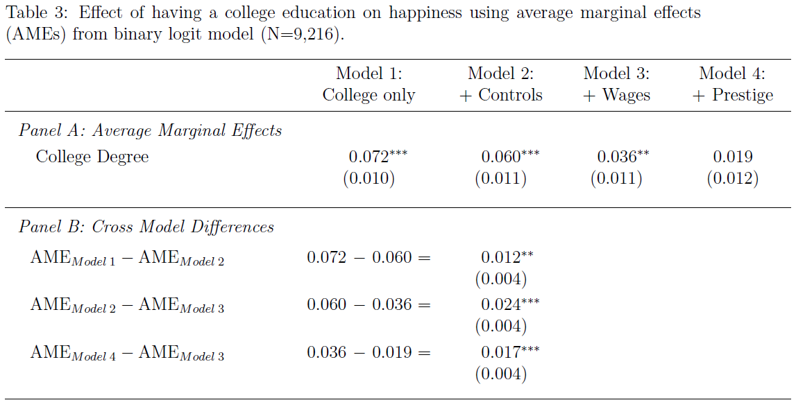
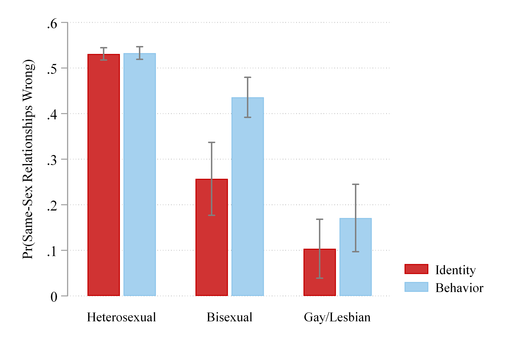
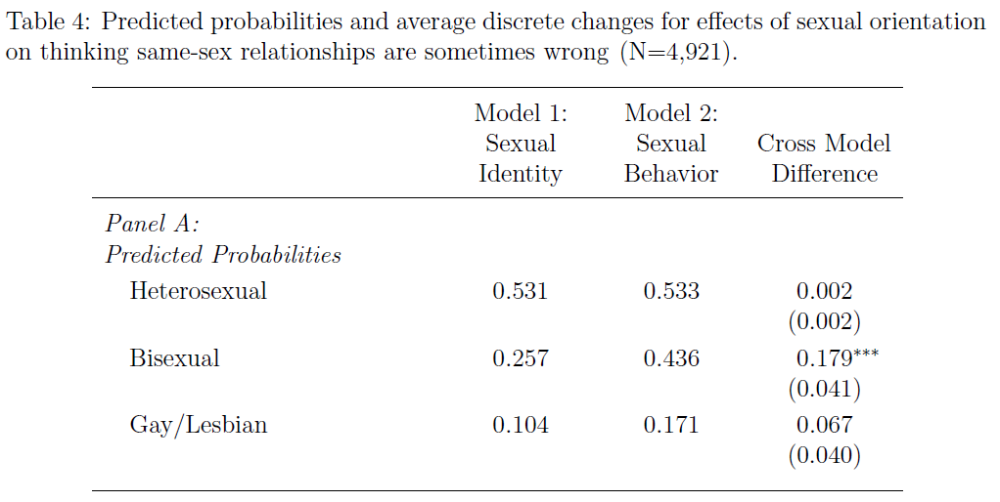
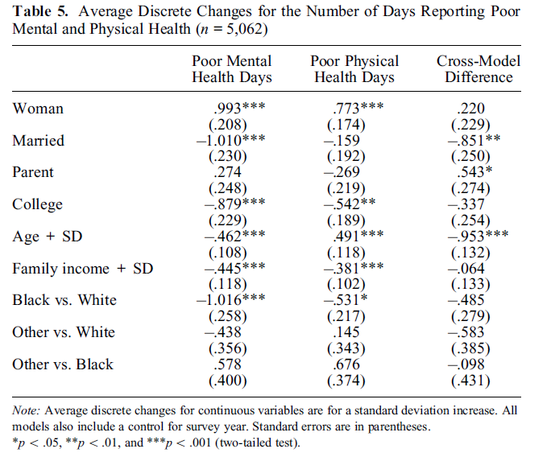
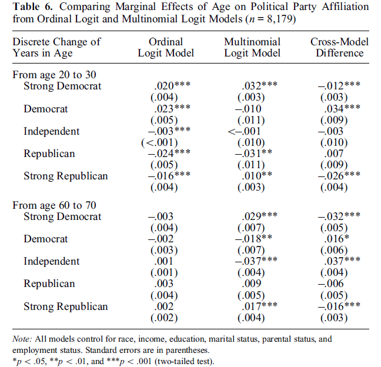
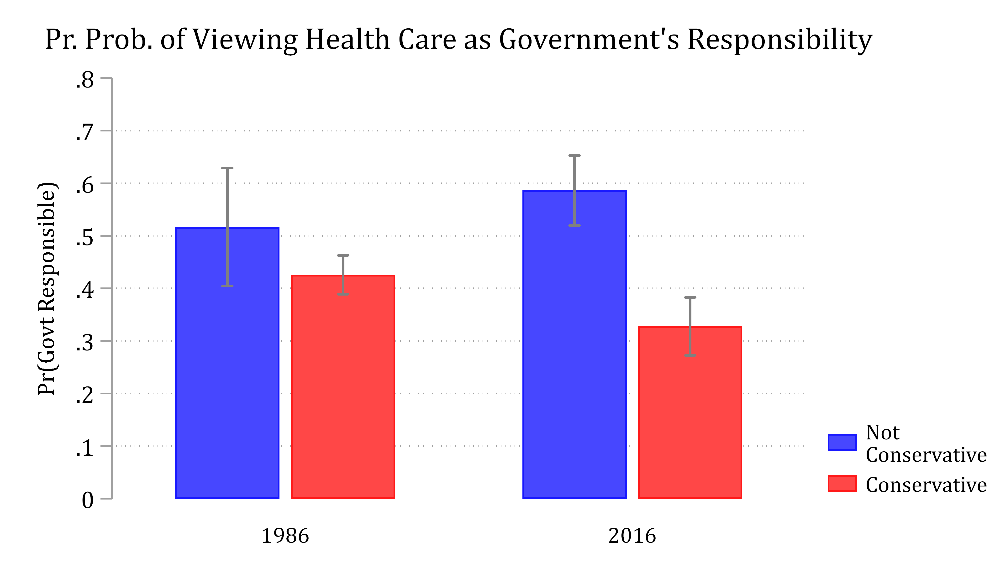

- These limitations were the motivation behind my paper (with Long Doan and Scott Long) *"A General Framework for Comparing Predictions and Marginal Effects Across Models"* ([*Sociological Methodology* 2019](https://journals.sagepub.com/doi/abs/10.1177/0081175019852763?journalCode=smxa))
- Most of the technical details of the method are beyond the scope of this course (see the article if you are interested). In brief, we propose:
  - Estimate two models of interest
  - Examine predictions and/or marginal effects to summarize the relationships of interest
  - Combine multiple model estimates using **S**eemingly **U**nrelated **Est**imation (SUEST)
  - Test cross-model differences of predictions and/or MEs using Wald tests, considering the relationship between each model's estimates
- See origin of and details of the SUEST method in [Weesie 1999](https://www.stata.com/products/stb/journals/stb52.pdf)

## Wald test of equality of cross-model effects

- A reminder of the Wald statistic to test $H_{0}: {ME}_{1} = {ME}_{2}$ (same formula for tests of predictions):

$$z = \frac{\widehat{ME}_{1} - \widehat{ME}_{2}}{\sqrt{\widehat{\sigma}_{1}^{2} + \widehat{\sigma}_{2}^{2} - 2\widehat{\sigma}_{1,2}}}$$

- Where ${\widehat{\sigma}}_{m}$ is the standard error of the *m*'th ME and ${\widehat{\sigma}}_{1,2}$ is the covariance between two MEs
- ${\widehat{\sigma}}_{1,2}$ quantifies how ${ME}_{1}$ and ${ME}_{2}$ are related
  - It is **almost always** non-zero and thus assuming it is zero **almost always** leads to an incorrect test statistic
- Some cross-model tests assume the covariance is zero (e.g., Paternoster et al. 1998). Will refer to this as $z'$ in what follows:

$$z' = \frac{{\widehat{ME}}_{1} - {\widehat{ME}}_{2}}{\sqrt{\sigma_{1}^{2} + \sigma_{2}^{2}}}$$

### Cross-model covariances: when are they non-zero?

- Cross-model covariances are non-zero when:
  - Overlapping observations are used across models
    - E.g., Mediation; specification checks; other nested models
  - If there is clustering in the data
    - E.g., Children within classrooms; voters within states; panel data
  - Stratification in complex sampling
    - This is accounted for in a similar way as clustering

{width=45% fig-alt="Animated clip of Severus Snape from the Harry Potter films saying Always."}

*(Almost)*

## Seemingly unrelated estimation (SUEST)

- SUEST can be implemented multiple ways. [Weesie (1999)](https://www.stata.com/products/stb/journals/stb52.pdf) proposes using equation-level scores
- An equation-level score is an observation-specific summary at the equation level:
  - OLS = residual
  - MLE = 1^st^ derivative of the log-likelihood with respect to $\mathbf{x}_{i}\widehat{\mathbf{\beta}}$
- SUEST uses equation-level scores in a clever application of the cluster robust variance estimator
  - Read additional details on the method in Stata's excellent [**suest** manual](https://www.stata.com/manuals13/rsuest.pdf) (which is mostly an adaption of [Weesie (1999)](https://www.stata.com/products/stb/journals/stb52.pdf))

### Variance and robust variance estimators

- To begin, consider the OLS variance estimator ($\sqrt{variance}$ = standard error). Note we calculate both variance estimates of individual βs as well as the covariance between each β:

$$Var\left( \widehat{\beta} \right) = \sum_{i = 1}^{N}{e_{i}^{2}*(\mathbf{x}'\mathbf{x})^{-1}}$$

- Where $(\mathbf{x}'\mathbf{x})^{-1}$ is the covariance matrix and *e~i~* is the equation level score for a given observation (e.g., the residual for linear regression)\*
- In the presence of heteroscedasticity (non-constant error variance), $\widehat{\mathbf{\beta}}$ estimates are correct but SEs are not. One solution, the robust variance estimator which produces different results than above when the residuals (*e~i~*) are correlated with **x**~*i*~

{width=15% fig-alt="A sandwich."}

$$Var\left( {\widehat{\beta}}_{robust} \right) = (\mathbf{x}'\mathbf{x})^{-1}\left\lbrack \sum_{i = 1}^{N}{(e_{i}*x_{i})'*(e_{i}*x_{i})} \right\rbrack(\mathbf{x}'\mathbf{x})^{-1}$$

\*I have omitted multipliers to adjust for sampling to keep things more straightforward

### Cluster robust variance estimator

- The cluster robust variance estimator is used when observations are not independent; it is a way of correcting variance estimates to account for the non-independence in the data
  - For example, might apply when observations are students that were sampled from within certain classrooms
- The cluster robust variance estimator:

$$Var\left( {\widehat{\beta}}_{cluster\ robust} \right) = (\mathbf{x}'\mathbf{x})^{-1}\left\lbrack \sum_{j = 1}^{n_{c}}{(u_{j}*u_{j})'} \right\rbrack(\mathbf{x}'\mathbf{x})^{-1}$$

$$u_{j} = \sum_{j\ cluster}{e_{i}*x_{i}}$$

- Where *u~j~* is an equation-level score at the level of the cluster

## Brief aside on (cluster) robust SEs

### Do robust SEs solve all of life's problems? (no)

- It is tempting to view robust SEs as a solution to the problem of a misspecified model (e.g., you didn't specify the functional form of *age* correctly so use robust SEs to "fix" the misspecification issue)
  - However, *"...robust standard errors expose methodological problems they do not fix*... '*Robust standard errors' are used in a vast array of scholarship to correct standard errors for model misspecification. However, when misspecification is bad enough to make classical and robust standard errors diverge, assuming that it is nevertheless not so bad as to bias everything else requires considerable optimism. And even if the optimism is warranted, settling for a misspecified model, with or without robust standard errors, will still bias estimators of all but a few quantities of interest." ([King and Roberts 2015](https://doi.org/10.1093/pan/mpu015))*
- That is, the solution to a misspecified model is to change the model so it is specified correctly (e.g., include both *age* and *age^2^* if warranted)
  - Robust SEs can certainly help but the best solution is to use the correct model\*

\*This logic also extends for logit/probit over the linear probability model with robust SEs

### Do cluster robust SEs solve many of life's problems? AKA do I need to learn multilevel modeling? (depends)

{width=60% fig-alt="Diagram of nested data: two schools, each with two classrooms, and each classroom with two students (students 1 to 8)."}

- Consider a dataset where the observations are students (Level-1)
  - But multiple students are nested within classrooms (Level-2) and within schools (Level-3)
- It may be tempting to view cluster robust SEs as an alternative to a multilevel/hierarchical model (another, more complicated method for accounting for clustered data) in these types of circumstances
- My view:
  - If all you care about is Level-1 observations and variables (e.g., student attributes and scores) and Level-2 and above is simply a nuisance to be corrected for (e.g., multiple students from same classroom and/or school) then cluster robust SEs do what you need
  - If you care about Level-2 or above observations and variables (e.g., attributes of the teacher/classroom or the school) and/or you care about cross-level interactions (e.g., how the effect of a student's characteristics depends on the school they attend) then you should use a multilevel model
- For full details, I highly recommend [McNeish, Stapleton, and Silverman (2017)](https://psycnet.apa.org/doi/10.1037/met0000078) *"On the unnecessary ubiquity of hierarchical linear modeling"*
  - TLDR: Multilevel models are complicated to interpret and require many assumptions. These are useful when you need to answer a complicated multilevel question; they are probably unnecessary for many other questions that are only focused on Level-1 variables

## SUEST application of cluster robust variance estimator

- SUEST is just a clever application of the cluster-robust variance estimator
  - Essentially, treat overlapping observations across models as a cluster
- For models *p* and *q*, where $u_{pi}$ and $u_{qi}$ are the *p* and *q* specific equation-level scores:

$$Cov\left( {\widehat{\mathbf{\beta}}}_{p},{\widehat{\mathbf{\beta}}}_{q} \right) = (\mathbf{x}'\mathbf{x})_{p}^{-1}\left\lbrack \sum_{i = 1}^{N}{w_{i}(u_{pi}*u_{qi})'} \right\rbrack(\mathbf{x}'\mathbf{x})_{q}^{-1}$$

- Where $w_{i}$ accounts for whether the observation is in both models or not
- Within-model variances of β coefficients are unaffected (except they are robust by default); however, cross-model covariances of βs are now estimated

## Implementing SUEST + MEs in Stata and R

- [Mize, Doan, and Long 2019](https://doi.org/10.1177%2F0081175019852763) develop a method for combining SUEST with predictions/MEs
  - [Mize (2026)](/software/mecompare/files/Mize_MEs_-_Comparing_Marginal_Effects_mecompare_-_Stata_Symposium_2026.pdf) further extends the SUEST approach to multilevel and panel models
- **In Stata**, use the [**suest2**](/software/suest2/index.qmd) command\* and/or [**mecompare**](/software/mecompare/index.qmd)
  - With 2+ models, **mecompare** calls **suest2** behind the scenes for you
  - See [how to replicate all of Mize, Doan, and Long 2019's examples using **mecompare**](/software/mecompare/examples/mediation.qmd)
- **In R**, use [**suest**](/software/suest_r/index.qmd) to combine the models, and **avg_comparisons** and/or other **marginaleffects** functions
  - See [how to replicate all of Mize, Doan, and Long 2019's examples in R](/software/suest_r/articles/mediation.qmd)

\*Stata has a [**suest**](https://www.stata.com/manuals/rsuest.pdf) command but it does not work well for MEs

### Workflow for SUEST + MEs in Stata and R

- First, fit two models of interest and save their estimates

::: {.panel-tabset group="language"}
## Stata

```stata
logit       dv iv1 iv2, vce(robust)
est store   basemod

logit       dv iv1 iv2 med1 med2, vce(robust)
est store   medmod
```

## R

```r
basemod <- glm(dv ~ iv1 + iv2, family = binomial, data = df)
medmod  <- glm(dv ~ iv1 + iv2 + med1 + med2, family = binomial, data = df)
```

:::

- Note that the SUEST method uses the robust variance estimator. Thus, to match its results I strongly recommend you include robust SEs as an option on the individual models\*
- Combine the estimates using SUEST

::: {.panel-tabset group="language"}
## Stata

::: {.callout-note icon="false" appearance="simple"}
If using **mecompare** in Stata, can skip this step
:::

```stata
suest2 basemod medmod
```

## R

```r
combo <- suest(basemod, medmod)
```

:::

\*In R, include **vcov = "HC1"** when you summarize the model estimates or calculate MEs to obtain robust SEs

::: {.panel-tabset group="language"}
## Stata

- **In Stata**, can pass the individual stored models directly to **mecompare**, which will call **suest2** behind the scenes to combine the models for you
  - Specify the 2+ stored **models( )** to compare

```stata
mecompare iv1, models(basemod medmod)
```

## R

- In R, use **avg_comparisons** to calculate MEs, listing the stored **suest** estimates as the model

```r
avg_comparisons(combo, variables = list(iv1 = "sd"), newdata = df)
```

:::

## Examples and applications

- Below, a very brief run through some example applications of our framework (see [Mize, Doan, and Long 2019](https://doi.org/10.1177%2F0081175019852763) for details)

### Ex 1: Mediation of curvilinear effects in linear regression

- **Data**: Add Health Wave IV ($\overline{x}_{age} \approx 28.5$)
  - **DV**: Depressive symptoms
  - **IV**: Income and income^2^
  - **Potential mediator**: Job satisfaction
  - **Model**: Linear regression

::: {.panel-tabset group="language"}
## Stata

```{.stata-run}
. use "https://tdmize.github.io/data/data/ah4_cme", clear
(ah4_cme.dta | Add Health Wave 4 | 2018-07-10)

. drop if missing(depsympB, income, inc10, age, woman, race, college, jobsat)
(0 observations deleted)

. 
. qui reg depsympB c.income##c.income c.age i.woman i.race, vce(robust)

. est store basemod

. 
. qui reg depsympB c.income##c.income c.age i.woman i.race i.jobsat, vce(robust)

. est store medmod

```

## R

```{r}
library(suest)           # seemingly unrelated estimation
library(marginaleffects) # predictions and marginal effects
library(haven)           # import Stata data

# Changes in continuous IVs centered on the observed values, like mecompare
options(marginaleffects_contrast_direction = "center")

ah <- zap_labels(read_dta("https://tdmize.github.io/data/data/ah4_cme.dta"))

factorize <- function(data, variables) {
  data[variables] <- lapply(data[variables], factor)
  data
}

vars61 <- c("depsympB", "income", "inc10", "age", "woman", "race", "college", "jobsat")
dat61 <- ah[complete.cases(ah[vars61]), ]
dat61 <- factorize(dat61, c("woman", "race", "jobsat"))

base61 <- lm(depsympB ~ income + I(income^2) + age + woman + race, data = dat61)
mediator61 <- lm(depsympB ~ income + I(income^2) + age + woman + race + jobsat,
                 data = dat61)
fit61 <- suest(base61, mediator61, model_names = c("Base", "Mediator"))
```

:::

- *income* and *income^2^* included as focal IV
- *jobsat* in 2^nd^ model as mediator

{width=80% fig-alt="Figure from Mize, Doan, and Long (2019): depressive symptoms by income (in $1,000s, 0 to 150) from models without (Model 1: Base) and with (Model 2: Adding job satisfaction) job satisfaction. Both curves fall as income rises and flatten at higher incomes; the curve is less steep in Model 2."}

::: {.panel-tabset group="language"}
## Stata

```{.stata-run}
. *The amount( ) option allows for customized change for continuous IVs
. mecompare income, models(basemod medmod) amount(sd)

Predicting: Linear prediction
Marginal effects and cross-model differences (N_basemod=4307) (N_medmod=4307)

                                 |  ME #   Estimate  Robust SE      P>|z|
---------------------------------+---------------------------------------
income + SD (centered)           |                                       
                         basemod |     1     -0.982      0.098      0.000
                          medmod |     2     -0.797      0.096      0.000
                      Difference |     3     -0.184      0.027      0.000

. 
. *Show proportion mediated
. di 1 - (-.797 / -.982)
.18839104

```

## R

```{r}
effects61 <- avg_comparisons(fit61,
  variables = list(income = sd(dat61$income)), newdata = dat61)
effects61

hypotheses(effects61, hypothesis = difference ~ revpairwise)

# Show proportion mediated
1 - (-.797 / -.982)
```

:::

> *In model 1, the ME is -0.982, indicating that a standard deviation increase in income (about \$34,500) is associated with about one fewer depressive symptom. The ME of income is reduced to -0.797 in model 2 after accounting for job satisfaction. A test of the difference in MEs across models shows that accounting for job satisfaction decreases the average effect of income by 0.184, a significant reduction of about 19% (cross-model difference p \< .001)*

### Ex 2: Mediation in binary logit

- **Data**: General Social Survey 2000 -- 2016
  - **DV**: Life happiness (1 = very happy; 0 = anything else)
  - **IV**: College degree (coded as 1)
  - **Potential mediators**: Hourly wages and occupational prestige
  - **Model**: Binary logit

::: {.panel-tabset group="language"}
## Stata

```{.stata-run}
. use "https://tdmize.github.io/data/data/gss_cme", clear
(gss_cme.dta | GSS 1972 - 2016 Weighted | 2018-07-10)

. drop if year < 2000
(38,116 observations deleted)

. drop if employed != 1
(9,556 observations deleted)

. drop if missing(vhappy, college, wages, occprest, age, married, ///
>     parent, woman, conserv, reltrad)
(5,578 observations deleted)

. 
. *Store the 4 nested models
. quietly logit vhappy i.college, vce(robust)

. estimates store m1

. quietly logit vhappy i.college i.married i.parent i.woman i.conserv ///
>     i.reltrad i.year c.age##c.age, vce(robust)

. estimates store m2

. quietly logit vhappy i.college c.wages i.married i.parent i.woman i.conserv //
> /
>     i.reltrad i.year c.age##c.age, vce(robust)

. estimates store m3

. quietly logit vhappy i.college c.wages c.occprest i.married i.parent i.woman /
> //
>     i.conserv i.reltrad i.year c.age##c.age, vce(robust)

. estimates store m4

. 
. *Use mecompare to get all MEs
. mecompare college, models(m1 m2 m3 m4)

Predicting: Pr(vhappy)
Marginal effects across models (N_m1=9216) (N_m2=9216) (N_m3=9216) (N_m4=9216)

                                 |  ME #   Estimate  Robust SE      P>|z|
---------------------------------+---------------------------------------
college                          |                                       
    College Deg - No Col Deg     |                                       
                              m1 |     1      0.072      0.010      0.000
                              m2 |     2      0.060      0.011      0.000
                              m3 |     3      0.036      0.011      0.001
                              m4 |     4      0.019      0.012      0.103

```

## R

```{r}
gss <- zap_labels(read_dta("https://tdmize.github.io/data/data/gss_cme.dta"))

vars62 <- c("vhappy", "college", "wages", "occprest", "age", "married",
            "parent", "woman", "conserv", "reltrad", "year", "employed")
dat62 <- subset(gss, year >= 2000 & employed == 1)
dat62 <- dat62[complete.cases(dat62[vars62]), ]
dat62 <- factorize(dat62, c("college", "married", "parent", "woman", "conserv",
                            "reltrad", "year"))

model62a <- glm(vhappy ~ college, family = binomial("logit"), data = dat62)
model62b <- glm(vhappy ~ college + married + parent + woman + conserv + reltrad +
                  year + age + I(age^2), family = binomial("logit"), data = dat62)
model62c <- glm(vhappy ~ college + wages + married + parent + woman + conserv +
                  reltrad + year + age + I(age^2), family = binomial("logit"),
                data = dat62)
model62d <- glm(vhappy ~ college + wages + occprest + married + parent + woman +
                  conserv + reltrad + year + age + I(age^2),
                family = binomial("logit"), data = dat62)
fit62 <- suest(model62a, model62b, model62c, model62d,
               model_names = c("Model 1", "Model 2", "Model 3", "Model 4"))

effects62 <- avg_comparisons(fit62, variables = "college", newdata = dat62)
effects62
```

:::

::: {.panel-tabset group="language"}
## Stata

```{.stata-run}
. *To automate all cross-model comparisons, use the pwcompare option of metest
. metest 1/4, pwcompare

                                 |  estimate         se     pvalue 
---------------------------------+--------------------------------
college                          |                                
                        m2 vs m1 |    -0.012      0.004      0.003 
                        m3 vs m1 |    -0.036      0.006      0.000 
                        m4 vs m1 |    -0.053      0.007      0.000 
                        m3 vs m2 |    -0.024      0.004      0.000 
                        m4 vs m2 |    -0.041      0.006      0.000 
                        m4 vs m3 |    -0.017      0.004      0.000 

```

## R

```{r}
hypotheses(effects62, hypothesis = ~ sequential)
```

:::

::: {.callout-note icon="false" appearance="simple"}
**pwcompare** in Stata; **\~pairwise** or **\~sequential** in R can be used to automate all tests of MEs
:::

{width=80% fig-alt="Table 3 from Mize, Doan, and Long (2019): effect of having a college education on happiness using average marginal effects from binary logit models (N = 9,216). Panel A: the AME of college is .072*** in Model 1 (college only), .060*** in Model 2 (+ controls), .036** in Model 3 (+ wages), and .019 in Model 4 (+ prestige). Panel B: cross-model differences of .012**, .024***, and .017***."}

*"The AME indicates that, on average, the probability of being happy is 0.072 higher for individuals with a college degree (p\< .001). Model 2 adds demographic control variables, reducing the AME for college to 0.060, which remains significant. A direct test of the difference in the AME from model 1 to model 2 shows that adding the controls significantly decreases the effect of college by 0.012 (p \< .01; see Panel B of Table 3)."*

### Ex 3: Specification checks for IVs

- **Data**: General Social Survey 2008 -- 2016
  - **DV**: Views of same-sex relationships (0 = not wrong at all; 1 = anything else)
  - **IV**: Sexual orientation (heterosexual, bisexual, gay/lesbian)
    - Self-identification (*identity*)
    - Dating history (*behavior*)
  - **Model**: Binary logit

{width=60% fig-alt="Bar chart from Mize, Doan, and Long (2019): predicted probability of thinking same-sex relationships are wrong for heterosexual, bisexual, and gay/lesbian respondents, with sexual orientation measured by identity or by behavior. Heterosexual: about .53 under both. Bisexual: about .26 by identity and .44 by behavior. Gay/lesbian: about .10 and .17."}

::: {.callout-note icon="false" appearance="simple"}
- [Stata code for this example](/software/mecompare/examples/alternative-predictors.qmd)
- [R code for this example](/software/suest_r/articles/alternative-predictors.qmd)
:::

::: {.panel-tabset group="language"}
## Stata

```{.stata-run}
. use "https://tdmize.github.io/data/data/gss_cme", clear
(gss_cme.dta | GSS 1972 - 2016 Weighted | 2018-07-10)

. drop if missing(samesexB, sexident, sexbehav, college, woman, race, age, year)
(57,545 observations deleted)

. 
. quietly logit samesexB i.sexbehav i.woman i.college c.age i.race i.year, vce(r
> obust)

. estimates store behavior

. 
. quietly logit samesexB i.sexident i.woman i.college c.age i.race i.year, vce(r
> obust)

. estimates store identity

. 
. mecompare i.sexbehav i.sexident, models(behavior identity)

Predicting: Pr(samesexB)
Marginal effects and cross-model differences (N_behavior=4921)
(N_identity=4921)

                                 |  ME #   Estimate  Robust SE      P>|z|
---------------------------------+---------------------------------------
sexbehav                         |                                       
     Bisexual - Heterosexual     |                                       
                        behavior |     1     -0.097      0.023      0.000
                        identity |                                       
                      Difference |                                       
          Gay - Heterosexual     |                                       
                        behavior |     2     -0.362      0.038      0.000
                        identity |                                       
                      Difference |                                       
---------------------------------+---------------------------------------
sexident                         |                                       
     Bisexual - Heterosexual     |                                       
                        behavior |                                       
                        identity |     3     -0.274      0.041      0.000
                      Difference |                                       
          Gay - Heterosexual     |                                       
                        behavior |                                       
                        identity |     4     -0.428      0.034      0.000
                      Difference |                                       

```

```{.stata-run}
. metest 1 - 3

                                 |  estimate         se     pvalue 
---------------------------------+--------------------------------
 sexbehav_Bis~h - sexident_Bis~e |     0.177      0.043      0.000 

. metest 2 - 4

                                 |  estimate         se     pvalue 
---------------------------------+--------------------------------
 sexbehav_Gay~r - sexident_Gay~y |     0.066      0.041      0.106 

```

```{.stata-run}
. *To compare predictions, use suest2 and then margins
. suest2 behavior identity

Simultaneous results for behavior, identity              Number of obs = 4,921

-------------------------------------------------------------------------------
              |               Robust
              | Coefficient  std. err.      z    P>|z|     [95% conf. interval]
--------------+----------------------------------------------------------------
behavior_sa~B |
     sexbehav |
    Bisexual  |     -0.441      0.108   -4.096   0.000       -0.652      -0.230
         Gay  |     -1.905      0.290   -6.561   0.000       -2.475      -1.336
              |
        woman |
       Women  |     -0.427      0.062   -6.894   0.000       -0.549      -0.306
              |
      college |
College De..  |     -0.870      0.068  -12.863   0.000       -1.002      -0.737
          age |      0.030      0.002   15.541   0.000        0.026       0.034
              |
         race |
       black  |      0.936      0.094    9.924   0.000        0.751       1.121
       other  |      0.377      0.108    3.495   0.000        0.166       0.589
              |
         year |
        2010  |     -0.203      0.098   -2.075   0.038       -0.394      -0.011
        2012  |     -0.370      0.098   -3.782   0.000       -0.561      -0.178
        2014  |     -0.560      0.089   -6.277   0.000       -0.735      -0.385
        2016  |     -0.754      0.105   -7.185   0.000       -0.960      -0.549
              |
        _cons |     -0.540      0.118   -4.593   0.000       -0.770      -0.309
--------------+----------------------------------------------------------------
identity_sa~B |
     sexident |
    Bisexual  |     -1.328      0.237   -5.593   0.000       -1.794      -0.863
         Gay  |     -2.513      0.377   -6.659   0.000       -3.252      -1.773
              |
        woman |
       Women  |     -0.419      0.062   -6.727   0.000       -0.541      -0.297
              |
      college |
College De..  |     -0.851      0.068  -12.566   0.000       -0.984      -0.718
          age |      0.029      0.002   15.160   0.000        0.026       0.033
              |
         race |
       black  |      0.958      0.095   10.051   0.000        0.771       1.145
       other  |      0.382      0.109    3.518   0.000        0.169       0.595
              |
         year |
        2010  |     -0.213      0.098   -2.185   0.029       -0.405      -0.022
        2012  |     -0.368      0.098   -3.739   0.000       -0.561      -0.175
        2014  |     -0.563      0.090   -6.264   0.000       -0.739      -0.387
        2016  |     -0.744      0.106   -7.039   0.000       -0.952      -0.537
              |
        _cons |     -0.535      0.117   -4.554   0.000       -0.765      -0.305
-------------------------------------------------------------------------------

. 
. *make predictions with margins, post; be careful to match up IV with model
. margins sexbehav sexident, post

Predictive margins                                       Number of obs = 4,921
Model VCE: Robust

1._predict: Pr(samesexB), predict(model(behavior))
2._predict: Pr(samesexB), predict(model(identity))

-------------------------------------------------------------------------------
              |            Delta-method
              |     Margin   std. err.      z    P>|z|     [95% conf. interval]
--------------+----------------------------------------------------------------
     _predict#|
     sexbehav |
           1 #|
Heterosexual  |      0.533      0.007   75.067   0.000        0.519       0.547
  1#Bisexual  |      0.436      0.022   19.487   0.000        0.392       0.480
       1#Gay  |      0.171      0.038    4.534   0.000        0.097       0.245
              |
     _predict#|
     sexident |
           1 #|
Heterosexual  |      0.517      0.007   77.817   0.000        0.504       0.530
  1#Bisexual  |      0.517      0.007   77.817   0.000        0.504       0.530
       1#Gay  |      0.517      0.007   77.817   0.000        0.504       0.530
              |
     _predict#|
     sexbehav |
           2 #|
Heterosexual  |      0.517      0.007   78.009   0.000        0.504       0.530
  2#Bisexual  |      0.517      0.007   78.009   0.000        0.504       0.530
       2#Gay  |      0.517      0.007   78.009   0.000        0.504       0.530
              |
     _predict#|
     sexident |
           2 #|
Heterosexual  |      0.531      0.007   77.364   0.000        0.518       0.545
  2#Bisexual  |      0.257      0.041    6.291   0.000        0.177       0.337
       2#Gay  |      0.104      0.033    3.136   0.002        0.039       0.168
-------------------------------------------------------------------------------

. 
. *when margins, post is used -- metest can be used to refer to prediction #
. qui metest, clear

. qui metest 1 - 10, add rowname("hetero")

. qui metest 2 - 11, add rowname("bisexual")

. qui metest 3 - 12, add rowname("gay-lesb")

. metest, title("Difference in pr(): behavior - identity")

Difference in pr(): behavior - identity

                                 |  estimate         se     pvalue 
---------------------------------+--------------------------------
                          hetero |     0.002      0.002      0.319 
                        bisexual |     0.179      0.041      0.000 
                        gay-lesb |     0.067      0.040      0.093 

```

## R

```{r}
vars63 <- c("samesexB", "sexident", "sexbehav", "college",
            "woman", "race", "age", "year")
dat63 <- gss[complete.cases(gss[vars63]), ]
dat63 <- factorize(dat63, c("sexident", "sexbehav", "college", "woman", "race", "year"))

behavior63 <- glm(samesexB ~ sexbehav + woman + college + age + race + year,
                  family = binomial("logit"), data = dat63)
identity63 <- glm(samesexB ~ sexident + woman + college + age + race + year,
                  family = binomial("logit"), data = dat63)
fit63 <- suest(behavior63, identity63, model_names = c("Behavior", "Identity"))

effects63 <- avg_comparisons(fit63,
  variables = list(sexbehav = "reference", sexident = "reference"), newdata = dat63)
effects63
```

```{r}
alternative_predictor_hypothesis <- function(x) {
  group <- as.character(x$group)
  term <- as.character(x$term)
  behavior <- x$estimate[term == "sexbehav" & group == "Behavior"]
  identity <- x$estimate[term == "sexident" & group == "Identity"]

  data.frame(
    term = c("Behavior bisexual - Identity bisexual",
             "Behavior gay - Identity gay",
             "(Behavior gay - bisexual) - (Identity gay - bisexual)"),
    estimate = c(behavior[1] - identity[1], behavior[2] - identity[2],
                 (behavior[2] - behavior[1]) - (identity[2] - identity[1])))
}

avg_comparisons(fit63,
  variables = list(sexbehav = "reference", sexident = "reference"),
  newdata = dat63, hypothesis = alternative_predictor_hypothesis)
```

```{r}
# Predictions from each model, with both measures set to the same category
orientation <- levels(dat63$sexident)
pred63 <- avg_predictions(fit63,
  variables = list(sexbehav = orientation, sexident = orientation),
  newdata = dat63)
pred63[pred63$sexbehav == pred63$sexident, ]

# Difference in predictions across models: behavior - identity
orientation_differences <- function(x) {
  same <- x$sexbehav == x$sexident
  data.frame(
    term = c("Heterosexual", "Bisexual", "Gay/Lesbian"),
    estimate = x$estimate[same & x$group == "Behavior"] -
      x$estimate[same & x$group == "Identity"])
}

avg_predictions(fit63,
  variables = list(sexbehav = orientation, sexident = orientation),
  newdata = dat63, hypothesis = orientation_differences)
```

:::

{width=80% fig-alt="Table 4 from Mize, Doan, and Long (2019): predicted probabilities and average discrete changes for effects of sexual orientation on thinking same-sex relationships are sometimes wrong (N = 4,921). Predicted probabilities by identity and by behavior, with the cross-model difference: heterosexual .531 vs .533 (difference .002); bisexual .257 vs .436 (difference .179***); gay/lesbian .104 vs .171 (difference .067)."}

> *"The formal tests support the general inferences described earlier: there is a significant difference in opinions of same-sex relationships for bisexual individuals depending on whether classification is based on identity or behavior."*

### Ex 4: Marginal effects across different DVs

- **Data**: General Social Survey 2002, 2006, 2010, 2014
  - **DVs\***:
    - 0 -- 30: Days of poor mental health days last month
    - 0 -- 30: Days of poor physical health days last month
  - **IVs**: Gender, marital status, parental status, college completion, age, family income, race
  - **Model**: Negative binomial regression (count model)

*\*NOTE: "Typically, to compare effects across outcomes, the outcomes need to have the same level of measurement. For example, it would be difficult to compare a marginal effect of a predictor on a continuous outcome to the marginal effect for the same predictor on a binary outcome." ([p.177](https://doi.org/10.1177%2F0081175019852763))*

::: {.callout-note icon="false" appearance="simple"}
- [Stata code for this example](/software/mecompare/examples/different-outcomes.qmd)
- [R code for this example](/software/suest_r/articles/different-outcomes.qmd)
:::

::: {.panel-tabset group="language"}
## Stata

```{.stata-run}
. use "https://tdmize.github.io/data/data/gss_cme", clear
(gss_cme.dta | GSS 1972 - 2016 Weighted | 2018-07-10)

. drop if missing(mntlhlth, physhlth, woman, married, age, faminc, race, college
> , parent, reltrad)
(57,404 observations deleted)

. 
. quietly nbreg mntlhlth i.woman i.married i.parent i.college c.age faminc ///
>               i.race i.year, vce(robust)

. estimates store mental

. 
. quietly nbreg physhlth i.woman i.married i.parent i.college c.age faminc ///
>               i.race i.year, vce(robust)

. estimates store physical

. 
. mecompare, models(mental physical) amount(sd)

Predicting: Predicted mean of mntlhlth (mental), Predicted mean of physhlth (phy
> sical)
Marginal effects and cross-model differences (N_mental=5062) (N_physical=5062)

                                 |  ME #   Estimate  Robust SE      P>|z|
---------------------------------+---------------------------------------
woman                            |                                       
                 Women - Men     |                                       
                          mental |     1      0.993      0.208      0.000
                        physical |     2      0.773      0.174      0.000
                      Difference |     3      0.220      0.229      0.337
---------------------------------+---------------------------------------
married                          |                                       
       Married - Not Married     |                                       
                          mental |     4     -1.010      0.230      0.000
                        physical |     5     -0.159      0.192      0.408
                      Difference |     6     -0.851      0.250      0.001
---------------------------------+---------------------------------------
parent                           |                                       
        Parent - No Children     |                                       
                          mental |     7      0.274      0.248      0.268
                        physical |     8     -0.269      0.219      0.218
                      Difference |     9      0.543      0.274      0.048
---------------------------------+---------------------------------------
college                          |                                       
    College Deg - No Col Deg     |                                       
                          mental |    10     -0.879      0.229      0.000
                        physical |    11     -0.542      0.189      0.004
                      Difference |    12     -0.337      0.254      0.184
---------------------------------+---------------------------------------
age + SD (centered)              |                                       
                          mental |    13     -0.496      0.124      0.000
                        physical |    14      0.450      0.099      0.000
                      Difference |    15     -0.946      0.133      0.000
---------------------------------+---------------------------------------
faminc + SD (centered)           |                                       
                          mental |    16     -0.476      0.135      0.000
                        physical |    17     -0.413      0.120      0.001
                      Difference |    18     -0.063      0.154      0.682
---------------------------------+---------------------------------------
race                             |                                       
               black - white     |                                       
                          mental |    19     -1.016      0.258      0.000
                        physical |    20     -0.531      0.217      0.015
                      Difference |    21     -0.485      0.279      0.083
               other - white     |                                       
                          mental |    22     -0.438      0.356      0.219
                        physical |    23      0.145      0.343      0.672
                      Difference |    24     -0.583      0.385      0.130
---------------------------------+---------------------------------------
year                             |                                       
                 2006 - 2002     |                                       
                          mental |    25     -0.944      0.270      0.000
                        physical |    26     -0.292      0.225      0.194
                      Difference |    27     -0.652      0.298      0.029
                 2010 - 2002     |                                       
                          mental |    28     -0.068      0.318      0.832
                        physical |    29      0.323      0.261      0.215
                      Difference |    30     -0.391      0.355      0.271
                 2014 - 2002     |                                       
                          mental |    31     -0.582      0.302      0.054
                        physical |    32     -0.229      0.245      0.351
                      Difference |    33     -0.353      0.324      0.275

```

## R

```{r}
vars64 <- c("mntlhlth", "physhlth", "woman", "married", "age",
            "faminc", "race", "college", "parent", "reltrad")
dat64 <- gss[complete.cases(gss[vars64]), ]
dat64 <- factorize(dat64, c("woman", "married", "parent", "college", "race", "year"))

mental64 <- MASS::glm.nb(mntlhlth ~ woman + married + parent + college + age +
                           faminc + race + year, data = dat64)
physical64 <- MASS::glm.nb(physhlth ~ woman + married + parent + college + age +
                             faminc + race + year, data = dat64)
fit64 <- suest(mental64, physical64, model_names = c("Mental", "Physical"))

variables64 <- list(woman = "reference", married = "reference", parent = "reference",
  college = "reference", age = sd(dat64$age), faminc = sd(dat64$faminc),
  race = "reference", year = "reference")
effects64 <- avg_comparisons(fit64, variables = variables64, newdata = dat64)
effects64

hypotheses(effects64, hypothesis = difference ~ revpairwise | term + contrast)
```

:::

{width=80% fig-alt="Table 5 from Mize, Doan, and Long (2019): average discrete changes for the number of days reporting poor mental and physical health (N = 5,062), with the cross-model difference. For example: woman .993*** and .773*** (difference .220); married -1.010*** and -.159 (difference -.851**); parent .274 and -.269 (difference .543*); age + SD -.462*** and .491*** (difference -.953***)."}

#### Example interpretations

> *We find, for example, that women report 0.99 more days of poor mental health, and 0.77 more days of poor physical health, per month, than do men. Although the effect of gender is 0.22 larger for mental health, the difference is not statistically significant.*
>
> *...being married significantly reduces the days of poor mental health by 1.01, and the effect of marriage on physical health is nonsignificant. A test of the cross-model difference shows that the effect of marriage on mental health is significantly larger than the effect of marriage on physical health (cross-model difference = -.851, p \< .01).*
>
> *Similarly, the effect of age differs significantly across the two outcomes, with aging associated with fewer poor mental health days but more poor physical health days.*

### Ex 5: Comparing across model types

- **Data**: 2010 to 2016 GSS
  - **DV**: Political party ID
    - Strong Democrat, Democrat, Independent, Republican, Strong Republican
  - **IV**: Age
  - **Models**:
    - Ordinal logit
    - Multinomial logit

::: {.callout-note icon="false" appearance="simple"}
- [Stata code for this example](/software/mecompare/examples/model-types.qmd)
- [R code for this example](/software/suest_r/articles/model-types.qmd)
:::

::: {.panel-tabset group="language"}
## Stata

```{.stata-run}
. use "https://tdmize.github.io/data/data/gss_cme", clear
(gss_cme.dta | GSS 1972 - 2016 Weighted | 2018-07-10)

. drop if year < 2010
(53,043 observations deleted)

. drop if missing(partyid5, woman, edyrs, age, parent, married, faminc, employed
> , region4, year)
(1,244 observations deleted)

. 
. quietly ologit partyid5 c.age##c.age i.woman c.edyrs i.parent i.married i.race
>  ///
>                c.faminc i.employed i.region4 i.year, vce(robust)

. estimates store ordinal

. 
. quietly mlogit partyid5 c.age##c.age i.woman c.edyrs i.parent i.married i.race
>  ///
>                c.faminc i.employed i.region4 i.year, vce(robust)

. estimates store nominal

. 
. mecompare age, models(ordinal nominal) start(age=20) amount(10) uncentered cov
> ariates(atmeans)

Predicting: Pr(partyid5)
Marginal effects and cross-model differences (N_ordinal=8179) (N_nominal=8179)

                                 |  ME #   Estimate  Robust SE      P>|z|
---------------------------------+---------------------------------------
age + 10 (uncentered)            |                                       
            Strong Dem - ordinal |     1      0.020      0.004      0.000
            Strong Dem - nominal |     2      0.032      0.003      0.000
         Strong Dem - Difference |     3     -0.012      0.003      0.000
              Democrat - ordinal |     4      0.023      0.005      0.000
              Democrat - nominal |     5     -0.010      0.011      0.352
           Democrat - Difference |     6      0.034      0.009      0.000
           Independent - ordinal |     7     -0.003      0.000      0.000
           Independent - nominal |     8     -0.000      0.010      0.965
        Independent - Difference |     9     -0.003      0.010      0.796
            Republican - ordinal |    10     -0.024      0.005      0.000
            Republican - nominal |    11     -0.031      0.011      0.003
         Republican - Difference |    12      0.007      0.009      0.436
          Strong Repub - ordinal |    13     -0.016      0.004      0.000
          Strong Repub - nominal |    14      0.010      0.003      0.003
       Strong Repub - Difference |    15     -0.026      0.004      0.000

```

## R

```{r}
vars65 <- c("partyid5", "woman", "edyrs", "age", "parent", "married",
            "faminc", "employed", "region4", "year", "race")
dat65 <- subset(gss, year >= 2010)
dat65 <- dat65[complete.cases(dat65[vars65]), ]
dat65 <- factorize(dat65, c("woman", "parent", "married", "race",
                            "employed", "region4", "year"))

party_levels <- sort(unique(dat65$partyid5))
party_labels <- c("Strong Democrat", "Democrat", "Independent",
                  "Republican", "Strong Republican")
dat65$party_ord <- ordered(dat65$partyid5, levels = party_levels, labels = party_labels)
dat65$party_nom <- factor(dat65$partyid5, levels = party_levels, labels = party_labels)

ordered65 <- MASS::polr(party_ord ~ age + I(age^2) + woman + edyrs + parent +
                          married + race + faminc + employed + region4 + year,
                        data = dat65, method = "logistic", Hess = TRUE)
nominal65 <- nnet::multinom(party_nom ~ age + I(age^2) + woman + edyrs + parent +
                             married + race + faminc + employed + region4 + year,
                           data = dat65, Hess = TRUE, trace = FALSE)
fit65 <- suest(ordered65, nominal65, model_names = c("Ordered", "Multinomial"))

# Age 20 to 30, with every other column of the model matrix held at its mean
source(system.file("example-code", "example-6-5-atmeans.R", package = "suest"))
results65 <- example65_atmeans(fit65, age_lo = 20, age_hi = 30)
results65$effects
results65$differences
```

:::

::: {.callout-note icon="false" appearance="simple"}
Specifying a custom ME~+10~ change from age 20 to age 30
:::

{width=80% fig-alt="Table 6 from Mize, Doan, and Long (2019): comparing marginal effects of age on political party affiliation from ordinal logit and multinomial logit models (n = 8,179), with the cross-model difference, for a change in age from 20 to 30 and from 60 to 70. From 20 to 30, for example, strong Democrat .020*** in the ordinal model and .032*** in the multinomial model (difference -.012***), and strong Republican -.016*** and .010** (difference -.026***)."}

#### Example interpretations

> *For someone who is 20 years old, the effect of a 10-year increase in age is significantly different across the ordinal and nominal models for three of the five outcome categories (top panel of Table 6). For example, the effect of aging on the probability of identifying as a strong Democrat is positive in both models, but it is significantly larger in the nominal model.*
>
> *Even more striking, the effects of age on being a strong Republican are in opposite directions across the two models.*
>
> *For someone who is 60 years old, the effects of age are nonsignificant for all party affiliations in the ordinal model (bottom panel of Table 6). In stark contrast, in the nominal model, the effects of age are significant for four of the five outcomes.*

### Ex 6: Comparing across groups/samples

- **Data**: 1986 and 2016 GSS
  - **DV**: Government or individual's responsibility for health care?
    - 0 = Individual's responsibility
    - 1 = Government's responsibility
  - **IV**: Political views
    - 0 = Not conservative
    - 1 = Conservative
  - **Model**: Binary logit

> *"For our example, we are interested in whether political polarization surrounding the role government should play in providing health care increased over the past 30 years."*

{width=60% fig-alt="Bar chart from Mize, Doan, and Long (2019): predicted probability of viewing health care as the government's responsibility for non-conservatives and conservatives in 1986 and 2016. 1986: about .52 for non-conservatives and .43 for conservatives. 2016: about .59 and .33, a larger gap."}

::: {.callout-note icon="false" appearance="simple"}
- [Stata code for this example](/software/mecompare/examples/groups.qmd)
- [R code for this example](/software/suest_r/articles/groups.qmd)
:::

::: {.panel-tabset group="language"}
## Stata

```{.stata-run}
. use "https://tdmize.github.io/data/data/gss_cme", clear
(gss_cme.dta | GSS 1972 - 2016 Weighted | 2018-07-10)

. drop if missing(helpsickB, polviews, faminc, employed, woman, age, college, ma
> rried, parent)
(36,143 observations deleted)

. 
. quietly logit helpsickB i.conserv faminc i.employed i.woman age i.college ///
>               i.married i.parent i.race if year == 1986, vce(robust)

. estimates store mod1986

. 
. quietly logit helpsickB i.conserv faminc i.employed i.woman age i.college ///
>               i.married i.parent i.race if year == 2016, vce(robust)

. estimates store mod2016

. 
. mecompare i.conserv, models(mod1986 mod2016) groups

Predicting: Pr(helpsickB)
Marginal effects and cross-model differences (N_mod1986=1254) (N_mod2016=1670)

                                 |  ME #   Estimate  Robust SE      P>|z|
---------------------------------+---------------------------------------
conserv                          |                                       
    Conservativ - Not Conser     |                                       
                         mod1986 |     1     -0.092      0.030      0.002
                         mod2016 |     2     -0.258      0.025      0.000
                      Difference |     3      0.166      0.039      0.000

```

## R

```{r}
vars66 <- c("helpsickB", "polviews", "conserv", "faminc", "employed",
            "woman", "age", "college", "married", "parent", "race", "year")
dat66 <- gss[complete.cases(gss[vars66]), ]
dat66 <- factorize(dat66, c("conserv", "employed", "woman", "college",
                            "married", "parent", "race"))

model1986 <- glm(helpsickB ~ conserv + faminc + employed + woman + age +
                   college + married + parent + race, family = binomial("logit"),
                 data = dat66, subset = year == 1986)
model2016 <- glm(helpsickB ~ conserv + faminc + employed + woman + age +
                   college + married + parent + race, family = binomial("logit"),
                 data = dat66, subset = year == 2016)

fit66 <- suest(model1986, model2016, model_names = c("1986", "2016"))

effects66 <- avg_comparisons(fit66, variables = "conserv",
                             newdata = suest_newdata(fit66))
effects66

hypotheses(effects66, hypothesis = difference ~ revpairwise)
```

:::

> *"...the polarization between conservatives and nonconservatives increased over time, as the effect of being conservative is significantly larger in 2016 than in 1986 (cross-model difference of ADCs = 0.166; p \< .001)."*
