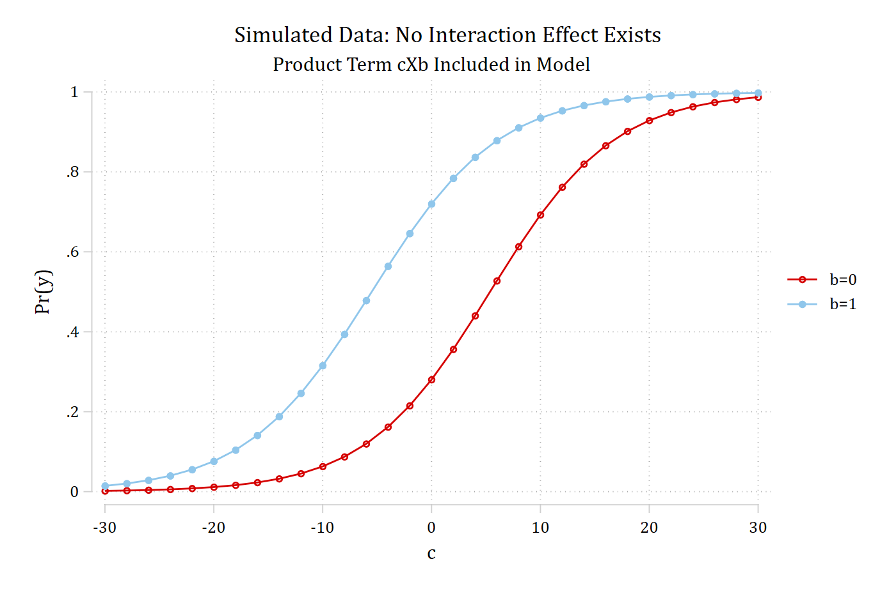
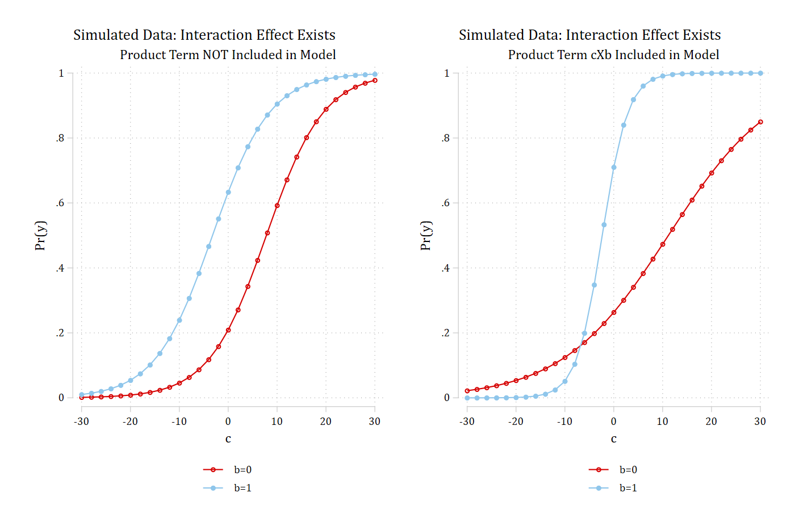
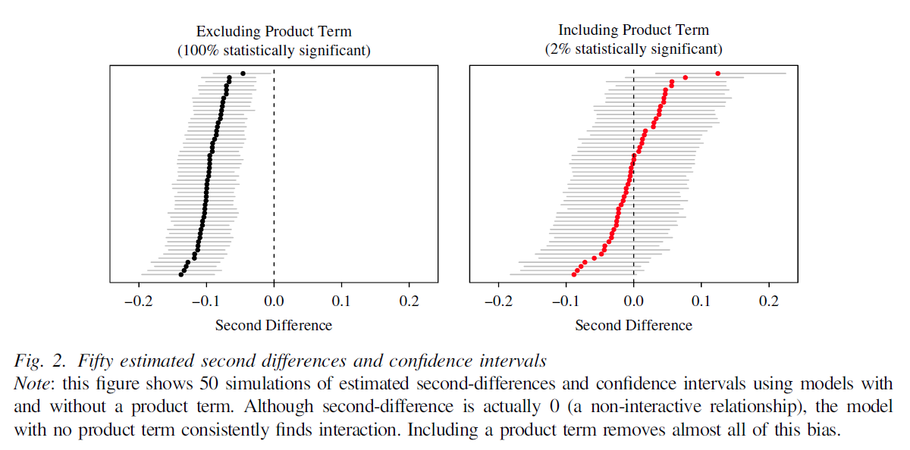
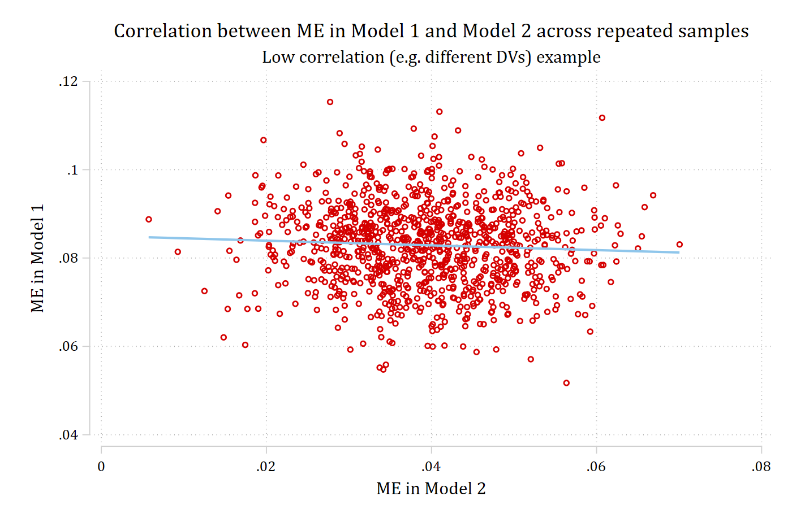
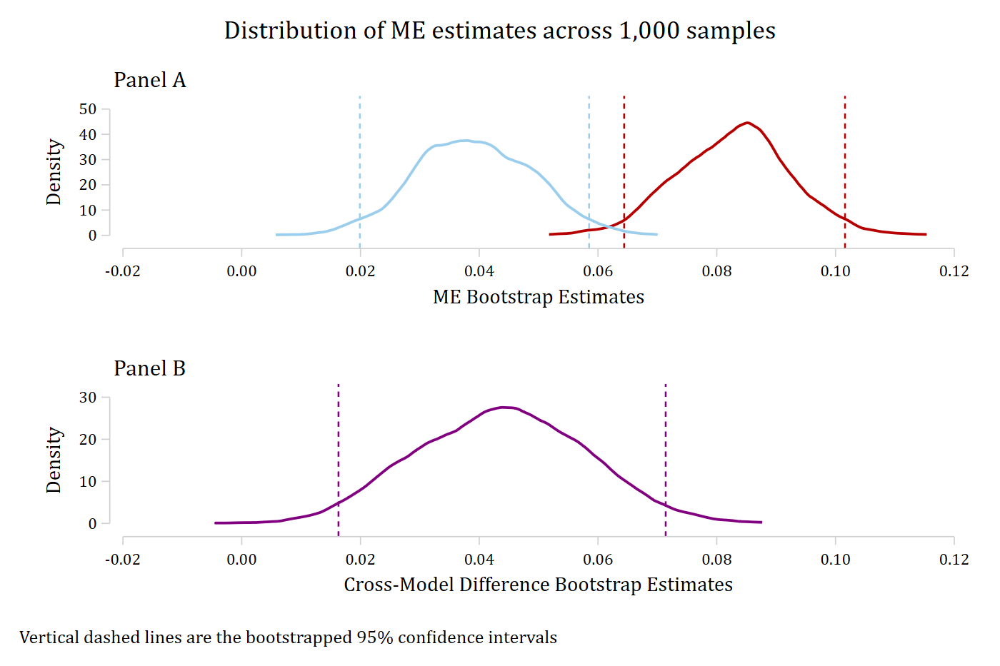
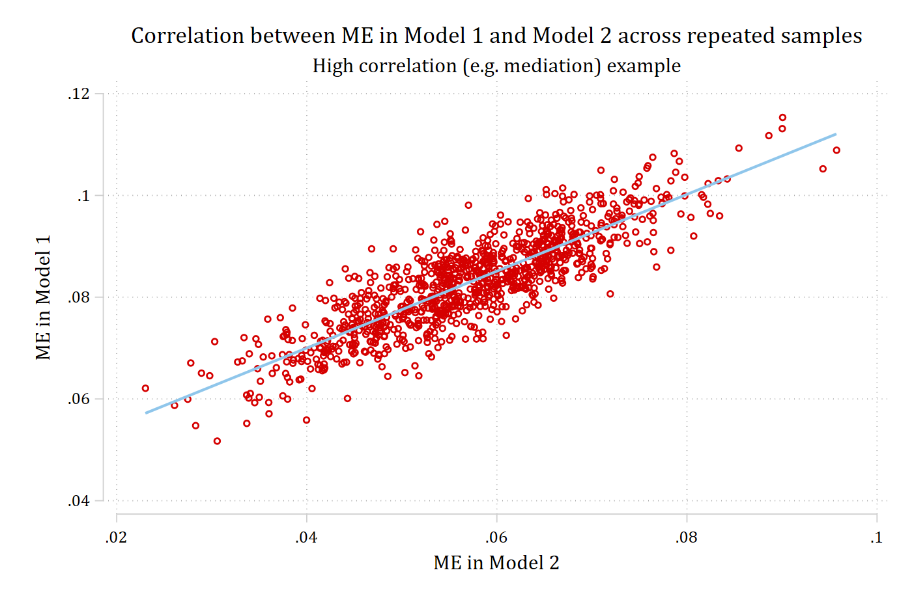
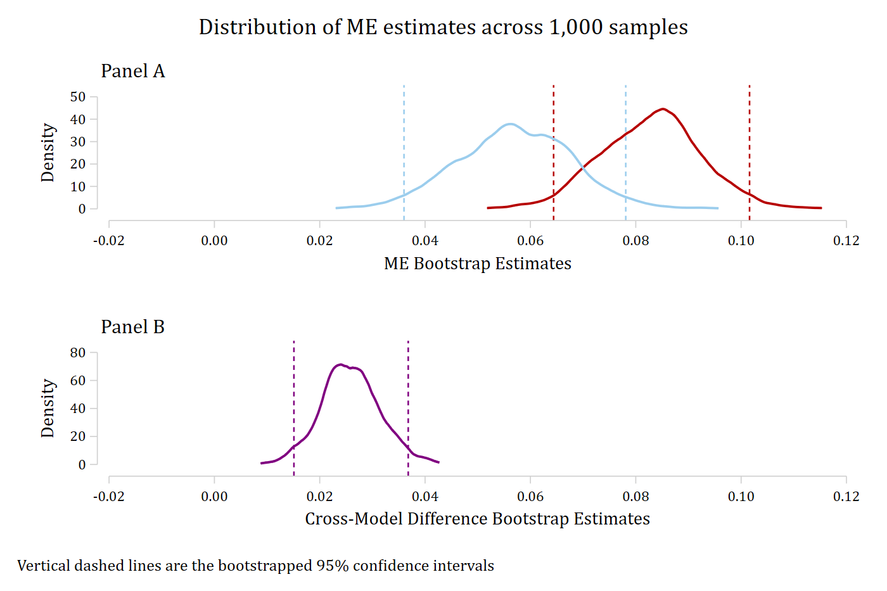

{width=35% fig-alt="Stata 17 logo."}

- For all sets of lecture notes, there is an accompanying replication Stata do-file ([available here](https://drive.google.com/drive/folders/1E0tqULBiY1WKic3A6pSG0_vFlcP-dhcF?usp=sharing) or on Brightspace)
  - This includes all of the Stata code necessary to recreate anything in the slides
- In this Appendix, I include some comments, notes, and examples for things that are new or that might be hard to follow without more detail
- For more streamlined, less complicated, and more notated do-files showing the basics of the types of analyses covered in this section:
  - For tests of interactions in nonlinear models, I recommend the [template Stata do-files](https://drive.google.com/drive/folders/1D2FmhncUONVIYuK6tTgenGIRZn48x-dF) that accompany the [Mize 2019 *Sociological Science*](https://www.sociologicalscience.com/articles-v6-4-81/) article
  - For comparing effects across models, I recommend the [template Stata do-files in the **mecompare** package](/software/mecompare/index.qmd) that accompanies the [Mize, Doan, and Long 2019 *Sociological Methodology*](https://journals.sagepub.com/doi/full/10.1177/0081175019852763) article

## A7.1 Is the interaction (product) term necessary?

- There has been an intense debate in the methodological literature as to whether it is appropriate to discuss interaction effects absent an interaction (product) term in the model
  - E.g. When "compression" of the effects is theoretically reasonable (especially within political science)
    - E.g. [Berry and Berry 1991](https://www.cambridge.org/core/journals/american-political-science-review/article/specifying-a-model-of-state-policy-innovation/F35C2A2A37C8F668958CCE38B30C7CD9); [Frant et al. 1991](https://www.cambridge.org/core/journals/american-political-science-review/article/specifying-a-model-of-state-policy-innovation/F35C2A2A37C8F668958CCE38B30C7CD9); [Nagler 1991](https://www.jstor.org/stable/1963952); [Berry, DeMeritt, and Esarey 2010](https://onlinelibrary.wiley.com/doi/full/10.1111/j.1540-5907.2009.00429.x); [Rainey 2016](https://www.cambridge.org/core/journals/political-science-research-and-methods/article/compression-and-conditional-effects-a-product-term-is-essential-when-using-logistic-regression-to-test-for-interaction/98664E6FF9AA240CCDBCFFC4B29EA7F8); [Mize 2019](https://www.sociologicalscience.com/articles-v6-4-81/)

**Deep Questions**:

> Imagine a case where compression is theoretically reasonable and fits the data: what are the consequences **of including** an interaction (product) term in the model?
>
> Imagine a case where compression is not theoretically reasonable and does not fit the data: what are the consequences **of not including** an interaction (product) term in the model?

### Effect of unneeded product term in model

Below, I generated data where **an interaction effect does not exist** in the data generating process

```{.stata-run}
. *Simulate data to show effect of unneeded product term
. clear

. set seed    30004

. set obs     2000
Number of observations (_N) was 0, now 2,000.

. matrix      P = (1, 0.2 \ 0.2, 1)   // Small correlation

. corr2data   x1 x2, n(2000) cov(P)

. gen         c = rnormal(0,10)

. gen         b = c

. replace     b = 0 in 1/1000
(1,000 real changes made)

. replace     b = 1 in 1001/2000
(1,000 real changes made)

. gen         cXb = c*b

. gen         y = uniform() < invlogit(-1 + 0.2*(c) + 2*(b) + 0*cXb)

. 
. qui logit y c.c##i.b x1 x2

. qui margins, at(c=(-30(2)30) b=(0 1))

. marginsplot, xlab(-30(10)30) noci ///
>     title("Simulated Data: No Interaction Effect Exists", size(medium)) ///
>     subtitle("Product Term cXb Included in Model")

Variables that uniquely identify margins: c b

```

{width=80% fig-alt="Simulated data with no interaction effect, logit model with the product term cXb included: predicted probability of y by c from -30 to 30 for b = 0 and b = 1. Two S-shaped curves with the same shape, the b = 1 curve shifted to the left of the b = 0 curve."}

### Product terms in logit/probit

- In the example above, I generated data where the interaction effect = 0 in the data generating process. What did we lose by including a product term when it is not needed? One degree of freedom---and nothing else
  - If compression fits the data, you will find it even with a product term in the model (because the coefficient on the interaction (product) term will be ≈ 0 and have no effect on the predictions)
- However, omitting an interaction (product) term effectively constrains the interaction effect to be zero (recall likelihood ratio test logic)
  - Without the interaction (product) term you force the overall slopes of the logit curves to be invariant across the levels of the second IV
- What about testing for an interaction effect (in terms of the predictions) *without* a product term in the model?
  - Below, the plots show logit models on data I generated where **an interaction effect does exist** in the data generating process

### Effect of omitting needed product term in model

```{.stata-run}
. clear

. set seed    30004

. set obs     2000
Number of observations (_N) was 0, now 2,000.

. matrix      P = (1, 0.2 \ 0.2, 1)   // Small correlation

. corr2data   x1 x2, n(2000) cov(P)

. gen         c = rnormal(0,10)

. gen         b = c

. replace     b = 0 in 1/1000
(1,000 real changes made)

. replace     b = 1 in 1001/2000
(1,000 real changes made)

. gen         cXb = c*b

. gen         y = uniform() < invlogit(-1 + 0.1*(c) + 2*(b) + 0.3*cXb)

. 
. qui logit y c.c##i.b x1 x2

. qui margins, at(c=(-30(2)30) b=(0 1))

. marginsplot, xlab(-30(10)30) noci ///
>     title("Simulated Data: Interaction Effect Exists", size(medium)) ///
>     subtitle("Product Term cXb Included in Model") ///
>     legend(position(6)) saving(int, replace)

Variables that uniquely identify margins: c b
file int.gph saved

. 
. qui logit y c.c i.b x1 x2

. qui margins, at(c=(-30(2)30) b=(0 1))

. marginsplot, xlab(-30(10)30) noci ///
>     title("Simulated Data: Interaction Effect Exists", size(medium)) ///
>     subtitle("Product Term NOT Included in Model") ///
>     legend(position(6)) saving(noint, replace)

Variables that uniquely identify margins: c b
file noint.gph saved

. 
. graph combine noint.gph int.gph

```

{width=80% fig-alt="Simulated data where an interaction effect exists, predicted probability of y by c (-30 to 30) for b = 0 and b = 1. Left, product term not included: two S-shaped curves with the same shape, one shifted left of the other. Right, product term included: the b = 1 curve is much steeper than the b = 0 curve, and the curves cross, showing the true interaction."}

### Type I errors and product terms in logit/probit

The figure below reports simulation results for a model where an **interaction should not exist**. **The product term is necessary to allow the effect to not be interactive.** Without the product term Type I error rates are disturbingly high

{width=80% fig-alt="Figure 2 from Rainey (2016): fifty simulated second differences with confidence intervals from models excluding the product term (100% statistically significant) and including the product term (2% statistically significant). Although the true second difference is 0, the model without the product term consistently finds interaction."}

Figure from [Rainey 2016 *PSRM*](https://www.cambridge.org/core/journals/political-science-research-and-methods/article/compression-and-conditional-effects-a-product-term-is-essential-when-using-logistic-regression-to-test-for-interaction/98664E6FF9AA240CCDBCFFC4B29EA7F8)

## A7.2 Options for testing 2^nd^ differences

### Simplifying tests of 2^nd^ differences with dydx( )

- The **dydx( )** option on **mtable** will report the **average instantaneous change** for continuous variables; the **average 0 vs 1 effect** for binary variables
  - Because this is a marginal change (first derivative) for continuous variables, you cannot say "for a one unit increase" or similar---instead, I interpret it as the effect "on average" (i.e. it is the *average slope* of love for each group)
- Instead of the arbitrary 4 and 8 I choose above for the discrete change could choose to use mean as starting value for a MEM. E.g.
  - Start value of the mean
  - Ending value of:
    - Mean +1
    - Mean + SD
  - Etc.

### Second differences with discrete change average marginal effects

- The **margins** syntax for discrete changes is clunkier (hence why **mchange** was written). But need to know it for tests of second differences which require using **margins**
- To get a prediction at the observed value (i.e. the start value) put in the **at( )** statement ***var*=gen(*var*)**
  - For a prediction at an ending value simply add the number onto the end, e.g. **var=gen(var + #)**
- Put these two predictions (start and end value) in separate **at( )** statements alongside the values of the nominal IV you want. E.g.

```stata
margins,    at(cond=(1 3) love10=gen(love10)) ///
            at(cond=(1 3) love10=gen(love10 + 1))
```

- This produces the four predictions you need for a +1 AME of love; one for heterosexuals (cond = 1) and one for lesbians (cond = 3)

```{.stata-run}
. use "https://tdmize.github.io/data/data/doan_love_SF", clear
(TESS03 - Analysis Dataset for TESS01 - Main Paper)

. 
. qui reg informal i.cond##c.love10 rfem age rce_wht ed_coll ///
>     ed_hs inc_50k married childyn children ideo evangel ///
>     mainline blackprot catholic ofaithV2

. est store inform

. 
. *How to get AMEs from margins; the secret var=gen(var) method
. margins, at(cond=(1 3) love10=gen(love10)) ///
>     at(cond=(1 3) love10=gen(love10 + 1))

Predictive margins                                         Number of obs = 499
Model VCE: OLS

Expression: Linear prediction, predict()
1._at: cond   =          1
       love10 =     love10
2._at: cond   =          3
       love10 =     love10
3._at: cond   =          1
       love10 = love10 + 1
4._at: cond   =          3
       love10 = love10 + 1

------------------------------------------------------------------------------
             |            Delta-method
             |     Margin   std. err.      t    P>|t|     [95% conf. interval]
-------------+----------------------------------------------------------------
         _at |
          1  |      9.150      0.187   49.035   0.000        8.784       9.517
          2  |      6.742      0.196   34.466   0.000        6.358       7.126
          3  |      9.587      0.198   48.310   0.000        9.197       9.976
          4  |      7.267      0.204   35.698   0.000        6.867       7.667
------------------------------------------------------------------------------

```

Now, can use **mlincom** as above to calculate the MEs

## A7.3 Plotting the "other side" of the interaction

- The examples above focus mostly on the effect of love. It is also important to examine the effect of the sexual orientation of the couple (we did this in the linear regression section of the course). Syntax is identical for logit/probit, use:

```stata
margins, dydx(nominalvar)
marginsplot
```

- Note I've excluded the lesbian couple from the model to make it easier to plot just gay men vs heterosexual couple on the graph:

```stata
logit       Bmarry i.cond##c.love10 … if cond != 3, or
```

- Including a line at zero with **yline(0)** helps interpret the plot. Remember to always include a subtitle or a note explaining how to interpret the plot:

```stata
qui margins, dydx(cond) at(love=(0(0.5)10))

marginsplot, recastci(rline) ciopts(lpat(dash)) yline(0) ///
    subtitle("Effects Below Zero Indicate Lower Support for Gay Couple's Marriage Rights") ///
    … options …
```

## A7.4 Nominal X nominal interactions

#### Bar charts of predictions with coefplot

- **marginsplot** is limited for bar charts; the user-written command **coefplot** is a more flexible choice
  - See more examples of what the wondrous [**coefplot** can do here](https://www.stata.com/meeting/germany14/abstracts/materials/de14_jann.pdf)
  - In order to get the spacing of the bars correct and to get different colors to indicate groups, you must make two sets of predictions using margins and store them; then, use coefplot to plot the predictions
  - I recommend copying the options I have below for a well laid out bar chart---and then adapt to your needs

```stata
est restore alcmod
qui margins, at(parrole=(0 1) woman=(0)) post
est store prmen

est restore alcmod
qui margins, at(parrole=(0 1) woman=(1)) post
est store prwom

coefplot prmen prwom, ///
    recast(bar) vertical barw(0.3) ciopts(recast(rcap) color(gs10)) citop
```

### coefplot with nominal IVs

- Procedure is the same to make a bar chart with **coefplot** when you have a nominal IV with \> 2 categories---you just need to specify the categories for prediction with **margins**
  - A helpful bit of my code below: to have your labels on multiple lines so that they will be readable, put each line in quotations " "---and enclose the entire text of the label in compound quotes **\`" text goes here "'**
    - E.g. See how I have specified the label High School below

```stata
*Bar chart with SE bars
est restore alcedmod
qui margins, at(educ=(0(1)4) woman=(0)) post
est store prmen

est restore alcedmod
qui margins, at(educ=(0(1)4) woman=(1)) post
est store prwom

coefplot prmen prwom, ///
    recast(bar) vertical barw(0.3) ciopts(recast(rcap) color(gs10)) ///
    citop level(68) ylab(0(.1)1) legend(order(1 "Men" 3 "Women")) ///
    xlab(1 `" "No HS" "Degree" "' 2 `" "High" "School" "' ///
        3 `" "Some" "College" "' 4 `" "College" "Degree" "' 5 `" "Graduate" "Degree" "') ///
    … titles …
```

### Testing nominal X nominal interactions (multi-category IVs)

```{.stata-run}
. use "https://tdmize.github.io/data/data/addhealth4", clear
(addhealth4_dmv.dta | Add Health Wave IV | DMV Workshop)

. 
. qui logit alcB i.educ##i.woman c.age i.race c.income, or

. estimates store alcedmod

. 
. *Predictions
. mtable, at(woman=(0 1) educ=(0(1)4)) post

Expression: Pr(alcB), predict()

           |     educ     woman     Pr(y)
 ----------+-----------------------------
         1 |        0         0     0.605
         2 |        0         1     0.317
         3 |        1         0     0.631
         4 |        1         1     0.527
         5 |        2         0     0.685
         6 |        2         1     0.549
         7 |        3         0     0.704
         8 |        3         1     0.642
         9 |        4         0     0.738
        10 |        4         1     0.611

Specified values where .n indicates no values specified with at()

           |  No at()
 ----------+---------
   Current |       .n

. 
. *Gender gap for no high school
. mlincom 6 - 1, stat(est se p)

             |   lincom        se    pvalue 
-------------+-----------------------------
           1 |   -0.056     0.044     0.199 

```

#### Nominal X Nominal Interactions (Multi-category IVs)

- An easier way to automate calculating all of the gender gaps is to ask for the effect of gender via **dydx( )** and to request these to be estimated at each level of education:

```{.stata-run}
. *Gender gaps across educational groups
. est restore alcedmod
(results alcedmod are active now)

. mtable, dydx(woman) at(educ=(0(1)4)) stat(est se p)

Expression: Pr(alcB), predict()

           |     educ   d Pr(y)        se         p
 ----------+---------------------------------------
         1 |        0    -0.288     0.061     0.000
         2 |        1    -0.104     0.035     0.003
         3 |        2    -0.136     0.023     0.000
         4 |        3    -0.062     0.029     0.033
         5 |        4    -0.126     0.048     0.008

Specified values where .n indicates no values specified with at()

           |  No at()
 ----------+---------
   Current |       .n

```

```stata
*Test all contrasts
est restore alcedmod
margins, dydx(woman) at(educ=(0(1)4)) pwcompare(pve)
```

\*The **pwcompare(pve)** option will calculate all of the pairwise comparisons---i.e. the difference in the effect of gender across each education category. The output is long and messy, but this does *a lot* of work for you

## A7.5 Continuous X continuous interactions

### Marginal effects plots

- You can make ME plots with a continuous X continuous interaction in the same way you do it for a nominal X continuous
  - Note using the **dydx( )** option is the simple way to do this---though it gives you a marginal change rather than a discrete change so the interpretation isn't as satisfying

```stata
qui margins, dydx(conviewSS) at(year1972=(1(1)52))
marginsplot, … options …
qui margins, dydx(year1972) at(conviewSS=(1(.5)7))
marginsplot, … options …
```

### Contour plots

- One of the primary difficulties of interpreting continuous X continuous interactions is thinking in two dimensions
  - Contour plots present the Pr(y = 1) at the intersection of the two continuous variables included in the interaction
- Making the plots is a little different than a **marginsplot**
  - First, make the predictions with **margins** and save the predictions as a new dataset with the **saving( )** option
  - **margins** will calculate all of the combinations of each level of your IVs

```{.stata-run}
. use "https://tdmize.github.io/data/data/cda_gss24", clear
(GSS 1972-2024 CDA - Categorical Data Analysis | 2024-12-03)

. drop if missing(sameokB, year1972, conviewSS, age, race3, ///
>     woman, faminc, married, college)
(37,893 observations deleted)

. 
. qui logit sameokB c.year1972##c.year1972##c.conviewSS c.age i.race3 ///
>     i.woman c.faminc i.married i.college, nolog or

. 
. *Make predictions at all combinations of both continuous IVs
. qui margins, at(conviewSS=(1(.5)7) year1972=(1(1)52)) ///
>     saving(preds, replace)

```

- The predictions are saved with unhelpful names for the new variables such as **\_at1** and **\_at2**---the easiest way to know for sure what these are is to look at them when you load the new dataset of predictions
  - Note that **margins** names these based on the order of the IVs in the original regression model; it sets the values to missing for the other IVs in the model that were not specified in the **margins** command

#### Continuous X Continuous Interactions---Contour Plots

- Load the dataset of predictions
  - Run **codebook, compact** immediately after loading the dataset of predictions

```{.stata-run}
. *Load dataset of predictions
. use preds, clear
(Created by command margins; also see char list)

. 
. *Examine variables; rename vars to be plotted
. codebook, c

Variable    Obs Unique      Mean       Min       Max  Label
--------------------------------------------------------------------------------
_deriv        0      0         .         .         .  Derivatives w.r.t.
_term       676      1         1         1         1  Margin term index
_predict      0      0         .         .         .  predict() option index
_at         676    676     338.5         1       676  Covariates fixed values...
_atopt      676      1         1         1         1  at() option index
_margin     676    676  .3142219  .0648411  .8933834  Pr(sameokB), predict()
_se_margin  676    676  .0050853   .002525  .0130976  Standard error
_statistic  676    676  61.67418  9.668413  144.0299  z-statistic
_pvalue     676     10  6.08e-25         0  4.11e-22  P>|z|
_ci_lb      676    676   .304255  .0537794    .88116  95% Confidence interval...
_ci_ub      676    676  .3241888  .0723443  .9056068  95% Confidence interval...
_at1        676     52      26.5         1        52  Years since 1972
_at2        676     13         4         1         7  Lib to Cons politics scale
_at3          0      0         .         .         .  Age of respondent
_at4          0      0         .         .         .  Race of respondent
_at5          0      0         .         .         .  Woman R
_at6          0      0         .         .         .  Family Income in 1000s
_at7          0      0         .         .         .  Currently Married
_at8          0      0         .         .         .  R Has College Degree
--------------------------------------------------------------------------------

```

#### Making contour plots in Stata

- Double-check the variables you will plot by looking at them with **list**

```{.stata-run}
. list _at1 _at2 _margin in 1/10

     +--------------------------------+
     | _at1           _at2    _margin |
     |--------------------------------|
  1. |    1   Most liberal   .1901978 |
  2. |    1            1.5   .1758679 |
  3. |    1              2   .1623425 |
  4. |    1            2.5   .1496135 |
  5. |    1              3   .1376677 |
     |--------------------------------|
  6. |    1            3.5    .126487 |
  7. |    1         Middle   .1160495 |
  8. |    1            4.5   .1063299 |
  9. |    1              5   .0972999 |
 10. |    1            5.5   .0889295 |
     +--------------------------------+

```

- Rename the variables to prevent mistakes when plotting:

```{.stata-run}
. rename _at1 year1972

. rename _at2 conviewSS

. rename _margin pr_sameok

```

#### Making contour plots in Stata

- Make the plot using **twoway contour**
  - Syntax: (1) variable with the predictions comes first, (2) followed by the IV you want on the x-axis, then (3) the IV you want on the y-axis
- **scolor( )** specifies what the starting color should be; **ecolor( )** the ending color; all colors between the two are plotted
  - The default is to plot each color between the two with **crule(hue)**
    - To get gradations instead, use **crule(linear)**
  - For rainbow plots, use **scolor(red) ecolor(purple)** \[or **scolor(purple) ecolor(red)**\] and the default **crule(hue)**
  - For grayscale plots use **scolor(gs16) ecolor(black)** \[or **scolor(black) ecolor(gs16)**\] and **crule(linear)**
- **ccuts(start(gap)end)** specifies what levels of the predicted probabilities to show as different colors
  - Alternatively, you can specify the number of levels to divide evenly among the range of probabilities in the data with **levels(#)** where the max \# of levels is 500
    - Especially useful for the smoothed rainbow plots

#### Making contour plots in Stata

- This is the base of the command that made all of the plots shown in these notes

```stata
twoway  (contour pr_sameok conviewSS year1972, ccuts(0(0.05)1.0)) … options …
```

- Some example options you can try:

```stata
twoway  (contour pr_sameok conviewSS year1972, ccuts(0(0.05)1.0) ///
    scolor(gs16) ecolor(black) crule(linear)) … options …

twoway  (contour pr_sameok conviewSS year1972, ccuts(0(0.05)1.0) ///
    scolor(black) ecolor(gs16) crule(linear)) … options …

twoway  (contour pr_sameok conviewSS year1972, ccuts(0(0.05)1.0) ///
    scolor(red) ecolor(purple)) … options …

twoway  (contour pr_sameok conviewSS year1972, ccuts(0(0.05)1.0) ///
    scolor(purple) ecolor(red)) … options …

twoway  (contour pr_sameok conviewSS year1972, levels(500) ///
    scolor(red) ecolor(purple)) … options …
```

## A7.7 Which observations do I use for predictions and MEs?

#### Using over( ) with nominal IVs to select observations

- The default for **margins/mtable/mchange** is to make predictions for all observations in the sample at specified values of the IVs (with controls at observed values) and then average the predictions
- To select only the observations specific to a nominal group, use the **over( )** option
  - This specifies that predictions/MEs be calculated separately across the observations at each level of the **over( )** variable
  - E.g. **over(woman)** makes predictions for women = 1 using only the observations for women; women = 0 using only the observations for men

```{.stata-run}
. use "https://tdmize.github.io/data/data/addhealth4", clear
(addhealth4_dmv.dta | Add Health Wave IV | DMV Workshop)

. 
. qui logit depB c.role##i.woman i.race i.college c.hhincome

. 
. margins, dydx(role) at(woman=(0 1))

Average marginal effects                                 Number of obs = 4,307
Model VCE: OIM

Expression: Pr(depB), predict()
dy/dx wrt:  role
1._at: woman = 0
2._at: woman = 1

------------------------------------------------------------------------------
             |            Delta-method
             |      dy/dx   std. err.      z    P>|z|     [95% conf. interval]
-------------+----------------------------------------------------------------
role         |
         _at |
          1  |     -0.036      0.005   -6.839   0.000       -0.046      -0.026
          2  |     -0.029      0.007   -4.349   0.000       -0.041      -0.016
------------------------------------------------------------------------------

```

This method uses all observations in the sample---both men and women---for each ME calculation

```{.stata-run}
. margins, dydx(role) over(woman)

Average marginal effects                                 Number of obs = 4,307
Model VCE: OIM

Expression: Pr(depB), predict()
dy/dx wrt:  role
Over:       woman

------------------------------------------------------------------------------
             |            Delta-method
             |      dy/dx   std. err.      z    P>|z|     [95% conf. interval]
-------------+----------------------------------------------------------------
role         |
       woman |
        Man  |     -0.037      0.005   -6.687   0.000       -0.047      -0.026
      Woman  |     -0.028      0.006   -4.382   0.000       -0.041      -0.016
------------------------------------------------------------------------------

```

This method uses only the group specific observations (men or women) for each ME calculation

## A7.8 Tests of mediation

- For the classic tests of mediation there are three options in Stata
  - Use the user-written command **sgmediation2**
    - \*Originally written by Phil Ender; I now maintain and support the command (see the [description here](/software/sgmediation2/index.qmd))
  - Fit the models separately and calculate the Sobel test yourself using the [formulas in these notes](7-7-cross-model-mediation.qmd#statistical-mediation-the-classic-model)
  - [Estimate the models simultaneously as using structural equation modeling](https://stats.oarc.ucla.edu/stata/faq/how-can-i-do-mediation-analysis-with-the-sem-command/) (SEM)
- The user-written command **sgmediation2** will do the test of the indirect effect for you (Sobel test). The syntax is:
  - DV listed before comma
  - Mediating variable listed in option **mv( )**
  - Independent variable of interest listed in option **iv( )**
  - Control variables listed in option **cv( )**

```stata
sgmediation2 depscale, mv(wages) iv(edyrs)
```

#### Statistical mediation: linear regression example

```{.stata-run}
. sgmediation2 depscale, mv(wages) iv(edyrs)

Model with dv regressed on iv (path c)
 regress depscale edyrs , vce() 

      Source |       SS           df       MS      Number of obs   =     4,307
-------------+----------------------------------   F(1, 4305)      =    108.52
       Model |  22.0288344         1  22.0288344   Prob > F        =    0.0000
    Residual |   873.92287     4,305  .203001828   R-squared       =    0.0246
-------------+----------------------------------   Adj R-squared   =    0.0244
       Total |  895.951704     4,306   .20807053   Root MSE        =    .45056

------------------------------------------------------------------------------
    depscale | Coefficient  Std. err.      t    P>|t|     [95% conf. interval]
-------------+----------------------------------------------------------------
       edyrs |     -0.032      0.003  -10.417   0.000       -0.038      -0.026
       _cons |      1.043      0.045   23.340   0.000        0.956       1.131
------------------------------------------------------------------------------

Model with mediator regressed on iv (path a)
 regress wages edyrs , vce() 

      Source |       SS           df       MS      Number of obs   =     4,307
-------------+----------------------------------   F(1, 4305)      =    148.22
       Model |  74140.5856         1  74140.5856   Prob > F        =    0.0000
    Residual |  2153341.01     4,305  500.195357   R-squared       =    0.0333
-------------+----------------------------------   Adj R-squared   =    0.0331
       Total |   2227481.6     4,306  517.297166   Root MSE        =    22.365

------------------------------------------------------------------------------
       wages | Coefficient  Std. err.      t    P>|t|     [95% conf. interval]
-------------+----------------------------------------------------------------
       edyrs |      1.845      0.152   12.175   0.000        1.548       2.142
       _cons |     -8.770      2.218   -3.953   0.000      -13.120      -4.421
------------------------------------------------------------------------------

Model with dv regressed on mediator and iv (paths b and c')
 regress depscale wages edyrs , vce() 

      Source |       SS           df       MS      Number of obs   =     4,307
-------------+----------------------------------   F(2, 4304)      =     68.58
       Model |  27.6703625         2  13.8351812   Prob > F        =    0.0000
    Residual |  868.281342     4,304   .20173823   R-squared       =    0.0309
-------------+----------------------------------   Adj R-squared   =    0.0304
       Total |  895.951704     4,306   .20807053   Root MSE        =    .44915

------------------------------------------------------------------------------
    depscale | Coefficient  Std. err.      t    P>|t|     [95% conf. interval]
-------------+----------------------------------------------------------------
       wages |     -0.002      0.000   -5.288   0.000       -0.002      -0.001
       edyrs |     -0.029      0.003   -9.309   0.000       -0.035      -0.023
       _cons |      1.029      0.045   23.053   0.000        0.941       1.116
------------------------------------------------------------------------------

Sobel-Goodman Mediation Tests

                     |        Est     Std_err           z       P>|z| 
---------------------+-----------------------------------------------
               Sobel |     -0.003       0.001      -4.850       0.000 
              Aroian |     -0.003       0.001      -4.837       0.000 
             Goodman |     -0.003       0.001      -4.864       0.000 

Indirect, Direct, and Total Effects

                     |        Est     Std_err           z       P>|z| 
---------------------+-----------------------------------------------
       a_coefficient |      1.845       0.152      12.175       0.000 
       b_coefficient |     -0.002       0.000      -5.288       0.000 
 Indirect_effect_aXb |     -0.003       0.001      -4.850       0.000 
    Direct_effect_c' |     -0.029       0.003      -9.309       0.000 
      Total_effect_c |     -0.032       0.003     -10.417       0.000 


Proportion of total effect that is mediated:       0.094
Ratio of indirect to direct effect:                0.104
Ratio of total to direct effect:                   1.104

```

> *Education's effect on depressive symptoms is partially mediated by the effect of wages. The effect of education is reduced by about 9% after accounting for the effect of wages (p \< 0.001)*

## A7.9 The khb command to test for mediation

- The [**khb** command](http://fmwww.bc.edu/RePEc/bocode/k/khb.html) provides tests of mediation. In logit/probit, the coefficient is decomposed to account for the rescaling across models

```{.stata-run}
. khb logit depB c.edyrs || c.wages, summary

Decomposition using the KHB-Method

Model-Type:  logit                                 Number of obs     =    4307
Variables of Interest: edyrs                       Pseudo R2         =    0.02
Z-variable(s): wages
------------------------------------------------------------------------------
        depB | Coefficient  Std. err.      z    P>|z|     [95% conf. interval]
-------------+----------------------------------------------------------------
edyrs        |
     Reduced |     -0.146      0.017   -8.580   0.000       -0.180      -0.113
        Full |     -0.119      0.018   -6.781   0.000       -0.153      -0.084
        Diff |     -0.028      0.006   -4.252   0.000       -0.040      -0.015
------------------------------------------------------------------------------

Summary of confounding

        Variable | Conf_ratio    Conf_Pct   Resc_Fact  
    -------------+-------------------------------------
           edyrs |  1.2319681       18.83    1.036583  
    ---------------------------------------------------

```

#### The khb method to test for mediation

- Option **ape** reports average partial effects (unfortunately, yet another name for the instantaneous change; i.e. first derivatives)

```{.stata-run}
. khb logit depB c.edyrs || c.wages, summary ape

Decomposition using the APE-Method

Model-Type:  logit                                 Number of obs     =    4307
Variables of Interest: edyrs                       Pseudo R2         =    0.02
Z-variable(s): wages
------------------------------------------------------------------------------
        depB | Coefficient  Std. err.      z    P>|z|     [95% conf. interval]
-------------+----------------------------------------------------------------
edyrs        |
     Reduced |     -0.025      0.003   -8.764   0.000       -0.031      -0.020
        Full |     -0.021      0.003   -6.875   0.000       -0.027      -0.015
        Diff |     -0.005          .        .       .            .           .
------------------------------------------------------------------------------
 Note: Standard errors of difference not known for APE method

Summary of confounding

        Variable | Conf_ratio    Conf_Pct   Dist_Sens  
    -------------+-------------------------------------
           edyrs |  1.2319681       18.83   1.0309895  
    ---------------------------------------------------

```

- *Now we have effects in a metric that is somewhat helpful (marginal effect for the instantaneous change)---but we can't get a statistical test of whether the effect is different across models*

## A7.10 Illustration of the impact of the cross-model covariance

- What is the impact of assuming the cross-model covariance is zero when it is non-zero? Two examples (*N* = 2,000 for both examples):
  - **Ex 1**: Effect of $x_{1}$ across binary DVs $y_{1}$ and $y_{2}$
  - **Ex 2**: Effect of $x_{1}$ on binary DV $y_{1}$ in model with and without $x_{2}$
- In what follows, comparing *z*, $z'$, and *z~bs~* which is the z-statistic from 1,000 bootstrapped samples
  - Bootstrapping works by randomly sampling from within a sample many (1,000) times and estimating the model parameter each time
    - Illustrating logic of what we would expect over repeated samples
  - The mean of the bootstrapped samples is the bootstrapped **β**; the middle 95% of those 1,000 bootstrapped samples the bootstrapped confidence intervals
- In addition to the graphs below, [see the logic via GIFs here](/research/mize_doan_long_2019_SM/gifs.qmd)!

```{.stata-run}
. *NOTE: These exs are extensions of those in Mize, Doan, and Long 2019 SM
. clear

. set seed    30004

. set obs     2000
Number of observations (_N) was 0, now 2,000.

. matrix      P = (1, 0.5 \ 0.5, 1)

. corr2data   x1 x2, n(2000) cov(P)

. 
. gen         y1 = uniform() < invlogit(-1 + 0.4*(x1) + 0.2*(x2))

. gen         y2 = uniform() < invlogit(-1 + 0.2*(x1))

. 
. save        a7-sim_data, replace
file a7-sim_data.dta saved

. 
. ////////////////////////////////////////
> // Low covariance; e.g. different DVs //
. ////////////////////////////////////////
> 
. // Bootstrap the individual and cross-model differences //
. capture program drop bs_crossmod

. program define bs_crossmod, rclass
  1.     logit   y1 x1
  2.     margins, dydx(x1) post
  3.     mat     temp1 = r(table)
  4.     scalar  me_mod1 = temp1[1,1]
  5. 
.     logit   y2 x1
  6.     margins, dydx(x1) post
  7.     mat     temp2 = r(table)
  8.     scalar  me_mod2 = temp2[1,1]
  9. 
.     scalar  diff = temp1[1,1] - temp2[1,1]
 10. end

. 
. bootstrap me_mod1 me_mod2 diff, saving(bs_ests-01-two_DVs, replace) ///
>     reps(1000) seed(6095) cformat(%6.4f) nodots: bs_crossmod

Bootstrap results                                        Number of obs = 2,000
                                                         Replications  = 1,000

      Command: bs_crossmod
        _bs_1: me_mod1
        _bs_2: me_mod2
        _bs_3: diff

------------------------------------------------------------------------------
             |   Observed   Bootstrap                         Normal-based
             | coefficient  std. err.      z    P>|z|     [95% conf. interval]
-------------+----------------------------------------------------------------
       _bs_1 |     0.0830     0.0095    8.754   0.000       0.0644      0.1016
       _bs_2 |     0.0392     0.0098    3.981   0.000       0.0199      0.0585
       _bs_3 |     0.0438     0.0140    3.122   0.002       0.0163      0.0714
------------------------------------------------------------------------------

. 
. *Load the dataset of the bootstrapped estimates
. use bs_ests-01-two_DVs, clear
(bootstrap: bs_crossmod)

. 
. rename _bs_1 me_mod1

. rename _bs_2 me_mod2

. rename _bs_3 diff

. 
. corr me*, cov
(obs=1,000)

             |  me_mod1  me_mod2
-------------+------------------
     me_mod1 |   .00009
     me_mod2 | -5.2e-06  .000097


. corr me*
(obs=1,000)

             |  me_mod1  me_mod2
-------------+------------------
     me_mod1 |   1.0000
     me_mod2 |  -0.0555   1.0000


. 
. twoway ///
>     scatter me_mod1 me_mod2 ||  ///
>     lfit me_mod1 me_mod2, lwid(medthick) legend(off) ///
>     ytitle("ME in Model 1") xtitle("ME in Model 2") ///
>     subtitle("Low correlation (e.g. different DVs) example") ///
>     title("Correlation between ME in Model 1 and Model 2 across repeated sampl
> es")

```

{width=80% fig-alt="Scatterplot of the marginal effect of x1 in model 1 against model 2 across 1,000 bootstrapped samples, for two models with different outcomes: a shapeless cloud of points with a nearly flat fitted line, showing almost no correlation between the two estimates."}

```{.stata-run}
. twoway kdensity me_mod1, lwid(medthick) lcol(red*1.4) || ///
>     kdensity me_mod2, lwid(medthick) lcol(eltblue*.8) || , ///
>     xlab(-.02(.02).12, format(%3.2f) nogrid) ylab(, nogrid) ///
>     xtitle("ME Bootstrap Estimates") ///
>     xline(0.0644, lcol(red*1.4) lwid(medium)) ///
>     xline(0.1016, lcol(red*1.4) lwid(medium)) ///
>     xline(0.0199, lcol(eltblue*.8) lwid(medium)) ///
>     xline(0.0585, lcol(eltblue*.8) lwid(medium)) ///
>     ytitle("Density") title("Panel A", pos(11)) ///
>     scale(*1.2) legend(off) name(bs_mes, replace)

. 
. twoway kdensity diff, lcol(purple) lwid(medthick) ///
>     xlab(-.02(.02).12, format(%3.2f) nogrid) ylab(, nogrid) ///
>     xtitle("Cross-Model Difference Bootstrap Estimates") ///
>     xline(0.0163, lcol(purple) lwid(medium)) ///
>     xline(0.0714, lcol(purple) lwid(medium)) ///
>     ytitle("Density") title("Panel B", pos(11)) ///
>     scale(*1.2) name(bs_diff, replace)

. 
. graph combine bs_mes bs_diff, row(2) ///
>     title("Distribution of ME estimates across 1,000 samples") ///
>     note("Vertical dashed lines are the bootstrapped 95% confidence intervals"
> )

```

{width=80% fig-alt="Two panels of bootstrap distributions for the different-outcomes example. Panel A: density curves of the marginal effect of x1 in model 1 (centered near .08) and in model 2 (centered near .04), with lines at each 95% confidence interval. Panel B: the density of the cross-model difference, centered near .045, with its 95% confidence interval from about .016 to .071."}

This is **Ex 1**: the bootstrapped estimates of *ME~1~* and *ME~2~* correlate at -0.056. Similarly, covariance estimated by SUEST is very small and negative

$$z_{bs} = 3.12 \qquad z = 3.09 \qquad z' = 3.16$$

```{.stata-run}
. ////////////////////////////////////////
> // High covariance; e.g. mediation    //
. ////////////////////////////////////////
> 
. // Bootstrap the individual and cross-model differences //
. use a7-sim_data, clear

. 
. capture program drop bs_crossmod

. program define bs_crossmod, rclass
  1.     logit   y1 x1
  2.     margins, dydx(x1) post
  3.     mat     temp1 = r(table)
  4.     scalar  me_mod1 = temp1[1,1]
  5. 
.     logit   y1 x1 x2
  6.     margins, dydx(x1) post
  7.     mat     temp2 = r(table)
  8.     scalar  me_mod2 = temp2[1,1]
  9. 
.     scalar  diff = temp1[1,1] - temp2[1,1]
 10. end

. 
. bootstrap me_mod1 me_mod2 diff, saving(bs_ests-02-med, replace) ///
>     reps(1000) seed(6095) cformat(%6.4f) nodots: bs_crossmod

Bootstrap results                                        Number of obs = 2,000
                                                         Replications  = 1,000

      Command: bs_crossmod
        _bs_1: me_mod1
        _bs_2: me_mod2
        _bs_3: diff

------------------------------------------------------------------------------
             |   Observed   Bootstrap                         Normal-based
             | coefficient  std. err.      z    P>|z|     [95% conf. interval]
-------------+----------------------------------------------------------------
       _bs_1 |     0.0830     0.0095    8.754   0.000       0.0644      0.1016
       _bs_2 |     0.0571     0.0108    5.300   0.000       0.0360      0.0781
       _bs_3 |     0.0260     0.0056    4.675   0.000       0.0151      0.0368
------------------------------------------------------------------------------

. 
. *Load the dataset of the bootstrapped estimates
. use bs_ests-02-med, clear
(bootstrap: bs_crossmod)

. 
. rename _bs_1 me_mod1

. rename _bs_2 me_mod2

. rename _bs_3 diff

. 
. corr me*, cov
(obs=1,000)

             |  me_mod1  me_mod2
-------------+------------------
     me_mod1 |   .00009
     me_mod2 |  .000087  .000116


. corr me*
(obs=1,000)

             |  me_mod1  me_mod2
-------------+------------------
     me_mod1 |   1.0000
     me_mod2 |   0.8570   1.0000


. 
. twoway ///
>     scatter me_mod1 me_mod2 ||  ///
>     lfit me_mod1 me_mod2, lwid(medthick) legend(off) ///
>     ytitle("ME in Model 1") xtitle("ME in Model 2") ///
>     subtitle("High correlation (e.g. mediation) example") ///
>     title("Correlation between ME in Model 1 and Model 2 across repeated sampl
> es")

```

{width=80% fig-alt="Scatterplot of the marginal effect of x1 in model 1 against model 2 across 1,000 bootstrapped samples, for models with and without x2 (mediation): the points fall tightly along a rising fitted line, showing a strong positive correlation between the two estimates."}

```{.stata-run}
. twoway kdensity me_mod1, lwid(medthick) lcol(red*1.4) || ///
>     kdensity me_mod2, lwid(medthick) lcol(eltblue*.8) || , ///
>     xlab(-.02(.02).12, format(%3.2f) nogrid) ylab(, nogrid) ///
>     xtitle("ME Bootstrap Estimates") ///
>     xline(0.0644, lcol(red*1.4) lwid(medium)) ///
>     xline(0.1016, lcol(red*1.4) lwid(medium)) ///
>     xline(0.0360, lcol(eltblue*.8) lwid(medium)) ///
>     xline(0.0781, lcol(eltblue*.8) lwid(medium)) ///
>     ytitle("Density") title("Panel A", pos(11)) legend(off) ///
>     scale(*1.2) name(bs_mes, replace)

. 
. twoway kdensity diff, lcol(purple) lwid(medthick) ///
>     xlab(-.02(.02).12, format(%3.2f) nogrid) ylab(, nogrid) ///
>     xtitle("Cross-Model Difference Bootstrap Estimates") ///
>     xline(0.0151, lcol(purple) lwid(medium)) ///
>     xline(0.0368, lcol(purple) lwid(medium)) ///
>     ytitle("Density") title("Panel B", pos(11)) ///
>     scale(*1.2) name(bs_diff, replace)

. 
. graph combine bs_mes bs_diff, row(2) ///
>     title("Distribution of ME estimates across 1,000 samples") ///
>     note("Vertical dashed lines are the bootstrapped 95% confidence intervals"
> )

```

{width=80% fig-alt="Two panels of bootstrap distributions for the mediation example. Panel A: density curves of the marginal effect of x1 in model 1 (centered near .08) and in model 2 (centered near .06), overlapping, with lines at each 95% confidence interval. Panel B: the density of the cross-model difference, narrow and centered near .025, with its 95% confidence interval from about .015 to .037, well above zero."}

This is for **Ex 2:** the bootstrapped estimates of *ME~1~* and *ME~2~* correlate at 0.857. Similarly, covariance estimated by SUEST is large and positive

$$z_{bs} = 4.68 \qquad z = 4.69 \qquad z' = 1.78$$
