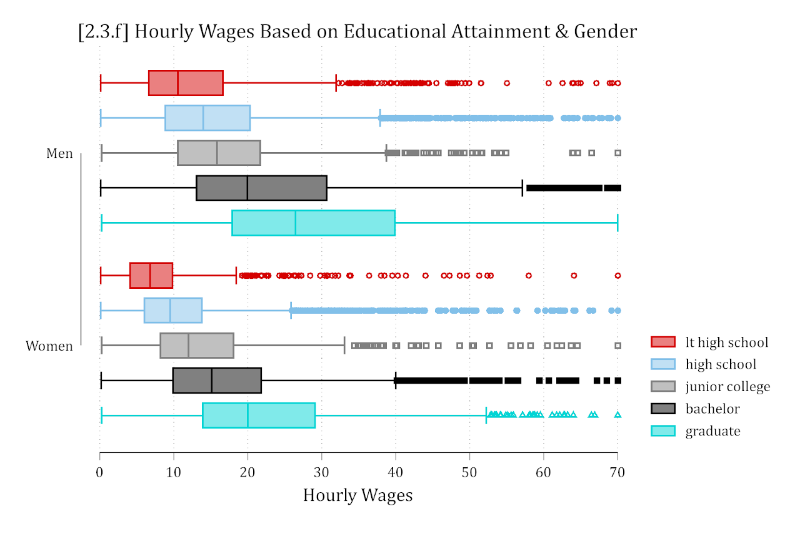
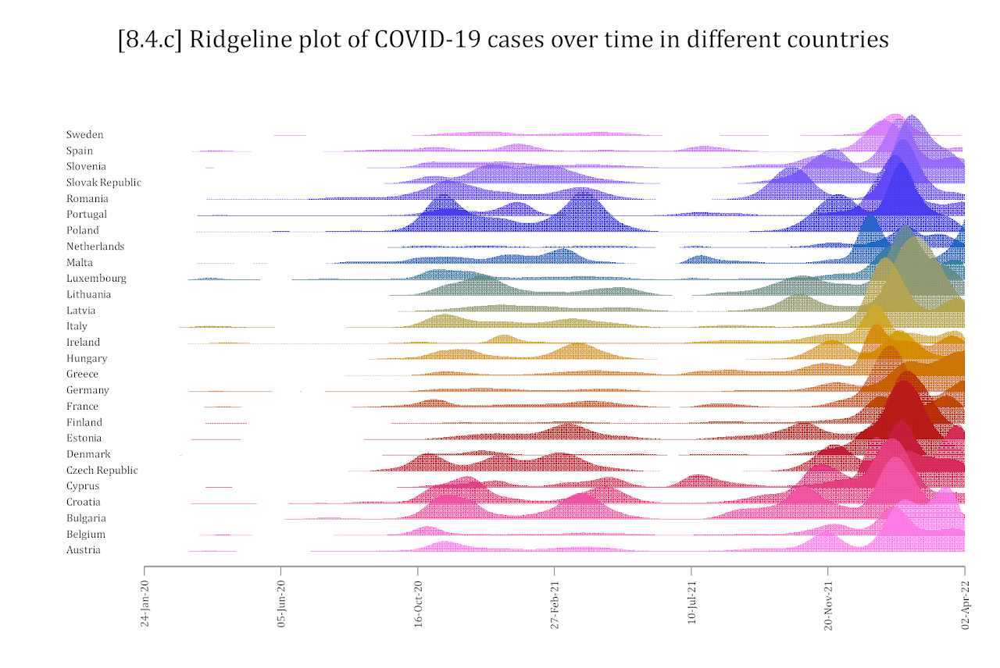

:::: {.columns}

::: {.column width="50%"}

:::

::: {.column width="50%"}

:::

::::

Understanding data and effectively presenting model results are challenges that applied quantitative researchers face most every day. There is seldom a more effective solution than a well thought out visualization. Problems in the data are easily identified; complex effects are quickly summarized; effect sizes and variability are immediately clear. In this workshop, we will cover best practices for accurately representing data as well as many specific approaches to data exploration, model diagnostics, and model presentation. The workshop will cover the principles of effective data and model visualization, while also introducing a range of different visualization techniques. Template files as well as full replication code in R and Stata will be provided. Participants are encouraged to bring their laptop with R or Stata installed.

The resources below provide slides with examples along with template R and Stata code to recreate the types of visualizations I cover in your own work.

## Data Visualization (Methodology Center Workshop Series)

### Logistics

Friday November 20, 2026 from 1:00 - 4:00 PM

- STEW 313

### Workshop Materials

- [Workshop notes (all of the slide content, along with the Stata and R code and output for all examples)](/teaching/dmv/notes/index.qmd)
- [Slides](/teaching/dmv/notes/files/dmv-data_visualization-slides.pdf)
- [Stata do-file](/teaching/dmv/notes/files/dmv-data_visualization-exs.do)
- [R script](/teaching/dmv/notes/files/dmv-data_visualization-exs.R)

## Data Visualization & Model Presentation in R (Eskenazi Health)

### Logistics

Monday October 27, 2025

### Workshop Materials

- [Slides](https://drive.google.com/file/d/1EcyBGpbeiaZv5tTCqN3uvxCxhPn5j4N8/view?usp=sharing)
- [R output (includes all code and example graphs from slides, along with notes)](/teaching/dmv/r-output.qmd)
- [R template code](https://drive.google.com/drive/folders/1i2ENFqy73jKrUtJ84Gt2zm9iMVOiDc8H?usp=sharing)

## Data Visualization with Stata (Center for Aging and Policy Studies)

### Logistics

Friday March 31, 2023

- Syracuse University

### Workshop Materials

- [Slides](https://drive.google.com/file/d/1IuYu1IGqJmnPdxQkkMzmWfJmlkEMM009/view?usp=share_link)
- [Stata template code](https://drive.google.com/drive/folders/1jIyLqQuxV4i_gMUubXGp8lhxyo1x8ZwP?usp=share_link)
- [R template code](https://drive.google.com/drive/folders/1x4UPkxPabu_ynF5G8NhBtLomg3aJf0Q0?usp=share_link)

## Data Visualization (AMAP Purdue 2022)

### Logistics

Friday Sep 23 from 1:00 - 5:00pm

- WALC 2124

### Workshop Materials

- [Slides](https://drive.google.com/file/d/1jKxsilzgS0B41Xo6SPpAGIUKACW1fEJA/view?usp=sharing)
- [Stata do-files](https://drive.google.com/drive/folders/1vN2CUkS9a1lpRy-K2DqetdXlRrzRyCjg?usp=sharing)
- [R files](https://drive.google.com/drive/folders/1fTC8XnKmZZxnBOWkG8_W6yjTc1I2ssdV?usp=sharing)

## Data Visualization & Model Presentation in Stata (PAA 2022)

### Logistics

Wednesday April 6 from 1:00 - 5:00pm

- Workshop offered at the Population Association of America 2022 Annual Meeting ([details here](https://www.populationassociation.org/paa2022/paa2022-related-events/2022-workshops))

### Workshop Materials

- [Folder of materials (slides and Stata do-files)](https://drive.google.com/drive/folders/1mb-schqueViKft88fneSc-6gGJevWhoa?usp=sharing)

## Data and Model Visualization in Stata & R (Purdue 2018)

- [Slides](https://drive.google.com/file/d/1cTd1d60X7bckudUQ1cW740fUY7-q4zHe/view?usp=sharing)
- [Example Stata do-files](https://drive.google.com/drive/folders/1DW8HH6pop9mWbDNRPa1R9BUyGNWsRu8-?usp=sharing)
- [Example R files](https://drive.google.com/drive/folders/1uTBgjK4YwRJtKCMmz6fbfwZsFfXEo627?usp=sharing)
