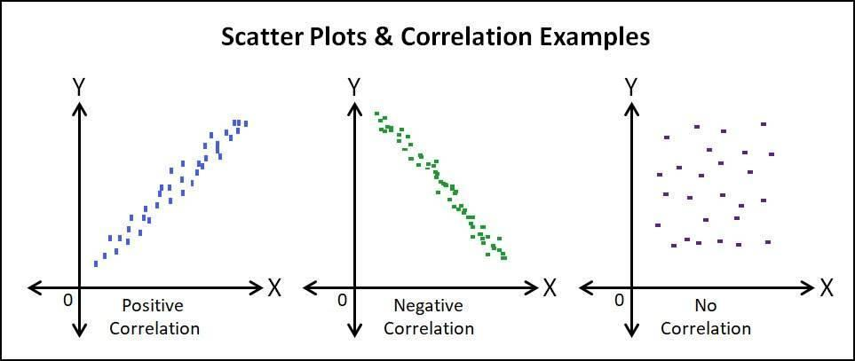
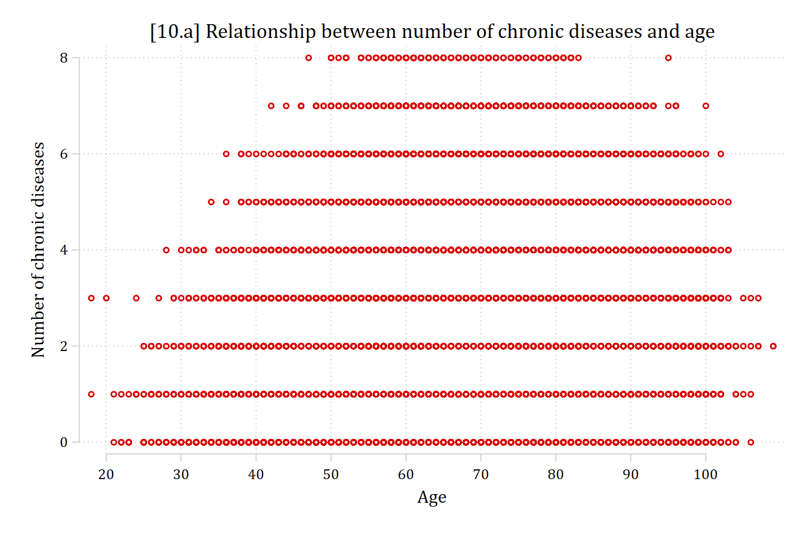
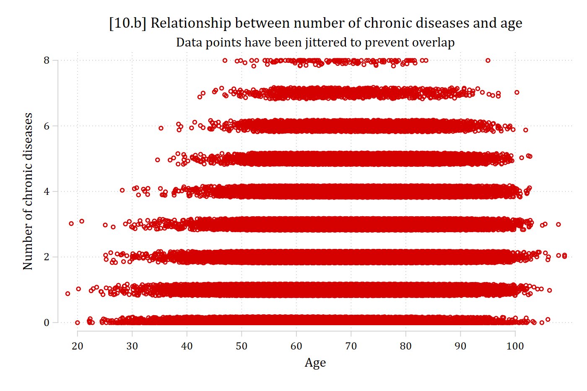
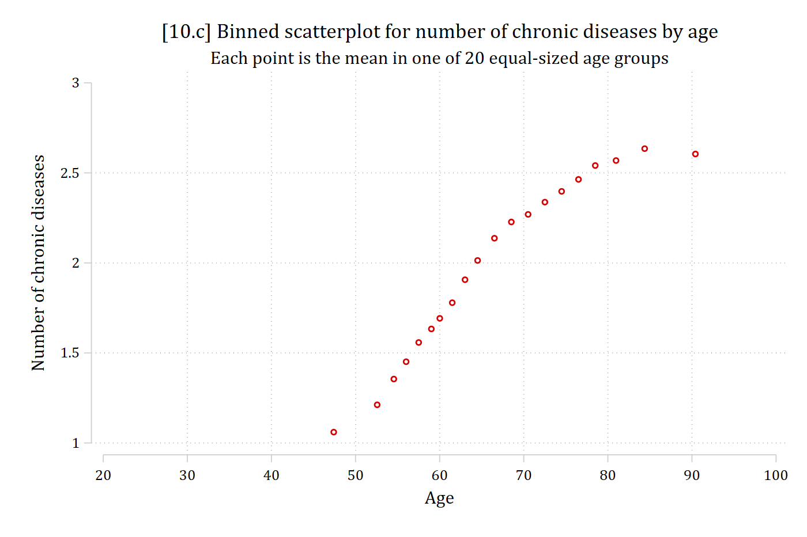
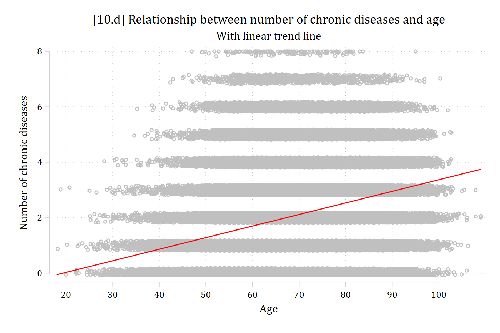
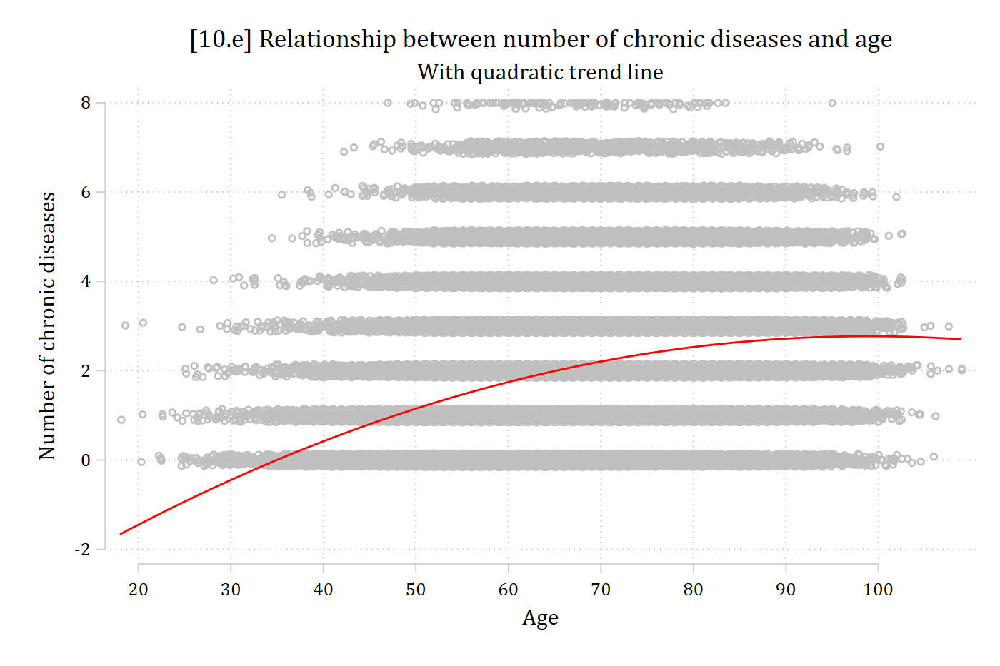
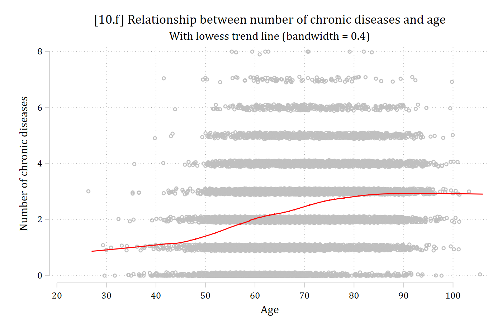
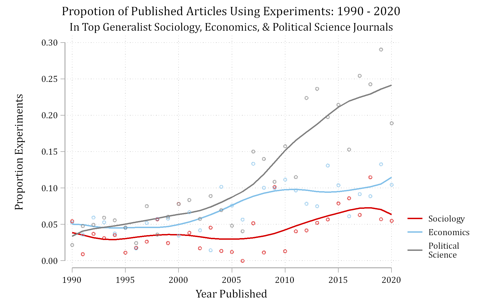
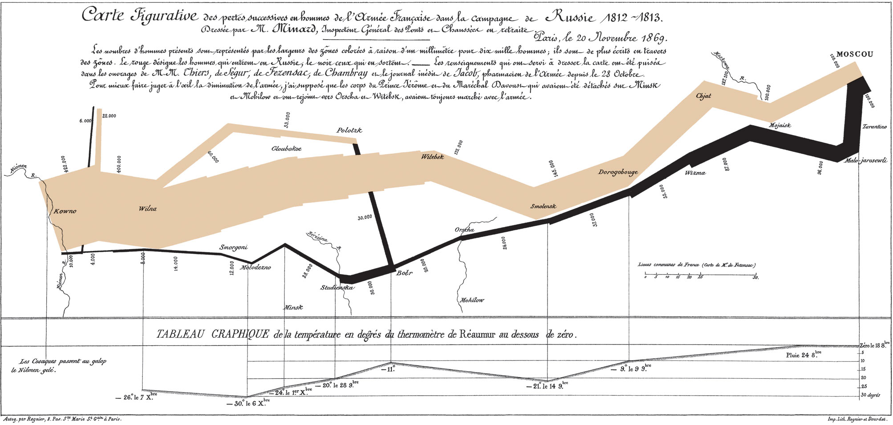

## Scatterplots of two continuous variables

:::: {.columns}
::: {.column width="60%"}
- Scatterplots are among the most common and intuitive data visualization techniques
- Plot each individual observation by placing one variable on the *x*-axis and another on the *y*-axis, and placing a dot where each observation falls
  - The dependent variable (DV) or outcome is the *y*-variable
  - The independent variable (IV) or cause is the *x*-variable
:::
::: {.column width="40%"}
{fig-alt="Three example scatterplots showing a positive correlation, a negative correlation, and no correlation."}
:::
::::

::: {.panel-tabset group="language"}
## Stata

```{.stata-run}
. use "https://tdmize.github.io/data/data/hrs_si.dta", clear
(Health and Retirement Study 1992-2022 - Cleaned for MCAP SI)

. 
. // 10.a - Basic scatterplot doesn't work because of overlapping data points
. twoway scatter dzcount age, ///
>     title("[10.a] Relationship between number of chronic diseases and age") //
> /
>     xtitle("Age") ytitle("Number of chronic diseases") ///
>     xlabel(20(10)100)

```

{width=80% fig-alt="[10.a] Scatterplot of the number of chronic diseases (0 to 8) by age: because both variables take whole-number values, the points overlap into solid horizontal rows, and the graph cannot show where most of the data are."}

## R

```{r}
#| fig-alt: "[10.a] Scatterplot of the number of chronic diseases (0 to 8) by age: because both variables take whole-number values, the points overlap into solid horizontal rows, and the graph cannot show where most of the data are."
library(foreign)            # load Stata datasets
library(ggplot2)            # main graphics package
library(dplyr)              # data manipulation tools
library(cleanplots)         # Mize's graphics scheme

## Use cleanplots colors, markers, lines, and theme for all graphs ##
cleanplots_defaults()
theme_update(plot.title.position = "plot")   # titles start at left edge of graph

# Health and Retirement Study Data
hrs <- read.dta("https://tdmize.github.io/data/data/hrs_si.dta")

# 10.a - Basic scatterplot doesn't work because of overlapping data points
ggplot(hrs, aes(x = age, y = dzcount)) +
  geom_point() +
  labs(x = "Age",
       y = "Number of chronic diseases",
       title = "[10.a] Relationship between number of chronic diseases and age") +
  scale_x_continuous(breaks = seq(20, 100, 10))
```

:::

::: {.panel-tabset group="language"}
## Stata

```{.stata-run}
. // 10.b - Jitter (random noise) points to prevent overlap
. twoway scatter dzcount age, jitter(3) ///
>     title("[10.b] Relationship between number of chronic diseases and age") //
> /
>     subtitle("Data points have been jittered to prevent overlap") ///
>     xtitle("Age") ytitle("Number of chronic diseases") ///
>     xlabel(20(10)100)

```

{width=80% fig-alt="[10.b] The same scatterplot with random noise added to each point: the rows become thick bands, showing that most observations are between ages 50 and 95, but with so many points the bands are still solid."}

## R

```{r}
#| fig-alt: "[10.b] The same scatterplot with random noise added to each point: the rows become thick bands, showing that most observations are between ages 50 and 95, but with so many points the bands are still solid."
# 10.b - Jitter (random noise) points to prevent overlap
ggplot(hrs, aes(x = age, y = dzcount)) +
  geom_jitter(height = .25, width = .25) +
  labs(x = "Age",
       y = "Number of chronic diseases",
       title = "[10.b] Relationship between number of chronic diseases and age",
       subtitle = "Data points have been jittered to prevent overlap") +
  scale_x_continuous(breaks = seq(20, 100, 10))
```

:::

## Binned scatterplots

- Scatterplots and scatterplot smoothing methods like lowess are less useful when you have lots of data
  - Graphs become impossible to read (but could plot random subsample)
- A binned scatterplot is a useful tool for these and other cases ([Stepner 2014](https://michaelstepner.com/binscatter/binscatter-StataConference2014.pdf))
  - "bin" the *x* variable into groups (e.g., 20 age groups) and then calculate the mean of the *y* variable for each bin

::: {.panel-tabset group="language"}
## Stata

```{.stata-run}
. // 10.c - Binned scatterplot: mean of y within 20 equal-sized bins of x
. binscatter dzcount age, linetype(none) mcolors(red*1.2) ///
>     title("[10.c] Binned scatterplot for number of chronic diseases by age") /
> //
>     subtitle("Each point is the mean in one of 20 equal-sized age groups") ///
>     xtitle("Age") ytitle("Number of chronic diseases") ///
>     xlabel(20(10)100)

```

{width=80% fig-alt="[10.c] Binned scatterplot with one point for the mean number of chronic diseases in each of 20 equal-sized age groups: the mean rises steeply from about 1 at age 47 to about 2.3 at age 70 and then levels off near 2.6 after age 80."}

## R

```{r}
#| fig-alt: "[10.c] Binned scatterplot with one point for the mean number of chronic diseases in each of 20 equal-sized age groups: the mean rises steeply from about 1 near age 47 and then levels off after age 80."
# 10.c - Binned scatterplot: mean of y within 20 equal-sized bins of x
hrs_bins <- hrs %>%
  filter(!is.na(dzcount), !is.na(age)) %>%
  mutate(age_bin = ntile(age, 20)) %>%
  group_by(age_bin) %>%
  summarise(age = mean(age), dzcount = mean(dzcount))

ggplot(hrs_bins, aes(x = age, y = dzcount)) +
  geom_point(size = 3) +
  labs(x = "Age",
       y = "Number of chronic diseases",
       title = "[10.c] Binned scatterplot for number of chronic diseases by age",
       subtitle = "Each point is the mean in one of 20 equal-sized age groups") +
  scale_x_continuous(breaks = seq(20, 100, 10))
```

:::

::: {.panel-tabset group="language"}
## Stata

```{.stata-run}
. // 10.d - Linear regression line overlaid on scatterplot
. twoway ///
>     (scatter dzcount age, jitter(3) mcolor(gs12)) ///
>     (lfit dzcount age, lcolor(red)), ///
>     legend(off) xlabel(20(10)100) ///
>     title("[10.d] Relationship between number of chronic diseases and age") //
> /
>     subtitle("With linear trend line") ///
>     xtitle("Age") ytitle("Number of chronic diseases")

```

{width=80% fig-alt="[10.d] The jittered scatterplot in light gray with a red linear regression line that rises steadily with age across the whole range."}

## R

```{r}
#| fig-alt: "[10.d] The jittered scatterplot in light gray with a linear regression line that rises steadily with age across the whole range."
# 10.d - Linear regression line overlaid on scatterplot
ggplot(hrs, aes(x = age, y = dzcount)) +
  geom_jitter(height = .25, width = .25, color = "gray75") +
  geom_smooth(method = "lm") +
  labs(x = "Age",
       y = "Number of chronic diseases",
       title = "[10.d] Relationship between number of chronic diseases and age",
       subtitle = "With linear trend line") +
  scale_x_continuous(breaks = seq(20, 100, 10))
```

:::

::: {.panel-tabset group="language"}
## Stata

```{.stata-run}
. // 10.e - Quadratic regression line (x and x^2) overlaid on scatterplot
. twoway ///
>     (scatter dzcount age, jitter(2) mcolor(gs12)) ///
>     (qfit dzcount age, lcolor(red)), ///
>     legend(off) xlabel(20(10)100) ///
>     title("[10.e] Relationship between number of chronic diseases and age") //
> /
>     subtitle("With quadratic trend line") ///
>     xtitle("Age") ytitle("Number of chronic diseases")

```

{width=80% fig-alt="[10.e] The jittered scatterplot with a red quadratic regression line that rises with age and flattens out at the oldest ages."}

## R

```{r}
#| fig-alt: "[10.e] The jittered scatterplot with a quadratic regression line that rises with age and flattens out at the oldest ages."
# 10.e - Quadratic regression line (x and x^2) overlaid on scatterplot
ggplot(hrs, aes(x = age, y = dzcount)) +
  geom_jitter(height = .25, width = .25, color = "gray75") +
  geom_smooth(method = "lm", formula = y ~ poly(x, 2)) +
  labs(x = "Age",
       y = "Number of chronic diseases",
       title = "[10.e] Relationship between number of chronic diseases and age",
       subtitle = "With quadratic trend line") +
  scale_x_continuous(breaks = seq(20, 100, 10))
```

:::

### LOWESS: locally weighted scatterplot smoothing

- The fitted lines shown above are parametric techniques
- LOWESS performs "local" regressions on a subset of your data
  - Primarily an exploratory technique---you can plot the smoothed regression line but you do not get parameter estimates/significance tests
  - It can be a helpful way to quickly assess nonlinearity and often suggests possible parametric modeling solutions for the nonlinearity (e.g., need both *age* and *age^2^* in model)
- Can specify a bandwidth (**bwidth( )** option in Stata; **span** in R) to determine how much to smooth (0 to 1 as a proportion of your data)
  - E.g., A bandwidth of 0.4 means you want the 40% of the data closest to a given point used to calculate the line at that point
  - Smaller bandwidths will let you find more nonlinearities but are more susceptible to outliers and other quirks of your data
    - I find 0.3 or 0.4 good starting places

::: {.panel-tabset group="language"}
## Stata

```{.stata-run}
. // 10.f - Lowess smoothed fit line (2022 wave only)
. twoway ///
>     (scatter dzcount age if year == 2022, jitter(2) mcolor(gs12)) ///
>     (lowess dzcount age if year == 2022, bwidth(.4) lcolor(red)), ///
>     legend(off) xlabel(20(10)100) ///
>     title("[10.f] Relationship between number of chronic diseases and age") //
> /
>     subtitle("With lowess trend line (bandwidth = 0.4)") ///
>     xtitle("Age") ytitle("Number of chronic diseases")

```

{width=80% fig-alt="[10.f] Jittered scatterplot of chronic diseases by age for the 2022 wave with a red lowess line: the line is nearly flat around 1 until about age 45, rises between 45 and 80, and levels off near 3 after age 80."}

## R

```{r}
#| fig-alt: "[10.f] Jittered scatterplot of chronic diseases by age for the 2022 wave with a lowess line: the line is nearly flat until about age 45, rises between 45 and 80, and levels off after age 80."
# 10.f - Lowess smoothed fit line (2022 wave only)
ggplot(filter(hrs, year == 2022), aes(x = age, y = dzcount)) +
  geom_jitter(height = .25, width = .25, color = "gray75") +
  geom_smooth(method = "loess", se = FALSE, span = .4) +
  labs(x = "Age",
       y = "Number of chronic diseases",
       title = "[10.f] Relationship between number of chronic diseases and age",
       subtitle = "With lowess trend line (span = 0.4)") +
  scale_x_continuous(breaks = seq(20, 100, 10))
```

:::

### Published example

{width=70% fig-alt="Published figure: the proportion of published articles using experiments from 1990 to 2020 in top generalist sociology, economics, and political science journals, with smoothed trend lines for each field."}

\*Figure 1 from [Mize and Manago 2022](https://doi.org/10.1016/j.ssresearch.2022.102799)

### Historical example

Napoleon's march to, and retreat from, Moscow in the War of 1812

{fig-alt="Charles Minard's 1869 chart of Napoleon's march to and retreat from Moscow: a tan band for the army's advance and a black band for its retreat, whose widths show the shrinking size of the army, with a temperature line below."}

\*Read more about the graphic [here](https://www.openculture.com/2019/07/napoleons-disastrous-invasion-of-russia-explained-in-an-1869-data-visualization.html)

:::: {.columns}
::: {.column width="50%"}
{fig-alt="The Methodology Center illustration: small line drawings of graphs around a central MCAP circle."}
:::
::: {.column width="50%"}
{fig-alt="Minard's chart of Napoleon's march, which one of the drawings in the Methodology Center illustration is based on."}
:::
::::

\*[Read about The Methodology Center graphic](https://www.purdue.edu/research/mcap/illustration/)
