:::: {.columns}
::: {.column width="60%"}
- Pie charts, bar charts, and dot plots can often display the same information: usually, the univariate distribution of a categorical variable
  - But, most can also be used for bivariate relationships and we will use these as building blocks for visualizing more complicated relationships
- Despite their similarities, they can differ dramatically in their effectiveness
:::
::: {.column width="40%"}
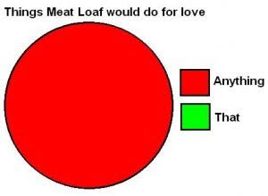{fig-alt="Joke pie chart titled Things Meat Loaf would do for love: the whole pie is Anything and none of it is That."}

[Meatloaf music video](https://www.youtube.com/watch?v=9X_ViIPA-Gc) (highly recommended)
:::
::::

## Pie charts

- Pie charts present the proportion of a variable represented in each category
  - The fundamental rule of a pie chart is it should show **parts of a whole**
  - E.g., Among the Purdue student population, what percent major in engineering, social science, health/medical fields, humanities, etc.?

{width=45% fig-alt="A crowd of Purdue students with the Purdue Pete mascot."}

- Pie charts have the advantage of being intuitive to understand and widely used---so your audience is probably familiar with them
- The downside of a pie chart is that judging area size and angles is hard
  - The reader receives more of a general sense of the size of different categories rather than a precise estimate
  - There are no axis labels that can be referred to

::: {.panel-tabset group="language"}
## Stata

```{.stata-run}
. use "https://tdmize.github.io/data/data/hrs_si.dta", clear
(Health and Retirement Study 1992-2022 - Cleaned for MCAP SI)

. 
. // 2.a - Pie charts are generally not recommended
. graph pie, over(srhealth) ///
>     title("[2.a] Pie chart for distribution of self-rated health among older a
> dults")

```

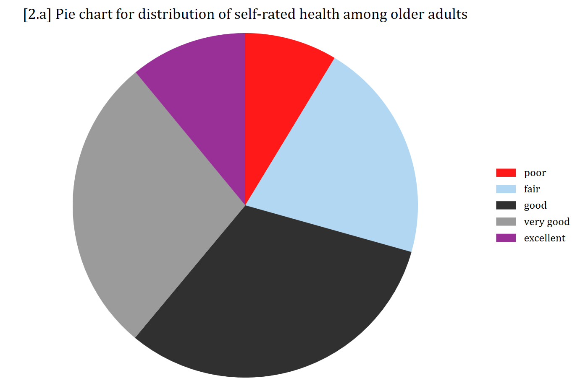{width=80% fig-alt="[2.a] Pie chart of self-rated health among older adults with five slices (poor, fair, good, very good, excellent): good and very good are the largest slices, but the sizes of the slices are hard to compare precisely."}

## R

```{r}
#| fig-alt: "[2.a] Pie chart of self-rated health among older adults with five slices (poor, fair, good, very good, excellent): good and very good are the largest slices, but the sizes of the slices are hard to compare precisely."
library(foreign)            # load Stata datasets
library(ggplot2)            # main graphics package
library(dplyr)              # data manipulation tools
library(cleanplots)         # Mize's graphics scheme

## Use cleanplots colors, markers, lines, and theme for all graphs ##
cleanplots_defaults()
theme_update(plot.title.position = "plot")   # titles start at left edge of graph

# Health and Retirement Study Data
hrs <- read.dta("https://tdmize.github.io/data/data/hrs_si.dta")

# 2.a - Pie charts (generally not recommended)
ggplot(filter(hrs, !is.na(srhealth)), aes(x = "", fill = srhealth)) +
  geom_bar(width = 1) +
  coord_polar(theta = "y") +
  labs(title = "[2.a] Pie chart for distribution of self-rated health among older adults",
       fill = "") +
  scale_fill_viridis_d() +
  theme_void(base_size = 12)
```

:::

## Accuracy of perceptual tasks

:::: {.columns}
::: {.column width="70%"}
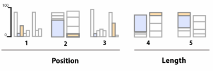{fig-alt="The perceptual tasks tested by Cleveland and McGill: judging position on a common scale, length, angle, circular area, and rectangular area."}

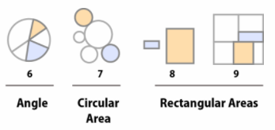{fig-alt="Examples of the angle, circular area, and rectangular area judgment tasks."}
:::
::: {.column width="30%"}
::: {.callout-note icon="false" appearance="simple"}
Findings and figures from:

[Cleveland and McGill 1984](https://www.tandfonline.com/doi/abs/10.1080/01621459.1984.10478080);
[Heer & Bostock 2010](http://www.cs.kent.edu/~javed/class-P2P12F/papers-2012/PAPER2012-2010-MTurk-CHI.pdf);
[Healy 2018](http://socviz.co/lookatdata.html#lookatdata)
:::
:::
::::

:::: {.columns}
::: {.column width="70%"}
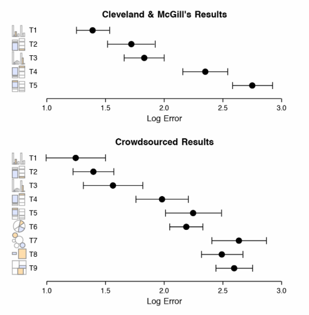{fig-alt="Dot plots of the log error for each task, in Cleveland and McGill's results and in crowdsourced results: errors are smallest for judging position and length and largest for angles and areas."}
:::
::: {.column width="30%"}
::: {.callout-note icon="false" appearance="simple"}
Note: "crowdsourced" results refer to [Heer & Bostock (2010)](http://www.cs.kent.edu/~javed/class-P2P12F/papers-2012/PAPER2012-2010-MTurk-CHI.pdf)
:::
:::
::::

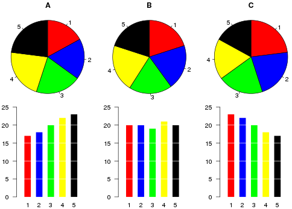{width=80% fig-alt="Three pie charts (A, B, C) with five similar-sized slices each, above bar charts of the same data: the differences between the categories are hard to see in the pies and easy to see in the bars."}

\*Bar charts are simple but very effective for comparing amounts across groups

## Stacked bar charts

- Stacked bar charts are a useful alternative to pie charts
  - Also, make it easy to compare across time/waves or groups (which is very difficult with a pie chart)
- Stacked bar charts can be used when you want a bar to fill the entire space of an axis (compare to how much space on the *y*-axis is covered by the bars above)
- Stacked bar charts are especially useful when you have categorical outcome (*y*) variables and/or when the total of multiple variables is of interest
  - Works well for binary dependent variables
  - Especially useful for nominal/ordinal dependent variables

::: {.panel-tabset group="language"}
## Stata

```{.stata-run}
. * Create variable to flag cohort of respondents who were in first wave of data
. egen byte in1992 = max(year == 1992), by(hhidpn)

. tab in1992

     in1992 |      Freq.     Percent        Cum.
------------+-----------------------------------
          0 |    171,820       58.01       58.01
          1 |    124,377       41.99      100.00
------------+-----------------------------------
      Total |    296,197      100.00

. 
. // 2.b - Stacked bar chart
. graph bar (count) if in1992, ///
>     over(srhealth) horizontal asyvars stack percentages ///
>     ytitle("Self-rated health") title("") ///
>     scheme(cleanplots5) legen(pos(6) row(1)) xsize(8) ysize(2) scale(2.5)

```

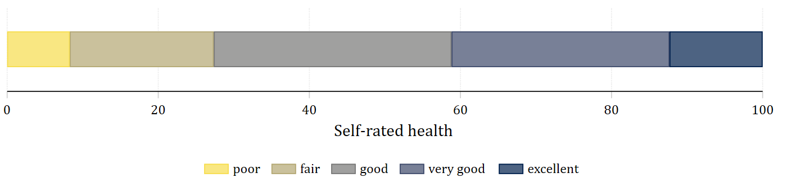{width=80% fig-alt="[2.b] A single horizontal stacked bar of self-rated health from 0 to 100 percent, in ordinal colors from light yellow (poor) to dark blue (excellent): about 8% poor, 19% fair, 31% good, 29% very good, and 12% excellent."}

## R

```{r}
#| fig-width: 8
#| fig-height: 2
#| fig-alt: "[2.b] A single horizontal stacked bar of self-rated health from 0 to 100 percent, in ordinal colors from light yellow (poor) to dark blue (excellent): about 8% poor, 19% fair, 31% good, 29% very good, and 12% excellent."
# Quick work to flag only those included in first HRS wave
ids_1992 <- hrs %>%
  filter(year == 1992) %>%
  pull(hhidpn) %>% unique()

hrs_filtered <- hrs %>%
  filter(hhidpn %in% ids_1992)

# 2.b - Stacked bar chart
ggplot(filter(hrs_filtered, !is.na(srhealth)), aes(y = "", fill = srhealth)) +
  geom_bar(position = position_fill(reverse = TRUE), width = .5) +
  labs(x = "Self-rated health", y = NULL, fill = "") +
  scale_fill_viridis_d(option = "cividis", direction = -1, end = .95) +
  theme(legend.position = "bottom")
```

:::

### Historical example: W.E.B DuBois

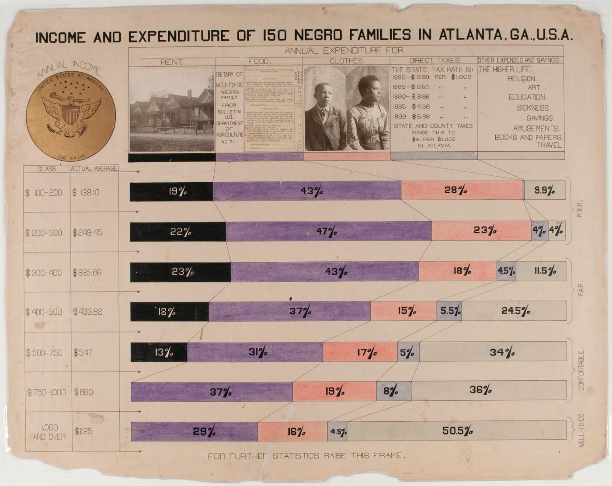{width=80% fig-alt="W.E.B. Du Bois's hand-drawn chart Income and Expenditure of 150 Negro Families in Atlanta, GA., U.S.A.: stacked horizontal bars showing how each income group spent its money."}

\*Read more about W.E.B. DuBois's pioneering data visualizations [here](https://www.smithsonianmag.com/history/first-time-together-and-color-book-displays-web-du-bois-visionary-infographics-180970826/) (and a whole [book here](https://www.amazon.com/W-Boiss-Data-Portraits-Visualizing/dp/1616897066))

::: {.panel-tabset group="language"}
## Stata

```{.stata-run}
. // 2.c - Stacked bar chart with 1992 cohort: ordinal colors from cleanplots5 s
> cheme
. graph bar (count) if in1992, ///
>     over(srhealth) over(year) ///
>     asyvars stack percentages ///
>     ytitle("Self-rated health") ///
>     title("[2.c] Stacked bar chart of self-rated health among older adults ove
> r time (HRS)") ///
>     scheme(cleanplots5)

```

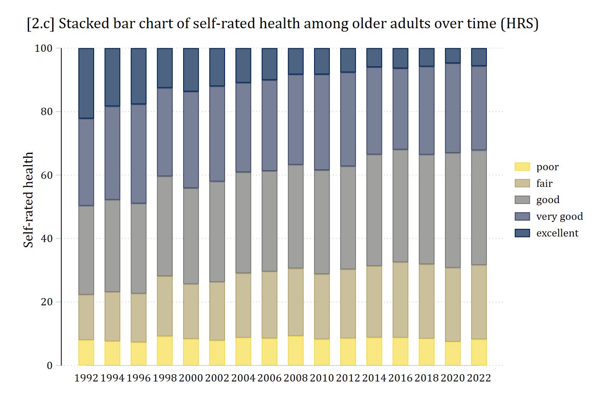{width=80% fig-alt="[2.c] Stacked bars of self-rated health for each HRS wave from 1992 to 2022 in the 1992 cohort: the share reporting excellent health shrinks from about 22% to about 5% over time while the shares reporting good and fair grow."}

## R

```{r}
#| fig-alt: "[2.c] Stacked bars of self-rated health for each HRS wave from 1992 to 2022 in the 1992 cohort: the share reporting excellent health shrinks from about 22% to about 5% over time while the shares reporting good and fair grow."
# 2.c - Stacked bar chart with 1992 cohort
ggplot(filter(hrs_filtered, !is.na(srhealth)), aes(fill = srhealth, x = year)) +
  geom_bar(position = "fill") +
  labs(title = "[2.c] Stacked bar chart of self-rated health among older adults over time (HRS)",
       y = "Self-rated health", fill = "") +
  scale_fill_viridis_d(option = "cividis", direction = -1, end = .95)
```

:::

### Published stacked bar chart example

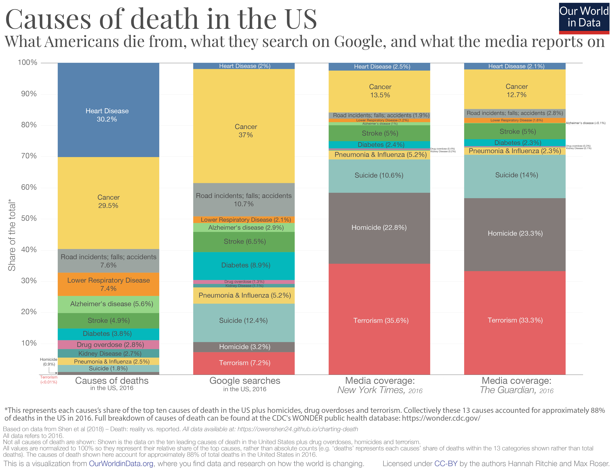{width=80% fig-alt="Our World in Data stacked bar chart, Causes of death in the US: what Americans die from compared with what they search on Google and what the media reports on."}

## Bar charts

:::: {.columns}
::: {.column width="60%"}
- The findings from the visual perception experiments pioneered by Cleveland and colleagues lead to some straightforward conclusions about effective graphics:
  - Angles are difficult to perceive accurately
    - Pie charts are not effective
  - Area is difficult to judge---especially when multiple aspects are varying at once (e.g., both length and width)
  - A common scale is necessary to compare across groups
- Bar charts---where the width stays the same and only the length varies based on a quantitative metric---are among the most effective tools for comparing quantities
:::
::: {.column width="40%"}
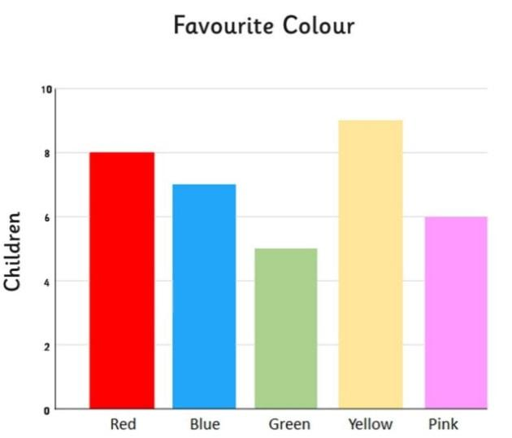{fig-alt="Simple bar chart of children's favourite colour: red, blue, green, yellow, and pink."}
:::
::::

::: {.panel-tabset group="language"}
## Stata

```{.stata-run}
. // 2.d - Bar chart for distribution of days drinking
. graph bar (count), ///
>     over(dayweekdrink) ///
>     title("[2.d] Bar chart for days usually drink each week (older adults, HRS
> )") ///
>     ytitle("Count") b1title("Days usually drink each week")

```

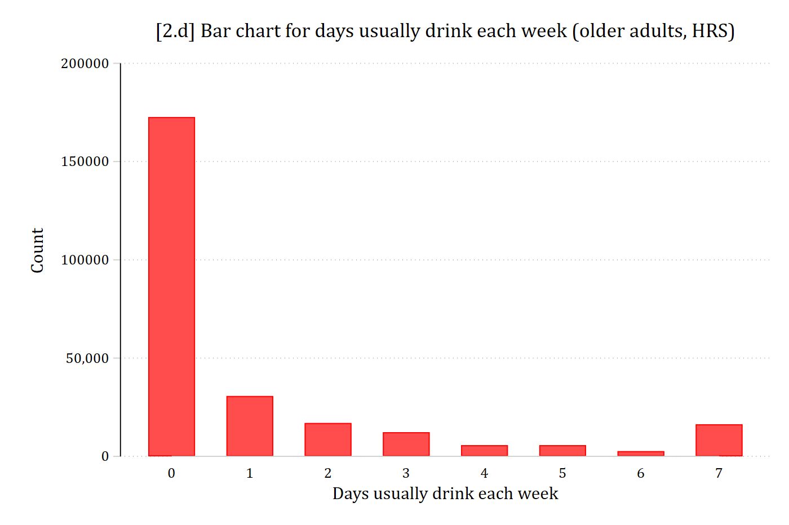{width=80% fig-alt="[2.d] Bar chart of the number of days older adults usually drink each week, 0 to 7: by far the tallest bar is 0 days (over 170,000 observations), followed by 1 day; the bars for 2 to 6 days are short, with a small rise at 7 days."}

## R

```{r}
#| fig-alt: "[2.d] Bar chart of the number of days older adults usually drink each week, 0 to 7: by far the tallest bar is 0 days, followed by 1 day; the bars for 2 to 6 days are short, with a small rise at 7 days."
# 2.d - Bar chart for distribution of days drinking
ggplot(filter(hrs, !is.na(dayweekdrink)), aes(x = dayweekdrink)) +
  geom_bar() +
  labs(title = "[2.d] Bar chart for days usually drink each week (older adults, HRS)",
       x = "Days usually drink each week", y = "Count")
```

:::
