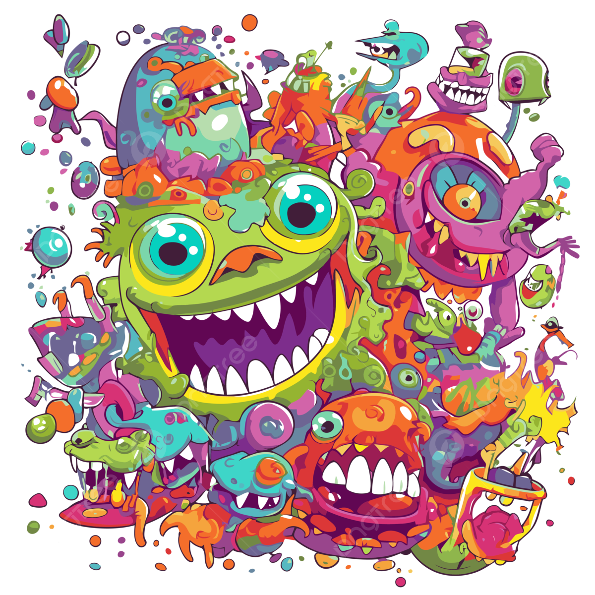
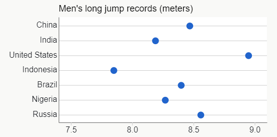
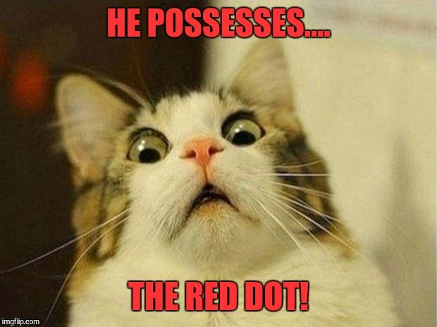
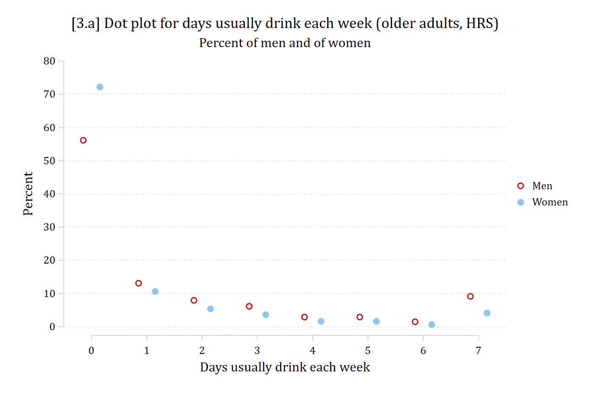
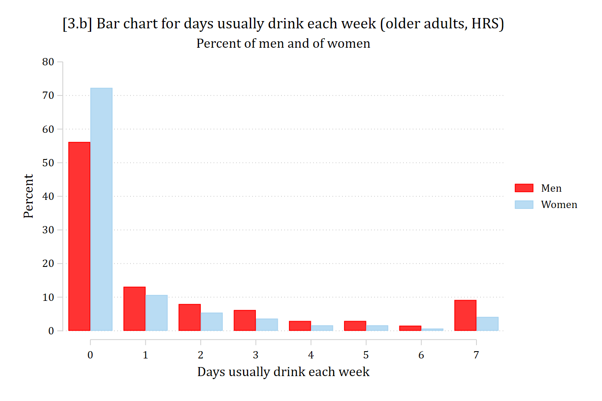
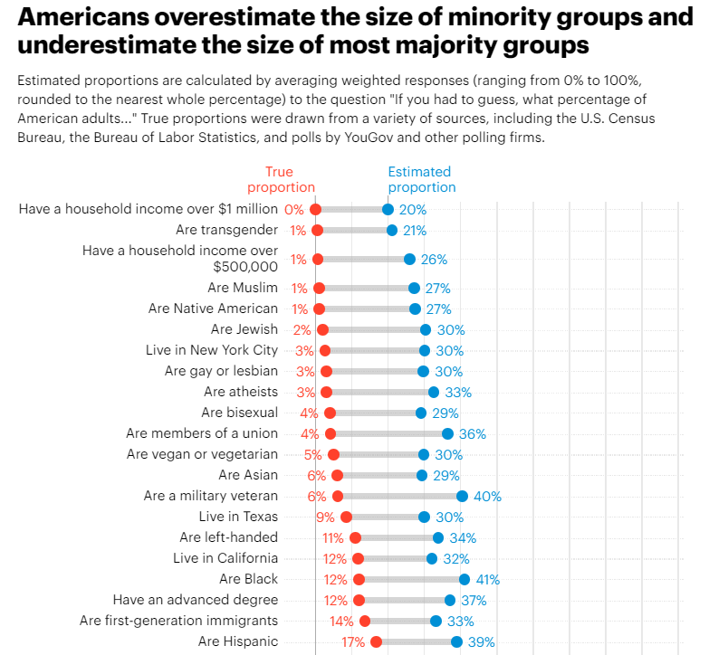

## The data-ink ratio

*"Maximize the data-ink ratio, **within reason**." [(Tufte 1983; emphasis added)](https://www.edwardtufte.com/tufte/books_vdqi)*

:::: {.columns}
::: {.column width="65%"}
- Excessive decoration/color should be avoided (but see my caveat below)
  - All aspects of the graph should aid in presenting the data
    - The "data ink" ratio should be as high as possible ([Tufte 1983](https://www.edwardtufte.com/tufte/books_vdqi))
      - The basic idea behind this principle: all aspects of a graphic should serve the purpose of showing the data
      - Consider whether superfluous additional pieces/colors on your graphic can be removed
  - My less strict rule: **all color should convey some information**
:::
::: {.column width="35%"}
{fig-alt="A busy, brightly colored cartoon monster covered in clashing patterns."}
:::
::::

### The data-ink ratio: my caveat

*"... 'remove clutter and strive for clean and elegant designs'... is reasonable advice. But... 'do everything you can to remove non-data ink'...will result in poor design choices." ([Wilke 2019](https://clauswilke.com/dataviz/balance-data-context.html) p.277-278)*

- I am much less of a fundamentalist about the maximize data ink rule
  - In the age of PDFs and online journals/reports/websites, it isn't "wasteful" to include extra color or other data ink
- Sometimes the color displays useful information (e.g., your brain registers amount better with a bar chart than a dot plot because the blocks of color carry visual information on quantity)
- Color can help you quickly identify different parts of the graph (e.g., *the blue line shows...*)
- Sometimes the color... looks nice
  - Having aesthetically pleasing graphics is important

## Dot plots

- Dot plots can often be used interchangeably with bar charts
  - But, instead of a colored in bar, you simply place a dot at the value being plotted (would be the top of the bar)
  - Dot plots can similarly easily incorporate measures of uncertainty in the form of SEs or CIs
- Dot plots were invented to take advantage of the knowledge gleaned from Cleveland and colleagues' visual perception experiments and Tufte's opinions about excess decoration

:::: {.columns}
::: {.column width="55%"}
{fig-alt="Dot plot of men's long jump records in meters for seven countries."}
:::
::: {.column width="45%"}
{fig-alt="Meme of a startled cat with the caption: He possesses... the red dot!"}
:::
::::

### Advantages of dot plots

- An advantage of dot plots is that they waste less data ink when compared to a bar chart ([Tufte 1983](https://www.edwardtufte.com/tufte/books_vdqi))
  - This also keeps them from becoming crowded and unreadable
- A purely utilitarian reason to use a dot plot is that people will give you a hard time for having a bar chart that does not start at zero---while no one seems to care if a dot plot starts at zero
  - There are good reasons for this concern as bar charts display information both as length and area---and the area can be misleading without a zero baseline
    - More on zero baselines [later in these notes](6-axes.qmd)

{width=25% fig-alt="Bluesky logo."} {width=15% fig-alt="X logo."} {width=20% fig-alt="Cartoon of a troll typing on a laptop."}

::: {.panel-tabset group="language"}
## Stata

```{.stata-run}
. use "https://tdmize.github.io/data/data/hrs_si.dta", clear
(Health and Retirement Study 1992-2022 - Cleaned for MCAP SI)

. 
. * Percent of men and of women in each category of days drinking
. proportion dayweekdrink if woman == 0

Proportion estimation                  Number of obs = 108,573

--------------------------------------------------------------
             |                                   Logit
             | Proportion   Std. err.     [95% conf. interval]
-------------+------------------------------------------------
dayweekdrink |
          0  |      0.562      0.002         0.559       0.565
          1  |      0.131      0.001         0.129       0.133
          2  |      0.080      0.001         0.078       0.081
          3  |      0.062      0.001         0.060       0.063
          4  |      0.029      0.001         0.028       0.030
          5  |      0.029      0.001         0.028       0.030
          6  |      0.015      0.000         0.014       0.016
          7  |      0.092      0.001         0.090       0.094
--------------------------------------------------------------

. est store drink_men

. proportion dayweekdrink if woman == 1

Proportion estimation                  Number of obs = 154,553

--------------------------------------------------------------
             |                                   Logit
             | Proportion   Std. err.     [95% conf. interval]
-------------+------------------------------------------------
dayweekdrink |
          0  |      0.723      0.001         0.720       0.725
          1  |      0.107      0.001         0.105       0.108
          2  |      0.054      0.001         0.053       0.055
          3  |      0.036      0.000         0.035       0.037
          4  |      0.016      0.000         0.016       0.017
          5  |      0.016      0.000         0.016       0.017
          6  |      0.007      0.000         0.006       0.007
          7  |      0.041      0.001         0.040       0.042
--------------------------------------------------------------

. est store drink_wom

. 
. // 3.a - Dot plot for days drinking per week, by gender
. coefplot (drink_men, label("Men") offset(-0.15)) ///
>          (drink_wom, label("Women") offset(0.15)), ///
>     vertical noci msize(*1.5) rescale(100) ylab(0(10)80) ///
>     xlab(1 "0" 2 "1" 3 "2" 4 "3" 5 "4" 6 "5" 7 "6" 8 "7") ///
>     ytitle("Percent") xtitle("Days usually drink each week") ///
>     title("[3.a] Dot plot for days usually drink each week (older adults, HRS)
> ") ///
>     subtitle("Percent of men and of women")

```

{width=80% fig-alt="[3.a] Dot plot of the percent of men and of women who usually drink 0 to 7 days a week: 56% of men and 72% of women drink 0 days; at every other number of days the percent is higher for men than for women, with a small rise at 7 days (9% of men, 4% of women)."}

## R

```{r}
#| fig-alt: "[3.a] Dot plot of the percent of men and of women who usually drink 0 to 7 days a week: 56% of men and 72% of women drink 0 days; at every other number of days the percent is higher for men than for women, with a small rise at 7 days (9% of men, 4% of women)."
library(foreign)            # load Stata datasets
library(ggplot2)            # main graphics package
library(dplyr)              # data manipulation tools
library(cleanplots)         # Mize's graphics scheme

## Use cleanplots colors, markers, lines, and theme for all graphs ##
cleanplots_defaults()
theme_update(plot.title.position = "plot")   # titles start at left edge of graph

# Health and Retirement Study Data
hrs <- read.dta("https://tdmize.github.io/data/data/hrs_si.dta")

# Percent of men and of women in each category of days drinking
drink_pct <- hrs %>%
  filter(!is.na(dayweekdrink)) %>%
  count(woman, dayweekdrink) %>%
  group_by(woman) %>%
  mutate(pct = 100 * n / sum(n))

# 3.a - Dot plot for days drinking per week, by gender
ggplot(drink_pct, aes(x = factor(dayweekdrink), y = pct, color = woman)) +
  geom_point(size = 4.5, position = position_dodge(width = .3)) +
  labs(x = "Days usually drink each week", y = "Percent", color = "",
       title = "[3.a] Dot plot for days usually drink each week (older adults, HRS)",
       subtitle = "Percent of men and of women") +
  scale_y_continuous(breaks = seq(0, 80, 10), limits = c(0, 80))
```

:::

::: {.panel-tabset group="language"}
## Stata

```{.stata-run}
. // 3.b - Same information as a bar chart
. coefplot (drink_men, label("Men") offset(-0.2)) ///
>          (drink_wom, label("Women") offset(0.2)), ///
>     vertical noci rescale(100) ylab(0(10)80) ///
>     recast(bar) barwidth(0.4) ///
>     xlab(1 "0" 2 "1" 3 "2" 4 "3" 5 "4" 6 "5" 7 "6" 8 "7") ///
>     ytitle("Percent") xtitle("Days usually drink each week") ///
>     title("[3.b] Bar chart for days usually drink each week (older adults, HRS
> )") ///
>     subtitle("Percent of men and of women")

```

{width=80% fig-alt="[3.b] The same percents as side-by-side bars for men and women at each number of days drinking: the bars for 0 days dominate the graph, reaching 56% for men and 72% for women."}

## R

```{r}
#| fig-alt: "[3.b] The same percents as side-by-side bars for men and women at each number of days drinking: the bars for 0 days dominate the graph, reaching 56% for men and 72% for women."
# 3.b - Same information as a bar chart
ggplot(drink_pct, aes(x = factor(dayweekdrink), y = pct, fill = woman)) +
  geom_col(position = position_dodge(width = .8), width = .8) +
  labs(x = "Days usually drink each week", y = "Percent", fill = "",
       title = "[3.b] Bar chart for days usually drink each week (older adults, HRS)",
       subtitle = "Percent of men and of women") +
  scale_y_continuous(breaks = seq(0, 80, 10), limits = c(0, 80))
```

:::

{width=70% fig-alt="YouGov dot plot: Americans overestimate the size of minority groups and underestimate the size of most majority groups, comparing the true and estimated percent for each group."}

::: {.callout-note icon="false" appearance="simple"}
Figure from [YouGov 2022](https://today.yougov.com/topics/politics/articles-reports/2022/03/15/americans-misestimate-small-subgroups-population)
:::
