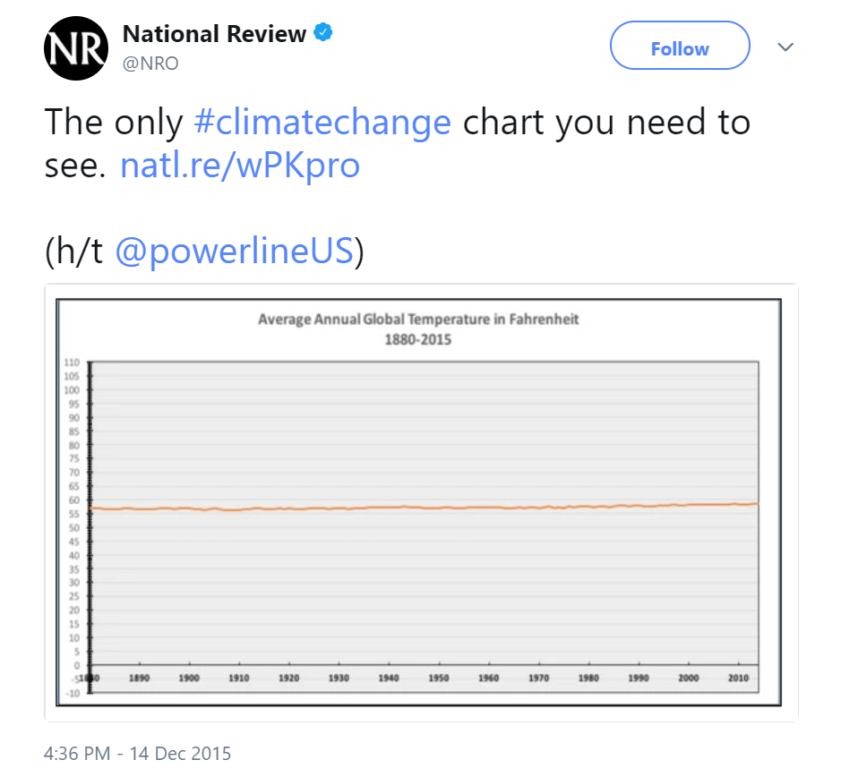
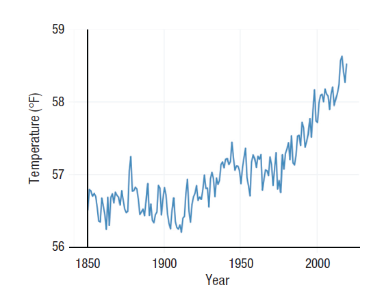
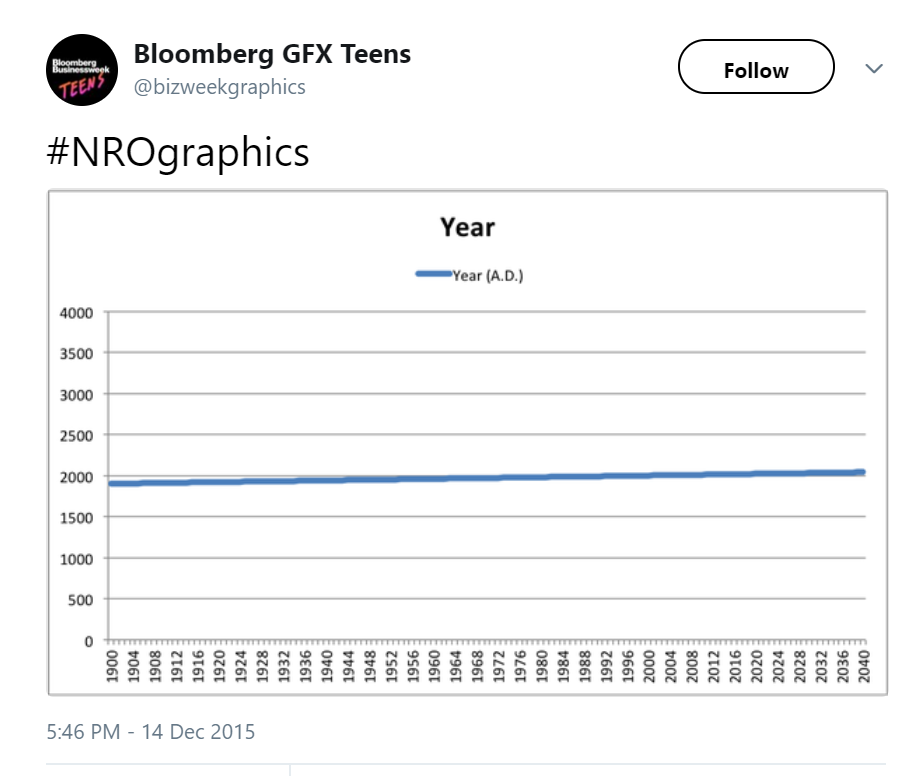
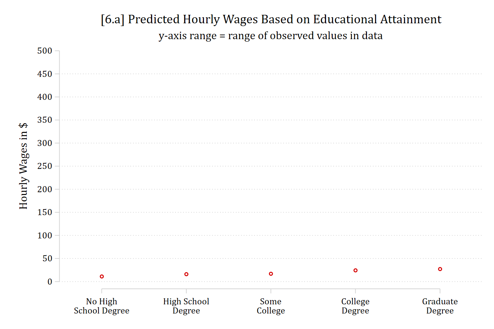
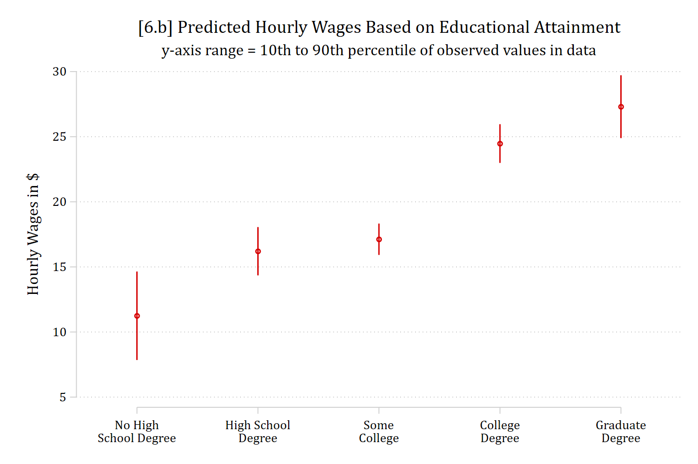
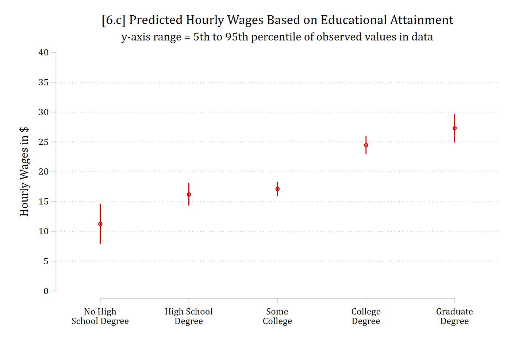
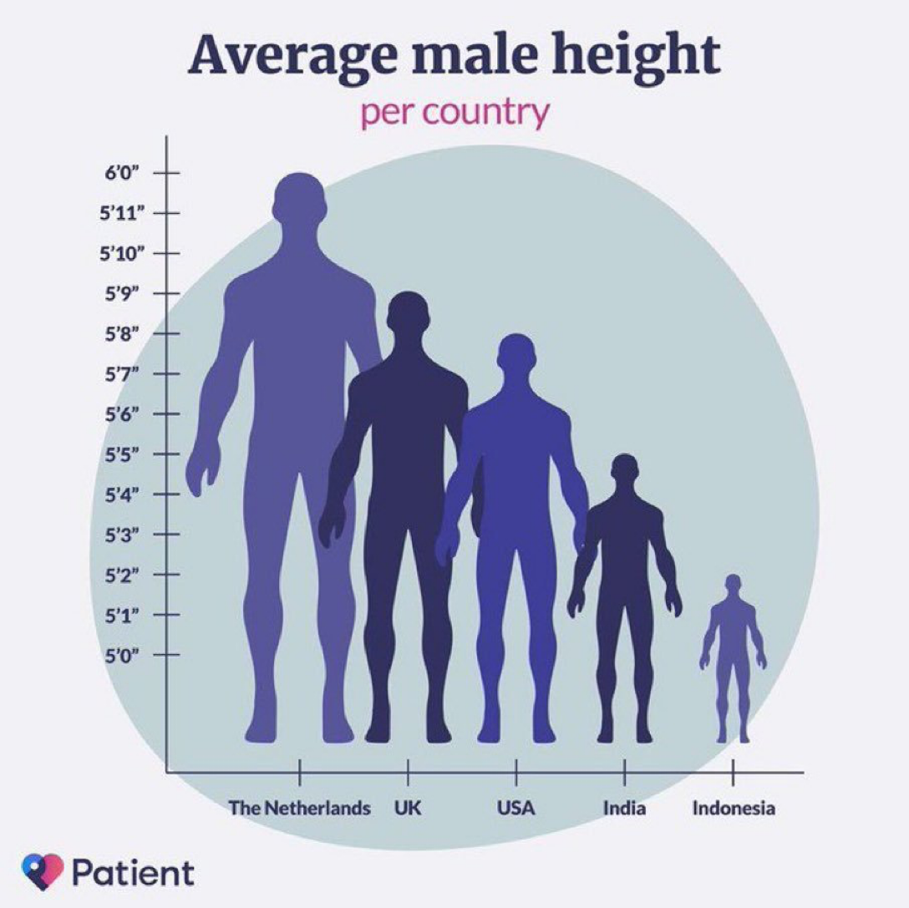

- The "ticks" and gaps on the axes should be clear and logical
  - Balance the readability of the axes with precision/number of ticks
  - More than 2 or 3 decimal places are rarely necessary

## Should your y-axis always start at zero?

{width=70% fig-alt="Headline: The Rise of the Y-Axis-Zero Fundamentalists."}

{width=70% fig-alt="Quartz headline: It's OK not to start your y-axis at zero."}

{width=70% fig-alt="Vox headline: Shut up about the y-axis. It shouldn't always start at zero."}

{width=70% fig-alt="Headline: Your axis doesn't always have to start at zero."}

\*Headlines above from: (1) [Justin Fox](https://byjustinfox.com/2014/12/14/the-rise-of-the-y-axis-zero-fundamentalists/), (2) [Quartz](https://qz.com/418083/its-ok-not-to-start-your-y-axis-at-zero/), (3) [Vox](https://www.vox.com/2015/11/19/9758062/y-axis-zero-chart), and (4) [Axis](http://www.axisgroup.com/your-axis-doesnt-always-have-to-start-at-zero/).

### Are the "y-axis zero fundamentalists" right?

*"Charts should convey information and make a point. We make charts to illustrate ideas that have context beyond their x- and y-axes. Forcing the y-axis to start at zero can do just as much to obscure and confuse the point as the opposite." [(Yanofsky 2015 in Quartz)](https://qz.com/418083/its-ok-not-to-start-your-y-axis-at-zero/)*

:::: {.columns}
::: {.column width="70%"}
- Graphs are tools for *showing the data*
  - The data should always be *accurately and honestly* represented
  - Including zero points on axes does not guarantee accuracy---in fact, it may be less accurate and honest than excluding it!
:::
::: {.column width="30%"}
{fig-alt="A shocked face emoji."}
:::
::::

{width=60% fig-alt="National Review tweet: The only climate change chart you need to see, showing average annual global temperature from 1880 to 2015 as a nearly flat line on a y-axis that starts near zero."}

{width=60% fig-alt="The same global temperature data on a y-axis from 56 to 59 degrees Fahrenheit: a clear rise from 1850 to 2000."}

{width=60% fig-alt="Bloomberg Graphics parody tweet: a line chart of the year itself on a y-axis that starts at zero, which makes the passage of time look like a flat line."}

### Why the y-axis doesn't have to cover the range of the data

*"... there is a lot to be said in favor of showing the data over the range we observe it, rather than forcing every scale to encompass its lowest and highest theoretical value. Many otherwise informative visualizations would become useless if it was mandatory to include a zero point on the x- or y-axis." ([Healy 2018](https://socviz.co/))*

- The most popular (sometimes misguided) rule is to always include zero on your axis
  - The second most popular (sometimes misguided) rule is to have your axis cover the entire observed range in your data
- But consider the following examples predicting hourly wages based on educational attainment
  - Which axis range do you think is most **"truthful"** to represent the story in the data?

::: {.panel-tabset group="language"}
## Stata

```{.stata-run}
. use "https://tdmize.github.io/data/data/addhealth4.dta", clear
(addhealth4_dmv.dta | Add Health Wave IV | DMV Workshop)

. drop if employed != 1
(732 observations deleted)

. 
. sum wages, d

                       Wages Estimate
-------------------------------------------------------------
      Percentiles      Smallest
 1%         2.13           2.13
 5%     2.666667           2.13
10%     5.714286           2.13       Obs               3,575
25%     11.11111           2.13       Sum of wgt.       3,575

50%           16                      Mean             19.666
                        Largest       Std. dev.      23.86499
75%     22.63158            400
90%         32.5       499.9975       Variance       569.5376
95%           40            500       Skewness       11.63459
99%     85.71429            500       Kurtosis       196.9297

. reg wages ibn.educ if employed, nocon

      Source |       SS           df       MS      Number of obs   =     3,575
-------------+----------------------------------   F(5, 3570)      =    529.63
       Model |  1455712.96         5  291142.591   Prob > F        =    0.0000
    Residual |   1962450.8     3,570  549.706106   R-squared       =    0.4259
-------------+----------------------------------   Adj R-squared   =    0.4251
       Total |  3418163.75     3,575  956.129721   Root MSE        =    23.446

-------------------------------------------------------------------------------
        wages | Coefficient  Std. err.      t    P>|t|     [95% conf. interval]
--------------+----------------------------------------------------------------
         educ |
No High Sc..  |     11.248      1.733    6.490   0.000        7.850      14.646
High Schoo..  |     16.204      0.945   17.140   0.000       14.351      18.058
Some College  |     17.123      0.614   27.877   0.000       15.919      18.327
College De..  |     24.474      0.758   32.292   0.000       22.988      25.960
Graduate D..  |     27.307      1.231   22.190   0.000       24.894      29.719
-------------------------------------------------------------------------------

. 
. // 6.a - y-axis covers the observed range in data
. coefplot, noci vertical ylab(0(50)500) ///
>     title("[6.a] Predicted Hourly Wages Based on Educational Attainment") ///
>     subtitle("y-axis range = range of observed values in data") ///
>     ytitle("Hourly Wages in $") ///
>     xlab(1 `" "No High" "School Degree" "' 2 `" "High School" "Degree" "' ///
>     3 `" "Some" "College" "' 4 `" "College" "Degree" "' 5 `" "Graduate" "Degre
> e" "')

```

{width=80% fig-alt="[6.a] Predicted hourly wages for five levels of education on a y-axis from 0 to 500, the full observed range: all five predictions sit near the bottom of the graph and look almost the same."}

## R

```{r}
#| fig-alt: "[6.a] Predicted hourly wages for five levels of education on a y-axis from 0 to 500, the full observed range: all five predictions sit near the bottom of the graph and look almost the same."
library(foreign)            # load Stata datasets
library(ggplot2)            # main graphics package
library(dplyr)              # data manipulation tools
library(cleanplots)         # Mize's graphics scheme

## Use cleanplots colors, markers, lines, and theme for all graphs ##
cleanplots_defaults()
theme_update(plot.title.position = "plot")   # titles start at left edge of graph

# Add Health Wave 4 Data
ah4 <- droplevels(read.dta("https://tdmize.github.io/data/data/addhealth4.dta"))

# Predicted wages by educational attainment (employed young adults)
ah4_emp <- filter(ah4, employed == "Yes", !is.na(educ))

quantile(ah4_emp$wages, c(.05, .10, .90, .95))

# 6.a - y-axis covers the observed range in data
ggplot(ah4_emp, aes(x = educ, y = wages)) +
  stat_summary(fun = mean, geom = "point", size = 3) +
  labs(x = "", y = "Hourly Wages in $",
       title = "[6.a] Predicted Hourly Wages Based on Educational Attainment",
       subtitle = "y-axis range = range of observed values in data") +
  scale_x_discrete(labels = scales::label_wrap(12)) +
  scale_y_continuous(breaks = seq(0, 500, 50), limits = c(0, 500))
```

:::

::: {.panel-tabset group="language"}
## Stata

```{.stata-run}
. // 6.b - y-axis covers the 10th to 90th percentile of data
. coefplot, vertical ylab(5(5)30) ///
>     title("[6.b] Predicted Hourly Wages Based on Educational Attainment") ///
>     subtitle("y-axis range = 10th to 90th percentile of observed values in dat
> a") ///
>     ytitle("Hourly Wages in $") ///
>     xlab(1 `" "No High" "School Degree" "' 2 `" "High School" "Degree" "' ///
>     3 `" "Some" "College" "' 4 `" "College" "Degree" "' 5 `" "Graduate" "Degre
> e" "')

```

{width=80% fig-alt="[6.b] The same predictions with 95% confidence intervals on a y-axis from 5 to 30, the 10th to 90th percentile: wages rise clearly with education, from about 11 dollars with no high school degree to about 27 dollars with a graduate degree."}

## R

```{r}
#| fig-alt: "[6.b] The same predictions with 95% confidence intervals on a y-axis from 5 to 30, the 10th to 90th percentile: wages rise clearly with education, from about 11 dollars with no high school degree to about 27 dollars with a graduate degree."
# 6.b - y-axis covers the 10th to 90th percentile of data
ggplot(ah4_emp, aes(x = educ, y = wages)) +
  stat_summary(fun = mean, geom = "point", size = 3) +
  stat_summary(fun.data = mean_cl_normal, geom = "errorbar", width = .2) +
  labs(x = "", y = "Hourly Wages in $",
       title = "[6.b] Predicted Hourly Wages Based on Educational Attainment",
       subtitle = "y-axis range = 10th to 90th percentile of observed values in data") +
  scale_x_discrete(labels = scales::label_wrap(12)) +
  scale_y_continuous(breaks = seq(5, 30, 5)) + coord_cartesian(ylim = c(5, 30))
```

:::

::: {.panel-tabset group="language"}
## Stata

```{.stata-run}
. // 6.c - y-axis covers the 5th to 95th percentile of data
. coefplot, vertical ylab(0(5)40) ///
>     title("[6.c] Predicted Hourly Wages Based on Educational Attainment") ///
>     subtitle("y-axis range = 5th to 95th percentile of observed values in data
> ") ///
>     ytitle("Hourly Wages in $") ///
>     xlab(1 `" "No High" "School Degree" "' 2 `" "High School" "Degree" "' ///
>     3 `" "Some" "College" "' 4 `" "College" "Degree" "' 5 `" "Graduate" "Degre
> e" "')

```

{width=80% fig-alt="[6.c] The same predictions on a y-axis from 0 to 40, the 5th to 95th percentile: the rise in wages with education is still clear, but the differences look a little smaller than on a 5 to 30 axis."}

## R

```{r}
#| fig-alt: "[6.c] The same predictions on a y-axis from 0 to 40, the 5th to 95th percentile: the rise in wages with education is still clear, but the differences look a little smaller than on a 5 to 30 axis."
# 6.c - y-axis covers the 5th to 95th percentile of data
ggplot(ah4_emp, aes(x = educ, y = wages)) +
  stat_summary(fun = mean, geom = "point", size = 3) +
  stat_summary(fun.data = mean_cl_normal, geom = "errorbar", width = .2) +
  labs(x = "", y = "Hourly Wages in $",
       title = "[6.c] Predicted Hourly Wages Based on Educational Attainment",
       subtitle = "y-axis range = 5th to 95th percentile of observed values in data") +
  scale_x_discrete(labels = scales::label_wrap(12)) +
  scale_y_continuous(breaks = seq(0, 40, 5)) + coord_cartesian(ylim = c(0, 40))
```

:::

### Guidelines for choosing axis values

*"There is emerging research that suggests that perhaps starting bar charts at something other than zero does not bias our perception... participants were better able to assess the sensitivity of the results (e.g., no effect, small effect, medium effect, or big effect) and more accurate (e.g., the size of the effect) when the vertical axis was set at a range more consistent with variation of the data." ([Schwabish 2021](https://cup.columbia.edu/book/better-data-visualizations/9780231193115))*

- My personal rule: the *y*-axis (and usually the *x*-axis as well) should **usually** cover at least the 10^th^ to the 90^th^ percentile of observed values
  - 5^th^ to the 95^th^ percentile is sometimes more appropriate
- Often, what we are trying to communicate is an effect or a difference across groups---not necessarily the exact value of the statistic (tables better for this)
- All these rules are mostly based on the logic of exploratory visualization of all sample values
  - Unclear that these rules work well when applied to model results
    - Sometimes, even more restrictive ranges better represent the data
    - Consider these **"starting rules"**---a good default to choose first, but that should be updated if a different choice better represents the data

### Bad graph levity

{width=50% fig-alt="Infographic of average male height per country, drawn as human silhouettes whose sizes make the differences between countries look much larger than they are."}
