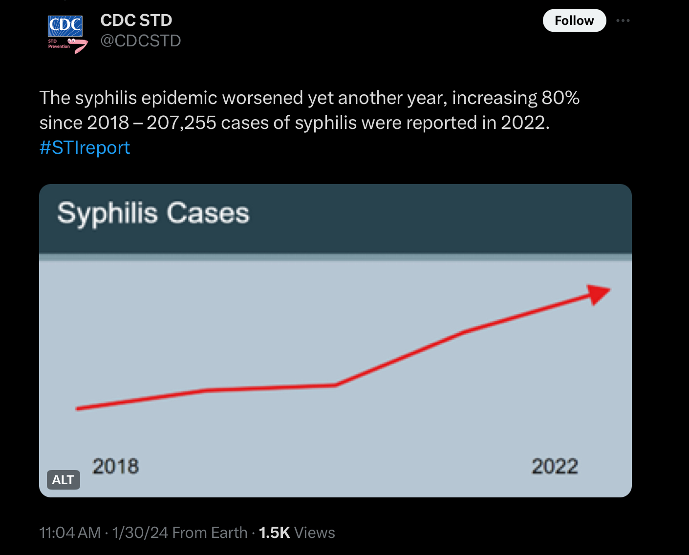
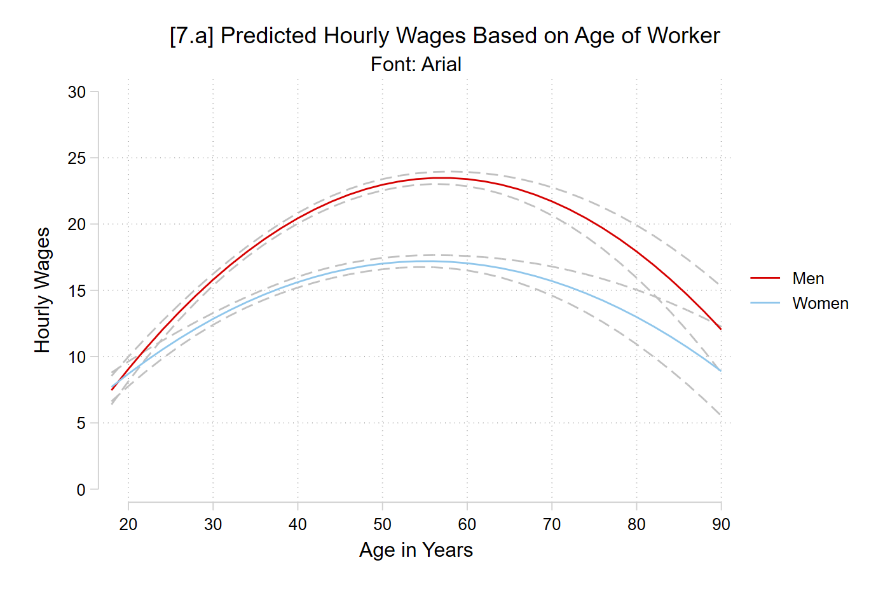
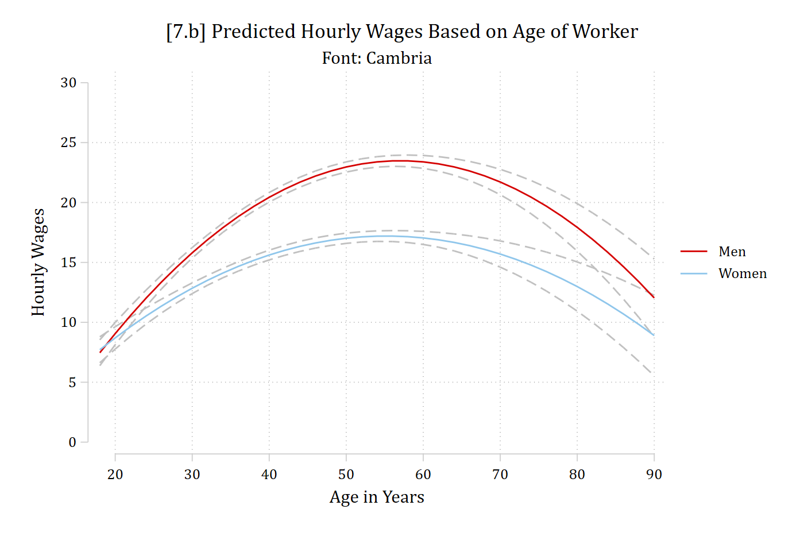
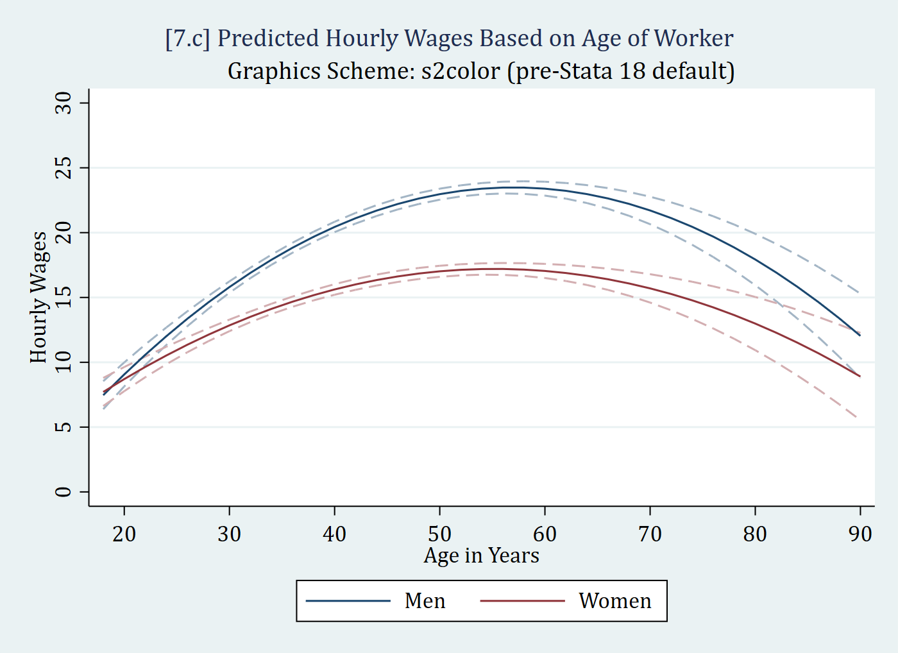
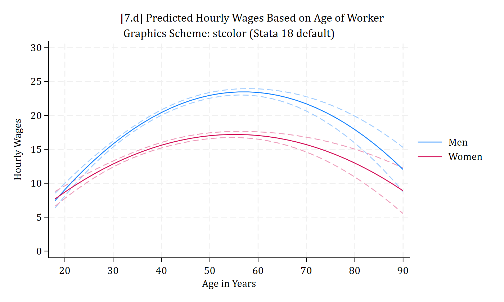
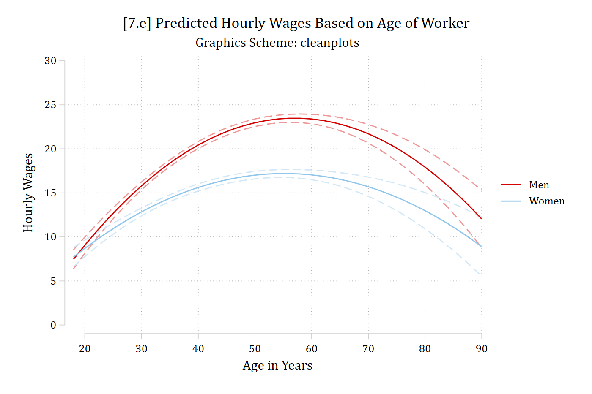
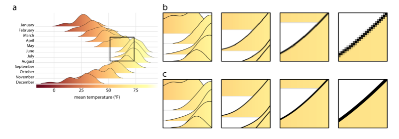

## Titles and axis labels

:::: {.columns}
::: {.column width="55%"}
- All graphs should have a descriptive, informative title
- Both the *x* and *y*-axis should have a substantive label
:::
::: {.column width="45%"}
{fig-alt="CDC tweet with a chart titled Syphilis Cases: a single rising line from 2018 to 2022 with no y-axis labels or values."}
:::
::::

## General advice: talks vs articles

- Font size
  - **Talks**: the font in the graph (titles, labels, axis titles, etc.) should be large enough to be easily read from afar
    - This is larger than you think!
  - **Articles and Slides**: the font size should flow seamlessly with the text of the article/slides\*
    - Smaller, and the graph will be unreadable
    - Larger, and the graph will look out of place
- Titles
  - **Talks**: a clear and descriptive title should be placed within the graph itself (usually at the top of the graph)
  - **Articles**: titles are generally typeset as part of the article---not as part of the graphics file itself, and are generally placed under the graph

\*In R's ggplot2, use **base_size = \#**; in Stata, use **scale(#)** where \# \> 1 to increase all font sizes

## Talks vs articles

*"The clearest conclusion from most of these studies is that tables are best suited for looking up specific information, and graphs are better for perceiving trends and making comparisons and predictions... Subjects who indicated a preference for tables were generally novices: laypersons unused to statistical information or beginning college students. Studies using more sophisticated subjects showed a preference for graphs..." [(Gelman, Pasarica, and Dodhia 2002)](https://www.tandfonline.com/doi/abs/10.1198/000313002317572790)*

- Tables vs graphs
  - **Talks**: keep your audience awake (and aid more rapid interpretation): use graphics whenever possible
  - **Articles**: graphics are more effective for observing patterns and overall relationships; tables for specific numbers
    - I find graphics in the main text and tables in the Online Appendix useful
      - Always helpful to include the table (e.g., a regression table) somewhere just in case a reviewer or editor wants to see specifics (and, useful for meta-analyses)

## General advice: fonts

:::: {.columns}
::: {.column width="65%"}
- Fonts within figures should present the information clearly and not distract from the important part of the figure: the data
- Fonts for graphics should not be too "light" or too thin or they will be difficult to read -- e.g., when there is a single number on an axis: [12345]{style="font-family: 'Eras Light ITC', sans-serif; font-weight: 200;"}
  - They also should not be too "heavy" or compressed, or text can run together: [12345]{style="font-family: Impact, sans-serif; font-weight: bold;"}
    - Note that letters can look very different than numbers for some fonts: [ABCabc 12345 (Georgia font)]{style="font-family: Georgia, serif;"}
:::
::: {.column width="35%"}
{fig-alt="FONT MATTERS! Two sticky notes reading I will always find you: in a hand-drawn font it looks friendly, and in a scrawled font it looks menacing."}
:::
::::

### Serif and sans serif fonts

- I often see recommendations for sans serif fonts with the rationale they are more accessible; this is largely a myth ([APA Style Guide](https://apastyle.apa.org/style-grammar-guidelines/paper-format/accessibility/typography))
  - There are [accessible serif fonts and inaccessible sans serif fonts](https://accessibility.uncg.edu/make-content-accessible/design-elements/)
  - [Tufte (1983)](https://www.edwardtufte.com/tufte/books_vdqi) recommends serif fonts
    - Most journals use serif fonts
      - *"...unify the elements of your presentation. This means consistency in your use of colors and fonts...(etc.)." ([Schwabish 2017](https://cup.columbia.edu/book/better-presentations/9780231175210) p.4)*
  - If using a serif font for graphics: fonts that are relatively minimal/unadorned/have small serifs tend to be more readable
- Some fonts I personally like for graphics, that are accessible to read:
  - **Serif**: Cambria ([download for Mac](https://www.rmtweb.co.uk/calibri-and-cambria-fonts-for-mac)), Times New Roman, Palatino
  - **Sans serif:** Segoe UI ([download for Mac](https://github.com/tejasraman/segoe-ui-macos)), Helvetica ([download for Windows](https://font.download/font/helvetica-255#google_vignette)), Arial, Trebuchet MS
- To make more fonts available in R, use [extrafont](https://cran.r-project.org/web/packages/extrafont/readme/README.html) or [windowsFont](https://www.rdocumentation.org/packages/grDevices/versions/3.6.2/topics/windowsFonts)

```{r}
#| include: false
# Register the fonts for R's Windows graphics device
if (.Platform$OS.type == "windows") {
  windowsFonts(Arial = windowsFont("Arial"), Cambria = windowsFont("Cambria"))
}
```

::: {.panel-tabset group="language"}
## Stata

```{.stata-run}
. use "https://tdmize.github.io/data/data/gss.dta", clear
(gss.dta | GSS 1972 - 2016 Data | DMV Workshop)

. drop if year < 2000
(38,116 observations deleted)

. drop if employed != 1
(9,556 observations deleted)

. 
. qui regress wages c.age##c.age##i.woman i.college i.race

. qui margins, at(age=(18(2)90) woman=(0 1))

. 
. // 7.a - Arial
. graph set window fontface "Arial"

. marginsplot, plotopts(msym(none)) xlab(20(10)90) ylab(0(5)30) ///
>     recastci(rline) ciopts(lpat(dash) col(gs12)) ///
>     ytitle("Hourly Wages") xtitle("Age in Years") ///
>     title("[7.a] Predicted Hourly Wages Based on Age of Worker", size(medium))
>  ///
>     subtitle("Font: Arial")

Variables that uniquely identify margins: age woman

```

{width=80% fig-alt="[7.a] Predicted hourly wages by age for men and women with 95% confidence intervals, with all text in Arial: wages rise to a peak in the mid-50s (about 23 dollars for men and 17 for women) and then fall."}

## R

```{r}
#| fig-alt: "[7.a] Predicted hourly wages by age for men and women with 95% confidence intervals, with all text in Arial: wages rise to a peak in the mid-50s and then fall, and men are predicted to earn more than women at most ages."
library(foreign)            # load Stata datasets
library(ggplot2)            # main graphics package
library(dplyr)              # data manipulation tools
library(marginaleffects)    # predictions and marginal effects
library(cleanplots)         # Mize's graphics scheme

## Use cleanplots colors, markers, lines, and theme for all graphs ##
cleanplots_defaults()
theme_update(plot.title.position = "plot")   # titles start at left edge of graph

# General Social Survey Data
gss <- droplevels(read.dta("https://tdmize.github.io/data/data/gss.dta"))

# Ex graph for font and theme examples
gss_emp <- droplevels(filter(gss, year >= 2000, employed == 1))

wage_int <- lm(wages ~ poly(age, 2, raw = TRUE) * woman + college + race, data = gss_emp)
fig7 <- plot_predictions(wage_int, condition = c("age", "woman")) +
  labs(x = "Age in Years", y = "Hourly Wages", color = "", fill = "",
       title = "[7.#] Predicted Hourly Wages Based on Age of Worker") +
  scale_x_continuous(breaks = seq(20, 90, 10)) +
  scale_y_continuous(breaks = seq(0, 30, 5)) + coord_cartesian(ylim = c(0, 30))

# 7.a - Arial
fig7 + theme(text = element_text(family = "Arial")) +
  labs(title = "[7.a] Predicted Hourly Wages Based on Age of Worker",
       subtitle = "Font: Arial")
```

:::

\*Arial (or Helvetica -- of which it is a clone) looks nice -- but very "default"

::: {.panel-tabset group="language"}
## Stata

```{.stata-run}
. // 7.b - Cambria
. graph set window fontface "Cambria"

. marginsplot, plotopts(msym(none)) xlab(20(10)90) ylab(0(5)30) ///
>     recastci(rline) ciopts(lpat(dash) col(gs12)) ///
>     ytitle("Hourly Wages") xtitle("Age in Years") ///
>     title("[7.b] Predicted Hourly Wages Based on Age of Worker", size(medium))
>  ///
>     subtitle("Font: Cambria")

Variables that uniquely identify margins: age woman

```

{width=80% fig-alt="[7.b] The same graph of predicted hourly wages by age for men and women, with all text in Cambria."}

## R

```{r}
#| fig-alt: "[7.b] The same graph of predicted hourly wages by age for men and women, with all text in Cambria."
# 7.b - Cambria
fig7 + theme(text = element_text(family = "Cambria")) +
  labs(title = "[7.b] Predicted Hourly Wages Based on Age of Worker",
       subtitle = "Font: Cambria")
```

:::

\*Cambria is my normal go-to font for slides and graphics

::: {.callout-note icon="false" appearance="simple"}
In Stata, **graph set** changes the font for all later graphs. To go back to Stata's default: **graph set window fontface default**
:::

### Graphics schemes in Stata

- Stata's graphics unfairly have a bad reputation
  - Stata's graphical capabilities are *impressive* and *flexible*
  - Stata's *default* graphics choices (pre-Stata 18) *were not great*
- Stata has many graphics schemes other than its pre-18 default (**s2color**)
  - Stata 18's default scheme (**stcolor**) is much better
    - See examples of additional built-in schemes [here](https://www.stata.com/manuals/g-4schemesintro.pdf)
- Some nice user-written schemes exist that work well
  - The [**blindschemes**](https://danbischof.com/2015/02/04/stata-figure-schemes/) package comes with multiple schemes with nice properties (these are primarily modeled after R's ggplot2's themes)
  - The [**schemepack**](https://github.com/asjadnaqvi/Stata-schemes) package has many excellent schemes
- [**cleanplots**](/software/cleanplots/index.qmd) is a scheme I wrote to implement the best practices outlined in this workshop
  - All the graphics made for this workshop use **cleanplots**

### Graphics themes in R

- Base R's default graphics theme leaves much to be desired
  - **ggplot2**'s default theme (**theme_gray**) is much better, but still imperfect
  - The good news is there are good additional options built into **ggplot2**
- You can change a theme on a single graph by specifying it as an element on a **ggplot2** graph. E.g.,

  ```r
  fig1 + theme_gray( )
  ```

- I prefer to set the theme at the top of my R file using [**theme_set( )**](https://ggplot2.tidyverse.org/reference/theme_get.html) so the same theme will apply to all graphs

  ```r
  theme_set(theme_minimal())
  ```

- My favorite built-in **ggplot** theme is **theme_minimal**
- My [**cleanplots** theme](/software/cleanplots_r/index.qmd) is also available for R and works with **ggplot**
  - See R versions of all plots in these slides in the R tabs on these pages

::: {.panel-tabset group="language"}
## Stata

```{.stata-run}
. // 7.c - s2color (pre-Stata 18 default)
. marginsplot, plotopts(msym(none)) xlab(20(10)90) ylab(0(5)30) ///
>     recastci(rline) ciopts(lpat(dash) col(*.4)) ///
>     ytitle("Hourly Wages") xtitle("Age in Years") ///
>     title("[7.c] Predicted Hourly Wages Based on Age of Worker", size(medium))
>  ///
>     subtitle("Graphics Scheme: s2color (pre-Stata 18 default)") scheme(s2color
> )

Variables that uniquely identify margins: age woman

```

{width=80% fig-alt="[7.c] The predicted wages graph in Stata's s2color scheme: a blue-gray background around the plot, dark blue and maroon lines, vertical y-axis labels, and the legend below the graph."}

## R

```{r}
#| fig-alt: "[7.c] The predicted wages graph in ggplot2's default theme_gray: a gray plot background with white gridlines and ggplot2's default colors."
# 7.c - ggplot2's default theme and colors
fig7 + theme_gray() + scale_color_hue() + scale_fill_hue() +
  labs(title = "[7.c] Predicted Hourly Wages Based on Age of Worker",
       subtitle = "Graphics theme: theme_gray (ggplot2 default)")
```

:::

::: {.panel-tabset group="language"}
## Stata

```{.stata-run}
. // 7.d - stcolor (Stata 18 default)
. marginsplot, plotopts(msym(none)) xlab(20(10)90) ylab(0(5)30) ///
>     recastci(rline) ciopts(lpat(dash) col(*.4)) ///
>     ytitle("Hourly Wages") xtitle("Age in Years") ///
>     title("[7.d] Predicted Hourly Wages Based on Age of Worker", size(medium))
>  ///
>     subtitle("Graphics Scheme: stcolor (Stata 18 default)") scheme(stcolor)

Variables that uniquely identify margins: age woman

```

{width=80% fig-alt="[7.d] The predicted wages graph in Stata's stcolor scheme: a white background with a blue line for men and a magenta line for women, and the legend to the right."}

## R

```{r}
#| fig-alt: "[7.d] The predicted wages graph in ggplot2's theme_minimal: a white background with light gridlines and no axis lines."
# 7.d - theme_minimal
fig7 + theme_minimal() + scale_color_hue() + scale_fill_hue() +
  labs(title = "[7.d] Predicted Hourly Wages Based on Age of Worker",
       subtitle = "Graphics theme: theme_minimal")
```

:::

::: {.panel-tabset group="language"}
## Stata

```{.stata-run}
. // 7.e - cleanplots
. marginsplot, plotopts(msym(none)) xlab(20(10)90) ylab(0(5)30) ///
>     recastci(rline) ciopts(lpat(dash) col(*.4)) ///
>     ytitle("Hourly Wages") xtitle("Age in Years") ///
>     title("[7.e] Predicted Hourly Wages Based on Age of Worker", size(medium))
>  ///
>     subtitle("Graphics Scheme: cleanplots") scheme(cleanplots)

Variables that uniquely identify margins: age woman

```

{width=80% fig-alt="[7.e] The predicted wages graph in the cleanplots scheme: a white background with a light dotted grid, a red line for men and a light blue line for women, horizontal axis labels, and the legend to the right."}

## R

```{r}
#| fig-alt: "[7.e] The predicted wages graph in the cleanplots theme: a white background with a light dotted grid, a red line for men and a light blue line for women, and the legend to the right."
# 7.e - cleanplots (the default after cleanplots_defaults())
fig7 +
  labs(title = "[7.e] Predicted Hourly Wages Based on Age of Worker",
       subtitle = "Graphics theme: cleanplots")
```

:::

## General advice: graphics file formats

- Always save your graphs as image files; do not copy from the Stata or R console
  - I generally recommend PNG files
    - PNG works well across platforms (Word, PowerPoint, websites; Windows, Mac; etc.)
    - Avoid JPEG: JPEGs are optimized for photographs, not graphs
- Vector graphics formats---PDF, EPS, and EMF---have some advantages but also some disadvantages
  - Advantage: they rescale without pixelating
  - Disadvantage: they are redrawn each time they are opened, so can look different across platforms (e.g., the original font may not be available)

:::: {.columns}
::: {.column width="70%"}
{fig-alt="Illustration of the difference between bitmap and vector graphics: when magnified, the bitmap version of a curve becomes jagged and blurry while the vector version stays smooth."}
:::
::: {.column width="30%"}
::: {.callout-note icon="false" appearance="simple"}
[Wilke 2019](https://clauswilke.com/dataviz/index.html)
:::
:::
::::
