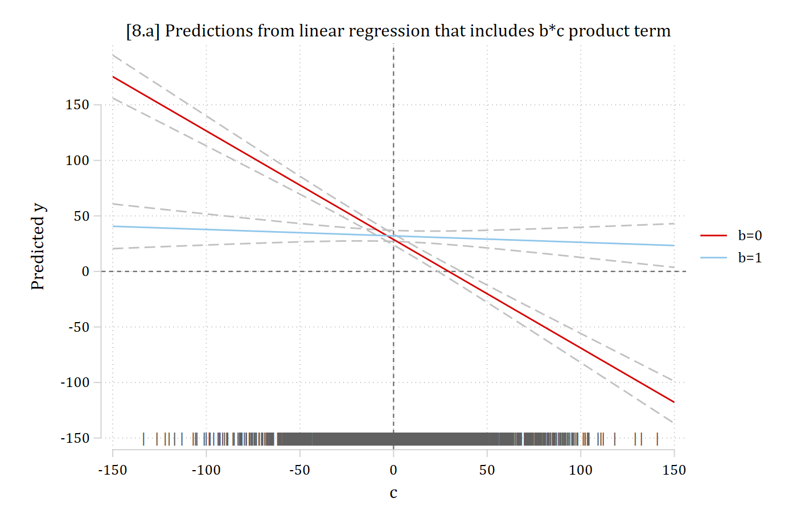
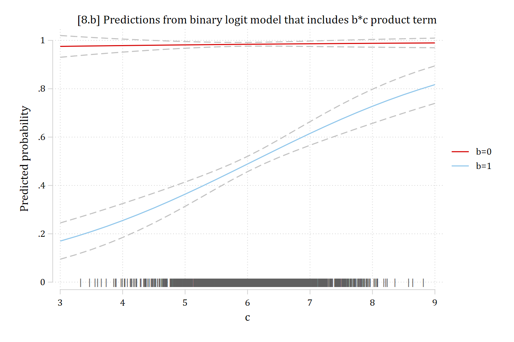
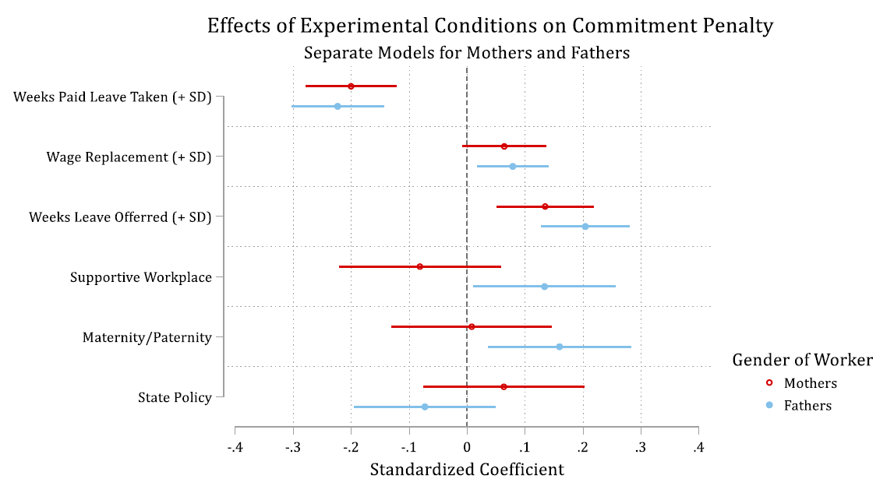
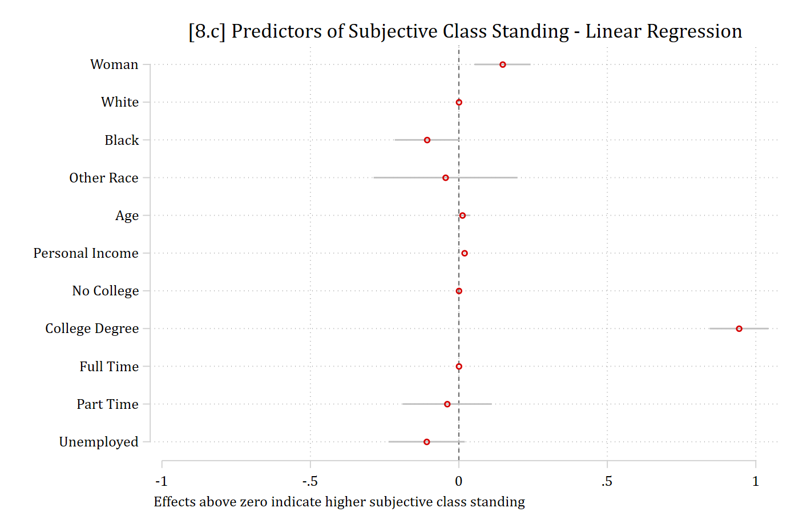
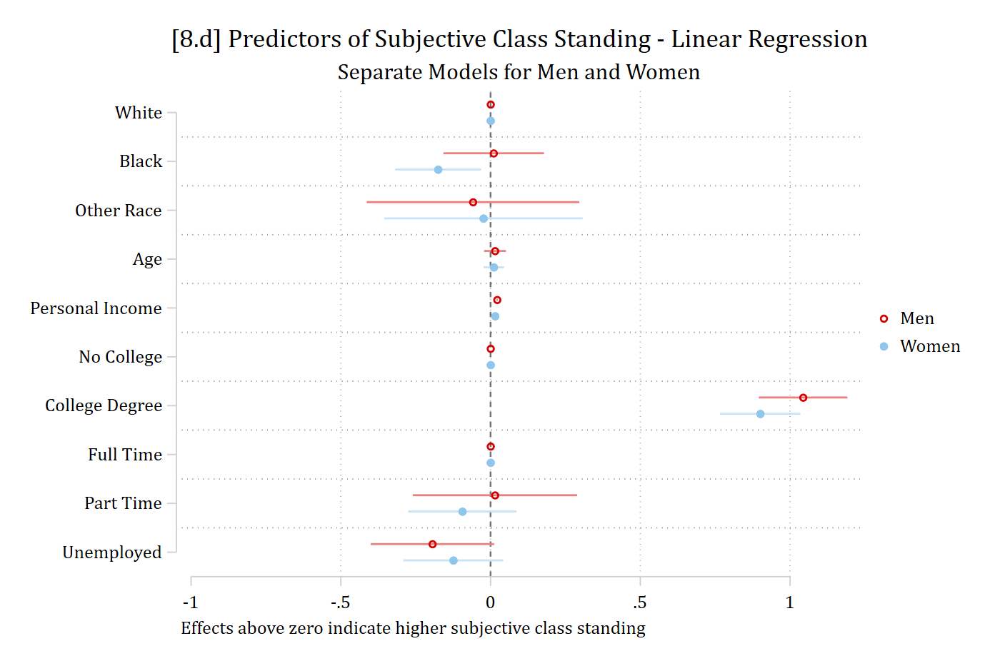
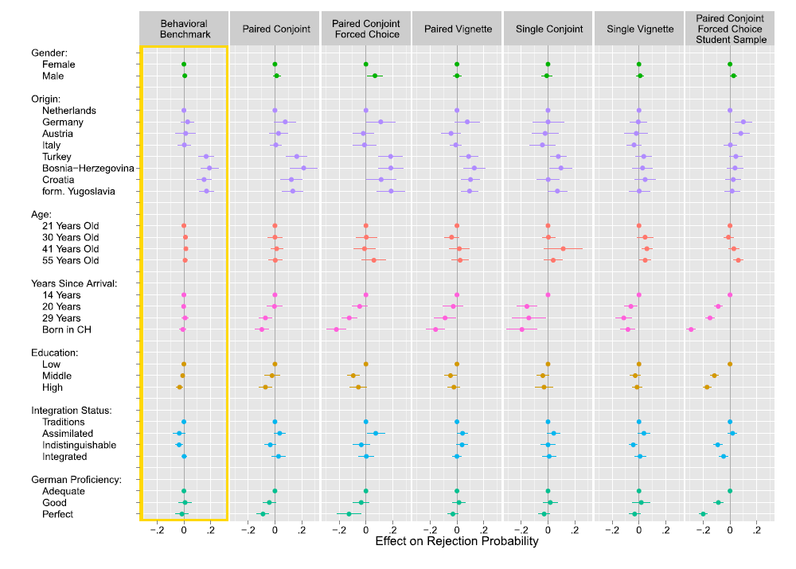
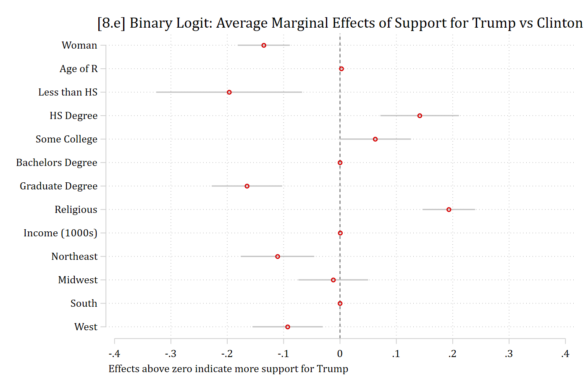

## Why visualize model results?

*"One great virtue of good graphical representation is that it can serve to display clearly and effectively a message carried by quantities whose calculation or observation is far from simple." ([Tukey and Wilk 1966](https://dl.acm.org/doi/pdf/10.1145/1464291.1464366?casa_token=i-jmHvnwKxcAAAAA:ZzNmerZ_W8OrCZA3n0N-5D-mPDAa-Ahossv9T2q41arvb26ynyVjVYhrpo4lBJzqDDALvzlYpq2ibQ))*

- Visualizing data can simplify complex relationships
  - Visualizations often synthesize large amounts of information succinctly; relationships/patterns become clear visually
- Visualizations make your data more accessible and memorable (bonus: nice visualizations make your audience less likely to fall asleep!)
  - *"The more visual the input becomes, the more likely it is to be recognized and recalled." ([Medina 2008](https://brainrules.net/))*

### Can you extract the sunbeams from these cucumbers?

::: {.panel-tabset group="language"}
## Stata

```{.stata-run}
. ** Ex 1: Linear Regression with Interaction
. use "https://tdmize.github.io/data/data/dmv_intsim01.dta", clear

. 
. qui regress y b c

. estimates store mod1a

. 
. qui regress y c.c##i.b

. estimates store mod1b

. 
. qui regress y c.c##i.b x1

. estimates store mod1c

. 
. esttab mod1a mod1b mod1c, noomit nobase se ///
>     title("Linear interaction models")

Linear interaction models
------------------------------------------------------------
                      (1)             (2)             (3)   
                        y               y               y   
------------------------------------------------------------
b                   4.600                                   
                  (3.657)                                   

c                  -0.537***       -0.978***       -0.978***
                 (0.0465)        (0.0629)        (0.0629)   

1.b                                 3.107           3.199   
                                  (3.571)         (3.574)   

1.b#c.c                             0.920***        0.920***
                                 (0.0908)        (0.0908)   

x1                                                 -1.204   
                                                  (1.786)   

_cons               28.19***        28.86***        28.81***
                  (2.587)         (2.525)         (2.526)   
------------------------------------------------------------
N                    2000            2000            2000   
------------------------------------------------------------
Standard errors in parentheses
* p<0.05, ** p<0.01, *** p<0.001

```

## R

```{r}
library(foreign)            # load Stata datasets
library(ggplot2)            # main graphics package
library(dplyr)              # data manipulation tools
library(marginaleffects)    # predictions and marginal effects
library(modelsummary)       # coefficient plots & nice tables
library(cleanplots)         # Mize's graphics scheme

## Use cleanplots colors, markers, lines, and theme for all graphs ##
cleanplots_defaults()
theme_update(plot.title.position = "plot")   # titles start at left edge of graph

# Simulated data for interaction exs
intsim01 <- read.dta("https://tdmize.github.io/data/data/dmv_intsim01.dta")

# b is a binary (0/1) group variable
intsim01$b <- factor(intsim01$b)

## Ex 1: Linear Regression with Interaction ##
mod1a <- lm(y ~ b + c, data = intsim01)
mod1b <- lm(y ~ b * c, data = intsim01)
mod1c <- lm(y ~ b * c + x1, data = intsim01)
modelsummary(list(mod1a, mod1b, mod1c), stars = TRUE)
```

:::

**Some sunbeams of interest**: (1) Is there an interaction effect between *b* and *c*? (2) Is the effect of *c* (when *b* = 0) positive or negative? (3) Is the effect of *c* (when *b* = 1) positive or negative? (4) Where across the range of *c* is the difference between *b* = 0 and *b* = 1 statistically significant? (5) Where is the observed data?

::: {.panel-tabset group="language"}
## Stata

```{.stata-run}
. // 8.a - Plot the predictions
. estimates restore mod1c
(results mod1c are active now)

. qui margins, at(c=(-150(5)150) b=(0 1))

. 
. *Generate variables to make rugs on plot
. gen pipe = "|" if c != .     // What rug looks like

. gen where = -150             // Where on y-axis to put rug

. 
. marginsplot, ///
>     recastci(rline) ciopt(lpat(dash) col(gs12)) plotopt(msym(none)) ///
>     addplot(scatter where c, ms(none) mlabel(pipe) mlabcol(gs6) ///
>     xlab(-150(50)150) ylab(-150(50)150) xline(0) yline(0) legend(order(3 "b=0"
>  4 "b=1"))) ///
>     title("[8.a] Predictions from linear regression that includes b*c product 
> term") ///
>     ytitle("Predicted y") xtitle("c")

Variables that uniquely identify margins: c b

```

{width=80% fig-alt="[8.a] Predicted y across c from -150 to 150 for b = 0 and b = 1, with 95% confidence intervals and a rug of the observed c values along the bottom: for b = 0 the prediction falls steeply from about 175 to about -120, for b = 1 it is nearly flat around 30, and the lines cross near c = 0."}

## R

```{r}
#| fig-alt: "[8.a] Predicted y across c for b = 0 and b = 1, with 95% confidence intervals and a rug of the observed c values along the bottom: for b = 0 the prediction falls steeply, for b = 1 it is nearly flat, and the lines cross near c = 0."
# 8.a - Plot the predictions
plot_predictions(mod1c, condition = c("c", "b")) +
  geom_rug(data = intsim01, mapping = aes(x = c), sides = "b", alpha = 0.3,
           inherit.aes = FALSE) +
  geom_hline(yintercept = 0) +
  labs(x = "c", y = "Predicted y", color = "b", fill = "b",
       title = "[8.a] Predictions from linear regression that includes b*c product term")
```

:::

### Can you extract the sunbeams from these cucumbers?

::: {.panel-tabset group="language"}
## Stata

```{.stata-run}
. ** Ex 2: Binary Logit with Interaction
. use "https://tdmize.github.io/data/data/dmv_intsim02.dta", clear

. 
. qui logit y b c

. estimates store mod2a

. 
. qui logit y c.c##i.b

. estimates store mod2b

. 
. qui logit y c.c##i.b x1

. estimates store mod2c

. 
. esttab mod2a mod2b mod2c, noomit nobase se ///
>     title("Logit interaction models")

Logit interaction models
------------------------------------------------------------
                      (1)             (2)             (3)   
                        y               y               y   
------------------------------------------------------------
y                                                           
b                  -4.225***                                
                  (0.262)                                   

c                   0.487***        0.147           0.148   
                 (0.0832)         (0.313)         (0.313)   

1.b                                -6.363**        -6.366** 
                                  (1.950)         (1.950)   

1.b#c.c                             0.366           0.367   
                                  (0.325)         (0.325)   

x1                                                -0.0575   
                                                 (0.0622)   

_cons               1.257*          3.238           3.235   
                  (0.539)         (1.877)         (1.877)   
------------------------------------------------------------
N                    2000            2000            2000   
------------------------------------------------------------
Standard errors in parentheses
* p<0.05, ** p<0.01, *** p<0.001

```

## R

```{r}
# Simulated data for interaction exs
intsim02 <- read.dta("https://tdmize.github.io/data/data/dmv_intsim02.dta")
intsim02$b <- factor(intsim02$b)

## Ex 2: Binary Logit with Interaction ##
mod2a <- glm(y ~ b + c, family = binomial, data = intsim02)
mod2b <- glm(y ~ b * c, family = binomial, data = intsim02)
mod2c <- glm(y ~ b * c + x1, family = binomial, data = intsim02)
modelsummary(list(mod2a, mod2b, mod2c), stars = TRUE)
```

:::

**Some sunbeams of interest**: (1) Is there an interaction effect between *b* and *c*? (2) Is the effect of *c* (when *b* = 0) positive or negative? (3) Is the effect of *c* (when *b* = 1) positive or negative? (4) Where across the range of *c* is the difference between *b* = 0 and *b* = 1 statistically significant? (5) Where is the observed data?

::: {.panel-tabset group="language"}
## Stata

```{.stata-run}
. // 8.b - Plot the predictions
. estimates restore mod2c
(results mod2c are active now)

. qui margins, at(c=(3(.25)9) b=(0 1))

. 
. *Generate variables to make rugs on plot
. gen pipe = "|" if c != .     // What rug looks like

. gen where = 0                // Where on y-axis to put rug

. 
. marginsplot, ///
>     recastci(rline) ciopt(lpat(dash) col(gs12)) plotopt(msym(none)) ///
>     addplot(scatter where c, ms(none) mlabel(pipe) mlabcol(gs6) ///
>         xlab(3(1)9) ylab(0(.2)1) legend(order(3 "b=0" 4 "b=1"))) ///
>     title("[8.b] Predictions from binary logit model that includes b*c product
>  term") ///
>     ytitle("Predicted probability") xtitle("c")

Variables that uniquely identify margins: c b

```

{width=80% fig-alt="[8.b] Predicted probabilities across c from 3 to 9 for b = 0 and b = 1, with 95% confidence intervals and a rug of the observed c values: for b = 0 the probability is flat near 1, while for b = 1 it rises steadily from about .17 to about .82."}

## R

```{r}
#| fig-alt: "[8.b] Predicted probabilities across c for b = 0 and b = 1, with 95% confidence intervals and a rug of the observed c values: for b = 0 the probability is flat near 1, while for b = 1 it rises steadily."
# 8.b - Plot the predictions
plot_predictions(mod2c, condition = c("c", "b"), rug = TRUE) +
  labs(x = "c", y = "Predicted probability", color = "b", fill = "b",
       title = "[8.b] Predictions from binary logit model that includes b*c product term")
```

:::

\*Curious how this is possible? See [Mize 2019](https://sociologicalscience.com/articles-v6-4-81/) on nonlinear interaction effects

### Giant regression tables in talks = ☹

```{.stata-output}
[11.0] Linear Regression Results - Log Hourly Wages
-----------------------------------------------------------------------------------------------------------
                              (1)                          (2)                          (3)
-----------------------------------------------------------------------------------------------------------
Woman R                     -0.37***       (0.01)        -0.37***       (0.01)        -0.36***       (0.01)
high school                                               0.36***       (0.01)         0.35***       (0.01)
junior college                                            0.57***       (0.02)         0.56***       (0.02)
bachelor                                                  0.78***       (0.02)         0.76***       (0.02)
graduate                                                  1.02***       (0.02)         0.98***       (0.02)
black                                                    -0.08***       (0.01)        -0.03*         (0.01)
other                                                    -0.05**        (0.02)        -0.07***       (0.02)
age of respondent                                         0.01***       (0.00)         0.01***       (0.00)
Currently Married                                                                      0.15***       (0.01)
Number of Children                                                                    -0.00          (0.00)
catholic                                                                               0.05***       (0.01)
jewish                                                                                 0.17***       (0.03)
none                                                                                   0.01          (0.01)
other                                                                                  0.01          (0.03)
buddhism                                                                               0.06          (0.07)
hinduism                                                                               0.25*         (0.10)
other eastern                                                                          0.38*         (0.17)
moslem/islam                                                                          -0.29**        (0.10)
orthodox-christian                                                                     0.07          (0.10)
christian                                                                             -0.01          (0.04)
native american                                                                        0.01          (0.20)
inter-nondenominat~l                                                                  -0.05          (0.08)
Lives in Metro Area                                                                    0.05***       (0.01)
Midwest                                                                               -0.09***       (0.01)
South                                                                                 -0.13***       (0.01)
West                                                                                  -0.04**        (0.01)
Constant                     2.65***       (0.01)         1.61***       (0.02)         1.61***       (0.02)
-----------------------------------------------------------------------------------------------------------
Observations                31102                        31021                        30876
-----------------------------------------------------------------------------------------------------------
Standard errors in parentheses
* p<0.05, ** p<0.01, *** p<0.001
```

{width=30% fig-alt="Nancy Reagan speaking at a podium with a sign that reads Just say no."}

## Coefficient plots

- Coefficient plots are very effective for replacing regression tables (of coefficients) in talks and (sometimes) in articles/reports
  - Coefficient plots also display multiple model results better than tables--- making it easy to compare estimates across models
    - Measures of uncertainty (e.g., CIs) are also easily incorporated and visually easily processed

:::: {.columns}
::: {.column width="70%"}
{fig-alt="Published coefficient plot: effects of experimental conditions on commitment penalty, with separate estimates and confidence intervals for mothers and fathers."}
:::
::: {.column width="30%"}
::: {.callout-note icon="false" appearance="simple"}
Figure 1 from [Petts, Mize, and Kaufman 2022](https://drive.google.com/file/d/1jx7l6Rl9AbR4_YRxJZPwqWG-F0Ti1lgJ/view?usp=sharing)
:::
:::
::::

::: {.panel-tabset group="language"}
## Stata

```{.stata-run}
. use "https://tdmize.github.io/data/data/addhealth4.dta", clear
(addhealth4_dmv.dta | Add Health Wave IV | DMV Workshop)

. 
. // 8.c - Coefficients from a linear regression model
. qui regress subjclass i.woman i.race3 c.age c.income i.college i.workstat

. 
. coefplot, xline(0) xlab(-1(.5)1) baselevels ciop(col(gs12)) drop(_cons 0.woman
> ) ///
>     title("[8.c] Predictors of Subjective Class Standing - Linear Regression")
>  ///
>     note("Effects above zero indicate higher subjective class standing")

```

{width=80% fig-alt="[8.c] Coefficient plot of predictors of subjective class standing with 95% confidence intervals and a dashed line at zero: having a college degree has by far the largest effect (about 0.94), women are slightly higher (about 0.15), and the other effects are near zero."}

## R

```{r}
#| fig-alt: "[8.c] Coefficient plot of predictors of subjective class standing with 95% confidence intervals and a dashed line at zero: having a college degree has by far the largest effect, women are slightly higher, and the other effects are near zero."
# Add Health Wave 4 Data
ah4 <- droplevels(read.dta("https://tdmize.github.io/data/data/addhealth4.dta"))

# Subjective class standing is a 1 to 10 scale
ah4$subjclass <- as.numeric(ah4$subjclass)

# 8.c - Coefficients from a linear regression model
reg_sc <- lm(subjclass ~ woman + race3 + age + income + college + workstat, data = ah4)

modelplot(reg_sc, coef_omit = "Intercept") +
  geom_vline(xintercept = 0, linetype = "dashed", color = "gray20") +
  scale_x_continuous(breaks = seq(-1, 1.5, .5)) +
  scale_y_discrete(limits = rev) +
  labs(title = "[8.c] Predictors of Subjective Class Standing - Linear Regression",
       caption = "Effects above zero indicate higher subjective class standing")
```

:::

::: {.panel-tabset group="language"}
## Stata

```{.stata-run}
. // 8.d - Separate models for men and women
. qui regress subjclass i.race3 c.age c.income i.college i.workstat if woman == 
> 0

. est store scmen

. 
. qui regress subjclass i.race3 c.age c.income i.college i.workstat if woman == 
> 1

. est store scwom

. 
. coefplot (scmen, label("Men")) (scwom, label("Women")), ///
>     xline(0) xlab(-1(.5)1) baselevels ciop(col(*.5)) drop(*_cons) ///
>     title("[8.d] Predictors of Subjective Class Standing - Linear Regression")
>  ///
>     subtitle("Separate Models for Men and Women") ///
>     note("Effects above zero indicate higher subjective class standing")

```

{width=80% fig-alt="[8.d] Coefficient plot with separate estimates for men (red) and women (light blue) side by side for each predictor: the college degree effect is large for both (about 1.04 for men and 0.90 for women), and the other effects are small for both."}

## R

```{r}
#| fig-alt: "[8.d] Coefficient plot with separate estimates for men and women side by side for each predictor: the college degree effect is large for both, and the other effects are small for both."
# 8.d - Fit separate models for men and women
reg_men <- lm(subjclass ~ race3 + age + income + college + workstat,
              data = subset(ah4, woman == "Man"))
reg_wom <- lm(subjclass ~ race3 + age + income + college + workstat,
              data = subset(ah4, woman == "Woman"))

mp_gender <- modelplot(list("Men" = reg_men, "Women" = reg_wom),
                       coef_omit = "Intercept", draw = FALSE)

ggplot(mp_gender, aes(x = estimate, y = term, color = model)) +
  geom_linerange(aes(xmin = conf.low, xmax = conf.high), alpha = .5,
                 position = position_dodge(width = .5)) +
  geom_point(size = 2.5, position = position_dodge(width = .5)) +
  geom_vline(xintercept = 0, linetype = "dashed", color = "gray20") +
  scale_x_continuous(breaks = seq(-1, 1.5, .5)) +
  scale_y_discrete(limits = rev) +
  labs(x = "Coefficient estimates and 95% confidence intervals", y = "", color = "",
       title = "[8.d] Predictors of Subjective Class Standing - Linear Regression",
       subtitle = "Separate Models for Men and Women",
       caption = "Effects above zero indicate higher subjective class standing")
```

:::

### Published example

{width=80% fig-alt="Published figure: coefficient plots of the effects of immigrant attributes on the probability of being preferred for admission, one panel for each survey design."}

Figure 1 from [Hainmueller, Hangartner, and Yamamoto 2015](https://doi.org/10.1073/pnas.1416587112)

### Coefficient plots: not just for coefficients

- Increasingly, most health and social science fields are moving towards reporting marginal effects for categorical models instead of coefficients
- A "coefficient plot" can be used to plot any effect

::: {.panel-tabset group="language"}
## Stata

```{.stata-run}
. use "https://tdmize.github.io/data/data/pew16.dta", clear
(pew16_dmv.dta | Pew 2016 Pre-Election Data | DMV Workshop)

. 
. qui logit trump i.woman c.age ib4.educ i.religB c.income ib3.region, or

. 
. * Average marginal effects (AMEs) for all predictors
. margins, dydx(*) post

Average marginal effects                                 Number of obs = 1,604
Model VCE: OIM

Expression: Pr(trump), predict()
dy/dx wrt:  1.woman age 1.educ 2.educ 3.educ 5.educ 1.religB income 1.region
            2.region 4.region

-------------------------------------------------------------------------------
              |            Delta-method
              |      dy/dx   std. err.      z    P>|z|     [95% conf. interval]
--------------+----------------------------------------------------------------
        woman |
       Woman  |     -0.135      0.024   -5.742   0.000       -0.181      -0.089
          age |      0.002      0.001    3.576   0.000        0.001       0.004
              |
         educ |
Less than HS  |     -0.197      0.066   -2.981   0.003       -0.326      -0.067
   HS Degree  |      0.141      0.036    3.978   0.000        0.072       0.211
Some College  |      0.062      0.032    1.931   0.053       -0.001       0.126
Graduate D..  |     -0.165      0.032   -5.176   0.000       -0.228      -0.103
              |
       religB |
   Religious  |      0.193      0.024    8.121   0.000        0.146       0.240
       income |      0.000      0.000    1.761   0.078       -0.000       0.001
              |
       region |
   Northeast  |     -0.111      0.033   -3.335   0.001       -0.176      -0.046
     Midwest  |     -0.012      0.032   -0.379   0.705       -0.074       0.050
        West  |     -0.093      0.032   -2.926   0.003       -0.155      -0.031
-------------------------------------------------------------------------------
Note: dy/dx for factor levels is the discrete change from the base level.

. est store ames

. 
. // 8.e - Coefficient plot of the AMEs
. coefplot ames, xline(0) xlab(-.4(.1).4) ciop(col(gs12)) ///
>     baselevels drop(0.woman 0.religB) ///
>     title("[8.e] Binary Logit: Average Marginal Effects of Support for Trump v
> s Clinton") ///
>     note("Effects above zero indicate more support for Trump")

```

{width=80% fig-alt="[8.e] Plot of the average marginal effects on support for Trump vs Clinton with 95% confidence intervals: being religious (about .19) and having a high school degree (about .14) increase support, while being a woman (about -.14), having less than high school (about -.20) or a graduate degree (about -.17), and living in the Northeast or West decrease it."}

## R

```{r}
#| fig-alt: "[8.e] Plot of the average marginal effects on support for Trump vs Clinton with 95% confidence intervals: being religious and having a high school degree increase support, while being a woman, having less than high school or a graduate degree, and living in the Northeast or West decrease it."
# Pew 2016 election data
pew <- droplevels(read.dta("https://tdmize.github.io/data/data/pew16.dta"))

# Bachelor's degree and the South as reference groups (as in Stata ex)
pew$educ   <- relevel(pew$educ, ref = "Bachelors Degree")
pew$region <- relevel(pew$region, ref = "South")

logit_trump <- glm(trump ~ woman + age + educ + religB + income + region,
                   family = binomial, data = pew)

# Average marginal effects (AMEs) for all predictors
ames <- avg_slopes(logit_trump)
ames

# Nominal predictors in the model: rename the estimates so each is unique
ames$term <- paste(ames$term, ames$contrast)

# 8.e - Coefficient plot of the AMEs
modelplot(ames) +
  geom_vline(xintercept = 0, linetype = "dashed", color = "gray20") +
  scale_x_continuous(breaks = seq(-.4, .4, .1)) +
  labs(x = "Average marginal effect",
       title = "[8.e] Binary Logit: Average Marginal Effects of Support for Trump vs Clinton",
       caption = "Effects above zero indicate more support for Trump")
```

:::
